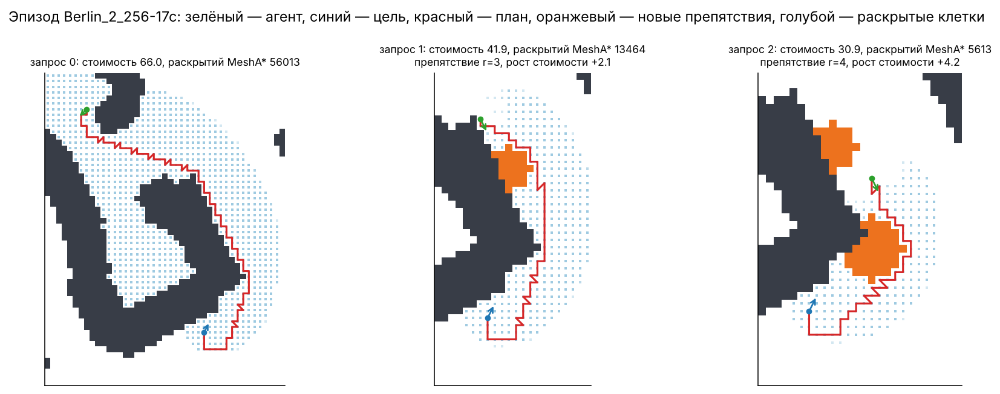
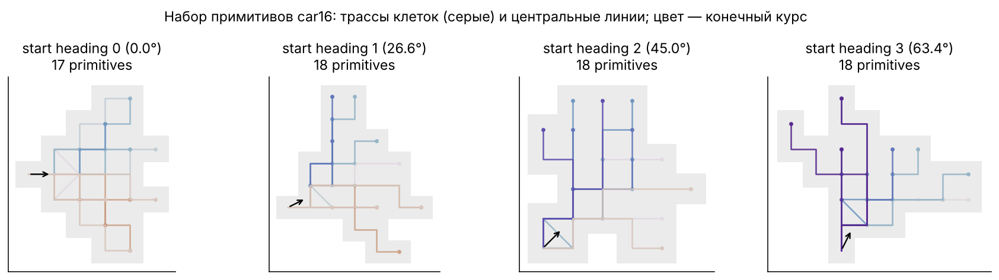
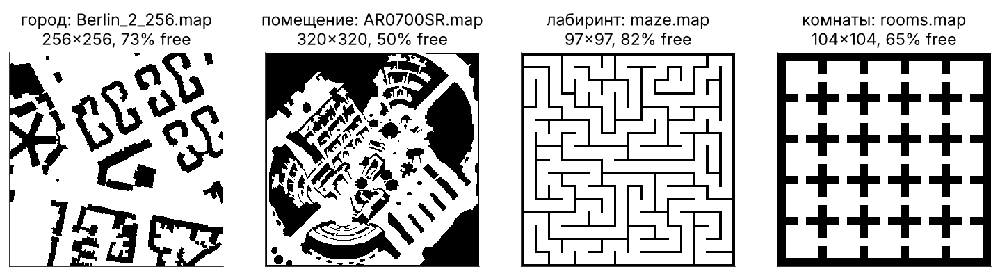
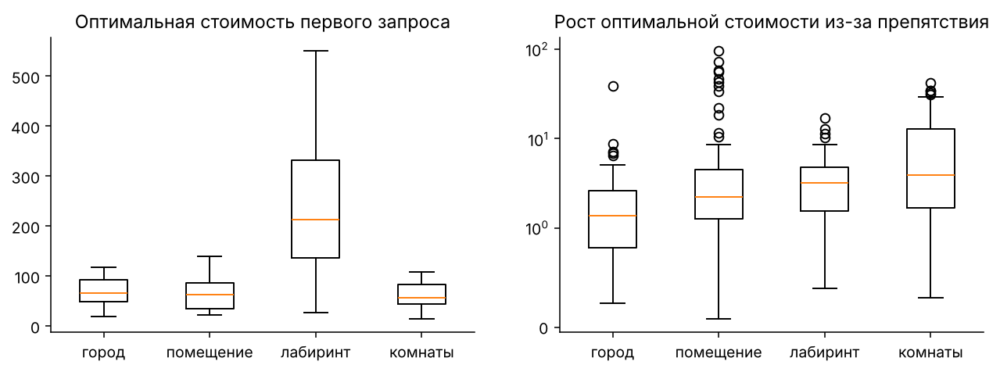
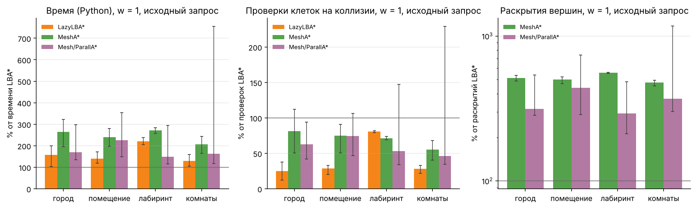
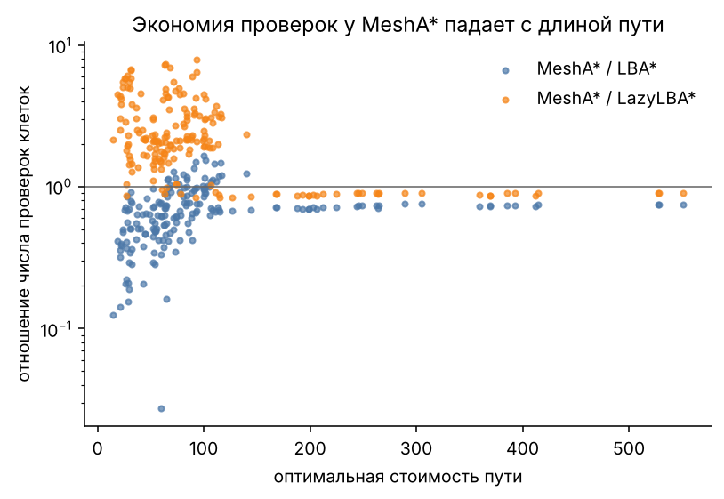
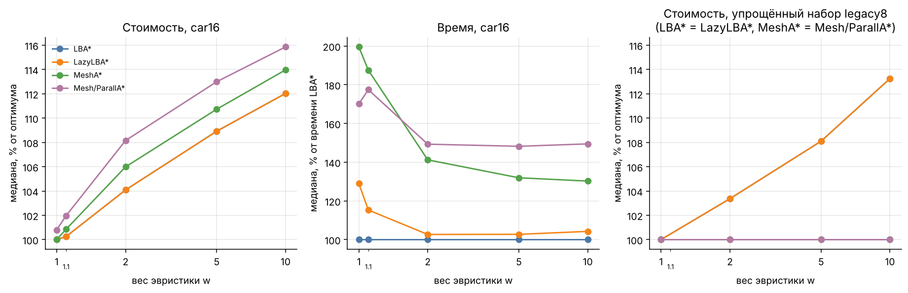
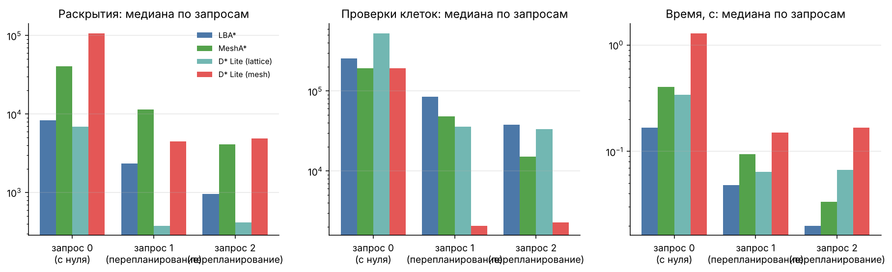
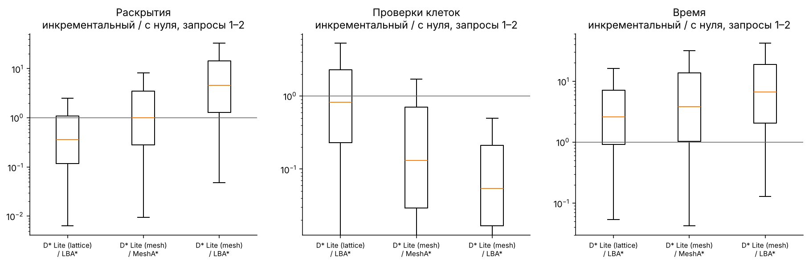
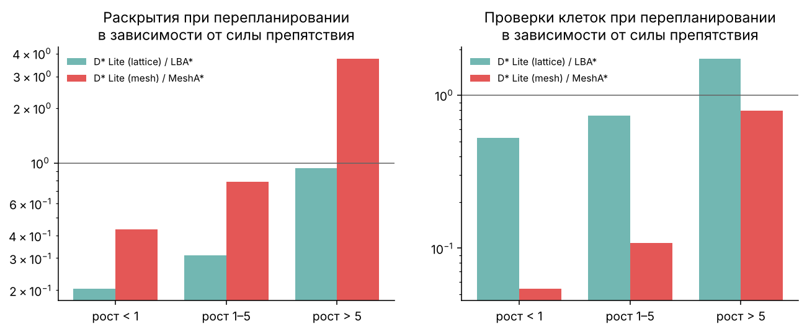

# Инкрементальный MeshA*

Планирование пути для машиноподобного агента на клеточной карте с помощью примитивов движения. Проект
основан на статье Agranovskiy & Yakovlev, *MeshA\*: Efficient Path Planning With Motion Primitives*
([arXiv:2412.10320](https://arxiv.org/html/2412.10320v2)) и расширяет её постановку на **перепланирование**:
по ходу движения агента на карте появляются новые препятствия.

## Дополнение: MD-A\*

**Stamp, Batch и Witness:** [три новых C++17-варианта mesh-MPGAA\*](cpp/mpgaa_lazy/README.md)
с ленивыми версиями карты, выбором направления ремонта и компактным сечением препятствий.
Ветка: `research/mpgaa-mesh-lazy`.
[Отчет по картам и абляции](docs/mpgaa_lazy/report.md) · [PDF](docs/mpgaa_lazy/report.pdf) ·
[Выполненный notebook](docs/mpgaa_lazy/analysis.ipynb).

**Четыре варианта MPGAA\* с mesh:** [Boundary, Selective, Delta и Policy на C++17](cpp/mpgaa_mesh/README.md),
независимые проверки, абляции и новая совместная серия с сильными контролями.
Ветка: `research/mpgaa-mesh-four`.
[Отчёт](docs/mpgaa_mesh/report.md) · [PDF](docs/mpgaa_mesh/report.pdf).
Прежние реализации и результаты сохраняются отдельно.

**Движение к фиксированной цели, n = k:** все 15 C++ методов проверены на раскрытии
неизвестной карты с радиусами 8/16/32/64 и динамике с полным перебором 6×6 k/cr
на десяти grid8-картах. Равные обмены ограничиваются доступными пулами;
фактический cr сохранён. Отдельный контроль добавляет Octile A* и Octile A* reuse.
[Новая глава](docs/experiments/navigation.md) · [PDF](docs/experiments/navigation.pdf) ·
[Атлас новых и прежних результатов по картам](docs/experiments/navigation_by_map.pdf) ·
[Протокол, C++ и данные](cpp/navigation_sweeps/README.md).

**C-Mesh-D\* Lite, Suffix-Mesh и Boundary-Mesh:** добавлены [C++-реализации](cpp/mesh_variants/README.md)
с исходными float-стоимостями и общий запуск 15 методов на прежних замороженных входах.
[Дополнение к отчёту](docs/experiments/mesh_variants.md) · [PDF](docs/experiments/mesh_variants.pdf).
Результаты новой совместной серии находятся отдельно в `cpp/mesh_variants/results/full`.

**Расширенные эксперименты C++:** все 11 методов на вставках на/вне пути, смешанных
правках, неизвестных картах и адаптации динамических постановок D\* Lite / MPGAA\*.
Измеряются время, работа поиска, память, хвосты задержек и качество навигации.
[Отчёт](docs/experiments/report.md) · [PDF](docs/experiments/report.pdf) ·
[Протокол](docs/experiments/protocol.md) · [Код, данные и воспроизведение](cpp/experiments/README.md).

В сохранённой серии из 11 методов MD-A\* ускоряет ремонт вне пути относительно MPGAA\*
в 23.5 раза, но обычный A\* с сохранением пути быстрее MD. На смешанных правках
выигрыш полного эпизода над MPGAA\* около 9% условен на 11/12 завершённых парах:
один эпизод MD исчерпал бюджет. Универсальное преимущество нового метода не подтверждено.

**C++17:** добавлены [самостоятельные реализации десяти методов и общий запускатель замеров](cpp/README.md).
Сборка: `make -C cpp -j2`; измерение с метаданными: `python cpp/run.py --output cpp/results/new_run.csv`.

В отдельной ветке добавлен нативный Python **MD-A\***: сертификат из mesh,
рабочий граф с отложенными освобождениями и переносимая очередь при движении старта.
Реализация использует те же `car16`, карты и float-стоимости. Шесть основных
алгоритмов сравниваются заново при `w=1` вместе с MD-A\*; старые C++-времена
в сравнение не входят.

[Статья и оценка качества](docs/md_astar/report.md) · [PDF](docs/md_astar/report.pdf) ·
[Код и воспроизведение](docs/md_astar/README.md) · [Ноутбук](md_astar.ipynb).
Исходные результаты ниже сохранены и относятся к прежнему эксперименту.

## Содержание

1. [Задача](#1-задача)
2. [Алгоритмы](#2-алгоритмы)
3. [Реализация](#3-реализация)
4. [Постановка экспериментов](#4-постановка-экспериментов)
5. [Результаты](#5-результаты)
6. [Выводы](#6-выводы)
7. [Ограничения](#7-ограничения)
8. [Структура проекта и воспроизведение](#8-структура-проекта-и-воспроизведение)

---

## 1. Задача

**Исходная задача (статья).** Состояние агента состоит из клетки сетки и одного из дискретных курсов.
Агент может двигаться только по заранее заданным **примитивам движения**: коротким гладким траекториям из
одного состояния решётки в другое, которые учитывают минимальный радиус поворота. Каждый примитив задаёт
**трассу коллизий** (клетки, которые он заметает) и стоимость (длину кривой). Нужно найти путь минимальной
стоимости из начального состояния (клетка + курс) в целевое, при котором ни одна клетка трассы не занята.

Классический подход, **LBA\*** (lattice-based A\*), ищет A\* по графу решётки: рёбра этого графа и есть
примитивы. Основная цена здесь — проверки коллизий: для каждого рёбра проверяются все клетки его трассы, хотя
у многих примитивов одного курса первые клетки трассы совпадают. **MeshA\*** ищет по *расширенным клеткам*:
клетка плюс «пучок» примитивов, которые через неё ещё проходят. Общий префикс трасс проверяется один раз, а
пучок делится только там, где трассы расходятся. Оптимальный путь при этом сохраняется.

**Задача этого проекта (инкрементальная).** Агент едет по найденному плану. На плане появляется новое
препятствие. Агент замечает его за несколько клеток, останавливается в последнем безопасном состоянии плана и
перепланирует путь к той же цели. Затем препятствие появляется и на новом плане. Вопрос исследования: можно ли
переиспользовать работу предыдущего поиска, в частности на mesh-графе MeshA\*, и что это даёт по раскрытиям,
проверкам коллизий и времени.

<p align="center"></p>

*Рис. 1. Эпизод из бенчмарка (Berlin). Слева первый запрос, затем два перепланирования после появления
препятствий (оранжевые). Голубые точки — клетки, которые раскрыл MeshA\*.*

## 2. Алгоритмы

| Алгоритм | Тип | Что делает |
|---|---|---|
| **LBA\*** | с нуля | A\* по решётке; примитив проверяется до того, как преемник попадает в OPEN |
| **LazyLBA\*** | с нуля | Преемник сначала кладётся в OPEN, трасса проверяется при извлечении |
| **MeshA\*** | с нуля | A\* по mesh-графу расширенных клеток; промежуточные шаги стоят 0, длина примитива учитывается при его завершении; пучок пропускается, если все его свободные концы уже раскрыты |
| **Mesh/ParallA\*** | с нуля | Mesh/PruningA\* («мягкие дубликаты»: одинаковые клетки, достижимые за ≤2 шага) чередуется с LBA\*: один шаг LBA\* на 100 шагов, как в статье. Полный, но не оптимальный |
| **D\* Lite (lattice)** | инкрементальный | D\* Lite (Koenig & Likhachev 2002) по решётке. Ищет от цели, поэтому движение агента меняет только эвристику; после правки карты чинится лишь затронутая часть дерева поиска |
| **D\* Lite (mesh)** | инкрементальный | **Инкрементальный MeshA\***: тот же D\* Lite, но по mesh-графу (нужна таблица предшественников mesh-графа) |

Эвристика во всех алгоритмах — евклидово расстояние, допускается вес `w`. Для расширенной клетки MeshA\*
использует, как в статье, `h(u) = min по концам пучка (стоимость примитива + h(конец))`. Для D\* Lite на
mesh-графе эвристика равна расстоянию от агента до клетки, где начался текущий примитив пучка. Это нижняя
оценка, и она удовлетворяет неравенству треугольника, что и требуется D\* Lite.

## 3. Реализация

| Компонент | Как устроен |
|---|---|
| Инкрементальный планировщик | `mesha/incremental.py`: D\* Lite на решётке и на mesh-графе. Каждое перепланирование сверяется с оптимумом, посчитанным с нуля |
| Набор примитивов | `car16`: 16 курсов, радиус поворота 2 клетки. Примитивы — кубические кривые Эрмита с ограничением кривизны, до 24 на курс. 68 избыточных примитивов (воспроизводимых другими) удаляются автоматически, остаётся 284. В `selfcheck` есть тест, который падает при появлении избыточного примитива |
| Трассы коллизий | Supercover кривой: при пересечении угла клетки помечаются обе соседние клетки, поэтому диагональные шаги не срезают углы препятствий |
| Препятствия | Диск радиуса 2–4 на плане; агент останавливается за 4 клетки до него. Каждая правка повышает оптимальную стоимость (медиана +2.3) |
| Счётчики | Стартовая клетка примитива не считается; MeshA\* считает различные клетки за одно раскрытие плюс чтения своего правила отсечения |
| Бенчмарк | Длины стратифицированы (до 120 на картах MovingAI, до 90 на сгенерированных), по 3 случайных пары курсов на пару клеток, как в статье. Отбрасываются только запросы, у которых решения нет в принципе; все отказы записываются в лог |
| Замер времени | 3 повтора в случайном порядке, берётся медиана. Счётчики обязаны совпадать между повторами, иначе прогон останавливается |
| Базовые линии | Mesh/ParallA\* и веса `w` = 1, 1.1, 2, 5, 10 на всех запросах, как в статье |

При тестировании D\* Lite нашлись две тонкости, обе учтены в реализации. Во-первых, на mesh-графе есть рёбра нулевой
стоимости, поэтому условие остановки должно обрабатывать равные ключи (`≤`). Во-вторых, ключи, равные с
точностью до последнего бита float, могут раньше времени завершить поиск, поэтому сравнение ключей идёт с допуском.

<p align="center"></p>

*Рис. 2. Набор примитивов car16 для четырёх стартовых курсов; остальные курсы получаются поворотом на 90°.
Серым показаны клетки трасс. Видно, что у многих примитивов общий префикс, и именно его MeshA\* проверяет
один раз.*

## 4. Постановка экспериментов

**Карты.** Две карты MovingAI со сценариями (Berlin_2_256 — город, AR0700SR — помещение) и две
сгенерированные (лабиринт с широкими коридорами, комнаты с дверями).

<p align="center"></p>

**Экземпляр** — это пара старт/цель, курсы и три запроса: исходный и два перепланирования после препятствий.

| Карта | Пар клеток | Пар курсов | Нет решения | Правка не удалась | Экземпляров |
|---|---:|---:|---:|---:|---:|
| Berlin_2_256 | 22 | 66 | 11 | 3 | 52 |
| AR0700SR | 21 | 63 | 15 | 0 | 48 |
| maze | 23 | 69 | 30 | 0 | 39 |
| rooms | 22 | 66 | 18 | 0 | 48 |
| **Всего** | | 264 | 74 | 3 | **187 (561 запрос)** |

<p align="center"></p>

*Рис. 3. Слева — оптимальная стоимость первого запроса, справа — насколько препятствие увеличило оптимальную
стоимость (374 правки, ни одна не нулевая, 83 больше 5).*

**Метрики:** раскрытия вершин, проверки клеток на коллизии (одна проверка — чтение одной клетки сетки, как в
статье), стоимость пути и время (медиана из 3 прогонов). Сравнения делаются попарно на одном и том же запросе,
затем берётся медиана отношений.

**Окружение:** Python 3.13, NumPy 2.5.3, Intel Xeon 2.1 GHz, 3 процесса на 4 ядрах, 83 минуты на полный
прогон. Окружение записано в `results/runs.json`.

## 5. Результаты

### 5.1. Корректность

* LBA\*, LazyLBA\* и MeshA\* при `w = 1` дают одинаковую оптимальную стоимость на всех 561 запросах.
* Все **1122** перепланирования (2 инкрементальных алгоритма × 561 запрос) совпали с оптимумом, посчитанным
  с нуля.
* Ни один прогон не упёрся в лимит раскрытий. Взвешенные LBA\*, LazyLBA\* и MeshA\* не выходят за границу
  `w × оптимум`. У Mesh/ParallA\* такой гарантии нет из-за отсечения мягких дубликатов: он нарушает её в
  148 из 2244 взвешенных прогонов, в основном при `w = 1.1`.

### 5.2. Планирование с нуля (постановка статьи, `w = 1`, первый запрос)

<p align="center"></p>

*Рис. 4. Отношения к LBA\* на том же запросе. Столбик — медиана, усы — межквартильный размах.*

| Алгоритм | Время к LBA\* | Проверки к LBA\* | Проверки к LazyLBA\* | Стоимость |
|---|---:|---:|---:|---|
| LBA\* | 100% | 100% | 325% | оптимум |
| LazyLBA\* | 156% | 31% | 100% | оптимум |
| MeshA\* | 246% | 70% | 210% | оптимум |
| Mesh/ParallA\* | 170% | 63% | 201% | 100.8% (медиана) |

* **Проверки коллизий.** MeshA\* читает 70% клеток от нашего LBA\* (город 81%, помещение 75%, лабиринт 71%,
  комнаты 55%). Наш LBA\* проверяет примитив, только если преемник не закрыт и улучшает g. Если сравнивать с
  «учебным» LBA\*, который сначала проверяет все примитивы раскрываемого состояния, у MeshA\* остаётся около
  **28%** проверок, что ближе к выводам статьи. LazyLBA\* читает ещё меньше клеток, чем MeshA\*, хотя в статье
  (рис. 5) наоборот.
* **Время (Python).** MeshA\* в 2.5 раза медленнее LBA\* и раскрывает примерно в 5 раз больше вершин: каждая
  клетка примитива — отдельная запись в очереди. Ускорение из статьи (60–80% времени LBA\*) **не
  воспроизводится**: в Python накладные расходы на вершину больше, чем экономия на дешёвых чтениях клеток.
* **Mesh/ParallA\*** быстрее MeshA\* (170% против 246% времени LBA\*) при медианной стоимости 100.8% от
  оптимума (в статье 100.3–100.7%). **LazyLBA\*** медленнее LBA\*. Оба вывода совпадают со статьёй.

<p align="center"></p>

*Рис. 5. Экономия проверок у MeshA\* максимальна на коротких путях: медиана 42% от LBA\* при стоимости
меньше 40 и 87% при стоимости больше 80.*

### 5.3. Взвешенный поиск

<p align="center"></p>

| Стоимость, % от оптимума | w = 1.1 | w = 2 | w = 5 | w = 10 |
|---|---:|---:|---:|---:|
| LBA\* | 100.3 | 104.1 | 108.9 | 112.0 |
| MeshA\* | 100.9 | 106.0 | 110.7 | 114.0 |
| Mesh/ParallA\* | 102.0 | 108.2 | 113.0 | 115.9 |
| MeshA\*, упрощённый набор legacy8 | — | 100.0 | 100.0 | 100.0 |

С набором car16 взвешенный MeshA\* **хуже по стоимости, чем LBA\***. Это то же направление, что в таблице 1
статьи. Абляция (правый график) показывает, что результат зависит от набора примитивов: на упрощённом
8-курсовом наборе legacy8, где все длинные примитивы раскладываются в цепочки 1-шаговых, MeshA\* остаётся на
100% при любом весе. По времени при `w ≥ 2` разрыв между MeshA\*
и LBA\* сокращается до 1.3–1.4 раза.

### 5.4. Инкрементальное перепланирование

<p align="center"></p>

*Рис. 6. Медианы по запросам. Запрос 0 все алгоритмы решают с нуля. На запросах 1–2 алгоритмы D\* Lite
используют сохранённое дерево поиска.*

<p align="center"></p>

| Перепланирование (запросы 1–2) | Раскрытия | Проверки клеток | Время |
|---|---:|---:|---:|
| D\* Lite (lattice) / LBA\* с нуля | 0.36× | 0.82× | 2.6× |
| D\* Lite (mesh) / MeshA\* с нуля | 0.99× | **0.13×** | 3.9× |
| D\* Lite (mesh) / LBA\* с нуля | 4.6× | **0.055×** | 6.7× |

* **Инкрементальный MeshA\*** при перепланировании читает в 7–8 раз меньше клеток, чем MeshA\* с нуля, и
  примерно в 18 раз меньше, чем LBA\*. Это самый сильный результат работы.
* **D\* Lite на решётке** раскрывает почти втрое меньше состояний, чем LBA\* с нуля.
* **По времени** в Python оба инкрементальных алгоритма медленнее своих аналогов, работающих с нуля. Это
  верно и для суммы по целому эпизоду: 2.4× для решётки и 4.3× для mesh.

<p align="center"></p>

*Рис. 7. Чем сильнее препятствие меняет оптимальный путь, тем меньше выигрыш. При росте стоимости больше 5
D\* Lite на mesh-графе раскрывает в 3.8 раза больше вершин, чем MeshA\* с нуля. Агент к этому моменту уже
проехал несколько примитивов, и большую часть обратного дерева поиска приходится чинить.*

## 6. Выводы

1. **Инкрементальный MeshA\* (D\* Lite на mesh-графе) корректен** и сокращает проверки коллизий при
   перепланировании на порядок. Именно эти затраты MeshA\* призван экономить, и именно они доминируют, когда
   проверка коллизии дорогая: реальный контур робота, запрос к карте, 3D.
2. **Ускорение MeshA\* по времени из статьи в Python не воспроизводится.** Накладные расходы на вершину в
   интерпретаторе больше, чем экономия на дешёвых чтениях клеток. Чтобы сравнивать время, нужна компилируемая
   реализация. Сравнение по числу проверок от языка не зависит.
3. **Взвешенный MeshA\* менее оптимален, чем LBA\***, как и в статье. На вырожденном наборе примитивов
   (legacy8) этот эффект пропадает.
4. **Выигрыш инкрементальности зависит от силы изменения.** Небольшие препятствия чинятся дёшево, а сильные
   изменения при далеко продвинувшемся агенте почти обнуляют выгоду.
5. **Насколько MeshA\* экономит проверки, сильно зависит от того, как реализован базовый LBA\*:** 28% от
   «учебного» LBA\*, но 70% от LBA\*, который проверяет только улучшающие рёбра.

## 7. Ограничения

* **Карты не те, что в статье.** В статье используются Labyrinth, ht_0_hightown, Moscow_0_512 и одна
  неназванная карта, но movingai.com был недоступен с машины, где шёл прогон. Чтобы добавить эти карты,
  положите их вместе с `.scen` в `data/maps/` и допишите в `MAP_SPECS` (`mesha/benchmark.py`).
* **Примитивы — кривые Эрмита с ограничением кривизны**, а не результат оптимизации методом Ньютона, как в
  статье. По размеру и форме набор похож, но не идентичен.
* **561 запрос** против более чем 25 000 в статье: прогон на Python занимает около 1.5 часа.
* Время измерено в Python с тремя параллельными процессами на 4 ядрах. Для сравнения алгоритмов лучше
  опираться на счётчики.

## 8. Структура проекта и воспроизведение

| Путь | Содержимое |
|---|---|
| `mesha/primitives.py` | Наборы примитивов: `car16` (основной) и `legacy8` (упрощённый, только для абляции) |
| `mesha/mesh.py` | Построение mesh-графа: конфигурации, таблицы преемников и предшественников, сигнатуры |
| `mesha/search.py` | LBA\*, LazyLBA\*, MeshA\*, Mesh/PruningA\*, Mesh/ParallA\* |
| `mesha/incremental.py` | D\* Lite на решётке и на mesh-графе |
| `mesha/benchmark.py` | Генерация бенчмарка и запуск экспериментов |
| `mesha/selfcheck.py` | Проверки корректности (набор примитивов, оптимальность, инкрементальность) |
| `mesha/viz.py` | Функции отрисовки |
| `incremental_mesha.ipynb` | Ноутбук с полным анализом (выполнен) |
| `tools_make_notebook.py`, `conclusions.md` | Сборка ноутбука |
| `tools_make_figures.py` | Рисунки для этого README (`docs/figures/`) |
| `data/benchmarks/incremental_mesha.json` | Бенчмарк (экземпляры, лог отбора) |
| `results/runs.json` | Результаты с описанием окружения |
| `results/legacy8_ablation.json` | Абляция с набором `legacy8` |

```bash
pip install -r requirements.txt
python -m mesha.selfcheck                      # проверки корректности, ~1 мин
python -m mesha.benchmark --prepare            # бенчмарк (детерминированный, ~20 мин)
python -m mesha.benchmark --run --workers 3    # все алгоритмы, 3 повтора (~1.5 ч)
python -m mesha.benchmark --legacy             # абляция с набором legacy8
python tools_make_figures.py                   # рисунки для README
python tools_make_notebook.py conclusions.md   # пересобрать ноутбук
jupyter nbconvert --to notebook --execute --inplace incremental_mesha.ipynb
```

Счётчики (раскрытия, проверки, стоимости) детерминированы. Время зависит от машины.
