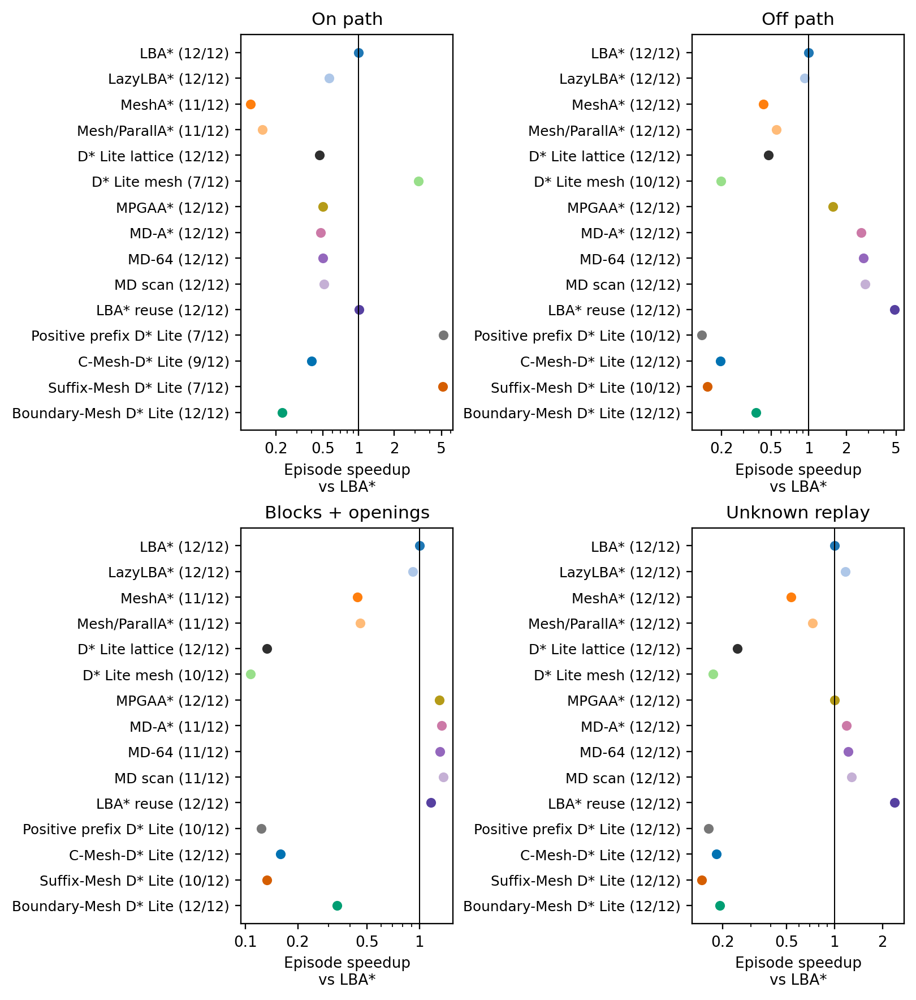
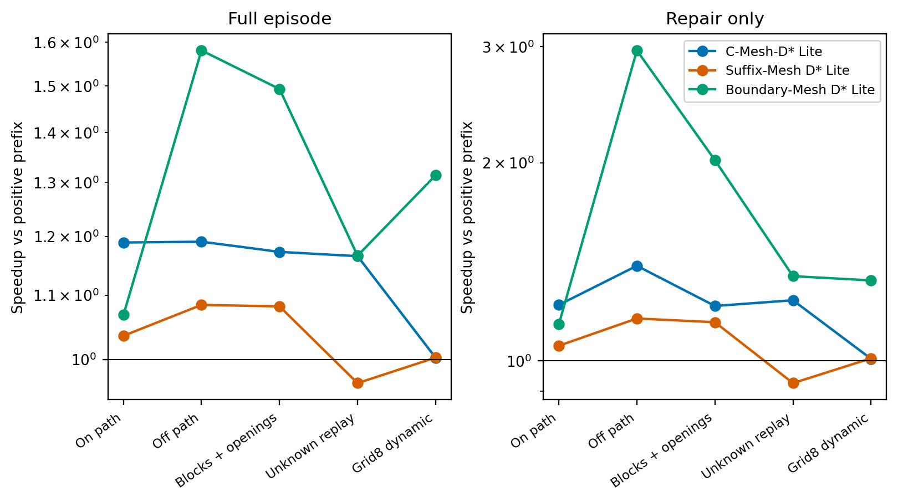
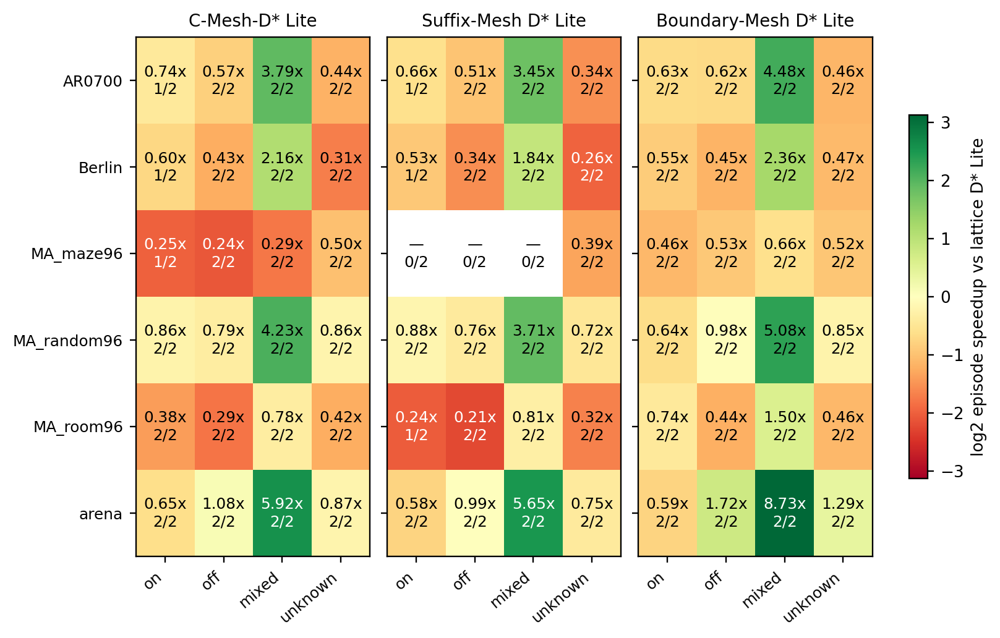
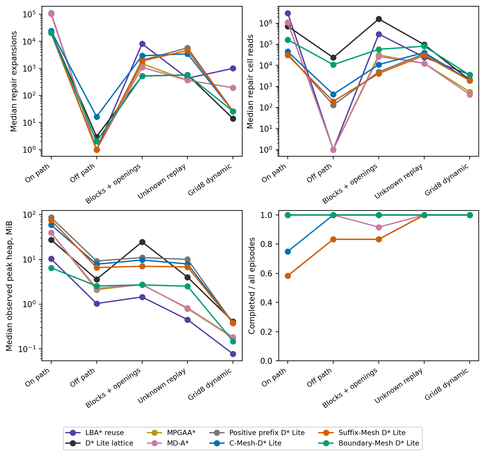
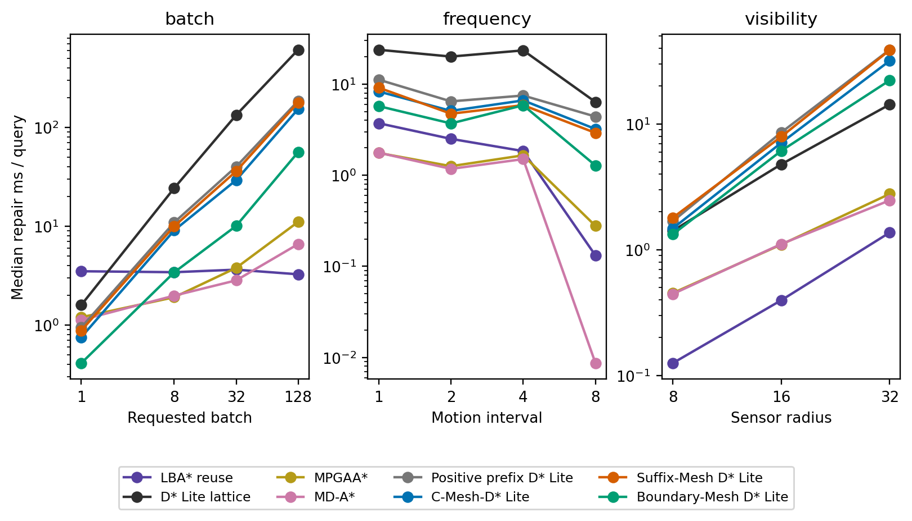
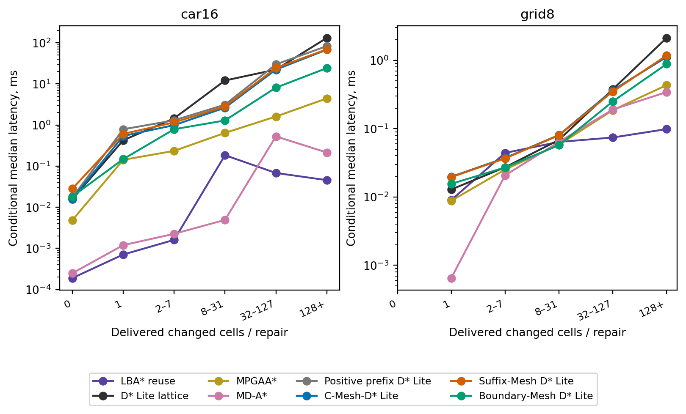
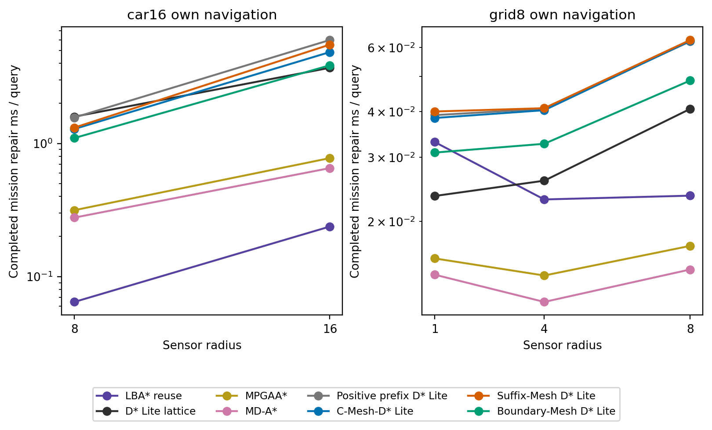
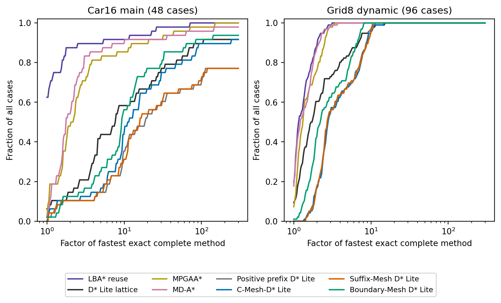

# Дополнение: C-Mesh-D* Lite, Suffix-Mesh и Boundary-Mesh

Добавлены три ранее предложенных алгоритма и контроль `prefix_positive`. Все прежние 11 методов повторно запущены вместе с ними: **15 методов, 10 170 измеряемых запусков, 224 208 строк, 207 501 вызовов планировщика**. Отдельный проход памяти содержит 2 790 запусков и 44 355 строк. Здесь и далее в этой главе используются только результаты новой совместной серии `cpp/mesh_variants/results/full`; ускорения не вычисляются из времён предыдущей серии.

Входы побайтно совпадают с прежними: 186 replay-эпизодов и 40 параметризованных миссий, три временных повтора, один отдельный проход памяти. Два корня на карту и повторное использование корней при разных параметрах ограничивают независимость выборки. Для всех точных завершённых запросов стоимость сверена с эталоном на той же карте знаний; расхождений **0**. Бюджеты, правила движения и определения метрик сохранены.

Mesh здесь — граф расширенных клеток, который разделяет collision traces примитивов движения в модели MeshA* (Agranovskiy, Yakovlev). Все новые представления используют тот же физический набор car16: 284 примитива и 16 направлений; вспомогательная grid8 содержит восемь одношаговых движений.

Главный положительный результат — основная car16-серия смешанных правок. Относительно D* Lite lattice ускорение C-Mesh полного эпизода составляет 2.67× (12/12), ремонта — 4.81× (12/12); Boundary-Mesh — 2.82× (12/12) и 8.00× (12/12) соответственно. Ускорение означает время контроля, делённое на время кандидата; число завершённых пар указано в скобках.

Этот выигрыш не переносится автоматически на более сильные контроли. В той же группе отношение полных времён MD/C-Mesh равно 0.15× (11/12), MD/Boundary — 0.24× (11/12); reuse/C-Mesh — 0.13× (12/12), reuse/Boundary — 0.27× (12/12). Значения меньше 1 выгодны контролю. Вставки без освобождений и раскрытие карты дают другое ранжирование; далее приведены все режимы, завершение, память и качество проезда.

При общем лимите миллиона раскрытий C-Mesh завершил 85/90 car16 replay-эпизодов, Suffix-Mesh — 79/90, Boundary-Mesh — 90/90; исходный D* Lite mesh и положительный префиксный контроль — 79/90 и 79/90. Число раскрытий зависит от представления; это преимущество по завершению именно в заданном бюджете, совместно с которым рассматривается время.

В основной mixed-серии медианное парное отношение пиков requested heap lattice/C-Mesh равно 2.76× (12/12), lattice/Boundary-Mesh — 9.36× (12/12). Общая модель и подготовка исключены из этих пиков и показаны отдельно; это не RSS процесса.

## Точные определения алгоритмов

**C-Mesh-D\* Lite** сжимает префиксный mesh: сохраняются все начальные конфигурации примитивов и узлы, у которых входящая или исходящая степень не равна единице. Цепочка между ними заменяется одной дугой. Её стоимость — сумма весов цепочки, а collision trace содержит **все** внутренние клетки. D\* Lite хранит метки только на оставшихся расширенных состояниях. Это сокращает операции с очередью и таблицей меток, но одна коллизионная проверка макродуги становится длиннее.

**Suffix-Mesh D\* Lite** строится в три шага: развернуть каждый физический примитив; построить префиксный mesh развёрнутого набора; развернуть его дуги и их traces обратно. Полученный граф по-прежнему представляет **прямые исходные** примитивы, но поиск D\* Lite от цели получает общие суффиксы. Метка завершённого примитива расположена на первой прямой дуге, после которой граф обязывает пройти оставшуюся часть примитива. Это не кеш суффикса пути `lba_reuse` и не разрешение движения задним ходом.

**Boundary-Mesh D\* Lite** хранит метки только на `(клетка, heading)` решётки. Для каждой такой исходной позы кешируется маска допустимых полных примитивов. При первом обращении после инвалидации один обход префиксного mesh вычисляет всю маску, проверяя общие начала трасс совместно. Изменение любой клетки поддержки инвалидирует соответствующую маску целиком. Возможен выигрыш в числе проверок клеток, но повторный пересчёт всей маски бывает дороже точечного кеша отдельного примитива у D\* Lite lattice.

**Контроль Positive prefix D\* Lite** использует исходный префиксный mesh, положительные веса и то же новое ядро. Он отделяет изменение представления C-Mesh/Suffix-Mesh от различий нового ядра с прежним D\* Lite mesh. У всех четырёх адаптеров одинаковы очередь, остановка, политика геометрических предшественников и индекс уведомлений.

## Сохранение стоимости и корректность ремонта

Пусть $c_0$ — вес исходной mesh-дуги: ноль на внутреннем переходе и полная стоимость на завершении примитива. В префиксном mesh задаётся потенциал $\rho(q)=\delta\,depth(q)$ для регулярного узла и ноль для начальной конфигурации. Используется

$$c_\rho(u,v)=c_0(u,v)+\rho(v)-\rho(u).$$

$\delta$ выбирается степенью двойки, не большей $c_{min}/[4(d_{max}+1)]$. Внутренние веса положительны, завершающие остаются положительными, а потенциалы полного примитива телескопически сокращаются. Примитивы сохраняют исходные float-стоимости и supercover traces: округления в микростоимости прежнего прототипа нет. В суффиксном графе положительные веса наследуются при развороте, потенциал меняет знак.

Для prefix/C-Mesh обратная эвристика равна евклидову расстоянию от текущего старта до восстановленного начала примитива плюс $\rho$. Для регулярного суффиксного узла берётся минимум «стоимость возможного исходного примитива + расстояние от его исходной позы до текущего старта» минус потенциал развёрнутого префикса. На начальных конфигурациях используется обычное евклидово расстояние. Согласованность следует из неравенства треугольника и ограничения длиной примитива; проверка каждой шаблонной дуги дополнительно включена в артефакт.

Каждый полный переход между начальными конфигурациями соответствует физическому примитиву с исходной ценой и trace. Сжатие удаляет только узлы без выбора, разворот сохраняет язык допустимых последовательностей, а граничная маска точно воспроизводит коллизионную допустимость полных примитивов. Поэтому поиск на этих графах решает исходную задачу при тех же предположениях D\* Lite.

Индекс инвалидации содержит начало, конец и **внутренние** клетки дуг, в том числе запрещённых. Геометрические предшественники регистрируются и через бесконечные дуги: иначе освобождение прохода могло бы не обнаружить ранее недостижимый компонент. Ограничение миллиона раскрытий одинаково по числу, но раскрытие решётки, обычного mesh и макродуги имеет разную цену. Поэтому сокращение раскрытий само по себе не считается ускорением.

## Размеры графов и стоимость подготовки

| Модель | Представление | Конфигурации | Дуги | Группы поддержки |
| --- | --- | --- | --- | --- |
| car16 | positive_prefix | 412 | 680 | 968 |
| car16 | cmesh | 188 | 456 | 728 |
| car16 | suffix_mesh | 428 | 696 | 860 |
| car16 | boundary_mesh | 16 | 284 | 424 |
| grid8 | positive_prefix | 1 | 8 | 9 |
| grid8 | cmesh | 1 | 8 | 9 |
| grid8 | suffix_mesh | 1 | 8 | 9 |
| grid8 | boundary_mesh | 1 | 8 | 9 |

| Модель | Медиана подготовки 4 шаблонов, мс | Общий retained, KiB | Общий peak, KiB |
| --- | --- | --- | --- |
| car16 | 2.054 | 753.5 | 832.9 |
| grid8 | 0.033 | 7.4 | 8.3 |

Общая подготовка выполняется до таймеров планировщиков, отдельно от конструктора каждого экземпляра. В таблице показаны сразу четыре шаблона, их индексы и служебные данные проверки проекций, а не минимальная память одного производственного адаптера. Медиана времени получена по запускам заданий, не по специальному микробенчмарку. В requested heap алгоритма общая подготовка исключена и потому приведена явно.

В car16 C-Mesh содержит 188 вместо 412 конфигураций и 456 вместо 680 дуг. Суффиксный граф содержит 428 конфигураций и 696 дуг, то есть он не меньше префиксного. В grid8 все примитивы одношаговые: prefix, C-Mesh и Suffix-Mesh имеют одинаковый граф из одной конфигурации и восьми дуг. Результаты grid8 характеризуют ремонт и накладные расходы; они не доказывают пользу сжатия или разделения суффиксов.

## Совместное сравнение всех 15 методов

Все ускорения ниже — время бейзлайна, делённое на время кандидата. Сначала берётся медиана трёх сумм по повторам, затем медиана парных отношений по эпизодам. Полный эпизод включает конструктор, первый поиск и ремонт. Время ремонта исключает первый запрос. Числа в скобках — завершённые обоими методы пары из всех задач группы; быстрый отказ не считается решением.

Mesh/ParallA* — приближённый контроль; остальные 14 методов проверяются как точные. Поисковая стоимость относится к текущей карте знаний; в миссиях отдельно оценивается фактический проезд по истинной карте.

| Метод | На пути | Вне пути | Mixed | Unknown | Grid8 |
| --- | --- | --- | --- | --- | --- |
| LBA\* | 356.102 [12/12] | 7.661 [12/12] | 21.972 [12/12] | 4.919 [12/12] | 1.164 [96/96] |
| LazyLBA\* | 691.682 [12/12] | 8.962 [12/12] | 23.244 [12/12] | 4.648 [12/12] | 1.311 [96/96] |
| MeshA\* | 3 055.234 [11/12] | 17.751 [12/12] | 19.170 [11/12] | 8.733 [12/12] | 1.593 [96/96] |
| Mesh/ParallA\* | 2 408.179 [11/12] | 13.316 [12/12] | 13.632 [11/12] | 5.328 [12/12] | 1.483 [96/96] |
| D\* Lite lattice | 304.393 [12/12] | 20.023 [12/12] | 173.531 [12/12] | 17.136 [12/12] | 1.701 [96/96] |
| D\* Lite mesh | 110.722 [7/12] | 27.350 [10/12] | 68.175 [10/12] | 36.209 [12/12] | 1.723 [96/96] |
| MPGAA\* | 981.007 [12/12] | 5.704 [12/12] | 10.875 [12/12] | 5.326 [12/12] | 1.202 [96/96] |
| MD-A\* | 941.942 [12/12] | 5.948 [12/12] | 8.551 [11/12] | 5.293 [12/12] | 1.022 [96/96] |
| MD-64 | 921.665 [12/12] | 5.500 [12/12] | 8.051 [11/12] | 5.227 [12/12] | 1.001 [96/96] |
| MD scan | 945.090 [12/12] | 5.387 [12/12] | 8.286 [11/12] | 5.137 [12/12] | 1.048 [96/96] |
| LBA\* reuse | 347.356 [12/12] | 3.393 [12/12] | 18.191 [12/12] | 2.291 [12/12] | 1.052 [96/96] |
| Positive prefix D\* Lite | 83.566 [7/12] | 33.539 [10/12] | 60.879 [10/12] | 41.744 [12/12] | 2.879 [96/96] |
| C-Mesh-D\* Lite | 87.013 [9/12] | 42.486 [12/12] | 62.240 [12/12] | 36.613 [12/12] | 2.947 [96/96] |
| Suffix-Mesh D\* Lite | 78.450 [7/12] | 31.035 [10/12] | 53.205 [10/12] | 45.671 [12/12] | 2.747 [96/96] |
| Boundary-Mesh D\* Lite | 530.809 [12/12] | 43.652 [12/12] | 54.440 [12/12] | 40.754 [12/12] | 2.141 [96/96] |

Значения в таблице — медианные **миллисекунды полного эпизода на завершённых задачах**; квадратные скобки показывают завершение. Сравнивать независимые медианы разных завершённых подмножеств как парное ускорение нельзя.

| Режим | Mesh/ParallA*: максимум цена / оптимум текущего запроса |
| --- | --- |
| Car16: вставки на пути | 1.1412 |
| Car16: вставки вне пути | 1.0999 |
| Car16: блокировки и освобождения | 1.1832 |
| Car16: раскрытие карты (replay) | 1.0100 |
| Grid8: локально наблюдаемая динамика | 1.0000 |

Это наблюдаемый максимум приближённого контроля на завершённых запросах, а не теоретическая граница. Остальные методы проверены на оптимальность каждой завершённой поисковой задачи с допуском 1e-6.

{width=100%}

Медианный относительный MAD трёх повторных времён полного эпизода по основным группам лежит в диапазонах: C-Mesh-D\* Lite: 1.0–2.8%; Suffix-Mesh D\* Lite: 0.6–2.3%; Boundary-Mesh D\* Lite: 0.7–2.3%. Это диапазоны групповых медиан, не доверительные интервалы; три повтора описывают шум измерения, а не число независимых карт. Близкие к единице ускорения требуют осторожной интерпретации.

### Новые варианты относительно D\* Lite mesh

| Режим | Алгоритм | Эпизод: ускорение | Ремонт: ускорение |
| --- | --- | --- | --- |
| Car16: вставки на пути | C-Mesh-D\* Lite | 1.65× (7/12) | 1.71× (7/12) |
| Car16: вставки на пути | Suffix-Mesh D\* Lite | 1.59× (7/12) | 1.63× (7/12) |
| Car16: вставки на пути | Boundary-Mesh D\* Lite | 1.27× (7/12) | 1.43× (7/12) |
| Car16: вставки вне пути | C-Mesh-D\* Lite | 0.91× (10/12) | 0.82× (10/12) |
| Car16: вставки вне пути | Suffix-Mesh D\* Lite | 0.83× (10/12) | 0.72× (10/12) |
| Car16: вставки вне пути | Boundary-Mesh D\* Lite | 1.15× (10/12) | 1.69× (10/12) |
| Car16: блокировки и освобождения | C-Mesh-D\* Lite | 1.37× (10/12) | 1.54× (10/12) |
| Car16: блокировки и освобождения | Suffix-Mesh D\* Lite | 1.40× (10/12) | 1.42× (10/12) |
| Car16: блокировки и освобождения | Boundary-Mesh D\* Lite | 1.82× (10/12) | 2.61× (10/12) |
| Car16: раскрытие карты (replay) | C-Mesh-D\* Lite | 1.09× (12/12) | 1.06× (12/12) |
| Car16: раскрытие карты (replay) | Suffix-Mesh D\* Lite | 0.86× (12/12) | 0.85× (12/12) |
| Car16: раскрытие карты (replay) | Boundary-Mesh D\* Lite | 1.07× (12/12) | 1.19× (12/12) |
| Grid8: локально наблюдаемая динамика | C-Mesh-D\* Lite | 0.60× (96/96) | 0.95× (92/96) |
| Grid8: локально наблюдаемая динамика | Suffix-Mesh D\* Lite | 0.59× (96/96) | 0.93× (92/96) |
| Grid8: локально наблюдаемая динамика | Boundary-Mesh D\* Lite | 0.79× (96/96) | 1.26× (92/96) |

### Новые варианты относительно D\* Lite lattice

| Режим | Алгоритм | Эпизод: ускорение | Ремонт: ускорение |
| --- | --- | --- | --- |
| Car16: вставки на пути | C-Mesh-D\* Lite | 0.60× (9/12) | 0.80× (9/12) |
| Car16: вставки на пути | Suffix-Mesh D\* Lite | 0.66× (7/12) | 0.72× (7/12) |
| Car16: вставки на пути | Boundary-Mesh D\* Lite | 0.61× (12/12) | 0.69× (12/12) |
| Car16: вставки вне пути | C-Mesh-D\* Lite | 0.47× (12/12) | 1.01× (12/12) |
| Car16: вставки вне пути | Suffix-Mesh D\* Lite | 0.51× (10/12) | 0.91× (10/12) |
| Car16: вставки вне пути | Boundary-Mesh D\* Lite | 0.53× (12/12) | 2.17× (12/12) |
| Car16: блокировки и освобождения | C-Mesh-D\* Lite | 2.67× (12/12) | 4.81× (12/12) |
| Car16: блокировки и освобождения | Suffix-Mesh D\* Lite | 2.89× (10/12) | 4.99× (10/12) |
| Car16: блокировки и освобождения | Boundary-Mesh D\* Lite | 2.82× (12/12) | 8.00× (12/12) |
| Car16: раскрытие карты (replay) | C-Mesh-D\* Lite | 0.50× (12/12) | 0.80× (12/12) |
| Car16: раскрытие карты (replay) | Suffix-Mesh D\* Lite | 0.39× (12/12) | 0.60× (12/12) |
| Car16: раскрытие карты (replay) | Boundary-Mesh D\* Lite | 0.50× (12/12) | 0.70× (12/12) |
| Grid8: локально наблюдаемая динамика | C-Mesh-D\* Lite | 0.59× (96/96) | 0.90× (92/96) |
| Grid8: локально наблюдаемая динамика | Suffix-Mesh D\* Lite | 0.59× (96/96) | 0.88× (92/96) |
| Grid8: локально наблюдаемая динамика | Boundary-Mesh D\* Lite | 0.78× (96/96) | 1.20× (92/96) |

### Новые варианты относительно MD-A\*

| Режим | Алгоритм | Эпизод: ускорение | Ремонт: ускорение |
| --- | --- | --- | --- |
| Car16: вставки на пути | C-Mesh-D\* Lite | 1.07× (9/12) | 1.79× (9/12) |
| Car16: вставки на пути | Suffix-Mesh D\* Lite | 9.82× (7/12) | 9.95× (7/12) |
| Car16: вставки на пути | Boundary-Mesh D\* Lite | 0.35× (12/12) | 0.37× (12/12) |
| Car16: вставки вне пути | C-Mesh-D\* Lite | 0.08× (12/12) | 0.00× (12/12) |
| Car16: вставки вне пути | Suffix-Mesh D\* Lite | 0.08× (10/12) | 0.00× (10/12) |
| Car16: вставки вне пути | Boundary-Mesh D\* Lite | 0.13× (12/12) | 0.00× (12/12) |
| Car16: блокировки и освобождения | C-Mesh-D\* Lite | 0.15× (11/12) | 0.15× (11/12) |
| Car16: блокировки и освобождения | Suffix-Mesh D\* Lite | 0.14× (9/12) | 0.13× (9/12) |
| Car16: блокировки и освобождения | Boundary-Mesh D\* Lite | 0.24× (11/12) | 0.17× (11/12) |
| Car16: раскрытие карты (replay) | C-Mesh-D\* Lite | 0.15× (12/12) | 0.05× (12/12) |
| Car16: раскрытие карты (replay) | Suffix-Mesh D\* Lite | 0.12× (12/12) | 0.04× (12/12) |
| Car16: раскрытие карты (replay) | Boundary-Mesh D\* Lite | 0.15× (12/12) | 0.08× (12/12) |
| Grid8: локально наблюдаемая динамика | C-Mesh-D\* Lite | 0.39× (96/96) | 0.61× (92/96) |
| Grid8: локально наблюдаемая динамика | Suffix-Mesh D\* Lite | 0.40× (96/96) | 0.61× (92/96) |
| Grid8: локально наблюдаемая динамика | Boundary-Mesh D\* Lite | 0.53× (96/96) | 0.82× (92/96) |

### Новые варианты относительно LBA\* reuse

| Режим | Алгоритм | Эпизод: ускорение | Ремонт: ускорение |
| --- | --- | --- | --- |
| Car16: вставки на пути | C-Mesh-D\* Lite | 0.38× (9/12) | 0.61× (9/12) |
| Car16: вставки на пути | Suffix-Mesh D\* Lite | 5.09× (7/12) | 5.16× (7/12) |
| Car16: вставки на пути | Boundary-Mesh D\* Lite | 0.22× (12/12) | 0.27× (12/12) |
| Car16: вставки вне пути | C-Mesh-D\* Lite | 0.05× (12/12) | 0.00× (12/12) |
| Car16: вставки вне пути | Suffix-Mesh D\* Lite | 0.04× (10/12) | 0.00× (10/12) |
| Car16: вставки вне пути | Boundary-Mesh D\* Lite | 0.07× (12/12) | 0.00× (12/12) |
| Car16: блокировки и освобождения | C-Mesh-D\* Lite | 0.13× (12/12) | 0.25× (12/12) |
| Car16: блокировки и освобождения | Suffix-Mesh D\* Lite | 0.11× (10/12) | 0.13× (10/12) |
| Car16: блокировки и освобождения | Boundary-Mesh D\* Lite | 0.27× (12/12) | 0.40× (12/12) |
| Car16: раскрытие карты (replay) | C-Mesh-D\* Lite | 0.10× (12/12) | 0.02× (12/12) |
| Car16: раскрытие карты (replay) | Suffix-Mesh D\* Lite | 0.09× (12/12) | 0.01× (12/12) |
| Car16: раскрытие карты (replay) | Boundary-Mesh D\* Lite | 0.09× (12/12) | 0.02× (12/12) |
| Grid8: локально наблюдаемая динамика | C-Mesh-D\* Lite | 0.43× (96/96) | 0.92× (92/96) |
| Grid8: локально наблюдаемая динамика | Suffix-Mesh D\* Lite | 0.42× (96/96) | 0.90× (92/96) |
| Grid8: локально наблюдаемая динамика | Boundary-Mesh D\* Lite | 0.56× (96/96) | 1.15× (92/96) |

### Контроль положительного префикса

| Режим | Алгоритм | Prefix / вариант: эпизод | Prefix / вариант: ремонт |
| --- | --- | --- | --- |
| Car16: вставки на пути | C-Mesh-D\* Lite | 1.19× (7/12) | 1.22× (7/12) |
| Car16: вставки на пути | Suffix-Mesh D\* Lite | 1.04× (7/12) | 1.05× (7/12) |
| Car16: вставки на пути | Boundary-Mesh D\* Lite | 1.07× (7/12) | 1.14× (7/12) |
| Car16: вставки вне пути | C-Mesh-D\* Lite | 1.19× (10/12) | 1.39× (10/12) |
| Car16: вставки вне пути | Suffix-Mesh D\* Lite | 1.08× (10/12) | 1.16× (10/12) |
| Car16: вставки вне пути | Boundary-Mesh D\* Lite | 1.58× (10/12) | 2.96× (10/12) |
| Car16: блокировки и освобождения | C-Mesh-D\* Lite | 1.17× (10/12) | 1.21× (10/12) |
| Car16: блокировки и освобождения | Suffix-Mesh D\* Lite | 1.08× (10/12) | 1.14× (10/12) |
| Car16: блокировки и освобождения | Boundary-Mesh D\* Lite | 1.49× (10/12) | 2.02× (10/12) |
| Car16: раскрытие карты (replay) | C-Mesh-D\* Lite | 1.17× (12/12) | 1.24× (12/12) |
| Car16: раскрытие карты (replay) | Suffix-Mesh D\* Lite | 0.97× (12/12) | 0.93× (12/12) |
| Car16: раскрытие карты (replay) | Boundary-Mesh D\* Lite | 1.17× (12/12) | 1.34× (12/12) |
| Grid8: локально наблюдаемая динамика | C-Mesh-D\* Lite | 1.00× (96/96) | 1.01× (92/96) |
| Grid8: локально наблюдаемая динамика | Suffix-Mesh D\* Lite | 1.00× (96/96) | 1.01× (92/96) |
| Grid8: локально наблюдаемая динамика | Boundary-Mesh D\* Lite | 1.31× (96/96) | 1.33× (92/96) |

{width=100%}

### Ремонт конечного пути и доказательство недостижимости

Чтобы отделить локальный ремонт существующего решения от широкого доказательства отсутствия пути, первичные replay-запросы после первого плана разделены по эталонной достижимости. Для парного времени берутся медианы трёх измерений запроса, затем их суммы внутри каждого случая на общих завершённых запросах и медиана отношений по случаям. Здесь один случай может внести только часть своих запросов; это условная диагностика, которая не заменяет полное время эпизода и профиль с отказами. Покрытие учитывает каждый лимит и пропуск.

| Запросы | Алгоритм | Ответы / все | Лимиты / пропуски | Mesh / вариант | Lattice / вариант | MD / вариант |
| --- | --- | --- | --- | --- | --- | --- |
| car16 finite | Positive prefix D\* Lite | 284/335 | 1 / 50 | 0.98× (40/46) | 0.84× (40/46) | 0.05× (40/46) |
| car16 finite | C-Mesh-D\* Lite | 331/335 | 1 / 3 | 1.22× (40/46) | 1.00× (46/46) | 0.08× (46/46) |
| car16 finite | Suffix-Mesh D\* Lite | 284/335 | 1 / 50 | 0.97× (40/46) | 0.89× (40/46) | 0.06× (40/46) |
| car16 finite | Boundary-Mesh D\* Lite | 335/335 | 0 / 0 | 1.62× (40/46) | 1.32× (46/46) | 0.12× (46/46) |
| car16 no_path | Positive prefix D\* Lite | 7/9 | 2 / 0 | 2.36× (7/9) | 1.04× (7/9) | 97.41× (6/9) |
| car16 no_path | C-Mesh-D\* Lite | 7/9 | 2 / 0 | 2.45× (7/9) | 1.23× (7/9) | 113.29× (6/9) |
| car16 no_path | Suffix-Mesh D\* Lite | 7/9 | 2 / 0 | 2.33× (7/9) | 1.20× (7/9) | 120.15× (6/9) |
| car16 no_path | Boundary-Mesh D\* Lite | 9/9 | 0 / 0 | 3.65× (7/9) | 0.99× (9/9) | 9.38× (8/9) |
| grid8 finite | Positive prefix D\* Lite | 2025/2025 | 0 / 0 | 0.92× (92/92) | 0.88× (92/92) | 0.61× (92/92) |
| grid8 finite | C-Mesh-D\* Lite | 2025/2025 | 0 / 0 | 0.90× (92/92) | 0.89× (92/92) | 0.62× (92/92) |
| grid8 finite | Suffix-Mesh D\* Lite | 2025/2025 | 0 / 0 | 0.91× (92/92) | 0.88× (92/92) | 0.62× (92/92) |
| grid8 finite | Boundary-Mesh D\* Lite | 2025/2025 | 0 / 0 | 1.20× (92/92) | 1.20× (92/92) | 0.83× (92/92) |
| grid8 no_path | Positive prefix D\* Lite | 1/1 | 0 / 0 | 1.16× (1/1) | 1.16× (1/1) | 1.30× (1/1) |
| grid8 no_path | C-Mesh-D\* Lite | 1/1 | 0 / 0 | 1.36× (1/1) | 1.35× (1/1) | 1.52× (1/1) |
| grid8 no_path | Suffix-Mesh D\* Lite | 1/1 | 0 / 0 | 1.33× (1/1) | 1.32× (1/1) | 1.49× (1/1) |
| grid8 no_path | Boundary-Mesh D\* Lite | 1/1 | 0 / 0 | 1.64× (1/1) | 1.63× (1/1) | 1.84× (1/1) |

Скобки в трёх последних столбцах показывают число случаев с хотя бы одним общим завершённым запросом из всех случаев, содержащих такую категорию. Точное число парных запросов также сохранено в `analysis.json`. `finite` означает конечную эталонную стоимость на текущей карте знаний, `no_path` — доказанную недостижимость; включены 48 основных car16-сценариев и 96 grid8-сценариев.

## Карты и область наблюдаемого преимущества

| Карта | Режим | Самый быстрый точный метод |
| --- | --- | --- |
| AR0700 | блокировки и освобождения | MD scan |
| Berlin | блокировки и освобождения | Boundary-Mesh D\* Lite |
| MA_maze96 | блокировки и освобождения | MPGAA\* |
| MA_random96 | блокировки и освобождения | LBA\* reuse |
| MA_room96 | блокировки и освобождения | MD scan |
| arena | блокировки и освобождения | LazyLBA\* |
| AR0700 | вставки вне пути | LBA\* reuse |
| Berlin | вставки вне пути | LBA\* reuse |
| MA_maze96 | вставки вне пути | LBA\* reuse |
| MA_random96 | вставки вне пути | LBA\* reuse |
| MA_room96 | вставки вне пути | LBA\* reuse |
| arena | вставки вне пути | LBA\* reuse |
| AR0700 | вставки на пути | LBA\* |
| Berlin | вставки на пути | LBA\* reuse |
| MA_maze96 | вставки на пути | LBA\* reuse |
| MA_random96 | вставки на пути | D\* Lite lattice |
| MA_room96 | вставки на пути | LBA\* reuse |
| arena | вставки на пути | LBA\* reuse |
| AR0700 | раскрытие карты (replay) | LBA\* reuse |
| Berlin | раскрытие карты (replay) | LBA\* reuse |
| MA_maze96 | раскрытие карты (replay) | LBA\* reuse |
| MA_random96 | раскрытие карты (replay) | LBA\* reuse |
| MA_room96 | раскрытие карты (replay) | LBA\* reuse |
| arena | раскрытие карты (replay) | LBA\* reuse |
| random50_p10 | локально наблюдаемая динамика | MD-64 |
| random50_p20 | локально наблюдаемая динамика | MD-A\* |
| random50_p30 | локально наблюдаемая динамика | MD-A\* |
| random50_p40 | локально наблюдаемая динамика | MPGAA\* |

Победитель строки минимизирует сумму медианных времён среди точных методов, завершивших **все** эпизоды строки. Это описательное ранжирование, не тест значимости при близких временах. Строки car16 содержат только два корня; grid8 — параметры на общих корнях.

На Berlin/churn Boundary-Mesh D\* Lite имеет сумму медианных полных времён 0.215951 с против 0.453047 с у самого быстрого полностью завершившего прежнего контроля D\* Lite lattice. Отношение этих сумм — 2.10× на 2 случаях. Это критерий ранжирования строки; медиана парных отношений является другой оценкой.

{width=100%}

C-Mesh-D\* Lite: минимальная сумма среди всех полностью завершивших точных методов в 0 строках карты/режима. Относительно D* Lite lattice медианное преимущество полного эпизода на полностью парно завершённых группах: Car16: блокировки и освобождения 2.67× (12/12).

Suffix-Mesh D\* Lite: минимальная сумма среди всех полностью завершивших точных методов в 0 строках карты/режима. Относительно D* Lite lattice медианное преимущество полного эпизода на полностью парно завершённых группах: не наблюдается.

Boundary-Mesh D\* Lite: минимальная сумма среди всех полностью завершивших точных методов в 1 строках карты/режима: Berlin/churn. Относительно D* Lite lattice медианное преимущество полного эпизода на полностью парно завершённых группах: Car16: блокировки и освобождения 2.82× (12/12).

## Работа, задержки и память

| Режим | Метод | Ремонт: раскрытия | Чтения клеток | Просмотры уведомлений | p95 ремонта, мс | Peak, MiB |
| --- | --- | --- | --- | --- | --- | --- |
| Car16: вставки на пути | LBA\* reuse | 111 078 | 3 041 727 | 0 | 334.603 | 10.324 |
| Car16: вставки на пути | D\* Lite lattice | 22 203 | 724 794 | 0 | 1 797.331 | 27.557 |
| Car16: вставки на пути | MPGAA\* | 104 231 | 1 092 890 | 14 688 | 958.907 | 39.473 |
| Car16: вставки на пути | MD-A\* | 104 231 | 1 092 890 | 14 688 | 904.276 | 39.504 |
| Car16: вставки на пути | Positive prefix D\* Lite | 23 223 | 35 073 | 23 232 | 1 967.626 | 86.909 |
| Car16: вставки на пути | C-Mesh-D\* Lite | 24 418 | 45 173 | 29 120 | 3 133.481 | 59.359 |
| Car16: вставки на пути | Suffix-Mesh D\* Lite | 20 370 | 30 427 | 20 640 | 2 631.958 | 75.868 |
| Car16: вставки на пути | Boundary-Mesh D\* Lite | 20 979 | 164 760 | 15 264 | 2 796.665 | 6.492 |
| Car16: вставки вне пути | LBA\* reuse | 0 | 0 | 0 | 0.003 | 1.034 |
| Car16: вставки вне пути | D\* Lite lattice | 3 | 23 392 | 0 | 37.275 | 3.599 |
| Car16: вставки вне пути | MPGAA\* | 0 | 0 | 5 712 | 3.085 | 2.108 |
| Car16: вставки вне пути | MD-A\* | 0 | 0 | 0 | 0.051 | 2.269 |
| Car16: вставки вне пути | Positive prefix D\* Lite | 0 | 130 | 61 952 | 6.799 | 9.236 |
| Car16: вставки вне пути | C-Mesh-D\* Lite | 16 | 422 | 46 592 | 91.580 | 7.839 |
| Car16: вставки вне пути | Suffix-Mesh D\* Lite | 0 | 195 | 55 040 | 5.284 | 6.585 |
| Car16: вставки вне пути | Boundary-Mesh D\* Lite | 2 | 10 796 | 27 136 | 58.029 | 2.550 |
| Car16: блокировки и освобождения | LBA\* reuse | 8 132 | 307 719 | 0 | 147.348 | 1.449 |
| Car16: блокировки и освобождения | D\* Lite lattice | 523 | 1 591 490 | 0 | 96.222 | 24.628 |
| Car16: блокировки и освобождения | MPGAA\* | 1 490 | 31 212 | 14 076 | 30.257 | 2.772 |
| Car16: блокировки и освобождения | MD-A\* | 1 102 | 26 370 | 9 792 | 18.184 | 2.704 |
| Car16: блокировки и освобождения | Positive prefix D\* Lite | 2 009 | 4 904 | 116 160 | 16.003 | 10.989 |
| Car16: блокировки и освобождения | C-Mesh-D\* Lite | 2 939 | 10 908 | 87 360 | 151.163 | 9.711 |
| Car16: блокировки и освобождения | Suffix-Mesh D\* Lite | 1 881 | 4 103 | 103 200 | 13.261 | 7.042 |
| Car16: блокировки и освобождения | Boundary-Mesh D\* Lite | 528 | 58 029 | 50 880 | 91.077 | 2.700 |
| Car16: раскрытие карты (replay) | LBA\* reuse | 434 | 24 350 | 0 | 1.111 | 0.451 |
| Car16: раскрытие карты (replay) | D\* Lite lattice | 577 | 96 280 | 0 | 17.783 | 4.009 |
| Car16: раскрытие карты (replay) | MPGAA\* | 363 | 12 416 | 14 484 | 2.965 | 0.795 |
| Car16: раскрытие карты (replay) | MD-A\* | 363 | 12 416 | 12 648 | 2.943 | 0.823 |
| Car16: раскрытие карты (replay) | Positive prefix D\* Lite | 5 756 | 35 921 | 34 364 | 63.726 | 10.039 |
| Car16: раскрытие карты (replay) | C-Mesh-D\* Lite | 3 469 | 40 623 | 25 844 | 54.604 | 7.936 |
| Car16: раскрытие карты (replay) | Suffix-Mesh D\* Lite | 4 626 | 29 890 | 30 530 | 69.219 | 6.797 |
| Car16: раскрытие карты (replay) | Boundary-Mesh D\* Lite | 572 | 81 225 | 15 052 | 32.104 | 2.522 |
| Grid8: локально наблюдаемая динамика | LBA\* reuse | 1 005 | 3 582 | 0 | 0.322 | 0.077 |
| Grid8: локально наблюдаемая динамика | D\* Lite lattice | 14 | 2 022 | 0 | 0.217 | 0.409 |
| Grid8: локально наблюдаемая динамика | MPGAA\* | 194 | 548 | 880 | 0.203 | 0.177 |
| Grid8: локально наблюдаемая динамика | MD-A\* | 193 | 411 | 496 | 0.232 | 0.183 |
| Grid8: локально наблюдаемая динамика | Positive prefix D\* Lite | 26 | 1 910 | 1 188 | 0.241 | 0.375 |
| Grid8: локально наблюдаемая динамика | C-Mesh-D\* Lite | 26 | 1 910 | 1 188 | 0.249 | 0.375 |
| Grid8: локально наблюдаемая динамика | Suffix-Mesh D\* Lite | 26 | 1 910 | 1 188 | 0.236 | 0.375 |
| Grid8: локально наблюдаемая динамика | Boundary-Mesh D\* Lite | 26 | 3 430 | 1 188 | 0.194 | 0.148 |

Работа показана медианой по завершённым эпизодам; p95 условен на завершённых запросах после первого поиска. Пик requested heap берётся по всем эпизодам, включая остановленные. Это не RSS: стек, allocator-метаданные, общая модель и внешняя проверка исключены. Память измеряется только отдельным replay-проходом; его пути и счётчики совпали с обычным бинарником.

У новых вариантов `notify_probes` считает просмотр групп зависимости от изменённых клеток; у MPGAA/MD это их собственная инструментированная работа уведомлений. Счётчики не эквивалентны по цене. Время включает обновления, поиск и извлечение пути; сенсор и контрольная проверка находятся вне таймера.

| Режим | Метод | Peak lattice / вариант | Peak prefix / вариант | Peak MD / вариант |
| --- | --- | --- | --- | --- |
| Car16: вставки на пути | C-Mesh-D\* Lite | 0.64× (9/12) | 1.12× (7/12) | 1.68× (9/12) |
| Car16: вставки на пути | Suffix-Mesh D\* Lite | 1.14× (7/12) | 1.46× (7/12) | 10.18× (7/12) |
| Car16: вставки на пути | Boundary-Mesh D\* Lite | 3.08× (12/12) | 3.83× (7/12) | 2.60× (12/12) |
| Car16: вставки вне пути | C-Mesh-D\* Lite | 0.46× (12/12) | 1.17× (10/12) | 0.30× (12/12) |
| Car16: вставки вне пути | Suffix-Mesh D\* Lite | 0.61× (10/12) | 1.39× (10/12) | 0.39× (10/12) |
| Car16: вставки вне пути | Boundary-Mesh D\* Lite | 1.58× (12/12) | 3.24× (10/12) | 1.03× (12/12) |
| Car16: блокировки и освобождения | C-Mesh-D\* Lite | 2.76× (12/12) | 1.15× (10/12) | 0.27× (11/12) |
| Car16: блокировки и освобождения | Suffix-Mesh D\* Lite | 4.65× (10/12) | 1.42× (10/12) | 0.39× (9/12) |
| Car16: блокировки и освобождения | Boundary-Mesh D\* Lite | 9.36× (12/12) | 3.69× (10/12) | 1.05× (11/12) |
| Car16: раскрытие карты (replay) | C-Mesh-D\* Lite | 0.51× (12/12) | 1.16× (12/12) | 0.17× (12/12) |
| Car16: раскрытие карты (replay) | Suffix-Mesh D\* Lite | 0.53× (12/12) | 1.35× (12/12) | 0.21× (12/12) |
| Car16: раскрытие карты (replay) | Boundary-Mesh D\* Lite | 1.81× (12/12) | 4.04× (12/12) | 0.48× (12/12) |
| Grid8: локально наблюдаемая динамика | C-Mesh-D\* Lite | 1.08× (96/96) | 1.00× (96/96) | 0.57× (96/96) |
| Grid8: локально наблюдаемая динамика | Suffix-Mesh D\* Lite | 1.08× (96/96) | 1.00× (96/96) | 0.57× (96/96) |
| Grid8: локально наблюдаемая динамика | Boundary-Mesh D\* Lite | 2.68× (96/96) | 2.29× (96/96) | 1.33× (96/96) |

Отношения памяти — медианы парных отношений наблюдаемых пиков только на эпизодах, полностью завершённых обоими методами. Значение больше 1 означает меньший пик у кандидата. Это отдельная оценка от медианы пиков по всем эпизодам выше; ранняя остановка по бюджету не создаёт ложной экономии в парном отношении.

Контрпример связи «меньше чтений — быстрее»: Berlin/on_path, seed 48102, запрос 2. Оба метода доказали недостижимость. Boundary-Mesh выполнил 27.92 млн чтений против 56.59 млн у D* Lite lattice, но медианное время трёх повторов составило 24.938 против 14.043 с. Очередь, кеши, повторные Bellman-обновления и представление графа тоже имеют цену. Это выбранный конкретный контрпример, а не оценка частоты такого эффекта.

{width=100%}

## Размер и частота пакетов изменений

{width=100%}

Размер пакета и доля cr — запрошенные параметры; фактически доставленные правки сохранены для каждого запроса. Большой пакет может раньше сделать цель недостижимой и сократить эпизод. Интервал k меняет продвижение старта и число вызовов; радиус меняет знания и последующие пути. Поэтому полное время и среднее время ремонта на запрос рассматриваются вместе, а разные параметры на одном корне не считаются независимыми проездами.

| Панель / режим | Значение | Алгоритм | Эпизод vs lattice | Ремонт vs lattice | Ремонт, мс/вызов |
| --- | --- | --- | --- | --- | --- |
| batch/churn | 1 | C-Mesh-D\* Lite | 0.83× (2/2) | 2.41× (2/2) | 0.754 |
| batch/churn | 1 | Suffix-Mesh D\* Lite | 0.88× (2/2) | 2.34× (2/2) | 0.882 |
| batch/churn | 1 | Boundary-Mesh D\* Lite | 0.75× (2/2) | 3.99× (2/2) | 0.412 |
| batch/churn | 8 | C-Mesh-D\* Lite | 3.12× (2/2) | 4.46× (2/2) | 9.096 |
| batch/churn | 8 | Suffix-Mesh D\* Lite | 2.39× (2/2) | 3.47× (2/2) | 10.017 |
| batch/churn | 8 | Boundary-Mesh D\* Lite | 4.34× (2/2) | 9.22× (2/2) | 3.418 |
| batch/churn | 32 | C-Mesh-D\* Lite | 5.89× (2/2) | 6.98× (2/2) | 29.352 |
| batch/churn | 32 | Suffix-Mesh D\* Lite | 4.99× (2/2) | 5.91× (2/2) | 36.133 |
| batch/churn | 32 | Boundary-Mesh D\* Lite | 11.50× (2/2) | 16.38× (2/2) | 10.090 |
| batch/churn | 128 | C-Mesh-D\* Lite | 5.79× (2/2) | 6.09× (2/2) | 153.815 |
| batch/churn | 128 | Suffix-Mesh D\* Lite | 5.72× (2/2) | 6.02× (2/2) | 178.461 |
| batch/churn | 128 | Boundary-Mesh D\* Lite | 17.32× (2/2) | 18.84× (2/2) | 56.286 |
| frequency/churn | 1 | C-Mesh-D\* Lite | 2.70× (4/4) | 3.88× (4/4) | 8.292 |
| frequency/churn | 1 | Suffix-Mesh D\* Lite | 2.68× (4/4) | 3.73× (4/4) | 9.133 |
| frequency/churn | 1 | Boundary-Mesh D\* Lite | 3.21× (4/4) | 5.35× (4/4) | 5.732 |
| frequency/churn | 2 | C-Mesh-D\* Lite | 1.90× (4/4) | 3.84× (4/4) | 5.084 |
| frequency/churn | 2 | Suffix-Mesh D\* Lite | 2.13× (4/4) | 4.10× (4/4) | 4.730 |
| frequency/churn | 2 | Boundary-Mesh D\* Lite | 2.23× (4/4) | 7.39× (4/4) | 3.701 |
| frequency/churn | 4 | C-Mesh-D\* Lite | 1.94× (3/4) | 2.67× (3/4) | 6.621 |
| frequency/churn | 4 | Suffix-Mesh D\* Lite | 2.20× (3/4) | 2.58× (3/4) | 5.871 |
| frequency/churn | 4 | Boundary-Mesh D\* Lite | 1.44× (4/4) | 2.75× (4/4) | 5.854 |
| frequency/churn | 8 | C-Mesh-D\* Lite | 0.74× (4/4) | 2.59× (4/4) | 3.214 |
| frequency/churn | 8 | Suffix-Mesh D\* Lite | 0.72× (4/4) | 2.30× (4/4) | 2.914 |
| frequency/churn | 8 | Boundary-Mesh D\* Lite | 0.83× (4/4) | 6.64× (4/4) | 1.279 |
| visibility/unknown_replay | 8 | C-Mesh-D\* Lite | 0.69× (4/4) | 1.00× (4/4) | 1.478 |
| visibility/unknown_replay | 8 | Suffix-Mesh D\* Lite | 0.54× (4/4) | 0.83× (4/4) | 1.799 |
| visibility/unknown_replay | 8 | Boundary-Mesh D\* Lite | 0.65× (4/4) | 1.12× (4/4) | 1.326 |
| visibility/unknown_replay | 16 | C-Mesh-D\* Lite | 0.70× (4/4) | 0.85× (4/4) | 7.081 |
| visibility/unknown_replay | 16 | Suffix-Mesh D\* Lite | 0.61× (4/4) | 0.76× (4/4) | 7.922 |
| visibility/unknown_replay | 16 | Boundary-Mesh D\* Lite | 0.83× (4/4) | 1.00× (4/4) | 6.116 |
| visibility/unknown_replay | 32 | C-Mesh-D\* Lite | 0.56× (4/4) | 0.69× (4/4) | 31.750 |
| visibility/unknown_replay | 32 | Suffix-Mesh D\* Lite | 0.48× (4/4) | 0.57× (4/4) | 38.591 |
| visibility/unknown_replay | 32 | Boundary-Mesh D\* Lite | 1.07× (4/4) | 1.30× (4/4) | 22.204 |

{width=100%}

### Динамическая grid8-серия по мотивам MPGAA*

| k / cr, % | Алгоритм | Завершено | Эпизод vs lattice | Ремонт, мс/вызов |
| --- | --- | --- | --- | --- |
| 2 / 1 | C-Mesh-D\* Lite | 8/8 | 0.44× (8/8) | 0.023 |
| 2 / 1 | Suffix-Mesh D\* Lite | 8/8 | 0.48× (8/8) | 0.024 |
| 2 / 1 | Boundary-Mesh D\* Lite | 8/8 | 0.62× (8/8) | 0.018 |
| 2 / 5 | C-Mesh-D\* Lite | 8/8 | 0.53× (8/8) | 0.036 |
| 2 / 5 | Suffix-Mesh D\* Lite | 8/8 | 0.51× (8/8) | 0.035 |
| 2 / 5 | Boundary-Mesh D\* Lite | 8/8 | 0.68× (8/8) | 0.028 |
| 2 / 10 | C-Mesh-D\* Lite | 8/8 | 0.53× (8/8) | 0.046 |
| 2 / 10 | Suffix-Mesh D\* Lite | 8/8 | 0.56× (8/8) | 0.042 |
| 2 / 10 | Boundary-Mesh D\* Lite | 8/8 | 0.76× (8/8) | 0.030 |
| 2 / 30 | C-Mesh-D\* Lite | 8/8 | 0.62× (8/8) | 0.052 |
| 2 / 30 | Suffix-Mesh D\* Lite | 8/8 | 0.62× (8/8) | 0.053 |
| 2 / 30 | Boundary-Mesh D\* Lite | 8/8 | 0.79× (8/8) | 0.038 |
| 8 / 1 | C-Mesh-D\* Lite | 8/8 | 0.48× (8/8) | 0.020 |
| 8 / 1 | Suffix-Mesh D\* Lite | 8/8 | 0.48× (8/8) | 0.020 |
| 8 / 1 | Boundary-Mesh D\* Lite | 8/8 | 0.62× (8/8) | 0.016 |
| 8 / 5 | C-Mesh-D\* Lite | 8/8 | 0.62× (8/8) | 0.039 |
| 8 / 5 | Suffix-Mesh D\* Lite | 8/8 | 0.62× (8/8) | 0.040 |
| 8 / 5 | Boundary-Mesh D\* Lite | 8/8 | 0.80× (8/8) | 0.035 |
| 8 / 10 | C-Mesh-D\* Lite | 8/8 | 0.65× (8/8) | 0.069 |
| 8 / 10 | Suffix-Mesh D\* Lite | 8/8 | 0.66× (8/8) | 0.072 |
| 8 / 10 | Boundary-Mesh D\* Lite | 8/8 | 0.87× (8/8) | 0.052 |
| 8 / 30 | C-Mesh-D\* Lite | 8/8 | 0.78× (8/8) | 0.112 |
| 8 / 30 | Suffix-Mesh D\* Lite | 8/8 | 0.76× (8/8) | 0.111 |
| 8 / 30 | Boundary-Mesh D\* Lite | 8/8 | 1.07× (8/8) | 0.083 |
| 32 / 1 | C-Mesh-D\* Lite | 8/8 | 0.46× (8/8) | 0.087 |
| 32 / 1 | Suffix-Mesh D\* Lite | 8/8 | 0.47× (8/8) | 0.089 |
| 32 / 1 | Boundary-Mesh D\* Lite | 8/8 | 0.61× (8/8) | 0.071 |
| 32 / 5 | C-Mesh-D\* Lite | 8/8 | 0.57× (8/8) | 0.325 |
| 32 / 5 | Suffix-Mesh D\* Lite | 8/8 | 0.58× (8/8) | 0.313 |
| 32 / 5 | Boundary-Mesh D\* Lite | 8/8 | 0.78× (8/8) | 0.265 |
| 32 / 10 | C-Mesh-D\* Lite | 8/8 | 0.72× (8/8) | 0.654 |
| 32 / 10 | Suffix-Mesh D\* Lite | 8/8 | 0.73× (8/8) | 0.646 |
| 32 / 10 | Boundary-Mesh D\* Lite | 8/8 | 1.03× (8/8) | 0.502 |
| 32 / 30 | C-Mesh-D\* Lite | 8/8 | 0.97× (8/8) | 1.455 |
| 32 / 30 | Suffix-Mesh D\* Lite | 8/8 | 0.96× (8/8) | 1.360 |
| 32 / 30 | Boundary-Mesh D\* Lite | 8/8 | 1.35× (8/8) | 0.951 |

Используются те же адаптированные режимы MPGAA* (Hernández, Asín, Baier, AAAI 2015): глобальные изменения мира, локальные наблюдения, k=2/8/32, cr=1/5/10/30%. Карты 50×50 и короткие проезды не воспроизводят оригинальную масштабную постановку. Важны фактические, а не только запрошенные изменения. У трёх mesh-представлений одношаговой grid8 одинаковая топология.

### Диагностическая история освобождений

| Алгоритм | Завершено | Эпизод vs lattice | Ремонт vs lattice | Эпизод vs MD |
| --- | --- | --- | --- | --- |
| Positive prefix D\* Lite | 4/4 | 4.12× (4/4) | 4.15× (4/4) | 0.01× (4/4) |
| C-Mesh-D\* Lite | 4/4 | 4.86× (4/4) | 4.91× (4/4) | 0.01× (4/4) |
| Suffix-Mesh D\* Lite | 4/4 | 4.20× (4/4) | 4.23× (4/4) | 0.01× (4/4) |
| Boundary-Mesh D\* Lite | 4/4 | 9.80× (4/4) | 10.46× (4/4) | 0.02× (4/4) |

Эти четыре эпизода на открытой карте — диагностический стресс истории, а не репрезентативный навигационный набор. В прежней проверке сертификаты MD с новыми освобождениями в этом тесте совпадали с глобальной евклидовой нижней оценкой. Поэтому большой выигрыш кеша в такой геометрии не доказывает необходимость mesh-сертификата; обычный контроль глобальной LB тоже мог бы решать эти запросы.

## Полностью неизвестная карта

| Модель | Радиус | Метод | До цели | Проезд / оптимум | Раскрытая доля | Ремонт, мс/вызов |
| --- | --- | --- | --- | --- | --- | --- |
| car16 | 8 | LBA\* reuse | 7/8 | 1.01 | 0.32 | 0.064 |
| car16 | 8 | D\* Lite lattice | 7/8 | 1.01 | 0.32 | 1.590 |
| car16 | 8 | MPGAA\* | 7/8 | 1.01 | 0.32 | 0.315 |
| car16 | 8 | MD-A\* | 7/8 | 1.01 | 0.32 | 0.277 |
| car16 | 8 | Positive prefix D\* Lite | 7/8 | 1.01 | 0.32 | 1.566 |
| car16 | 8 | C-Mesh-D\* Lite | 7/8 | 1.01 | 0.32 | 1.284 |
| car16 | 8 | Suffix-Mesh D\* Lite | 7/8 | 1.00 | 0.32 | 1.314 |
| car16 | 8 | Boundary-Mesh D\* Lite | 7/8 | 1.01 | 0.32 | 1.098 |
| car16 | 16 | LBA\* reuse | 8/8 | 1.00 | 0.55 | 0.237 |
| car16 | 16 | D\* Lite lattice | 8/8 | 1.00 | 0.55 | 3.700 |
| car16 | 16 | MPGAA\* | 8/8 | 1.00 | 0.55 | 0.776 |
| car16 | 16 | MD-A\* | 8/8 | 1.00 | 0.55 | 0.652 |
| car16 | 16 | Positive prefix D\* Lite | 8/8 | 1.00 | 0.55 | 5.982 |
| car16 | 16 | C-Mesh-D\* Lite | 8/8 | 1.00 | 0.55 | 4.854 |
| car16 | 16 | Suffix-Mesh D\* Lite | 8/8 | 1.00 | 0.55 | 5.523 |
| car16 | 16 | Boundary-Mesh D\* Lite | 8/8 | 1.00 | 0.55 | 3.863 |
| grid8 | 1 | LBA\* reuse | 8/8 | 1.07 | 0.08 | 0.033 |
| grid8 | 1 | D\* Lite lattice | 8/8 | 1.07 | 0.08 | 0.023 |
| grid8 | 1 | MPGAA\* | 8/8 | 1.07 | 0.08 | 0.016 |
| grid8 | 1 | MD-A\* | 8/8 | 1.07 | 0.08 | 0.014 |
| grid8 | 1 | Positive prefix D\* Lite | 8/8 | 1.07 | 0.08 | 0.039 |
| grid8 | 1 | C-Mesh-D\* Lite | 8/8 | 1.07 | 0.08 | 0.038 |
| grid8 | 1 | Suffix-Mesh D\* Lite | 8/8 | 1.07 | 0.08 | 0.040 |
| grid8 | 1 | Boundary-Mesh D\* Lite | 8/8 | 1.07 | 0.08 | 0.031 |
| grid8 | 4 | LBA\* reuse | 8/8 | 1.01 | 0.25 | 0.023 |
| grid8 | 4 | D\* Lite lattice | 8/8 | 1.02 | 0.24 | 0.026 |
| grid8 | 4 | MPGAA\* | 8/8 | 1.02 | 0.24 | 0.014 |
| grid8 | 4 | MD-A\* | 8/8 | 1.02 | 0.24 | 0.012 |
| grid8 | 4 | Positive prefix D\* Lite | 8/8 | 1.02 | 0.24 | 0.041 |
| grid8 | 4 | C-Mesh-D\* Lite | 8/8 | 1.02 | 0.24 | 0.040 |
| grid8 | 4 | Suffix-Mesh D\* Lite | 8/8 | 1.02 | 0.24 | 0.041 |
| grid8 | 4 | Boundary-Mesh D\* Lite | 8/8 | 1.02 | 0.24 | 0.033 |
| grid8 | 8 | LBA\* reuse | 8/8 | 1.01 | 0.47 | 0.024 |
| grid8 | 8 | D\* Lite lattice | 8/8 | 1.02 | 0.46 | 0.041 |
| grid8 | 8 | MPGAA\* | 8/8 | 1.02 | 0.47 | 0.017 |
| grid8 | 8 | MD-A\* | 8/8 | 1.02 | 0.47 | 0.015 |
| grid8 | 8 | Positive prefix D\* Lite | 8/8 | 1.02 | 0.46 | 0.062 |
| grid8 | 8 | C-Mesh-D\* Lite | 8/8 | 1.02 | 0.46 | 0.063 |
| grid8 | 8 | Suffix-Mesh D\* Lite | 8/8 | 1.02 | 0.46 | 0.063 |
| grid8 | 8 | Boundary-Mesh D\* Lite | 8/8 | 1.02 | 0.46 | 0.049 |

{width=100%}

Равностоимостные планы могут вести к разным наблюдениям и разным реальным маршрутам. Для миссий парное время относится к общему миру, а не к одной последовательности запросов. Квадратный сенсор не моделирует окклюзию. Планирование вызывается в начале и при обнаружении препятствий; перед каждым движением примитив проверяется на истинной карте вне таймера.

## Незавершённые задачи и профили производительности

| Модель / режим | Метод | Завершено | Терминальные исходы |
| --- | --- | --- | --- |
| car16/replay | LBA\* | 90/90 | no_path: 16; ok: 74 |
| car16/replay | LazyLBA\* | 90/90 | no_path: 16; ok: 74 |
| car16/replay | MeshA\* | 88/90 | capped: 2; no_path: 14; ok: 74 |
| car16/replay | Mesh/ParallA\* | 88/90 | capped: 2; no_path: 14; ok: 74 |
| car16/replay | D\* Lite lattice | 90/90 | no_path: 16; ok: 74 |
| car16/replay | D\* Lite mesh | 79/90 | capped: 4; no_path: 12; ok: 67; skipped_after_cap: 7 |
| car16/replay | MPGAA\* | 90/90 | no_path: 16; ok: 74 |
| car16/replay | MD-A\* | 89/90 | capped: 1; no_path: 15; ok: 74 |
| car16/replay | MD-64 | 89/90 | capped: 1; no_path: 15; ok: 74 |
| car16/replay | MD scan | 89/90 | capped: 1; no_path: 15; ok: 74 |
| car16/replay | LBA\* reuse | 90/90 | no_path: 16; ok: 74 |
| car16/replay | Positive prefix D\* Lite | 79/90 | capped: 4; no_path: 12; ok: 67; skipped_after_cap: 7 |
| car16/replay | C-Mesh-D\* Lite | 85/90 | capped: 4; no_path: 12; ok: 73; skipped_after_cap: 1 |
| car16/replay | Suffix-Mesh D\* Lite | 79/90 | capped: 4; no_path: 12; ok: 67; skipped_after_cap: 7 |
| car16/replay | Boundary-Mesh D\* Lite | 90/90 | no_path: 16; ok: 74 |
| car16/mission | LBA\* | 15/16 | goal: 15; step_limit: 1 |
| car16/mission | LazyLBA\* | 15/16 | goal: 15; step_limit: 1 |
| car16/mission | MeshA\* | 15/16 | goal: 15; step_limit: 1 |
| car16/mission | Mesh/ParallA\* | 15/16 | goal: 15; step_limit: 1 |
| car16/mission | D\* Lite lattice | 15/16 | goal: 15; step_limit: 1 |
| car16/mission | D\* Lite mesh | 15/16 | goal: 15; step_limit: 1 |
| car16/mission | MPGAA\* | 15/16 | goal: 15; step_limit: 1 |
| car16/mission | MD-A\* | 15/16 | goal: 15; step_limit: 1 |
| car16/mission | MD-64 | 15/16 | goal: 15; step_limit: 1 |
| car16/mission | MD scan | 15/16 | goal: 15; step_limit: 1 |
| car16/mission | LBA\* reuse | 15/16 | goal: 15; step_limit: 1 |
| car16/mission | Positive prefix D\* Lite | 15/16 | goal: 15; step_limit: 1 |
| car16/mission | C-Mesh-D\* Lite | 15/16 | goal: 15; step_limit: 1 |
| car16/mission | Suffix-Mesh D\* Lite | 15/16 | goal: 15; step_limit: 1 |
| car16/mission | Boundary-Mesh D\* Lite | 15/16 | goal: 15; step_limit: 1 |
| grid8/replay | LBA\* | 96/96 | no_path: 1; ok: 95 |
| grid8/replay | LazyLBA\* | 96/96 | no_path: 1; ok: 95 |
| grid8/replay | MeshA\* | 96/96 | no_path: 1; ok: 95 |
| grid8/replay | Mesh/ParallA\* | 96/96 | no_path: 1; ok: 95 |
| grid8/replay | D\* Lite lattice | 96/96 | no_path: 1; ok: 95 |
| grid8/replay | D\* Lite mesh | 96/96 | no_path: 1; ok: 95 |
| grid8/replay | MPGAA\* | 96/96 | no_path: 1; ok: 95 |
| grid8/replay | MD-A\* | 96/96 | no_path: 1; ok: 95 |
| grid8/replay | MD-64 | 96/96 | no_path: 1; ok: 95 |
| grid8/replay | MD scan | 96/96 | no_path: 1; ok: 95 |
| grid8/replay | LBA\* reuse | 96/96 | no_path: 1; ok: 95 |
| grid8/replay | Positive prefix D\* Lite | 96/96 | no_path: 1; ok: 95 |
| grid8/replay | C-Mesh-D\* Lite | 96/96 | no_path: 1; ok: 95 |
| grid8/replay | Suffix-Mesh D\* Lite | 96/96 | no_path: 1; ok: 95 |
| grid8/replay | Boundary-Mesh D\* Lite | 96/96 | no_path: 1; ok: 95 |
| grid8/mission | LBA\* | 24/24 | goal: 24 |
| grid8/mission | LazyLBA\* | 24/24 | goal: 24 |
| grid8/mission | MeshA\* | 24/24 | goal: 24 |
| grid8/mission | Mesh/ParallA\* | 24/24 | goal: 24 |
| grid8/mission | D\* Lite lattice | 24/24 | goal: 24 |
| grid8/mission | D\* Lite mesh | 24/24 | goal: 24 |
| grid8/mission | MPGAA\* | 24/24 | goal: 24 |
| grid8/mission | MD-A\* | 24/24 | goal: 24 |
| grid8/mission | MD-64 | 24/24 | goal: 24 |
| grid8/mission | MD scan | 24/24 | goal: 24 |
| grid8/mission | LBA\* reuse | 24/24 | goal: 24 |
| grid8/mission | Positive prefix D\* Lite | 24/24 | goal: 24 |
| grid8/mission | C-Mesh-D\* Lite | 24/24 | goal: 24 |
| grid8/mission | Suffix-Mesh D\* Lite | 24/24 | goal: 24 |
| grid8/mission | Boundary-Mesh D\* Lite | 24/24 | goal: 24 |

В измеряемых строках: 135 превышений бюджета, 459 запросов после остановки по бюджету и 45 остановок движения. Счётчики включают три повтора и не являются числом независимых задач. Недостижимость в replay считается корректно решённой задачей; остановка по бюджету — нет.

| Метод | Первый replay-контрпример | Запрос | Раскрытия | Lattice: исход / раскрытия |
| --- | --- | --- | --- | --- |
| Positive prefix D\* Lite | Berlin/on_path/48102 | 2 | 1 000 000 | no_path / 695 926 |
| C-Mesh-D\* Lite | Berlin/on_path/48102 | 2 | 1 000 000 | no_path / 695 926 |
| Suffix-Mesh D\* Lite | Berlin/on_path/48102 | 2 | 1 000 000 | no_path / 695 926 |

Таблица показывает по одному первому зафиксированному превышению бюджета на новый адаптер, без повторного счёта трёх таймингов. Поисковый лимит зависит от представления: миллион mesh-вершин и миллион решётчатых поз не являются одинаковым объёмом физического пространства. Раннюю остановку mesh после части доказательства недостижимости нельзя считать преимуществом перед завершённым доказательством lattice.

### Преимущество сжатия или ориентации по завершению

| Метод | Контроль | Выигрыши / потери | Пример | Запрос / ответ | Раскрытия: вариант / контроль |
| --- | --- | --- | --- | --- | --- |
| C-Mesh-D\* Lite | Positive prefix D\* Lite | 6 / 0 | MA_room96/on_path | 6 / ok | 734 628 / 1 000 000 |
| C-Mesh-D\* Lite | D\* Lite mesh | 6 / 0 | MA_room96/on_path | 6 / ok | 734 628 / 1 000 000 |
| Suffix-Mesh D\* Lite | Positive prefix D\* Lite | 0 / 0 | — | — | — |
| Suffix-Mesh D\* Lite | D\* Lite mesh | 0 / 0 | — | — | — |
| Boundary-Mesh D\* Lite | Positive prefix D\* Lite | 11 / 0 | MA_room96/on_path | 6 / ok | 66 972 / 1 000 000 |
| Boundary-Mesh D\* Lite | D\* Lite mesh | 11 / 0 | MA_room96/on_path | 6 / ok | 66 972 / 1 000 000 |

Попарное покрытие рассчитано по всем 90 car16 replay-случаям. «Выигрыш» означает завершённый кандидатом эпизод при остановке контроля; «потеря» — обратное. Для примера по возможности выбран запрос с конечным эталонным путём. Контроль остановился на миллионе раскрытий, кандидат дал проверенный ответ и завершил весь эпизод. Его частичное время не сравнивается с полным временем кандидата. Параметры с общими корнями остаются зависимыми.

{width=100%}

## Проверки, выводы и ограничения

Независимый Python Dijkstra работает по исходным физическим примитивам, без mesh-адаптера, кеша и эвристики: 120 динамических снимков, все 16 направлений car16, 1200 проверок ответов обычного бинарника. Дополнительно проверены 1168 проекций примитивов, 6444 условий согласованности и 6444 циклов закрытия и открытия опорных клеток. Те же проверки прошли ASan/UBSan; инструментирование памяти сохраняет решения и работу. Проверены перемещение старта, внутренние клетки макродуги и открытие ранее недостижимого компонента. Проверены закрытие и повторное открытие начальной и целевой клеток.

Перенос завершён и проверяем, но сами структурные идеи не превращаются автоматически в универсальное преимущество над A\*, MPGAA\* или MD-A\*. C-Mesh сокращает число меток, Suffix-Mesh меняет направление разделения трасс, Boundary-Mesh меняет гранулярность кеша коллизий. Их полезность определяется геометрией, локальностью изменений и стоимостью уведомлений. В результатах выше показаны и сильные режимы, и случаи проигрыша.

Positive prefix — контроль общей реализации, а не доказательство, что всё отличие от прежнего D\* Lite mesh вызвано топологией. Для car16 сравнение Boundary-Mesh с ним включает переход к решётке и пакетный кеш; чтобы строго приписать весь выигрыш маске, нужна дополнительная решётчатая версия с точечным кешем в новом ядре. Прежний D\* Lite lattice служит практическим сильным контролем, но ядра отличаются. В одношаговой grid8 Positive prefix уже тождествен решётке с точечным кешем в том же ядре: сравнение Boundary/Positive prefix здесь выделяет гранулярность кеша и пакетную проверку. Совпадение путей и раскрытий четырёх новых адаптеров на grid8 проверяется отдельно; различаться могут чтения клеток и ресурсы.

Сжатие цепочек, разворот автомата и кеширование допустимости сами по себе известные приёмы. Исследовательская идея здесь — их применение и сравнение в конкретной incremental MeshA\*-модели; мировой приоритет этих комбинаций не установлен. Сильная сторона работы — исполняемый и проверяемый артефакт, а не подтверждённая новая общая теорема или лидерство над всеми опубликованными реализациями.

Для выделения пользы именно префиксного обхода Boundary-Mesh нужен ещё контроль с той же маской и тем же ядром, который вычисляет её независимыми проходами полных traces. Он отделил бы совместную проверку mesh от упаковки кеша и гранулярности инвалидации. Текущее преимущество памяти маски нельзя целиком приписывать mesh-структуре.

Репрезентативность ограничена прежними корнями и окнами карт. Официальные Moving AI карты уже применялись в исследованиях поиска, но новые числа не воспроизводят опубликованные реализации авторов. Bootstrap по четырём–шести картам, сохранённый в JSON для основных сравнений, описательный. Мелкие различия времени сопоставляются с разбросом повторов; все 15 методов выполнялись последовательно в перемешанном порядке, отдельного второго компьютера и аппаратных счётчиков нет. Нельзя переносить победу в отдельных строках на все инкрементальные mesh-задачи.

## Воспроизведение дополнения

Машина: `AMD EPYC 9V74 80-Core Processor`; платформа: `Linux-6.18.57-x86_64-with-glibc2.41`. Исходники, команды, версии компилятора, флаги, хеши бинарников, входов и каждой CSV сохранены в `cpp/mesh_variants/frozen/manifest.json` и `results/full/experiment.json`. Старые результаты `cpp/experiments/results/expanded` сохранены.

```bash
make -C cpp/mesh_variants -j2 all
make -C cpp/mesh_variants sanitize
python cpp/mesh_variants/test_variants.py
python cpp/mesh_variants/run_all.py --output cpp/mesh_variants/results/reproduction
python cpp/mesh_variants/analyze.py --directory cpp/mesh_variants/results/reproduction
python cpp/mesh_variants/report.py --directory cpp/mesh_variants/results/reproduction
python cpp/experiments/report.py --mesh-directory cpp/mesh_variants/results/reproduction
```

Сохранённые результаты можно заново проанализировать и собрать командами `analyze.py` и `report.py` без параметра `--directory`. Основной объединённый отчёт из сохранённых данных собирается так:

```bash
python cpp/experiments/report.py
```

Словарь CSV и определения метрик: `cpp/experiments/README.md`.

Новая семантика уведомлений и стоимость общей модели: `cpp/mesh_variants/README.md`.

## Литература

1. Agranovskiy, Yakovlev. *MeshA\*: Efficient Path Planning With Motion Primitives*. [arXiv:2412.10320](https://arxiv.org/abs/2412.10320).
2. S. Koenig, M. Likhachev. *D\* Lite*. AAAI 2002. [PDF](https://www.cs.cmu.edu/~motionplanning/papers/sbp_papers/integrated3/koenig_dstarlite_aaai02b.pdf).
3. C. Hernández, R. Asín, J. A. Baier. *Reusing Previously Found A\* Paths for Fast Goal-Directed Navigation in Dynamic Terrain*. AAAI 2015. [PDF](https://classpages.cselabs.umn.edu/Fall-2021/csci4511-001/misc/HernandezAB15.pdf).
4. N. Sturtevant. *Benchmarks for Grid-Based Pathfinding*. IEEE TCIAIG 4(2), 144–148, 2012. [Moving AI](https://www.movingai.com/benchmarks/grids.html).
