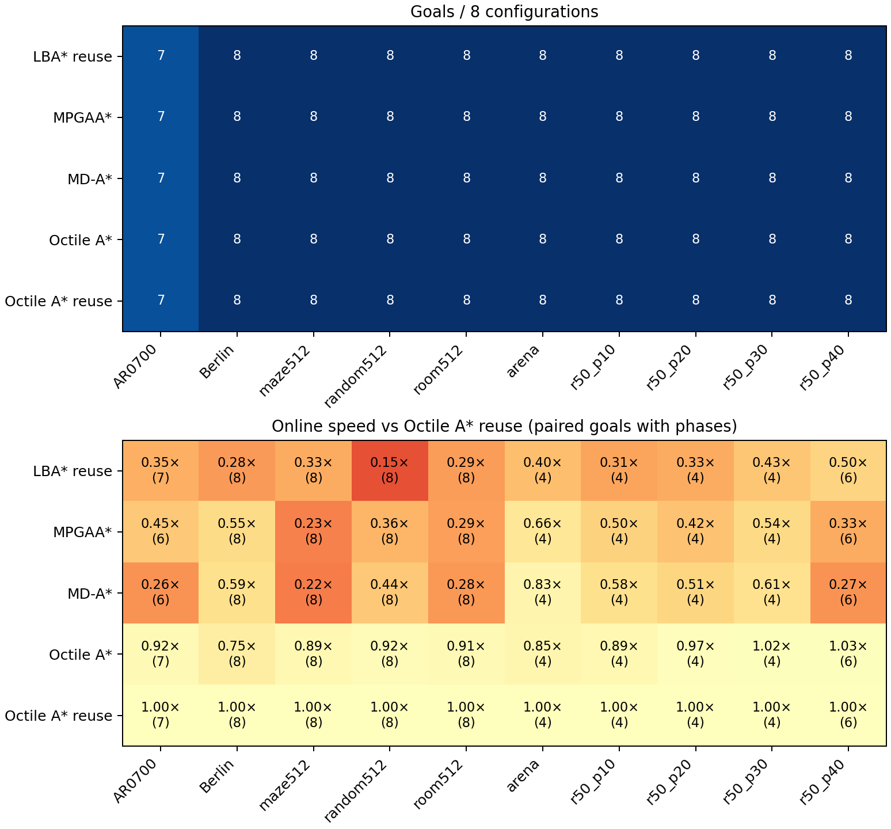
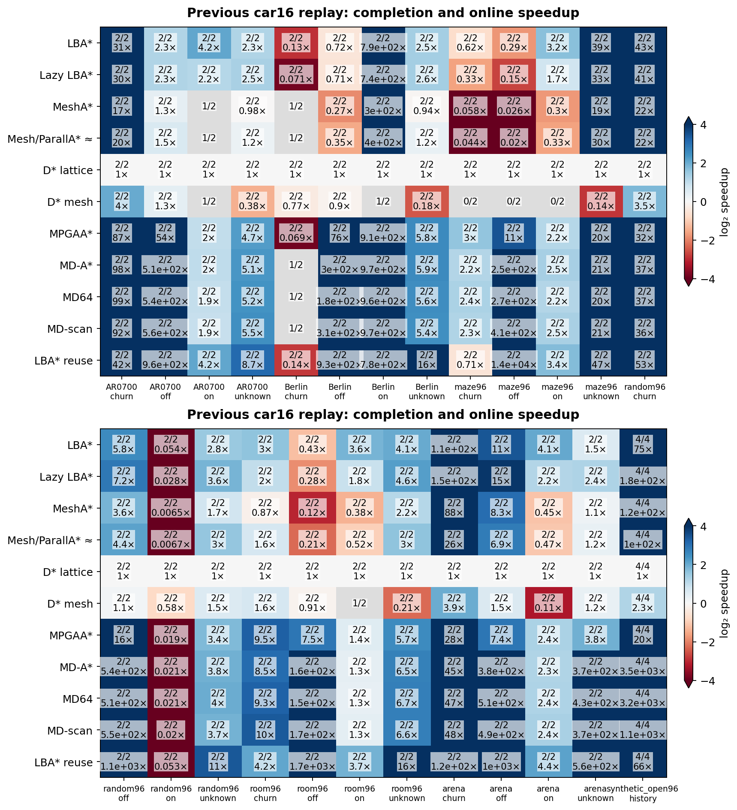
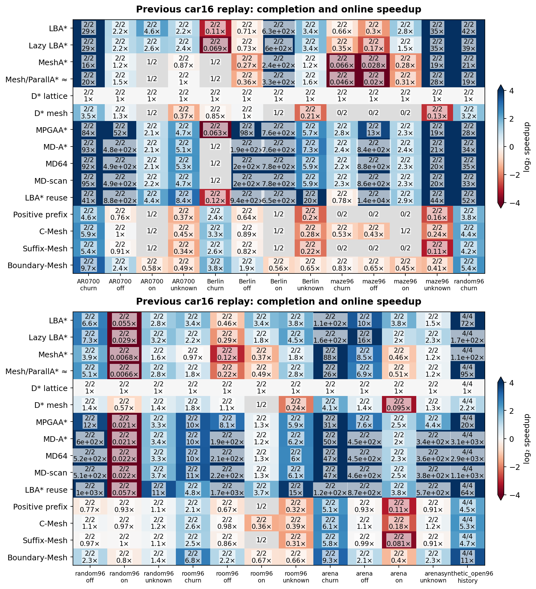

# Раскрытие карты и глобальная динамика при n = k

Новая серия проверяет все 15 реализаций на замкнутых проездах к неизменной цели. Заморожено 816 конфигураций: 48 статических и 768 динамических. Выполнено **17,520 измеряемых проездов**, ещё **2,640 отдельных проездов для памяти**, проверено **1,484,116 вызовов планировщика**. Предыдущие серии сохраняют собственные времена и протокол; их нельзя объединять с этой серией в один временной рейтинг.

Полный атлас всех карт и параметров: [navigation_by_map.pdf](navigation_by_map.pdf). Численные таблицы со всеми 15 методами находятся в каталоге `cpp/navigation_sweeps/results/full/analysis/`:

- `episode_metrics.csv`: отдельные конфигурации и методы;
- `static_radius.csv`: карты и радиусы раскрытия;
- `dynamic_parameters.csv`: карты, k/cr и методы;
- `map_summary.csv`: полнота, время и работа по картам;
- `map_pairs.csv`: парные сравнения по картам;
- `dynamic_pairs.csv`: парные сравнения по k/cr;
- `work_by_observed_changes.csv`: нагрузка фактических пакетов.

Предыдущие результаты по картам вынесены также в [prior_by_map.csv](prior_by_map.csv).

В этой новой серии скорость больше 1 выгодна кандидату. Если не указано иное, ускорения агрегируются геометрическим средним отношений времени по общим допустимым конфигурациям, после медианы повторов внутри конфигурации. Предыдущие серии сохраняют свои определения агрегаторов. Число допустимых пар и полнота всегда рассматриваются вместе с отношением времени.

Дополнительный контроль с более сильным обычным Octile A\* reuse ограничивает общий вывод о MD-A\*: online-выигрыш минимум 10% на каждом из двух корней получен на **2 из 30 сопоставимых точек** карта/k/cr. Выигрышные точки: Berlin: (k,cr) = (2,5); Berlin: (k,cr) = (8,10). По геометрическому среднему online-отношений на допустимых опорных конфигурациях MD уступает этому бейзлайну на **10/10 карт**. Поэтому таблицы выигрыша над D\* lattice ниже показывают конкретную область применимости; универсальное преимущество MD не подтверждено. Подробный пятисторонний контроль и его отдельные времена приведены далее.

## Где наблюдается преимущество ремонта

Для компактного обозначения областей выигрыша используется практический порог **10% на каждом из двух корней**. Это описательный фильтр размера эффекта, а не проверка статистической значимости. Статическая таблица перечисляет радиусы, на которых оба метода достигли цели и полное время кандидата минимум в 1.1 раза меньше D\* lattice на каждом корне. Пустое поле означает отсутствие подтверждающего сочетания в этой серии. Сравнение относится к собственным траекториям методов, а не одинаковым запросам.

| Карта | MD-A\* | LBA\* reuse | C-Mesh | Suffix-Mesh | Boundary-Mesh |
| --- | --- | --- | --- | --- | --- |
| AR0700 | 8, 16, 32, 64 | 8, 16, 32, 64 | — | — | 16, 32, 64 |
| Berlin | 8, 16, 32, 64 | 8, 16, 32, 64 | — | — | 32, 64 |
| MA_maze96 | 8, 16, 32, 64 | 8, 16, 32, 64 | — | — | — |
| MA_random96 | 8, 16, 32, 64 | 8, 16, 32, 64 | — | — | 16, 32, 64 |
| MA_room96 | 8, 16, 32, 64 | 8, 16, 32, 64 | — | — | — |
| arena | 8, 16, 32, 64 | 8, 16, 32, 64 | 16 | — | 16, 32, 64 |


В динамической таблице указано **число выигрышных точек / число допустимых точек**: всего измерено 36 точек на grid8-карту и 4 точки на car16-карту. Допустимая точка требует обеих целей, хотя бы одной фазы и ненулевого online-времени у обоих методов на каждом из двух корней. Выигрыш требует online-ускорения не меньше 1.1 на **каждом** корне. Точки без полной допустимой пары нельзя считать ни победами, ни подтверждением общего преимущества. Все 15 методов и неудачные исходы представлены далее в подробных таблицах и CSV.

| Граф / карта | MD-A\* | LBA\* reuse | C-Mesh | Suffix-Mesh | Boundary-Mesh |
| --- | --- | --- | --- | --- | --- |
| car16 / AR0700 | 0/0 | 0/0 | 0/0 | 0/0 | 0/0 |
| car16 / Berlin | 0/0 | 0/0 | 0/0 | 0/0 | 0/0 |
| car16 / MA_maze96 | 3/4 | 3/4 | 4/4 | 0/0 | 4/4 |
| car16 / MA_random96 | 1/1 | 1/1 | 1/1 | 1/1 | 1/1 |
| car16 / MA_room96 | 1/1 | 1/1 | 1/1 | 1/1 | 1/1 |
| car16 / arena | 0/0 | 0/0 | 0/0 | 0/0 | 1/1 |
| grid8 / AR0700 | 1/23 | 2/22 | 3/25 | 4/25 | 19/25 |
| grid8 / Berlin | 5/36 | 1/36 | 1/36 | 0/36 | 33/36 |
| grid8 / MA_maze512 | 0/36 | 0/36 | 0/36 | 0/36 | 34/36 |
| grid8 / MA_random512 | 0/36 | 0/36 | 7/36 | 6/36 | 32/36 |
| grid8 / MA_room512 | 0/36 | 0/36 | 0/36 | 0/36 | 36/36 |
| grid8 / arena | 18/24 | 10/24 | 4/24 | 2/24 | 7/24 |
| grid8 / random50_p10 | 22/24 | 16/24 | 6/24 | 8/24 | 12/24 |
| grid8 / random50_p20 | 23/24 | 15/24 | 7/24 | 6/24 | 11/24 |
| grid8 / random50_p30 | 23/24 | 21/24 | 9/24 | 8/24 | 13/24 |
| grid8 / random50_p40 | 15/30 | 19/30 | 10/30 | 12/30 | 14/30 |


Следующая таблица показывает **разведочные примеры** на конкретных картах и параметрах: для каждого выбранного метода берутся до трёх максимальных ускорений online относительно D\* lattice, только если оба метода достигли цели на обоих корнях и пережили изменения. Это выбор по результатам, поэтому эти максимумы не являются несмещённой оценкой будущего выигрыша. Строки без преимущества не добавляются. Полное множество сравнений, включая проигрыши, находится в `dynamic_pairs.csv`.

| Метод | Граф | Карта | k=n | cr | Полное | Online | Раскрытия | Чтения |
| --- | --- | --- | --- | --- | --- | --- | --- | --- |
| MD-A\* | car16 | MA_random96 | 8 | 10 | 187.59× | 219.09× | 1.08× | 237.31× |
| MD-A\* | car16 | MA_room96 | 8 | 10 | 25.66× | 36.94× | 0.88× | 17.52× |
| MD-A\* | grid8 | random50_p40 | 32 | 15 | 4.94× | 18.03× | 1.50× | 8.73× |
| LBA\* reuse | car16 | MA_random96 | 8 | 10 | 724.03× | 1107.67× | 0.63× | 115.56× |
| LBA\* reuse | car16 | MA_maze96 | 64 | 30 | 22.86× | 1053.39× | 1.10× | 7.14× |
| LBA\* reuse | car16 | MA_maze96 | 32 | 20 | 30.67× | 601.57× | 1.23× | 8.50× |
| C-Mesh | car16 | MA_random96 | 8 | 10 | 7.36× | 7.51× | 0.19× | 115.60× |
| C-Mesh | car16 | MA_room96 | 8 | 10 | 2.32× | 2.75× | 0.13× | 7.53× |
| C-Mesh | grid8 | random50_p10 | 16 | 10 | 0.90× | 1.93× | 1.13× | 0.96× |
| Suffix-Mesh | car16 | MA_random96 | 8 | 10 | 6.76× | 6.89× | 0.20× | 161.89× |
| Suffix-Mesh | car16 | MA_room96 | 8 | 10 | 2.22× | 2.83× | 0.10× | 10.48× |
| Suffix-Mesh | grid8 | random50_p10 | 16 | 15 | 1.22× | 1.96× | 1.13× | 1.13× |
| Boundary-Mesh | car16 | MA_random96 | 8 | 10 | 22.20× | 24.36× | 1.10× | 38.92× |
| Boundary-Mesh | car16 | MA_room96 | 8 | 10 | 6.72× | 10.29× | 1.09× | 4.19× |
| Boundary-Mesh | car16 | MA_maze96 | 64 | 30 | 1.80× | 7.07× | 1.04× | 1.85× |


В последней таблице отношения раскрытий и чтений относятся ко всему эпизоду, включая начальный поиск. Online-счётчики также сохранены отдельно в CSV. Максимумы выбраны для иллюстрации условий, а не для общего рейтинга.

### Контроль на совпадающей части фактических запросов

Дополнительно из уже измеренных проездов выделены успешные online-вызовы с совпадающими конфигурацией, номером движения, состоянием агента, хешами истинного мира и карты убеждений **до и после** наблюдения и числом блокировок/открытий. Начальные запросы и остановки по лимиту исключены. Это контроль на общей части реальных входов; внутренняя история поиска всё ещё может отличаться, а несовпавшие запросы не включены. Значения — геометрическое среднее отношений суммарного времени совпавших вызовов по конфигурациям, относительно D\* lattice; в скобках число совпавших запросов. Полные числа конфигураций, работы и времени находятся в `aligned_query_cases.csv` и `aligned_query_maps.csv`. Хеши используются как практические отпечатки, а не как математическое доказательство тождества карт.

Динамический car16:

| Карта | MD-A\* | LBA\* reuse | C-Mesh | Suffix-Mesh | Boundary-Mesh |
| --- | --- | --- | --- | --- | --- |
| AR0700 | 19.77× (16) | 85.55× (38) | 1.62× (38) | 1.93× (38) | 3.54× (38) |
| Berlin | 22.82× (45) | 30.71× (44) | 2.29× (44) | 2.23× (44) | 4.90× (54) |
| MA_maze96 | 9.65× (39) | 519.41× (35) | 1.44× (35) | — | 4.48× (102) |
| MA_random96 | 5.66× (41) | 160.70× (39) | 5.83× (50) | 4.98× (39) | 13.04× (53) |
| MA_room96 | 26.64× (32) | 145.93× (32) | 2.12× (41) | 2.34× (32) | 7.67× (63) |
| arena | 14.67× (25) | 51.91× (29) | 2.19× (29) | 2.18× (29) | 3.27× (47) |


Динамический grid8:

| Карта | MD-A\* | LBA\* reuse | C-Mesh | Suffix-Mesh | Boundary-Mesh |
| --- | --- | --- | --- | --- | --- |
| AR0700 | 0.52× (746) | 0.19× (1831) | 0.86× (11419) | 0.89× (11419) | 1.27× (11419) |
| Berlin | 0.66× (514) | 0.44× (5177) | 0.91× (12349) | 0.91× (12349) | 1.42× (12349) |
| MA_maze512 | 0.13× (546) | 0.15× (1107) | 0.81× (18847) | 0.78× (18847) | 1.62× (18847) |
| MA_random512 | — | — | 1.00× (14335) | 1.01× (14335) | 1.74× (14335) |
| MA_room512 | 0.20× (203) | 0.21× (183) | 0.82× (15803) | 0.80× (15803) | 1.57× (15803) |
| arena | 1.75× (27) | 0.44× (24) | 0.87× (818) | 0.78× (818) | 1.06× (818) |
| random50_p10 | 1.94× (48) | 4.20× (48) | 1.11× (837) | 1.14× (837) | 1.32× (837) |
| random50_p20 | 2.84× (68) | 2.34× (58) | 1.04× (900) | 1.03× (900) | 1.26× (900) |
| random50_p30 | 2.66× (240) | 1.89× (213) | 1.02× (828) | 1.02× (828) | 1.28× (828) |
| random50_p40 | 1.72× (408) | 2.22× (454) | 0.98× (1233) | 1.02× (1233) | 1.29× (1233) |


### Отдельно: доказательство отсутствия пути

Следующие отношения относятся только к совпавшим online-запросам, на которых оба метода **доказали отсутствие пути в текущей карте убеждений** и эталон подтвердил ответ. Это полностью завершённые поисковые запросы, но не успешные проезды к цели; они не входят в таблицы ускорений на достигнутых целях. Лимиты без доказательства исключены. Во всех случаях сохраняется отдельная проверка истинной карты: отсутствие пути в убеждениях не равнозначно отсутствию пути в мире. В скобках число совпавших запросов; среднее геометрическое сначала использует суммарные времена внутри конфигурации.

Динамический car16:

| Карта | MD-A\* | LBA\* reuse | C-Mesh | Suffix-Mesh | Boundary-Mesh |
| --- | --- | --- | --- | --- | --- |
| AR0700 | 2310.86× (3) | 18999.50× (4) | 3.02× (2) | 2.50× (2) | 2.34× (4) |
| Berlin | 8937.25× (1) | 1737549.23× (2) | — | — | 1.38× (4) |
| MA_random96 | 4784.67× (1) | 297532.75× (1) | — | — | 0.51× (1) |
| MA_room96 | 303.85× (1) | 67947.62× (1) | — | — | 0.51× (1) |
| arena | 53.29× (1) | 11396.35× (1) | 0.27× (1) | 0.22× (1) | 0.62× (1) |


Динамический grid8:

| Карта | MD-A\* | LBA\* reuse | C-Mesh | Suffix-Mesh | Boundary-Mesh |
| --- | --- | --- | --- | --- | --- |
| AR0700 | 4205.08× (1) | 10773.85× (1) | 0.69× (16) | 0.70× (16) | 1.30× (16) |


Очень большие отношения на единичных no-path запросах следует читать отдельно: повторное использование ранее доказанной недостижимости и направление поиска могут менять стоимость доказательства на порядки. Внутренние истории не уравнены. Такие числа не доказывают выигрыш нового mesh-сертификата и не заменяют сравнение законченных проездов.

## Протокол и сопоставимость

В статической серии использованы все шесть прежних car16-карт и те же два корня на карту. До наблюдения все клетки считаются свободными. Квадратный сенсор без окклюзии раскрывает радиус **8, 16, 32 или 64 клетки** перед каждым движением. Агент выполняет один примитив и перепланирует, когда изменились известные стоимости; иначе следует сохранённому суффиксу. Цель, включая курс, неизменна. Лимит — 512 выполненных примитивов.

В динамической серии карта полностью известна в начале. Через каждые **k = 2, 4, 8, 16, 32, 64 выполненных движения** происходят изменения по всей карте. Видимость **n = k**, как задано пользователем. Для **cr = 1%, 5%, 10%, 15%, 20%, 30%** целевое число обменов в одном направлении равно $\lfloor N\,cr/200+0.5\rfloor$, где $N$ — все клетки, включая препятствия. Из **дофазных** свободного и занятого пулов выбирается одинаковое число клеток; новая блокировка не может тут же открыться. Текущая клетка и клетка цели защищены. Число обменов ограничено меньшим доступным пулом. Плотность препятствий сохраняется точно, а фактический $cr=100(B+O)/N$ записан отдельно от запрошенного. При отсутствии фаз доставлено ноль изменений; фактический cr фазы не определён.

Наблюдения происходят перед каждым движением. Поэтому между глобальными фазами тоже могут появляться новые вызовы планировщика: агент обнаруживает ранее произошедшие правки в новой части сенсорной области. Число фаз не равно числу ремонтов; обе величины и реальные размеры наблюдённых пакетов приведены отдельно.

Полный набор из **36 сочетаний k/cr** выполнен на шести полных grid8-картах и четырёх прежних случайных картах 50×50 с плотностями около 10/20/30/40%. Дополнительная динамическая адаптация к car16 выполнена на всех шести картах, но только на четырёх опорных точках, заданных до измерений: **(2,5), (8,10), (32,20), (64,30)**. Это отдельный срез, а не полный car16-перебор; подготовленные остальные car16-входы сохранены, но не считаются измеренными. Для grid8 взяты новые два корня; на картах со стороной не меньше 128 начальное расстояние Чебышёва составляет 144–260 клеток, а эталонный путь — не более 400 шагов. Поэтому успешный проезд на этих картах обязательно переживает как минимум две фазы при k = 64. Малые карты выделяются как диагностика коротких маршрутов. Лимиты: 384 примитива car16 и 512 шагов grid8.

Для grid8 глубина видимости n точно равна шару Чебышёва: диагонали имеют стоимость $\sqrt2$, проверяется клетка назначения, срезание углов разрешено, как в прежних реализациях. Для car16 это **адаптация** протокола: видны клетки коллизионных следов всех дуг, чьи начала достижимы менее чем за n примитивов на свободной бесконечной решётке; затем область обрезается границами карты. Это не квадрат радиуса n и не сенсор с окклюзией. Точная область предвычислена отдельно для каждого курса. Приведённый протокол воспроизводит семейство экспериментов MPGAA\* (Hernández, Asín, Baier, AAAI 2015), но не заявляется точной репликацией их реализации или численных результатов.

Все методы используют общие случайные приоритеты клеток по фазам, не зависящие от k/cr и метода. При разных маршрутах защита текущей клетки может изменить глобальную карту. Это **сравнение замкнутых политик**, а не строго одинаковая последовательность запросов. Ранжирование по времени трактуется совместно с успехом и выполненной работой. Прежний replay на одинаковых снимках остаётся отдельным контролем. Из-за n = k нельзя независимо приписать эффект только частоте изменений или только видимости.

Все статические конфигурации имеют три повтора. В grid8-динамике выполнен один полный проход, а четыре заранее заданные точки **(k, cr) = (2, 5), (8, 10), (32, 20), (64, 30)** имеют по три повтора. В car16-динамике выполнены только эти четыре точки, каждая с тремя повторами. Это позволяет полностью покрыть запрошенный grid-протокол, но единичные малые временные различия нельзя считать устойчивым превосходством. Отдельный проход памяти выполнен для всей статической серии и этих четырёх точек динамики на обеих моделях. Все измерения последовательны, порядок методов в повторе рандомизирован.

Параметры поисковых ядер сохранены из репозитория. В частности, Mesh/ParallA\* выполняет **100 раскрытий mesh на одно раскрытие LBA*** и возвращает первый найденный ответ. Этот внутренний параметр не является интервалом изменения карты k. Когда mesh-ветвь не помогает, такая диспетчеризация может существенно увеличить работу до срабатывания LBA\*-ветви. Числа относятся к этой конфигурации реализации; отдельная настройка соотношения на каждой карте не выполнялась.

Время эпизода — конструктор планировщика плюс все его вызовы; online — вызовы после начального плана. Общие подготовка модели, предвычисление сенсора, изменение мира, сенсор и эталонные проверки исключены из таймера поиска. В CSV отдельно приведены сенсор и сумма поиска с сенсором. Память — пик запрошенных байтов динамического размещения планировщика и текущего пути; общие модель/календарь/мир исключены. Это не RSS. Дефолтный предел — 1 млн раскрытий на запрос; все остановки сохранены.

Планировщик конструируется до первого наблюдения. В неизвестной статической карте первое наблюдение передаётся ему как пакет блокировок исходно свободной карты; начальный вызов включает обработку этого пакета. Поэтому полное время нельзя выдавать за чистое преимущество ремонта. В динамике исходная карта известна целиком и начальный пакет пуст. Альтернативная инициализация планировщика уже после первого наблюдения здесь не измерялась; начальный и online-поиск сохранены отдельно.

После каждого планирования вне таймера выполняется LBA\* по текущей карте убеждений, проверяется достижимость, стоимость и геометрическая допустимость ответа. Точные методы должны совпасть по стоимости с допуском $10^{-6}$; Mesh/ParallA\* допускает удлинение пути. Если в убеждениях пути нет, отдельно проверяется истинная карта. Такая остановка не считается ошибкой поиска: изменения происходят только после движений, и неподвижный агент не получит следующей фазы. В таблицах она различается с истинной недостижимостью.

Машина: **AMD EPYC 9V74 80-Core Processor**, `Linux-6.18.57-x86_64-with-glibc2.41`. Компилятор: **g++ 14.2.0**, флаги `-O3 -DNDEBUG -std=c++17 -Wall -Wextra -Wpedantic`. Внутри каждого измерительного прохода проверено единство хеша бинарника и флагов. Параметры модели и поисковые ядра совпадают с предыдущей серией 15 методов. При проверке симулятора устранён пограничный запрет совпадающих клеток текущего состояния и цели при разных курсах. Прерванный предварительный проход сохранён в `results/pre_endpoint_guard_fix` и исключён из анализа; все приведённые времена получены после исправления.

Связь с первоисточником проверена по [Hernández, Asín, Baier, «Reusing Previously Found A\* Paths for Fast Goal-Directed Navigation in Dynamic Terrain», AAAI 2015, раздел Experimental Results](https://classpages.cselabs.umn.edu/Fall-2021/csci4511-001/misc/HernandezAB15.pdf). Оттуда взяты наборы k/cr и n = k; в статье использованы октильная эвристика, оптимизированный авторский D\* Lite и существенно больше начальных задач, включая случайные карты 1000×1000. Здесь геометрическая основа эвристик прежних ядер евклидова, а исходные реализации и карты сохранены для сопоставимости с прежними сериями. Добавленный далее октильный контроль усиливает обычный A\*, но не переводит все инкрементальные ядра на октильную эвристику. Это ещё одна причина не трактовать новые времена как репликацию сравнительного рейтинга статьи.

## Фактическая интенсивность изменений

| Граф | Карта | Занято, % | cr1 | cr5 | cr10 | cr15 | cr20 | cr30 |
| --- | --- | --- | --- | --- | --- | --- | --- | --- |
| car16 | AR0700 | 49.62 | — | 5.00 | 10.00 | — | 20.00 | 30.00 |
| car16 | Berlin | 26.85 | — | 5.00 | 10.00 | — | 20.00 | 30.00 |
| car16 | MA_maze96 | 6.77 | — | 4.99 | 10.00 | — | 13.54\* | 13.54\* |
| car16 | MA_random96 | 10.19 | — | 4.99 | 10.00 | — | 20.01 | 20.38\* |
| car16 | MA_room96 | 11.51 | — | 4.99 | 10.00 | — | 20.01 | 23.03\* |
| car16 | arena | 14.45 | — | 5.00 | 10.00 | — | 19.99 | 28.90\* |
| grid8 | AR0700 | 49.62 | 1.00 | 5.00 | 10.00 | 15.00 | 20.00 | 30.00 |
| grid8 | Berlin | 26.85 | 1.00 | 5.00 | 10.00 | 15.00 | 20.00 | 30.00 |
| grid8 | MA_maze512 | 6.15 | 1.00 | 5.00 | 10.00 | 12.30\* | 12.30\* | 12.30\* |
| grid8 | MA_random512 | 10.01 | 1.00 | 5.00 | 10.00 | 15.00 | 20.00 | 20.02\* |
| grid8 | MA_room512 | 11.55 | 1.00 | 5.00 | 10.00 | 15.00 | 20.00 | 23.11\* |
| grid8 | arena | 14.45 | 1.00 | 5.00 | 10.00 | 14.99 | 19.99 | 28.90\* |
| grid8 | random50_p10 | 10.48 | 1.04 | 5.04 | 10.00 | 15.04 | 20.00 | 20.96\* |
| grid8 | random50_p20 | 19.72 | 1.04 | 5.04 | 10.00 | 15.04 | 20.00 | 30.00 |
| grid8 | random50_p30 | 30.88 | 1.04 | 5.04 | 10.00 | 15.04 | 20.00 | 30.00 |
| grid8 | random50_p40 | 38.88 | 1.04 | 5.04 | 10.00 | 15.04 | 20.00 | 30.00 |


Числа — фактический процент правок **на состоявшуюся фазу**; `*` означает ограничение пулом. Это не число наблюдённых агентом изменений. При высокой видимости агент получает большую долю глобальных изменений; число фаз и реально наблюдённых клеток сохранены для каждого проезда. Полные и обрезанные карты Room/Random/Maze имеют разные плотности и рассматриваются отдельно. Несколько больших номинальных cr могут давать один и тот же ограниченный пакет: такие столбцы физически совпадают и не являются независимыми уровнями интенсивности. Поэтому 768 номинальных динамических конфигураций соответствуют 744 различным физическим конфигурациям с учётом корня. Дополнительно проверено точное совпадение их траекторий, миров и работы поиска при общих приоритетах.

Далее показана медианная доля глобальных правок, фактически наблюдённых D\* lattice, в процентах. Взяты все его попытки с хотя бы одной фазой; значения по cr и двум корням объединены внутри каждого k. Прочерк означает отсутствие измерений или отсутствие фаз. Для car16 каждому измеренному k соответствует одна опорная cr, а для grid8 — все шесть. Сравнивать n в двух моделях как одинаковый геометрический радиус нельзя.

| Граф / карта | k2 | k4 | k8 | k16 | k32 | k64 |
| --- | --- | --- | --- | --- | --- | --- |
| car16 / AR0700 | 0.28 | — | 6.03 | — | 49.33 | — |
| car16 / Berlin | 0.41 | — | 9.49 | — | 73.92 | — |
| car16 / MA_maze96 | 2.83 | — | 61.02 | — | 100.00 | 100.00 |
| car16 / MA_random96 | 2.66 | — | 65.54 | — | — | — |
| car16 / MA_room96 | 3.00 | — | 63.02 | — | — | — |
| car16 / arena | 11.58 | — | 99.27 | — | — | — |
| grid8 / AR0700 | 0.07 | 0.24 | 0.83 | 2.89 | 9.03 | 27.19 |
| grid8 / Berlin | 0.08 | 0.31 | 1.19 | 4.18 | 12.66 | 31.35 |
| grid8 / MA_maze512 | 0.01 | 0.04 | 0.17 | 0.69 | 2.50 | 8.60 |
| grid8 / MA_random512 | 0.01 | 0.06 | 0.22 | 0.84 | 3.23 | 11.61 |
| grid8 / MA_room512 | 0.01 | 0.06 | 0.22 | 0.84 | 3.19 | 11.72 |
| grid8 / arena | 1.55 | 5.14 | 17.28 | 49.87 | — | — |
| grid8 / random50_p10 | 1.40 | 5.27 | 17.36 | 45.62 | — | — |
| grid8 / random50_p20 | 1.93 | 6.92 | 19.87 | 54.92 | — | — |
| grid8 / random50_p30 | 2.40 | 6.93 | 19.29 | 42.92 | — | — |
| grid8 / random50_p40 | 2.43 | 7.56 | 22.25 | 50.00 | 84.58 | — |


## Раскрытие статической карты: все радиусы и методы

В каждой ячейке указаны **достижения цели / 2 корня; медиана полного времени поиска в мс** среди успешных проездов. Успех указан первым; медианы с разной полнотой не образуют общий рейтинг. В каждой комбинации радиуса и корня время сначала агрегировано по трём повторам. Полная работа, раскрытая доля карты, длина проезда, p95 и память доступны в таблицах и атласе.

### AR0700

| Метод | r = 8 | r = 16 | r = 32 | r = 64 |
| --- | --- | --- | --- | --- |
| LBA\* | 2/2; 29.30 | 2/2; 17.81 | 2/2; 16.43 | 2/2; 16.83 |
| Lazy LBA\* | 2/2; 29.09 | 2/2; 16.81 | 2/2; 16.82 | 2/2; 16.48 |
| MeshA\* | 2/2; 61.95 | 2/2; 28.61 | 2/2; 29.11 | 2/2; 27.77 |
| Mesh/ParallA\* $\approx$ | 2/2; 52.19 | 2/2; 24.00 | 2/2; 22.05 | 2/2; 20.57 |
| D\* lattice | 2/2; 217.61 | 2/2; 197.47 | 2/2; 447.90 | 2/2; 1013.01 |
| D\* mesh | 2/2; 935.26 | 2/2; 342.46 | 2/2; 690.66 | 2/2; 1375.39 |
| MPGAA\* | 2/2; 27.00 | 2/2; 24.01 | 2/2; 23.38 | 2/2; 6.73 |
| MD-A\* | 2/2; 23.64 | 2/2; 15.47 | 2/2; 12.74 | 2/2; 6.41 |
| MD64 | 2/2; 23.13 | 2/2; 15.68 | 2/2; 12.82 | 2/2; 6.41 |
| MD-scan | 2/2; 22.98 | 2/2; 16.05 | 2/2; 12.86 | 2/2; 6.38 |
| LBA\* reuse | 2/2; 8.67 | 2/2; 3.45 | 2/2; 4.05 | 2/2; 3.47 |
| Positive prefix | 2/2; 1015.87 | 2/2; 424.32 | 2/2; 887.41 | 2/2; 1978.98 |
| C-Mesh | 2/2; 643.31 | 2/2; 340.60 | 2/2; 584.06 | 2/2; 1287.72 |
| Suffix-Mesh | 2/2; 845.13 | 2/2; 334.94 | 2/2; 778.01 | 2/2; 1618.99 |
| Boundary-Mesh | 2/2; 308.05 | 2/2; 134.39 | 2/2; 210.50 | 2/2; 377.46 |


### Berlin

| Метод | r = 8 | r = 16 | r = 32 | r = 64 |
| --- | --- | --- | --- | --- |
| LBA\* | 2/2; 114.34 | 2/2; 27.48 | 2/2; 56.10 | 2/2; 56.71 |
| Lazy LBA\* | 2/2; 181.69 | 2/2; 27.12 | 2/2; 57.69 | 2/2; 60.10 |
| MeshA\* | 2/2; 157.06 | 2/2; 62.38 | 2/2; 156.05 | 2/2; 161.35 |
| Mesh/ParallA\* $\approx$ | 2/2; 85.86 | 2/2; 52.25 | 2/2; 111.06 | 2/2; 112.91 |
| D\* lattice | 2/2; 469.24 | 2/2; 97.85 | 2/2; 199.87 | 2/2; 695.11 |
| D\* mesh | 2/2; 2957.41 | 2/2; 225.16 | 2/2; 366.90 | 2/2; 1210.95 |
| MPGAA\* | 2/2; 148.23 | 2/2; 16.96 | 2/2; 9.03 | 2/2; 8.38 |
| MD-A\* | 2/2; 163.96 | 2/2; 12.72 | 2/2; 9.03 | 2/2; 9.87 |
| MD64 | 2/2; 132.57 | 2/2; 12.44 | 2/2; 8.93 | 2/2; 10.53 |
| MD-scan | 2/2; 144.88 | 2/2; 12.26 | 2/2; 8.51 | 2/2; 9.99 |
| LBA\* reuse | 2/2; 81.44 | 2/2; 4.56 | 2/2; 4.85 | 2/2; 5.36 |
| Positive prefix | 2/2; 2690.14 | 2/2; 295.27 | 2/2; 441.18 | 2/2; 1577.22 |
| C-Mesh | 2/2; 1884.85 | 2/2; 181.06 | 2/2; 310.29 | 2/2; 1051.97 |
| Suffix-Mesh | 2/2; 3197.80 | 2/2; 239.79 | 2/2; 383.81 | 2/2; 1361.95 |
| Boundary-Mesh | 2/2; 562.53 | 2/2; 110.64 | 2/2; 125.83 | 2/2; 322.62 |


### MA_maze96

| Метод | r = 8 | r = 16 | r = 32 | r = 64 |
| --- | --- | --- | --- | --- |
| LBA\* | 2/2; 475.16 | 2/2; 968.43 | 2/2; 2225.89 | 2/2; 552.54 |
| Lazy LBA\* | 2/2; 610.14 | 2/2; 1376.28 | 2/2; 3769.10 | 2/2; 976.34 |
| MeshA\* | 2/2; 1824.85 | 2/2; 5143.42 | 2/2; 20007.69 | 2/2; 5912.33 |
| Mesh/ParallA\* $\approx$ | 2/2; 59453.99 | 2/2; 62745.28 | 2/2; 53833.27 | 2/2; 5347.03 |
| D\* lattice | 2/2; 1710.03 | 2/2; 2584.51 | 2/2; 9357.99 | 2/2; 893.04 |
| D\* mesh | 2/2; 10811.60 | 2/2; 16551.15 | 0/2; — | 0/2; — |
| MPGAA\* | 2/2; 710.03 | 2/2; 1124.50 | 2/2; 3014.97 | 2/2; 379.70 |
| MD-A\* | 2/2; 746.51 | 2/2; 1065.16 | 2/2; 2916.05 | 2/2; 375.68 |
| MD64 | 2/2; 634.61 | 2/2; 1039.27 | 2/2; 3101.71 | 2/2; 354.58 |
| MD-scan | 2/2; 785.94 | 2/2; 1103.34 | 2/2; 2894.99 | 2/2; 354.62 |
| LBA\* reuse | 2/2; 452.88 | 2/2; 689.70 | 2/2; 1745.95 | 2/2; 133.53 |
| Positive prefix | 2/2; 8589.16 | 2/2; 10790.91 | 0/2; — | 0/2; — |
| C-Mesh | 2/2; 5895.98 | 2/2; 8234.00 | 2/2; 27478.78 | 2/2; 3887.43 |
| Suffix-Mesh | 2/2; 9835.04 | 2/2; 15774.25 | 0/2; — | 0/2; — |
| Boundary-Mesh | 2/2; 1941.85 | 2/2; 3219.40 | 2/2; 12885.03 | 2/2; 1372.10 |


### MA_random96

| Метод | r = 8 | r = 16 | r = 32 | r = 64 |
| --- | --- | --- | --- | --- |
| LBA\* | 2/2; 5.57 | 2/2; 4.08 | 2/2; 4.18 | 2/2; 4.12 |
| Lazy LBA\* | 2/2; 4.76 | 2/2; 3.54 | 2/2; 4.25 | 2/2; 4.30 |
| MeshA\* | 2/2; 8.81 | 2/2; 6.05 | 2/2; 7.65 | 2/2; 7.37 |
| Mesh/ParallA\* $\approx$ | 2/2; 4.43 | 2/2; 4.59 | 2/2; 6.46 | 2/2; 6.48 |
| D\* lattice | 2/2; 29.69 | 2/2; 54.99 | 2/2; 90.12 | 2/2; 108.32 |
| D\* mesh | 2/2; 24.74 | 2/2; 51.65 | 2/2; 90.18 | 2/2; 132.41 |
| MPGAA\* | 2/2; 7.10 | 2/2; 9.08 | 2/2; 4.55 | 2/2; 1.59 |
| MD-A\* | 2/2; 6.14 | 2/2; 7.38 | 2/2; 2.54 | 2/2; 1.68 |
| MD64 | 2/2; 5.92 | 2/2; 7.31 | 2/2; 2.63 | 2/2; 1.72 |
| MD-scan | 2/2; 6.36 | 2/2; 7.24 | 2/2; 2.46 | 2/2; 1.80 |
| LBA\* reuse | 2/2; 2.11 | 2/2; 1.82 | 2/2; 1.27 | 2/2; 1.08 |
| Positive prefix | 2/2; 33.27 | 2/2; 70.78 | 2/2; 140.61 | 2/2; 226.20 |
| C-Mesh | 2/2; 29.28 | 2/2; 58.78 | 2/2; 110.19 | 2/2; 185.82 |
| Suffix-Mesh | 2/2; 31.13 | 2/2; 64.73 | 2/2; 121.42 | 2/2; 188.99 |
| Boundary-Mesh | 2/2; 27.71 | 2/2; 39.29 | 2/2; 50.44 | 2/2; 56.08 |


### MA_room96

| Метод | r = 8 | r = 16 | r = 32 | r = 64 |
| --- | --- | --- | --- | --- |
| LBA\* | 2/2; 92.57 | 2/2; 52.12 | 2/2; 106.04 | 2/2; 102.90 |
| Lazy LBA\* | 2/2; 122.32 | 2/2; 81.88 | 2/2; 166.34 | 2/2; 172.48 |
| MeshA\* | 2/2; 270.75 | 2/2; 137.55 | 2/2; 402.28 | 2/2; 430.09 |
| Mesh/ParallA\* $\approx$ | 2/2; 104.48 | 2/2; 95.96 | 2/2; 4602.71 | 2/2; 247.45 |
| D\* lattice | 2/2; 511.49 | 2/2; 493.93 | 2/2; 770.80 | 2/2; 189.95 |
| D\* mesh | 2/2; 2735.22 | 2/2; 2218.36 | 2/2; 3689.03 | 2/2; 690.71 |
| MPGAA\* | 2/2; 164.16 | 2/2; 66.07 | 2/2; 100.97 | 2/2; 46.40 |
| MD-A\* | 2/2; 127.29 | 2/2; 60.46 | 2/2; 95.02 | 2/2; 40.31 |
| MD64 | 2/2; 137.88 | 2/2; 69.35 | 2/2; 113.10 | 2/2; 38.62 |
| MD-scan | 2/2; 125.76 | 2/2; 57.89 | 2/2; 90.29 | 2/2; 37.91 |
| LBA\* reuse | 2/2; 50.56 | 2/2; 35.71 | 2/2; 48.24 | 2/2; 21.97 |
| Positive prefix | 2/2; 1946.47 | 2/2; 1687.15 | 2/2; 2446.52 | 2/2; 699.34 |
| C-Mesh | 2/2; 1422.29 | 2/2; 1230.62 | 2/2; 1508.41 | 2/2; 488.14 |
| Suffix-Mesh | 2/2; 2333.37 | 2/2; 2049.55 | 2/2; 2674.16 | 2/2; 656.32 |
| Boundary-Mesh | 2/2; 679.71 | 2/2; 625.61 | 2/2; 758.31 | 2/2; 206.23 |


### arena

| Метод | r = 8 | r = 16 | r = 32 | r = 64 |
| --- | --- | --- | --- | --- |
| LBA\* | 2/2; 0.85 | 2/2; 2.50 | 2/2; 0.96 | 2/2; 0.20 |
| Lazy LBA\* | 2/2; 0.58 | 2/2; 1.59 | 2/2; 0.75 | 2/2; 0.18 |
| MeshA\* | 2/2; 0.89 | 2/2; 2.92 | 2/2; 1.02 | 2/2; 0.24 |
| Mesh/ParallA\* $\approx$ | 2/2; 1.01 | 2/2; 3.16 | 2/2; 1.27 | 2/2; 0.30 |
| D\* lattice | 2/2; 8.19 | 2/2; 24.33 | 2/2; 26.52 | 2/2; 25.14 |
| D\* mesh | 2/2; 7.48 | 2/2; 23.77 | 2/2; 29.10 | 2/2; 36.35 |
| MPGAA\* | 2/2; 1.84 | 2/2; 2.41 | 2/2; 0.72 | 2/2; 0.35 |
| MD-A\* | 2/2; 0.36 | 2/2; 0.42 | 2/2; 0.43 | 2/2; 0.43 |
| MD64 | 2/2; 0.38 | 2/2; 0.44 | 2/2; 0.44 | 2/2; 0.43 |
| MD-scan | 2/2; 0.37 | 2/2; 0.43 | 2/2; 0.41 | 2/2; 0.43 |
| LBA\* reuse | 2/2; 0.23 | 2/2; 0.25 | 2/2; 0.22 | 2/2; 0.21 |
| Positive prefix | 2/2; 9.84 | 2/2; 29.32 | 2/2; 37.03 | 2/2; 37.41 |
| C-Mesh | 2/2; 7.81 | 2/2; 21.54 | 2/2; 25.36 | 2/2; 24.69 |
| Suffix-Mesh | 2/2; 9.15 | 2/2; 26.89 | 2/2; 33.90 | 2/2; 35.99 |
| Boundary-Mesh | 2/2; 5.54 | 2/2; 10.13 | 2/2; 9.18 | 2/2; 8.54 |


## Динамика: результаты отдельно по каждой карте

Для каждого метода приведено число целей из **72 конфигураций на grid8-карту** (2 корня × 36 параметров) либо **8 конфигураций на car16-карту** (2 корня × 4 опорных точки), медианное полное время поиска и сумма поиска с сенсором среди успешных проездов, ускорение online относительно D\* lattice на общих успешных проездах с фазами, медиана раскрытий и чтений клеток среди успешных проездов. В скобках у ускорения — **число пар**. Ремонт с нулевыми фазами и без последующих вызовов исключён. «Поиск + сенсор» не включает моделирование изменений мира и физическое движение. Это описательная агрегация по разным k/cr, а не доказательство победы на каждом параметре. Полные grid8-матрицы 6×6 и выбранные car16-точки для всех методов приведены в CSV; матрицы ускорений и покрытия — в атласе.

### car16 / AR0700

| Метод | Цели | Поиск, мс | +сенсор, мс | Online vs D\* | Раскрытия | Чтения |
| --- | --- | --- | --- | --- | --- | --- |
| LBA\* | 4/8 | 3.65 | 6.35 | 637.25× (1) | 1855 | 65504 |
| Lazy LBA\* | 4/8 | 4.75 | 6.65 | 525.28× (1) | 1855 | 14318 |
| MeshA\* | 4/8 | 11.79 | 12.57 | 361.21× (1) | 9212 | 42001 |
| Mesh/ParallA\* $\approx$ | 3/8 | 7.85 | 9.73 | —× (0) | 5398 | 27243 |
| D\* lattice | 4/8 | 6.20 | 10.35 | 1.00× (1) | 1433 | 96182 |
| D\* mesh | 4/8 | 23.73 | 27.01 | 1.86× (1) | 15740 | 34807 |
| MPGAA\* | 4/8 | 7.55 | 9.55 | 131.81× (1) | 1533 | 60939 |
| MD-A\* | 4/8 | 5.49 | 7.83 | 118.10× (1) | 1718 | 63586 |
| MD64 | 4/8 | 5.71 | 8.77 | 123.07× (1) | 1718 | 63586 |
| MD-scan | 4/8 | 6.00 | 7.88 | 117.60× (1) | 1718 | 63586 |
| LBA\* reuse | 4/8 | 3.82 | 6.51 | 641.55× (1) | 1855 | 65504 |
| Positive prefix | 4/8 | 23.92 | 27.07 | 3.99× (1) | 14292 | 103066 |
| C-Mesh | 4/8 | 21.30 | 24.59 | 5.47× (1) | 9345 | 120220 |
| Suffix-Mesh | 4/8 | 22.62 | 26.74 | 5.03× (1) | 10786 | 88788 |
| Boundary-Mesh | 4/8 | 22.77 | 26.46 | 14.63× (1) | 1326 | 143939 |


### car16 / Berlin

| Метод | Цели | Поиск, мс | +сенсор, мс | Online vs D\* | Раскрытия | Чтения |
| --- | --- | --- | --- | --- | --- | --- |
| LBA\* | 5/8 | 5.07 | 5.87 | 512.46× (1) | 2816 | 94672 |
| Lazy LBA\* | 4/8 | 5.39 | 6.91 | 512.37× (1) | 2374 | 26849 |
| MeshA\* | 4/8 | 11.04 | 11.95 | 368.55× (1) | 11412 | 41819 |
| Mesh/ParallA\* $\approx$ | 4/8 | 6.86 | 7.90 | 462.71× (1) | 6740 | 27184 |
| D\* lattice | 4/8 | 14.21 | 15.79 | 1.00× (1) | 3699 | 295064 |
| D\* mesh | 5/8 | 89.94 | 91.64 | 1.39× (1) | 54151 | 98434 |
| MPGAA\* | 5/8 | 7.61 | 11.27 | 38.68× (1) | 2128 | 94672 |
| MD-A\* | 5/8 | 7.71 | 11.49 | 115.80× (1) | 2128 | 93902 |
| MD64 | 5/8 | 7.86 | 11.48 | 112.27× (1) | 2128 | 93902 |
| MD-scan | 5/8 | 7.79 | 11.62 | 106.52× (1) | 2128 | 93902 |
| LBA\* reuse | 5/8 | 5.12 | 5.52 | 646.77× (1) | 2740 | 94672 |
| Positive prefix | 5/8 | 87.14 | 88.89 | 2.19× (1) | 51101 | 280132 |
| C-Mesh | 5/8 | 63.54 | 65.26 | 2.65× (1) | 29302 | 299441 |
| Suffix-Mesh | 5/8 | 85.70 | 87.36 | 2.75× (1) | 42769 | 243038 |
| Boundary-Mesh | 4/8 | 61.39 | 62.93 | 9.52× (1) | 3543 | 333060 |


### car16 / MA_maze96

| Метод | Цели | Поиск, мс | +сенсор, мс | Online vs D\* | Раскрытия | Чтения |
| --- | --- | --- | --- | --- | --- | --- |
| LBA\* | 8/8 | 131.27 | 131.84 | 199.63× (8) | 62689 | 1504673 |
| Lazy LBA\* | 8/8 | 241.42 | 241.99 | 182.94× (8) | 62688 | 756834 |
| MeshA\* | 8/8 | 1483.94 | 1484.44 | 85.63× (8) | 341694 | 1805154 |
| Mesh/ParallA\* $\approx$ | 7/8 | 2294.10 | 2294.12 | 218.45× (7) | 420556 | 3236257 |
| D\* lattice | 8/8 | 2991.62 | 2992.42 | 1.00× (8) | 67019 | 9611744 |
| D\* mesh | 0/8 | — | — | —× (0) | — | — |
| MPGAA\* | 8/8 | 1036.98 | 1041.03 | 2.53× (8) | 60298 | 2193156 |
| MD-A\* | 8/8 | 795.54 | 796.40 | 3.80× (8) | 62715 | 1913734 |
| MD64 | 8/8 | 780.71 | 783.35 | 3.93× (8) | 62715 | 1913682 |
| MD-scan | 8/8 | 801.53 | 802.25 | 3.84× (8) | 62715 | 1913734 |
| LBA\* reuse | 8/8 | 138.08 | 138.78 | 216.63× (8) | 62674 | 1503625 |
| Positive prefix | 0/8 | — | — | —× (0) | — | — |
| C-Mesh | 8/8 | 5231.71 | 5232.56 | 1.41× (8) | 708690 | 5536128 |
| Suffix-Mesh | 0/8 | — | — | —× (0) | — | — |
| Boundary-Mesh | 8/8 | 1813.22 | 1814.15 | 4.69× (8) | 64377 | 5166203 |


### car16 / MA_random96

| Метод | Цели | Поиск, мс | +сенсор, мс | Online vs D\* | Раскрытия | Чтения |
| --- | --- | --- | --- | --- | --- | --- |
| LBA\* | 7/8 | 1.11 | 1.33 | 336.83× (3) | 586 | 27054 |
| Lazy LBA\* | 7/8 | 1.36 | 1.55 | 330.82× (3) | 586 | 5006 |
| MeshA\* | 7/8 | 2.23 | 2.54 | 229.65× (3) | 2793 | 8563 |
| Mesh/ParallA\* $\approx$ | 7/8 | 1.47 | 1.74 | 152.44× (2) | 1788 | 6521 |
| D\* lattice | 7/8 | 2.12 | 2.31 | 1.00× (3) | 632 | 47374 |
| D\* mesh | 7/8 | 7.76 | 7.99 | 2.50× (3) | 6121 | 14588 |
| MPGAA\* | 7/8 | 1.72 | 1.92 | 50.81× (3) | 586 | 27054 |
| MD-A\* | 7/8 | 1.79 | 2.02 | 21.43× (3) | 586 | 27054 |
| MD64 | 7/8 | 1.89 | 2.09 | 21.40× (3) | 586 | 27054 |
| MD-scan | 7/8 | 1.68 | 1.97 | 21.41× (3) | 586 | 27054 |
| LBA\* reuse | 7/8 | 1.23 | 1.59 | 333.61× (3) | 586 | 27054 |
| Positive prefix | 7/8 | 7.75 | 8.04 | 4.93× (3) | 5520 | 45572 |
| C-Mesh | 7/8 | 7.96 | 8.15 | 5.89× (3) | 3766 | 58075 |
| Suffix-Mesh | 7/8 | 7.49 | 7.70 | 5.60× (3) | 3587 | 43737 |
| Boundary-Mesh | 7/8 | 10.46 | 10.70 | 13.02× (3) | 571 | 84719 |


### car16 / MA_room96

| Метод | Цели | Поиск, мс | +сенсор, мс | Online vs D\* | Раскрытия | Чтения |
| --- | --- | --- | --- | --- | --- | --- |
| LBA\* | 6/8 | 22.75 | 23.00 | 265.82× (2) | 12660 | 447398 |
| Lazy LBA\* | 6/8 | 37.72 | 37.97 | 225.03× (2) | 12660 | 184064 |
| MeshA\* | 7/8 | 140.79 | 141.11 | 26.14× (3) | 83268 | 380090 |
| Mesh/ParallA\* $\approx$ | 6/8 | 56.08 | 56.45 | 1.18× (1) | 37001 | 167256 |
| D\* lattice | 7/8 | 51.29 | 51.62 | 1.00× (3) | 6822 | 950000 |
| D\* mesh | 7/8 | 638.67 | 639.01 | 1.30× (3) | 95163 | 386063 |
| MPGAA\* | 7/8 | 50.77 | 51.10 | 10.96× (3) | 15683 | 503114 |
| MD-A\* | 7/8 | 52.05 | 52.36 | 14.60× (3) | 15683 | 503114 |
| MD64 | 7/8 | 55.45 | 55.79 | 14.70× (3) | 15683 | 503114 |
| MD-scan | 7/8 | 51.26 | 51.58 | 14.89× (3) | 15683 | 503114 |
| LBA\* reuse | 6/8 | 22.92 | 23.16 | 250.47× (2) | 12660 | 447398 |
| Positive prefix | 7/8 | 559.70 | 560.03 | 1.69× (3) | 84518 | 578469 |
| C-Mesh | 7/8 | 348.82 | 349.16 | 2.19× (3) | 49694 | 664609 |
| Suffix-Mesh | 6/8 | 606.37 | 606.65 | 2.83× (2) | 118786 | 630388 |
| Boundary-Mesh | 7/8 | 206.56 | 206.87 | 6.57× (3) | 6289 | 727666 |


### car16 / arena

| Метод | Цели | Поиск, мс | +сенсор, мс | Online vs D\* | Раскрытия | Чтения |
| --- | --- | --- | --- | --- | --- | --- |
| LBA\* | 6/8 | 0.30 | 0.38 | 58.91× (2) | 122 | 7912 |
| Lazy LBA\* | 6/8 | 0.21 | 0.28 | 60.16× (2) | 122 | 665 |
| MeshA\* | 7/8 | 0.48 | 0.55 | 21.68× (3) | 450 | 1376 |
| Mesh/ParallA\* $\approx$ | 8/8 | 0.98 | 1.08 | 6.81× (3) | 998 | 3344 |
| D\* lattice | 7/8 | 0.45 | 0.53 | 1.00× (3) | 82 | 7392 |
| D\* mesh | 6/8 | 0.60 | 0.67 | 1.66× (2) | 322 | 1564 |
| MPGAA\* | 6/8 | 0.44 | 0.51 | 14.80× (2) | 122 | 7912 |
| MD-A\* | 6/8 | 0.48 | 0.55 | 18.02× (2) | 122 | 7912 |
| MD64 | 6/8 | 0.46 | 0.53 | 17.20× (2) | 122 | 7912 |
| MD-scan | 6/8 | 0.49 | 0.57 | 17.87× (2) | 122 | 7912 |
| LBA\* reuse | 6/8 | 0.26 | 0.36 | 58.48× (2) | 122 | 7912 |
| Positive prefix | 6/8 | 0.67 | 0.74 | 1.82× (2) | 293 | 5524 |
| C-Mesh | 6/8 | 0.84 | 0.91 | 2.36× (2) | 249 | 8286 |
| Suffix-Mesh | 6/8 | 0.59 | 0.66 | 2.08× (2) | 236 | 4569 |
| Boundary-Mesh | 7/8 | 1.45 | 1.51 | 2.87× (3) | 76 | 24849 |


### grid8 / AR0700

| Метод | Цели | Поиск, мс | +сенсор, мс | Online vs D\* | Раскрытия | Чтения |
| --- | --- | --- | --- | --- | --- | --- |
| LBA\* | 54/72 | 145.66 | 146.60 | 0.40× (51) | 222364 | 556402 |
| Lazy LBA\* | 56/72 | 231.31 | 232.24 | 0.26× (52) | 221302 | 408882 |
| MeshA\* | 54/72 | 189.85 | 190.46 | 0.30× (51) | 222364 | 1778908 |
| Mesh/ParallA\* $\approx$ | 54/72 | 192.15 | 192.75 | 0.30× (51) | 224496 | 1789607 |
| D\* lattice | 56/72 | 67.62 | 68.01 | 1.00× (56) | 9394 | 83444 |
| D\* mesh | 56/72 | 63.90 | 64.75 | 1.02× (56) | 9394 | 83444 |
| MPGAA\* | 57/72 | 76.33 | 77.53 | 0.85× (52) | 33796 | 34999 |
| MD-A\* | 56/72 | 80.18 | 80.40 | 0.71× (52) | 34536 | 32030 |
| MD64 | 56/72 | 80.88 | 81.62 | 0.70× (52) | 34536 | 32030 |
| MD-scan | 56/72 | 83.06 | 83.79 | 0.68× (52) | 34536 | 32030 |
| LBA\* reuse | 54/72 | 113.06 | 113.96 | 0.47× (51) | 153652 | 414064 |
| Positive prefix | 56/72 | 77.43 | 79.06 | 0.95× (56) | 7284 | 114768 |
| C-Mesh | 56/72 | 78.00 | 79.52 | 0.92× (56) | 7284 | 114768 |
| Suffix-Mesh | 56/72 | 76.39 | 77.69 | 0.95× (56) | 7284 | 114768 |
| Boundary-Mesh | 56/72 | 54.71 | 55.05 | 1.33× (56) | 7284 | 96548 |


### grid8 / Berlin

| Метод | Цели | Поиск, мс | +сенсор, мс | Online vs D\* | Раскрытия | Чтения |
| --- | --- | --- | --- | --- | --- | --- |
| LBA\* | 72/72 | 174.91 | 175.93 | 0.28× (72) | 271672 | 607669 |
| Lazy LBA\* | 72/72 | 251.31 | 251.52 | 0.20× (72) | 265766 | 369671 |
| MeshA\* | 72/72 | 241.85 | 242.03 | 0.21× (72) | 271672 | 2173372 |
| Mesh/ParallA\* $\approx$ | 72/72 | 244.82 | 245.13 | 0.21× (72) | 274304 | 2185336 |
| D\* lattice | 72/72 | 59.91 | 60.12 | 1.00× (72) | 9890 | 85999 |
| D\* mesh | 72/72 | 62.11 | 62.41 | 0.95× (72) | 9890 | 85999 |
| MPGAA\* | 72/72 | 48.99 | 49.18 | 1.03× (72) | 15426 | 23622 |
| MD-A\* | 72/72 | 45.16 | 45.46 | 1.11× (72) | 15766 | 22868 |
| MD64 | 72/72 | 46.35 | 46.78 | 1.10× (72) | 15766 | 22868 |
| MD-scan | 72/72 | 49.56 | 50.86 | 1.03× (72) | 15766 | 22868 |
| LBA\* reuse | 72/72 | 134.24 | 134.96 | 0.41× (72) | 187826 | 398583 |
| Positive prefix | 72/72 | 83.47 | 84.11 | 0.91× (72) | 9458 | 170517 |
| C-Mesh | 72/72 | 84.63 | 85.47 | 0.91× (72) | 9458 | 170517 |
| Suffix-Mesh | 72/72 | 84.00 | 84.31 | 0.91× (72) | 9458 | 170517 |
| Boundary-Mesh | 72/72 | 57.63 | 57.92 | 1.42× (72) | 9458 | 129423 |


### grid8 / MA_maze512

| Метод | Цели | Поиск, мс | +сенсор, мс | Online vs D\* | Раскрытия | Чтения |
| --- | --- | --- | --- | --- | --- | --- |
| LBA\* | 72/72 | 1920.56 | 1923.66 | 0.11× (72) | 2604166 | 4742774 |
| Lazy LBA\* | 72/72 | 2916.54 | 2916.85 | 0.07× (72) | 2767170 | 3818688 |
| MeshA\* | 72/72 | 2653.19 | 2655.46 | 0.08× (72) | 2604166 | 20833328 |
| Mesh/ParallA\* $\approx$ | 72/72 | 2667.16 | 2668.84 | 0.08× (72) | 2630114 | 20904151 |
| D\* lattice | 72/72 | 229.25 | 232.69 | 1.00× (72) | 32493 | 267698 |
| D\* mesh | 72/72 | 229.66 | 231.23 | 1.00× (72) | 32493 | 267698 |
| MPGAA\* | 72/72 | 1846.12 | 1846.49 | 0.09× (72) | 722633 | 144747 |
| MD-A\* | 72/72 | 1834.55 | 1835.43 | 0.09× (72) | 730277 | 145728 |
| MD64 | 72/72 | 1813.73 | 1815.21 | 0.09× (72) | 730277 | 145728 |
| MD-scan | 72/72 | 1840.83 | 1841.63 | 0.09× (72) | 730277 | 145728 |
| LBA\* reuse | 72/72 | 1656.04 | 1656.85 | 0.13× (72) | 2305427 | 4171486 |
| Positive prefix | 72/72 | 356.98 | 358.53 | 0.80× (72) | 30104 | 531432 |
| C-Mesh | 72/72 | 352.66 | 353.06 | 0.81× (72) | 30104 | 531432 |
| Suffix-Mesh | 72/72 | 363.12 | 365.01 | 0.79× (72) | 30104 | 531432 |
| Boundary-Mesh | 72/72 | 187.23 | 187.50 | 1.61× (72) | 30104 | 345843 |


### grid8 / MA_random512

| Метод | Цели | Поиск, мс | +сенсор, мс | Online vs D\* | Раскрытия | Чтения |
| --- | --- | --- | --- | --- | --- | --- |
| LBA\* | 72/72 | 380.70 | 383.95 | 0.16× (72) | 506154 | 1246184 |
| Lazy LBA\* | 72/72 | 557.29 | 560.34 | 0.11× (72) | 509594 | 839241 |
| MeshA\* | 72/72 | 501.79 | 505.28 | 0.12× (72) | 506154 | 4049236 |
| Mesh/ParallA\* $\approx$ | 72/72 | 496.20 | 499.28 | 0.12× (72) | 511132 | 4066524 |
| D\* lattice | 72/72 | 114.49 | 114.93 | 1.00× (72) | 16101 | 169639 |
| D\* mesh | 72/72 | 111.29 | 112.13 | 0.97× (72) | 16101 | 169639 |
| MPGAA\* | 72/72 | 153.46 | 154.73 | 0.52× (72) | 51685 | 56978 |
| MD-A\* | 72/72 | 130.11 | 130.25 | 0.61× (72) | 40924 | 50684 |
| MD64 | 72/72 | 127.48 | 128.32 | 0.64× (72) | 40924 | 50684 |
| MD-scan | 72/72 | 139.25 | 140.92 | 0.60× (72) | 40924 | 50684 |
| LBA\* reuse | 72/72 | 345.63 | 348.57 | 0.17× (72) | 424908 | 1050670 |
| Positive prefix | 72/72 | 146.10 | 148.78 | 0.99× (72) | 14638 | 269529 |
| C-Mesh | 72/72 | 144.01 | 146.32 | 0.99× (72) | 14638 | 269529 |
| Suffix-Mesh | 72/72 | 144.96 | 147.42 | 1.00× (72) | 14638 | 269529 |
| Boundary-Mesh | 72/72 | 84.09 | 86.34 | 1.74× (72) | 14638 | 207812 |


### grid8 / MA_room512

| Метод | Цели | Поиск, мс | +сенсор, мс | Online vs D\* | Раскрытия | Чтения |
| --- | --- | --- | --- | --- | --- | --- |
| LBA\* | 72/72 | 1373.77 | 1374.51 | 0.12× (72) | 1764849 | 3910016 |
| Lazy LBA\* | 72/72 | 2042.27 | 2042.94 | 0.08× (72) | 1738149 | 2989526 |
| MeshA\* | 72/72 | 1792.95 | 1793.63 | 0.09× (72) | 1764849 | 14118792 |
| Mesh/ParallA\* $\approx$ | 72/72 | 1834.49 | 1835.15 | 0.09× (72) | 1782392 | 14172792 |
| D\* lattice | 72/72 | 184.38 | 187.09 | 1.00× (72) | 25890 | 209412 |
| D\* mesh | 72/72 | 187.44 | 187.73 | 1.01× (72) | 25890 | 209412 |
| MPGAA\* | 72/72 | 747.40 | 747.90 | 0.18× (72) | 246551 | 134145 |
| MD-A\* | 72/72 | 838.17 | 840.75 | 0.17× (72) | 257892 | 134918 |
| MD64 | 72/72 | 818.02 | 818.54 | 0.18× (72) | 257892 | 134918 |
| MD-scan | 72/72 | 854.97 | 857.92 | 0.17× (72) | 257892 | 134918 |
| LBA\* reuse | 72/72 | 1161.96 | 1163.68 | 0.14× (72) | 1476968 | 3276066 |
| Positive prefix | 72/72 | 271.82 | 274.03 | 0.82× (72) | 22884 | 421374 |
| C-Mesh | 72/72 | 269.27 | 270.00 | 0.82× (72) | 22884 | 421374 |
| Suffix-Mesh | 72/72 | 277.16 | 278.06 | 0.81× (72) | 22884 | 421374 |
| Boundary-Mesh | 72/72 | 148.03 | 150.29 | 1.58× (72) | 22884 | 280041 |


### grid8 / arena

| Метод | Цели | Поиск, мс | +сенсор, мс | Online vs D\* | Раскрытия | Чтения |
| --- | --- | --- | --- | --- | --- | --- |
| LBA\* | 72/72 | 0.44 | 0.52 | 0.87× (48) | 562 | 1516 |
| Lazy LBA\* | 72/72 | 0.52 | 0.56 | 0.72× (48) | 556 | 658 |
| MeshA\* | 72/72 | 0.60 | 0.67 | 0.61× (48) | 562 | 4492 |
| Mesh/ParallA\* $\approx$ | 72/72 | 0.59 | 0.62 | 0.60× (48) | 564 | 4505 |
| D\* lattice | 72/72 | 0.79 | 0.80 | 1.00× (48) | 307 | 2988 |
| D\* mesh | 72/72 | 0.85 | 0.88 | 0.95× (48) | 307 | 2988 |
| MPGAA\* | 72/72 | 0.51 | 0.53 | 1.79× (48) | 300 | 708 |
| MD-A\* | 72/72 | 0.48 | 0.50 | 2.28× (48) | 300 | 688 |
| MD64 | 72/72 | 0.44 | 0.47 | 2.25× (48) | 300 | 688 |
| MD-scan | 72/72 | 0.44 | 0.47 | 2.16× (48) | 300 | 688 |
| LBA\* reuse | 72/72 | 0.43 | 0.48 | 1.25× (48) | 506 | 1268 |
| Positive prefix | 72/72 | 1.74 | 1.75 | 0.90× (48) | 298 | 6908 |
| C-Mesh | 72/72 | 1.68 | 1.71 | 0.86× (48) | 298 | 6908 |
| Suffix-Mesh | 72/72 | 1.76 | 1.78 | 0.77× (48) | 298 | 6908 |
| Boundary-Mesh | 72/72 | 1.35 | 1.37 | 1.06× (48) | 298 | 5016 |


### grid8 / random50_p10

| Метод | Цели | Поиск, мс | +сенсор, мс | Online vs D\* | Раскрытия | Чтения |
| --- | --- | --- | --- | --- | --- | --- |
| LBA\* | 72/72 | 0.25 | 0.29 | 1.70× (48) | 328 | 1092 |
| Lazy LBA\* | 72/72 | 0.28 | 0.30 | 1.49× (48) | 330 | 428 |
| MeshA\* | 72/72 | 0.35 | 0.38 | 1.17× (48) | 328 | 2620 |
| Mesh/ParallA\* $\approx$ | 72/72 | 0.37 | 0.39 | 1.21× (48) | 328 | 2628 |
| D\* lattice | 72/72 | 0.65 | 0.66 | 1.00× (48) | 199 | 2050 |
| D\* mesh | 72/72 | 0.66 | 0.68 | 0.96× (48) | 199 | 2050 |
| MPGAA\* | 72/72 | 0.32 | 0.36 | 2.36× (48) | 150 | 484 |
| MD-A\* | 72/72 | 0.32 | 0.34 | 2.72× (48) | 165 | 471 |
| MD64 | 72/72 | 0.31 | 0.33 | 2.74× (48) | 165 | 471 |
| MD-scan | 72/72 | 0.30 | 0.33 | 2.65× (48) | 165 | 471 |
| LBA\* reuse | 72/72 | 0.25 | 0.26 | 1.96× (48) | 274 | 1006 |
| Positive prefix | 72/72 | 1.13 | 1.16 | 1.13× (48) | 178 | 4572 |
| C-Mesh | 72/72 | 1.07 | 1.15 | 1.11× (48) | 178 | 4572 |
| Suffix-Mesh | 72/72 | 1.14 | 1.18 | 1.14× (48) | 178 | 4572 |
| Boundary-Mesh | 72/72 | 0.86 | 0.87 | 1.32× (48) | 178 | 3127 |


### grid8 / random50_p20

| Метод | Цели | Поиск, мс | +сенсор, мс | Online vs D\* | Раскрытия | Чтения |
| --- | --- | --- | --- | --- | --- | --- |
| LBA\* | 72/72 | 0.37 | 0.39 | 1.87× (48) | 480 | 1870 |
| Lazy LBA\* | 72/72 | 0.41 | 0.45 | 1.61× (48) | 480 | 746 |
| MeshA\* | 72/72 | 0.49 | 0.51 | 1.37× (48) | 480 | 3836 |
| Mesh/ParallA\* $\approx$ | 72/72 | 0.50 | 0.52 | 1.36× (48) | 481 | 3848 |
| D\* lattice | 72/72 | 0.77 | 0.78 | 1.00× (48) | 208 | 2436 |
| D\* mesh | 72/72 | 0.73 | 0.77 | 0.97× (48) | 208 | 2436 |
| MPGAA\* | 72/72 | 0.40 | 0.43 | 2.19× (48) | 193 | 690 |
| MD-A\* | 72/72 | 0.37 | 0.40 | 2.64× (48) | 186 | 615 |
| MD64 | 72/72 | 0.39 | 0.41 | 2.55× (48) | 186 | 615 |
| MD-scan | 72/72 | 0.35 | 0.41 | 2.41× (48) | 186 | 615 |
| LBA\* reuse | 72/72 | 0.35 | 0.37 | 1.95× (48) | 440 | 1683 |
| Positive prefix | 72/72 | 1.11 | 1.15 | 1.00× (48) | 167 | 4770 |
| C-Mesh | 72/72 | 1.14 | 1.17 | 1.04× (48) | 167 | 4770 |
| Suffix-Mesh | 72/72 | 1.18 | 1.21 | 1.02× (48) | 167 | 4770 |
| Boundary-Mesh | 72/72 | 0.92 | 1.00 | 1.26× (48) | 167 | 3338 |


### grid8 / random50_p30

| Метод | Цели | Поиск, мс | +сенсор, мс | Online vs D\* | Раскрытия | Чтения |
| --- | --- | --- | --- | --- | --- | --- |
| LBA\* | 72/72 | 0.25 | 0.28 | 2.33× (48) | 316 | 1313 |
| Lazy LBA\* | 72/72 | 0.31 | 0.33 | 1.89× (48) | 314 | 466 |
| MeshA\* | 72/72 | 0.31 | 0.34 | 1.81× (48) | 316 | 2524 |
| Mesh/ParallA\* $\approx$ | 72/72 | 0.32 | 0.35 | 1.77× (48) | 316 | 2532 |
| D\* lattice | 72/72 | 0.77 | 0.80 | 1.00× (48) | 188 | 2732 |
| D\* mesh | 72/72 | 0.80 | 0.82 | 0.99× (48) | 188 | 2732 |
| MPGAA\* | 72/72 | 0.35 | 0.38 | 2.61× (48) | 141 | 605 |
| MD-A\* | 72/72 | 0.30 | 0.32 | 3.30× (48) | 144 | 586 |
| MD64 | 72/72 | 0.29 | 0.32 | 3.28× (48) | 144 | 586 |
| MD-scan | 72/72 | 0.28 | 0.30 | 3.00× (48) | 144 | 586 |
| LBA\* reuse | 72/72 | 0.24 | 0.26 | 2.44× (48) | 295 | 1282 |
| Positive prefix | 72/72 | 1.03 | 1.07 | 1.04× (48) | 134 | 3932 |
| C-Mesh | 72/72 | 1.08 | 1.10 | 1.03× (48) | 134 | 3932 |
| Suffix-Mesh | 72/72 | 1.05 | 1.09 | 1.02× (48) | 134 | 3932 |
| Boundary-Mesh | 72/72 | 0.86 | 0.88 | 1.28× (48) | 134 | 2732 |


### grid8 / random50_p40

| Метод | Цели | Поиск, мс | +сенсор, мс | Online vs D\* | Раскрытия | Чтения |
| --- | --- | --- | --- | --- | --- | --- |
| LBA\* | 72/72 | 0.64 | 0.70 | 2.47× (60) | 835 | 3826 |
| Lazy LBA\* | 72/72 | 0.91 | 0.95 | 1.90× (60) | 872 | 2340 |
| MeshA\* | 72/72 | 0.78 | 0.83 | 2.07× (60) | 835 | 6680 |
| Mesh/ParallA\* $\approx$ | 72/72 | 0.77 | 0.81 | 2.12× (60) | 839 | 6709 |
| D\* lattice | 72/72 | 1.63 | 1.67 | 1.00× (60) | 421 | 5270 |
| D\* mesh | 72/72 | 1.66 | 1.67 | 0.98× (60) | 421 | 5270 |
| MPGAA\* | 72/72 | 0.76 | 0.83 | 2.01× (60) | 330 | 1496 |
| MD-A\* | 72/72 | 0.86 | 0.90 | 2.05× (60) | 390 | 1528 |
| MD64 | 72/72 | 0.90 | 0.93 | 2.05× (60) | 390 | 1528 |
| MD-scan | 72/72 | 0.88 | 0.88 | 2.02× (60) | 390 | 1528 |
| LBA\* reuse | 72/72 | 0.62 | 0.67 | 2.61× (60) | 778 | 3576 |
| Positive prefix | 72/72 | 2.37 | 2.42 | 1.03× (60) | 276 | 8360 |
| C-Mesh | 72/72 | 2.38 | 2.44 | 0.98× (60) | 276 | 8360 |
| Suffix-Mesh | 72/72 | 2.25 | 2.28 | 1.03× (60) | 276 | 8360 |
| Boundary-Mesh | 72/72 | 1.74 | 1.84 | 1.29× (60) | 276 | 5665 |


## Дополнительные метрики: память, задержки и путь

Память измерялась отдельной сборкой на всей статической серии и четырёх опорных точках динамики. Ниже медиана пиковых запрошенных МиБ **по всем исходам** соответствующего поднабора; остановившиеся миссии тоже учитываются. Сравнивать эти числа следует совместно с долей целей. Подробные значения по каждой карте и конфигурации находятся в `episode_metrics.csv`; у неизмеренных точек значение отсутствует, а не равно нулю.

| Метод | car16 static, МиБ | car16 dynamic, МиБ | grid8 dynamic, МиБ |
| --- | --- | --- | --- |
| LBA\* | 1.04 | 1.04 | 0.47 |
| Lazy LBA\* | 1.55 | 1.53 | 0.50 |
| MeshA\* | 2.33 | 2.52 | 0.48 |
| Mesh/ParallA\* $\approx$ | 1.64 | 3.21 | 0.49 |
| D\* lattice | 6.18 | 41.46 | 2.06 |
| D\* mesh | 19.92 | 49.18 | 2.06 |
| MPGAA\* | 1.97 | 2.23 | 1.07 |
| MD-A\* | 2.20 | 2.36 | 1.39 |
| MD64 | 2.20 | 2.36 | 1.39 |
| MD-scan | 2.20 | 2.36 | 1.39 |
| LBA\* reuse | 1.04 | 1.04 | 0.47 |
| Positive prefix | 24.33 | 31.42 | 1.43 |
| C-Mesh | 16.46 | 22.88 | 1.43 |
| Suffix-Mesh | 19.03 | 27.40 | 1.43 |
| Boundary-Mesh | 4.21 | 5.00 | 0.66 |


В `work_by_observed_changes.csv` работа поиска и p95 задержки сгруппированы по фактическому размеру полученного пакета: 0, 1, 2–4, 5–16, 17–64, 65–256, 257–1024 и больше 1024 клеток, отдельно по карте и методу. Это позволяет отличить увеличение глобального cr от увеличения нагрузки уведомлений. В `episode_metrics.csv` также сохранены раскрытия, чтения клеток, проверки уведомлений, работа эвристики, число вызовов, сертификации, фактические фазы, доставленные и наблюдённые изменения и длина проезда. `known_fraction` означает долю когда-либо известных клеток, а не свежесть их стоимости; в динамике она равна единице из-за полного начального знания. Поэтому отдельно записана `belief_accuracy = 1 - belief_mismatches / cells`, вычисленная по истинной карте вне планировщика. Группы описывают собственные траектории методов и не являются парными снимками мира.

![Размер реально полученного пакета и нагрузка: медиана online-запроса по трём картам разных размеров и моделей. Для читаемости показаны шесть методов; таблица содержит все 15. Ось y симметрично-логарифмическая, нулевая работа сохранена. На car16 объединены статические радиусы и динамические k/cr; на grid8 — динамические k/cr. Взят первый повтор, включая запросы без пути и остановки по лимиту. Это условные описательные группы, а не одинаковые запросы или изолированный причинный эффект размера пакета; пропуски не означают ноль.](navigation_figures/work_by_observed_changes.png){width=100%}


## Контроль с усиленным сеточным A\*

Отдельная серия добавляет два известных бейзлайна: обычный A\* с октильной эвристикой, плотными массивами со штампами поколений и выбором большего g при равных f; и тот же A\* с сохранением допустимого оптимального суффикса при отсутствии открытий. Это усиление реализации стандартного поиска, а не новый алгоритм. Диагонали и коллизионные проверки совпадают с основным grid8-протоколом. Конструктор плотных массивов включён в полное время и память.

На всех десяти grid8-картах взяты только четыре ранее заданные опорные точки (2,5), (8,10), (32,20), (64,30), по два тех же корня. Дополнительный контроль назначен после основной серии; сами четыре точки были выбраны до её измерений для повторов и памяти. Вместе с новыми бейзлайнами заново измерены LBA\* reuse, MPGAA\* и MD-A\*: **1 200 проездов времени** (три повтора) и **400 проездов памяти**. Это самостоятельная серия с единым бинарником в каждом проходе; её времена сравниваются только внутри неё. Порядок пяти методов перемешивается. Симулятор, сенсор, таймеры, лимит и независимый эталон совпадают с основной серией: копия harness отличается только выбором фабрики. Отпечатки траекторий, миров, ответов и работы трёх прежних методов точно совпали с основной серией на этих входах.

В таблице: цели / 8 конфигураций, медиана полного времени в мс среди успешных проездов, online-ускорение относительно Octile A\* reuse и число допустимых пар в скобках. Раскрытия, чтения и память здесь также являются медианами среди успешных проездов; все остановки сохранены в CSV. Пары требуют обеих целей, состоявшихся фаз и положительного online-времени. Отсутствие пар не означает равенство методов. Повторы не увеличивают число независимых корней.

### Усиленный контроль / AR0700

| Метод | Цели | Поиск, мс | Online × (пар) | Раскрытия | Чтения | Пик MiB |
| --- | --- | --- | --- | --- | --- | --- |
| LBA\* reuse | 7/8 | 171.25 | 0.35 (7) | 254783.00 | 611752.00 | 1.15 |
| MPGAA\* | 7/8 | 90.29 | 0.45 (6) | 39971.00 | 38091.00 | 2.66 |
| MD-A\* | 7/8 | 145.91 | 0.26 (6) | 59469.00 | 50409.00 | 3.34 |
| Octile A\* | 7/8 | 59.23 | 0.92 (7) | 199145.00 | 630188.00 | 1.76 |
| Octile A\* reuse | 7/8 | 52.21 | 1.00 (7) | 169074.00 | 537090.00 | 1.79 |


### Усиленный контроль / Berlin

| Метод | Цели | Поиск, мс | Online × (пар) | Раскрытия | Чтения | Пик MiB |
| --- | --- | --- | --- | --- | --- | --- |
| LBA\* reuse | 8/8 | 142.31 | 0.28 (8) | 204643.50 | 460339.50 | 1.08 |
| MPGAA\* | 8/8 | 63.21 | 0.55 (8) | 26454.00 | 29309.00 | 2.50 |
| MD-A\* | 8/8 | 64.76 | 0.59 (8) | 29223.00 | 27033.50 | 2.68 |
| Octile A\* | 8/8 | 59.12 | 0.75 (8) | 187952.00 | 518571.00 | 1.59 |
| Octile A\* reuse | 8/8 | 40.29 | 1.00 (8) | 115090.00 | 325908.00 | 1.60 |


### Усиленный контроль / MA_maze512

| Метод | Цели | Поиск, мс | Online × (пар) | Раскрытия | Чтения | Пик MiB |
| --- | --- | --- | --- | --- | --- | --- |
| LBA\* reuse | 8/8 | 1647.15 | 0.33 (8) | 2225585.00 | 4043354.00 | 3.72 |
| MPGAA\* | 8/8 | 1699.85 | 0.23 (8) | 665232.50 | 140289.50 | 9.63 |
| MD-A\* | 8/8 | 1778.91 | 0.22 (8) | 688898.00 | 143981.50 | 10.56 |
| Octile A\* | 8/8 | 607.18 | 0.89 (8) | 2539057.50 | 5392583.50 | 4.44 |
| Octile A\* reuse | 8/8 | 556.16 | 1.00 (8) | 2259956.50 | 4870087.00 | 4.47 |


### Усиленный контроль / MA_random512

| Метод | Цели | Поиск, мс | Online × (пар) | Раскрытия | Чтения | Пик MiB |
| --- | --- | --- | --- | --- | --- | --- |
| LBA\* reuse | 8/8 | 386.92 | 0.15 (8) | 526240.00 | 1289083.00 | 2.17 |
| MPGAA\* | 8/8 | 151.87 | 0.36 (8) | 54481.50 | 56642.00 | 5.05 |
| MD-A\* | 8/8 | 118.99 | 0.44 (8) | 49396.50 | 50191.50 | 5.48 |
| Octile A\* | 8/8 | 66.54 | 0.92 (8) | 241396.50 | 743017.50 | 4.82 |
| Octile A\* reuse | 8/8 | 65.21 | 1.00 (8) | 232011.50 | 714270.00 | 4.85 |


### Усиленный контроль / MA_room512

| Метод | Цели | Поиск, мс | Online × (пар) | Раскрытия | Чтения | Пик MiB |
| --- | --- | --- | --- | --- | --- | --- |
| LBA\* reuse | 8/8 | 1026.83 | 0.29 (8) | 1279445.00 | 2915412.50 | 4.37 |
| MPGAA\* | 8/8 | 1040.17 | 0.29 (8) | 309055.50 | 145480.50 | 9.85 |
| MD-A\* | 8/8 | 933.00 | 0.28 (8) | 323676.00 | 141070.00 | 10.41 |
| Octile A\* | 8/8 | 335.36 | 0.91 (8) | 1304555.50 | 3270407.00 | 4.45 |
| Octile A\* reuse | 8/8 | 311.33 | 1.00 (8) | 1181435.00 | 2967234.00 | 4.48 |


### Усиленный контроль / arena

| Метод | Цели | Поиск, мс | Online × (пар) | Раскрытия | Чтения | Пик MiB |
| --- | --- | --- | --- | --- | --- | --- |
| LBA\* reuse | 8/8 | 0.39 | 0.40 (4) | 551.50 | 1316.00 | 0.06 |
| MPGAA\* | 8/8 | 0.38 | 0.66 (4) | 294.00 | 627.50 | 0.12 |
| MD-A\* | 8/8 | 0.33 | 0.83 (4) | 291.50 | 628.00 | 0.13 |
| Octile A\* | 8/8 | 0.13 | 0.85 (4) | 496.00 | 1624.50 | 0.05 |
| Octile A\* reuse | 8/8 | 0.12 | 1.00 (4) | 387.00 | 1158.50 | 0.05 |


### Усиленный контроль / random50_p10

| Метод | Цели | Поиск, мс | Online × (пар) | Раскрытия | Чтения | Пик MiB |
| --- | --- | --- | --- | --- | --- | --- |
| LBA\* reuse | 8/8 | 0.22 | 0.31 (4) | 307.50 | 1010.50 | 0.04 |
| MPGAA\* | 8/8 | 0.26 | 0.50 (4) | 138.00 | 467.50 | 0.07 |
| MD-A\* | 8/8 | 0.21 | 0.58 (4) | 138.00 | 445.00 | 0.08 |
| Octile A\* | 8/8 | 0.08 | 0.89 (4) | 273.50 | 1009.00 | 0.05 |
| Octile A\* reuse | 8/8 | 0.09 | 1.00 (4) | 245.50 | 927.50 | 0.05 |


### Усиленный контроль / random50_p20

| Метод | Цели | Поиск, мс | Online × (пар) | Раскрытия | Чтения | Пик MiB |
| --- | --- | --- | --- | --- | --- | --- |
| LBA\* reuse | 8/8 | 0.26 | 0.33 (4) | 334.50 | 1276.00 | 0.04 |
| MPGAA\* | 8/8 | 0.32 | 0.42 (4) | 187.50 | 668.00 | 0.09 |
| MD-A\* | 8/8 | 0.29 | 0.51 (4) | 185.00 | 615.00 | 0.09 |
| Octile A\* | 8/8 | 0.08 | 0.97 (4) | 209.00 | 908.50 | 0.05 |
| Octile A\* reuse | 8/8 | 0.08 | 1.00 (4) | 205.50 | 889.50 | 0.05 |


### Усиленный контроль / random50_p30

| Метод | Цели | Поиск, мс | Online × (пар) | Раскрытия | Чтения | Пик MiB |
| --- | --- | --- | --- | --- | --- | --- |
| LBA\* reuse | 8/8 | 0.25 | 0.43 (4) | 329.50 | 1529.50 | 0.03 |
| MPGAA\* | 8/8 | 0.29 | 0.54 (4) | 156.00 | 627.00 | 0.07 |
| MD-A\* | 8/8 | 0.27 | 0.61 (4) | 154.50 | 599.00 | 0.08 |
| Octile A\* | 8/8 | 0.07 | 1.02 (4) | 232.00 | 1177.00 | 0.05 |
| Octile A\* reuse | 8/8 | 0.10 | 1.00 (4) | 221.50 | 1121.00 | 0.05 |


### Усиленный контроль / random50_p40

| Метод | Цели | Поиск, мс | Online × (пар) | Раскрытия | Чтения | Пик MiB |
| --- | --- | --- | --- | --- | --- | --- |
| LBA\* reuse | 8/8 | 0.66 | 0.50 (6) | 881.00 | 4064.50 | 0.05 |
| MPGAA\* | 8/8 | 0.82 | 0.33 (6) | 353.50 | 1538.00 | 0.13 |
| MD-A\* | 8/8 | 1.03 | 0.27 (6) | 504.50 | 1698.00 | 0.14 |
| Octile A\* | 8/8 | 0.24 | 1.03 (6) | 719.50 | 3416.00 | 0.05 |
| Octile A\* reuse | 8/8 | 0.25 | 1.00 (6) | 656.00 | 3116.00 | 0.05 |


{width=100%}

Из 40 измеренных точек карта/k/cr, 30 допускают online-сравнение MD-A\* и Octile A\* reuse на обоих корнях. На **2** из них MD-A\* быстрее минимум в 1.1 раза на каждом корне; на **28** он проигрывает хотя бы на одном корне. Это описательный итог на выбранном срезе, без заявления статистической значимости. Полный набор отношений и проигрышей сохранён в `cpp/navigation_controls/results/full/analysis/parameter_pairs.csv`.

Такой контроль отделяет выигрыш над исходной реализацией LBA\* от выигрыша над более сильным стандартным A\*. Октильная эвристика, плотные массивы и правило равных f изменены вместе; их отдельные вклады здесь не разделены. Повторно измеренные MPGAA\*/MD-A\* сохраняют исходную евклидову основу эвристики. Контроль не заменяет оптимизацию и настройку всех известных инкрементальных методов. Особенно нельзя переносить результаты grid8 на car16: октильная эвристика и один курс применимы только к grid8. Сохраняются ограничения двух корней, зависимых от траектории миров и связки n = k.

Полный список точек с online-выигрышем MD минимум 10% на обоих корнях приведён ниже. Это выбранная по результатам область выигрыша, а не оценка среднего эффекта всей серии. Параметры k/cr были заданы заранее.

| Карта | k = n | cr, % | Полное × | Online × | Мин. online × |
| --- | --- | --- | --- | --- | --- |
| Berlin | 2 | 5 | 1.27 | 1.61 | 1.23 |
| Berlin | 8 | 10 | 1.11 | 1.29 | 1.12 |


## Качество, остановки и ограничения

По 12,240 парам «конфигурация × метод» после объединения повторов получены: **{'goal': 11785, 'no_path': 375, 'capped': 72, 'step_limit': 8}**. Остановок из-за устаревшей карты убеждений при существующем истинном пути: **158**. Успешных динамических проездов без фаз: **1890**; они не входят в сравнение ремонта.

Расхождений оптимальной стоимости точных методов на запросах, не остановленных по лимиту: **0**. Максимальное отношение стоимости ответа Mesh/ParallA\* к оптимуму: **1.71505**. Решения, хеши траекторий и миров, пути и счётчики совпали между повторами и отдельным проходом памяти. Пройдены ASan/UBSan и независимый прямой BFS для геометрии сенсора, проверены дофазные пулы, баланс, сохранение плотности и защита конечных клеток. Медиана относительного MAD полного времени на конфигурациях с тремя повторами: **1.92%**.

Возможность достижения цели зависит и от реальной динамики: случайные открытия/закрытия нарушают структуру комнат и коридоров, поэтому высокие cr на этих картах не моделируют только локально появившееся препятствие. Видимость n = k одновременно меняет объём уведомлений и частоту фаз. На car16 короткие миссии могут завершиться раньше первой фазы при большом k. Различия точных методов в успешности возможны из-за разных равностоимостных траекторий и зависимой от текущей клетки защиты мира; они сами по себе не означают нарушение оптимальности поиска.

Длина динамического проезда делится на оптимум **начальной** карты только как описательная величина. Отношение может быть меньше единицы благодаря открытиям; это не competitive ratio. Два корня на карту и один полный временной проход вне опорных точек ограничивают статистическую силу выводов. Исследование устанавливает условия выигрыша и потерь в этой реализации, но не доказывает универсальное превосходство или мировой приоритет алгоритма. На grid8 C-Mesh и Suffix сводятся к исходной одношаговой структуре; там отсутствует отдельный эффект сжатия длинных примитивов.

Инженерная часть проверена существенно сильнее, чем один демонстрационный замер: сохранены все остановки, заморожены входы и измеряемые исходники, каждый ответ проверяется эталоном, отдельно проверены память, повторяемость и геометрия наблюдений. Научная часть остаётся экспериментальным исследованием областей применимости: сравниваются C++ реализации этого артефакта, а не официальные оптимизированные бинарники всех авторов. Два корня и зависимость миров от политики ограничивают обобщение; само ускорение Boundary-Mesh не отделяет вклад кэширования от вклада обхода общего префикса. Поэтому результаты поддерживают конкретные условия выигрыша, но недостаточны для заявления о безусловном SOTA или доказанной мировой новизне.

Общая подготовка моделей, представлений графа и сертификатов выполняется до создания планировщиков. Её длительность `preparation_s` сохранена в завершении каждого native-задания, но она не входит в сравнение эпизодов. Такой режим соответствует повторному использованию заранее подготовленной модели движения. Стоимость отдельного построения mesh/сертификата и её амортизация для одноразового запроса здесь не выделены; конструктор планировщика и его плотные либо разреженные рабочие структуры измерены.

### Вклад оболочки MD относительно её общего ядра

MD-A\* и отдельный MPGAA\* используют один класс поискового ядра. Следующая таблица показывает отношение времени MPGAA\*/MD-A\* и LBA\* reuse/MD-A\*, чтобы оценить добавленный сертификат отдельно от выбора ядра. В каждой ячейке ускорение MD и число общих достигнутых целей; для online дополнительно требуются изменения и ненулевой ремонт. Полное время включает конструктор и начальный поиск. Значения меньше единицы означают проигрыш MD. В статической постановке нет освобождений, поэтому этот срез не оценивает отсрочку уменьшений. Разные траектории по-прежнему ограничивают причинную интерпретацию.

| Граф / режим / карта | MPGAA/MD: полное | MPGAA/MD: online | Reuse/MD: полное |
| --- | --- | --- | --- |
| car16 / dynamic / AR0700 | 1.18 (4) | 0.90 (1) | 0.55 (4) |
| car16 / dynamic / Berlin | 1.15 (5) | 1.72 (2) | 0.46 (5) |
| car16 / dynamic / MA_maze96 | 1.24 (8) | 1.50 (8) | 0.18 (8) |
| car16 / dynamic / MA_random96 | 0.70 (7) | 0.42 (3) | 0.27 (7) |
| car16 / dynamic / MA_room96 | 1.07 (7) | 1.33 (3) | 0.44 (6) |
| car16 / dynamic / arena | 1.01 (6) | 1.22 (2) | 0.45 (6) |
| car16 / unknown / AR0700 | 1.40 (8) | 1.62 (8) | 0.35 (8) |
| car16 / unknown / Berlin | 1.03 (8) | 2.99 (8) | 0.50 (8) |
| car16 / unknown / MA_maze96 | 1.02 (8) | 1.29 (7) | 0.54 (8) |
| car16 / unknown / MA_random96 | 1.26 (8) | 1.79 (8) | 0.41 (8) |
| car16 / unknown / MA_room96 | 1.10 (8) | 1.08 (8) | 0.50 (8) |
| car16 / unknown / arena | 2.53 (8) | 33.46 (6) | 0.53 (8) |
| grid8 / dynamic / AR0700 | 0.84 (55) | 0.85 (55) | 1.41 (50) |
| grid8 / dynamic / Berlin | 1.06 (72) | 1.07 (72) | 2.37 (72) |
| grid8 / dynamic / MA_maze512 | 0.98 (72) | 0.98 (72) | 0.71 (72) |
| grid8 / dynamic / MA_random512 | 1.15 (72) | 1.18 (72) | 3.09 (72) |
| grid8 / dynamic / MA_room512 | 0.96 (72) | 0.95 (72) | 1.24 (72) |
| grid8 / dynamic / arena | 1.04 (72) | 1.27 (48) | 0.87 (72) |
| grid8 / dynamic / random50_p10 | 1.04 (72) | 1.15 (48) | 0.84 (72) |
| grid8 / dynamic / random50_p20 | 1.01 (72) | 1.20 (48) | 0.78 (72) |
| grid8 / dynamic / random50_p30 | 1.07 (72) | 1.26 (48) | 0.78 (72) |
| grid8 / dynamic / random50_p40 | 0.88 (72) | 1.02 (60) | 0.66 (72) |


## Предыдущие серии: разбиение по картам

Предыдущие данные не смешиваются с новой динамикой: в старой grid8-серии пакет мог иметь неравные стороны и плотность могла дрейфовать; здесь обмены строго равны. Следующие два рисунка показывают старые car16 replay по карте и сценарию. В каждой ячейке сначала полнота, затем отношение медианного времени online к D\* lattice только при полном завершении обоих методов. Это отношение медиан, а не новая парная оценка. Предыдущие 11 и современные 15 методов измерены в разных сериях. Детальные таблицы всех карт, методов и прежних сценариев помещены в атлас и `prior_by_map.csv`.

{width=100%}


{width=100%}


## Воспроизведение новой серии

```bash
make -C cpp/navigation_sweeps -j2 all test
make -C cpp/navigation_sweeps sanitize
python cpp/navigation_sweeps/verify.py --sanitize
python cpp/navigation_sweeps/run_requested.py --output cpp/navigation_sweeps/results/reproduction
python cpp/navigation_sweeps/finish.py --directory cpp/navigation_sweeps/results/reproduction
```

Для проверки сохранённого артефакта достаточно `python cpp/navigation_sweeps/validate_artifact.py --smoke`. `finish.py` согласованно строит анализ, отдельную главу, атлас, исполняемый notebook и объединённый отчёт, затем проверяет их; он обновляет генерируемые файлы в `docs/experiments`. Зависимости Python перечислены в `requirements.txt`; для notebook можно указать отдельный интерпретатор через `NAV_NOTEBOOK_PYTHON`. Большие сырые CSV хранятся также в gzip без потерь: `storage.py` восстанавливает исходные байты, проверяя исходные SHA-256; анализ и аудит делают это автоматически. Для продолжения сохранённого прогона после клонирования при необходимости сначала выполните `python cpp/navigation_sweeps/storage.py`.

Повторная генерация замороженных входов не требуется. `prepare.py` прекращает работу при существующем манифесте; `run_requested.py` проверяет хеши, сохраняет команды и продолжает только целиком завершённые задания. `frozen/requested.json` определяет выполненный набор; полный исходный манифест сохраняет также подготовленные неисполненные car16-комбинации. Незавершённый проход нельзя незаметно перезаписать. Полностью завершённая статическая серия импортирована побайтно из первого запуска с проверкой тех же бинарников, входов, команд и машины; её времена не измерялись повторно. Частичный полный car16-перебор сохранён в `results/pre_car_full_sweep` и исключён. Поисковые ядра прежних серий не изменены.
