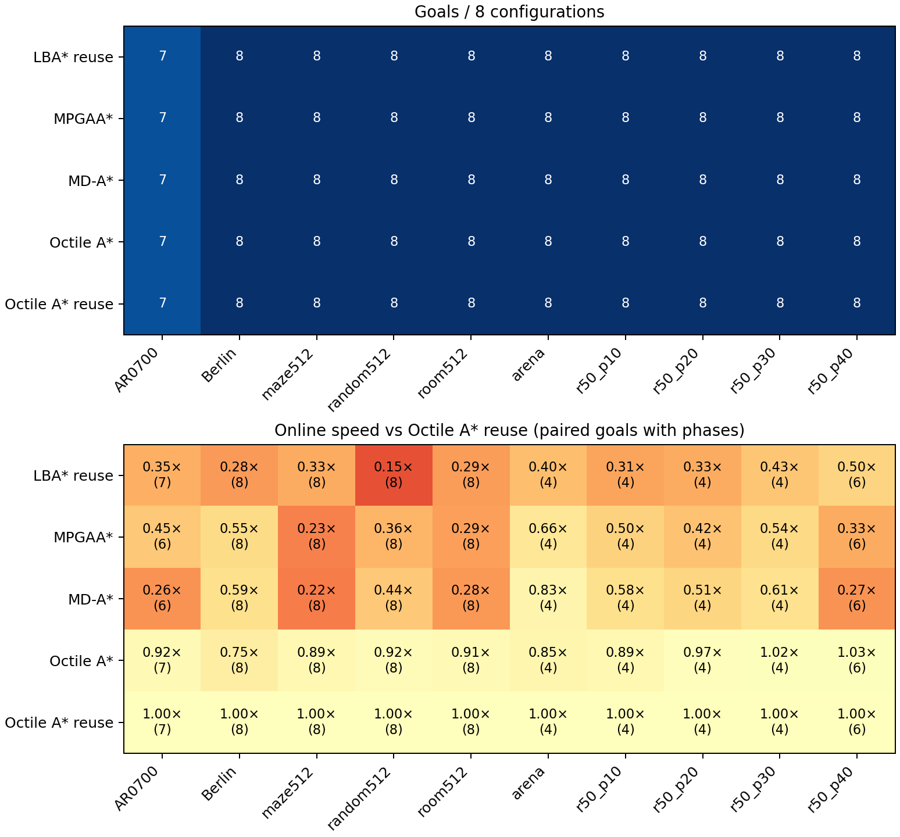

## Контроль с усиленным сеточным A\*

Отдельная серия добавляет два известных бейзлайна: обычный A\* с октильной эвристикой, плотными массивами со штампами поколений и выбором большего g при равных f; и тот же A\* с сохранением допустимого оптимального суффикса при отсутствии открытий. Это усиление реализации стандартного поиска, а не новый алгоритм. Диагонали и коллизионные проверки совпадают с основным grid8-протоколом. Конструктор плотных массивов включён в полное время и память.

На всех десяти grid8-картах взяты только четыре ранее заданные опорные точки (2,5), (8,10), (32,20), (64,30), по два тех же корня. Дополнительный контроль назначен после основной серии; сами четыре точки были выбраны до её измерений для повторов и памяти. Вместе с новыми бейзлайнами заново измерены LBA\* reuse, MPGAA\* и MD-A\*: **1 200 проездов времени** (три повтора) и **400 проездов памяти**. Это самостоятельная серия с единым бинарником в каждом проходе; её времена сравниваются только внутри неё. Порядок пяти методов перемешивается. Симулятор, сенсор, таймеры, лимит и независимый эталон совпадают с основной серией: копия harness отличается только выбором фабрики. Отпечатки траекторий, миров, ответов и работы трёх прежних методов точно совпали с основной серией на этих входах.

В таблице: цели / 8 конфигураций, медиана полного времени в мс среди успешных проездов, online-ускорение относительно Octile A\* reuse и число допустимых пар в скобках. Раскрытия, чтения и память здесь также являются медианами среди успешных проездов; все остановки сохранены в CSV. Пары требуют обеих целей, состоявшихся фаз и положительного online-времени. Отсутствие пар не означает равенство методов. Повторы не увеличивают число независимых корней.

### Усиленный контроль / AR0700

| Метод | Цели | Поиск, мс | Online × (пар) | Раскрытия | Чтения | Пик MiB |
| --- | --- | --- | --- | --- | --- | --- |
| LBA\* reuse | 7/8 | 171.25 | 0.35 (7) | 254783.00 | 611752.00 | 1.15 |
| MPGAA\* | 7/8 | 90.29 | 0.45 (6) | 39971.00 | 38091.00 | 2.66 |
| MD-A\* | 7/8 | 145.91 | 0.26 (6) | 59469.00 | 50409.00 | 3.34 |
| Octile A\* | 7/8 | 59.23 | 0.92 (7) | 199145.00 | 630188.00 | 1.76 |
| Octile A\* reuse | 7/8 | 52.21 | 1.00 (7) | 169074.00 | 537090.00 | 1.79 |

### Усиленный контроль / Berlin

| Метод | Цели | Поиск, мс | Online × (пар) | Раскрытия | Чтения | Пик MiB |
| --- | --- | --- | --- | --- | --- | --- |
| LBA\* reuse | 8/8 | 142.31 | 0.28 (8) | 204643.50 | 460339.50 | 1.08 |
| MPGAA\* | 8/8 | 63.21 | 0.55 (8) | 26454.00 | 29309.00 | 2.50 |
| MD-A\* | 8/8 | 64.76 | 0.59 (8) | 29223.00 | 27033.50 | 2.68 |
| Octile A\* | 8/8 | 59.12 | 0.75 (8) | 187952.00 | 518571.00 | 1.59 |
| Octile A\* reuse | 8/8 | 40.29 | 1.00 (8) | 115090.00 | 325908.00 | 1.60 |

### Усиленный контроль / MA_maze512

| Метод | Цели | Поиск, мс | Online × (пар) | Раскрытия | Чтения | Пик MiB |
| --- | --- | --- | --- | --- | --- | --- |
| LBA\* reuse | 8/8 | 1647.15 | 0.33 (8) | 2225585.00 | 4043354.00 | 3.72 |
| MPGAA\* | 8/8 | 1699.85 | 0.23 (8) | 665232.50 | 140289.50 | 9.63 |
| MD-A\* | 8/8 | 1778.91 | 0.22 (8) | 688898.00 | 143981.50 | 10.56 |
| Octile A\* | 8/8 | 607.18 | 0.89 (8) | 2539057.50 | 5392583.50 | 4.44 |
| Octile A\* reuse | 8/8 | 556.16 | 1.00 (8) | 2259956.50 | 4870087.00 | 4.47 |

### Усиленный контроль / MA_random512

| Метод | Цели | Поиск, мс | Online × (пар) | Раскрытия | Чтения | Пик MiB |
| --- | --- | --- | --- | --- | --- | --- |
| LBA\* reuse | 8/8 | 386.92 | 0.15 (8) | 526240.00 | 1289083.00 | 2.17 |
| MPGAA\* | 8/8 | 151.87 | 0.36 (8) | 54481.50 | 56642.00 | 5.05 |
| MD-A\* | 8/8 | 118.99 | 0.44 (8) | 49396.50 | 50191.50 | 5.48 |
| Octile A\* | 8/8 | 66.54 | 0.92 (8) | 241396.50 | 743017.50 | 4.82 |
| Octile A\* reuse | 8/8 | 65.21 | 1.00 (8) | 232011.50 | 714270.00 | 4.85 |

### Усиленный контроль / MA_room512

| Метод | Цели | Поиск, мс | Online × (пар) | Раскрытия | Чтения | Пик MiB |
| --- | --- | --- | --- | --- | --- | --- |
| LBA\* reuse | 8/8 | 1026.83 | 0.29 (8) | 1279445.00 | 2915412.50 | 4.37 |
| MPGAA\* | 8/8 | 1040.17 | 0.29 (8) | 309055.50 | 145480.50 | 9.85 |
| MD-A\* | 8/8 | 933.00 | 0.28 (8) | 323676.00 | 141070.00 | 10.41 |
| Octile A\* | 8/8 | 335.36 | 0.91 (8) | 1304555.50 | 3270407.00 | 4.45 |
| Octile A\* reuse | 8/8 | 311.33 | 1.00 (8) | 1181435.00 | 2967234.00 | 4.48 |

### Усиленный контроль / arena

| Метод | Цели | Поиск, мс | Online × (пар) | Раскрытия | Чтения | Пик MiB |
| --- | --- | --- | --- | --- | --- | --- |
| LBA\* reuse | 8/8 | 0.39 | 0.40 (4) | 551.50 | 1316.00 | 0.06 |
| MPGAA\* | 8/8 | 0.38 | 0.66 (4) | 294.00 | 627.50 | 0.12 |
| MD-A\* | 8/8 | 0.33 | 0.83 (4) | 291.50 | 628.00 | 0.13 |
| Octile A\* | 8/8 | 0.13 | 0.85 (4) | 496.00 | 1624.50 | 0.05 |
| Octile A\* reuse | 8/8 | 0.12 | 1.00 (4) | 387.00 | 1158.50 | 0.05 |

### Усиленный контроль / random50_p10

| Метод | Цели | Поиск, мс | Online × (пар) | Раскрытия | Чтения | Пик MiB |
| --- | --- | --- | --- | --- | --- | --- |
| LBA\* reuse | 8/8 | 0.22 | 0.31 (4) | 307.50 | 1010.50 | 0.04 |
| MPGAA\* | 8/8 | 0.26 | 0.50 (4) | 138.00 | 467.50 | 0.07 |
| MD-A\* | 8/8 | 0.21 | 0.58 (4) | 138.00 | 445.00 | 0.08 |
| Octile A\* | 8/8 | 0.08 | 0.89 (4) | 273.50 | 1009.00 | 0.05 |
| Octile A\* reuse | 8/8 | 0.09 | 1.00 (4) | 245.50 | 927.50 | 0.05 |

### Усиленный контроль / random50_p20

| Метод | Цели | Поиск, мс | Online × (пар) | Раскрытия | Чтения | Пик MiB |
| --- | --- | --- | --- | --- | --- | --- |
| LBA\* reuse | 8/8 | 0.26 | 0.33 (4) | 334.50 | 1276.00 | 0.04 |
| MPGAA\* | 8/8 | 0.32 | 0.42 (4) | 187.50 | 668.00 | 0.09 |
| MD-A\* | 8/8 | 0.29 | 0.51 (4) | 185.00 | 615.00 | 0.09 |
| Octile A\* | 8/8 | 0.08 | 0.97 (4) | 209.00 | 908.50 | 0.05 |
| Octile A\* reuse | 8/8 | 0.08 | 1.00 (4) | 205.50 | 889.50 | 0.05 |

### Усиленный контроль / random50_p30

| Метод | Цели | Поиск, мс | Online × (пар) | Раскрытия | Чтения | Пик MiB |
| --- | --- | --- | --- | --- | --- | --- |
| LBA\* reuse | 8/8 | 0.25 | 0.43 (4) | 329.50 | 1529.50 | 0.03 |
| MPGAA\* | 8/8 | 0.29 | 0.54 (4) | 156.00 | 627.00 | 0.07 |
| MD-A\* | 8/8 | 0.27 | 0.61 (4) | 154.50 | 599.00 | 0.08 |
| Octile A\* | 8/8 | 0.07 | 1.02 (4) | 232.00 | 1177.00 | 0.05 |
| Octile A\* reuse | 8/8 | 0.10 | 1.00 (4) | 221.50 | 1121.00 | 0.05 |

### Усиленный контроль / random50_p40

| Метод | Цели | Поиск, мс | Online × (пар) | Раскрытия | Чтения | Пик MiB |
| --- | --- | --- | --- | --- | --- | --- |
| LBA\* reuse | 8/8 | 0.66 | 0.50 (6) | 881.00 | 4064.50 | 0.05 |
| MPGAA\* | 8/8 | 0.82 | 0.33 (6) | 353.50 | 1538.00 | 0.13 |
| MD-A\* | 8/8 | 1.03 | 0.27 (6) | 504.50 | 1698.00 | 0.14 |
| Octile A\* | 8/8 | 0.24 | 1.03 (6) | 719.50 | 3416.00 | 0.05 |
| Octile A\* reuse | 8/8 | 0.25 | 1.00 (6) | 656.00 | 3116.00 | 0.05 |

{width=100%}

Из 40 измеренных точек карта/k/cr, 30 допускают online-сравнение MD-A\* и Octile A\* reuse на обоих корнях. На **2** из них MD-A\* быстрее минимум в 1.1 раза на каждом корне; на **28** он проигрывает хотя бы на одном корне. Это описательный итог на выбранном срезе, без заявления статистической значимости. Полный набор отношений и проигрышей сохранён в `cpp/navigation_controls/results/full/analysis/parameter_pairs.csv`.

Такой контроль отделяет выигрыш над исходной реализацией LBA\* от выигрыша над более сильным стандартным A\*. Октильная эвристика, плотные массивы и правило равных f изменены вместе; их отдельные вклады здесь не разделены. Повторно измеренные MPGAA\*/MD-A\* сохраняют исходную евклидову основу эвристики. Контроль не заменяет оптимизацию и настройку всех известных инкрементальных методов. Особенно нельзя переносить результаты grid8 на car16: октильная эвристика и один курс применимы только к grid8. Сохраняются ограничения двух корней, зависимых от траектории миров и связки n = k.

Полный список точек с online-выигрышем MD минимум 10% на обоих корнях приведён ниже. Это выбранная по результатам область выигрыша, а не оценка среднего эффекта всей серии. Параметры k/cr были заданы заранее.

| Карта | k = n | cr, % | Полное × | Online × | Мин. online × |
| --- | --- | --- | --- | --- | --- |
| Berlin | 2 | 5 | 1.27 | 1.61 | 1.23 |
| Berlin | 8 | 10 | 1.11 | 1.29 | 1.12 |
