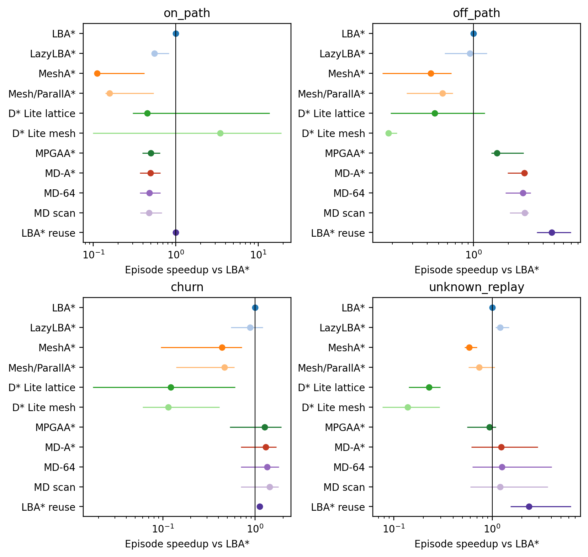
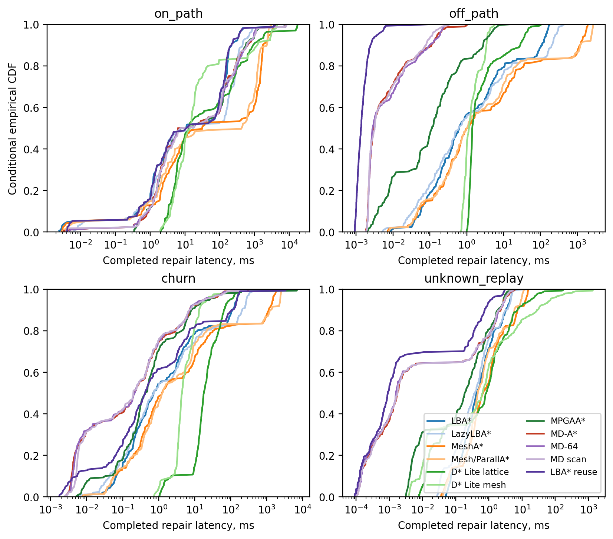
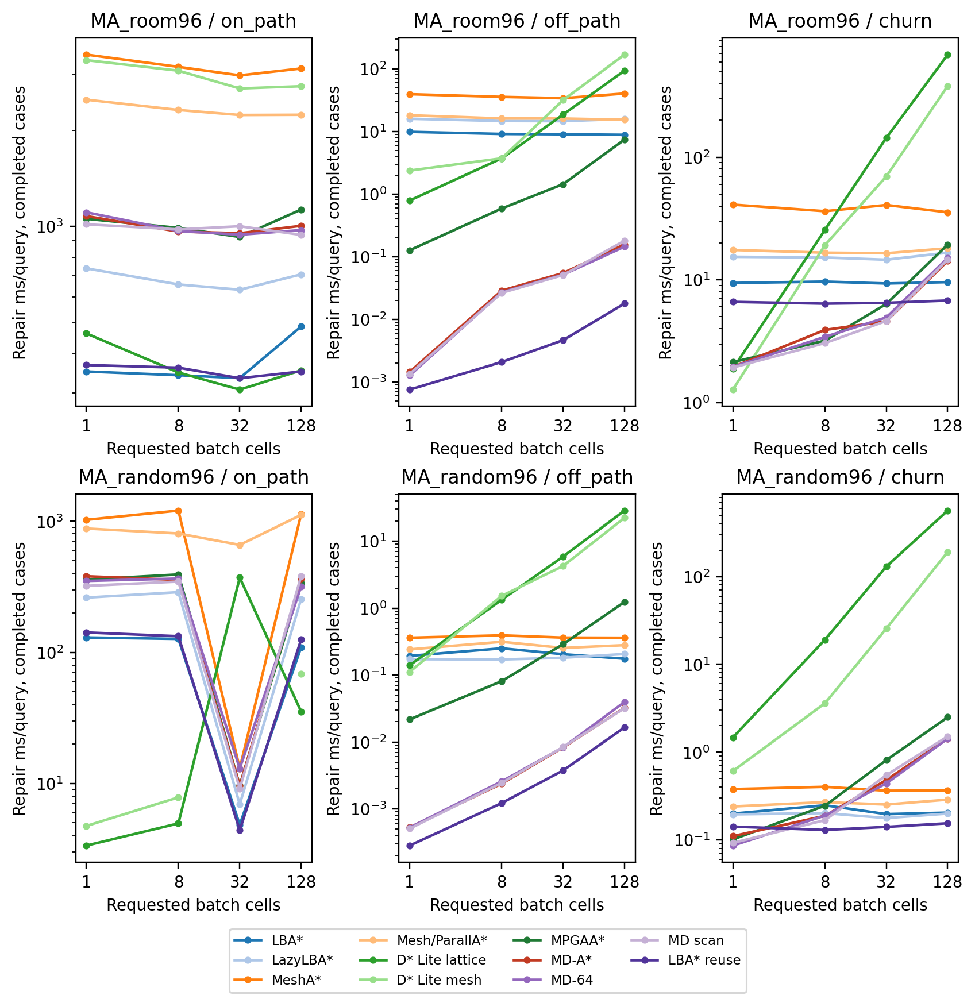
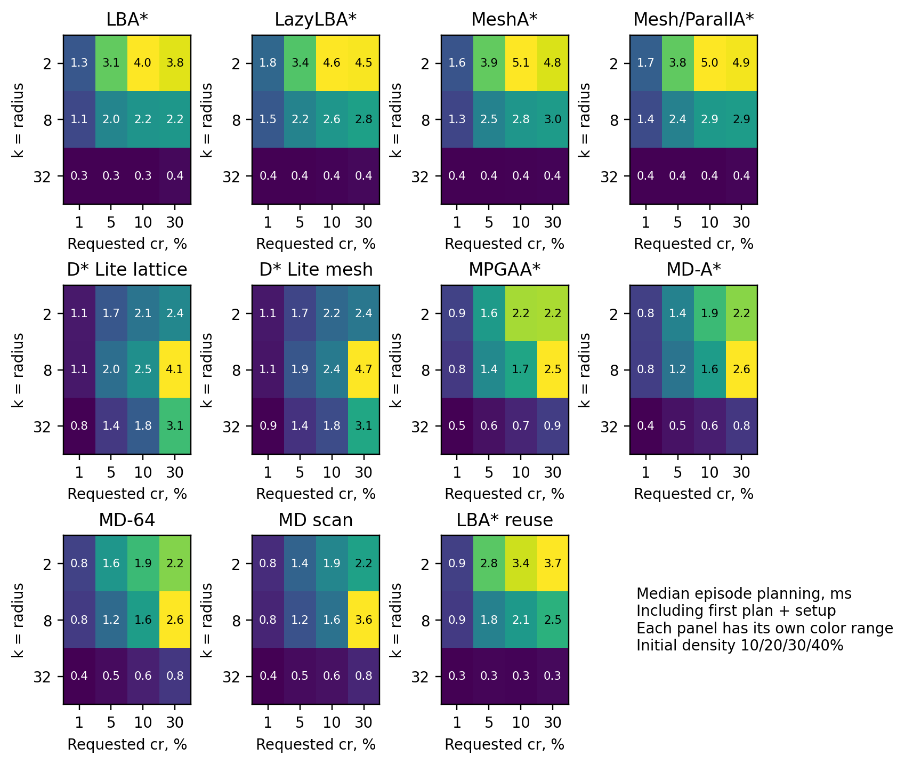

# Результат и исследовательский вопрос

Выполнены 7 458 измеряемых запусков эпизодов/миссий: 11 методов, три повтора, 186 зафиксированных replay-эпизодов и 40 параметризованных миссий с собственным движением. Записаны 164 379 строк и 152 298 фактических вызовов планировщика. Повторы и параметры с общими концами не считаются независимыми задачами. Статья оценивает, в каких режимах сохранение результатов поиска и отсрочка освобождений полезны, а где их накладные расходы или распространение изменений мешают.

Ниже ускорение означает время бейзлайна, делённое на время кандидата: значение больше 1 выгодно кандидату. Для полного эпизода учитываются конструктор, первый поиск и все последующие ремонты. Для онлайн-ремонта первый поиск исключён. В каждой паре сначала берётся медиана трёх повторных сумм, затем медиана отношений по сценариям. В скобках всегда указано число пар, завершённых обоими методами, из всех задач группы. Эти условные отношения рассматриваются вместе с долей завершения.

| Постановка | MPGAA / MD: эпизод | MPGAA / MD: ремонт | Reuse / MD: эпизод |
| --- | --- | --- | --- |
| car16 / Вставки на контрольной трассе | 1.04× (12/12) | 1.04× (12/12) | 0.51× (12/12) |
| car16 / Вставки вне контрольной трассы | 1.08× (12/12) | 23.51× (12/12) | 0.60× (12/12) |
| car16 / Блокировки и освобождения | 1.09× (11/12) | 1.11× (11/12) | 0.97× (11/12) |
| car16 / Раскрытие неизвестной карты: replay | 1.08× (12/12) | 1.12× (12/12) | 0.46× (12/12) |
| grid8 / Динамика с локальными наблюдениями | 1.05× (96/96) | 1.13× (92/96) | 1.00× (96/96) |

Преимущество MD-A\* зависит от нагрузки. При вставках вне пути ремонт ускорен относительно MPGAA\* в 23.51 раза, но полный эпизод — только в 1.08 раза. Более простой LBA\* reuse быстрее MD по полному эпизоду в 1.68 раза и выигрывает все 12 пар. Здесь сохранение допустимого суффикса важнее нового сертификата.

При принудительной поломке контрольного пути MD близок к MPGAA\*: отношение полных времён 1.04×, а LBA\* reuse быстрее MD примерно в 1.95 раза. На смешанных изменениях MD ускоряет онлайн-ремонт относительно MPGAA\* в 1.11 раза и относительно reuse в 1.99 раза, однако полный эпизод относительно reuse имеет отношение 0.97×. Главное ограничение: MD завершил 11/12 основных смешанных эпизодов, MPGAA\* — 12/12. Ускорение на 11 завершённых парах не устраняет этот ресурсный отказ.

В дополнительной grid8-динамике все методы завершили 96/96 эпизодов. MD даёт 1.13× по ремонту относительно MPGAA\* и 1.41× относительно reuse; по полному эпизоду отношения равны 1.05× и 1.00×. Таким образом, сильный эффект ремонта не превращается автоматически в сильный выигрыш всей задачи. Описательный межкартный интервал для полного MD/MPGAA сравнения включает единицу.

Контроль LBA\* reuse намеренно добавлен в эту серию: если при одних блокировках старый оптимальный суффикс остался допустимым, его можно вернуть без нового поиска. Это стандартное правило. Поэтому преимущество MD-A\* над повторным поиском на вставках вне пути само по себе не доказывает преимущество нового механизма. Отсрочку освобождений следует оценивать на смешанных изменениях и отдельно от сохранения пути.

# Методы, карты и опубликованные постановки

| Метод | Используемая работа / роль |
| --- | --- |
| LBA\* | Повторный A* по решётке примитивов |
| LazyLBA\* | Повторный поиск, отложенная проверка рёбер |
| MeshA\* | Повторный точный поиск по mesh с общими префиксами трасс |
| Mesh/ParallA\* | Приближённый mesh-контроль; качество приводится отдельно |
| D\* Lite lattice | Ремонт обратного поиска на решётке |
| D\* Lite mesh | Ремонт обратного поиска на mesh |
| MPGAA\* | Адаптивная эвристика, кеш рёбер и продолжения пути |
| MD-A\* | То же ядро MPGAA* плюс сохранённый суффикс и сертификат отложенных освобождений из mesh |
| MD-64 | Абляция: более сильная оценка с 64 парами направлений |
| MD scan | Абляция: полный просмотр отложенных клеток вместо переносимой очереди |
| LBA\* reuse | Стандартное сохранение допустимого оптимального суффикса, иначе обычный LBA* |

MD-A\* использует mesh для построения нижней оценки стоимости пути через освобождённую клетку. Нерелевантные освобождения остаются закрытыми в рабочей карте MPGAA\*, пока оценка не станет конкурентной сохранённому допустимому пути. При поломке пути возможны два вызова ядра; общий бюджет обоих одинаков с бюджетом других методов. Это не прямое сохранение дерева поиска MeshA\*. Описание и доказательство исходного MD-A\* сохранены в `docs/md_astar/method.md`; здесь алгоритм не меняется ради выбранных тестов.

Основная car16-модель содержит 284 примитива движения, 16 курсов и 412 mesh-конфигураций. Стоимость — исходная float-длина кривой, коллизии — полная supercover-трасса. Используются полные Berlin 256×256, AR0700SR 320×320 и DAO arena 49×49. Room/Random/Maze — фиксированные верхние левые окна 96×96 из официальных карт Moving AI 512×512. Дополнительная диагностическая карта пуста. Корни выбираются точным LBA\* до времени кандидатов; критерии и отказы сохранены.

Дополнительный grid8 — одна ориентация и восемь соседей со стоимостями 1 и $\sqrt{2}$, проверкой клетки назначения и евклидовой эвристикой. На четырёх фиксированных Bernoulli-картах 50×50 начальная плотность составляет 10/20/30/40%, по два корня на карту. Длинных общих префиксов mesh здесь нет; это контроль динамического режима, а не демонстрация геометрического преимущества mesh.

{width=100%}

Постановка неизвестной карты следует идее free-space assumption из Koenig & Likhachev, D\* Lite (AAAI 2002): неизвестные клетки считаются свободными. Сетка с динамическими изменениями и локальными наблюдениями адаптирует Hernández, Asín & Baier, MPGAA\* (AAAI 2015); перебираются $k\in\{2,8,32\}$ и запрошенный бюджет $cr\in\{1,5,10,30\}\%$, радиус наблюдения равен $k$. Официальные игровые и комнатные карты происходят из Moving AI (Sturtevant 2012).

Это адаптация, а не воспроизведение чисел этих статей. В частности, отличаются размеры, число задач, реализации и эвристики. В paper_dynamic свободная и занятая части бюджета независимо ограничены наличием клеток; начальная плотность при большом бюджете может дрейфовать. Основной анализ сохраняет все режимы, а ниже приводится чувствительность к исключению начального случая 10% / cr=30%.

# Протокол и измеряемые величины

В replay один точный контрольный агент задаёт общую последовательность стартов и правок. Вставки делаются на его будущей трассе (`on_path`), вне всей трассы (`off_path`) либо чередуются с освобождениями (`churn`). Есть optimistic unknown replay, серия размера пакета 1/8/32/128, интервалов 1/2/4/8 и видимости 8/16/32. «На пути» относится к контрольной трассе: другой метод может выбрать равностоимостный путь. Попадание в трассу не обязательно повышает оптимальную стоимость.

В отдельной closed-loop серии каждый алгоритм движется сам: карта вначале неизвестна, квадратный сенсор раскрывает окрестность, новый поиск запускается при обнаружении препятствий. Между вызовами исполняется текущий план. Радиус покрывает весь следующий примитив, который независимо проверяется по истинному миру. Полный будущий путь валидируется только по текущим знаниям. После достижения цели лишних запросов нет. Для качества движения используется отношение проеханной стоимости к оптимуму при полной информации. Незавершённая миссия не получает оценку качества по короткому пройденному отрезку.

| Режим | Запросов ремонта в основной/своей панели | С попаданием блокировки в контрольный путь | С освобождениями | Получено правок |
| --- | --- | --- | --- | --- |
| car16:on_path | 56 | 56 | 0 | 448 |
| car16:off_path | 96 | 0 | 0 | 768 |
| car16:churn | 96 | 24 | 84 | 1 440 |
| car16:unknown_replay | 96 | 29 | 0 | 529 |
| grid8:paper_dynamic | 2026 | 427 | 1652 | 19 494 |

Среда: AMD EPYC 9V74 80-Core Processor; Linux-6.18.57-x86_64-with-glibc2.41; GCC 14.2.0, `-O3 -DNDEBUG -std=c++17 -Wall -Wextra -Wpedantic`. Методы выполняются последовательно с перемешиванием порядка и тремя повторами. Во время измерений не запускаются сборки и тяжёлый анализ. CPU affinity и фиксирование частоты не использовались; небольшие процентные различия нельзя считать устойчивым лидерством по трём повторам.

Время запроса включает получение правок, поиск/ремонт, извлечение результата и обслуживание сохранённого пути. Конструктор измеряется отдельно и включён в полный эпизод. Подготовка общей модели/сертификата, сенсор, контрольный поиск и внешний валидатор находятся вне таймера. Поэтому это время планировщика, а не всей робототехнической системы.

Дополнительно измеряются раскрытия, обращения к клеткам при коллизиях, инструментированные уведомления MPGAA/MD, очередь снижения эвристики, вызовы ядра, доля сертификатов, отложенные/активированные клетки, пиковая запрошенная C++ heap-память, p50/p95/p99 задержек и стоимость движения. Для памяти используется отдельный бинарник; его времена не входят в сравнение. Пик — максимальные запрошенные байты внутри запроса с сохранённым состоянием и результатом, исключая общую модель/вход и проверку. Это не RSS и не включает стек или накладные расходы malloc.

Лимит — 1 000 000 раскрытий на запрос; у MD он общий для двух вызовов. У car16-миссий дополнительно 160 шагов, у grid8 — 256. Раскрытия разных графов имеют разную цену. В replay доказанное отсутствие пути — завершённый вычисленный ответ, превышение бюджета — нет; оставшиеся запросы после него сохранены как `skipped_after_cap`. В mission завершение означает именно достижение цели. Пределы не скрываются и не превращаются в дешёвые успехи.

Однократная подготовка фиксированной модели/сертификата амортизируется между задачами и не включена в эпизодные отношения. Для одиночного запуска MD следует дополнительно учитывать стоимость сертификата; её фактическое измерение приведено отдельно:

| Модель | Подготовка модели/входа/сертификата, мс | В том числе сертификат, мс |
| --- | --- | --- |
| car16 | 13.742 | 0.073 |
| grid8 | 4.114 | 0.006 |

# Сравнение всех методов

## Время и завершение

Для оценки шума измерения ниже приведён медианный относительный MAD полных времён: медиана абсолютных отклонений трёх повторов, делённая на их медиану, затем медиана по завершённым задачам. Это описательная мера с тремя повторами, а не доверительный интервал превосходства.

| Метод | На пути | Вне пути | Смешанные | Unknown replay | Grid dynamic |
| --- | --- | --- | --- | --- | --- |
| LBA\* | 1.2% | 2.0% | 0.7% | 2.8% | 2.9% |
| LazyLBA\* | 1.9% | 3.0% | 1.9% | 2.2% | 2.4% |
| MeshA\* | 4.0% | 1.5% | 1.0% | 1.3% | 2.6% |
| Mesh/ParallA\* | 3.4% | 1.1% | 1.1% | 2.8% | 2.3% |
| D\* Lite lattice | 2.5% | 2.8% | 2.7% | 1.6% | 2.4% |
| D\* Lite mesh | 1.0% | 1.4% | 3.0% | 1.7% | 2.2% |
| MPGAA\* | 2.4% | 1.7% | 2.3% | 2.1% | 2.5% |
| MD-A\* | 4.0% | 2.5% | 2.9% | 2.7% | 2.7% |
| MD-64 | 2.5% | 1.7% | 1.3% | 2.1% | 2.7% |
| MD scan | 2.9% | 1.7% | 2.6% | 2.0% | 1.9% |
| LBA\* reuse | 1.4% | 1.6% | 2.6% | 3.0% | 2.8% |

В клетках следующей таблицы — парное ускорение полного эпизода относительно LBA\* и число завершённых пар. Нельзя ранжировать две условные медианы, если они получены на разных подмножествах; для этого ниже есть профиль с учётом неудач.

| Метод | На пути | Вне пути | Смешанные | Unknown replay |
| --- | --- | --- | --- | --- |
| LBA\* | 1.00× (12/12) | 1.00× (12/12) | 1.00× (12/12) | 1.00× (12/12) |
| LazyLBA\* | 0.55× (12/12) | 0.93× (12/12) | 0.88× (12/12) | 1.21× (12/12) |
| MeshA\* | 0.11× (11/12) | 0.43× (12/12) | 0.44× (11/12) | 0.58× (12/12) |
| Mesh/ParallA\* | 0.16× (11/12) | 0.54× (12/12) | 0.46× (11/12) | 0.74× (12/12) |
| D\* Lite lattice | 0.45× (12/12) | 0.46× (12/12) | 0.12× (12/12) | 0.23× (12/12) |
| D\* Lite mesh | 3.44× (7/12) | 0.19× (10/12) | 0.11× (10/12) | 0.14× (12/12) |
| MPGAA\* | 0.50× (12/12) | 1.60× (12/12) | 1.26× (12/12) | 0.94× (12/12) |
| MD-A\* | 0.49× (12/12) | 2.76× (12/12) | 1.30× (11/12) | 1.23× (12/12) |
| MD-64 | 0.48× (12/12) | 2.69× (12/12) | 1.34× (11/12) | 1.26× (12/12) |
| MD scan | 0.47× (12/12) | 2.78× (12/12) | 1.43× (11/12) | 1.20× (12/12) |
| LBA\* reuse | 1.00× (12/12) | 4.76× (12/12) | 1.12× (12/12) | 2.36× (12/12) |

Завершённые вычислительные эпизоды по всем задачам соответствующей группы, без условия завершения LBA. Доказанный no-path здесь корректен; cap и пропущенные запросы означают незавершённый эпизод:

| Метод | На пути | Вне пути | Смешанные | Unknown replay | Grid dynamic |
| --- | --- | --- | --- | --- | --- |
| LBA\* | 12/12 | 12/12 | 12/12 | 12/12 | 96/96 |
| LazyLBA\* | 12/12 | 12/12 | 12/12 | 12/12 | 96/96 |
| MeshA\* | 11/12 | 12/12 | 11/12 | 12/12 | 96/96 |
| Mesh/ParallA\* | 11/12 | 12/12 | 11/12 | 12/12 | 96/96 |
| D\* Lite lattice | 12/12 | 12/12 | 12/12 | 12/12 | 96/96 |
| D\* Lite mesh | 7/12 | 10/12 | 10/12 | 12/12 | 96/96 |
| MPGAA\* | 12/12 | 12/12 | 12/12 | 12/12 | 96/96 |
| MD-A\* | 12/12 | 12/12 | 11/12 | 12/12 | 96/96 |
| MD-64 | 12/12 | 12/12 | 11/12 | 12/12 | 96/96 |
| MD scan | 12/12 | 12/12 | 11/12 | 12/12 | 96/96 |
| LBA\* reuse | 12/12 | 12/12 | 12/12 | 12/12 | 96/96 |

{width=100%}

| Метод | Grid8 dynamic: скорость / пары | Car16 mission: до цели | Grid8 mission: до цели | Grid8 dynamic: до конца |
| --- | --- | --- | --- | --- |
| LBA\* | 1.00× (96/96) | 15/16 | 24/24 | 96/96 |
| LazyLBA\* | 0.78× (96/96) | 15/16 | 24/24 | 96/96 |
| MeshA\* | 0.82× (96/96) | 15/16 | 24/24 | 96/96 |
| Mesh/ParallA\* | 0.80× (96/96) | 15/16 | 24/24 | 96/96 |
| D\* Lite lattice | 0.83× (96/96) | 15/16 | 24/24 | 96/96 |
| D\* Lite mesh | 0.82× (96/96) | 15/16 | 24/24 | 96/96 |
| MPGAA\* | 1.14× (96/96) | 15/16 | 24/24 | 96/96 |
| MD-A\* | 1.18× (96/96) | 15/16 | 24/24 | 96/96 |
| MD-64 | 1.13× (96/96) | 15/16 | 24/24 | 96/96 |
| MD scan | 1.20× (96/96) | 15/16 | 24/24 | 96/96 |
| LBA\* reuse | 1.06× (96/96) | 15/16 | 24/24 | 96/96 |

{width=100%}

## На каких картах есть преимущество

Победитель в таблице — точный метод, завершивший все задачи данной строки, с наименьшей суммой медианных времён полных эпизодов. Выбор не зависит от завершения LBA\*. Это описательная характеристика конкретной малой группы. Если разница мала, её следует понимать как сопоставимый результат. «Нет» означает отсутствие полностью завершившего точного метода, а не отсутствие допустимого пути.

| Карта | Режим | Лучший полный точный | MPGAA / MD | Reuse / MD |
| --- | --- | --- | --- | --- |
| AR0700 | churn | MD-A\* | 1.06× (2/2) | 1.25× (2/2) |
| AR0700 | off_path | LBA\* reuse | 1.01× (2/2) | 0.63× (2/2) |
| AR0700 | on_path | LBA\* reuse | 0.98× (2/2) | 0.49× (2/2) |
| AR0700 | unknown_replay | LBA\* reuse | 1.02× (2/2) | 0.47× (2/2) |
| Berlin | churn | D\* Lite lattice | 1.09× (1/2) | 2.68× (1/2) |
| Berlin | off_path | LBA\* reuse | 1.00× (2/2) | 0.61× (2/2) |
| Berlin | on_path | LBA\* reuse | 0.98× (2/2) | 0.85× (2/2) |
| Berlin | unknown_replay | LBA\* reuse | 1.06× (2/2) | 0.54× (2/2) |
| MA_maze96 | churn | MPGAA\* | 0.88× (2/2) | 1.71× (2/2) |
| MA_maze96 | off_path | LBA\* reuse | 0.99× (2/2) | 0.39× (2/2) |
| MA_maze96 | on_path | LBA\* reuse | 1.15× (2/2) | 0.73× (2/2) |
| MA_maze96 | unknown_replay | LBA\* reuse | 1.06× (2/2) | 0.43× (2/2) |
| MA_random96 | churn | LBA\* reuse | 1.15× (2/2) | 0.69× (2/2) |
| MA_random96 | off_path | LBA\* reuse | 1.39× (2/2) | 0.61× (2/2) |
| MA_random96 | on_path | D\* Lite lattice | 1.08× (2/2) | 0.40× (2/2) |
| MA_random96 | unknown_replay | LBA\* reuse | 1.08× (2/2) | 0.49× (2/2) |
| MA_room96 | churn | MD scan | 1.00× (2/2) | 1.18× (2/2) |
| MA_room96 | off_path | LBA\* reuse | 1.17× (2/2) | 0.56× (2/2) |
| MA_room96 | on_path | LBA\* reuse | 0.95× (2/2) | 0.36× (2/2) |
| MA_room96 | unknown_replay | LBA\* reuse | 1.15× (2/2) | 0.55× (2/2) |
| arena | churn | LazyLBA\* | 1.49× (2/2) | 0.42× (2/2) |
| arena | off_path | LBA\* reuse | 6.59× (2/2) | 0.59× (2/2) |
| arena | on_path | LBA\* reuse | 1.06× (2/2) | 0.52× (2/2) |
| arena | unknown_replay | LBA\* reuse | 3.01× (2/2) | 0.55× (2/2) |

{width=100%}

| Grid8-карта | Лучший полный точный | MPGAA / MD | Reuse / MD |
| --- | --- | --- | --- |
| random50_p10 | MD-A\* | 1.07× (24/24) | 1.19× (24/24) |
| random50_p20 | MD-A\* | 1.11× (24/24) | 0.96× (24/24) |
| random50_p30 | MD-A\* | 1.06× (24/24) | 1.28× (24/24) |
| random50_p40 | MPGAA\* | 0.97× (24/24) | 0.76× (24/24) |

На car16 LBA\* reuse имеет минимальную суммарную стоимость вычислений среди полностью завершивших точных методов на 6/6 карт при `off_path`, 6/6 при `unknown_replay` и 5/6 при `on_path`. Для смешанных изменений победители различаются: AR0700: MD-A\*; Berlin: D\* Lite lattice; MA_maze96: MPGAA\*; MA_random96: LBA\* reuse; MA_room96: MD scan; arena: LazyLBA\*. Это результат по двум корням на строку и сумме медианных времён, а не устойчивое ранжирование при малых процентных различиях.

В grid8-динамике победители по суммарному времени: random50_p10: MD-A\*; random50_p20: MD-A\*; random50_p30: MD-A\*; random50_p40: MPGAA\*. Медианные парные отношения могут ранжировать методы иначе, чем сумма; эти два критерия явно сохраняются в отчёте и не сводятся к одному универсальному победителю.

Наибольшие наблюдаемые отношения MPGAA/MD среди полностью завершённых строк: arena/off_path: 6.59×; arena/unknown_replay: 3.01×; arena/churn: 1.49×. Наименьшие: MA_maze96/churn: 0.88×; MA_room96/on_path: 0.95×; Berlin/on_path: 0.98×.

## Работа, память и задержки

| Метод | p95 на пути, мс | p95 вне пути, мс | p95 mixed, мс | p95 unknown, мс | p95 grid, мс |
| --- | --- | --- | --- | --- | --- |
| LBA\* | 358.711 | 140.466 | 147.262 | 4.386 | 0.331 |
| LazyLBA\* | 718.861 | 256.816 | 274.091 | 4.607 | 0.486 |
| MeshA\* | 2 893.716 | 1 638.166 | 1 503.874 | 13.046 | 0.380 |
| Mesh/ParallA\* | 2 444.382 | 2 439.287 | 2 372.933 | 9.469 | 0.384 |
| D\* Lite lattice | 1 901.046 | 38.185 | 97.032 | 18.654 | 0.213 |
| D\* Lite mesh | 3 043.222 | 3.660 | 21.746 | 72.726 | 0.219 |
| MPGAA\* | 1 025.213 | 4.218 | 26.585 | 2.767 | 0.207 |
| MD-A\* | 1 021.947 | 0.161 | 18.468 | 2.952 | 0.228 |
| MD-64 | 966.986 | 0.189 | 18.401 | 3.088 | 0.230 |
| MD scan | 1 030.086 | 0.118 | 18.560 | 3.016 | 0.227 |
| LBA\* reuse | 359.167 | 0.004 | 150.814 | 1.190 | 0.311 |

Перцентили и CDF ниже условны на запросах, завершённых в бюджете, и включают доказанную недостижимость. Они не включают пропущенные после лимита запросы и не заменяют долю завершения. Три повторных значения задержки не являются тремя независимыми задачами.

{width=100%}

| Метод | Peak на пути, MiB | Вне пути | Mixed | Unknown | Grid dynamic |
| --- | --- | --- | --- | --- | --- |
| LBA\* | 10.318 | 1.034 | 1.446 | 0.449 | 0.077 |
| LazyLBA\* | 17.650 | 1.531 | 2.876 | 0.713 | 0.116 |
| MeshA\* | 76.955 | 2.467 | 3.643 | 0.756 | 0.078 |
| Mesh/ParallA\* | 70.871 | 1.839 | 2.810 | 0.410 | 0.079 |
| D\* Lite lattice | 27.557 | 3.599 | 24.628 | 4.009 | 0.409 |
| D\* Lite mesh | 111.128 | 9.049 | 14.282 | 8.663 | 0.409 |
| MPGAA\* | 39.473 | 2.108 | 2.772 | 0.795 | 0.177 |
| MD-A\* | 39.504 | 2.269 | 2.704 | 0.823 | 0.183 |
| MD-64 | 39.504 | 2.269 | 2.704 | 0.823 | 0.183 |
| MD scan | 39.504 | 2.269 | 2.704 | 0.823 | 0.183 |
| LBA\* reuse | 10.324 | 1.034 | 1.449 | 0.451 | 0.077 |

{width=100%}

| Режим | Метод | Раскрытия ремонта | Чтения клеток ремонта | Уведомления ремонта | Сертификаты |
| --- | --- | --- | --- | --- | --- |
| car16:on_path | MPGAA\* | 104 231 | 1 092 890 | 14 688 | 0.0% |
| car16:on_path | MD-A\* | 104 231 | 1 092 890 | 14 688 | 1.8% |
| car16:on_path | LBA\* reuse | 111 078 | 3 041 727 | 0 | 0.0% |
| car16:off_path | MPGAA\* | 0 | 0 | 5 712 | 0.0% |
| car16:off_path | MD-A\* | 0 | 0 | 0 | 100.0% |
| car16:off_path | LBA\* reuse | 0 | 0 | 0 | 100.0% |
| car16:churn | MPGAA\* | 1 490 | 31 212 | 14 076 | 0.0% |
| car16:churn | MD-A\* | 1 102 | 26 370 | 9 792 | 38.5% |
| car16:churn | LBA\* reuse | 8 132 | 307 719 | 0 | 12.5% |
| car16:unknown_replay | MPGAA\* | 363 | 12 416 | 14 484 | 0.0% |
| car16:unknown_replay | MD-A\* | 363 | 12 416 | 12 648 | 64.6% |
| car16:unknown_replay | LBA\* reuse | 434 | 24 350 | 0 | 69.8% |
| grid8:paper_dynamic | MPGAA\* | 194 | 548 | 880 | 0.0% |
| grid8:paper_dynamic | MD-A\* | 193 | 411 | 496 | 36.6% |
| grid8:paper_dynamic | LBA\* reuse | 1 005 | 3 582 | 0 | 15.4% |

Уведомления и очередь снижения эвристики инструментированы у MPGAA/MD. Их нулевые значения у других методов не означают отсутствие всякой работы обновления. Раскрытие решётки и mesh — разные единицы; время и обращения к клеткам дополняют этот счётчик. Полная работа эпизода включает первичный поиск, а таблица выше — только ремонт.

{width=100%}

Меньшее число раскрытий не гарантирует меньшую задержку. В grid8-динамике медиана онлайн-раскрытий D\* Lite lattice составляет 14, у MD — 193, но медиана суммарного времени ремонта — 0.967 и 0.586 мс соответственно. Уведомления, обслуживание графа и извлечение пути тоже входят во время.

В основной car16-серии поломок пути медианный наблюдаемый peak MD равен 39.50 MiB, у reuse — 10.32 MiB. На всём replay максимальный наблюдаемый requested heap D\* Lite lattice достиг 808.57 MiB. Экономия раскрытий может сопровождаться существенной ценой сохранённого состояния.

# Зависимость от изменений и видимости

{width=100%}

{width=100%}

| Панель | Режим | Параметр | N | MPGAA / MD: эпизод | MPGAA / MD: ремонт | Reuse / MD: эпизод |
| --- | --- | --- | --- | --- | --- | --- |
| batch | churn | 1 | 2 | 0.99× (2/2) | 1.01× (2/2) | 1.04× (2/2) |
| batch | churn | 8 | 2 | 1.08× (2/2) | 1.06× (2/2) | 0.81× (2/2) |
| batch | churn | 32 | 2 | 1.33× (2/2) | 1.53× (2/2) | 0.64× (2/2) |
| batch | churn | 128 | 2 | 1.44× (2/2) | 1.55× (2/2) | 0.33× (2/2) |
| batch | off_path | 1 | 2 | 1.00× (2/2) | 64.39× (2/2) | 0.58× (2/2) |
| batch | off_path | 8 | 2 | 1.25× (2/2) | 27.20× (2/2) | 0.56× (2/2) |
| batch | off_path | 32 | 2 | 1.83× (2/2) | 30.60× (2/2) | 0.55× (2/2) |
| batch | off_path | 128 | 2 | 4.07× (2/2) | 42.67× (2/2) | 0.51× (2/2) |
| batch | on_path | 1 | 2 | 0.96× (2/2) | 0.96× (2/2) | 0.36× (2/2) |
| batch | on_path | 8 | 2 | 1.06× (2/2) | 1.06× (2/2) | 0.38× (2/2) |
| batch | on_path | 32 | 2 | 0.99× (2/2) | 0.99× (2/2) | 0.42× (2/2) |
| batch | on_path | 128 | 2 | 1.02× (2/2) | 1.03× (2/2) | 0.35× (2/2) |
| frequency | churn | 1 | 4 | 1.11× (4/4) | 1.13× (4/4) | 1.24× (4/4) |
| frequency | churn | 2 | 4 | 1.07× (4/4) | 1.11× (4/4) | 0.81× (4/4) |
| frequency | churn | 4 | 4 | 1.03× (4/4) | 1.02× (4/4) | 0.65× (4/4) |
| frequency | churn | 8 | 4 | 1.05× (4/4) | 44.06× (4/4) | 0.59× (4/4) |
| visibility | unknown_replay | 8 | 4 | 1.08× (4/4) | 1.13× (4/4) | 0.49× (4/4) |
| visibility | unknown_replay | 16 | 4 | 1.06× (4/4) | 1.08× (4/4) | 0.38× (4/4) |
| visibility | unknown_replay | 32 | 4 | 1.17× (4/4) | 1.28× (4/4) | 0.55× (4/4) |

{width=100%}

{width=100%}

Для той же сеточной серии ниже показаны число запросов и средняя стоимость одного ремонта внутри эпизода. Большой k уменьшает число вызовов и приближает старт к цели; снижение полного времени на тепловой карте нельзя трактовать как ускорение каждого ремонта.

| k | cr, % | Медиана ремонтов MD | MD, мс/ремонт | MPGAA/MD: эпизод | MPGAA/MD: ремонт | Reuse/MD: эпизод |
| --- | --- | --- | --- | --- | --- | --- |
| 2 | 1 | 20.5 | 0.021 | 1.12× (8/8) | 1.19× (8/8) | 1.32× (8/8) |
| 2 | 5 | 36.5 | 0.027 | 1.00× (8/8) | 1.00× (8/8) | 1.64× (8/8) |
| 2 | 10 | 41.0 | 0.033 | 1.02× (8/8) | 1.04× (8/8) | 1.56× (8/8) |
| 2 | 30 | 41.5 | 0.042 | 0.95× (8/8) | 0.94× (8/8) | 1.39× (8/8) |
| 8 | 1 | 14.5 | 0.021 | 1.04× (8/8) | 1.22× (8/8) | 1.05× (8/8) |
| 8 | 5 | 26.5 | 0.028 | 1.06× (8/8) | 1.11× (8/8) | 1.18× (8/8) |
| 8 | 10 | 30.0 | 0.043 | 0.98× (8/8) | 0.98× (8/8) | 1.05× (8/8) |
| 8 | 30 | 31.0 | 0.061 | 1.01× (8/8) | 1.01× (8/8) | 0.80× (8/8) |
| 32 | 1 | 1.0 | 0.006 | 1.09× (8/8) | 10.62× (7/8) | 0.65× (8/8) |
| 32 | 5 | 1.0 | 0.028 | 1.07× (8/8) | 4.11× (7/8) | 0.58× (8/8) |
| 32 | 10 | 1.0 | 0.187 | 1.18× (8/8) | 1.84× (7/8) | 0.53× (8/8) |
| 32 | 30 | 1.0 | 0.361 | 1.07× (8/8) | 1.31× (7/8) | 0.47× (8/8) |

При k=2 отношение полных времён reuse/MD лежит в диапазоне 1.32–1.64 в рассмотренных четырёх бюджетах, при k=32 — 0.47–0.65. При k=8 диапазон равен 0.80–1.18; результат зависит от бюджета. Это позволяет различать частые небольшие локальные ремонты и редкие крупные переоценки карты, а не рекомендовать один метод для всех потоков изменений.

Проверка чувствительности grid8 к ограничению начального пула: MPGAA/MD на всей серии 1.05× (96/96); на подмножестве без запрошенного бюджета выше начальной доступности 1.05× (90/90). Основные таблицы сохраняют все 96 случаев. Реально доставленные правки, плотность и глобальные изменения сохранены в контекстах; номинальный cr не равен числу наблюдаемых клеток.

# Неизвестная карта и цена исследования

| Метод | Car16: до цели | Car16: проезд / оптимум | Grid8: до цели | Grid8: проезд / оптимум |
| --- | --- | --- | --- | --- |
| LBA\* | 15/16 | 1.00 | 24/24 | 1.01 |
| LazyLBA\* | 15/16 | 1.00 | 24/24 | 1.01 |
| MeshA\* | 15/16 | 1.00 | 24/24 | 1.01 |
| Mesh/ParallA\* | 15/16 | 1.01 | 24/24 | 1.01 |
| D\* Lite lattice | 15/16 | 1.00 | 24/24 | 1.02 |
| D\* Lite mesh | 15/16 | 1.00 | 24/24 | 1.02 |
| MPGAA\* | 15/16 | 1.00 | 24/24 | 1.02 |
| MD-A\* | 15/16 | 1.00 | 24/24 | 1.02 |
| MD-64 | 15/16 | 1.00 | 24/24 | 1.02 |
| MD scan | 15/16 | 1.00 | 24/24 | 1.02 |
| LBA\* reuse | 15/16 | 1.00 | 24/24 | 1.01 |

| Модель | Радиус | Метод | До цели | Проезд / оптимум | Карта раскрыта | Ремонт, мс/вызов |
| --- | --- | --- | --- | --- | --- | --- |
| car16 | 8 | LBA\* | 7/8 | 1.01 | 32.2% | 0.280 |
| car16 | 8 | D\* Lite lattice | 7/8 | 1.01 | 32.2% | 1.883 |
| car16 | 8 | MPGAA\* | 7/8 | 1.01 | 32.2% | 0.357 |
| car16 | 8 | MD-A\* | 7/8 | 1.01 | 32.2% | 0.299 |
| car16 | 8 | LBA\* reuse | 7/8 | 1.01 | 32.2% | 0.066 |
| car16 | 16 | LBA\* | 8/8 | 1.00 | 54.8% | 0.447 |
| car16 | 16 | D\* Lite lattice | 8/8 | 1.00 | 55.2% | 3.851 |
| car16 | 16 | MPGAA\* | 8/8 | 1.00 | 55.3% | 0.790 |
| car16 | 16 | MD-A\* | 8/8 | 1.00 | 55.3% | 0.675 |
| car16 | 16 | LBA\* reuse | 8/8 | 1.00 | 54.8% | 0.242 |
| grid8 | 1 | LBA\* | 8/8 | 1.07 | 7.9% | 0.075 |
| grid8 | 1 | D\* Lite lattice | 8/8 | 1.07 | 7.6% | 0.024 |
| grid8 | 1 | MPGAA\* | 8/8 | 1.07 | 7.7% | 0.016 |
| grid8 | 1 | MD-A\* | 8/8 | 1.07 | 7.7% | 0.015 |
| grid8 | 1 | LBA\* reuse | 8/8 | 1.07 | 7.9% | 0.033 |
| grid8 | 4 | LBA\* | 8/8 | 1.01 | 24.9% | 0.070 |
| grid8 | 4 | D\* Lite lattice | 8/8 | 1.02 | 24.3% | 0.031 |
| grid8 | 4 | MPGAA\* | 8/8 | 1.02 | 24.5% | 0.016 |
| grid8 | 4 | MD-A\* | 8/8 | 1.02 | 24.5% | 0.013 |
| grid8 | 4 | LBA\* reuse | 8/8 | 1.01 | 24.9% | 0.024 |
| grid8 | 8 | LBA\* | 8/8 | 1.01 | 46.8% | 0.073 |
| grid8 | 8 | D\* Lite lattice | 8/8 | 1.02 | 46.2% | 0.039 |
| grid8 | 8 | MPGAA\* | 8/8 | 1.02 | 46.7% | 0.016 |
| grid8 | 8 | MD-A\* | 8/8 | 1.02 | 46.7% | 0.015 |
| grid8 | 8 | LBA\* reuse | 8/8 | 1.01 | 46.8% | 0.023 |

{width=100%}

{width=100%}

{width=100%}

На car16 у каждого метода достигнуто 7/8 целей при радиусе 8 и 8/8 при радиусе 16. Наборы неудачных траекторий могут различаться. Следовательно, увеличение видимости устранило неудачи по лимиту движения в этой выборке, а смена поискового метода не дала прироста общей доли достижения цели. В grid8 все 24 миссии завершены всеми методами.

Это не ошибка точного поиска: меняются равностоимостные планы и последующие наблюдения. Выбор по одной задержке не учитывал бы эту цену.

Медиана проезд/оптимум на завершённых grid8-миссиях равна 1.024 для MD, 1.021 для D\* Lite lattice и 1.006 для LBA\* reuse. В приведённом примере плотности 40% и радиуса 1 MD едет примерно 1.31 от оптимума против 1.21 у D\* Lite lattice, одновременно тратя меньше времени на поиск.

В статической неизвестной карте знания меняются только через обнаружение препятствий. Здесь нет освобождений, поэтому новый сертификат отложенных освобождений не используется. Возможный выигрыш MD на этой серии связан с сохранением пути и адаптивным ядром; он не является самостоятельным доказательством преимущества отсрочки. Разные даже точные методы могут выбрать разные равностоимостные планы, затем получить разные наблюдения и итоговую длину проезда. Оптимальность поиска по знаниям не означает оптимальную разведку неизвестного мира.

# Механизм MD, абляции и история

| Модель | Есть открытия | Метод | Попыток | Cap | Сертификаты | Два вызова | Макс. отложено |
| --- | --- | --- | --- | --- | --- | --- | --- |
| car16 | нет | MPGAA\* | 1 224 | 0 | 0.0% | 0.0% | 0 |
| car16 | нет | MD-A\* | 1 224 | 0 | 68.6% | 0.0% | 0 |
| car16 | нет | MD-64 | 1 224 | 0 | 68.6% | 0.0% | 0 |
| car16 | нет | MD scan | 1 224 | 0 | 68.6% | 0.0% | 0 |
| car16 | нет | LBA\* reuse | 1 224 | 0 | 69.9% | 0.0% | 0 |
| car16 | да | MPGAA\* | 1 011 | 0 | 0.0% | 0.0% | 0 |
| car16 | да | MD-A\* | 1 011 | 3 | 63.5% | 6.5% | 830 |
| car16 | да | MD-64 | 1 011 | 3 | 63.5% | 6.5% | 830 |
| car16 | да | MD scan | 1 011 | 3 | 63.5% | 6.5% | 830 |
| car16 | да | LBA\* reuse | 1 011 | 0 | 0.0% | 0.0% | 0 |
| grid8 | нет | MPGAA\* | 1 122 | 0 | 0.0% | 0.0% | 0 |
| grid8 | нет | MD-A\* | 1 122 | 0 | 69.5% | 0.0% | 226 |
| grid8 | нет | MD-64 | 1 122 | 0 | 69.5% | 0.0% | 226 |
| grid8 | нет | MD scan | 1 122 | 0 | 69.5% | 0.0% | 226 |
| grid8 | нет | LBA\* reuse | 1 122 | 0 | 83.7% | 0.0% | 0 |
| grid8 | да | MPGAA\* | 4 956 | 0 | 0.0% | 0.0% | 0 |
| grid8 | да | MD-A\* | 4 956 | 0 | 29.2% | 24.2% | 370 |
| grid8 | да | MD-64 | 4 956 | 0 | 29.2% | 24.2% | 370 |
| grid8 | да | MD scan | 4 956 | 0 | 29.2% | 24.2% | 370 |
| grid8 | да | LBA\* reuse | 4 956 | 0 | 0.0% | 0.0% | 0 |

Эта таблица включает повторные попытки и потому описывает механизм, а не независимую выборку. Столбец «есть открытия» относится к текущему пакету: старые отложенные клетки могут активироваться и позже. Сравнение MD-64 и MD scan с MD-A\* изолирует более сильную оценку и способ обслуживания отложенного множества. Сравнение со стандартным A\* reuse нужно для вставок без освобождений, а MPGAA\* использует буквально то же ядро, что MD.

| Режим | Сертификаты MD при новых освобождениях | Цена совпадает с глобальной Euclid LB | Цена выше простой LB |
| --- | --- | --- | --- |
| car16:churn | 25 | 1 | 24 |
| car16:history | 156 | 156 | 0 |
| car16:off_path | 0 | 0 | 0 |
| car16:on_path | 0 | 0 | 0 |
| car16:unknown_replay | 0 | 0 | 0 |
| grid8:paper_dynamic | 482 | 50 | 432 |

В этой дополнительной проверке повторы не умножают число запросов. Совпадение с глобальной геометрической нижней оценкой определяется с допуском $10^{-7}$. Если уже допустимый путь достигает общей нижней оценки, его можно сохранить даже при освобождениях без отдельного сертификата каждой клетки. Поэтому такие ответы не доказывают необходимость mesh-сертификата. В частности, пустая диагональная диагностика истории проверяет обслуживание отложенного множества, но её большое ускорение само по себе слабо обосновывает новую поисковую идею. Положительный разрыв исключает только эту простейшую проверку; возможны и более сильные известные нижние оценки. Основной `lba_reuse` не содержит такой дополнительной проверки, что ограничивает вывод о новизне его превосходства.

| История | Лучший полный точный | MPGAA / MD | Reuse / MD |
| --- | --- | --- | --- |
| synthetic_open96 | MD-64 | 31.80× (4/4) | 9.81× (4/4) |

{width=100%}

{width=100%}

Есть и нетривиальные срабатывания относительно простой глобальной геометрической проверки: в основных смешанных car16-эпизодах 24 из 25 сертификатов при новых освобождениях имеют стоимость выше Euclid LB; в grid8 — 432 из 482. Это подтверждает полезность дополнительного условия для данной реализации, но не исключает более сильных известных глобальных нижних оценок или оптимизации уведомлений.

На 64-событийной диагностике очередь MD выполнила 0 уточнений при фиксированном старте и 9 при возвращающемся, полный просмотр — 9683 в обоих случаях. Размер отложенного множества достиг 248 клеток. Это ясное преимущество обслуживания очередью; эффект нельзя переносить на произвольную навигацию. MD-64 не показал устойчивого общего преимущества, оправдывающего более дорогую оценку, на рассмотренных размерах.

# Проверка качества и границы выводов

Расширение нагрузок выявило реальный дефект прежнего D\* Lite mesh: на неизвестной комнатной карте извлечение дошло до вершины с конечным g и бесконечным rhs. Причина — несовместимость точного порядка OPEN и epsilon-лексикографического условия остановки на нулевых mesh-префиксах. Для обеих версий D\* Lite экспериментальный класс теперь обрабатывает всю границу первого компонента ключа; перенос ключей сравнивается точно, как очередь. Это консервативное численное исправление бейзлайна, не новый поиск. Проблемная миссия включена в регрессию.

Первый остановленный проход и его исходники сохранены в `cpp/experiments/results/pre_boundary_fix`. Все основные времена после исправления измерены заново одним бинарником; исходные карты, корни и события сохранены. Общие старые заголовки и результаты прежних задач не менялись. Поэтому вывод о качестве относится к исправленной экспериментальной реализации D\* Lite, а найденная ошибка также является результатом проверки артефакта. Консервативная обработка границы может раскрывать дополнительные равные по первому ключу вершины; эти числа не следует выдавать за предельную скорость оптимизированного D\* Lite.

В этой серии не обнаружено расхождений оптимальной стоимости точных методов на завершённых запросах: 0. Каждый возвращённый путь независимо проверялся по клеткам/курсам/стоимости. Проход памяти воспроизвёл те же ответы, пути и счётчики работы, что обычный повтор 0: passed. Для приближённого Mesh/ParallA\* максимальные наблюдаемые отношения стоимости плана к точному контролю:

| Режим | Максимальная стоимость / оптимум |
| --- | --- |
| car16:churn | 1.1832 |
| car16:history | 1.0000 |
| car16:off_path | 1.0999 |
| car16:on_path | 1.1412 |
| car16:unknown_mission | 1.5997 |
| car16:unknown_replay | 1.0100 |
| grid8:paper_dynamic | 1.0000 |
| grid8:unknown_mission | 1.0000 |

В протокольных тестах: 88 replay-строк и 22 миссии; проверены повторная активация старого открытия с двумя вызовами, стандартный reuse, различие cap/no-path, сохранение пропущенных запросов, движение по истинной карте и совпадение отдельного прохода памяти. Те же проверки прошли ASAN/UBSan. Прежние тесты общих ядер сохранены отдельно; новая серия не меняет их исходники.

В измерениях сохранены 54 событий превышения бюджета, 150 пропущенных после них строк и 33 достижений лимита движения (с учётом повторов). Ниже — исходы по уникальным параметризованным эпизодам, без умножения на три:

Дополнительно независимый Python Dijkstra без общих классов графа/поиска проверил новую grid8-модель на 216 снимках: 2376 ответов 11 методов и идентичность отдельного прохода памяти. Отдельная регрессия float-границы D* Lite выполнила четыре реальные car16-миссии до цели.

| Модель / задача | Метод | Завершено / всего | Cap | Лимит шагов | No path |
| --- | --- | --- | --- | --- | --- |
| car16/replay | LBA\* | 90/90 | 0 | 0 | 16 |
| car16/replay | LazyLBA\* | 90/90 | 0 | 0 | 16 |
| car16/replay | MeshA\* | 88/90 | 2 | 0 | 14 |
| car16/replay | Mesh/ParallA\* | 88/90 | 2 | 0 | 14 |
| car16/replay | D\* Lite lattice | 90/90 | 0 | 0 | 16 |
| car16/replay | D\* Lite mesh | 79/90 | 11 | 0 | 12 |
| car16/replay | MPGAA\* | 90/90 | 0 | 0 | 16 |
| car16/replay | MD-A\* | 89/90 | 1 | 0 | 15 |
| car16/replay | MD-64 | 89/90 | 1 | 0 | 15 |
| car16/replay | MD scan | 89/90 | 1 | 0 | 15 |
| car16/replay | LBA\* reuse | 90/90 | 0 | 0 | 16 |
| car16/mission | LBA\* | 15/16 | 0 | 1 | 0 |
| car16/mission | LazyLBA\* | 15/16 | 0 | 1 | 0 |
| car16/mission | MeshA\* | 15/16 | 0 | 1 | 0 |
| car16/mission | Mesh/ParallA\* | 15/16 | 0 | 1 | 0 |
| car16/mission | D\* Lite lattice | 15/16 | 0 | 1 | 0 |
| car16/mission | D\* Lite mesh | 15/16 | 0 | 1 | 0 |
| car16/mission | MPGAA\* | 15/16 | 0 | 1 | 0 |
| car16/mission | MD-A\* | 15/16 | 0 | 1 | 0 |
| car16/mission | MD-64 | 15/16 | 0 | 1 | 0 |
| car16/mission | MD scan | 15/16 | 0 | 1 | 0 |
| car16/mission | LBA\* reuse | 15/16 | 0 | 1 | 0 |
| grid8/replay | LBA\* | 96/96 | 0 | 0 | 1 |
| grid8/replay | LazyLBA\* | 96/96 | 0 | 0 | 1 |
| grid8/replay | MeshA\* | 96/96 | 0 | 0 | 1 |
| grid8/replay | Mesh/ParallA\* | 96/96 | 0 | 0 | 1 |
| grid8/replay | D\* Lite lattice | 96/96 | 0 | 0 | 1 |
| grid8/replay | D\* Lite mesh | 96/96 | 0 | 0 | 1 |
| grid8/replay | MPGAA\* | 96/96 | 0 | 0 | 1 |
| grid8/replay | MD-A\* | 96/96 | 0 | 0 | 1 |
| grid8/replay | MD-64 | 96/96 | 0 | 0 | 1 |
| grid8/replay | MD scan | 96/96 | 0 | 0 | 1 |
| grid8/replay | LBA\* reuse | 96/96 | 0 | 0 | 1 |
| grid8/mission | LBA\* | 24/24 | 0 | 0 | 0 |
| grid8/mission | LazyLBA\* | 24/24 | 0 | 0 | 0 |
| grid8/mission | MeshA\* | 24/24 | 0 | 0 | 0 |
| grid8/mission | Mesh/ParallA\* | 24/24 | 0 | 0 | 0 |
| grid8/mission | D\* Lite lattice | 24/24 | 0 | 0 | 0 |
| grid8/mission | D\* Lite mesh | 24/24 | 0 | 0 | 0 |
| grid8/mission | MPGAA\* | 24/24 | 0 | 0 | 0 |
| grid8/mission | MD-A\* | 24/24 | 0 | 0 | 0 |
| grid8/mission | MD-64 | 24/24 | 0 | 0 | 0 |
| grid8/mission | MD scan | 24/24 | 0 | 0 | 0 |
| grid8/mission | LBA\* reuse | 24/24 | 0 | 0 | 0 |

Ресурсный контрпример MD — `car16__Berlin__churn__s48102__b8__k2__r8`, запрос 8: после 8 блокировок и 8 освобождений пути нет. MD сделал два вызова ядра, активировал 55 старых освобождений и исчерпал общий миллион раскрытий; MPGAA\* доказал no-path за 674792 раскрытия одним вызовом. Это прямой недостаток двухфазного ремонта при потере допустимого пути. Все три MD-варианта имеют этот отказ, тогда как MPGAA\*, LBA\*, D\* Lite lattice и reuse завершают все 90 car16 replay-эпизодов. D\* Lite mesh завершает 79/90; MeshA\* и Mesh/ParallA\* — 88/90.

Инженерное качество исследования существенно улучшено: добавлены реальные новые режимы, строгая проверка ответов/движений и инструментирования, независимый Dijkstra, сохранённый воспроизводимый контрпример старого бейзлайна и полный повтор после его исправления. Экспериментальное подтверждение универсального преимущества нового алгоритма остаётся слабым. Для сильной конференционной заявки нужны дополнительные независимые корни и большие полные карты, контроль с глобальной LB и более эффективные уведомления бейзлайна. В текущем виде артефакт обосновывает область применимости и выявляет конкретные недостатки, а не превосходство над всеми известными реализациями.

Разнообразие сценариев значительно расширено, но внешняя валидность остаётся ограниченной: по два корня на карту; окна 96×96 и короткие проезды, а не полномасштабные 512×512/1000×1000 миссии из литературы; синтетическая сеточная серия вспомогательна; квадратный сенсор без окклюзии; реализации данного репозитория, а не официальные оптимизированные пакеты авторов. У MPGAA\* уведомления отсекаются грубым прямоугольником посещённой области, а не точным пространственным индексом; преимущество пропуска уведомлений частично зависит от этой реализации. Бюджет раскрытий зависит от представления, а внешняя проверка/сенсор не включены во время поиска. Память измеряется только для replay и как requested heap. Межкартный bootstrap при четырёх–шести картах — описательный, не сильная статистическая гарантия.

Поэтому корректный итог работы — карта режимов применимости, а не заявление об универсальном превосходстве MD-A\*. Для гарантированно неповреждённого оптимального пути достаточно стандартного сохранения суффикса; для актуального сложного ремонта нужны результаты на конкретной геометрии и потоке правок. Новизну MD следует защищать сертификатом для освобождений и переносом очереди, а экспериментальную пользу — парными данными со смешанными изменениями и контролями.

# Артефакт и воспроизведение

Все новые исходники, полные замороженные входы, контексты, сырые CSV с неудачами, команды запуска, данные компилятора и машины, SHA-256, скрипты анализа и PNG/PDF-графики включены в ветку `research/md-astar`. Предыдущие статьи и результаты не перезаписаны. Основные команды из корня репозитория:

```bash
make -C cpp/experiments -j2
python cpp/experiments/test_protocols.py
python cpp/experiments/run_all.py --output cpp/experiments/results/reproduction
python cpp/experiments/analyze.py --directory cpp/experiments/results/reproduction
python cpp/experiments/report.py --directory cpp/experiments/results/reproduction
```

Для просмотра сохранённых результатов достаточно последних двух команд без `--directory`. Файл `cpp/experiments/README.md` содержит словарь всех столбцов и отдельные команды проверки санитайзерами. Замороженные входы не нужно заново генерировать. `analysis.json` хранит проверенные хеши сырых файлов и контекстов; `experiment.json` — хеши измеряемых исходников и бинарников.

# Литература

1. S. Koenig, M. Likhachev. *D\* Lite*. AAAI 2002. [PDF](https://www.cs.cmu.edu/~motionplanning/papers/sbp_papers/integrated3/koenig_dstarlite_aaai02b.pdf).
2. C. Hernández, R. Asín, J. A. Baier. *Reusing Previously Found A\* Paths for Fast Goal-Directed Navigation in Dynamic Terrain*. AAAI 2015. [PDF](https://classpages.cselabs.umn.edu/Fall-2021/csci4511-001/misc/HernandezAB15.pdf).
3. N. Sturtevant. *Benchmarks for Grid-Based Pathfinding*. IEEE TCIAIG 4(2), 144–148, 2012. [Moving AI](https://www.movingai.com/benchmarks/grids.html).
4. Agranovskiy, Yakovlev. *MeshA\*: Efficient Path Planning With Motion Primitives*. [arXiv:2412.10320](https://arxiv.org/abs/2412.10320).
