Историческая часть отчёта содержит две отдельные измерительные серии. Первые главы описывают исходное сравнение 11 методов; глава «Дополнение» — совместный запуск 15 методов на тех же входах, включая C-Mesh-D\* Lite, Suffix-Mesh и Boundary-Mesh. Далее добавлены новые навигационные эксперименты и усиленный сеточный контроль. Времена между сериями не смешиваются.

Глава «Раскрытие карты и глобальная динамика» добавляет новую замкнутую серию всех 15 методов: четыре статических радиуса, полный grid8-набор k/cr при n=k, четыре опорные точки car16-динамики, строго равные ограниченные обмены и отдельное разбиение новых и прежних результатов по картам. В ней 17 520 прогонов времени и 2 640 прогонов памяти. Отдельный контроль с Octile A* и Octile A* reuse содержит ещё 1 200 прогонов времени и 400 прогонов памяти. Новая глава доступна также как `navigation.pdf`, полный атлас — `navigation_by_map.pdf`.

# Исходная серия: результат и исследовательский вопрос

Выполнены 7 458 измеряемых запусков эпизодов/миссий: 11 методов, три повтора, 186 зафиксированных replay-эпизодов и 40 параметризованных миссий с собственным движением. Записаны 164 379 строк и 152 298 фактических вызовов планировщика. Повторы и параметры с общими концами не считаются независимыми задачами. Статья оценивает, в каких режимах сохранение результатов поиска и отсрочка освобождений полезны, а где их накладные расходы или распространение изменений мешают.

Ниже ускорение означает время бейзлайна, делённое на время кандидата: значение больше 1 выгодно кандидату. Для полного эпизода учитываются конструктор, первый поиск и все последующие ремонты. Для онлайн-ремонта первый поиск исключён. В каждой паре сначала берётся медиана трёх повторных сумм, затем медиана отношений по сценариям. В скобках всегда указано число пар, завершённых обоими методами, из всех задач группы. Эти условные отношения рассматриваются вместе с долей завершения.

| Постановка | MPGAA / MD: эпизод | MPGAA / MD: ремонт | Reuse / MD: эпизод |
| --- | --- | --- | --- |
| car16 / Вставки на контрольной трассе | 1.04× (12/12) | 1.04× (12/12) | 0.51× (12/12) |
| car16 / Вставки вне контрольной трассы | 1.08× (12/12) | 23.51× (12/12) | 0.60× (12/12) |
| car16 / Блокировки и освобождения | 1.09× (11/12) | 1.11× (11/12) | 0.97× (11/12) |
| car16 / Раскрытие неизвестной карты: replay | 1.08× (12/12) | 1.12× (12/12) | 0.46× (12/12) |
| grid8 / Динамика с локальными наблюдениями | 1.05× (96/96) | 1.13× (92/96) | 1.00× (96/96) |

Преимущество MD-A\* зависит от нагрузки. При вставках вне пути ремонт ускорен относительно MPGAA\* в 23.51 раза, но полный эпизод — только в 1.08 раза. Более простой LBA\* reuse быстрее MD по полному эпизоду в 1.68 раза и выигрывает все 12 пар. Здесь сохранение допустимого суффикса важнее нового сертификата.

При принудительной поломке контрольного пути MD близок к MPGAA\*: отношение полных времён 1.04×, а LBA\* reuse быстрее MD примерно в 1.95 раза. На смешанных изменениях MD ускоряет онлайн-ремонт относительно MPGAA\* в 1.11 раза и относительно reuse в 1.99 раза, однако полный эпизод относительно reuse имеет отношение 0.97×. Главное ограничение: MD завершил 11/12 основных смешанных эпизодов, MPGAA\* — 12/12. Ускорение на 11 завершённых парах не устраняет этот ресурсный отказ.

В дополнительной grid8-динамике все методы завершили 96/96 эпизодов. MD даёт 1.13× по ремонту относительно MPGAA\* и 1.41× относительно reuse; по полному эпизоду отношения равны 1.05× и 1.00×. Таким образом, сильный эффект ремонта не превращается автоматически в сильный выигрыш всей задачи. Описательный межкартный интервал для полного MD/MPGAA сравнения включает единицу.

Контроль LBA\* reuse намеренно добавлен в эту серию: если при одних блокировках старый оптимальный суффикс остался допустимым, его можно вернуть без нового поиска. Это стандартное правило. Поэтому преимущество MD-A\* над повторным поиском на вставках вне пути само по себе не доказывает преимущество нового механизма. Отсрочку освобождений следует оценивать на смешанных изменениях и отдельно от сохранения пути.

# Методы, карты и опубликованные постановки

| Метод | Используемая работа / роль |
| --- | --- |
| LBA\* | Повторный A* по решётке примитивов |
| LazyLBA\* | Повторный поиск, отложенная проверка рёбер |
| MeshA\* | Повторный точный поиск по mesh с общими префиксами трасс |
| Mesh/ParallA\* | Приближённый mesh-контроль; качество приводится отдельно |
| D\* Lite lattice | Ремонт обратного поиска на решётке |
| D\* Lite mesh | Ремонт обратного поиска на mesh |
| MPGAA\* | Адаптивная эвристика, кеш рёбер и продолжения пути |
| MD-A\* | То же ядро MPGAA* плюс сохранённый суффикс и сертификат отложенных освобождений из mesh |
| MD-64 | Абляция: более сильная оценка с 64 парами направлений |
| MD scan | Абляция: полный просмотр отложенных клеток вместо переносимой очереди |
| LBA\* reuse | Стандартное сохранение допустимого оптимального суффикса, иначе обычный LBA* |

MD-A\* использует mesh для построения нижней оценки стоимости пути через освобождённую клетку. Нерелевантные освобождения остаются закрытыми в рабочей карте MPGAA\*, пока оценка не станет конкурентной сохранённому допустимому пути. При поломке пути возможны два вызова ядра; общий бюджет обоих одинаков с бюджетом других методов. Это не прямое сохранение дерева поиска MeshA\*. Описание и доказательство исходного MD-A\* сохранены в `docs/md_astar/method.md`; здесь алгоритм не меняется ради выбранных тестов.

Основная car16-модель содержит 284 примитива движения, 16 курсов и 412 mesh-конфигураций. Стоимость — исходная float-длина кривой, коллизии — полная supercover-трасса. Используются полные Berlin 256×256, AR0700SR 320×320 и DAO arena 49×49. Room/Random/Maze — фиксированные верхние левые окна 96×96 из официальных карт Moving AI 512×512. Дополнительная диагностическая карта пуста. Корни выбираются точным LBA\* до времени кандидатов; критерии и отказы сохранены.

Дополнительный grid8 — одна ориентация и восемь соседей со стоимостями 1 и $\sqrt{2}$, проверкой клетки назначения и евклидовой эвристикой. На четырёх фиксированных Bernoulli-картах 50×50 начальная плотность составляет 10/20/30/40%, по два корня на карту. Длинных общих префиксов mesh здесь нет; это контроль динамического режима, а не демонстрация геометрического преимущества mesh.

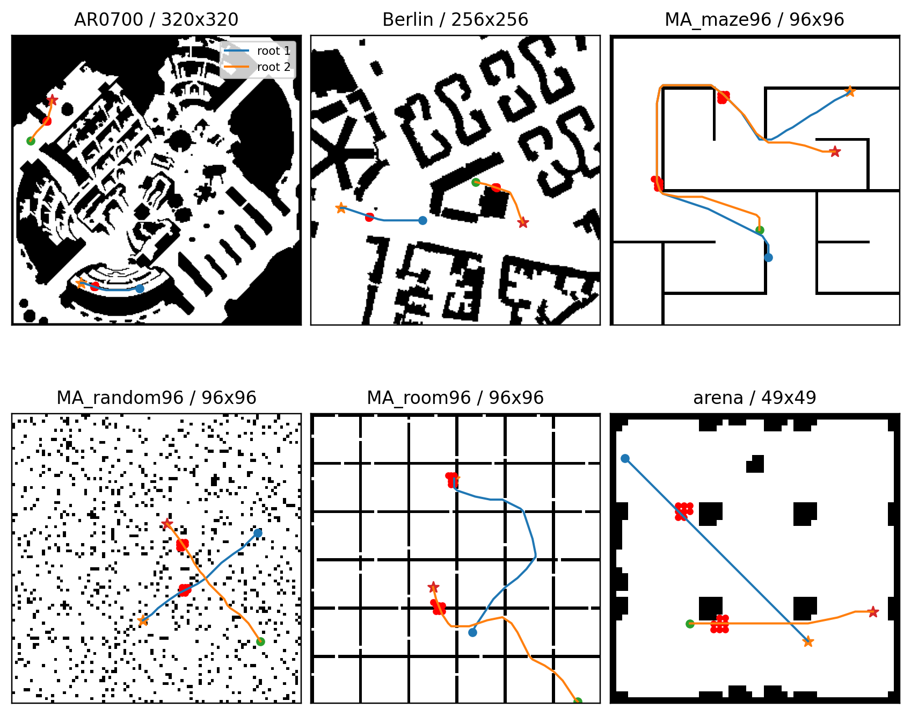{width=100%}

Постановка неизвестной карты следует идее free-space assumption из Koenig & Likhachev, D\* Lite (AAAI 2002): неизвестные клетки считаются свободными. Сетка с динамическими изменениями и локальными наблюдениями адаптирует Hernández, Asín & Baier, MPGAA\* (AAAI 2015); перебираются $k\in\{2,8,32\}$ и запрошенный бюджет $cr\in\{1,5,10,30\}\%$, радиус наблюдения равен $k$. Официальные игровые и комнатные карты происходят из Moving AI (Sturtevant 2012).

Это адаптация, а не воспроизведение чисел этих статей. В частности, отличаются размеры, число задач, реализации и эвристики. В paper_dynamic свободная и занятая части бюджета независимо ограничены наличием клеток; начальная плотность при большом бюджете может дрейфовать. Основной анализ сохраняет все режимы, а ниже приводится чувствительность к исключению начального случая 10% / cr=30%.

# Протокол и измеряемые величины

В replay один точный контрольный агент задаёт общую последовательность стартов и правок. Вставки делаются на его будущей трассе (`on_path`), вне всей трассы (`off_path`) либо чередуются с освобождениями (`churn`). Есть optimistic unknown replay, серия размера пакета 1/8/32/128, интервалов 1/2/4/8 и видимости 8/16/32. «На пути» относится к контрольной трассе: другой метод может выбрать равностоимостный путь. Попадание в трассу не обязательно повышает оптимальную стоимость.

В отдельной closed-loop серии каждый алгоритм движется сам: карта вначале неизвестна, квадратный сенсор раскрывает окрестность, новый поиск запускается при обнаружении препятствий. Между вызовами исполняется текущий план. Радиус покрывает весь следующий примитив, который независимо проверяется по истинному миру. Полный будущий путь валидируется только по текущим знаниям. После достижения цели лишних запросов нет. Для качества движения используется отношение проеханной стоимости к оптимуму при полной информации. Незавершённая миссия не получает оценку качества по короткому пройденному отрезку.

| Режим | Запросов ремонта в основной/своей панели | С попаданием блокировки в контрольный путь | С освобождениями | Получено правок |
| --- | --- | --- | --- | --- |
| car16:on_path | 56 | 56 | 0 | 448 |
| car16:off_path | 96 | 0 | 0 | 768 |
| car16:churn | 96 | 24 | 84 | 1 440 |
| car16:unknown_replay | 96 | 29 | 0 | 529 |
| grid8:paper_dynamic | 2026 | 427 | 1652 | 19 494 |

Среда: AMD EPYC 9V74 80-Core Processor; Linux-6.18.57-x86_64-with-glibc2.41; GCC 14.2.0, `-O3 -DNDEBUG -std=c++17 -Wall -Wextra -Wpedantic`. Методы выполняются последовательно с перемешиванием порядка и тремя повторами. Во время измерений не запускаются сборки и тяжёлый анализ. CPU affinity и фиксирование частоты не использовались; небольшие процентные различия нельзя считать устойчивым лидерством по трём повторам.

Время запроса включает получение правок, поиск/ремонт, извлечение результата и обслуживание сохранённого пути. Конструктор измеряется отдельно и включён в полный эпизод. Подготовка общей модели/сертификата, сенсор, контрольный поиск и внешний валидатор находятся вне таймера. Поэтому это время планировщика, а не всей робототехнической системы.

Дополнительно измеряются раскрытия, обращения к клеткам при коллизиях, инструментированные уведомления MPGAA/MD, очередь снижения эвристики, вызовы ядра, доля сертификатов, отложенные и активированные клетки, пиковая запрошенная C++ heap-память, p50/p95/p99 задержек и стоимость движения. Для памяти используется отдельный бинарник; его времена не входят в сравнение. Пик — максимальные запрошенные байты внутри запроса с сохранённым состоянием и результатом, исключая общую модель/вход и проверку. Это не RSS и не включает стек или накладные расходы malloc.

Лимит — 1 000 000 раскрытий на запрос; у MD он общий для двух вызовов. У car16-миссий дополнительно 160 шагов, у grid8 — 256. Раскрытия разных графов имеют разную цену. В replay доказанное отсутствие пути — завершённый вычисленный ответ, превышение бюджета — нет; оставшиеся запросы после него сохранены как `skipped_after_cap`. В mission завершение означает именно достижение цели. Пределы не скрываются и не превращаются в дешёвые успехи.

Однократная подготовка фиксированной модели/сертификата амортизируется между задачами и не включена в эпизодные отношения. Для одиночного запуска MD следует дополнительно учитывать стоимость сертификата; её фактическое измерение приведено отдельно:

| Модель | Подготовка модели/входа/сертификата, мс | В том числе сертификат, мс |
| --- | --- | --- |
| car16 | 13.742 | 0.073 |
| grid8 | 4.114 | 0.006 |

# Сравнение всех методов

## Время и завершение

Для оценки шума измерения ниже приведён медианный относительный MAD полных времён: медиана абсолютных отклонений трёх повторов, делённая на их медиану, затем медиана по завершённым задачам. Это описательная мера с тремя повторами, а не доверительный интервал превосходства.

| Метод | На пути | Вне пути | Смешанные | Unknown replay | Grid dynamic |
| --- | --- | --- | --- | --- | --- |
| LBA\* | 1.2% | 2.0% | 0.7% | 2.8% | 2.9% |
| LazyLBA\* | 1.9% | 3.0% | 1.9% | 2.2% | 2.4% |
| MeshA\* | 4.0% | 1.5% | 1.0% | 1.3% | 2.6% |
| Mesh/ParallA\* | 3.4% | 1.1% | 1.1% | 2.8% | 2.3% |
| D\* Lite lattice | 2.5% | 2.8% | 2.7% | 1.6% | 2.4% |
| D\* Lite mesh | 1.0% | 1.4% | 3.0% | 1.7% | 2.2% |
| MPGAA\* | 2.4% | 1.7% | 2.3% | 2.1% | 2.5% |
| MD-A\* | 4.0% | 2.5% | 2.9% | 2.7% | 2.7% |
| MD-64 | 2.5% | 1.7% | 1.3% | 2.1% | 2.7% |
| MD scan | 2.9% | 1.7% | 2.6% | 2.0% | 1.9% |
| LBA\* reuse | 1.4% | 1.6% | 2.6% | 3.0% | 2.8% |

В клетках следующей таблицы — парное ускорение полного эпизода относительно LBA\* и число завершённых пар. Нельзя ранжировать две условные медианы, если они получены на разных подмножествах; для этого ниже есть профиль с учётом неудач.

| Метод | На пути | Вне пути | Смешанные | Unknown replay |
| --- | --- | --- | --- | --- |
| LBA\* | 1.00× (12/12) | 1.00× (12/12) | 1.00× (12/12) | 1.00× (12/12) |
| LazyLBA\* | 0.55× (12/12) | 0.93× (12/12) | 0.88× (12/12) | 1.21× (12/12) |
| MeshA\* | 0.11× (11/12) | 0.43× (12/12) | 0.44× (11/12) | 0.58× (12/12) |
| Mesh/ParallA\* | 0.16× (11/12) | 0.54× (12/12) | 0.46× (11/12) | 0.74× (12/12) |
| D\* Lite lattice | 0.45× (12/12) | 0.46× (12/12) | 0.12× (12/12) | 0.23× (12/12) |
| D\* Lite mesh | 3.44× (7/12) | 0.19× (10/12) | 0.11× (10/12) | 0.14× (12/12) |
| MPGAA\* | 0.50× (12/12) | 1.60× (12/12) | 1.26× (12/12) | 0.94× (12/12) |
| MD-A\* | 0.49× (12/12) | 2.76× (12/12) | 1.30× (11/12) | 1.23× (12/12) |
| MD-64 | 0.48× (12/12) | 2.69× (12/12) | 1.34× (11/12) | 1.26× (12/12) |
| MD scan | 0.47× (12/12) | 2.78× (12/12) | 1.43× (11/12) | 1.20× (12/12) |
| LBA\* reuse | 1.00× (12/12) | 4.76× (12/12) | 1.12× (12/12) | 2.36× (12/12) |

Завершённые вычислительные эпизоды по всем задачам соответствующей группы, без условия завершения LBA. Доказанный no-path здесь корректен; cap и пропущенные запросы означают незавершённый эпизод:

| Метод | На пути | Вне пути | Смешанные | Unknown replay | Grid dynamic |
| --- | --- | --- | --- | --- | --- |
| LBA\* | 12/12 | 12/12 | 12/12 | 12/12 | 96/96 |
| LazyLBA\* | 12/12 | 12/12 | 12/12 | 12/12 | 96/96 |
| MeshA\* | 11/12 | 12/12 | 11/12 | 12/12 | 96/96 |
| Mesh/ParallA\* | 11/12 | 12/12 | 11/12 | 12/12 | 96/96 |
| D\* Lite lattice | 12/12 | 12/12 | 12/12 | 12/12 | 96/96 |
| D\* Lite mesh | 7/12 | 10/12 | 10/12 | 12/12 | 96/96 |
| MPGAA\* | 12/12 | 12/12 | 12/12 | 12/12 | 96/96 |
| MD-A\* | 12/12 | 12/12 | 11/12 | 12/12 | 96/96 |
| MD-64 | 12/12 | 12/12 | 11/12 | 12/12 | 96/96 |
| MD scan | 12/12 | 12/12 | 11/12 | 12/12 | 96/96 |
| LBA\* reuse | 12/12 | 12/12 | 12/12 | 12/12 | 96/96 |

{width=100%}

| Метод | Grid8 dynamic: скорость / пары | Car16 mission: до цели | Grid8 mission: до цели | Grid8 dynamic: до конца |
| --- | --- | --- | --- | --- |
| LBA\* | 1.00× (96/96) | 15/16 | 24/24 | 96/96 |
| LazyLBA\* | 0.78× (96/96) | 15/16 | 24/24 | 96/96 |
| MeshA\* | 0.82× (96/96) | 15/16 | 24/24 | 96/96 |
| Mesh/ParallA\* | 0.80× (96/96) | 15/16 | 24/24 | 96/96 |
| D\* Lite lattice | 0.83× (96/96) | 15/16 | 24/24 | 96/96 |
| D\* Lite mesh | 0.82× (96/96) | 15/16 | 24/24 | 96/96 |
| MPGAA\* | 1.14× (96/96) | 15/16 | 24/24 | 96/96 |
| MD-A\* | 1.18× (96/96) | 15/16 | 24/24 | 96/96 |
| MD-64 | 1.13× (96/96) | 15/16 | 24/24 | 96/96 |
| MD scan | 1.20× (96/96) | 15/16 | 24/24 | 96/96 |
| LBA\* reuse | 1.06× (96/96) | 15/16 | 24/24 | 96/96 |

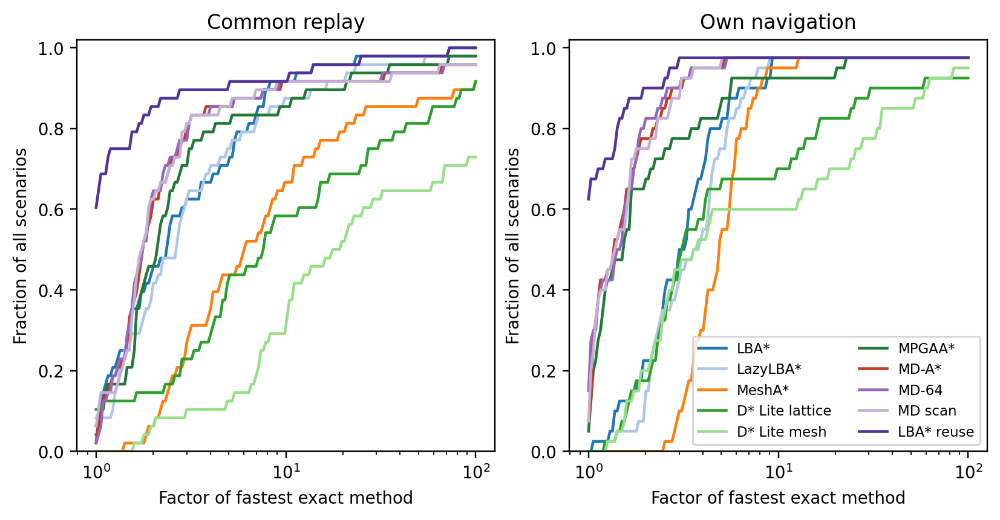{width=100%}

## На каких картах есть преимущество

Победитель в таблице — точный метод, завершивший все задачи данной строки, с наименьшей суммой медианных времён полных эпизодов. Выбор не зависит от завершения LBA\*. Это описательная характеристика конкретной малой группы. Если разница мала, её следует понимать как сопоставимый результат. «Нет» означает отсутствие полностью завершившего точного метода, а не отсутствие допустимого пути.

| Карта | Режим | Лучший полный точный | MPGAA / MD | Reuse / MD |
| --- | --- | --- | --- | --- |
| AR0700 | churn | MD-A\* | 1.06× (2/2) | 1.25× (2/2) |
| AR0700 | off_path | LBA\* reuse | 1.01× (2/2) | 0.63× (2/2) |
| AR0700 | on_path | LBA\* reuse | 0.98× (2/2) | 0.49× (2/2) |
| AR0700 | unknown_replay | LBA\* reuse | 1.02× (2/2) | 0.47× (2/2) |
| Berlin | churn | D\* Lite lattice | 1.09× (1/2) | 2.68× (1/2) |
| Berlin | off_path | LBA\* reuse | 1.00× (2/2) | 0.61× (2/2) |
| Berlin | on_path | LBA\* reuse | 0.98× (2/2) | 0.85× (2/2) |
| Berlin | unknown_replay | LBA\* reuse | 1.06× (2/2) | 0.54× (2/2) |
| MA_maze96 | churn | MPGAA\* | 0.88× (2/2) | 1.71× (2/2) |
| MA_maze96 | off_path | LBA\* reuse | 0.99× (2/2) | 0.39× (2/2) |
| MA_maze96 | on_path | LBA\* reuse | 1.15× (2/2) | 0.73× (2/2) |
| MA_maze96 | unknown_replay | LBA\* reuse | 1.06× (2/2) | 0.43× (2/2) |
| MA_random96 | churn | LBA\* reuse | 1.15× (2/2) | 0.69× (2/2) |
| MA_random96 | off_path | LBA\* reuse | 1.39× (2/2) | 0.61× (2/2) |
| MA_random96 | on_path | D\* Lite lattice | 1.08× (2/2) | 0.40× (2/2) |
| MA_random96 | unknown_replay | LBA\* reuse | 1.08× (2/2) | 0.49× (2/2) |
| MA_room96 | churn | MD scan | 1.00× (2/2) | 1.18× (2/2) |
| MA_room96 | off_path | LBA\* reuse | 1.17× (2/2) | 0.56× (2/2) |
| MA_room96 | on_path | LBA\* reuse | 0.95× (2/2) | 0.36× (2/2) |
| MA_room96 | unknown_replay | LBA\* reuse | 1.15× (2/2) | 0.55× (2/2) |
| arena | churn | LazyLBA\* | 1.49× (2/2) | 0.42× (2/2) |
| arena | off_path | LBA\* reuse | 6.59× (2/2) | 0.59× (2/2) |
| arena | on_path | LBA\* reuse | 1.06× (2/2) | 0.52× (2/2) |
| arena | unknown_replay | LBA\* reuse | 3.01× (2/2) | 0.55× (2/2) |

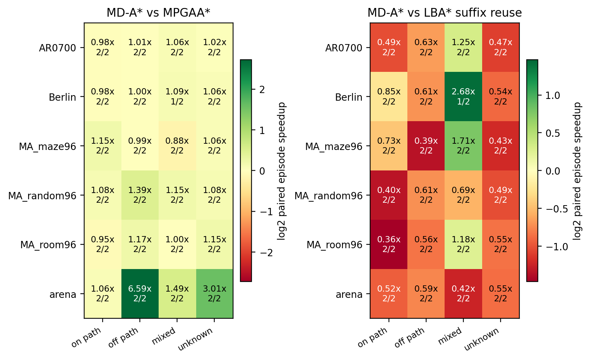{width=100%}

| Grid8-карта | Лучший полный точный | MPGAA / MD | Reuse / MD |
| --- | --- | --- | --- |
| random50_p10 | MD-A\* | 1.07× (24/24) | 1.19× (24/24) |
| random50_p20 | MD-A\* | 1.11× (24/24) | 0.96× (24/24) |
| random50_p30 | MD-A\* | 1.06× (24/24) | 1.28× (24/24) |
| random50_p40 | MPGAA\* | 0.97× (24/24) | 0.76× (24/24) |

На car16 LBA\* reuse имеет минимальную суммарную стоимость вычислений среди полностью завершивших точных методов на 6/6 карт при `off_path`, 6/6 при `unknown_replay` и 5/6 при `on_path`. Для смешанных изменений победители различаются: AR0700: MD-A\*; Berlin: D\* Lite lattice; MA_maze96: MPGAA\*; MA_random96: LBA\* reuse; MA_room96: MD scan; arena: LazyLBA\*. Это результат по двум корням на строку и сумме медианных времён, а не устойчивое ранжирование при малых процентных различиях.

В grid8-динамике победители по суммарному времени: random50_p10: MD-A\*; random50_p20: MD-A\*; random50_p30: MD-A\*; random50_p40: MPGAA\*. Медианные парные отношения могут ранжировать методы иначе, чем сумма; эти два критерия явно сохраняются в отчёте и не сводятся к одному универсальному победителю.

Наибольшие наблюдаемые отношения MPGAA/MD среди полностью завершённых строк: arena/off_path: 6.59×; arena/unknown_replay: 3.01×; arena/churn: 1.49×. Наименьшие: MA_maze96/churn: 0.88×; MA_room96/on_path: 0.95×; Berlin/on_path: 0.98×.

## Работа, память и задержки

| Метод | p95 на пути, мс | p95 вне пути, мс | p95 mixed, мс | p95 unknown, мс | p95 grid, мс |
| --- | --- | --- | --- | --- | --- |
| LBA\* | 358.711 | 140.466 | 147.262 | 4.386 | 0.331 |
| LazyLBA\* | 718.861 | 256.816 | 274.091 | 4.607 | 0.486 |
| MeshA\* | 2 893.716 | 1 638.166 | 1 503.874 | 13.046 | 0.380 |
| Mesh/ParallA\* | 2 444.382 | 2 439.287 | 2 372.933 | 9.469 | 0.384 |
| D\* Lite lattice | 1 901.046 | 38.185 | 97.032 | 18.654 | 0.213 |
| D\* Lite mesh | 3 043.222 | 3.660 | 21.746 | 72.726 | 0.219 |
| MPGAA\* | 1 025.213 | 4.218 | 26.585 | 2.767 | 0.207 |
| MD-A\* | 1 021.947 | 0.161 | 18.468 | 2.952 | 0.228 |
| MD-64 | 966.986 | 0.189 | 18.401 | 3.088 | 0.230 |
| MD scan | 1 030.086 | 0.118 | 18.560 | 3.016 | 0.227 |
| LBA\* reuse | 359.167 | 0.004 | 150.814 | 1.190 | 0.311 |

Перцентили и CDF ниже условны на запросах, завершённых в бюджете, и включают доказанную недостижимость. Они не включают пропущенные после лимита запросы и не заменяют долю завершения. Три повторных значения задержки не являются тремя независимыми задачами.

{width=100%}

| Метод | Peak на пути, MiB | Вне пути | Mixed | Unknown | Grid dynamic |
| --- | --- | --- | --- | --- | --- |
| LBA\* | 10.318 | 1.034 | 1.446 | 0.449 | 0.077 |
| LazyLBA\* | 17.650 | 1.531 | 2.876 | 0.713 | 0.116 |
| MeshA\* | 76.955 | 2.467 | 3.643 | 0.756 | 0.078 |
| Mesh/ParallA\* | 70.871 | 1.839 | 2.810 | 0.410 | 0.079 |
| D\* Lite lattice | 27.557 | 3.599 | 24.628 | 4.009 | 0.409 |
| D\* Lite mesh | 111.128 | 9.049 | 14.282 | 8.663 | 0.409 |
| MPGAA\* | 39.473 | 2.108 | 2.772 | 0.795 | 0.177 |
| MD-A\* | 39.504 | 2.269 | 2.704 | 0.823 | 0.183 |
| MD-64 | 39.504 | 2.269 | 2.704 | 0.823 | 0.183 |
| MD scan | 39.504 | 2.269 | 2.704 | 0.823 | 0.183 |
| LBA\* reuse | 10.324 | 1.034 | 1.449 | 0.451 | 0.077 |

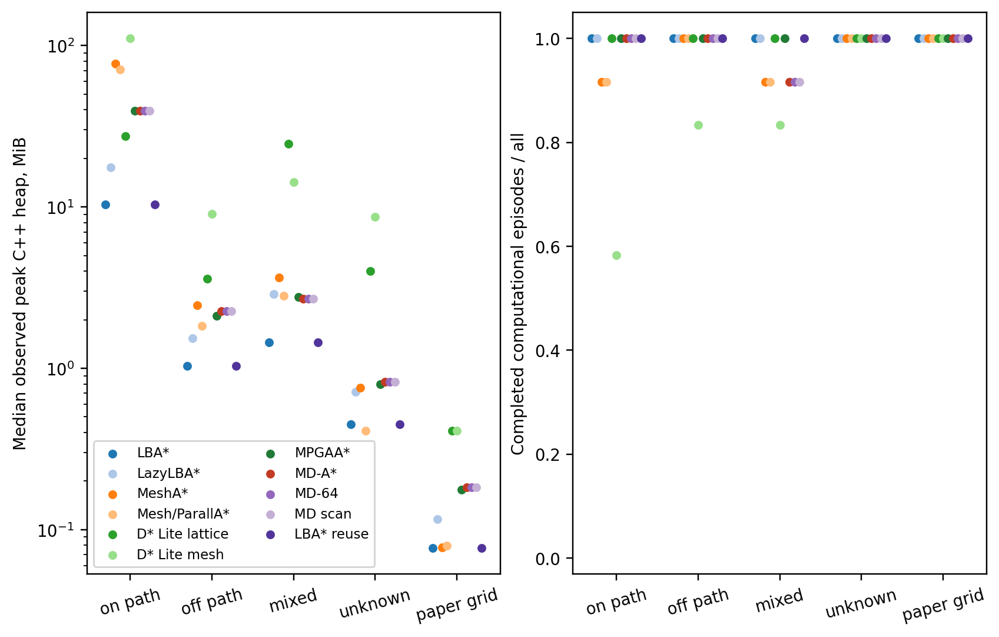{width=100%}

| Режим | Метод | Раскрытия ремонта | Чтения клеток ремонта | Уведомления ремонта | Сертификаты |
| --- | --- | --- | --- | --- | --- |
| car16:on_path | MPGAA\* | 104 231 | 1 092 890 | 14 688 | 0.0% |
| car16:on_path | MD-A\* | 104 231 | 1 092 890 | 14 688 | 1.8% |
| car16:on_path | LBA\* reuse | 111 078 | 3 041 727 | 0 | 0.0% |
| car16:off_path | MPGAA\* | 0 | 0 | 5 712 | 0.0% |
| car16:off_path | MD-A\* | 0 | 0 | 0 | 100.0% |
| car16:off_path | LBA\* reuse | 0 | 0 | 0 | 100.0% |
| car16:churn | MPGAA\* | 1 490 | 31 212 | 14 076 | 0.0% |
| car16:churn | MD-A\* | 1 102 | 26 370 | 9 792 | 38.5% |
| car16:churn | LBA\* reuse | 8 132 | 307 719 | 0 | 12.5% |
| car16:unknown_replay | MPGAA\* | 363 | 12 416 | 14 484 | 0.0% |
| car16:unknown_replay | MD-A\* | 363 | 12 416 | 12 648 | 64.6% |
| car16:unknown_replay | LBA\* reuse | 434 | 24 350 | 0 | 69.8% |
| grid8:paper_dynamic | MPGAA\* | 194 | 548 | 880 | 0.0% |
| grid8:paper_dynamic | MD-A\* | 193 | 411 | 496 | 36.6% |
| grid8:paper_dynamic | LBA\* reuse | 1 005 | 3 582 | 0 | 15.4% |

Уведомления и очередь снижения эвристики инструментированы у MPGAA/MD. Их нулевые значения у других методов не означают отсутствие всякой работы обновления. Раскрытие решётки и mesh — разные единицы; время и обращения к клеткам дополняют этот счётчик. Полная работа эпизода включает первичный поиск, а таблица выше — только ремонт.

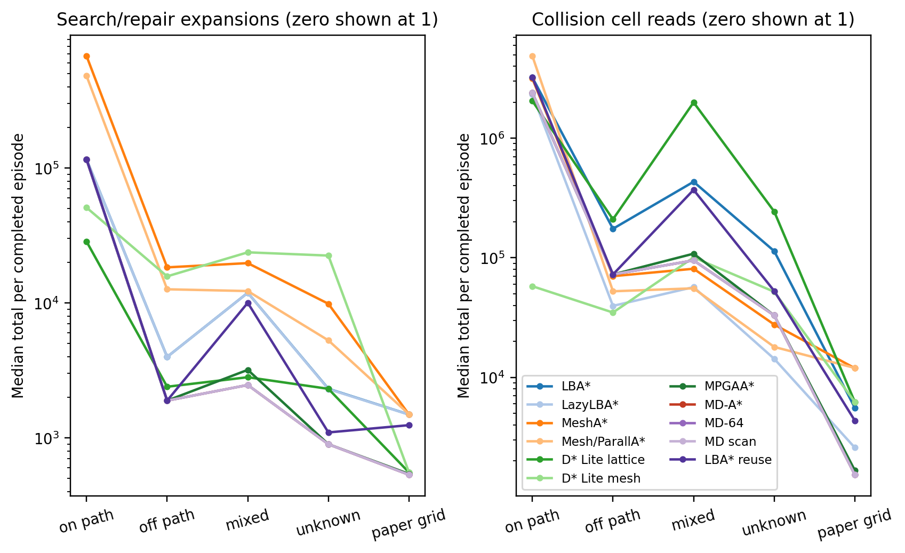{width=100%}

Меньшее число раскрытий не гарантирует меньшую задержку. В grid8-динамике медиана онлайн-раскрытий D\* Lite lattice составляет 14, у MD — 193, но медиана суммарного времени ремонта — 0.967 и 0.586 мс соответственно. Уведомления, обслуживание графа и извлечение пути тоже входят во время.

В основной car16-серии поломок пути медианный наблюдаемый peak MD равен 39.50 MiB, у reuse — 10.32 MiB. На всём replay максимальный наблюдаемый requested heap D\* Lite lattice достиг 808.57 MiB. Экономия раскрытий может сопровождаться существенной ценой сохранённого состояния.

# Зависимость от изменений и видимости

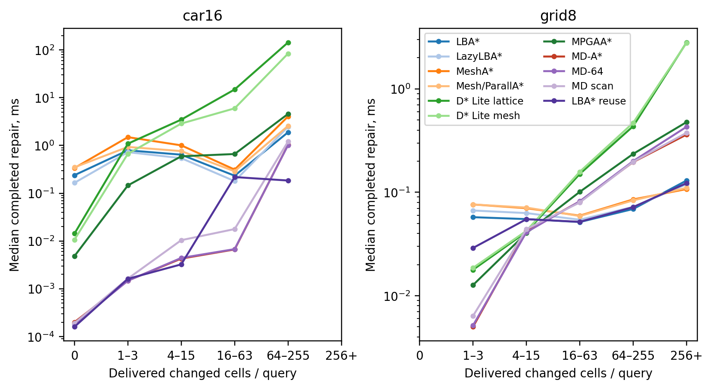{width=100%}

{width=100%}

| Панель | Режим | Параметр | N | MPGAA / MD: эпизод | MPGAA / MD: ремонт | Reuse / MD: эпизод |
| --- | --- | --- | --- | --- | --- | --- |
| batch | churn | 1 | 2 | 0.99× (2/2) | 1.01× (2/2) | 1.04× (2/2) |
| batch | churn | 8 | 2 | 1.08× (2/2) | 1.06× (2/2) | 0.81× (2/2) |
| batch | churn | 32 | 2 | 1.33× (2/2) | 1.53× (2/2) | 0.64× (2/2) |
| batch | churn | 128 | 2 | 1.44× (2/2) | 1.55× (2/2) | 0.33× (2/2) |
| batch | off_path | 1 | 2 | 1.00× (2/2) | 64.39× (2/2) | 0.58× (2/2) |
| batch | off_path | 8 | 2 | 1.25× (2/2) | 27.20× (2/2) | 0.56× (2/2) |
| batch | off_path | 32 | 2 | 1.83× (2/2) | 30.60× (2/2) | 0.55× (2/2) |
| batch | off_path | 128 | 2 | 4.07× (2/2) | 42.67× (2/2) | 0.51× (2/2) |
| batch | on_path | 1 | 2 | 0.96× (2/2) | 0.96× (2/2) | 0.36× (2/2) |
| batch | on_path | 8 | 2 | 1.06× (2/2) | 1.06× (2/2) | 0.38× (2/2) |
| batch | on_path | 32 | 2 | 0.99× (2/2) | 0.99× (2/2) | 0.42× (2/2) |
| batch | on_path | 128 | 2 | 1.02× (2/2) | 1.03× (2/2) | 0.35× (2/2) |
| frequency | churn | 1 | 4 | 1.11× (4/4) | 1.13× (4/4) | 1.24× (4/4) |
| frequency | churn | 2 | 4 | 1.07× (4/4) | 1.11× (4/4) | 0.81× (4/4) |
| frequency | churn | 4 | 4 | 1.03× (4/4) | 1.02× (4/4) | 0.65× (4/4) |
| frequency | churn | 8 | 4 | 1.05× (4/4) | 44.06× (4/4) | 0.59× (4/4) |
| visibility | unknown_replay | 8 | 4 | 1.08× (4/4) | 1.13× (4/4) | 0.49× (4/4) |
| visibility | unknown_replay | 16 | 4 | 1.06× (4/4) | 1.08× (4/4) | 0.38× (4/4) |
| visibility | unknown_replay | 32 | 4 | 1.17× (4/4) | 1.28× (4/4) | 0.55× (4/4) |

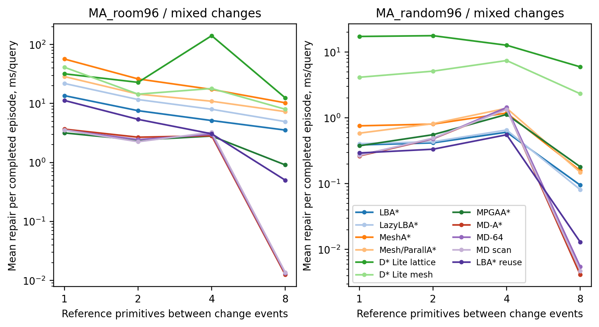{width=100%}

{width=100%}

Для той же сеточной серии ниже показаны число запросов и средняя стоимость одного ремонта внутри эпизода. Большой k уменьшает число вызовов и приближает старт к цели; снижение полного времени на тепловой карте нельзя трактовать как ускорение каждого ремонта.

| k | cr, % | Медиана ремонтов MD | MD, мс/ремонт | MPGAA/MD: эпизод | MPGAA/MD: ремонт | Reuse/MD: эпизод |
| --- | --- | --- | --- | --- | --- | --- |
| 2 | 1 | 20.5 | 0.021 | 1.12× (8/8) | 1.19× (8/8) | 1.32× (8/8) |
| 2 | 5 | 36.5 | 0.027 | 1.00× (8/8) | 1.00× (8/8) | 1.64× (8/8) |
| 2 | 10 | 41.0 | 0.033 | 1.02× (8/8) | 1.04× (8/8) | 1.56× (8/8) |
| 2 | 30 | 41.5 | 0.042 | 0.95× (8/8) | 0.94× (8/8) | 1.39× (8/8) |
| 8 | 1 | 14.5 | 0.021 | 1.04× (8/8) | 1.22× (8/8) | 1.05× (8/8) |
| 8 | 5 | 26.5 | 0.028 | 1.06× (8/8) | 1.11× (8/8) | 1.18× (8/8) |
| 8 | 10 | 30.0 | 0.043 | 0.98× (8/8) | 0.98× (8/8) | 1.05× (8/8) |
| 8 | 30 | 31.0 | 0.061 | 1.01× (8/8) | 1.01× (8/8) | 0.80× (8/8) |
| 32 | 1 | 1.0 | 0.006 | 1.09× (8/8) | 10.62× (7/8) | 0.65× (8/8) |
| 32 | 5 | 1.0 | 0.028 | 1.07× (8/8) | 4.11× (7/8) | 0.58× (8/8) |
| 32 | 10 | 1.0 | 0.187 | 1.18× (8/8) | 1.84× (7/8) | 0.53× (8/8) |
| 32 | 30 | 1.0 | 0.361 | 1.07× (8/8) | 1.31× (7/8) | 0.47× (8/8) |

При k=2 отношение полных времён reuse/MD лежит в диапазоне 1.32–1.64 в рассмотренных четырёх бюджетах, при k=32 — 0.47–0.65. При k=8 диапазон равен 0.80–1.18; результат зависит от бюджета. Это позволяет различать частые небольшие локальные ремонты и редкие крупные переоценки карты, а не рекомендовать один метод для всех потоков изменений.

Проверка чувствительности grid8 к ограничению начального пула: MPGAA/MD на всей серии 1.05× (96/96); на подмножестве без запрошенного бюджета выше начальной доступности 1.05× (90/90). Основные таблицы сохраняют все 96 случаев. Реально доставленные правки, плотность и глобальные изменения сохранены в контекстах; номинальный cr не равен числу наблюдаемых клеток.

# Неизвестная карта и цена исследования

| Метод | Car16: до цели | Car16: проезд / оптимум | Grid8: до цели | Grid8: проезд / оптимум |
| --- | --- | --- | --- | --- |
| LBA\* | 15/16 | 1.00 | 24/24 | 1.01 |
| LazyLBA\* | 15/16 | 1.00 | 24/24 | 1.01 |
| MeshA\* | 15/16 | 1.00 | 24/24 | 1.01 |
| Mesh/ParallA\* | 15/16 | 1.01 | 24/24 | 1.01 |
| D\* Lite lattice | 15/16 | 1.00 | 24/24 | 1.02 |
| D\* Lite mesh | 15/16 | 1.00 | 24/24 | 1.02 |
| MPGAA\* | 15/16 | 1.00 | 24/24 | 1.02 |
| MD-A\* | 15/16 | 1.00 | 24/24 | 1.02 |
| MD-64 | 15/16 | 1.00 | 24/24 | 1.02 |
| MD scan | 15/16 | 1.00 | 24/24 | 1.02 |
| LBA\* reuse | 15/16 | 1.00 | 24/24 | 1.01 |

| Модель | Радиус | Метод | До цели | Проезд / оптимум | Карта раскрыта | Ремонт, мс/вызов |
| --- | --- | --- | --- | --- | --- | --- |
| car16 | 8 | LBA\* | 7/8 | 1.01 | 32.2% | 0.280 |
| car16 | 8 | D\* Lite lattice | 7/8 | 1.01 | 32.2% | 1.883 |
| car16 | 8 | MPGAA\* | 7/8 | 1.01 | 32.2% | 0.357 |
| car16 | 8 | MD-A\* | 7/8 | 1.01 | 32.2% | 0.299 |
| car16 | 8 | LBA\* reuse | 7/8 | 1.01 | 32.2% | 0.066 |
| car16 | 16 | LBA\* | 8/8 | 1.00 | 54.8% | 0.447 |
| car16 | 16 | D\* Lite lattice | 8/8 | 1.00 | 55.2% | 3.851 |
| car16 | 16 | MPGAA\* | 8/8 | 1.00 | 55.3% | 0.790 |
| car16 | 16 | MD-A\* | 8/8 | 1.00 | 55.3% | 0.675 |
| car16 | 16 | LBA\* reuse | 8/8 | 1.00 | 54.8% | 0.242 |
| grid8 | 1 | LBA\* | 8/8 | 1.07 | 7.9% | 0.075 |
| grid8 | 1 | D\* Lite lattice | 8/8 | 1.07 | 7.6% | 0.024 |
| grid8 | 1 | MPGAA\* | 8/8 | 1.07 | 7.7% | 0.016 |
| grid8 | 1 | MD-A\* | 8/8 | 1.07 | 7.7% | 0.015 |
| grid8 | 1 | LBA\* reuse | 8/8 | 1.07 | 7.9% | 0.033 |
| grid8 | 4 | LBA\* | 8/8 | 1.01 | 24.9% | 0.070 |
| grid8 | 4 | D\* Lite lattice | 8/8 | 1.02 | 24.3% | 0.031 |
| grid8 | 4 | MPGAA\* | 8/8 | 1.02 | 24.5% | 0.016 |
| grid8 | 4 | MD-A\* | 8/8 | 1.02 | 24.5% | 0.013 |
| grid8 | 4 | LBA\* reuse | 8/8 | 1.01 | 24.9% | 0.024 |
| grid8 | 8 | LBA\* | 8/8 | 1.01 | 46.8% | 0.073 |
| grid8 | 8 | D\* Lite lattice | 8/8 | 1.02 | 46.2% | 0.039 |
| grid8 | 8 | MPGAA\* | 8/8 | 1.02 | 46.7% | 0.016 |
| grid8 | 8 | MD-A\* | 8/8 | 1.02 | 46.7% | 0.015 |
| grid8 | 8 | LBA\* reuse | 8/8 | 1.01 | 46.8% | 0.023 |

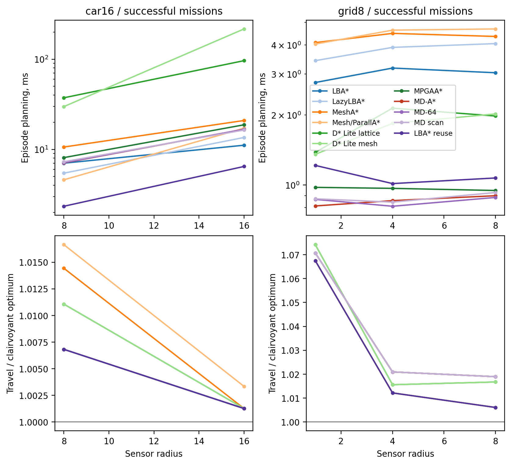{width=100%}

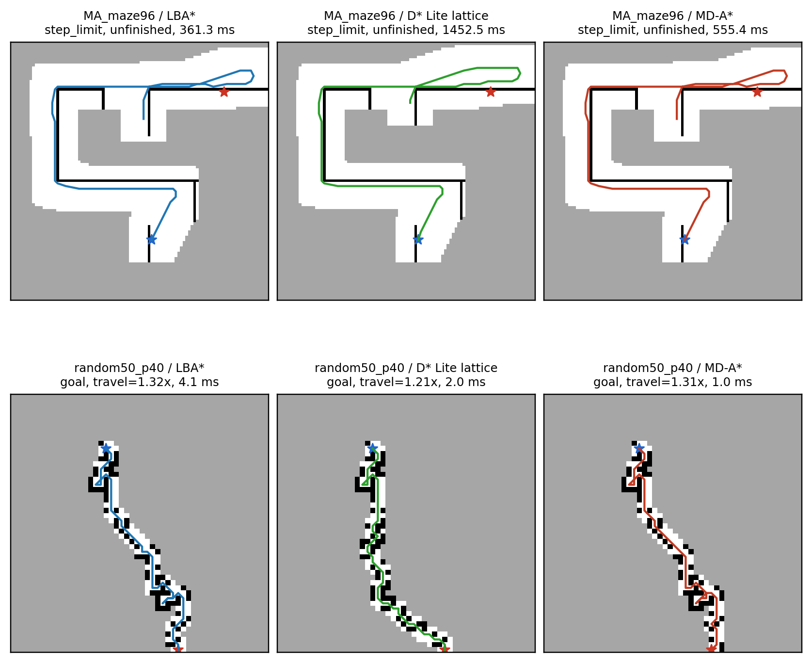{width=100%}

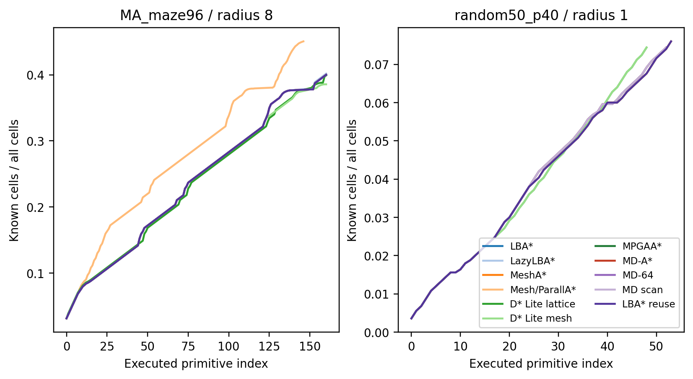{width=100%}

На car16 у каждого метода достигнуто 7/8 целей при радиусе 8 и 8/8 при радиусе 16. Наборы неудачных траекторий могут различаться. Следовательно, увеличение видимости устранило неудачи по лимиту движения в этой выборке, а смена поискового метода не дала прироста общей доли достижения цели. В grid8 все 24 миссии завершены всеми методами.

Это не ошибка точного поиска: меняются равностоимостные планы и последующие наблюдения. Выбор по одной задержке не учитывал бы эту цену.

Медиана проезд/оптимум на завершённых grid8-миссиях равна 1.024 для MD, 1.021 для D\* Lite lattice и 1.006 для LBA\* reuse. В приведённом примере плотности 40% и радиуса 1 MD едет примерно 1.31 от оптимума против 1.21 у D\* Lite lattice, одновременно тратя меньше времени на поиск.

В статической неизвестной карте знания меняются только через обнаружение препятствий. Здесь нет освобождений, поэтому новый сертификат отложенных освобождений не используется. Возможный выигрыш MD на этой серии связан с сохранением пути и адаптивным ядром; он не является самостоятельным доказательством преимущества отсрочки. Разные даже точные методы могут выбрать разные равностоимостные планы, затем получить разные наблюдения и итоговую длину проезда. Оптимальность поиска по знаниям не означает оптимальную разведку неизвестного мира.

# Механизм MD, абляции и история

| Модель | Есть открытия | Метод | Попыток | Cap | Сертификаты | Два вызова | Макс. отложено |
| --- | --- | --- | --- | --- | --- | --- | --- |
| car16 | нет | MPGAA\* | 1 224 | 0 | 0.0% | 0.0% | 0 |
| car16 | нет | MD-A\* | 1 224 | 0 | 68.6% | 0.0% | 0 |
| car16 | нет | MD-64 | 1 224 | 0 | 68.6% | 0.0% | 0 |
| car16 | нет | MD scan | 1 224 | 0 | 68.6% | 0.0% | 0 |
| car16 | нет | LBA\* reuse | 1 224 | 0 | 69.9% | 0.0% | 0 |
| car16 | да | MPGAA\* | 1 011 | 0 | 0.0% | 0.0% | 0 |
| car16 | да | MD-A\* | 1 011 | 3 | 63.5% | 6.5% | 830 |
| car16 | да | MD-64 | 1 011 | 3 | 63.5% | 6.5% | 830 |
| car16 | да | MD scan | 1 011 | 3 | 63.5% | 6.5% | 830 |
| car16 | да | LBA\* reuse | 1 011 | 0 | 0.0% | 0.0% | 0 |
| grid8 | нет | MPGAA\* | 1 122 | 0 | 0.0% | 0.0% | 0 |
| grid8 | нет | MD-A\* | 1 122 | 0 | 69.5% | 0.0% | 226 |
| grid8 | нет | MD-64 | 1 122 | 0 | 69.5% | 0.0% | 226 |
| grid8 | нет | MD scan | 1 122 | 0 | 69.5% | 0.0% | 226 |
| grid8 | нет | LBA\* reuse | 1 122 | 0 | 83.7% | 0.0% | 0 |
| grid8 | да | MPGAA\* | 4 956 | 0 | 0.0% | 0.0% | 0 |
| grid8 | да | MD-A\* | 4 956 | 0 | 29.2% | 24.2% | 370 |
| grid8 | да | MD-64 | 4 956 | 0 | 29.2% | 24.2% | 370 |
| grid8 | да | MD scan | 4 956 | 0 | 29.2% | 24.2% | 370 |
| grid8 | да | LBA\* reuse | 4 956 | 0 | 0.0% | 0.0% | 0 |

Эта таблица включает повторные попытки и потому описывает механизм, а не независимую выборку. Столбец «есть открытия» относится к текущему пакету: старые отложенные клетки могут активироваться и позже. Сравнение MD-64 и MD scan с MD-A\* изолирует более сильную оценку и способ обслуживания отложенного множества. Сравнение со стандартным A\* reuse нужно для вставок без освобождений, а MPGAA\* использует буквально то же ядро, что MD.

| Режим | Сертификаты MD при новых освобождениях | Цена совпадает с глобальной Euclid LB | Цена выше простой LB |
| --- | --- | --- | --- |
| car16:churn | 25 | 1 | 24 |
| car16:history | 156 | 156 | 0 |
| car16:off_path | 0 | 0 | 0 |
| car16:on_path | 0 | 0 | 0 |
| car16:unknown_replay | 0 | 0 | 0 |
| grid8:paper_dynamic | 482 | 50 | 432 |

В этой дополнительной проверке повторы не умножают число запросов. Совпадение с глобальной геометрической нижней оценкой определяется с допуском $10^{-7}$. Если уже допустимый путь достигает общей нижней оценки, его можно сохранить даже при освобождениях без отдельного сертификата каждой клетки. Поэтому такие ответы не доказывают необходимость mesh-сертификата. В частности, пустая диагональная диагностика истории проверяет обслуживание отложенного множества, но её большое ускорение само по себе слабо обосновывает новую поисковую идею. Положительный разрыв исключает только эту простейшую проверку; возможны и более сильные известные нижние оценки. Основной `lba_reuse` не содержит такой дополнительной проверки, что ограничивает вывод о новизне его превосходства.

| История | Лучший полный точный | MPGAA / MD | Reuse / MD |
| --- | --- | --- | --- |
| synthetic_open96 | MD-64 | 31.80× (4/4) | 9.81× (4/4) |

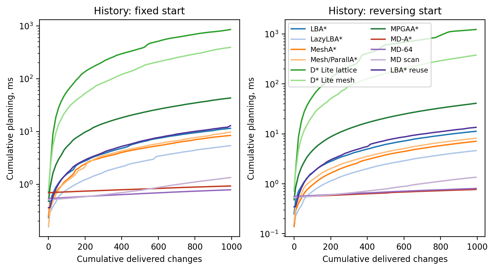{width=100%}

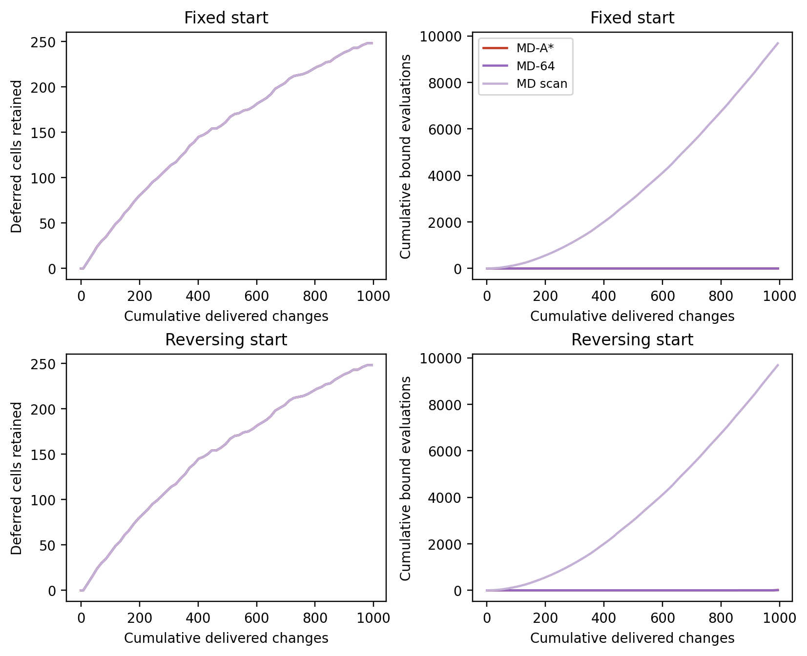{width=100%}

Есть и нетривиальные срабатывания относительно простой глобальной геометрической проверки: в основных смешанных car16-эпизодах 24 из 25 сертификатов при новых освобождениях имеют стоимость выше Euclid LB; в grid8 — 432 из 482. Это подтверждает полезность дополнительного условия для данной реализации, но не исключает более сильных известных глобальных нижних оценок или оптимизации уведомлений.

На 64-событийной диагностике очередь MD выполнила 0 уточнений при фиксированном старте и 9 при возвращающемся, полный просмотр — 9683 в обоих случаях. Размер отложенного множества достиг 248 клеток. Это ясное преимущество обслуживания очередью; эффект нельзя переносить на произвольную навигацию. MD-64 не показал устойчивого общего преимущества, оправдывающего более дорогую оценку, на рассмотренных размерах.

# Проверка качества и границы выводов

Расширение нагрузок выявило реальный дефект прежнего D\* Lite mesh: на неизвестной комнатной карте извлечение дошло до вершины с конечным g и бесконечным rhs. Причина — несовместимость точного порядка OPEN и epsilon-лексикографического условия остановки на нулевых mesh-префиксах. Для обеих версий D\* Lite экспериментальный класс теперь обрабатывает всю границу первого компонента ключа; перенос ключей сравнивается точно, как очередь. Это консервативное численное исправление бейзлайна, не новый поиск. Проблемная миссия включена в регрессию.

Первый остановленный проход и его исходники сохранены в `cpp/experiments/results/pre_boundary_fix`. Все основные времена после исправления измерены заново одним бинарником; исходные карты, корни и события сохранены. Общие старые заголовки и результаты прежних задач не менялись. Поэтому вывод о качестве относится к исправленной экспериментальной реализации D\* Lite, а найденная ошибка также является результатом проверки артефакта. Консервативная обработка границы может раскрывать дополнительные равные по первому ключу вершины; эти числа не следует выдавать за предельную скорость оптимизированного D\* Lite.

В этой серии не обнаружено расхождений оптимальной стоимости точных методов на завершённых запросах: 0. Каждый возвращённый путь независимо проверялся по клеткам/курсам/стоимости. Проход памяти воспроизвёл те же ответы, пути и счётчики работы, что обычный повтор 0: passed. Для приближённого Mesh/ParallA\* максимальные наблюдаемые отношения стоимости плана к точному контролю:

| Режим | Максимальная стоимость / оптимум |
| --- | --- |
| car16:churn | 1.1832 |
| car16:history | 1.0000 |
| car16:off_path | 1.0999 |
| car16:on_path | 1.1412 |
| car16:unknown_mission | 1.5997 |
| car16:unknown_replay | 1.0100 |
| grid8:paper_dynamic | 1.0000 |
| grid8:unknown_mission | 1.0000 |

В протокольных тестах: 88 replay-строк и 22 миссии; проверены повторная активация старого открытия с двумя вызовами, стандартный reuse, различие cap/no-path, сохранение пропущенных запросов, движение по истинной карте и совпадение отдельного прохода памяти. Те же проверки прошли ASAN/UBSan. Прежние тесты общих ядер сохранены отдельно; новая серия не меняет их исходники.

В измерениях сохранены 54 событий превышения бюджета, 150 пропущенных после них строк и 33 достижений лимита движения (с учётом повторов). Ниже — исходы по уникальным параметризованным эпизодам, без умножения на три:

Дополнительно независимый Python Dijkstra без общих классов графа/поиска проверил новую grid8-модель на 216 снимках: 2376 ответов 11 методов и идентичность отдельного прохода памяти. Отдельная регрессия float-границы D* Lite выполнила четыре реальные car16-миссии до цели.

| Модель / задача | Метод | Завершено / всего | Cap | Лимит шагов | No path |
| --- | --- | --- | --- | --- | --- |
| car16/replay | LBA\* | 90/90 | 0 | 0 | 16 |
| car16/replay | LazyLBA\* | 90/90 | 0 | 0 | 16 |
| car16/replay | MeshA\* | 88/90 | 2 | 0 | 14 |
| car16/replay | Mesh/ParallA\* | 88/90 | 2 | 0 | 14 |
| car16/replay | D\* Lite lattice | 90/90 | 0 | 0 | 16 |
| car16/replay | D\* Lite mesh | 79/90 | 11 | 0 | 12 |
| car16/replay | MPGAA\* | 90/90 | 0 | 0 | 16 |
| car16/replay | MD-A\* | 89/90 | 1 | 0 | 15 |
| car16/replay | MD-64 | 89/90 | 1 | 0 | 15 |
| car16/replay | MD scan | 89/90 | 1 | 0 | 15 |
| car16/replay | LBA\* reuse | 90/90 | 0 | 0 | 16 |
| car16/mission | LBA\* | 15/16 | 0 | 1 | 0 |
| car16/mission | LazyLBA\* | 15/16 | 0 | 1 | 0 |
| car16/mission | MeshA\* | 15/16 | 0 | 1 | 0 |
| car16/mission | Mesh/ParallA\* | 15/16 | 0 | 1 | 0 |
| car16/mission | D\* Lite lattice | 15/16 | 0 | 1 | 0 |
| car16/mission | D\* Lite mesh | 15/16 | 0 | 1 | 0 |
| car16/mission | MPGAA\* | 15/16 | 0 | 1 | 0 |
| car16/mission | MD-A\* | 15/16 | 0 | 1 | 0 |
| car16/mission | MD-64 | 15/16 | 0 | 1 | 0 |
| car16/mission | MD scan | 15/16 | 0 | 1 | 0 |
| car16/mission | LBA\* reuse | 15/16 | 0 | 1 | 0 |
| grid8/replay | LBA\* | 96/96 | 0 | 0 | 1 |
| grid8/replay | LazyLBA\* | 96/96 | 0 | 0 | 1 |
| grid8/replay | MeshA\* | 96/96 | 0 | 0 | 1 |
| grid8/replay | Mesh/ParallA\* | 96/96 | 0 | 0 | 1 |
| grid8/replay | D\* Lite lattice | 96/96 | 0 | 0 | 1 |
| grid8/replay | D\* Lite mesh | 96/96 | 0 | 0 | 1 |
| grid8/replay | MPGAA\* | 96/96 | 0 | 0 | 1 |
| grid8/replay | MD-A\* | 96/96 | 0 | 0 | 1 |
| grid8/replay | MD-64 | 96/96 | 0 | 0 | 1 |
| grid8/replay | MD scan | 96/96 | 0 | 0 | 1 |
| grid8/replay | LBA\* reuse | 96/96 | 0 | 0 | 1 |
| grid8/mission | LBA\* | 24/24 | 0 | 0 | 0 |
| grid8/mission | LazyLBA\* | 24/24 | 0 | 0 | 0 |
| grid8/mission | MeshA\* | 24/24 | 0 | 0 | 0 |
| grid8/mission | Mesh/ParallA\* | 24/24 | 0 | 0 | 0 |
| grid8/mission | D\* Lite lattice | 24/24 | 0 | 0 | 0 |
| grid8/mission | D\* Lite mesh | 24/24 | 0 | 0 | 0 |
| grid8/mission | MPGAA\* | 24/24 | 0 | 0 | 0 |
| grid8/mission | MD-A\* | 24/24 | 0 | 0 | 0 |
| grid8/mission | MD-64 | 24/24 | 0 | 0 | 0 |
| grid8/mission | MD scan | 24/24 | 0 | 0 | 0 |
| grid8/mission | LBA\* reuse | 24/24 | 0 | 0 | 0 |

Ресурсный контрпример MD — `car16__Berlin__churn__s48102__b8__k2__r8`, запрос 8: после 8 блокировок и 8 освобождений пути нет. MD сделал два вызова ядра, активировал 55 старых освобождений и исчерпал общий миллион раскрытий; MPGAA\* доказал no-path за 674792 раскрытия одним вызовом. Это прямой недостаток двухфазного ремонта при потере допустимого пути. Все три MD-варианта имеют этот отказ, тогда как MPGAA\*, LBA\*, D\* Lite lattice и reuse завершают все 90 car16 replay-эпизодов. D\* Lite mesh завершает 79/90; MeshA\* и Mesh/ParallA\* — 88/90.

Инженерное качество исследования существенно улучшено: добавлены реальные новые режимы, строгая проверка ответов/движений и инструментирования, независимый Dijkstra, сохранённый воспроизводимый контрпример старого бейзлайна и полный повтор после его исправления. Экспериментальное подтверждение универсального преимущества нового алгоритма остаётся слабым. Для сильной конференционной заявки нужны дополнительные независимые корни и большие полные карты, контроль с глобальной LB и более эффективные уведомления бейзлайна. В текущем виде артефакт обосновывает область применимости и выявляет конкретные недостатки, а не превосходство над всеми известными реализациями.

Разнообразие сценариев значительно расширено, но внешняя валидность остаётся ограниченной: по два корня на карту; окна 96×96 и короткие проезды, а не полномасштабные 512×512/1000×1000 миссии из литературы; синтетическая сеточная серия вспомогательна; квадратный сенсор без окклюзии; реализации данного репозитория, а не официальные оптимизированные пакеты авторов. У MPGAA\* уведомления отсекаются грубым прямоугольником посещённой области, а не точным пространственным индексом; преимущество пропуска уведомлений частично зависит от этой реализации. Бюджет раскрытий зависит от представления, а внешняя проверка/сенсор не включены во время поиска. Память измеряется только для replay и как requested heap. Межкартный bootstrap при четырёх–шести картах — описательный, не сильная статистическая гарантия.

Поэтому корректный итог работы — карта режимов применимости, а не заявление об универсальном превосходстве MD-A\*. Для гарантированно неповреждённого оптимального пути достаточно стандартного сохранения суффикса; для актуального сложного ремонта нужны результаты на конкретной геометрии и потоке правок. Новизну MD следует защищать сертификатом для освобождений и переносом очереди, а экспериментальную пользу — парными данными со смешанными изменениями и контролями.

# Дополнение: C-Mesh-D* Lite, Suffix-Mesh и Boundary-Mesh

Добавлены три ранее предложенных алгоритма и контроль `prefix_positive`. Все прежние 11 методов повторно запущены вместе с ними: **15 методов, 10 170 измеряемых запусков, 224 208 строк, 207 501 вызовов планировщика**. Отдельный проход памяти содержит 2 790 запусков и 44 355 строк. Здесь и далее в этой главе используются только результаты новой совместной серии `cpp/mesh_variants/results/full`; ускорения не вычисляются из времён предыдущей серии.

Входы побайтно совпадают с прежними: 186 replay-эпизодов и 40 параметризованных миссий, три временных повтора, один отдельный проход памяти. Два корня на карту и повторное использование корней при разных параметрах ограничивают независимость выборки. Для всех точных завершённых запросов стоимость сверена с эталоном на той же карте знаний; расхождений **0**. Бюджеты, правила движения и определения метрик сохранены.

Mesh здесь — граф расширенных клеток, который разделяет collision traces примитивов движения в модели MeshA* (Agranovskiy, Yakovlev). Все новые представления используют тот же физический набор car16: 284 примитива и 16 направлений; вспомогательная grid8 содержит восемь одношаговых движений.

Главный положительный результат — основная car16-серия смешанных правок. Относительно D* Lite lattice ускорение C-Mesh полного эпизода составляет 2.67× (12/12), ремонта — 4.81× (12/12); Boundary-Mesh — 2.82× (12/12) и 8.00× (12/12) соответственно. Ускорение означает время контроля, делённое на время кандидата; число завершённых пар указано в скобках.

Этот выигрыш не переносится автоматически на более сильные контроли. В той же группе отношение полных времён MD/C-Mesh равно 0.15× (11/12), MD/Boundary — 0.24× (11/12); reuse/C-Mesh — 0.13× (12/12), reuse/Boundary — 0.27× (12/12). Значения меньше 1 выгодны контролю. Вставки без освобождений и раскрытие карты дают другое ранжирование; далее приведены все режимы, завершение, память и качество проезда.

При общем лимите миллиона раскрытий C-Mesh завершил 85/90 car16 replay-эпизодов, Suffix-Mesh — 79/90, Boundary-Mesh — 90/90; исходный D* Lite mesh и положительный префиксный контроль — 79/90 и 79/90. Число раскрытий зависит от представления; это преимущество по завершению именно в заданном бюджете, совместно с которым рассматривается время.

В основной mixed-серии медианное парное отношение пиков requested heap lattice/C-Mesh равно 2.76× (12/12), lattice/Boundary-Mesh — 9.36× (12/12). Общая модель и подготовка исключены из этих пиков и показаны отдельно; это не RSS процесса.

## Точные определения алгоритмов

**C-Mesh-D\* Lite** сжимает префиксный mesh: сохраняются все начальные конфигурации примитивов и узлы, у которых входящая или исходящая степень не равна единице. Цепочка между ними заменяется одной дугой. Её стоимость — сумма весов цепочки, а collision trace содержит **все** внутренние клетки. D\* Lite хранит метки только на оставшихся расширенных состояниях. Это сокращает операции с очередью и таблицей меток, но одна коллизионная проверка макродуги становится длиннее.

**Suffix-Mesh D\* Lite** строится в три шага: развернуть каждый физический примитив; построить префиксный mesh развёрнутого набора; развернуть его дуги и их traces обратно. Полученный граф по-прежнему представляет **прямые исходные** примитивы, но поиск D\* Lite от цели получает общие суффиксы. Метка завершённого примитива расположена на первой прямой дуге, после которой граф обязывает пройти оставшуюся часть примитива. Это не кеш суффикса пути `lba_reuse` и не разрешение движения задним ходом.

**Boundary-Mesh D\* Lite** хранит метки только на `(клетка, heading)` решётки. Для каждой такой исходной позы кешируется маска допустимых полных примитивов. При первом обращении после инвалидации один обход префиксного mesh вычисляет всю маску, проверяя общие начала трасс совместно. Изменение любой клетки поддержки инвалидирует соответствующую маску целиком. Возможен выигрыш в числе проверок клеток, но повторный пересчёт всей маски бывает дороже точечного кеша отдельного примитива у D\* Lite lattice.

**Контроль Positive prefix D\* Lite** использует исходный префиксный mesh, положительные веса и то же новое ядро. Он отделяет изменение представления C-Mesh/Suffix-Mesh от различий нового ядра с прежним D\* Lite mesh. У всех четырёх адаптеров одинаковы очередь, остановка, политика геометрических предшественников и индекс уведомлений.

## Сохранение стоимости и корректность ремонта

Пусть $c_0$ — вес исходной mesh-дуги: ноль на внутреннем переходе и полная стоимость на завершении примитива. В префиксном mesh задаётся потенциал $\rho(q)=\delta\,depth(q)$ для регулярного узла и ноль для начальной конфигурации. Используется

$$c_\rho(u,v)=c_0(u,v)+\rho(v)-\rho(u).$$

$\delta$ выбирается степенью двойки, не большей $c_{min}/[4(d_{max}+1)]$. Внутренние веса положительны, завершающие остаются положительными, а потенциалы полного примитива телескопически сокращаются. Примитивы сохраняют исходные float-стоимости и supercover traces: округления в микростоимости прежнего прототипа нет. В суффиксном графе положительные веса наследуются при развороте, потенциал меняет знак.

Для prefix/C-Mesh обратная эвристика равна евклидову расстоянию от текущего старта до восстановленного начала примитива плюс $\rho$. Для регулярного суффиксного узла берётся минимум «стоимость возможного исходного примитива + расстояние от его исходной позы до текущего старта» минус потенциал развёрнутого префикса. На начальных конфигурациях используется обычное евклидово расстояние. Согласованность следует из неравенства треугольника и ограничения длиной примитива; проверка каждой шаблонной дуги дополнительно включена в артефакт.

Каждый полный переход между начальными конфигурациями соответствует физическому примитиву с исходной ценой и trace. Сжатие удаляет только узлы без выбора, разворот сохраняет язык допустимых последовательностей, а граничная маска точно воспроизводит коллизионную допустимость полных примитивов. Поэтому поиск на этих графах решает исходную задачу при тех же предположениях D\* Lite.

Индекс инвалидации содержит начало, конец и **внутренние** клетки дуг, в том числе запрещённых. Геометрические предшественники регистрируются и через бесконечные дуги: иначе освобождение прохода могло бы не обнаружить ранее недостижимый компонент. Ограничение миллиона раскрытий одинаково по числу, но раскрытие решётки, обычного mesh и макродуги имеет разную цену. Поэтому сокращение раскрытий само по себе не считается ускорением.

## Размеры графов и стоимость подготовки

| Модель | Представление | Конфигурации | Дуги | Группы поддержки |
| --- | --- | --- | --- | --- |
| car16 | positive_prefix | 412 | 680 | 968 |
| car16 | cmesh | 188 | 456 | 728 |
| car16 | suffix_mesh | 428 | 696 | 860 |
| car16 | boundary_mesh | 16 | 284 | 424 |
| grid8 | positive_prefix | 1 | 8 | 9 |
| grid8 | cmesh | 1 | 8 | 9 |
| grid8 | suffix_mesh | 1 | 8 | 9 |
| grid8 | boundary_mesh | 1 | 8 | 9 |

| Модель | Медиана подготовки 4 шаблонов, мс | Общий retained, KiB | Общий peak, KiB |
| --- | --- | --- | --- |
| car16 | 2.054 | 753.5 | 832.9 |
| grid8 | 0.033 | 7.4 | 8.3 |

Общая подготовка выполняется до таймеров планировщиков, отдельно от конструктора каждого экземпляра. В таблице показаны сразу четыре шаблона, их индексы и служебные данные проверки проекций, а не минимальная память одного производственного адаптера. Медиана времени получена по запускам заданий, не по специальному микробенчмарку. В requested heap алгоритма общая подготовка исключена и потому приведена явно.

В car16 C-Mesh содержит 188 вместо 412 конфигураций и 456 вместо 680 дуг. Суффиксный граф содержит 428 конфигураций и 696 дуг, то есть он не меньше префиксного. В grid8 все примитивы одношаговые: prefix, C-Mesh и Suffix-Mesh имеют одинаковый граф из одной конфигурации и восьми дуг. Результаты grid8 характеризуют ремонт и накладные расходы; они не доказывают пользу сжатия или разделения суффиксов.

## Совместное сравнение всех 15 методов

Все ускорения ниже — время бейзлайна, делённое на время кандидата. Сначала берётся медиана трёх сумм по повторам, затем медиана парных отношений по эпизодам. Полный эпизод включает конструктор, первый поиск и ремонт. Время ремонта исключает первый запрос. Числа в скобках — завершённые обоими методы пары из всех задач группы; быстрый отказ не считается решением.

Mesh/ParallA* — приближённый контроль; остальные 14 методов проверяются как точные. Поисковая стоимость относится к текущей карте знаний; в миссиях отдельно оценивается фактический проезд по истинной карте.

| Метод | На пути | Вне пути | Mixed | Unknown | Grid8 |
| --- | --- | --- | --- | --- | --- |
| LBA\* | 356.102 [12/12] | 7.661 [12/12] | 21.972 [12/12] | 4.919 [12/12] | 1.164 [96/96] |
| LazyLBA\* | 691.682 [12/12] | 8.962 [12/12] | 23.244 [12/12] | 4.648 [12/12] | 1.311 [96/96] |
| MeshA\* | 3 055.234 [11/12] | 17.751 [12/12] | 19.170 [11/12] | 8.733 [12/12] | 1.593 [96/96] |
| Mesh/ParallA\* | 2 408.179 [11/12] | 13.316 [12/12] | 13.632 [11/12] | 5.328 [12/12] | 1.483 [96/96] |
| D\* Lite lattice | 304.393 [12/12] | 20.023 [12/12] | 173.531 [12/12] | 17.136 [12/12] | 1.701 [96/96] |
| D\* Lite mesh | 110.722 [7/12] | 27.350 [10/12] | 68.175 [10/12] | 36.209 [12/12] | 1.723 [96/96] |
| MPGAA\* | 981.007 [12/12] | 5.704 [12/12] | 10.875 [12/12] | 5.326 [12/12] | 1.202 [96/96] |
| MD-A\* | 941.942 [12/12] | 5.948 [12/12] | 8.551 [11/12] | 5.293 [12/12] | 1.022 [96/96] |
| MD-64 | 921.665 [12/12] | 5.500 [12/12] | 8.051 [11/12] | 5.227 [12/12] | 1.001 [96/96] |
| MD scan | 945.090 [12/12] | 5.387 [12/12] | 8.286 [11/12] | 5.137 [12/12] | 1.048 [96/96] |
| LBA\* reuse | 347.356 [12/12] | 3.393 [12/12] | 18.191 [12/12] | 2.291 [12/12] | 1.052 [96/96] |
| Positive prefix D\* Lite | 83.566 [7/12] | 33.539 [10/12] | 60.879 [10/12] | 41.744 [12/12] | 2.879 [96/96] |
| C-Mesh-D\* Lite | 87.013 [9/12] | 42.486 [12/12] | 62.240 [12/12] | 36.613 [12/12] | 2.947 [96/96] |
| Suffix-Mesh D\* Lite | 78.450 [7/12] | 31.035 [10/12] | 53.205 [10/12] | 45.671 [12/12] | 2.747 [96/96] |
| Boundary-Mesh D\* Lite | 530.809 [12/12] | 43.652 [12/12] | 54.440 [12/12] | 40.754 [12/12] | 2.141 [96/96] |

Значения в таблице — медианные **миллисекунды полного эпизода на завершённых задачах**; квадратные скобки показывают завершение. Сравнивать независимые медианы разных завершённых подмножеств как парное ускорение нельзя.

| Режим | Mesh/ParallA*: максимум цена / оптимум текущего запроса |
| --- | --- |
| Car16: вставки на пути | 1.1412 |
| Car16: вставки вне пути | 1.0999 |
| Car16: блокировки и освобождения | 1.1832 |
| Car16: раскрытие карты (replay) | 1.0100 |
| Grid8: локально наблюдаемая динамика | 1.0000 |

Это наблюдаемый максимум приближённого контроля на завершённых запросах, а не теоретическая граница. Остальные методы проверены на оптимальность каждой завершённой поисковой задачи с допуском 1e-6.

{width=100%}

Медианный относительный MAD трёх повторных времён полного эпизода по основным группам лежит в диапазонах: C-Mesh-D\* Lite: 1.0–2.8%; Suffix-Mesh D\* Lite: 0.6–2.3%; Boundary-Mesh D\* Lite: 0.7–2.3%. Это диапазоны групповых медиан, не доверительные интервалы; три повтора описывают шум измерения, а не число независимых карт. Близкие к единице ускорения требуют осторожной интерпретации.

### Новые варианты относительно D\* Lite mesh

| Режим | Алгоритм | Эпизод: ускорение | Ремонт: ускорение |
| --- | --- | --- | --- |
| Car16: вставки на пути | C-Mesh-D\* Lite | 1.65× (7/12) | 1.71× (7/12) |
| Car16: вставки на пути | Suffix-Mesh D\* Lite | 1.59× (7/12) | 1.63× (7/12) |
| Car16: вставки на пути | Boundary-Mesh D\* Lite | 1.27× (7/12) | 1.43× (7/12) |
| Car16: вставки вне пути | C-Mesh-D\* Lite | 0.91× (10/12) | 0.82× (10/12) |
| Car16: вставки вне пути | Suffix-Mesh D\* Lite | 0.83× (10/12) | 0.72× (10/12) |
| Car16: вставки вне пути | Boundary-Mesh D\* Lite | 1.15× (10/12) | 1.69× (10/12) |
| Car16: блокировки и освобождения | C-Mesh-D\* Lite | 1.37× (10/12) | 1.54× (10/12) |
| Car16: блокировки и освобождения | Suffix-Mesh D\* Lite | 1.40× (10/12) | 1.42× (10/12) |
| Car16: блокировки и освобождения | Boundary-Mesh D\* Lite | 1.82× (10/12) | 2.61× (10/12) |
| Car16: раскрытие карты (replay) | C-Mesh-D\* Lite | 1.09× (12/12) | 1.06× (12/12) |
| Car16: раскрытие карты (replay) | Suffix-Mesh D\* Lite | 0.86× (12/12) | 0.85× (12/12) |
| Car16: раскрытие карты (replay) | Boundary-Mesh D\* Lite | 1.07× (12/12) | 1.19× (12/12) |
| Grid8: локально наблюдаемая динамика | C-Mesh-D\* Lite | 0.60× (96/96) | 0.95× (92/96) |
| Grid8: локально наблюдаемая динамика | Suffix-Mesh D\* Lite | 0.59× (96/96) | 0.93× (92/96) |
| Grid8: локально наблюдаемая динамика | Boundary-Mesh D\* Lite | 0.79× (96/96) | 1.26× (92/96) |

### Новые варианты относительно D\* Lite lattice

| Режим | Алгоритм | Эпизод: ускорение | Ремонт: ускорение |
| --- | --- | --- | --- |
| Car16: вставки на пути | C-Mesh-D\* Lite | 0.60× (9/12) | 0.80× (9/12) |
| Car16: вставки на пути | Suffix-Mesh D\* Lite | 0.66× (7/12) | 0.72× (7/12) |
| Car16: вставки на пути | Boundary-Mesh D\* Lite | 0.61× (12/12) | 0.69× (12/12) |
| Car16: вставки вне пути | C-Mesh-D\* Lite | 0.47× (12/12) | 1.01× (12/12) |
| Car16: вставки вне пути | Suffix-Mesh D\* Lite | 0.51× (10/12) | 0.91× (10/12) |
| Car16: вставки вне пути | Boundary-Mesh D\* Lite | 0.53× (12/12) | 2.17× (12/12) |
| Car16: блокировки и освобождения | C-Mesh-D\* Lite | 2.67× (12/12) | 4.81× (12/12) |
| Car16: блокировки и освобождения | Suffix-Mesh D\* Lite | 2.89× (10/12) | 4.99× (10/12) |
| Car16: блокировки и освобождения | Boundary-Mesh D\* Lite | 2.82× (12/12) | 8.00× (12/12) |
| Car16: раскрытие карты (replay) | C-Mesh-D\* Lite | 0.50× (12/12) | 0.80× (12/12) |
| Car16: раскрытие карты (replay) | Suffix-Mesh D\* Lite | 0.39× (12/12) | 0.60× (12/12) |
| Car16: раскрытие карты (replay) | Boundary-Mesh D\* Lite | 0.50× (12/12) | 0.70× (12/12) |
| Grid8: локально наблюдаемая динамика | C-Mesh-D\* Lite | 0.59× (96/96) | 0.90× (92/96) |
| Grid8: локально наблюдаемая динамика | Suffix-Mesh D\* Lite | 0.59× (96/96) | 0.88× (92/96) |
| Grid8: локально наблюдаемая динамика | Boundary-Mesh D\* Lite | 0.78× (96/96) | 1.20× (92/96) |

### Новые варианты относительно MD-A\*

| Режим | Алгоритм | Эпизод: ускорение | Ремонт: ускорение |
| --- | --- | --- | --- |
| Car16: вставки на пути | C-Mesh-D\* Lite | 1.07× (9/12) | 1.79× (9/12) |
| Car16: вставки на пути | Suffix-Mesh D\* Lite | 9.82× (7/12) | 9.95× (7/12) |
| Car16: вставки на пути | Boundary-Mesh D\* Lite | 0.35× (12/12) | 0.37× (12/12) |
| Car16: вставки вне пути | C-Mesh-D\* Lite | 0.08× (12/12) | 0.00× (12/12) |
| Car16: вставки вне пути | Suffix-Mesh D\* Lite | 0.08× (10/12) | 0.00× (10/12) |
| Car16: вставки вне пути | Boundary-Mesh D\* Lite | 0.13× (12/12) | 0.00× (12/12) |
| Car16: блокировки и освобождения | C-Mesh-D\* Lite | 0.15× (11/12) | 0.15× (11/12) |
| Car16: блокировки и освобождения | Suffix-Mesh D\* Lite | 0.14× (9/12) | 0.13× (9/12) |
| Car16: блокировки и освобождения | Boundary-Mesh D\* Lite | 0.24× (11/12) | 0.17× (11/12) |
| Car16: раскрытие карты (replay) | C-Mesh-D\* Lite | 0.15× (12/12) | 0.05× (12/12) |
| Car16: раскрытие карты (replay) | Suffix-Mesh D\* Lite | 0.12× (12/12) | 0.04× (12/12) |
| Car16: раскрытие карты (replay) | Boundary-Mesh D\* Lite | 0.15× (12/12) | 0.08× (12/12) |
| Grid8: локально наблюдаемая динамика | C-Mesh-D\* Lite | 0.39× (96/96) | 0.61× (92/96) |
| Grid8: локально наблюдаемая динамика | Suffix-Mesh D\* Lite | 0.40× (96/96) | 0.61× (92/96) |
| Grid8: локально наблюдаемая динамика | Boundary-Mesh D\* Lite | 0.53× (96/96) | 0.82× (92/96) |

### Новые варианты относительно LBA\* reuse

| Режим | Алгоритм | Эпизод: ускорение | Ремонт: ускорение |
| --- | --- | --- | --- |
| Car16: вставки на пути | C-Mesh-D\* Lite | 0.38× (9/12) | 0.61× (9/12) |
| Car16: вставки на пути | Suffix-Mesh D\* Lite | 5.09× (7/12) | 5.16× (7/12) |
| Car16: вставки на пути | Boundary-Mesh D\* Lite | 0.22× (12/12) | 0.27× (12/12) |
| Car16: вставки вне пути | C-Mesh-D\* Lite | 0.05× (12/12) | 0.00× (12/12) |
| Car16: вставки вне пути | Suffix-Mesh D\* Lite | 0.04× (10/12) | 0.00× (10/12) |
| Car16: вставки вне пути | Boundary-Mesh D\* Lite | 0.07× (12/12) | 0.00× (12/12) |
| Car16: блокировки и освобождения | C-Mesh-D\* Lite | 0.13× (12/12) | 0.25× (12/12) |
| Car16: блокировки и освобождения | Suffix-Mesh D\* Lite | 0.11× (10/12) | 0.13× (10/12) |
| Car16: блокировки и освобождения | Boundary-Mesh D\* Lite | 0.27× (12/12) | 0.40× (12/12) |
| Car16: раскрытие карты (replay) | C-Mesh-D\* Lite | 0.10× (12/12) | 0.02× (12/12) |
| Car16: раскрытие карты (replay) | Suffix-Mesh D\* Lite | 0.09× (12/12) | 0.01× (12/12) |
| Car16: раскрытие карты (replay) | Boundary-Mesh D\* Lite | 0.09× (12/12) | 0.02× (12/12) |
| Grid8: локально наблюдаемая динамика | C-Mesh-D\* Lite | 0.43× (96/96) | 0.92× (92/96) |
| Grid8: локально наблюдаемая динамика | Suffix-Mesh D\* Lite | 0.42× (96/96) | 0.90× (92/96) |
| Grid8: локально наблюдаемая динамика | Boundary-Mesh D\* Lite | 0.56× (96/96) | 1.15× (92/96) |

### Контроль положительного префикса

| Режим | Алгоритм | Prefix / вариант: эпизод | Prefix / вариант: ремонт |
| --- | --- | --- | --- |
| Car16: вставки на пути | C-Mesh-D\* Lite | 1.19× (7/12) | 1.22× (7/12) |
| Car16: вставки на пути | Suffix-Mesh D\* Lite | 1.04× (7/12) | 1.05× (7/12) |
| Car16: вставки на пути | Boundary-Mesh D\* Lite | 1.07× (7/12) | 1.14× (7/12) |
| Car16: вставки вне пути | C-Mesh-D\* Lite | 1.19× (10/12) | 1.39× (10/12) |
| Car16: вставки вне пути | Suffix-Mesh D\* Lite | 1.08× (10/12) | 1.16× (10/12) |
| Car16: вставки вне пути | Boundary-Mesh D\* Lite | 1.58× (10/12) | 2.96× (10/12) |
| Car16: блокировки и освобождения | C-Mesh-D\* Lite | 1.17× (10/12) | 1.21× (10/12) |
| Car16: блокировки и освобождения | Suffix-Mesh D\* Lite | 1.08× (10/12) | 1.14× (10/12) |
| Car16: блокировки и освобождения | Boundary-Mesh D\* Lite | 1.49× (10/12) | 2.02× (10/12) |
| Car16: раскрытие карты (replay) | C-Mesh-D\* Lite | 1.17× (12/12) | 1.24× (12/12) |
| Car16: раскрытие карты (replay) | Suffix-Mesh D\* Lite | 0.97× (12/12) | 0.93× (12/12) |
| Car16: раскрытие карты (replay) | Boundary-Mesh D\* Lite | 1.17× (12/12) | 1.34× (12/12) |
| Grid8: локально наблюдаемая динамика | C-Mesh-D\* Lite | 1.00× (96/96) | 1.01× (92/96) |
| Grid8: локально наблюдаемая динамика | Suffix-Mesh D\* Lite | 1.00× (96/96) | 1.01× (92/96) |
| Grid8: локально наблюдаемая динамика | Boundary-Mesh D\* Lite | 1.31× (96/96) | 1.33× (92/96) |

{width=100%}

### Ремонт конечного пути и доказательство недостижимости

Чтобы отделить локальный ремонт существующего решения от широкого доказательства отсутствия пути, первичные replay-запросы после первого плана разделены по эталонной достижимости. Для парного времени берутся медианы трёх измерений запроса, затем их суммы внутри каждого случая на общих завершённых запросах и медиана отношений по случаям. Здесь один случай может внести только часть своих запросов; это условная диагностика, которая не заменяет полное время эпизода и профиль с отказами. Покрытие учитывает каждый лимит и пропуск.

| Запросы | Алгоритм | Ответы / все | Лимиты / пропуски | Mesh / вариант | Lattice / вариант | MD / вариант |
| --- | --- | --- | --- | --- | --- | --- |
| car16 finite | Positive prefix D\* Lite | 284/335 | 1 / 50 | 0.98× (40/46) | 0.84× (40/46) | 0.05× (40/46) |
| car16 finite | C-Mesh-D\* Lite | 331/335 | 1 / 3 | 1.22× (40/46) | 1.00× (46/46) | 0.08× (46/46) |
| car16 finite | Suffix-Mesh D\* Lite | 284/335 | 1 / 50 | 0.97× (40/46) | 0.89× (40/46) | 0.06× (40/46) |
| car16 finite | Boundary-Mesh D\* Lite | 335/335 | 0 / 0 | 1.62× (40/46) | 1.32× (46/46) | 0.12× (46/46) |
| car16 no_path | Positive prefix D\* Lite | 7/9 | 2 / 0 | 2.36× (7/9) | 1.04× (7/9) | 97.41× (6/9) |
| car16 no_path | C-Mesh-D\* Lite | 7/9 | 2 / 0 | 2.45× (7/9) | 1.23× (7/9) | 113.29× (6/9) |
| car16 no_path | Suffix-Mesh D\* Lite | 7/9 | 2 / 0 | 2.33× (7/9) | 1.20× (7/9) | 120.15× (6/9) |
| car16 no_path | Boundary-Mesh D\* Lite | 9/9 | 0 / 0 | 3.65× (7/9) | 0.99× (9/9) | 9.38× (8/9) |
| grid8 finite | Positive prefix D\* Lite | 2025/2025 | 0 / 0 | 0.92× (92/92) | 0.88× (92/92) | 0.61× (92/92) |
| grid8 finite | C-Mesh-D\* Lite | 2025/2025 | 0 / 0 | 0.90× (92/92) | 0.89× (92/92) | 0.62× (92/92) |
| grid8 finite | Suffix-Mesh D\* Lite | 2025/2025 | 0 / 0 | 0.91× (92/92) | 0.88× (92/92) | 0.62× (92/92) |
| grid8 finite | Boundary-Mesh D\* Lite | 2025/2025 | 0 / 0 | 1.20× (92/92) | 1.20× (92/92) | 0.83× (92/92) |
| grid8 no_path | Positive prefix D\* Lite | 1/1 | 0 / 0 | 1.16× (1/1) | 1.16× (1/1) | 1.30× (1/1) |
| grid8 no_path | C-Mesh-D\* Lite | 1/1 | 0 / 0 | 1.36× (1/1) | 1.35× (1/1) | 1.52× (1/1) |
| grid8 no_path | Suffix-Mesh D\* Lite | 1/1 | 0 / 0 | 1.33× (1/1) | 1.32× (1/1) | 1.49× (1/1) |
| grid8 no_path | Boundary-Mesh D\* Lite | 1/1 | 0 / 0 | 1.64× (1/1) | 1.63× (1/1) | 1.84× (1/1) |

Скобки в трёх последних столбцах показывают число случаев с хотя бы одним общим завершённым запросом из всех случаев, содержащих такую категорию. Точное число парных запросов также сохранено в `analysis.json`. `finite` означает конечную эталонную стоимость на текущей карте знаний, `no_path` — доказанную недостижимость; включены 48 основных car16-сценариев и 96 grid8-сценариев.

## Карты и область наблюдаемого преимущества

| Карта | Режим | Самый быстрый точный метод |
| --- | --- | --- |
| AR0700 | блокировки и освобождения | MD scan |
| Berlin | блокировки и освобождения | Boundary-Mesh D\* Lite |
| MA_maze96 | блокировки и освобождения | MPGAA\* |
| MA_random96 | блокировки и освобождения | LBA\* reuse |
| MA_room96 | блокировки и освобождения | MD scan |
| arena | блокировки и освобождения | LazyLBA\* |
| AR0700 | вставки вне пути | LBA\* reuse |
| Berlin | вставки вне пути | LBA\* reuse |
| MA_maze96 | вставки вне пути | LBA\* reuse |
| MA_random96 | вставки вне пути | LBA\* reuse |
| MA_room96 | вставки вне пути | LBA\* reuse |
| arena | вставки вне пути | LBA\* reuse |
| AR0700 | вставки на пути | LBA\* |
| Berlin | вставки на пути | LBA\* reuse |
| MA_maze96 | вставки на пути | LBA\* reuse |
| MA_random96 | вставки на пути | D\* Lite lattice |
| MA_room96 | вставки на пути | LBA\* reuse |
| arena | вставки на пути | LBA\* reuse |
| AR0700 | раскрытие карты (replay) | LBA\* reuse |
| Berlin | раскрытие карты (replay) | LBA\* reuse |
| MA_maze96 | раскрытие карты (replay) | LBA\* reuse |
| MA_random96 | раскрытие карты (replay) | LBA\* reuse |
| MA_room96 | раскрытие карты (replay) | LBA\* reuse |
| arena | раскрытие карты (replay) | LBA\* reuse |
| random50_p10 | локально наблюдаемая динамика | MD-64 |
| random50_p20 | локально наблюдаемая динамика | MD-A\* |
| random50_p30 | локально наблюдаемая динамика | MD-A\* |
| random50_p40 | локально наблюдаемая динамика | MPGAA\* |

Победитель строки минимизирует сумму медианных времён среди точных методов, завершивших **все** эпизоды строки. Это описательное ранжирование, не тест значимости при близких временах. Строки car16 содержат только два корня; grid8 — параметры на общих корнях.

На Berlin/churn Boundary-Mesh D\* Lite имеет сумму медианных полных времён 0.215951 с против 0.453047 с у самого быстрого полностью завершившего прежнего контроля D\* Lite lattice. Отношение этих сумм — 2.10× на 2 случаях. Это критерий ранжирования строки; медиана парных отношений является другой оценкой.

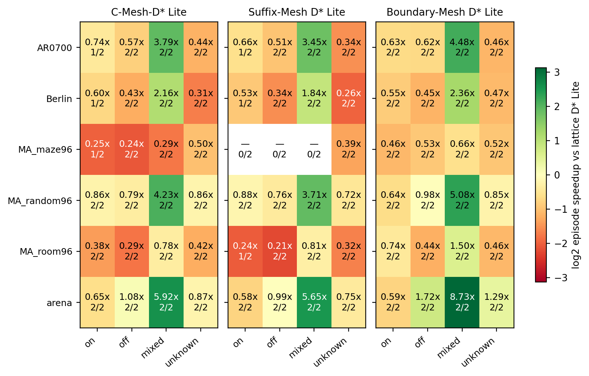{width=100%}

C-Mesh-D\* Lite: минимальная сумма среди всех полностью завершивших точных методов в 0 строках карты/режима. Относительно D* Lite lattice медианное преимущество полного эпизода на полностью парно завершённых группах: Car16: блокировки и освобождения 2.67× (12/12).

Suffix-Mesh D\* Lite: минимальная сумма среди всех полностью завершивших точных методов в 0 строках карты/режима. Относительно D* Lite lattice медианное преимущество полного эпизода на полностью парно завершённых группах: не наблюдается.

Boundary-Mesh D\* Lite: минимальная сумма среди всех полностью завершивших точных методов в 1 строках карты/режима: Berlin/churn. Относительно D* Lite lattice медианное преимущество полного эпизода на полностью парно завершённых группах: Car16: блокировки и освобождения 2.82× (12/12).

## Работа, задержки и память

| Режим | Метод | Ремонт: раскрытия | Чтения клеток | Просмотры уведомлений | p95 ремонта, мс | Peak, MiB |
| --- | --- | --- | --- | --- | --- | --- |
| Car16: вставки на пути | LBA\* reuse | 111 078 | 3 041 727 | 0 | 334.603 | 10.324 |
| Car16: вставки на пути | D\* Lite lattice | 22 203 | 724 794 | 0 | 1 797.331 | 27.557 |
| Car16: вставки на пути | MPGAA\* | 104 231 | 1 092 890 | 14 688 | 958.907 | 39.473 |
| Car16: вставки на пути | MD-A\* | 104 231 | 1 092 890 | 14 688 | 904.276 | 39.504 |
| Car16: вставки на пути | Positive prefix D\* Lite | 23 223 | 35 073 | 23 232 | 1 967.626 | 86.909 |
| Car16: вставки на пути | C-Mesh-D\* Lite | 24 418 | 45 173 | 29 120 | 3 133.481 | 59.359 |
| Car16: вставки на пути | Suffix-Mesh D\* Lite | 20 370 | 30 427 | 20 640 | 2 631.958 | 75.868 |
| Car16: вставки на пути | Boundary-Mesh D\* Lite | 20 979 | 164 760 | 15 264 | 2 796.665 | 6.492 |
| Car16: вставки вне пути | LBA\* reuse | 0 | 0 | 0 | 0.003 | 1.034 |
| Car16: вставки вне пути | D\* Lite lattice | 3 | 23 392 | 0 | 37.275 | 3.599 |
| Car16: вставки вне пути | MPGAA\* | 0 | 0 | 5 712 | 3.085 | 2.108 |
| Car16: вставки вне пути | MD-A\* | 0 | 0 | 0 | 0.051 | 2.269 |
| Car16: вставки вне пути | Positive prefix D\* Lite | 0 | 130 | 61 952 | 6.799 | 9.236 |
| Car16: вставки вне пути | C-Mesh-D\* Lite | 16 | 422 | 46 592 | 91.580 | 7.839 |
| Car16: вставки вне пути | Suffix-Mesh D\* Lite | 0 | 195 | 55 040 | 5.284 | 6.585 |
| Car16: вставки вне пути | Boundary-Mesh D\* Lite | 2 | 10 796 | 27 136 | 58.029 | 2.550 |
| Car16: блокировки и освобождения | LBA\* reuse | 8 132 | 307 719 | 0 | 147.348 | 1.449 |
| Car16: блокировки и освобождения | D\* Lite lattice | 523 | 1 591 490 | 0 | 96.222 | 24.628 |
| Car16: блокировки и освобождения | MPGAA\* | 1 490 | 31 212 | 14 076 | 30.257 | 2.772 |
| Car16: блокировки и освобождения | MD-A\* | 1 102 | 26 370 | 9 792 | 18.184 | 2.704 |
| Car16: блокировки и освобождения | Positive prefix D\* Lite | 2 009 | 4 904 | 116 160 | 16.003 | 10.989 |
| Car16: блокировки и освобождения | C-Mesh-D\* Lite | 2 939 | 10 908 | 87 360 | 151.163 | 9.711 |
| Car16: блокировки и освобождения | Suffix-Mesh D\* Lite | 1 881 | 4 103 | 103 200 | 13.261 | 7.042 |
| Car16: блокировки и освобождения | Boundary-Mesh D\* Lite | 528 | 58 029 | 50 880 | 91.077 | 2.700 |
| Car16: раскрытие карты (replay) | LBA\* reuse | 434 | 24 350 | 0 | 1.111 | 0.451 |
| Car16: раскрытие карты (replay) | D\* Lite lattice | 577 | 96 280 | 0 | 17.783 | 4.009 |
| Car16: раскрытие карты (replay) | MPGAA\* | 363 | 12 416 | 14 484 | 2.965 | 0.795 |
| Car16: раскрытие карты (replay) | MD-A\* | 363 | 12 416 | 12 648 | 2.943 | 0.823 |
| Car16: раскрытие карты (replay) | Positive prefix D\* Lite | 5 756 | 35 921 | 34 364 | 63.726 | 10.039 |
| Car16: раскрытие карты (replay) | C-Mesh-D\* Lite | 3 469 | 40 623 | 25 844 | 54.604 | 7.936 |
| Car16: раскрытие карты (replay) | Suffix-Mesh D\* Lite | 4 626 | 29 890 | 30 530 | 69.219 | 6.797 |
| Car16: раскрытие карты (replay) | Boundary-Mesh D\* Lite | 572 | 81 225 | 15 052 | 32.104 | 2.522 |
| Grid8: локально наблюдаемая динамика | LBA\* reuse | 1 005 | 3 582 | 0 | 0.322 | 0.077 |
| Grid8: локально наблюдаемая динамика | D\* Lite lattice | 14 | 2 022 | 0 | 0.217 | 0.409 |
| Grid8: локально наблюдаемая динамика | MPGAA\* | 194 | 548 | 880 | 0.203 | 0.177 |
| Grid8: локально наблюдаемая динамика | MD-A\* | 193 | 411 | 496 | 0.232 | 0.183 |
| Grid8: локально наблюдаемая динамика | Positive prefix D\* Lite | 26 | 1 910 | 1 188 | 0.241 | 0.375 |
| Grid8: локально наблюдаемая динамика | C-Mesh-D\* Lite | 26 | 1 910 | 1 188 | 0.249 | 0.375 |
| Grid8: локально наблюдаемая динамика | Suffix-Mesh D\* Lite | 26 | 1 910 | 1 188 | 0.236 | 0.375 |
| Grid8: локально наблюдаемая динамика | Boundary-Mesh D\* Lite | 26 | 3 430 | 1 188 | 0.194 | 0.148 |

Работа показана медианой по завершённым эпизодам; p95 условен на завершённых запросах после первого поиска. Пик requested heap берётся по всем эпизодам, включая остановленные. Это не RSS: стек, allocator-метаданные, общая модель и внешняя проверка исключены. Память измеряется только отдельным replay-проходом; его пути и счётчики совпали с обычным бинарником.

У новых вариантов `notify_probes` считает просмотр групп зависимости от изменённых клеток; у MPGAA/MD это их собственная инструментированная работа уведомлений. Счётчики не эквивалентны по цене. Время включает обновления, поиск и извлечение пути; сенсор и контрольная проверка находятся вне таймера.

| Режим | Метод | Peak lattice / вариант | Peak prefix / вариант | Peak MD / вариант |
| --- | --- | --- | --- | --- |
| Car16: вставки на пути | C-Mesh-D\* Lite | 0.64× (9/12) | 1.12× (7/12) | 1.68× (9/12) |
| Car16: вставки на пути | Suffix-Mesh D\* Lite | 1.14× (7/12) | 1.46× (7/12) | 10.18× (7/12) |
| Car16: вставки на пути | Boundary-Mesh D\* Lite | 3.08× (12/12) | 3.83× (7/12) | 2.60× (12/12) |
| Car16: вставки вне пути | C-Mesh-D\* Lite | 0.46× (12/12) | 1.17× (10/12) | 0.30× (12/12) |
| Car16: вставки вне пути | Suffix-Mesh D\* Lite | 0.61× (10/12) | 1.39× (10/12) | 0.39× (10/12) |
| Car16: вставки вне пути | Boundary-Mesh D\* Lite | 1.58× (12/12) | 3.24× (10/12) | 1.03× (12/12) |
| Car16: блокировки и освобождения | C-Mesh-D\* Lite | 2.76× (12/12) | 1.15× (10/12) | 0.27× (11/12) |
| Car16: блокировки и освобождения | Suffix-Mesh D\* Lite | 4.65× (10/12) | 1.42× (10/12) | 0.39× (9/12) |
| Car16: блокировки и освобождения | Boundary-Mesh D\* Lite | 9.36× (12/12) | 3.69× (10/12) | 1.05× (11/12) |
| Car16: раскрытие карты (replay) | C-Mesh-D\* Lite | 0.51× (12/12) | 1.16× (12/12) | 0.17× (12/12) |
| Car16: раскрытие карты (replay) | Suffix-Mesh D\* Lite | 0.53× (12/12) | 1.35× (12/12) | 0.21× (12/12) |
| Car16: раскрытие карты (replay) | Boundary-Mesh D\* Lite | 1.81× (12/12) | 4.04× (12/12) | 0.48× (12/12) |
| Grid8: локально наблюдаемая динамика | C-Mesh-D\* Lite | 1.08× (96/96) | 1.00× (96/96) | 0.57× (96/96) |
| Grid8: локально наблюдаемая динамика | Suffix-Mesh D\* Lite | 1.08× (96/96) | 1.00× (96/96) | 0.57× (96/96) |
| Grid8: локально наблюдаемая динамика | Boundary-Mesh D\* Lite | 2.68× (96/96) | 2.29× (96/96) | 1.33× (96/96) |

Отношения памяти — медианы парных отношений наблюдаемых пиков только на эпизодах, полностью завершённых обоими методами. Значение больше 1 означает меньший пик у кандидата. Это отдельная оценка от медианы пиков по всем эпизодам выше; ранняя остановка по бюджету не создаёт ложной экономии в парном отношении.

Контрпример связи «меньше чтений — быстрее»: Berlin/on_path, seed 48102, запрос 2. Оба метода доказали недостижимость. Boundary-Mesh выполнил 27.92 млн чтений против 56.59 млн у D* Lite lattice, но медианное время трёх повторов составило 24.938 против 14.043 с. Очередь, кеши, повторные Bellman-обновления и представление графа тоже имеют цену. Это выбранный конкретный контрпример, а не оценка частоты такого эффекта.

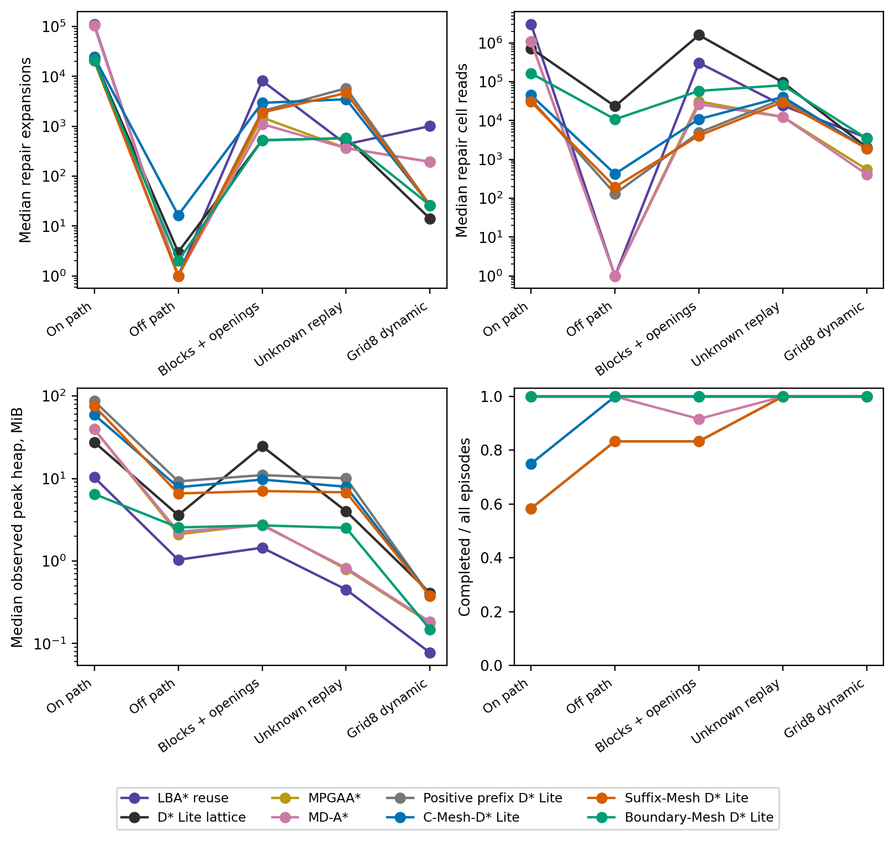{width=100%}

## Размер и частота пакетов изменений

{width=100%}

Размер пакета и доля cr — запрошенные параметры; фактически доставленные правки сохранены для каждого запроса. Большой пакет может раньше сделать цель недостижимой и сократить эпизод. Интервал k меняет продвижение старта и число вызовов; радиус меняет знания и последующие пути. Поэтому полное время и среднее время ремонта на запрос рассматриваются вместе, а разные параметры на одном корне не считаются независимыми проездами.

| Панель / режим | Значение | Алгоритм | Эпизод vs lattice | Ремонт vs lattice | Ремонт, мс/вызов |
| --- | --- | --- | --- | --- | --- |
| batch/churn | 1 | C-Mesh-D\* Lite | 0.83× (2/2) | 2.41× (2/2) | 0.754 |
| batch/churn | 1 | Suffix-Mesh D\* Lite | 0.88× (2/2) | 2.34× (2/2) | 0.882 |
| batch/churn | 1 | Boundary-Mesh D\* Lite | 0.75× (2/2) | 3.99× (2/2) | 0.412 |
| batch/churn | 8 | C-Mesh-D\* Lite | 3.12× (2/2) | 4.46× (2/2) | 9.096 |
| batch/churn | 8 | Suffix-Mesh D\* Lite | 2.39× (2/2) | 3.47× (2/2) | 10.017 |
| batch/churn | 8 | Boundary-Mesh D\* Lite | 4.34× (2/2) | 9.22× (2/2) | 3.418 |
| batch/churn | 32 | C-Mesh-D\* Lite | 5.89× (2/2) | 6.98× (2/2) | 29.352 |
| batch/churn | 32 | Suffix-Mesh D\* Lite | 4.99× (2/2) | 5.91× (2/2) | 36.133 |
| batch/churn | 32 | Boundary-Mesh D\* Lite | 11.50× (2/2) | 16.38× (2/2) | 10.090 |
| batch/churn | 128 | C-Mesh-D\* Lite | 5.79× (2/2) | 6.09× (2/2) | 153.815 |
| batch/churn | 128 | Suffix-Mesh D\* Lite | 5.72× (2/2) | 6.02× (2/2) | 178.461 |
| batch/churn | 128 | Boundary-Mesh D\* Lite | 17.32× (2/2) | 18.84× (2/2) | 56.286 |
| frequency/churn | 1 | C-Mesh-D\* Lite | 2.70× (4/4) | 3.88× (4/4) | 8.292 |
| frequency/churn | 1 | Suffix-Mesh D\* Lite | 2.68× (4/4) | 3.73× (4/4) | 9.133 |
| frequency/churn | 1 | Boundary-Mesh D\* Lite | 3.21× (4/4) | 5.35× (4/4) | 5.732 |
| frequency/churn | 2 | C-Mesh-D\* Lite | 1.90× (4/4) | 3.84× (4/4) | 5.084 |
| frequency/churn | 2 | Suffix-Mesh D\* Lite | 2.13× (4/4) | 4.10× (4/4) | 4.730 |
| frequency/churn | 2 | Boundary-Mesh D\* Lite | 2.23× (4/4) | 7.39× (4/4) | 3.701 |
| frequency/churn | 4 | C-Mesh-D\* Lite | 1.94× (3/4) | 2.67× (3/4) | 6.621 |
| frequency/churn | 4 | Suffix-Mesh D\* Lite | 2.20× (3/4) | 2.58× (3/4) | 5.871 |
| frequency/churn | 4 | Boundary-Mesh D\* Lite | 1.44× (4/4) | 2.75× (4/4) | 5.854 |
| frequency/churn | 8 | C-Mesh-D\* Lite | 0.74× (4/4) | 2.59× (4/4) | 3.214 |
| frequency/churn | 8 | Suffix-Mesh D\* Lite | 0.72× (4/4) | 2.30× (4/4) | 2.914 |
| frequency/churn | 8 | Boundary-Mesh D\* Lite | 0.83× (4/4) | 6.64× (4/4) | 1.279 |
| visibility/unknown_replay | 8 | C-Mesh-D\* Lite | 0.69× (4/4) | 1.00× (4/4) | 1.478 |
| visibility/unknown_replay | 8 | Suffix-Mesh D\* Lite | 0.54× (4/4) | 0.83× (4/4) | 1.799 |
| visibility/unknown_replay | 8 | Boundary-Mesh D\* Lite | 0.65× (4/4) | 1.12× (4/4) | 1.326 |
| visibility/unknown_replay | 16 | C-Mesh-D\* Lite | 0.70× (4/4) | 0.85× (4/4) | 7.081 |
| visibility/unknown_replay | 16 | Suffix-Mesh D\* Lite | 0.61× (4/4) | 0.76× (4/4) | 7.922 |
| visibility/unknown_replay | 16 | Boundary-Mesh D\* Lite | 0.83× (4/4) | 1.00× (4/4) | 6.116 |
| visibility/unknown_replay | 32 | C-Mesh-D\* Lite | 0.56× (4/4) | 0.69× (4/4) | 31.750 |
| visibility/unknown_replay | 32 | Suffix-Mesh D\* Lite | 0.48× (4/4) | 0.57× (4/4) | 38.591 |
| visibility/unknown_replay | 32 | Boundary-Mesh D\* Lite | 1.07× (4/4) | 1.30× (4/4) | 22.204 |

{width=100%}

### Динамическая grid8-серия по мотивам MPGAA*

| k / cr, % | Алгоритм | Завершено | Эпизод vs lattice | Ремонт, мс/вызов |
| --- | --- | --- | --- | --- |
| 2 / 1 | C-Mesh-D\* Lite | 8/8 | 0.44× (8/8) | 0.023 |
| 2 / 1 | Suffix-Mesh D\* Lite | 8/8 | 0.48× (8/8) | 0.024 |
| 2 / 1 | Boundary-Mesh D\* Lite | 8/8 | 0.62× (8/8) | 0.018 |
| 2 / 5 | C-Mesh-D\* Lite | 8/8 | 0.53× (8/8) | 0.036 |
| 2 / 5 | Suffix-Mesh D\* Lite | 8/8 | 0.51× (8/8) | 0.035 |
| 2 / 5 | Boundary-Mesh D\* Lite | 8/8 | 0.68× (8/8) | 0.028 |
| 2 / 10 | C-Mesh-D\* Lite | 8/8 | 0.53× (8/8) | 0.046 |
| 2 / 10 | Suffix-Mesh D\* Lite | 8/8 | 0.56× (8/8) | 0.042 |
| 2 / 10 | Boundary-Mesh D\* Lite | 8/8 | 0.76× (8/8) | 0.030 |
| 2 / 30 | C-Mesh-D\* Lite | 8/8 | 0.62× (8/8) | 0.052 |
| 2 / 30 | Suffix-Mesh D\* Lite | 8/8 | 0.62× (8/8) | 0.053 |
| 2 / 30 | Boundary-Mesh D\* Lite | 8/8 | 0.79× (8/8) | 0.038 |
| 8 / 1 | C-Mesh-D\* Lite | 8/8 | 0.48× (8/8) | 0.020 |
| 8 / 1 | Suffix-Mesh D\* Lite | 8/8 | 0.48× (8/8) | 0.020 |
| 8 / 1 | Boundary-Mesh D\* Lite | 8/8 | 0.62× (8/8) | 0.016 |
| 8 / 5 | C-Mesh-D\* Lite | 8/8 | 0.62× (8/8) | 0.039 |
| 8 / 5 | Suffix-Mesh D\* Lite | 8/8 | 0.62× (8/8) | 0.040 |
| 8 / 5 | Boundary-Mesh D\* Lite | 8/8 | 0.80× (8/8) | 0.035 |
| 8 / 10 | C-Mesh-D\* Lite | 8/8 | 0.65× (8/8) | 0.069 |
| 8 / 10 | Suffix-Mesh D\* Lite | 8/8 | 0.66× (8/8) | 0.072 |
| 8 / 10 | Boundary-Mesh D\* Lite | 8/8 | 0.87× (8/8) | 0.052 |
| 8 / 30 | C-Mesh-D\* Lite | 8/8 | 0.78× (8/8) | 0.112 |
| 8 / 30 | Suffix-Mesh D\* Lite | 8/8 | 0.76× (8/8) | 0.111 |
| 8 / 30 | Boundary-Mesh D\* Lite | 8/8 | 1.07× (8/8) | 0.083 |
| 32 / 1 | C-Mesh-D\* Lite | 8/8 | 0.46× (8/8) | 0.087 |
| 32 / 1 | Suffix-Mesh D\* Lite | 8/8 | 0.47× (8/8) | 0.089 |
| 32 / 1 | Boundary-Mesh D\* Lite | 8/8 | 0.61× (8/8) | 0.071 |
| 32 / 5 | C-Mesh-D\* Lite | 8/8 | 0.57× (8/8) | 0.325 |
| 32 / 5 | Suffix-Mesh D\* Lite | 8/8 | 0.58× (8/8) | 0.313 |
| 32 / 5 | Boundary-Mesh D\* Lite | 8/8 | 0.78× (8/8) | 0.265 |
| 32 / 10 | C-Mesh-D\* Lite | 8/8 | 0.72× (8/8) | 0.654 |
| 32 / 10 | Suffix-Mesh D\* Lite | 8/8 | 0.73× (8/8) | 0.646 |
| 32 / 10 | Boundary-Mesh D\* Lite | 8/8 | 1.03× (8/8) | 0.502 |
| 32 / 30 | C-Mesh-D\* Lite | 8/8 | 0.97× (8/8) | 1.455 |
| 32 / 30 | Suffix-Mesh D\* Lite | 8/8 | 0.96× (8/8) | 1.360 |
| 32 / 30 | Boundary-Mesh D\* Lite | 8/8 | 1.35× (8/8) | 0.951 |

Используются те же адаптированные режимы MPGAA* (Hernández, Asín, Baier, AAAI 2015): глобальные изменения мира, локальные наблюдения, k=2/8/32, cr=1/5/10/30%. Карты 50×50 и короткие проезды не воспроизводят оригинальную масштабную постановку. Важны фактические, а не только запрошенные изменения. У трёх mesh-представлений одношаговой grid8 одинаковая топология.

### Диагностическая история освобождений

| Алгоритм | Завершено | Эпизод vs lattice | Ремонт vs lattice | Эпизод vs MD |
| --- | --- | --- | --- | --- |
| Positive prefix D\* Lite | 4/4 | 4.12× (4/4) | 4.15× (4/4) | 0.01× (4/4) |
| C-Mesh-D\* Lite | 4/4 | 4.86× (4/4) | 4.91× (4/4) | 0.01× (4/4) |
| Suffix-Mesh D\* Lite | 4/4 | 4.20× (4/4) | 4.23× (4/4) | 0.01× (4/4) |
| Boundary-Mesh D\* Lite | 4/4 | 9.80× (4/4) | 10.46× (4/4) | 0.02× (4/4) |

Эти четыре эпизода на открытой карте — диагностический стресс истории, а не репрезентативный навигационный набор. В прежней проверке сертификаты MD с новыми освобождениями в этом тесте совпадали с глобальной евклидовой нижней оценкой. Поэтому большой выигрыш кеша в такой геометрии не доказывает необходимость mesh-сертификата; обычный контроль глобальной LB тоже мог бы решать эти запросы.

## Полностью неизвестная карта

| Модель | Радиус | Метод | До цели | Проезд / оптимум | Раскрытая доля | Ремонт, мс/вызов |
| --- | --- | --- | --- | --- | --- | --- |
| car16 | 8 | LBA\* reuse | 7/8 | 1.01 | 0.32 | 0.064 |
| car16 | 8 | D\* Lite lattice | 7/8 | 1.01 | 0.32 | 1.590 |
| car16 | 8 | MPGAA\* | 7/8 | 1.01 | 0.32 | 0.315 |
| car16 | 8 | MD-A\* | 7/8 | 1.01 | 0.32 | 0.277 |
| car16 | 8 | Positive prefix D\* Lite | 7/8 | 1.01 | 0.32 | 1.566 |
| car16 | 8 | C-Mesh-D\* Lite | 7/8 | 1.01 | 0.32 | 1.284 |
| car16 | 8 | Suffix-Mesh D\* Lite | 7/8 | 1.00 | 0.32 | 1.314 |
| car16 | 8 | Boundary-Mesh D\* Lite | 7/8 | 1.01 | 0.32 | 1.098 |
| car16 | 16 | LBA\* reuse | 8/8 | 1.00 | 0.55 | 0.237 |
| car16 | 16 | D\* Lite lattice | 8/8 | 1.00 | 0.55 | 3.700 |
| car16 | 16 | MPGAA\* | 8/8 | 1.00 | 0.55 | 0.776 |
| car16 | 16 | MD-A\* | 8/8 | 1.00 | 0.55 | 0.652 |
| car16 | 16 | Positive prefix D\* Lite | 8/8 | 1.00 | 0.55 | 5.982 |
| car16 | 16 | C-Mesh-D\* Lite | 8/8 | 1.00 | 0.55 | 4.854 |
| car16 | 16 | Suffix-Mesh D\* Lite | 8/8 | 1.00 | 0.55 | 5.523 |
| car16 | 16 | Boundary-Mesh D\* Lite | 8/8 | 1.00 | 0.55 | 3.863 |
| grid8 | 1 | LBA\* reuse | 8/8 | 1.07 | 0.08 | 0.033 |
| grid8 | 1 | D\* Lite lattice | 8/8 | 1.07 | 0.08 | 0.023 |
| grid8 | 1 | MPGAA\* | 8/8 | 1.07 | 0.08 | 0.016 |
| grid8 | 1 | MD-A\* | 8/8 | 1.07 | 0.08 | 0.014 |
| grid8 | 1 | Positive prefix D\* Lite | 8/8 | 1.07 | 0.08 | 0.039 |
| grid8 | 1 | C-Mesh-D\* Lite | 8/8 | 1.07 | 0.08 | 0.038 |
| grid8 | 1 | Suffix-Mesh D\* Lite | 8/8 | 1.07 | 0.08 | 0.040 |
| grid8 | 1 | Boundary-Mesh D\* Lite | 8/8 | 1.07 | 0.08 | 0.031 |
| grid8 | 4 | LBA\* reuse | 8/8 | 1.01 | 0.25 | 0.023 |
| grid8 | 4 | D\* Lite lattice | 8/8 | 1.02 | 0.24 | 0.026 |
| grid8 | 4 | MPGAA\* | 8/8 | 1.02 | 0.24 | 0.014 |
| grid8 | 4 | MD-A\* | 8/8 | 1.02 | 0.24 | 0.012 |
| grid8 | 4 | Positive prefix D\* Lite | 8/8 | 1.02 | 0.24 | 0.041 |
| grid8 | 4 | C-Mesh-D\* Lite | 8/8 | 1.02 | 0.24 | 0.040 |
| grid8 | 4 | Suffix-Mesh D\* Lite | 8/8 | 1.02 | 0.24 | 0.041 |
| grid8 | 4 | Boundary-Mesh D\* Lite | 8/8 | 1.02 | 0.24 | 0.033 |
| grid8 | 8 | LBA\* reuse | 8/8 | 1.01 | 0.47 | 0.024 |
| grid8 | 8 | D\* Lite lattice | 8/8 | 1.02 | 0.46 | 0.041 |
| grid8 | 8 | MPGAA\* | 8/8 | 1.02 | 0.47 | 0.017 |
| grid8 | 8 | MD-A\* | 8/8 | 1.02 | 0.47 | 0.015 |
| grid8 | 8 | Positive prefix D\* Lite | 8/8 | 1.02 | 0.46 | 0.062 |
| grid8 | 8 | C-Mesh-D\* Lite | 8/8 | 1.02 | 0.46 | 0.063 |
| grid8 | 8 | Suffix-Mesh D\* Lite | 8/8 | 1.02 | 0.46 | 0.063 |
| grid8 | 8 | Boundary-Mesh D\* Lite | 8/8 | 1.02 | 0.46 | 0.049 |

{width=100%}

Равностоимостные планы могут вести к разным наблюдениям и разным реальным маршрутам. Для миссий парное время относится к общему миру, а не к одной последовательности запросов. Квадратный сенсор не моделирует окклюзию. Планирование вызывается в начале и при обнаружении препятствий; перед каждым движением примитив проверяется на истинной карте вне таймера.

## Незавершённые задачи и профили производительности

| Модель / режим | Метод | Завершено | Терминальные исходы |
| --- | --- | --- | --- |
| car16/replay | LBA\* | 90/90 | no_path: 16; ok: 74 |
| car16/replay | LazyLBA\* | 90/90 | no_path: 16; ok: 74 |
| car16/replay | MeshA\* | 88/90 | capped: 2; no_path: 14; ok: 74 |
| car16/replay | Mesh/ParallA\* | 88/90 | capped: 2; no_path: 14; ok: 74 |
| car16/replay | D\* Lite lattice | 90/90 | no_path: 16; ok: 74 |
| car16/replay | D\* Lite mesh | 79/90 | capped: 4; no_path: 12; ok: 67; skipped_after_cap: 7 |
| car16/replay | MPGAA\* | 90/90 | no_path: 16; ok: 74 |
| car16/replay | MD-A\* | 89/90 | capped: 1; no_path: 15; ok: 74 |
| car16/replay | MD-64 | 89/90 | capped: 1; no_path: 15; ok: 74 |
| car16/replay | MD scan | 89/90 | capped: 1; no_path: 15; ok: 74 |
| car16/replay | LBA\* reuse | 90/90 | no_path: 16; ok: 74 |
| car16/replay | Positive prefix D\* Lite | 79/90 | capped: 4; no_path: 12; ok: 67; skipped_after_cap: 7 |
| car16/replay | C-Mesh-D\* Lite | 85/90 | capped: 4; no_path: 12; ok: 73; skipped_after_cap: 1 |
| car16/replay | Suffix-Mesh D\* Lite | 79/90 | capped: 4; no_path: 12; ok: 67; skipped_after_cap: 7 |
| car16/replay | Boundary-Mesh D\* Lite | 90/90 | no_path: 16; ok: 74 |
| car16/mission | LBA\* | 15/16 | goal: 15; step_limit: 1 |
| car16/mission | LazyLBA\* | 15/16 | goal: 15; step_limit: 1 |
| car16/mission | MeshA\* | 15/16 | goal: 15; step_limit: 1 |
| car16/mission | Mesh/ParallA\* | 15/16 | goal: 15; step_limit: 1 |
| car16/mission | D\* Lite lattice | 15/16 | goal: 15; step_limit: 1 |
| car16/mission | D\* Lite mesh | 15/16 | goal: 15; step_limit: 1 |
| car16/mission | MPGAA\* | 15/16 | goal: 15; step_limit: 1 |
| car16/mission | MD-A\* | 15/16 | goal: 15; step_limit: 1 |
| car16/mission | MD-64 | 15/16 | goal: 15; step_limit: 1 |
| car16/mission | MD scan | 15/16 | goal: 15; step_limit: 1 |
| car16/mission | LBA\* reuse | 15/16 | goal: 15; step_limit: 1 |
| car16/mission | Positive prefix D\* Lite | 15/16 | goal: 15; step_limit: 1 |
| car16/mission | C-Mesh-D\* Lite | 15/16 | goal: 15; step_limit: 1 |
| car16/mission | Suffix-Mesh D\* Lite | 15/16 | goal: 15; step_limit: 1 |
| car16/mission | Boundary-Mesh D\* Lite | 15/16 | goal: 15; step_limit: 1 |
| grid8/replay | LBA\* | 96/96 | no_path: 1; ok: 95 |
| grid8/replay | LazyLBA\* | 96/96 | no_path: 1; ok: 95 |
| grid8/replay | MeshA\* | 96/96 | no_path: 1; ok: 95 |
| grid8/replay | Mesh/ParallA\* | 96/96 | no_path: 1; ok: 95 |
| grid8/replay | D\* Lite lattice | 96/96 | no_path: 1; ok: 95 |
| grid8/replay | D\* Lite mesh | 96/96 | no_path: 1; ok: 95 |
| grid8/replay | MPGAA\* | 96/96 | no_path: 1; ok: 95 |
| grid8/replay | MD-A\* | 96/96 | no_path: 1; ok: 95 |
| grid8/replay | MD-64 | 96/96 | no_path: 1; ok: 95 |
| grid8/replay | MD scan | 96/96 | no_path: 1; ok: 95 |
| grid8/replay | LBA\* reuse | 96/96 | no_path: 1; ok: 95 |
| grid8/replay | Positive prefix D\* Lite | 96/96 | no_path: 1; ok: 95 |
| grid8/replay | C-Mesh-D\* Lite | 96/96 | no_path: 1; ok: 95 |
| grid8/replay | Suffix-Mesh D\* Lite | 96/96 | no_path: 1; ok: 95 |
| grid8/replay | Boundary-Mesh D\* Lite | 96/96 | no_path: 1; ok: 95 |
| grid8/mission | LBA\* | 24/24 | goal: 24 |
| grid8/mission | LazyLBA\* | 24/24 | goal: 24 |
| grid8/mission | MeshA\* | 24/24 | goal: 24 |
| grid8/mission | Mesh/ParallA\* | 24/24 | goal: 24 |
| grid8/mission | D\* Lite lattice | 24/24 | goal: 24 |
| grid8/mission | D\* Lite mesh | 24/24 | goal: 24 |
| grid8/mission | MPGAA\* | 24/24 | goal: 24 |
| grid8/mission | MD-A\* | 24/24 | goal: 24 |
| grid8/mission | MD-64 | 24/24 | goal: 24 |
| grid8/mission | MD scan | 24/24 | goal: 24 |
| grid8/mission | LBA\* reuse | 24/24 | goal: 24 |
| grid8/mission | Positive prefix D\* Lite | 24/24 | goal: 24 |
| grid8/mission | C-Mesh-D\* Lite | 24/24 | goal: 24 |
| grid8/mission | Suffix-Mesh D\* Lite | 24/24 | goal: 24 |
| grid8/mission | Boundary-Mesh D\* Lite | 24/24 | goal: 24 |

В измеряемых строках: 135 превышений бюджета, 459 запросов после остановки по бюджету и 45 остановок движения. Счётчики включают три повтора и не являются числом независимых задач. Недостижимость в replay считается корректно решённой задачей; остановка по бюджету — нет.

| Метод | Первый replay-контрпример | Запрос | Раскрытия | Lattice: исход / раскрытия |
| --- | --- | --- | --- | --- |
| Positive prefix D\* Lite | Berlin/on_path/48102 | 2 | 1 000 000 | no_path / 695 926 |
| C-Mesh-D\* Lite | Berlin/on_path/48102 | 2 | 1 000 000 | no_path / 695 926 |
| Suffix-Mesh D\* Lite | Berlin/on_path/48102 | 2 | 1 000 000 | no_path / 695 926 |

Таблица показывает по одному первому зафиксированному превышению бюджета на новый адаптер, без повторного счёта трёх таймингов. Поисковый лимит зависит от представления: миллион mesh-вершин и миллион решётчатых поз не являются одинаковым объёмом физического пространства. Раннюю остановку mesh после части доказательства недостижимости нельзя считать преимуществом перед завершённым доказательством lattice.

### Преимущество сжатия или ориентации по завершению

| Метод | Контроль | Выигрыши / потери | Пример | Запрос / ответ | Раскрытия: вариант / контроль |
| --- | --- | --- | --- | --- | --- |
| C-Mesh-D\* Lite | Positive prefix D\* Lite | 6 / 0 | MA_room96/on_path | 6 / ok | 734 628 / 1 000 000 |
| C-Mesh-D\* Lite | D\* Lite mesh | 6 / 0 | MA_room96/on_path | 6 / ok | 734 628 / 1 000 000 |
| Suffix-Mesh D\* Lite | Positive prefix D\* Lite | 0 / 0 | — | — | — |
| Suffix-Mesh D\* Lite | D\* Lite mesh | 0 / 0 | — | — | — |
| Boundary-Mesh D\* Lite | Positive prefix D\* Lite | 11 / 0 | MA_room96/on_path | 6 / ok | 66 972 / 1 000 000 |
| Boundary-Mesh D\* Lite | D\* Lite mesh | 11 / 0 | MA_room96/on_path | 6 / ok | 66 972 / 1 000 000 |

Попарное покрытие рассчитано по всем 90 car16 replay-случаям. «Выигрыш» означает завершённый кандидатом эпизод при остановке контроля; «потеря» — обратное. Для примера по возможности выбран запрос с конечным эталонным путём. Контроль остановился на миллионе раскрытий, кандидат дал проверенный ответ и завершил весь эпизод. Его частичное время не сравнивается с полным временем кандидата. Параметры с общими корнями остаются зависимыми.

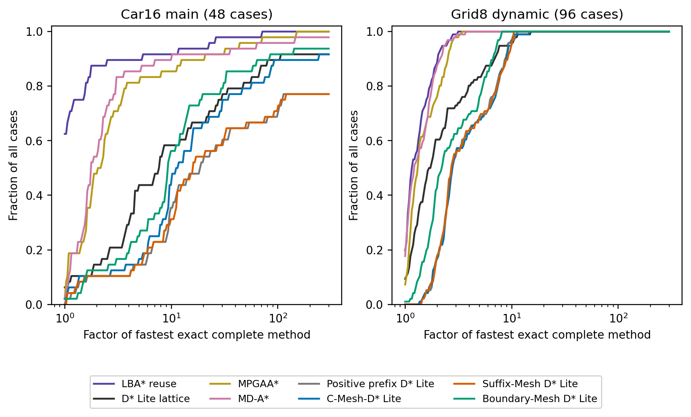{width=100%}

## Проверки, выводы и ограничения

Независимый Python Dijkstra работает по исходным физическим примитивам, без mesh-адаптера, кеша и эвристики: 120 динамических снимков, все 16 направлений car16, 1200 проверок ответов обычного бинарника. Дополнительно проверены 1168 проекций примитивов, 6444 условий согласованности и 6444 циклов закрытия и открытия опорных клеток. Те же проверки прошли ASan/UBSan; инструментирование памяти сохраняет решения и работу. Проверены перемещение старта, внутренние клетки макродуги и открытие ранее недостижимого компонента. Проверены закрытие и повторное открытие начальной и целевой клеток.

Перенос завершён и проверяем, но сами структурные идеи не превращаются автоматически в универсальное преимущество над A\*, MPGAA\* или MD-A\*. C-Mesh сокращает число меток, Suffix-Mesh меняет направление разделения трасс, Boundary-Mesh меняет гранулярность кеша коллизий. Их полезность определяется геометрией, локальностью изменений и стоимостью уведомлений. В результатах выше показаны и сильные режимы, и случаи проигрыша.

Positive prefix — контроль общей реализации, а не доказательство, что всё отличие от прежнего D\* Lite mesh вызвано топологией. Для car16 сравнение Boundary-Mesh с ним включает переход к решётке и пакетный кеш; чтобы строго приписать весь выигрыш маске, нужна дополнительная решётчатая версия с точечным кешем в новом ядре. Прежний D\* Lite lattice служит практическим сильным контролем, но ядра отличаются. В одношаговой grid8 Positive prefix уже тождествен решётке с точечным кешем в том же ядре: сравнение Boundary/Positive prefix здесь выделяет гранулярность кеша и пакетную проверку. Совпадение путей и раскрытий четырёх новых адаптеров на grid8 проверяется отдельно; различаться могут чтения клеток и ресурсы.

Сжатие цепочек, разворот автомата и кеширование допустимости сами по себе известные приёмы. Исследовательская идея здесь — их применение и сравнение в конкретной incremental MeshA\*-модели; мировой приоритет этих комбинаций не установлен. Сильная сторона работы — исполняемый и проверяемый артефакт, а не подтверждённая новая общая теорема или лидерство над всеми опубликованными реализациями.

Для выделения пользы именно префиксного обхода Boundary-Mesh нужен ещё контроль с той же маской и тем же ядром, который вычисляет её независимыми проходами полных traces. Он отделил бы совместную проверку mesh от упаковки кеша и гранулярности инвалидации. Текущее преимущество памяти маски нельзя целиком приписывать mesh-структуре.

Репрезентативность ограничена прежними корнями и окнами карт. Официальные Moving AI карты уже применялись в исследованиях поиска, но новые числа не воспроизводят опубликованные реализации авторов. Bootstrap по четырём–шести картам, сохранённый в JSON для основных сравнений, описательный. Мелкие различия времени сопоставляются с разбросом повторов; все 15 методов выполнялись последовательно в перемешанном порядке, отдельного второго компьютера и аппаратных счётчиков нет. Нельзя переносить победу в отдельных строках на все инкрементальные mesh-задачи.

## Воспроизведение дополнения

Машина: `AMD EPYC 9V74 80-Core Processor`; платформа: `Linux-6.18.57-x86_64-with-glibc2.41`. Исходники, команды, версии компилятора, флаги, хеши бинарников, входов и каждой CSV сохранены в `cpp/mesh_variants/frozen/manifest.json` и `results/full/experiment.json`. Старые результаты `cpp/experiments/results/expanded` сохранены.

```bash
make -C cpp/mesh_variants -j2 all
make -C cpp/mesh_variants sanitize
python cpp/mesh_variants/test_variants.py
python cpp/mesh_variants/run_all.py --output cpp/mesh_variants/results/reproduction
python cpp/mesh_variants/analyze.py --directory cpp/mesh_variants/results/reproduction
python cpp/mesh_variants/report.py --directory cpp/mesh_variants/results/reproduction
python cpp/experiments/report.py --mesh-directory cpp/mesh_variants/results/reproduction
```

Сохранённые результаты можно заново проанализировать и собрать командами `analyze.py` и `report.py` без параметра `--directory`. Основной объединённый отчёт из сохранённых данных собирается так:

```bash
python cpp/experiments/report.py
```

Словарь CSV и определения метрик: `cpp/experiments/README.md`.

Новая семантика уведомлений и стоимость общей модели: `cpp/mesh_variants/README.md`.

# Раскрытие карты и глобальная динамика при n = k

Новая серия проверяет все 15 реализаций на замкнутых проездах к неизменной цели. Заморожено 816 конфигураций: 48 статических и 768 динамических. Выполнено **17,520 измеряемых проездов**, ещё **2,640 отдельных проездов для памяти**, проверено **1,484,116 вызовов планировщика**. Предыдущие серии сохраняют собственные времена и протокол; их нельзя объединять с этой серией в один временной рейтинг.

Полный атлас всех карт и параметров: [navigation_by_map.pdf](navigation_by_map.pdf). Численные таблицы со всеми 15 методами находятся в каталоге `cpp/navigation_sweeps/results/full/analysis/`:

- `episode_metrics.csv`: отдельные конфигурации и методы;
- `static_radius.csv`: карты и радиусы раскрытия;
- `dynamic_parameters.csv`: карты, k/cr и методы;
- `map_summary.csv`: полнота, время и работа по картам;
- `map_pairs.csv`: парные сравнения по картам;
- `dynamic_pairs.csv`: парные сравнения по k/cr;
- `work_by_observed_changes.csv`: нагрузка фактических пакетов.

Предыдущие результаты по картам вынесены также в [prior_by_map.csv](prior_by_map.csv).

В этой новой серии скорость больше 1 выгодна кандидату. Если не указано иное, ускорения агрегируются геометрическим средним отношений времени по общим допустимым конфигурациям, после медианы повторов внутри конфигурации. Предыдущие серии сохраняют свои определения агрегаторов. Число допустимых пар и полнота всегда рассматриваются вместе с отношением времени.

Дополнительный контроль с более сильным обычным Octile A\* reuse ограничивает общий вывод о MD-A\*: online-выигрыш минимум 10% на каждом из двух корней получен на **2 из 30 сопоставимых точек** карта/k/cr. Выигрышные точки: Berlin: (k,cr) = (2,5); Berlin: (k,cr) = (8,10). По геометрическому среднему online-отношений на допустимых опорных конфигурациях MD уступает этому бейзлайну на **10/10 карт**. Поэтому таблицы выигрыша над D\* lattice ниже показывают конкретную область применимости; универсальное преимущество MD не подтверждено. Подробный пятисторонний контроль и его отдельные времена приведены далее.

## Где наблюдается преимущество ремонта

Для компактного обозначения областей выигрыша используется практический порог **10% на каждом из двух корней**. Это описательный фильтр размера эффекта, а не проверка статистической значимости. Статическая таблица перечисляет радиусы, на которых оба метода достигли цели и полное время кандидата минимум в 1.1 раза меньше D\* lattice на каждом корне. Пустое поле означает отсутствие подтверждающего сочетания в этой серии. Сравнение относится к собственным траекториям методов, а не одинаковым запросам.

| Карта | MD-A\* | LBA\* reuse | C-Mesh | Suffix-Mesh | Boundary-Mesh |
| --- | --- | --- | --- | --- | --- |
| AR0700 | 8, 16, 32, 64 | 8, 16, 32, 64 | — | — | 16, 32, 64 |
| Berlin | 8, 16, 32, 64 | 8, 16, 32, 64 | — | — | 32, 64 |
| MA_maze96 | 8, 16, 32, 64 | 8, 16, 32, 64 | — | — | — |
| MA_random96 | 8, 16, 32, 64 | 8, 16, 32, 64 | — | — | 16, 32, 64 |
| MA_room96 | 8, 16, 32, 64 | 8, 16, 32, 64 | — | — | — |
| arena | 8, 16, 32, 64 | 8, 16, 32, 64 | 16 | — | 16, 32, 64 |


В динамической таблице указано **число выигрышных точек / число допустимых точек**: всего измерено 36 точек на grid8-карту и 4 точки на car16-карту. Допустимая точка требует обеих целей, хотя бы одной фазы и ненулевого online-времени у обоих методов на каждом из двух корней. Выигрыш требует online-ускорения не меньше 1.1 на **каждом** корне. Точки без полной допустимой пары нельзя считать ни победами, ни подтверждением общего преимущества. Все 15 методов и неудачные исходы представлены далее в подробных таблицах и CSV.

| Граф / карта | MD-A\* | LBA\* reuse | C-Mesh | Suffix-Mesh | Boundary-Mesh |
| --- | --- | --- | --- | --- | --- |
| car16 / AR0700 | 0/0 | 0/0 | 0/0 | 0/0 | 0/0 |
| car16 / Berlin | 0/0 | 0/0 | 0/0 | 0/0 | 0/0 |
| car16 / MA_maze96 | 3/4 | 3/4 | 4/4 | 0/0 | 4/4 |
| car16 / MA_random96 | 1/1 | 1/1 | 1/1 | 1/1 | 1/1 |
| car16 / MA_room96 | 1/1 | 1/1 | 1/1 | 1/1 | 1/1 |
| car16 / arena | 0/0 | 0/0 | 0/0 | 0/0 | 1/1 |
| grid8 / AR0700 | 1/23 | 2/22 | 3/25 | 4/25 | 19/25 |
| grid8 / Berlin | 5/36 | 1/36 | 1/36 | 0/36 | 33/36 |
| grid8 / MA_maze512 | 0/36 | 0/36 | 0/36 | 0/36 | 34/36 |
| grid8 / MA_random512 | 0/36 | 0/36 | 7/36 | 6/36 | 32/36 |
| grid8 / MA_room512 | 0/36 | 0/36 | 0/36 | 0/36 | 36/36 |
| grid8 / arena | 18/24 | 10/24 | 4/24 | 2/24 | 7/24 |
| grid8 / random50_p10 | 22/24 | 16/24 | 6/24 | 8/24 | 12/24 |
| grid8 / random50_p20 | 23/24 | 15/24 | 7/24 | 6/24 | 11/24 |
| grid8 / random50_p30 | 23/24 | 21/24 | 9/24 | 8/24 | 13/24 |
| grid8 / random50_p40 | 15/30 | 19/30 | 10/30 | 12/30 | 14/30 |


Следующая таблица показывает **разведочные примеры** на конкретных картах и параметрах: для каждого выбранного метода берутся до трёх максимальных ускорений online относительно D\* lattice, только если оба метода достигли цели на обоих корнях и пережили изменения. Это выбор по результатам, поэтому эти максимумы не являются несмещённой оценкой будущего выигрыша. Строки без преимущества не добавляются. Полное множество сравнений, включая проигрыши, находится в `dynamic_pairs.csv`.

| Метод | Граф | Карта | k=n | cr | Полное | Online | Раскрытия | Чтения |
| --- | --- | --- | --- | --- | --- | --- | --- | --- |
| MD-A\* | car16 | MA_random96 | 8 | 10 | 187.59× | 219.09× | 1.08× | 237.31× |
| MD-A\* | car16 | MA_room96 | 8 | 10 | 25.66× | 36.94× | 0.88× | 17.52× |
| MD-A\* | grid8 | random50_p40 | 32 | 15 | 4.94× | 18.03× | 1.50× | 8.73× |
| LBA\* reuse | car16 | MA_random96 | 8 | 10 | 724.03× | 1107.67× | 0.63× | 115.56× |
| LBA\* reuse | car16 | MA_maze96 | 64 | 30 | 22.86× | 1053.39× | 1.10× | 7.14× |
| LBA\* reuse | car16 | MA_maze96 | 32 | 20 | 30.67× | 601.57× | 1.23× | 8.50× |
| C-Mesh | car16 | MA_random96 | 8 | 10 | 7.36× | 7.51× | 0.19× | 115.60× |
| C-Mesh | car16 | MA_room96 | 8 | 10 | 2.32× | 2.75× | 0.13× | 7.53× |
| C-Mesh | grid8 | random50_p10 | 16 | 10 | 0.90× | 1.93× | 1.13× | 0.96× |
| Suffix-Mesh | car16 | MA_random96 | 8 | 10 | 6.76× | 6.89× | 0.20× | 161.89× |
| Suffix-Mesh | car16 | MA_room96 | 8 | 10 | 2.22× | 2.83× | 0.10× | 10.48× |
| Suffix-Mesh | grid8 | random50_p10 | 16 | 15 | 1.22× | 1.96× | 1.13× | 1.13× |
| Boundary-Mesh | car16 | MA_random96 | 8 | 10 | 22.20× | 24.36× | 1.10× | 38.92× |
| Boundary-Mesh | car16 | MA_room96 | 8 | 10 | 6.72× | 10.29× | 1.09× | 4.19× |
| Boundary-Mesh | car16 | MA_maze96 | 64 | 30 | 1.80× | 7.07× | 1.04× | 1.85× |


В последней таблице отношения раскрытий и чтений относятся ко всему эпизоду, включая начальный поиск. Online-счётчики также сохранены отдельно в CSV. Максимумы выбраны для иллюстрации условий, а не для общего рейтинга.

### Контроль на совпадающей части фактических запросов

Дополнительно из уже измеренных проездов выделены успешные online-вызовы с совпадающими конфигурацией, номером движения, состоянием агента, хешами истинного мира и карты убеждений **до и после** наблюдения и числом блокировок/открытий. Начальные запросы и остановки по лимиту исключены. Это контроль на общей части реальных входов; внутренняя история поиска всё ещё может отличаться, а несовпавшие запросы не включены. Значения — геометрическое среднее отношений суммарного времени совпавших вызовов по конфигурациям, относительно D\* lattice; в скобках число совпавших запросов. Полные числа конфигураций, работы и времени находятся в `aligned_query_cases.csv` и `aligned_query_maps.csv`. Хеши используются как практические отпечатки, а не как математическое доказательство тождества карт.

Динамический car16:

| Карта | MD-A\* | LBA\* reuse | C-Mesh | Suffix-Mesh | Boundary-Mesh |
| --- | --- | --- | --- | --- | --- |
| AR0700 | 19.77× (16) | 85.55× (38) | 1.62× (38) | 1.93× (38) | 3.54× (38) |
| Berlin | 22.82× (45) | 30.71× (44) | 2.29× (44) | 2.23× (44) | 4.90× (54) |
| MA_maze96 | 9.65× (39) | 519.41× (35) | 1.44× (35) | — | 4.48× (102) |
| MA_random96 | 5.66× (41) | 160.70× (39) | 5.83× (50) | 4.98× (39) | 13.04× (53) |
| MA_room96 | 26.64× (32) | 145.93× (32) | 2.12× (41) | 2.34× (32) | 7.67× (63) |
| arena | 14.67× (25) | 51.91× (29) | 2.19× (29) | 2.18× (29) | 3.27× (47) |


Динамический grid8:

| Карта | MD-A\* | LBA\* reuse | C-Mesh | Suffix-Mesh | Boundary-Mesh |
| --- | --- | --- | --- | --- | --- |
| AR0700 | 0.52× (746) | 0.19× (1831) | 0.86× (11419) | 0.89× (11419) | 1.27× (11419) |
| Berlin | 0.66× (514) | 0.44× (5177) | 0.91× (12349) | 0.91× (12349) | 1.42× (12349) |
| MA_maze512 | 0.13× (546) | 0.15× (1107) | 0.81× (18847) | 0.78× (18847) | 1.62× (18847) |
| MA_random512 | — | — | 1.00× (14335) | 1.01× (14335) | 1.74× (14335) |
| MA_room512 | 0.20× (203) | 0.21× (183) | 0.82× (15803) | 0.80× (15803) | 1.57× (15803) |
| arena | 1.75× (27) | 0.44× (24) | 0.87× (818) | 0.78× (818) | 1.06× (818) |
| random50_p10 | 1.94× (48) | 4.20× (48) | 1.11× (837) | 1.14× (837) | 1.32× (837) |
| random50_p20 | 2.84× (68) | 2.34× (58) | 1.04× (900) | 1.03× (900) | 1.26× (900) |
| random50_p30 | 2.66× (240) | 1.89× (213) | 1.02× (828) | 1.02× (828) | 1.28× (828) |
| random50_p40 | 1.72× (408) | 2.22× (454) | 0.98× (1233) | 1.02× (1233) | 1.29× (1233) |


### Отдельно: доказательство отсутствия пути

Следующие отношения относятся только к совпавшим online-запросам, на которых оба метода **доказали отсутствие пути в текущей карте убеждений** и эталон подтвердил ответ. Это полностью завершённые поисковые запросы, но не успешные проезды к цели; они не входят в таблицы ускорений на достигнутых целях. Лимиты без доказательства исключены. Во всех случаях сохраняется отдельная проверка истинной карты: отсутствие пути в убеждениях не равнозначно отсутствию пути в мире. В скобках число совпавших запросов; среднее геометрическое сначала использует суммарные времена внутри конфигурации.

Динамический car16:

| Карта | MD-A\* | LBA\* reuse | C-Mesh | Suffix-Mesh | Boundary-Mesh |
| --- | --- | --- | --- | --- | --- |
| AR0700 | 2310.86× (3) | 18999.50× (4) | 3.02× (2) | 2.50× (2) | 2.34× (4) |
| Berlin | 8937.25× (1) | 1737549.23× (2) | — | — | 1.38× (4) |
| MA_random96 | 4784.67× (1) | 297532.75× (1) | — | — | 0.51× (1) |
| MA_room96 | 303.85× (1) | 67947.62× (1) | — | — | 0.51× (1) |
| arena | 53.29× (1) | 11396.35× (1) | 0.27× (1) | 0.22× (1) | 0.62× (1) |


Динамический grid8:

| Карта | MD-A\* | LBA\* reuse | C-Mesh | Suffix-Mesh | Boundary-Mesh |
| --- | --- | --- | --- | --- | --- |
| AR0700 | 4205.08× (1) | 10773.85× (1) | 0.69× (16) | 0.70× (16) | 1.30× (16) |


Очень большие отношения на единичных no-path запросах следует читать отдельно: повторное использование ранее доказанной недостижимости и направление поиска могут менять стоимость доказательства на порядки. Внутренние истории не уравнены. Такие числа не доказывают выигрыш нового mesh-сертификата и не заменяют сравнение законченных проездов.

## Протокол и сопоставимость

В статической серии использованы все шесть прежних car16-карт и те же два корня на карту. До наблюдения все клетки считаются свободными. Квадратный сенсор без окклюзии раскрывает радиус **8, 16, 32 или 64 клетки** перед каждым движением. Агент выполняет один примитив и перепланирует, когда изменились известные стоимости; иначе следует сохранённому суффиксу. Цель, включая курс, неизменна. Лимит — 512 выполненных примитивов.

В динамической серии карта полностью известна в начале. Через каждые **k = 2, 4, 8, 16, 32, 64 выполненных движения** происходят изменения по всей карте. Видимость **n = k**, как задано пользователем. Для **cr = 1%, 5%, 10%, 15%, 20%, 30%** целевое число обменов в одном направлении равно $\lfloor N\,cr/200+0.5\rfloor$, где $N$ — все клетки, включая препятствия. Из **дофазных** свободного и занятого пулов выбирается одинаковое число клеток; новая блокировка не может тут же открыться. Текущая клетка и клетка цели защищены. Число обменов ограничено меньшим доступным пулом. Плотность препятствий сохраняется точно, а фактический $cr=100(B+O)/N$ записан отдельно от запрошенного. При отсутствии фаз доставлено ноль изменений; фактический cr фазы не определён.

Наблюдения происходят перед каждым движением. Поэтому между глобальными фазами тоже могут появляться новые вызовы планировщика: агент обнаруживает ранее произошедшие правки в новой части сенсорной области. Число фаз не равно числу ремонтов; обе величины и реальные размеры наблюдённых пакетов приведены отдельно.

Полный набор из **36 сочетаний k/cr** выполнен на шести полных grid8-картах и четырёх прежних случайных картах 50×50 с плотностями около 10/20/30/40%. Дополнительная динамическая адаптация к car16 выполнена на всех шести картах, но только на четырёх опорных точках, заданных до измерений: **(2,5), (8,10), (32,20), (64,30)**. Это отдельный срез, а не полный car16-перебор; подготовленные остальные car16-входы сохранены, но не считаются измеренными. Для grid8 взяты новые два корня; на картах со стороной не меньше 128 начальное расстояние Чебышёва составляет 144–260 клеток, а эталонный путь — не более 400 шагов. Поэтому успешный проезд на этих картах обязательно переживает как минимум две фазы при k = 64. Малые карты выделяются как диагностика коротких маршрутов. Лимиты: 384 примитива car16 и 512 шагов grid8.

Для grid8 глубина видимости n точно равна шару Чебышёва: диагонали имеют стоимость $\sqrt2$, проверяется клетка назначения, срезание углов разрешено, как в прежних реализациях. Для car16 это **адаптация** протокола: видны клетки коллизионных следов всех дуг, чьи начала достижимы менее чем за n примитивов на свободной бесконечной решётке; затем область обрезается границами карты. Это не квадрат радиуса n и не сенсор с окклюзией. Точная область предвычислена отдельно для каждого курса. Приведённый протокол воспроизводит семейство экспериментов MPGAA\* (Hernández, Asín, Baier, AAAI 2015), но не заявляется точной репликацией их реализации или численных результатов.

Все методы используют общие случайные приоритеты клеток по фазам, не зависящие от k/cr и метода. При разных маршрутах защита текущей клетки может изменить глобальную карту. Это **сравнение замкнутых политик**, а не строго одинаковая последовательность запросов. Ранжирование по времени трактуется совместно с успехом и выполненной работой. Прежний replay на одинаковых снимках остаётся отдельным контролем. Из-за n = k нельзя независимо приписать эффект только частоте изменений или только видимости.

Все статические конфигурации имеют три повтора. В grid8-динамике выполнен один полный проход, а четыре заранее заданные точки **(k, cr) = (2, 5), (8, 10), (32, 20), (64, 30)** имеют по три повтора. В car16-динамике выполнены только эти четыре точки, каждая с тремя повторами. Это позволяет полностью покрыть запрошенный grid-протокол, но единичные малые временные различия нельзя считать устойчивым превосходством. Отдельный проход памяти выполнен для всей статической серии и этих четырёх точек динамики на обеих моделях. Все измерения последовательны, порядок методов в повторе рандомизирован.

Параметры поисковых ядер сохранены из репозитория. В частности, Mesh/ParallA\* выполняет **100 раскрытий mesh на одно раскрытие LBA*** и возвращает первый найденный ответ. Этот внутренний параметр не является интервалом изменения карты k. Когда mesh-ветвь не помогает, такая диспетчеризация может существенно увеличить работу до срабатывания LBA\*-ветви. Числа относятся к этой конфигурации реализации; отдельная настройка соотношения на каждой карте не выполнялась.

Время эпизода — конструктор планировщика плюс все его вызовы; online — вызовы после начального плана. Общие подготовка модели, предвычисление сенсора, изменение мира, сенсор и эталонные проверки исключены из таймера поиска. В CSV отдельно приведены сенсор и сумма поиска с сенсором. Память — пик запрошенных байтов динамического размещения планировщика и текущего пути; общие модель/календарь/мир исключены. Это не RSS. Дефолтный предел — 1 млн раскрытий на запрос; все остановки сохранены.

Планировщик конструируется до первого наблюдения. В неизвестной статической карте первое наблюдение передаётся ему как пакет блокировок исходно свободной карты; начальный вызов включает обработку этого пакета. Поэтому полное время нельзя выдавать за чистое преимущество ремонта. В динамике исходная карта известна целиком и начальный пакет пуст. Альтернативная инициализация планировщика уже после первого наблюдения здесь не измерялась; начальный и online-поиск сохранены отдельно.

После каждого планирования вне таймера выполняется LBA\* по текущей карте убеждений, проверяется достижимость, стоимость и геометрическая допустимость ответа. Точные методы должны совпасть по стоимости с допуском $10^{-6}$; Mesh/ParallA\* допускает удлинение пути. Если в убеждениях пути нет, отдельно проверяется истинная карта. Такая остановка не считается ошибкой поиска: изменения происходят только после движений, и неподвижный агент не получит следующей фазы. В таблицах она различается с истинной недостижимостью.

Машина: **AMD EPYC 9V74 80-Core Processor**, `Linux-6.18.57-x86_64-with-glibc2.41`. Компилятор: **g++ 14.2.0**, флаги `-O3 -DNDEBUG -std=c++17 -Wall -Wextra -Wpedantic`. Внутри каждого измерительного прохода проверено единство хеша бинарника и флагов. Параметры модели и поисковые ядра совпадают с предыдущей серией 15 методов. При проверке симулятора устранён пограничный запрет совпадающих клеток текущего состояния и цели при разных курсах. Прерванный предварительный проход сохранён в `results/pre_endpoint_guard_fix` и исключён из анализа; все приведённые времена получены после исправления.

Связь с первоисточником проверена по [Hernández, Asín, Baier, «Reusing Previously Found A\* Paths for Fast Goal-Directed Navigation in Dynamic Terrain», AAAI 2015, раздел Experimental Results](https://classpages.cselabs.umn.edu/Fall-2021/csci4511-001/misc/HernandezAB15.pdf). Оттуда взяты наборы k/cr и n = k; в статье использованы октильная эвристика, оптимизированный авторский D\* Lite и существенно больше начальных задач, включая случайные карты 1000×1000. Здесь геометрическая основа эвристик прежних ядер евклидова, а исходные реализации и карты сохранены для сопоставимости с прежними сериями. Добавленный далее октильный контроль усиливает обычный A\*, но не переводит все инкрементальные ядра на октильную эвристику. Это ещё одна причина не трактовать новые времена как репликацию сравнительного рейтинга статьи.

## Фактическая интенсивность изменений

| Граф | Карта | Занято, % | cr1 | cr5 | cr10 | cr15 | cr20 | cr30 |
| --- | --- | --- | --- | --- | --- | --- | --- | --- |
| car16 | AR0700 | 49.62 | — | 5.00 | 10.00 | — | 20.00 | 30.00 |
| car16 | Berlin | 26.85 | — | 5.00 | 10.00 | — | 20.00 | 30.00 |
| car16 | MA_maze96 | 6.77 | — | 4.99 | 10.00 | — | 13.54\* | 13.54\* |
| car16 | MA_random96 | 10.19 | — | 4.99 | 10.00 | — | 20.01 | 20.38\* |
| car16 | MA_room96 | 11.51 | — | 4.99 | 10.00 | — | 20.01 | 23.03\* |
| car16 | arena | 14.45 | — | 5.00 | 10.00 | — | 19.99 | 28.90\* |
| grid8 | AR0700 | 49.62 | 1.00 | 5.00 | 10.00 | 15.00 | 20.00 | 30.00 |
| grid8 | Berlin | 26.85 | 1.00 | 5.00 | 10.00 | 15.00 | 20.00 | 30.00 |
| grid8 | MA_maze512 | 6.15 | 1.00 | 5.00 | 10.00 | 12.30\* | 12.30\* | 12.30\* |
| grid8 | MA_random512 | 10.01 | 1.00 | 5.00 | 10.00 | 15.00 | 20.00 | 20.02\* |
| grid8 | MA_room512 | 11.55 | 1.00 | 5.00 | 10.00 | 15.00 | 20.00 | 23.11\* |
| grid8 | arena | 14.45 | 1.00 | 5.00 | 10.00 | 14.99 | 19.99 | 28.90\* |
| grid8 | random50_p10 | 10.48 | 1.04 | 5.04 | 10.00 | 15.04 | 20.00 | 20.96\* |
| grid8 | random50_p20 | 19.72 | 1.04 | 5.04 | 10.00 | 15.04 | 20.00 | 30.00 |
| grid8 | random50_p30 | 30.88 | 1.04 | 5.04 | 10.00 | 15.04 | 20.00 | 30.00 |
| grid8 | random50_p40 | 38.88 | 1.04 | 5.04 | 10.00 | 15.04 | 20.00 | 30.00 |


Числа — фактический процент правок **на состоявшуюся фазу**; `*` означает ограничение пулом. Это не число наблюдённых агентом изменений. При высокой видимости агент получает большую долю глобальных изменений; число фаз и реально наблюдённых клеток сохранены для каждого проезда. Полные и обрезанные карты Room/Random/Maze имеют разные плотности и рассматриваются отдельно. Несколько больших номинальных cr могут давать один и тот же ограниченный пакет: такие столбцы физически совпадают и не являются независимыми уровнями интенсивности. Поэтому 768 номинальных динамических конфигураций соответствуют 744 различным физическим конфигурациям с учётом корня. Дополнительно проверено точное совпадение их траекторий, миров и работы поиска при общих приоритетах.

Далее показана медианная доля глобальных правок, фактически наблюдённых D\* lattice, в процентах. Взяты все его попытки с хотя бы одной фазой; значения по cr и двум корням объединены внутри каждого k. Прочерк означает отсутствие измерений или отсутствие фаз. Для car16 каждому измеренному k соответствует одна опорная cr, а для grid8 — все шесть. Сравнивать n в двух моделях как одинаковый геометрический радиус нельзя.

| Граф / карта | k2 | k4 | k8 | k16 | k32 | k64 |
| --- | --- | --- | --- | --- | --- | --- |
| car16 / AR0700 | 0.28 | — | 6.03 | — | 49.33 | — |
| car16 / Berlin | 0.41 | — | 9.49 | — | 73.92 | — |
| car16 / MA_maze96 | 2.83 | — | 61.02 | — | 100.00 | 100.00 |
| car16 / MA_random96 | 2.66 | — | 65.54 | — | — | — |
| car16 / MA_room96 | 3.00 | — | 63.02 | — | — | — |
| car16 / arena | 11.58 | — | 99.27 | — | — | — |
| grid8 / AR0700 | 0.07 | 0.24 | 0.83 | 2.89 | 9.03 | 27.19 |
| grid8 / Berlin | 0.08 | 0.31 | 1.19 | 4.18 | 12.66 | 31.35 |
| grid8 / MA_maze512 | 0.01 | 0.04 | 0.17 | 0.69 | 2.50 | 8.60 |
| grid8 / MA_random512 | 0.01 | 0.06 | 0.22 | 0.84 | 3.23 | 11.61 |
| grid8 / MA_room512 | 0.01 | 0.06 | 0.22 | 0.84 | 3.19 | 11.72 |
| grid8 / arena | 1.55 | 5.14 | 17.28 | 49.87 | — | — |
| grid8 / random50_p10 | 1.40 | 5.27 | 17.36 | 45.62 | — | — |
| grid8 / random50_p20 | 1.93 | 6.92 | 19.87 | 54.92 | — | — |
| grid8 / random50_p30 | 2.40 | 6.93 | 19.29 | 42.92 | — | — |
| grid8 / random50_p40 | 2.43 | 7.56 | 22.25 | 50.00 | 84.58 | — |


## Раскрытие статической карты: все радиусы и методы

В каждой ячейке указаны **достижения цели / 2 корня; медиана полного времени поиска в мс** среди успешных проездов. Успех указан первым; медианы с разной полнотой не образуют общий рейтинг. В каждой комбинации радиуса и корня время сначала агрегировано по трём повторам. Полная работа, раскрытая доля карты, длина проезда, p95 и память доступны в таблицах и атласе.

### AR0700

| Метод | r = 8 | r = 16 | r = 32 | r = 64 |
| --- | --- | --- | --- | --- |
| LBA\* | 2/2; 29.30 | 2/2; 17.81 | 2/2; 16.43 | 2/2; 16.83 |
| Lazy LBA\* | 2/2; 29.09 | 2/2; 16.81 | 2/2; 16.82 | 2/2; 16.48 |
| MeshA\* | 2/2; 61.95 | 2/2; 28.61 | 2/2; 29.11 | 2/2; 27.77 |
| Mesh/ParallA\* $\approx$ | 2/2; 52.19 | 2/2; 24.00 | 2/2; 22.05 | 2/2; 20.57 |
| D\* lattice | 2/2; 217.61 | 2/2; 197.47 | 2/2; 447.90 | 2/2; 1013.01 |
| D\* mesh | 2/2; 935.26 | 2/2; 342.46 | 2/2; 690.66 | 2/2; 1375.39 |
| MPGAA\* | 2/2; 27.00 | 2/2; 24.01 | 2/2; 23.38 | 2/2; 6.73 |
| MD-A\* | 2/2; 23.64 | 2/2; 15.47 | 2/2; 12.74 | 2/2; 6.41 |
| MD64 | 2/2; 23.13 | 2/2; 15.68 | 2/2; 12.82 | 2/2; 6.41 |
| MD-scan | 2/2; 22.98 | 2/2; 16.05 | 2/2; 12.86 | 2/2; 6.38 |
| LBA\* reuse | 2/2; 8.67 | 2/2; 3.45 | 2/2; 4.05 | 2/2; 3.47 |
| Positive prefix | 2/2; 1015.87 | 2/2; 424.32 | 2/2; 887.41 | 2/2; 1978.98 |
| C-Mesh | 2/2; 643.31 | 2/2; 340.60 | 2/2; 584.06 | 2/2; 1287.72 |
| Suffix-Mesh | 2/2; 845.13 | 2/2; 334.94 | 2/2; 778.01 | 2/2; 1618.99 |
| Boundary-Mesh | 2/2; 308.05 | 2/2; 134.39 | 2/2; 210.50 | 2/2; 377.46 |


### Berlin

| Метод | r = 8 | r = 16 | r = 32 | r = 64 |
| --- | --- | --- | --- | --- |
| LBA\* | 2/2; 114.34 | 2/2; 27.48 | 2/2; 56.10 | 2/2; 56.71 |
| Lazy LBA\* | 2/2; 181.69 | 2/2; 27.12 | 2/2; 57.69 | 2/2; 60.10 |
| MeshA\* | 2/2; 157.06 | 2/2; 62.38 | 2/2; 156.05 | 2/2; 161.35 |
| Mesh/ParallA\* $\approx$ | 2/2; 85.86 | 2/2; 52.25 | 2/2; 111.06 | 2/2; 112.91 |
| D\* lattice | 2/2; 469.24 | 2/2; 97.85 | 2/2; 199.87 | 2/2; 695.11 |
| D\* mesh | 2/2; 2957.41 | 2/2; 225.16 | 2/2; 366.90 | 2/2; 1210.95 |
| MPGAA\* | 2/2; 148.23 | 2/2; 16.96 | 2/2; 9.03 | 2/2; 8.38 |
| MD-A\* | 2/2; 163.96 | 2/2; 12.72 | 2/2; 9.03 | 2/2; 9.87 |
| MD64 | 2/2; 132.57 | 2/2; 12.44 | 2/2; 8.93 | 2/2; 10.53 |
| MD-scan | 2/2; 144.88 | 2/2; 12.26 | 2/2; 8.51 | 2/2; 9.99 |
| LBA\* reuse | 2/2; 81.44 | 2/2; 4.56 | 2/2; 4.85 | 2/2; 5.36 |
| Positive prefix | 2/2; 2690.14 | 2/2; 295.27 | 2/2; 441.18 | 2/2; 1577.22 |
| C-Mesh | 2/2; 1884.85 | 2/2; 181.06 | 2/2; 310.29 | 2/2; 1051.97 |
| Suffix-Mesh | 2/2; 3197.80 | 2/2; 239.79 | 2/2; 383.81 | 2/2; 1361.95 |
| Boundary-Mesh | 2/2; 562.53 | 2/2; 110.64 | 2/2; 125.83 | 2/2; 322.62 |


### MA_maze96

| Метод | r = 8 | r = 16 | r = 32 | r = 64 |
| --- | --- | --- | --- | --- |
| LBA\* | 2/2; 475.16 | 2/2; 968.43 | 2/2; 2225.89 | 2/2; 552.54 |
| Lazy LBA\* | 2/2; 610.14 | 2/2; 1376.28 | 2/2; 3769.10 | 2/2; 976.34 |
| MeshA\* | 2/2; 1824.85 | 2/2; 5143.42 | 2/2; 20007.69 | 2/2; 5912.33 |
| Mesh/ParallA\* $\approx$ | 2/2; 59453.99 | 2/2; 62745.28 | 2/2; 53833.27 | 2/2; 5347.03 |
| D\* lattice | 2/2; 1710.03 | 2/2; 2584.51 | 2/2; 9357.99 | 2/2; 893.04 |
| D\* mesh | 2/2; 10811.60 | 2/2; 16551.15 | 0/2; — | 0/2; — |
| MPGAA\* | 2/2; 710.03 | 2/2; 1124.50 | 2/2; 3014.97 | 2/2; 379.70 |
| MD-A\* | 2/2; 746.51 | 2/2; 1065.16 | 2/2; 2916.05 | 2/2; 375.68 |
| MD64 | 2/2; 634.61 | 2/2; 1039.27 | 2/2; 3101.71 | 2/2; 354.58 |
| MD-scan | 2/2; 785.94 | 2/2; 1103.34 | 2/2; 2894.99 | 2/2; 354.62 |
| LBA\* reuse | 2/2; 452.88 | 2/2; 689.70 | 2/2; 1745.95 | 2/2; 133.53 |
| Positive prefix | 2/2; 8589.16 | 2/2; 10790.91 | 0/2; — | 0/2; — |
| C-Mesh | 2/2; 5895.98 | 2/2; 8234.00 | 2/2; 27478.78 | 2/2; 3887.43 |
| Suffix-Mesh | 2/2; 9835.04 | 2/2; 15774.25 | 0/2; — | 0/2; — |
| Boundary-Mesh | 2/2; 1941.85 | 2/2; 3219.40 | 2/2; 12885.03 | 2/2; 1372.10 |


### MA_random96

| Метод | r = 8 | r = 16 | r = 32 | r = 64 |
| --- | --- | --- | --- | --- |
| LBA\* | 2/2; 5.57 | 2/2; 4.08 | 2/2; 4.18 | 2/2; 4.12 |
| Lazy LBA\* | 2/2; 4.76 | 2/2; 3.54 | 2/2; 4.25 | 2/2; 4.30 |
| MeshA\* | 2/2; 8.81 | 2/2; 6.05 | 2/2; 7.65 | 2/2; 7.37 |
| Mesh/ParallA\* $\approx$ | 2/2; 4.43 | 2/2; 4.59 | 2/2; 6.46 | 2/2; 6.48 |
| D\* lattice | 2/2; 29.69 | 2/2; 54.99 | 2/2; 90.12 | 2/2; 108.32 |
| D\* mesh | 2/2; 24.74 | 2/2; 51.65 | 2/2; 90.18 | 2/2; 132.41 |
| MPGAA\* | 2/2; 7.10 | 2/2; 9.08 | 2/2; 4.55 | 2/2; 1.59 |
| MD-A\* | 2/2; 6.14 | 2/2; 7.38 | 2/2; 2.54 | 2/2; 1.68 |
| MD64 | 2/2; 5.92 | 2/2; 7.31 | 2/2; 2.63 | 2/2; 1.72 |
| MD-scan | 2/2; 6.36 | 2/2; 7.24 | 2/2; 2.46 | 2/2; 1.80 |
| LBA\* reuse | 2/2; 2.11 | 2/2; 1.82 | 2/2; 1.27 | 2/2; 1.08 |
| Positive prefix | 2/2; 33.27 | 2/2; 70.78 | 2/2; 140.61 | 2/2; 226.20 |
| C-Mesh | 2/2; 29.28 | 2/2; 58.78 | 2/2; 110.19 | 2/2; 185.82 |
| Suffix-Mesh | 2/2; 31.13 | 2/2; 64.73 | 2/2; 121.42 | 2/2; 188.99 |
| Boundary-Mesh | 2/2; 27.71 | 2/2; 39.29 | 2/2; 50.44 | 2/2; 56.08 |


### MA_room96

| Метод | r = 8 | r = 16 | r = 32 | r = 64 |
| --- | --- | --- | --- | --- |
| LBA\* | 2/2; 92.57 | 2/2; 52.12 | 2/2; 106.04 | 2/2; 102.90 |
| Lazy LBA\* | 2/2; 122.32 | 2/2; 81.88 | 2/2; 166.34 | 2/2; 172.48 |
| MeshA\* | 2/2; 270.75 | 2/2; 137.55 | 2/2; 402.28 | 2/2; 430.09 |
| Mesh/ParallA\* $\approx$ | 2/2; 104.48 | 2/2; 95.96 | 2/2; 4602.71 | 2/2; 247.45 |
| D\* lattice | 2/2; 511.49 | 2/2; 493.93 | 2/2; 770.80 | 2/2; 189.95 |
| D\* mesh | 2/2; 2735.22 | 2/2; 2218.36 | 2/2; 3689.03 | 2/2; 690.71 |
| MPGAA\* | 2/2; 164.16 | 2/2; 66.07 | 2/2; 100.97 | 2/2; 46.40 |
| MD-A\* | 2/2; 127.29 | 2/2; 60.46 | 2/2; 95.02 | 2/2; 40.31 |
| MD64 | 2/2; 137.88 | 2/2; 69.35 | 2/2; 113.10 | 2/2; 38.62 |
| MD-scan | 2/2; 125.76 | 2/2; 57.89 | 2/2; 90.29 | 2/2; 37.91 |
| LBA\* reuse | 2/2; 50.56 | 2/2; 35.71 | 2/2; 48.24 | 2/2; 21.97 |
| Positive prefix | 2/2; 1946.47 | 2/2; 1687.15 | 2/2; 2446.52 | 2/2; 699.34 |
| C-Mesh | 2/2; 1422.29 | 2/2; 1230.62 | 2/2; 1508.41 | 2/2; 488.14 |
| Suffix-Mesh | 2/2; 2333.37 | 2/2; 2049.55 | 2/2; 2674.16 | 2/2; 656.32 |
| Boundary-Mesh | 2/2; 679.71 | 2/2; 625.61 | 2/2; 758.31 | 2/2; 206.23 |


### arena

| Метод | r = 8 | r = 16 | r = 32 | r = 64 |
| --- | --- | --- | --- | --- |
| LBA\* | 2/2; 0.85 | 2/2; 2.50 | 2/2; 0.96 | 2/2; 0.20 |
| Lazy LBA\* | 2/2; 0.58 | 2/2; 1.59 | 2/2; 0.75 | 2/2; 0.18 |
| MeshA\* | 2/2; 0.89 | 2/2; 2.92 | 2/2; 1.02 | 2/2; 0.24 |
| Mesh/ParallA\* $\approx$ | 2/2; 1.01 | 2/2; 3.16 | 2/2; 1.27 | 2/2; 0.30 |
| D\* lattice | 2/2; 8.19 | 2/2; 24.33 | 2/2; 26.52 | 2/2; 25.14 |
| D\* mesh | 2/2; 7.48 | 2/2; 23.77 | 2/2; 29.10 | 2/2; 36.35 |
| MPGAA\* | 2/2; 1.84 | 2/2; 2.41 | 2/2; 0.72 | 2/2; 0.35 |
| MD-A\* | 2/2; 0.36 | 2/2; 0.42 | 2/2; 0.43 | 2/2; 0.43 |
| MD64 | 2/2; 0.38 | 2/2; 0.44 | 2/2; 0.44 | 2/2; 0.43 |
| MD-scan | 2/2; 0.37 | 2/2; 0.43 | 2/2; 0.41 | 2/2; 0.43 |
| LBA\* reuse | 2/2; 0.23 | 2/2; 0.25 | 2/2; 0.22 | 2/2; 0.21 |
| Positive prefix | 2/2; 9.84 | 2/2; 29.32 | 2/2; 37.03 | 2/2; 37.41 |
| C-Mesh | 2/2; 7.81 | 2/2; 21.54 | 2/2; 25.36 | 2/2; 24.69 |
| Suffix-Mesh | 2/2; 9.15 | 2/2; 26.89 | 2/2; 33.90 | 2/2; 35.99 |
| Boundary-Mesh | 2/2; 5.54 | 2/2; 10.13 | 2/2; 9.18 | 2/2; 8.54 |


## Динамика: результаты отдельно по каждой карте

Для каждого метода приведено число целей из **72 конфигураций на grid8-карту** (2 корня × 36 параметров) либо **8 конфигураций на car16-карту** (2 корня × 4 опорных точки), медианное полное время поиска и сумма поиска с сенсором среди успешных проездов, ускорение online относительно D\* lattice на общих успешных проездах с фазами, медиана раскрытий и чтений клеток среди успешных проездов. В скобках у ускорения — **число пар**. Ремонт с нулевыми фазами и без последующих вызовов исключён. «Поиск + сенсор» не включает моделирование изменений мира и физическое движение. Это описательная агрегация по разным k/cr, а не доказательство победы на каждом параметре. Полные grid8-матрицы 6×6 и выбранные car16-точки для всех методов приведены в CSV; матрицы ускорений и покрытия — в атласе.

### car16 / AR0700

| Метод | Цели | Поиск, мс | +сенсор, мс | Online vs D\* | Раскрытия | Чтения |
| --- | --- | --- | --- | --- | --- | --- |
| LBA\* | 4/8 | 3.65 | 6.35 | 637.25× (1) | 1855 | 65504 |
| Lazy LBA\* | 4/8 | 4.75 | 6.65 | 525.28× (1) | 1855 | 14318 |
| MeshA\* | 4/8 | 11.79 | 12.57 | 361.21× (1) | 9212 | 42001 |
| Mesh/ParallA\* $\approx$ | 3/8 | 7.85 | 9.73 | —× (0) | 5398 | 27243 |
| D\* lattice | 4/8 | 6.20 | 10.35 | 1.00× (1) | 1433 | 96182 |
| D\* mesh | 4/8 | 23.73 | 27.01 | 1.86× (1) | 15740 | 34807 |
| MPGAA\* | 4/8 | 7.55 | 9.55 | 131.81× (1) | 1533 | 60939 |
| MD-A\* | 4/8 | 5.49 | 7.83 | 118.10× (1) | 1718 | 63586 |
| MD64 | 4/8 | 5.71 | 8.77 | 123.07× (1) | 1718 | 63586 |
| MD-scan | 4/8 | 6.00 | 7.88 | 117.60× (1) | 1718 | 63586 |
| LBA\* reuse | 4/8 | 3.82 | 6.51 | 641.55× (1) | 1855 | 65504 |
| Positive prefix | 4/8 | 23.92 | 27.07 | 3.99× (1) | 14292 | 103066 |
| C-Mesh | 4/8 | 21.30 | 24.59 | 5.47× (1) | 9345 | 120220 |
| Suffix-Mesh | 4/8 | 22.62 | 26.74 | 5.03× (1) | 10786 | 88788 |
| Boundary-Mesh | 4/8 | 22.77 | 26.46 | 14.63× (1) | 1326 | 143939 |


### car16 / Berlin

| Метод | Цели | Поиск, мс | +сенсор, мс | Online vs D\* | Раскрытия | Чтения |
| --- | --- | --- | --- | --- | --- | --- |
| LBA\* | 5/8 | 5.07 | 5.87 | 512.46× (1) | 2816 | 94672 |
| Lazy LBA\* | 4/8 | 5.39 | 6.91 | 512.37× (1) | 2374 | 26849 |
| MeshA\* | 4/8 | 11.04 | 11.95 | 368.55× (1) | 11412 | 41819 |
| Mesh/ParallA\* $\approx$ | 4/8 | 6.86 | 7.90 | 462.71× (1) | 6740 | 27184 |
| D\* lattice | 4/8 | 14.21 | 15.79 | 1.00× (1) | 3699 | 295064 |
| D\* mesh | 5/8 | 89.94 | 91.64 | 1.39× (1) | 54151 | 98434 |
| MPGAA\* | 5/8 | 7.61 | 11.27 | 38.68× (1) | 2128 | 94672 |
| MD-A\* | 5/8 | 7.71 | 11.49 | 115.80× (1) | 2128 | 93902 |
| MD64 | 5/8 | 7.86 | 11.48 | 112.27× (1) | 2128 | 93902 |
| MD-scan | 5/8 | 7.79 | 11.62 | 106.52× (1) | 2128 | 93902 |
| LBA\* reuse | 5/8 | 5.12 | 5.52 | 646.77× (1) | 2740 | 94672 |
| Positive prefix | 5/8 | 87.14 | 88.89 | 2.19× (1) | 51101 | 280132 |
| C-Mesh | 5/8 | 63.54 | 65.26 | 2.65× (1) | 29302 | 299441 |
| Suffix-Mesh | 5/8 | 85.70 | 87.36 | 2.75× (1) | 42769 | 243038 |
| Boundary-Mesh | 4/8 | 61.39 | 62.93 | 9.52× (1) | 3543 | 333060 |


### car16 / MA_maze96

| Метод | Цели | Поиск, мс | +сенсор, мс | Online vs D\* | Раскрытия | Чтения |
| --- | --- | --- | --- | --- | --- | --- |
| LBA\* | 8/8 | 131.27 | 131.84 | 199.63× (8) | 62689 | 1504673 |
| Lazy LBA\* | 8/8 | 241.42 | 241.99 | 182.94× (8) | 62688 | 756834 |
| MeshA\* | 8/8 | 1483.94 | 1484.44 | 85.63× (8) | 341694 | 1805154 |
| Mesh/ParallA\* $\approx$ | 7/8 | 2294.10 | 2294.12 | 218.45× (7) | 420556 | 3236257 |
| D\* lattice | 8/8 | 2991.62 | 2992.42 | 1.00× (8) | 67019 | 9611744 |
| D\* mesh | 0/8 | — | — | —× (0) | — | — |
| MPGAA\* | 8/8 | 1036.98 | 1041.03 | 2.53× (8) | 60298 | 2193156 |
| MD-A\* | 8/8 | 795.54 | 796.40 | 3.80× (8) | 62715 | 1913734 |
| MD64 | 8/8 | 780.71 | 783.35 | 3.93× (8) | 62715 | 1913682 |
| MD-scan | 8/8 | 801.53 | 802.25 | 3.84× (8) | 62715 | 1913734 |
| LBA\* reuse | 8/8 | 138.08 | 138.78 | 216.63× (8) | 62674 | 1503625 |
| Positive prefix | 0/8 | — | — | —× (0) | — | — |
| C-Mesh | 8/8 | 5231.71 | 5232.56 | 1.41× (8) | 708690 | 5536128 |
| Suffix-Mesh | 0/8 | — | — | —× (0) | — | — |
| Boundary-Mesh | 8/8 | 1813.22 | 1814.15 | 4.69× (8) | 64377 | 5166203 |


### car16 / MA_random96

| Метод | Цели | Поиск, мс | +сенсор, мс | Online vs D\* | Раскрытия | Чтения |
| --- | --- | --- | --- | --- | --- | --- |
| LBA\* | 7/8 | 1.11 | 1.33 | 336.83× (3) | 586 | 27054 |
| Lazy LBA\* | 7/8 | 1.36 | 1.55 | 330.82× (3) | 586 | 5006 |
| MeshA\* | 7/8 | 2.23 | 2.54 | 229.65× (3) | 2793 | 8563 |
| Mesh/ParallA\* $\approx$ | 7/8 | 1.47 | 1.74 | 152.44× (2) | 1788 | 6521 |
| D\* lattice | 7/8 | 2.12 | 2.31 | 1.00× (3) | 632 | 47374 |
| D\* mesh | 7/8 | 7.76 | 7.99 | 2.50× (3) | 6121 | 14588 |
| MPGAA\* | 7/8 | 1.72 | 1.92 | 50.81× (3) | 586 | 27054 |
| MD-A\* | 7/8 | 1.79 | 2.02 | 21.43× (3) | 586 | 27054 |
| MD64 | 7/8 | 1.89 | 2.09 | 21.40× (3) | 586 | 27054 |
| MD-scan | 7/8 | 1.68 | 1.97 | 21.41× (3) | 586 | 27054 |
| LBA\* reuse | 7/8 | 1.23 | 1.59 | 333.61× (3) | 586 | 27054 |
| Positive prefix | 7/8 | 7.75 | 8.04 | 4.93× (3) | 5520 | 45572 |
| C-Mesh | 7/8 | 7.96 | 8.15 | 5.89× (3) | 3766 | 58075 |
| Suffix-Mesh | 7/8 | 7.49 | 7.70 | 5.60× (3) | 3587 | 43737 |
| Boundary-Mesh | 7/8 | 10.46 | 10.70 | 13.02× (3) | 571 | 84719 |


### car16 / MA_room96

| Метод | Цели | Поиск, мс | +сенсор, мс | Online vs D\* | Раскрытия | Чтения |
| --- | --- | --- | --- | --- | --- | --- |
| LBA\* | 6/8 | 22.75 | 23.00 | 265.82× (2) | 12660 | 447398 |
| Lazy LBA\* | 6/8 | 37.72 | 37.97 | 225.03× (2) | 12660 | 184064 |
| MeshA\* | 7/8 | 140.79 | 141.11 | 26.14× (3) | 83268 | 380090 |
| Mesh/ParallA\* $\approx$ | 6/8 | 56.08 | 56.45 | 1.18× (1) | 37001 | 167256 |
| D\* lattice | 7/8 | 51.29 | 51.62 | 1.00× (3) | 6822 | 950000 |
| D\* mesh | 7/8 | 638.67 | 639.01 | 1.30× (3) | 95163 | 386063 |
| MPGAA\* | 7/8 | 50.77 | 51.10 | 10.96× (3) | 15683 | 503114 |
| MD-A\* | 7/8 | 52.05 | 52.36 | 14.60× (3) | 15683 | 503114 |
| MD64 | 7/8 | 55.45 | 55.79 | 14.70× (3) | 15683 | 503114 |
| MD-scan | 7/8 | 51.26 | 51.58 | 14.89× (3) | 15683 | 503114 |
| LBA\* reuse | 6/8 | 22.92 | 23.16 | 250.47× (2) | 12660 | 447398 |
| Positive prefix | 7/8 | 559.70 | 560.03 | 1.69× (3) | 84518 | 578469 |
| C-Mesh | 7/8 | 348.82 | 349.16 | 2.19× (3) | 49694 | 664609 |
| Suffix-Mesh | 6/8 | 606.37 | 606.65 | 2.83× (2) | 118786 | 630388 |
| Boundary-Mesh | 7/8 | 206.56 | 206.87 | 6.57× (3) | 6289 | 727666 |


### car16 / arena

| Метод | Цели | Поиск, мс | +сенсор, мс | Online vs D\* | Раскрытия | Чтения |
| --- | --- | --- | --- | --- | --- | --- |
| LBA\* | 6/8 | 0.30 | 0.38 | 58.91× (2) | 122 | 7912 |
| Lazy LBA\* | 6/8 | 0.21 | 0.28 | 60.16× (2) | 122 | 665 |
| MeshA\* | 7/8 | 0.48 | 0.55 | 21.68× (3) | 450 | 1376 |
| Mesh/ParallA\* $\approx$ | 8/8 | 0.98 | 1.08 | 6.81× (3) | 998 | 3344 |
| D\* lattice | 7/8 | 0.45 | 0.53 | 1.00× (3) | 82 | 7392 |
| D\* mesh | 6/8 | 0.60 | 0.67 | 1.66× (2) | 322 | 1564 |
| MPGAA\* | 6/8 | 0.44 | 0.51 | 14.80× (2) | 122 | 7912 |
| MD-A\* | 6/8 | 0.48 | 0.55 | 18.02× (2) | 122 | 7912 |
| MD64 | 6/8 | 0.46 | 0.53 | 17.20× (2) | 122 | 7912 |
| MD-scan | 6/8 | 0.49 | 0.57 | 17.87× (2) | 122 | 7912 |
| LBA\* reuse | 6/8 | 0.26 | 0.36 | 58.48× (2) | 122 | 7912 |
| Positive prefix | 6/8 | 0.67 | 0.74 | 1.82× (2) | 293 | 5524 |
| C-Mesh | 6/8 | 0.84 | 0.91 | 2.36× (2) | 249 | 8286 |
| Suffix-Mesh | 6/8 | 0.59 | 0.66 | 2.08× (2) | 236 | 4569 |
| Boundary-Mesh | 7/8 | 1.45 | 1.51 | 2.87× (3) | 76 | 24849 |


### grid8 / AR0700

| Метод | Цели | Поиск, мс | +сенсор, мс | Online vs D\* | Раскрытия | Чтения |
| --- | --- | --- | --- | --- | --- | --- |
| LBA\* | 54/72 | 145.66 | 146.60 | 0.40× (51) | 222364 | 556402 |
| Lazy LBA\* | 56/72 | 231.31 | 232.24 | 0.26× (52) | 221302 | 408882 |
| MeshA\* | 54/72 | 189.85 | 190.46 | 0.30× (51) | 222364 | 1778908 |
| Mesh/ParallA\* $\approx$ | 54/72 | 192.15 | 192.75 | 0.30× (51) | 224496 | 1789607 |
| D\* lattice | 56/72 | 67.62 | 68.01 | 1.00× (56) | 9394 | 83444 |
| D\* mesh | 56/72 | 63.90 | 64.75 | 1.02× (56) | 9394 | 83444 |
| MPGAA\* | 57/72 | 76.33 | 77.53 | 0.85× (52) | 33796 | 34999 |
| MD-A\* | 56/72 | 80.18 | 80.40 | 0.71× (52) | 34536 | 32030 |
| MD64 | 56/72 | 80.88 | 81.62 | 0.70× (52) | 34536 | 32030 |
| MD-scan | 56/72 | 83.06 | 83.79 | 0.68× (52) | 34536 | 32030 |
| LBA\* reuse | 54/72 | 113.06 | 113.96 | 0.47× (51) | 153652 | 414064 |
| Positive prefix | 56/72 | 77.43 | 79.06 | 0.95× (56) | 7284 | 114768 |
| C-Mesh | 56/72 | 78.00 | 79.52 | 0.92× (56) | 7284 | 114768 |
| Suffix-Mesh | 56/72 | 76.39 | 77.69 | 0.95× (56) | 7284 | 114768 |
| Boundary-Mesh | 56/72 | 54.71 | 55.05 | 1.33× (56) | 7284 | 96548 |


### grid8 / Berlin

| Метод | Цели | Поиск, мс | +сенсор, мс | Online vs D\* | Раскрытия | Чтения |
| --- | --- | --- | --- | --- | --- | --- |
| LBA\* | 72/72 | 174.91 | 175.93 | 0.28× (72) | 271672 | 607669 |
| Lazy LBA\* | 72/72 | 251.31 | 251.52 | 0.20× (72) | 265766 | 369671 |
| MeshA\* | 72/72 | 241.85 | 242.03 | 0.21× (72) | 271672 | 2173372 |
| Mesh/ParallA\* $\approx$ | 72/72 | 244.82 | 245.13 | 0.21× (72) | 274304 | 2185336 |
| D\* lattice | 72/72 | 59.91 | 60.12 | 1.00× (72) | 9890 | 85999 |
| D\* mesh | 72/72 | 62.11 | 62.41 | 0.95× (72) | 9890 | 85999 |
| MPGAA\* | 72/72 | 48.99 | 49.18 | 1.03× (72) | 15426 | 23622 |
| MD-A\* | 72/72 | 45.16 | 45.46 | 1.11× (72) | 15766 | 22868 |
| MD64 | 72/72 | 46.35 | 46.78 | 1.10× (72) | 15766 | 22868 |
| MD-scan | 72/72 | 49.56 | 50.86 | 1.03× (72) | 15766 | 22868 |
| LBA\* reuse | 72/72 | 134.24 | 134.96 | 0.41× (72) | 187826 | 398583 |
| Positive prefix | 72/72 | 83.47 | 84.11 | 0.91× (72) | 9458 | 170517 |
| C-Mesh | 72/72 | 84.63 | 85.47 | 0.91× (72) | 9458 | 170517 |
| Suffix-Mesh | 72/72 | 84.00 | 84.31 | 0.91× (72) | 9458 | 170517 |
| Boundary-Mesh | 72/72 | 57.63 | 57.92 | 1.42× (72) | 9458 | 129423 |


### grid8 / MA_maze512

| Метод | Цели | Поиск, мс | +сенсор, мс | Online vs D\* | Раскрытия | Чтения |
| --- | --- | --- | --- | --- | --- | --- |
| LBA\* | 72/72 | 1920.56 | 1923.66 | 0.11× (72) | 2604166 | 4742774 |
| Lazy LBA\* | 72/72 | 2916.54 | 2916.85 | 0.07× (72) | 2767170 | 3818688 |
| MeshA\* | 72/72 | 2653.19 | 2655.46 | 0.08× (72) | 2604166 | 20833328 |
| Mesh/ParallA\* $\approx$ | 72/72 | 2667.16 | 2668.84 | 0.08× (72) | 2630114 | 20904151 |
| D\* lattice | 72/72 | 229.25 | 232.69 | 1.00× (72) | 32493 | 267698 |
| D\* mesh | 72/72 | 229.66 | 231.23 | 1.00× (72) | 32493 | 267698 |
| MPGAA\* | 72/72 | 1846.12 | 1846.49 | 0.09× (72) | 722633 | 144747 |
| MD-A\* | 72/72 | 1834.55 | 1835.43 | 0.09× (72) | 730277 | 145728 |
| MD64 | 72/72 | 1813.73 | 1815.21 | 0.09× (72) | 730277 | 145728 |
| MD-scan | 72/72 | 1840.83 | 1841.63 | 0.09× (72) | 730277 | 145728 |
| LBA\* reuse | 72/72 | 1656.04 | 1656.85 | 0.13× (72) | 2305427 | 4171486 |
| Positive prefix | 72/72 | 356.98 | 358.53 | 0.80× (72) | 30104 | 531432 |
| C-Mesh | 72/72 | 352.66 | 353.06 | 0.81× (72) | 30104 | 531432 |
| Suffix-Mesh | 72/72 | 363.12 | 365.01 | 0.79× (72) | 30104 | 531432 |
| Boundary-Mesh | 72/72 | 187.23 | 187.50 | 1.61× (72) | 30104 | 345843 |


### grid8 / MA_random512

| Метод | Цели | Поиск, мс | +сенсор, мс | Online vs D\* | Раскрытия | Чтения |
| --- | --- | --- | --- | --- | --- | --- |
| LBA\* | 72/72 | 380.70 | 383.95 | 0.16× (72) | 506154 | 1246184 |
| Lazy LBA\* | 72/72 | 557.29 | 560.34 | 0.11× (72) | 509594 | 839241 |
| MeshA\* | 72/72 | 501.79 | 505.28 | 0.12× (72) | 506154 | 4049236 |
| Mesh/ParallA\* $\approx$ | 72/72 | 496.20 | 499.28 | 0.12× (72) | 511132 | 4066524 |
| D\* lattice | 72/72 | 114.49 | 114.93 | 1.00× (72) | 16101 | 169639 |
| D\* mesh | 72/72 | 111.29 | 112.13 | 0.97× (72) | 16101 | 169639 |
| MPGAA\* | 72/72 | 153.46 | 154.73 | 0.52× (72) | 51685 | 56978 |
| MD-A\* | 72/72 | 130.11 | 130.25 | 0.61× (72) | 40924 | 50684 |
| MD64 | 72/72 | 127.48 | 128.32 | 0.64× (72) | 40924 | 50684 |
| MD-scan | 72/72 | 139.25 | 140.92 | 0.60× (72) | 40924 | 50684 |
| LBA\* reuse | 72/72 | 345.63 | 348.57 | 0.17× (72) | 424908 | 1050670 |
| Positive prefix | 72/72 | 146.10 | 148.78 | 0.99× (72) | 14638 | 269529 |
| C-Mesh | 72/72 | 144.01 | 146.32 | 0.99× (72) | 14638 | 269529 |
| Suffix-Mesh | 72/72 | 144.96 | 147.42 | 1.00× (72) | 14638 | 269529 |
| Boundary-Mesh | 72/72 | 84.09 | 86.34 | 1.74× (72) | 14638 | 207812 |


### grid8 / MA_room512

| Метод | Цели | Поиск, мс | +сенсор, мс | Online vs D\* | Раскрытия | Чтения |
| --- | --- | --- | --- | --- | --- | --- |
| LBA\* | 72/72 | 1373.77 | 1374.51 | 0.12× (72) | 1764849 | 3910016 |
| Lazy LBA\* | 72/72 | 2042.27 | 2042.94 | 0.08× (72) | 1738149 | 2989526 |
| MeshA\* | 72/72 | 1792.95 | 1793.63 | 0.09× (72) | 1764849 | 14118792 |
| Mesh/ParallA\* $\approx$ | 72/72 | 1834.49 | 1835.15 | 0.09× (72) | 1782392 | 14172792 |
| D\* lattice | 72/72 | 184.38 | 187.09 | 1.00× (72) | 25890 | 209412 |
| D\* mesh | 72/72 | 187.44 | 187.73 | 1.01× (72) | 25890 | 209412 |
| MPGAA\* | 72/72 | 747.40 | 747.90 | 0.18× (72) | 246551 | 134145 |
| MD-A\* | 72/72 | 838.17 | 840.75 | 0.17× (72) | 257892 | 134918 |
| MD64 | 72/72 | 818.02 | 818.54 | 0.18× (72) | 257892 | 134918 |
| MD-scan | 72/72 | 854.97 | 857.92 | 0.17× (72) | 257892 | 134918 |
| LBA\* reuse | 72/72 | 1161.96 | 1163.68 | 0.14× (72) | 1476968 | 3276066 |
| Positive prefix | 72/72 | 271.82 | 274.03 | 0.82× (72) | 22884 | 421374 |
| C-Mesh | 72/72 | 269.27 | 270.00 | 0.82× (72) | 22884 | 421374 |
| Suffix-Mesh | 72/72 | 277.16 | 278.06 | 0.81× (72) | 22884 | 421374 |
| Boundary-Mesh | 72/72 | 148.03 | 150.29 | 1.58× (72) | 22884 | 280041 |


### grid8 / arena

| Метод | Цели | Поиск, мс | +сенсор, мс | Online vs D\* | Раскрытия | Чтения |
| --- | --- | --- | --- | --- | --- | --- |
| LBA\* | 72/72 | 0.44 | 0.52 | 0.87× (48) | 562 | 1516 |
| Lazy LBA\* | 72/72 | 0.52 | 0.56 | 0.72× (48) | 556 | 658 |
| MeshA\* | 72/72 | 0.60 | 0.67 | 0.61× (48) | 562 | 4492 |
| Mesh/ParallA\* $\approx$ | 72/72 | 0.59 | 0.62 | 0.60× (48) | 564 | 4505 |
| D\* lattice | 72/72 | 0.79 | 0.80 | 1.00× (48) | 307 | 2988 |
| D\* mesh | 72/72 | 0.85 | 0.88 | 0.95× (48) | 307 | 2988 |
| MPGAA\* | 72/72 | 0.51 | 0.53 | 1.79× (48) | 300 | 708 |
| MD-A\* | 72/72 | 0.48 | 0.50 | 2.28× (48) | 300 | 688 |
| MD64 | 72/72 | 0.44 | 0.47 | 2.25× (48) | 300 | 688 |
| MD-scan | 72/72 | 0.44 | 0.47 | 2.16× (48) | 300 | 688 |
| LBA\* reuse | 72/72 | 0.43 | 0.48 | 1.25× (48) | 506 | 1268 |
| Positive prefix | 72/72 | 1.74 | 1.75 | 0.90× (48) | 298 | 6908 |
| C-Mesh | 72/72 | 1.68 | 1.71 | 0.86× (48) | 298 | 6908 |
| Suffix-Mesh | 72/72 | 1.76 | 1.78 | 0.77× (48) | 298 | 6908 |
| Boundary-Mesh | 72/72 | 1.35 | 1.37 | 1.06× (48) | 298 | 5016 |


### grid8 / random50_p10

| Метод | Цели | Поиск, мс | +сенсор, мс | Online vs D\* | Раскрытия | Чтения |
| --- | --- | --- | --- | --- | --- | --- |
| LBA\* | 72/72 | 0.25 | 0.29 | 1.70× (48) | 328 | 1092 |
| Lazy LBA\* | 72/72 | 0.28 | 0.30 | 1.49× (48) | 330 | 428 |
| MeshA\* | 72/72 | 0.35 | 0.38 | 1.17× (48) | 328 | 2620 |
| Mesh/ParallA\* $\approx$ | 72/72 | 0.37 | 0.39 | 1.21× (48) | 328 | 2628 |
| D\* lattice | 72/72 | 0.65 | 0.66 | 1.00× (48) | 199 | 2050 |
| D\* mesh | 72/72 | 0.66 | 0.68 | 0.96× (48) | 199 | 2050 |
| MPGAA\* | 72/72 | 0.32 | 0.36 | 2.36× (48) | 150 | 484 |
| MD-A\* | 72/72 | 0.32 | 0.34 | 2.72× (48) | 165 | 471 |
| MD64 | 72/72 | 0.31 | 0.33 | 2.74× (48) | 165 | 471 |
| MD-scan | 72/72 | 0.30 | 0.33 | 2.65× (48) | 165 | 471 |
| LBA\* reuse | 72/72 | 0.25 | 0.26 | 1.96× (48) | 274 | 1006 |
| Positive prefix | 72/72 | 1.13 | 1.16 | 1.13× (48) | 178 | 4572 |
| C-Mesh | 72/72 | 1.07 | 1.15 | 1.11× (48) | 178 | 4572 |
| Suffix-Mesh | 72/72 | 1.14 | 1.18 | 1.14× (48) | 178 | 4572 |
| Boundary-Mesh | 72/72 | 0.86 | 0.87 | 1.32× (48) | 178 | 3127 |


### grid8 / random50_p20

| Метод | Цели | Поиск, мс | +сенсор, мс | Online vs D\* | Раскрытия | Чтения |
| --- | --- | --- | --- | --- | --- | --- |
| LBA\* | 72/72 | 0.37 | 0.39 | 1.87× (48) | 480 | 1870 |
| Lazy LBA\* | 72/72 | 0.41 | 0.45 | 1.61× (48) | 480 | 746 |
| MeshA\* | 72/72 | 0.49 | 0.51 | 1.37× (48) | 480 | 3836 |
| Mesh/ParallA\* $\approx$ | 72/72 | 0.50 | 0.52 | 1.36× (48) | 481 | 3848 |
| D\* lattice | 72/72 | 0.77 | 0.78 | 1.00× (48) | 208 | 2436 |
| D\* mesh | 72/72 | 0.73 | 0.77 | 0.97× (48) | 208 | 2436 |
| MPGAA\* | 72/72 | 0.40 | 0.43 | 2.19× (48) | 193 | 690 |
| MD-A\* | 72/72 | 0.37 | 0.40 | 2.64× (48) | 186 | 615 |
| MD64 | 72/72 | 0.39 | 0.41 | 2.55× (48) | 186 | 615 |
| MD-scan | 72/72 | 0.35 | 0.41 | 2.41× (48) | 186 | 615 |
| LBA\* reuse | 72/72 | 0.35 | 0.37 | 1.95× (48) | 440 | 1683 |
| Positive prefix | 72/72 | 1.11 | 1.15 | 1.00× (48) | 167 | 4770 |
| C-Mesh | 72/72 | 1.14 | 1.17 | 1.04× (48) | 167 | 4770 |
| Suffix-Mesh | 72/72 | 1.18 | 1.21 | 1.02× (48) | 167 | 4770 |
| Boundary-Mesh | 72/72 | 0.92 | 1.00 | 1.26× (48) | 167 | 3338 |


### grid8 / random50_p30

| Метод | Цели | Поиск, мс | +сенсор, мс | Online vs D\* | Раскрытия | Чтения |
| --- | --- | --- | --- | --- | --- | --- |
| LBA\* | 72/72 | 0.25 | 0.28 | 2.33× (48) | 316 | 1313 |
| Lazy LBA\* | 72/72 | 0.31 | 0.33 | 1.89× (48) | 314 | 466 |
| MeshA\* | 72/72 | 0.31 | 0.34 | 1.81× (48) | 316 | 2524 |
| Mesh/ParallA\* $\approx$ | 72/72 | 0.32 | 0.35 | 1.77× (48) | 316 | 2532 |
| D\* lattice | 72/72 | 0.77 | 0.80 | 1.00× (48) | 188 | 2732 |
| D\* mesh | 72/72 | 0.80 | 0.82 | 0.99× (48) | 188 | 2732 |
| MPGAA\* | 72/72 | 0.35 | 0.38 | 2.61× (48) | 141 | 605 |
| MD-A\* | 72/72 | 0.30 | 0.32 | 3.30× (48) | 144 | 586 |
| MD64 | 72/72 | 0.29 | 0.32 | 3.28× (48) | 144 | 586 |
| MD-scan | 72/72 | 0.28 | 0.30 | 3.00× (48) | 144 | 586 |
| LBA\* reuse | 72/72 | 0.24 | 0.26 | 2.44× (48) | 295 | 1282 |
| Positive prefix | 72/72 | 1.03 | 1.07 | 1.04× (48) | 134 | 3932 |
| C-Mesh | 72/72 | 1.08 | 1.10 | 1.03× (48) | 134 | 3932 |
| Suffix-Mesh | 72/72 | 1.05 | 1.09 | 1.02× (48) | 134 | 3932 |
| Boundary-Mesh | 72/72 | 0.86 | 0.88 | 1.28× (48) | 134 | 2732 |


### grid8 / random50_p40

| Метод | Цели | Поиск, мс | +сенсор, мс | Online vs D\* | Раскрытия | Чтения |
| --- | --- | --- | --- | --- | --- | --- |
| LBA\* | 72/72 | 0.64 | 0.70 | 2.47× (60) | 835 | 3826 |
| Lazy LBA\* | 72/72 | 0.91 | 0.95 | 1.90× (60) | 872 | 2340 |
| MeshA\* | 72/72 | 0.78 | 0.83 | 2.07× (60) | 835 | 6680 |
| Mesh/ParallA\* $\approx$ | 72/72 | 0.77 | 0.81 | 2.12× (60) | 839 | 6709 |
| D\* lattice | 72/72 | 1.63 | 1.67 | 1.00× (60) | 421 | 5270 |
| D\* mesh | 72/72 | 1.66 | 1.67 | 0.98× (60) | 421 | 5270 |
| MPGAA\* | 72/72 | 0.76 | 0.83 | 2.01× (60) | 330 | 1496 |
| MD-A\* | 72/72 | 0.86 | 0.90 | 2.05× (60) | 390 | 1528 |
| MD64 | 72/72 | 0.90 | 0.93 | 2.05× (60) | 390 | 1528 |
| MD-scan | 72/72 | 0.88 | 0.88 | 2.02× (60) | 390 | 1528 |
| LBA\* reuse | 72/72 | 0.62 | 0.67 | 2.61× (60) | 778 | 3576 |
| Positive prefix | 72/72 | 2.37 | 2.42 | 1.03× (60) | 276 | 8360 |
| C-Mesh | 72/72 | 2.38 | 2.44 | 0.98× (60) | 276 | 8360 |
| Suffix-Mesh | 72/72 | 2.25 | 2.28 | 1.03× (60) | 276 | 8360 |
| Boundary-Mesh | 72/72 | 1.74 | 1.84 | 1.29× (60) | 276 | 5665 |


## Дополнительные метрики: память, задержки и путь

Память измерялась отдельной сборкой на всей статической серии и четырёх опорных точках динамики. Ниже медиана пиковых запрошенных МиБ **по всем исходам** соответствующего поднабора; остановившиеся миссии тоже учитываются. Сравнивать эти числа следует совместно с долей целей. Подробные значения по каждой карте и конфигурации находятся в `episode_metrics.csv`; у неизмеренных точек значение отсутствует, а не равно нулю.

| Метод | car16 static, МиБ | car16 dynamic, МиБ | grid8 dynamic, МиБ |
| --- | --- | --- | --- |
| LBA\* | 1.04 | 1.04 | 0.47 |
| Lazy LBA\* | 1.55 | 1.53 | 0.50 |
| MeshA\* | 2.33 | 2.52 | 0.48 |
| Mesh/ParallA\* $\approx$ | 1.64 | 3.21 | 0.49 |
| D\* lattice | 6.18 | 41.46 | 2.06 |
| D\* mesh | 19.92 | 49.18 | 2.06 |
| MPGAA\* | 1.97 | 2.23 | 1.07 |
| MD-A\* | 2.20 | 2.36 | 1.39 |
| MD64 | 2.20 | 2.36 | 1.39 |
| MD-scan | 2.20 | 2.36 | 1.39 |
| LBA\* reuse | 1.04 | 1.04 | 0.47 |
| Positive prefix | 24.33 | 31.42 | 1.43 |
| C-Mesh | 16.46 | 22.88 | 1.43 |
| Suffix-Mesh | 19.03 | 27.40 | 1.43 |
| Boundary-Mesh | 4.21 | 5.00 | 0.66 |


В `work_by_observed_changes.csv` работа поиска и p95 задержки сгруппированы по фактическому размеру полученного пакета: 0, 1, 2–4, 5–16, 17–64, 65–256, 257–1024 и больше 1024 клеток, отдельно по карте и методу. Это позволяет отличить увеличение глобального cr от увеличения нагрузки уведомлений. В `episode_metrics.csv` также сохранены раскрытия, чтения клеток, проверки уведомлений, работа эвристики, число вызовов, сертификации, фактические фазы, доставленные и наблюдённые изменения и длина проезда. `known_fraction` означает долю когда-либо известных клеток, а не свежесть их стоимости; в динамике она равна единице из-за полного начального знания. Поэтому отдельно записана `belief_accuracy = 1 - belief_mismatches / cells`, вычисленная по истинной карте вне планировщика. Группы описывают собственные траектории методов и не являются парными снимками мира.

![Размер реально полученного пакета и нагрузка: медиана online-запроса по трём картам разных размеров и моделей. Для читаемости показаны шесть методов; таблица содержит все 15. Ось y симметрично-логарифмическая, нулевая работа сохранена. На car16 объединены статические радиусы и динамические k/cr; на grid8 — динамические k/cr. Взят первый повтор, включая запросы без пути и остановки по лимиту. Это условные описательные группы, а не одинаковые запросы или изолированный причинный эффект размера пакета; пропуски не означают ноль.](navigation_figures/work_by_observed_changes.png){width=100%}


## Контроль с усиленным сеточным A\*

Отдельная серия добавляет два известных бейзлайна: обычный A\* с октильной эвристикой, плотными массивами со штампами поколений и выбором большего g при равных f; и тот же A\* с сохранением допустимого оптимального суффикса при отсутствии открытий. Это усиление реализации стандартного поиска, а не новый алгоритм. Диагонали и коллизионные проверки совпадают с основным grid8-протоколом. Конструктор плотных массивов включён в полное время и память.

На всех десяти grid8-картах взяты только четыре ранее заданные опорные точки (2,5), (8,10), (32,20), (64,30), по два тех же корня. Дополнительный контроль назначен после основной серии; сами четыре точки были выбраны до её измерений для повторов и памяти. Вместе с новыми бейзлайнами заново измерены LBA\* reuse, MPGAA\* и MD-A\*: **1 200 проездов времени** (три повтора) и **400 проездов памяти**. Это самостоятельная серия с единым бинарником в каждом проходе; её времена сравниваются только внутри неё. Порядок пяти методов перемешивается. Симулятор, сенсор, таймеры, лимит и независимый эталон совпадают с основной серией: копия harness отличается только выбором фабрики. Отпечатки траекторий, миров, ответов и работы трёх прежних методов точно совпали с основной серией на этих входах.

В таблице: цели / 8 конфигураций, медиана полного времени в мс среди успешных проездов, online-ускорение относительно Octile A\* reuse и число допустимых пар в скобках. Раскрытия, чтения и память здесь также являются медианами среди успешных проездов; все остановки сохранены в CSV. Пары требуют обеих целей, состоявшихся фаз и положительного online-времени. Отсутствие пар не означает равенство методов. Повторы не увеличивают число независимых корней.

### Усиленный контроль / AR0700

| Метод | Цели | Поиск, мс | Online × (пар) | Раскрытия | Чтения | Пик MiB |
| --- | --- | --- | --- | --- | --- | --- |
| LBA\* reuse | 7/8 | 171.25 | 0.35 (7) | 254783.00 | 611752.00 | 1.15 |
| MPGAA\* | 7/8 | 90.29 | 0.45 (6) | 39971.00 | 38091.00 | 2.66 |
| MD-A\* | 7/8 | 145.91 | 0.26 (6) | 59469.00 | 50409.00 | 3.34 |
| Octile A\* | 7/8 | 59.23 | 0.92 (7) | 199145.00 | 630188.00 | 1.76 |
| Octile A\* reuse | 7/8 | 52.21 | 1.00 (7) | 169074.00 | 537090.00 | 1.79 |


### Усиленный контроль / Berlin

| Метод | Цели | Поиск, мс | Online × (пар) | Раскрытия | Чтения | Пик MiB |
| --- | --- | --- | --- | --- | --- | --- |
| LBA\* reuse | 8/8 | 142.31 | 0.28 (8) | 204643.50 | 460339.50 | 1.08 |
| MPGAA\* | 8/8 | 63.21 | 0.55 (8) | 26454.00 | 29309.00 | 2.50 |
| MD-A\* | 8/8 | 64.76 | 0.59 (8) | 29223.00 | 27033.50 | 2.68 |
| Octile A\* | 8/8 | 59.12 | 0.75 (8) | 187952.00 | 518571.00 | 1.59 |
| Octile A\* reuse | 8/8 | 40.29 | 1.00 (8) | 115090.00 | 325908.00 | 1.60 |


### Усиленный контроль / MA_maze512

| Метод | Цели | Поиск, мс | Online × (пар) | Раскрытия | Чтения | Пик MiB |
| --- | --- | --- | --- | --- | --- | --- |
| LBA\* reuse | 8/8 | 1647.15 | 0.33 (8) | 2225585.00 | 4043354.00 | 3.72 |
| MPGAA\* | 8/8 | 1699.85 | 0.23 (8) | 665232.50 | 140289.50 | 9.63 |
| MD-A\* | 8/8 | 1778.91 | 0.22 (8) | 688898.00 | 143981.50 | 10.56 |
| Octile A\* | 8/8 | 607.18 | 0.89 (8) | 2539057.50 | 5392583.50 | 4.44 |
| Octile A\* reuse | 8/8 | 556.16 | 1.00 (8) | 2259956.50 | 4870087.00 | 4.47 |


### Усиленный контроль / MA_random512

| Метод | Цели | Поиск, мс | Online × (пар) | Раскрытия | Чтения | Пик MiB |
| --- | --- | --- | --- | --- | --- | --- |
| LBA\* reuse | 8/8 | 386.92 | 0.15 (8) | 526240.00 | 1289083.00 | 2.17 |
| MPGAA\* | 8/8 | 151.87 | 0.36 (8) | 54481.50 | 56642.00 | 5.05 |
| MD-A\* | 8/8 | 118.99 | 0.44 (8) | 49396.50 | 50191.50 | 5.48 |
| Octile A\* | 8/8 | 66.54 | 0.92 (8) | 241396.50 | 743017.50 | 4.82 |
| Octile A\* reuse | 8/8 | 65.21 | 1.00 (8) | 232011.50 | 714270.00 | 4.85 |


### Усиленный контроль / MA_room512

| Метод | Цели | Поиск, мс | Online × (пар) | Раскрытия | Чтения | Пик MiB |
| --- | --- | --- | --- | --- | --- | --- |
| LBA\* reuse | 8/8 | 1026.83 | 0.29 (8) | 1279445.00 | 2915412.50 | 4.37 |
| MPGAA\* | 8/8 | 1040.17 | 0.29 (8) | 309055.50 | 145480.50 | 9.85 |
| MD-A\* | 8/8 | 933.00 | 0.28 (8) | 323676.00 | 141070.00 | 10.41 |
| Octile A\* | 8/8 | 335.36 | 0.91 (8) | 1304555.50 | 3270407.00 | 4.45 |
| Octile A\* reuse | 8/8 | 311.33 | 1.00 (8) | 1181435.00 | 2967234.00 | 4.48 |


### Усиленный контроль / arena

| Метод | Цели | Поиск, мс | Online × (пар) | Раскрытия | Чтения | Пик MiB |
| --- | --- | --- | --- | --- | --- | --- |
| LBA\* reuse | 8/8 | 0.39 | 0.40 (4) | 551.50 | 1316.00 | 0.06 |
| MPGAA\* | 8/8 | 0.38 | 0.66 (4) | 294.00 | 627.50 | 0.12 |
| MD-A\* | 8/8 | 0.33 | 0.83 (4) | 291.50 | 628.00 | 0.13 |
| Octile A\* | 8/8 | 0.13 | 0.85 (4) | 496.00 | 1624.50 | 0.05 |
| Octile A\* reuse | 8/8 | 0.12 | 1.00 (4) | 387.00 | 1158.50 | 0.05 |


### Усиленный контроль / random50_p10

| Метод | Цели | Поиск, мс | Online × (пар) | Раскрытия | Чтения | Пик MiB |
| --- | --- | --- | --- | --- | --- | --- |
| LBA\* reuse | 8/8 | 0.22 | 0.31 (4) | 307.50 | 1010.50 | 0.04 |
| MPGAA\* | 8/8 | 0.26 | 0.50 (4) | 138.00 | 467.50 | 0.07 |
| MD-A\* | 8/8 | 0.21 | 0.58 (4) | 138.00 | 445.00 | 0.08 |
| Octile A\* | 8/8 | 0.08 | 0.89 (4) | 273.50 | 1009.00 | 0.05 |
| Octile A\* reuse | 8/8 | 0.09 | 1.00 (4) | 245.50 | 927.50 | 0.05 |


### Усиленный контроль / random50_p20

| Метод | Цели | Поиск, мс | Online × (пар) | Раскрытия | Чтения | Пик MiB |
| --- | --- | --- | --- | --- | --- | --- |
| LBA\* reuse | 8/8 | 0.26 | 0.33 (4) | 334.50 | 1276.00 | 0.04 |
| MPGAA\* | 8/8 | 0.32 | 0.42 (4) | 187.50 | 668.00 | 0.09 |
| MD-A\* | 8/8 | 0.29 | 0.51 (4) | 185.00 | 615.00 | 0.09 |
| Octile A\* | 8/8 | 0.08 | 0.97 (4) | 209.00 | 908.50 | 0.05 |
| Octile A\* reuse | 8/8 | 0.08 | 1.00 (4) | 205.50 | 889.50 | 0.05 |


### Усиленный контроль / random50_p30

| Метод | Цели | Поиск, мс | Online × (пар) | Раскрытия | Чтения | Пик MiB |
| --- | --- | --- | --- | --- | --- | --- |
| LBA\* reuse | 8/8 | 0.25 | 0.43 (4) | 329.50 | 1529.50 | 0.03 |
| MPGAA\* | 8/8 | 0.29 | 0.54 (4) | 156.00 | 627.00 | 0.07 |
| MD-A\* | 8/8 | 0.27 | 0.61 (4) | 154.50 | 599.00 | 0.08 |
| Octile A\* | 8/8 | 0.07 | 1.02 (4) | 232.00 | 1177.00 | 0.05 |
| Octile A\* reuse | 8/8 | 0.10 | 1.00 (4) | 221.50 | 1121.00 | 0.05 |


### Усиленный контроль / random50_p40

| Метод | Цели | Поиск, мс | Online × (пар) | Раскрытия | Чтения | Пик MiB |
| --- | --- | --- | --- | --- | --- | --- |
| LBA\* reuse | 8/8 | 0.66 | 0.50 (6) | 881.00 | 4064.50 | 0.05 |
| MPGAA\* | 8/8 | 0.82 | 0.33 (6) | 353.50 | 1538.00 | 0.13 |
| MD-A\* | 8/8 | 1.03 | 0.27 (6) | 504.50 | 1698.00 | 0.14 |
| Octile A\* | 8/8 | 0.24 | 1.03 (6) | 719.50 | 3416.00 | 0.05 |
| Octile A\* reuse | 8/8 | 0.25 | 1.00 (6) | 656.00 | 3116.00 | 0.05 |


{width=100%}

Из 40 измеренных точек карта/k/cr, 30 допускают online-сравнение MD-A\* и Octile A\* reuse на обоих корнях. На **2** из них MD-A\* быстрее минимум в 1.1 раза на каждом корне; на **28** он проигрывает хотя бы на одном корне. Это описательный итог на выбранном срезе, без заявления статистической значимости. Полный набор отношений и проигрышей сохранён в `cpp/navigation_controls/results/full/analysis/parameter_pairs.csv`.

Такой контроль отделяет выигрыш над исходной реализацией LBA\* от выигрыша над более сильным стандартным A\*. Октильная эвристика, плотные массивы и правило равных f изменены вместе; их отдельные вклады здесь не разделены. Повторно измеренные MPGAA\*/MD-A\* сохраняют исходную евклидову основу эвристики. Контроль не заменяет оптимизацию и настройку всех известных инкрементальных методов. Особенно нельзя переносить результаты grid8 на car16: октильная эвристика и один курс применимы только к grid8. Сохраняются ограничения двух корней, зависимых от траектории миров и связки n = k.

Полный список точек с online-выигрышем MD минимум 10% на обоих корнях приведён ниже. Это выбранная по результатам область выигрыша, а не оценка среднего эффекта всей серии. Параметры k/cr были заданы заранее.

| Карта | k = n | cr, % | Полное × | Online × | Мин. online × |
| --- | --- | --- | --- | --- | --- |
| Berlin | 2 | 5 | 1.27 | 1.61 | 1.23 |
| Berlin | 8 | 10 | 1.11 | 1.29 | 1.12 |


## Качество, остановки и ограничения

По 12,240 парам «конфигурация × метод» после объединения повторов получены: **{'goal': 11785, 'no_path': 375, 'capped': 72, 'step_limit': 8}**. Остановок из-за устаревшей карты убеждений при существующем истинном пути: **158**. Успешных динамических проездов без фаз: **1890**; они не входят в сравнение ремонта.

Расхождений оптимальной стоимости точных методов на запросах, не остановленных по лимиту: **0**. Максимальное отношение стоимости ответа Mesh/ParallA\* к оптимуму: **1.71505**. Решения, хеши траекторий и миров, пути и счётчики совпали между повторами и отдельным проходом памяти. Пройдены ASan/UBSan и независимый прямой BFS для геометрии сенсора, проверены дофазные пулы, баланс, сохранение плотности и защита конечных клеток. Медиана относительного MAD полного времени на конфигурациях с тремя повторами: **1.92%**.

Возможность достижения цели зависит и от реальной динамики: случайные открытия/закрытия нарушают структуру комнат и коридоров, поэтому высокие cr на этих картах не моделируют только локально появившееся препятствие. Видимость n = k одновременно меняет объём уведомлений и частоту фаз. На car16 короткие миссии могут завершиться раньше первой фазы при большом k. Различия точных методов в успешности возможны из-за разных равностоимостных траекторий и зависимой от текущей клетки защиты мира; они сами по себе не означают нарушение оптимальности поиска.

Длина динамического проезда делится на оптимум **начальной** карты только как описательная величина. Отношение может быть меньше единицы благодаря открытиям; это не competitive ratio. Два корня на карту и один полный временной проход вне опорных точек ограничивают статистическую силу выводов. Исследование устанавливает условия выигрыша и потерь в этой реализации, но не доказывает универсальное превосходство или мировой приоритет алгоритма. На grid8 C-Mesh и Suffix сводятся к исходной одношаговой структуре; там отсутствует отдельный эффект сжатия длинных примитивов.

Инженерная часть проверена существенно сильнее, чем один демонстрационный замер: сохранены все остановки, заморожены входы и измеряемые исходники, каждый ответ проверяется эталоном, отдельно проверены память, повторяемость и геометрия наблюдений. Научная часть остаётся экспериментальным исследованием областей применимости: сравниваются C++ реализации этого артефакта, а не официальные оптимизированные бинарники всех авторов. Два корня и зависимость миров от политики ограничивают обобщение; само ускорение Boundary-Mesh не отделяет вклад кэширования от вклада обхода общего префикса. Поэтому результаты поддерживают конкретные условия выигрыша, но недостаточны для заявления о безусловном SOTA или доказанной мировой новизне.

Общая подготовка моделей, представлений графа и сертификатов выполняется до создания планировщиков. Её длительность `preparation_s` сохранена в завершении каждого native-задания, но она не входит в сравнение эпизодов. Такой режим соответствует повторному использованию заранее подготовленной модели движения. Стоимость отдельного построения mesh/сертификата и её амортизация для одноразового запроса здесь не выделены; конструктор планировщика и его плотные либо разреженные рабочие структуры измерены.

### Вклад оболочки MD относительно её общего ядра

MD-A\* и отдельный MPGAA\* используют один класс поискового ядра. Следующая таблица показывает отношение времени MPGAA\*/MD-A\* и LBA\* reuse/MD-A\*, чтобы оценить добавленный сертификат отдельно от выбора ядра. В каждой ячейке ускорение MD и число общих достигнутых целей; для online дополнительно требуются изменения и ненулевой ремонт. Полное время включает конструктор и начальный поиск. Значения меньше единицы означают проигрыш MD. В статической постановке нет освобождений, поэтому этот срез не оценивает отсрочку уменьшений. Разные траектории по-прежнему ограничивают причинную интерпретацию.

| Граф / режим / карта | MPGAA/MD: полное | MPGAA/MD: online | Reuse/MD: полное |
| --- | --- | --- | --- |
| car16 / dynamic / AR0700 | 1.18 (4) | 0.90 (1) | 0.55 (4) |
| car16 / dynamic / Berlin | 1.15 (5) | 1.72 (2) | 0.46 (5) |
| car16 / dynamic / MA_maze96 | 1.24 (8) | 1.50 (8) | 0.18 (8) |
| car16 / dynamic / MA_random96 | 0.70 (7) | 0.42 (3) | 0.27 (7) |
| car16 / dynamic / MA_room96 | 1.07 (7) | 1.33 (3) | 0.44 (6) |
| car16 / dynamic / arena | 1.01 (6) | 1.22 (2) | 0.45 (6) |
| car16 / unknown / AR0700 | 1.40 (8) | 1.62 (8) | 0.35 (8) |
| car16 / unknown / Berlin | 1.03 (8) | 2.99 (8) | 0.50 (8) |
| car16 / unknown / MA_maze96 | 1.02 (8) | 1.29 (7) | 0.54 (8) |
| car16 / unknown / MA_random96 | 1.26 (8) | 1.79 (8) | 0.41 (8) |
| car16 / unknown / MA_room96 | 1.10 (8) | 1.08 (8) | 0.50 (8) |
| car16 / unknown / arena | 2.53 (8) | 33.46 (6) | 0.53 (8) |
| grid8 / dynamic / AR0700 | 0.84 (55) | 0.85 (55) | 1.41 (50) |
| grid8 / dynamic / Berlin | 1.06 (72) | 1.07 (72) | 2.37 (72) |
| grid8 / dynamic / MA_maze512 | 0.98 (72) | 0.98 (72) | 0.71 (72) |
| grid8 / dynamic / MA_random512 | 1.15 (72) | 1.18 (72) | 3.09 (72) |
| grid8 / dynamic / MA_room512 | 0.96 (72) | 0.95 (72) | 1.24 (72) |
| grid8 / dynamic / arena | 1.04 (72) | 1.27 (48) | 0.87 (72) |
| grid8 / dynamic / random50_p10 | 1.04 (72) | 1.15 (48) | 0.84 (72) |
| grid8 / dynamic / random50_p20 | 1.01 (72) | 1.20 (48) | 0.78 (72) |
| grid8 / dynamic / random50_p30 | 1.07 (72) | 1.26 (48) | 0.78 (72) |
| grid8 / dynamic / random50_p40 | 0.88 (72) | 1.02 (60) | 0.66 (72) |


## Предыдущие серии: разбиение по картам

Предыдущие данные не смешиваются с новой динамикой: в старой grid8-серии пакет мог иметь неравные стороны и плотность могла дрейфовать; здесь обмены строго равны. Следующие два рисунка показывают старые car16 replay по карте и сценарию. В каждой ячейке сначала полнота, затем отношение медианного времени online к D\* lattice только при полном завершении обоих методов. Это отношение медиан, а не новая парная оценка. Предыдущие 11 и современные 15 методов измерены в разных сериях. Детальные таблицы всех карт, методов и прежних сценариев помещены в атлас и `prior_by_map.csv`.

{width=100%}


{width=100%}


## Воспроизведение новой серии

```bash
make -C cpp/navigation_sweeps -j2 all test
make -C cpp/navigation_sweeps sanitize
python cpp/navigation_sweeps/verify.py --sanitize
python cpp/navigation_sweeps/run_requested.py --output cpp/navigation_sweeps/results/reproduction
python cpp/navigation_sweeps/finish.py --directory cpp/navigation_sweeps/results/reproduction
```

Для проверки сохранённого артефакта достаточно `python cpp/navigation_sweeps/validate_artifact.py --smoke`. `finish.py` согласованно строит анализ, отдельную главу, атлас, исполняемый notebook и объединённый отчёт, затем проверяет их; он обновляет генерируемые файлы в `docs/experiments`. Зависимости Python перечислены в `requirements.txt`; для notebook можно указать отдельный интерпретатор через `NAV_NOTEBOOK_PYTHON`. Большие сырые CSV хранятся также в gzip без потерь: `storage.py` восстанавливает исходные байты, проверяя исходные SHA-256; анализ и аудит делают это автоматически. Для продолжения сохранённого прогона после клонирования при необходимости сначала выполните `python cpp/navigation_sweeps/storage.py`.

Повторная генерация замороженных входов не требуется. `prepare.py` прекращает работу при существующем манифесте; `run_requested.py` проверяет хеши, сохраняет команды и продолжает только целиком завершённые задания. `frozen/requested.json` определяет выполненный набор; полный исходный манифест сохраняет также подготовленные неисполненные car16-комбинации. Незавершённый проход нельзя незаметно перезаписать. Полностью завершённая статическая серия импортирована побайтно из первого запуска с проверкой тех же бинарников, входов, команд и машины; её времена не измерялись повторно. Частичный полный car16-перебор сохранён в `results/pre_car_full_sweep` и исключён. Поисковые ядра прежних серий не изменены.

# Артефакт и воспроизведение

Все новые исходники, полные замороженные входы, контексты, сырые CSV с неудачами, команды запуска, данные компилятора и машины, SHA-256, скрипты анализа и PNG/PDF-графики включены в ветку `research/md-astar`. Предыдущие статьи и результаты не перезаписаны. Основные команды из корня репозитория:

```bash
make -C cpp/experiments -j2
python cpp/experiments/test_protocols.py
python cpp/experiments/run_all.py --output cpp/experiments/results/reproduction
python cpp/experiments/analyze.py --directory cpp/experiments/results/reproduction
python cpp/experiments/report.py --directory cpp/experiments/results/reproduction
```

Для просмотра сохранённых результатов достаточно последних двух команд без `--directory`. Файл `cpp/experiments/README.md` содержит словарь всех столбцов и отдельные команды проверки санитайзерами. Замороженные входы не нужно заново генерировать. `analysis.json` хранит проверенные хеши сырых файлов и контекстов; `experiment.json` — хеши измеряемых исходников и бинарников.

# Литература

1. S. Koenig, M. Likhachev. *D\* Lite*. AAAI 2002. [PDF](https://www.cs.cmu.edu/~motionplanning/papers/sbp_papers/integrated3/koenig_dstarlite_aaai02b.pdf).
2. C. Hernández, R. Asín, J. A. Baier. *Reusing Previously Found A\* Paths for Fast Goal-Directed Navigation in Dynamic Terrain*. AAAI 2015. [PDF](https://classpages.cselabs.umn.edu/Fall-2021/csci4511-001/misc/HernandezAB15.pdf).
3. N. Sturtevant. *Benchmarks for Grid-Based Pathfinding*. IEEE TCIAIG 4(2), 144–148, 2012. [Moving AI](https://www.movingai.com/benchmarks/grids.html).
4. Agranovskiy, Yakovlev. *MeshA\*: Efficient Path Planning With Motion Primitives*. [arXiv:2412.10320](https://arxiv.org/abs/2412.10320).
