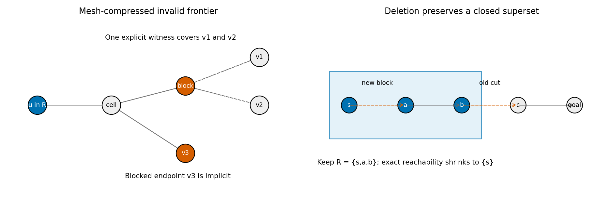
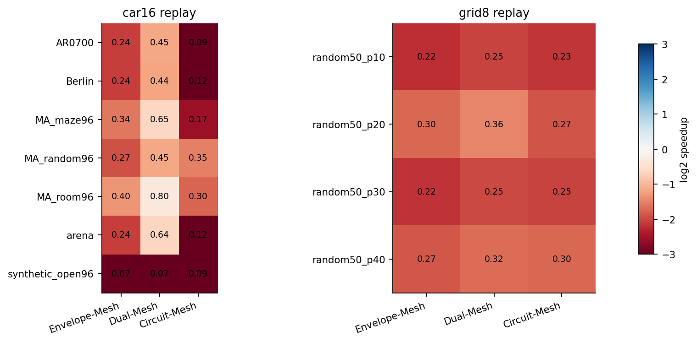
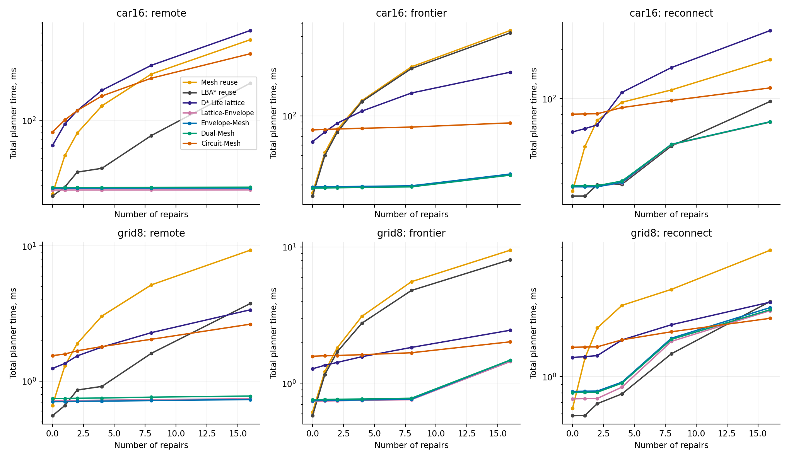
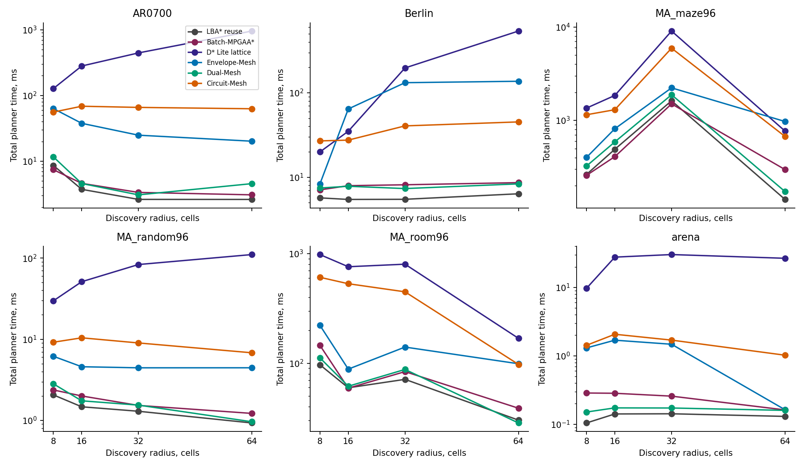
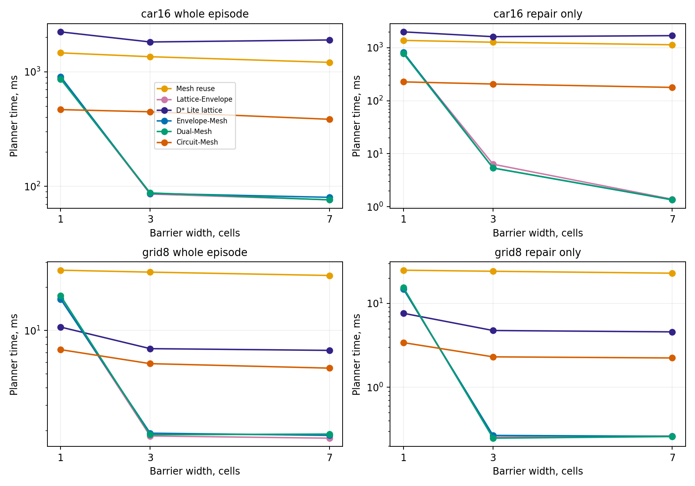
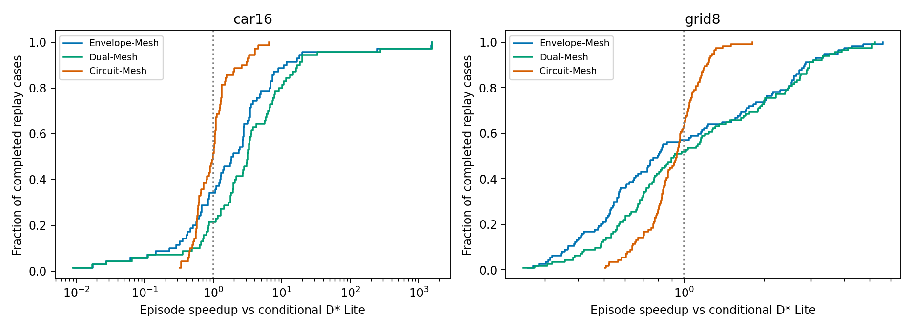
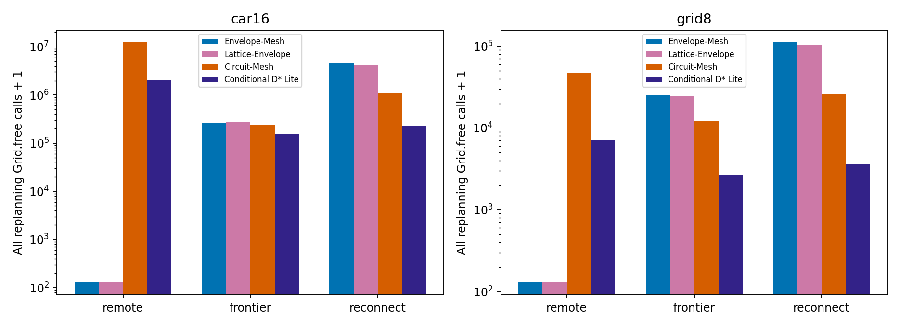

# Abstract

We study exact replanning on directed motion-primitive lattices represented by shared collision-cell prefix meshes. We propose a negative certificate: a closed superset of boundary states whose outgoing invalid transitions are covered by mesh-prefix witnesses. Edge deletions preserve the superset certificate; insertions repair only its exposed frontier. Blocked endpoints are represented implicitly, avoiding per-primitive terminal subscriptions. A dual variant combines this certificate with standard optimal-suffix reuse. We also evaluate a Bellman-circuit mesh variant of D\* Lite. Our frozen C++17 study covers 228 configurations and 11,340 serial timing episodes, with a separate allocation pass and exact cost validation. Results are reported per map and include failure episodes, reconnection, map discovery, construction overhead and strong controls. We claim a mesh-specific frontier representation and its correctness, not a new general reachability theorem or universal planner superiority.

On the 52 car replay configurations, whole-episode speedups against the fastest completed control are 0.25, 0.47, 0.16 for Envelope, Dual and Circuit respectively. Repeated negative queries on synthetic separated maps benefit substantially from certificate reuse, but the independent lattice-witness ablation achieves almost the same time. These results delimit the mechanism's usefulness and do not establish an overall mesh-specific speed advantage.

# Problem and motivation

Updates are occupancy cells, not a precomputed list of changed primitive edges. One cell may occur in many translated swept traces. A generic dynamic graph method must first generate those arc changes. Our proposed contribution is a cell-to-family repair representation: subscriptions to blocked mesh-prefix witnesses, with implicit blocked endpoints, around a closed negative region. Unrelated cell updates need not materialize all affected arcs or repair weighted cost labels.

A failed shortest-path query is useful information. Standard suffix reuse accelerates surviving positive paths, but may repeat a full failure proof after an irrelevant edge insertion. Maintaining the exact reachable component under deletions is considerably harder than maintaining a closed superset. We exploit this asymmetry and compress its outgoing invalid boundary using the same primitive-prefix mesh that shares collision checks in MeshA\*.

The intended consumer continues querying after temporary disconnection: e.g., a robot waiting for a door or a planning service receiving external map updates. Standard navigation in this study stops on its first NO_PATH. Under the k-move update model, stopping also prevents subsequent change phases. Negative-certificate construction cannot amortize in those terminal missions; they are retained as controls. Externally driven replay and reconnection isolate repeated-failure reuse. Fixed-start synthetic replay models waiting queries, not executed navigation.

# Method and correctness

{width=99%}

## Definitions and invariant

Let V consist of all in-grid primitive-boundary states (cell, heading). Let E_t
contain a primitive iff every original collision cell after its origin is free.
This deliberately includes outgoing arcs of a blocked origin; it is a safe
supergraph of the physically executable graph. The planner checks start and goal
occupancy separately. All positive paths use the original exact costs.

A negative certificate is a set R with s in R, goal outside R, and

    (u in R and (u,v) in E_t) implies v in R.

Any executable path starting in R remains in R by induction, so it cannot reach
the goal. R need not remain exactly reachable, connected, minimal, or free of
blocked origin cells. This is the reason deletions require no region repair.

## Construction

When the exact forward A\* exhausts OPEN, its closed boundary states are the
reachable component. A capped search supplies no certificate. Store the component
in a bit vector and scan its outgoing prefix mesh. Prune a subtree if all member
primitive endpoints are already in R, outside the finite grid, or blocked. At the
first blocked prefix cell install a single witness for the entire subtree. No
witness is required for an outside-grid blocker: it can never change. Endpoints
that are blocked are implicit witnesses, described below.

The first failed search pays for both A\* and construction of the compressed cut.
This overhead is measured; a one-query episode need not benefit.

## Repair of an update batch

Apply the entire batch to the belief grid before inspecting witnesses. For every
opened witness cell remove its subscription, recheck the full origin-to-node
prefix (blocks may have appeared earlier), then traverse its live subtree. New
blocked prefixes become witnesses. Enabled transitions to outside R add their
endpoints to R and seed a reachability flood. Prefix traversal shares collision
reads among member primitives. Membership is monotone between exact rebuilds.

For every opened cell q, inspect original incoming primitives at each heading of
q. Only tails in R and heads outside R matter. If an incoming primitive is valid,
add its head; otherwise install its first blocked prefix witness. This represents
blocked endpoint witnesses implicitly and avoids explicit records for every
incoming primitive to blocked poses.

Continue the unweighted flood until no valid outgoing transition leaves R. If
the goal enters R, discard the certificate and invoke exact weighted A\*. The
flood never produces a positive path or a shortest-path cost. If the current
start is outside R, use exact A\* and replace R on failure. Blocks can make R an
overestimate, so reaching the goal in the supergraph may cause a conservative
fallback even when the true start component still cannot reach the goal.

## Compact pseudocode

```text
REPLAN(s, batch):
    apply the entire batch to the belief grid
    invalidate the positive suffix if any cell was opened
    if a negative envelope exists:
        for each opened explicit witness:
            recheck its full prefix, then traverse the exposed mesh subtree
        for each opened cell and incoming primitive with tail in R:
            test its prefix; seed a new endpoint or install a blocker witness
        flood all newly seeded boundary states through the prefix mesh
        if goal entered R: discard the negative envelope
    if start or goal is blocked: return NO_PATH
    if a valid deletion-only optimal suffix exists: return that suffix
    if start is in the closed envelope: return NO_PATH
    result, exhausted_component = exact weighted mesh boundary A*
    if result is a complete failure:
        replace R with exhausted_component and build its mesh cut
    return result
```

In the exact implementation, reaching the goal during the flood stops it early:
the certificate is already unusable, so further reachability work would be wasted.
A blocked endpoint return does not construct a new envelope or preserve an old
positive path. A capped weighted search never constructs a negative certificate.

## Completeness of event delivery

Take an arc leaving the final R which has become valid since the last certified
state. If its endpoint was blocked, its opening is processed by the implicit
incoming-primitive join. Otherwise the old cut contains a blocked prefix witness
covering that arc. Every such blocker of a newly valid arc is opened in the
batch, so a witness event traverses the branch or relocates to a remaining block.
Every added endpoint is expanded before accepting the certificate. Hence an
accepted certificate is closed. Duplicate notifications and multiple witnesses
are harmless because membership and active guard keys are sets.

New blocks may leave redundant downstream witnesses. They do not invalidate
closure; a future opening rechecks their full prefix. Redundant records are
released on an exact rebuild. This implementation favors a small proof over
complex decremental garbage collection. Memory and rebuild frequency are
reported.


The **Envelope-Mesh** algorithm uses the negative certificate and an exact mesh boundary A\*. **Dual-Mesh** additionally reuses a surviving optimal suffix after deletion-only updates; all insertions discard that positive certificate. Suffix reuse is established and is treated as a control, not a novelty claim. Cut reset discards R on any insertion. Lattice-Envelope retains the same R but replaces shared mesh witnesses by independent primitive witnesses. Mesh cold and Mesh reuse share exactly the same weighted backend as the proposed algorithms.

# Bellman-circuit alternative

## Bellman-Circuit Mesh D\* Lite

For every materialized boundary origin u, compile its prefix mesh into a local
min-plus circuit. Terminal p has value c(p)+g(head(p)). A blocked mesh node is
infinity; a free node is the minimum of its child/terminal values. The root gives
the exact Bellman rhs(u), with the usual goal override. A g change touches
incoming terminals; a map edit touches mesh nodes at translated offsets.
Propagate toward the root and stop when the minimum does not change. Only an
inconsistent boundary root enters D\* Lite's queue. Positive primitive costs and
the standard consistent Euclidean heuristic preserve D\* Lite's guarantees.

The implementation stores one double per original prefix node at each relevant
origin. It is intentionally straightforward: no unary-chain contraction, no
online threshold and no coefficient tuning. It may use more memory and do more
local work than conditional lattice D\* Lite, which is included as a comparator.
The queue stopping boundary drains all first keys within scaled floating-point
tolerance, as in the repository's corrected D\* baseline. Internal mesh edges do
not enter the queue and their cost is never rounded or redistributed.

## Complexity boundaries

Let P be the number of template primitives, R the envelope and W its active
witnesses. Membership storage is O(|V|) bits; the stored member list is O(|R|),
explicit witness storage O(|W|). A batch of o opened cells includes an O(o P)
implicit endpoint join, active witness prefix probes, and one mesh traversal per
newly added state. Common prefix probes are shared in traversal, not in the
implicit incoming join. Blocks require only the usual grid normalization/writes.
The region can grow only |V| times between rebuilds, but an adversary may force a
full rebuild after each batch. Therefore no universal amortized improvement over
D\* Lite or repeated A\* is claimed. The interesting parameter is the number of
newly exposed frontier states and guards, not the number of all old explored
states.


# Experimental design

Frozen before timings. Six car maps x two roots x four replay families plus four old history cases; all 96 grid replay. New separators: two sizes x two roots x three edit regimes x two control sets, 17 queries. Car unknown: all six maps, one root, four radii. Dynamic: all sixteen maps, one root, two anchors (k,cr)=(2,5),(32,20), visibility n=k, balanced edits clamped and actual cr retained. Three serial randomized repeats; separate allocation pass. No source changes or parameter tuning after freeze.

The main car replay is balanced over six maps, two roots and four edit families. Grid replay contains the prior 96 small-grid dynamic cases. Synthetic separators isolate remote changes, changes along the closed boundary and periodic reconnection. They are mechanism tests rather than standard benchmarks. Closed-loop discovery uses four radii on all six car maps; dynamic runs cover all sixteen maps at two anchors, n=k. One root per navigation point limits statistical strength. All controls are freshly compiled and timed; published times are never pooled. Exact cost validation, Dijkstra tests, sanitizer checks and independent allocation runs are separate from measured kernel time.

# Results

| Cohort | Model | Candidate | Episode speedup | Repair speedup | Pairs |
| --- | --- | --- | --- | --- | --- |
| navigation_dynamic | car16 | Circuit-Mesh | 0.23 | 0.23 | 6/12 |
| navigation_dynamic | car16 | Dual-Mesh | 0.82 | 0.89 | 7/12 |
| navigation_dynamic | car16 | Envelope-Mesh | 0.74 | 0.74 | 7/12 |
| navigation_dynamic | grid8 | Circuit-Mesh | 0.41 | 1.06 | 19/20 |
| navigation_dynamic | grid8 | Dual-Mesh | 0.22 | 0.19 | 20/20 |
| navigation_dynamic | grid8 | Envelope-Mesh | 0.18 | 0.15 | 20/20 |
| navigation_unknown | car16 | Circuit-Mesh | 0.13 | 0.05 | 24/24 |
| navigation_unknown | car16 | Dual-Mesh | 0.79 | 0.87 | 24/24 |
| navigation_unknown | car16 | Envelope-Mesh | 0.21 | 0.03 | 24/24 |
| replay | car16 | Circuit-Mesh | 0.16 | 0.06 | 52/52 |
| replay | car16 | Dual-Mesh | 0.47 | 0.37 | 52/52 |
| replay | car16 | Envelope-Mesh | 0.25 | 0.04 | 52/52 |
| replay | grid8 | Circuit-Mesh | 0.26 | 0.64 | 96/96 |
| replay | grid8 | Dual-Mesh | 0.29 | 0.34 | 96/96 |
| replay | grid8 | Envelope-Mesh | 0.25 | 0.28 | 96/96 |
| separator | car16 | Circuit-Mesh | 1.03 | 2.58 | 12/12 |
| separator | car16 | Dual-Mesh | 3.72 | 71.42 | 12/12 |
| separator | car16 | Envelope-Mesh | 3.71 | 71.11 | 12/12 |
| separator | grid8 | Circuit-Mesh | 0.53 | 1.55 | 12/12 |
| separator | grid8 | Dual-Mesh | 0.85 | 4.26 | 12/12 |
| separator | grid8 | Envelope-Mesh | 0.86 | 4.22 | 12/12 |

The comparator is the fastest completed control per configuration by median whole-episode time, selected post hoc as a descriptive envelope. Ratios above one favor the candidate. Correct no-path replay answers count as completed; closed-loop missions require reaching the goal. Repair time excludes setup and the first query. No-path certificates are accepted only after full closure, never after an expansion cap.

{width=99%}

{width=99%}

| Model | Changes | Candidate | LBA reuse | Lattice envelope | D\* Lite |
| --- | --- | --- | --- | --- | --- |
| car16 | frontier | Circuit-Mesh | 4.81 | 0.41 | 2.42 |
| car16 | frontier | Dual-Mesh | 11.97 | 1.01 | 6.02 |
| car16 | frontier | Envelope-Mesh | 11.74 | 0.99 | 5.91 |
| car16 | reconnect | Circuit-Mesh | 0.83 | 0.62 | 2.25 |
| car16 | reconnect | Dual-Mesh | 1.34 | 1.00 | 3.64 |
| car16 | reconnect | Envelope-Mesh | 1.33 | 0.99 | 3.63 |
| car16 | remote | Circuit-Mesh | 0.58 | 0.08 | 1.53 |
| car16 | remote | Dual-Mesh | 6.77 | 0.95 | 17.86 |
| car16 | remote | Envelope-Mesh | 6.88 | 0.97 | 18.15 |
| grid8 | frontier | Circuit-Mesh | 4.00 | 0.72 | 1.22 |
| grid8 | frontier | Dual-Mesh | 5.45 | 0.97 | 1.66 |
| grid8 | frontier | Envelope-Mesh | 5.46 | 0.98 | 1.66 |
| grid8 | reconnect | Circuit-Mesh | 1.26 | 1.11 | 1.25 |
| grid8 | reconnect | Dual-Mesh | 1.12 | 0.99 | 1.11 |
| grid8 | reconnect | Envelope-Mesh | 1.09 | 0.96 | 1.08 |
| grid8 | remote | Circuit-Mesh | 1.42 | 0.28 | 1.28 |
| grid8 | remote | Dual-Mesh | 4.83 | 0.96 | 4.35 |
| grid8 | remote | Envelope-Mesh | 5.12 | 1.01 | 4.61 |

{width=99%}

# Structural complement: barrier width

Separately from the primary aggregate, we fixed a structural complement before inspecting aggregate primary times. A seven-cell separator can hide all outgoing free endpoints beyond the primitive span, so widths 1, 3 and 7 are all tested on 64x64 maps, two fixed-start map seeds, both control sets, with alternating one-column shifts. All widths, including conservative fallback failures, are retained. These twelve mechanism configurations are not pooled into the primary 228-case means.

{width=99%}

| Model | Width | Candidate | Full vs lattice | Repair vs lattice |
| --- | --- | --- | --- | --- |
| car16 | 1 | Circuit-Mesh | 1.88 | 3.45 |
| car16 | 1 | Dual-Mesh | 1.02 | 1.01 |
| car16 | 1 | Envelope-Mesh | 0.97 | 0.96 |
| car16 | 3 | Circuit-Mesh | 0.19 | 0.03 |
| car16 | 3 | Dual-Mesh | 0.98 | 1.18 |
| car16 | 3 | Envelope-Mesh | 0.99 | 1.18 |
| car16 | 7 | Circuit-Mesh | 0.20 | 0.01 |
| car16 | 7 | Dual-Mesh | 1.00 | 1.02 |
| car16 | 7 | Envelope-Mesh | 0.95 | 1.03 |
| grid8 | 1 | Circuit-Mesh | 2.28 | 4.34 |
| grid8 | 1 | Dual-Mesh | 0.96 | 0.96 |
| grid8 | 1 | Envelope-Mesh | 1.01 | 1.00 |
| grid8 | 3 | Circuit-Mesh | 0.31 | 0.11 |
| grid8 | 3 | Dual-Mesh | 0.98 | 1.03 |
| grid8 | 3 | Envelope-Mesh | 0.96 | 0.95 |
| grid8 | 7 | Circuit-Mesh | 0.32 | 0.12 |
| grid8 | 7 | Dual-Mesh | 0.94 | 1.02 |
| grid8 | 7 | Envelope-Mesh | 0.96 | 1.01 |

# Stronger conditional-edge control

Source review showed that the inherited D\* control conditionally propagates g but fully backs up map-notified tails. We therefore added a standard optimized Conditional D\* Lite control: edge decreases seed c+g(head), disabled edges trigger backups only when they may support rhs, and identical active queue keys are suppressed. All three unchanged candidates were freshly remeasured alongside it in the same binary, on all184 replay inputs (including the width complement), with three randomized timing repeats and a separate allocation pass. These repeated inputs are not extra independent cases; no seconds are pooled with the primary cohort. Navigation is outside this additional validation.

| Model | Cohort | Candidate | Full speedup | Repair speedup | Pairs |
| --- | --- | --- | --- | --- | --- |
| car16 | frontier_width | Circuit-Mesh | 1.38 | 2.45 | 6/6 |
| car16 | frontier_width | Dual-Mesh | 3.52 | 31.29 | 6/6 |
| car16 | frontier_width | Envelope-Mesh | 3.51 | 31.43 | 6/6 |
| car16 | replay | Circuit-Mesh | 0.97 | 1.98 | 52/52 |
| car16 | replay | Dual-Mesh | 2.88 | 12.52 | 52/52 |
| car16 | replay | Envelope-Mesh | 1.52 | 1.28 | 52/52 |
| car16 | separator | Circuit-Mesh | 0.85 | 2.03 | 12/12 |
| car16 | separator | Dual-Mesh | 3.20 | 59.96 | 12/12 |
| car16 | separator | Envelope-Mesh | 3.23 | 59.70 | 12/12 |
| grid8 | frontier_width | Circuit-Mesh | 0.99 | 1.68 | 6/6 |
| grid8 | frontier_width | Dual-Mesh | 1.58 | 4.50 | 6/6 |
| grid8 | frontier_width | Envelope-Mesh | 1.58 | 4.45 | 6/6 |
| grid8 | replay | Circuit-Mesh | 0.93 | 1.48 | 96/96 |
| grid8 | replay | Dual-Mesh | 1.07 | 0.80 | 96/96 |
| grid8 | replay | Envelope-Mesh | 0.92 | 0.67 | 96/96 |
| grid8 | separator | Circuit-Mesh | 0.74 | 1.43 | 12/12 |
| grid8 | separator | Dual-Mesh | 1.23 | 4.04 | 12/12 |
| grid8 | separator | Envelope-Mesh | 1.23 | 3.97 | 12/12 |

{width=99%}

The inherited checked_cells field omits endpoint eligibility reads. We therefore ran a separate count-only pass over all184 replay inputs, instrumenting every Grid.free invocation inside replan in generated header copies. All previous logical fields match the unchanged trajectories; count-binary times are discarded. Reported total collision-API probes include endpoint gates and outside-grid probes, excluding direct Grid.blocked input normalization and all reference/verification calls. These are logical API invocations, not hardware load counts. See the accompanying report for totals and ratios against Lattice-Envelope and Conditional D\* Lite.

{width=99%}

# Discussion and limitations

The primary falsifiable claim is that a shared mesh frontier can amortize repeated negative answers more cheaply than rebuilding or maintaining independent primitive witnesses. Remote edits alone do not establish mesh value: Lattice-Envelope is the decisive representation ablation. The first failure pays construction overhead; reconnection can trigger a conservative exact fallback because R is a superset. Positive-only navigation largely measures the backend and standard suffix rule, not the new negative certificate. The circuit variant must justify both its event work and larger local storage against conditional lattice D\* Lite. Full per-map tables, latency percentiles, edit rates, memory maxima and completion failures are retained in the accompanying report.

This work uses cheap 2D occupancy tests and an unmerged prefix representation. It does not establish superiority over external Lifelong-GLS or Generalized D\* implementations, which were not integrated. Incremental reachability, cut-based non-reachability arguments, D\* Lite and suffix reuse are prior concepts. The novelty hypothesis is their specific mesh-compressed negative frontier with implicit endpoints; a broader full-text literature review and additional independent roots are required before a priority or top-conference readiness claim.

# References

* **MeshA\*: Efficient Path Planning with Motion Primitives**, AAAI 2026,
  [DOI 10.1609/aaai.v40i43.41004](https://doi.org/10.1609/aaai.v40i43.41004).
  Shares collision-cell structure among primitives and establishes the mesh
  representation. Our new frontier uses an unmerged prefix forest over exactly
  the same ordered primitive traces. It does not reproduce every quotient/merge
  in the paper's full configuration mesh. Original MeshA\* and contracted
  C-Mesh-D\* Lite are freshly timed controls.
* **Koenig and Likhachev, D\* Lite**, AAAI 2002,
  [AAAI proceedings](https://cdn.aaai.org/AAAI/2002/AAAI02-072.pdf).
  Repairs g/rhs with moving starts. Conditional Bellman updates, reuse of labels,
  and D\* Lite's queue are established; Circuit-Mesh is a local compilation and
  event-sharing variant, not a new proof of D\* Lite.
* **Koenig, Likhachev and Furcy, Lifelong Planning A\***, Artificial Intelligence
  155, 2004, [DOI 10.1016/j.artint.2003.12.001](https://doi.org/10.1016/j.artint.2003.12.001).
  Incremental graph search under edge changes is the established problem setting.
* **Hernández, Asín and Baier, MPGAA\*** is represented here by the
  repository's existing directed MPGAA\* implementation and its original
  benchmark protocol reference,
  [AAAI 2015 DOI 10.1609/aaai.v29i1.9355](https://doi.org/10.1609/aaai.v29i1.9355).
  Crossref title: _Reusing Previously Found A\* Paths for Fast Goal-Directed
  Navigation in Dynamic Terrain_. The new separator experiment is distinct from
  that published benchmark.
* **Mandalika et al., Generalized Lazy Search for Robot Motion Planning:
  Interleaving Search and Edge Evaluation via Event-Based Toggles**, ICAPS 2019,
  [DOI 10.1609/icaps.v29i1.3543](https://doi.org/10.1609/icaps.v29i1.3543).
  Lazy evaluation, event-based search/evaluation choices and reusing invalid-edge
  information are prior work.
* **Lazy Lifelong Planning for Efficient Replanning in Graphs with Expensive Edge
  Evaluation**, IROS 2022,
  [DOI 10.1109/IROS47612.2022.9981389](https://doi.org/10.1109/IROS47612.2022.9981389).
  Lifelong-GLS combines LPA\* and GLS. The indexed abstract promises exact optimal
  solutions in dynamic graphs; generic incremental lazy search cannot be claimed
  as the new contribution here.
* **Lazy incremental search for efficient replanning with bounded suboptimality
  guarantees**, IJRR 2024,
  [DOI 10.1177/02783649241227869](https://doi.org/10.1177/02783649241227869).
  Introduces exact L-GLS and Generalized D\* for nonstationary queries alongside
  bounded variants. Their published implementations were not integrated into
  this measured cohort. Consequently our results establish no superiority over
  those external implementations, especially for costly high-dimensional
  collision evaluation.
* **Sung and Stone, Motion Planning (In)feasibility Detection using a Prior
  Roadmap via Path and Cut Search**, RSS 2023,
  [DOI 10.15607/RSS.2023.XIX.060](https://doi.org/10.15607/RSS.2023.XIX.060).
  IPC alternates candidate path and cut search; IDPC also decomposes the roadmap.
  Both target inexpensive feasibility detection with few expensive edge checks.
  We inspected the paper's abstract, problem, IPC algorithm and related work
  (`rss2023_notes.md`). Positive/negative certificates and cut reasoning are
  established; our proposed distinction is mesh-specific incremental frontier
  repair under explicit map updates. IPC/IDPC were not ported or timed here.
* **Sturtevant, Benchmarks for Grid-Based Pathfinding**, IEEE TCIAIG 2012,
  [DOI 10.1109/TCIAIG.2012.2197681](https://doi.org/10.1109/TCIAIG.2012.2197681).
  Standard map sources are recorded in the immutable map registry. The new
  separator maps are mechanism experiments, not published benchmark maps.

The defensible proposed contribution is a **mesh-compressed negative frontier**:
a closed superset survives arbitrary edge deletions; prefix witnesses and
implicit blocked endpoints deliver only insertion events capable of exposing
outgoing transitions; a weighted solver is invoked only after the certificate
ceases to prove failure. A closed-set non-reachability proof and incremental
reachability flood are elementary and are not claimed as new. Dual-Mesh adds a
standard positive suffix certificate, so its positive reuse is also not a novelty
claim. The empirical question is whether the compressed frontier is worth its
construction and repair costs relative to a lattice frontier and strong exact
planners on the frozen workloads.
