# Общий результат двух итераций

Разработаны четыре новых алгоритма: Envelope-Mesh, Dual-Mesh, Circuit-Mesh и SMD-A\*. Сначала проверены три идеи отрицательных сертификатов и Bellman-схем; после отсутствия убедительного mesh-выигрыша на обычных картах разработан SMD-A\* для положительного перепланирования. Всего в отдельных сериях выполнено 19,326 временных эпизодов, 6,442 эпизодов памяти и 920 счётных эпизодов. Повторно измеренные входы не считаются новыми независимыми картами.

Отдельный отчёт второй итерации: [SMD-A\*: результаты по картам и абляции](../mesh_symmetric/report.pdf); рукопись [Exact Mesh Replanning with Two-Sided Update Deferral](../mesh_symmetric/paper.pdf). Ниже подробно сохранён первый этап, включая отрицательные результаты; секунды разных серий не смешиваются.

SMD-A\*, balanced car16 replay: относительно best_control — 0.44× по полному времени, 0.33× по ремонту, 0/48 выигрышей от 10%. Это новая совместная серия с тем же Batch-backend и eager-open абляцией; подробная оценка пригодности для статьи находится в отчёте SMD.

SMD-A\*, balanced car16 replay: относительно lazy_blocks_batch — 0.99× по полному времени, 1.06× по ремонту, 2/48 выигрышей от 10%. Это новая совместная серия с тем же Batch-backend и eager-open абляцией; подробная оценка пригодности для статьи находится в отчёте SMD.

SMD-A\*, balanced car16 replay: относительно md_batch — 0.80× по полному времени, 0.70× по ремонту, 5/47 выигрышей от 10%. Это новая совместная серия с тем же Batch-backend и eager-open абляцией; подробная оценка пригодности для статьи находится в отчёте SMD.

# Проверяемый результат

Добавлены три алгоритма C++17: **Envelope-Mesh**, **Dual-Certificate Mesh** и **Bellman-Circuit Mesh D\* Lite**, а также четыре контрольных варианта. Выполнены 11,340 временных эпизодов, 3,780 отдельных эпизодов памяти на 228 конфигурациях; получено 293,487 временных вызовов. Расхождений достижимости или стоимости у завершённых ответов: 0; остановок по лимиту: 36. Независимые тесты проверили 10 852 ответа через прямой Dijkstra. ASan/UBSan прошли. Логические результаты обычного и allocation-прогонов совпали в 97,829 строках.

Остановки по бюджету: C-Mesh-D\* Lite: 21; MD-A\*: 6; MeshA\*: 9. Ни один ограниченный ответ не засчитывается как доказательство отсутствия пути.

| Алгоритм | Завершено | Эпизод × | Ремонт × | Память / baseline | Выигрыш от 10% |
| --- | --- | --- | --- | --- | --- |
| Envelope-Mesh | 223/228 | 0.31 | 0.21 | 1.23 | 16/223 |
| Dual-Mesh | 223/228 | 0.44 | 0.59 | 1.22 | 18/223 |
| Circuit-Mesh | 221/228 | 0.25 | 0.31 | 2.80 | 16/221 |

Эта общая строка описывает именно смесь выбранных конфигураций: 96 небольших grid replay представлены чаще, чем отдельные большие карты. Основные выводы следует читать по отдельным картам и семействам ниже. Геометрические средние рассчитаны по общим завершённым конфигурациям. В replay точный ответ «пути нет» считается завершением; в навигации требуется достичь цели. Память / baseline меньше 1 выгодна кандидату. Время включает конструктор планировщика и первый поиск; ремонт исключает только конструктор и запрос 0.

`best_control` — описательная огибающая: для каждой конфигурации после измерений выбран прежний завершившийся контроль с минимальной медианой полного времени эпизода. Его время ремонта может не быть минимальным. В огибающую входят LBA\* reuse, MeshA\*, MPGAA\*, MD-A\*, Boundary-Mesh, Boundary-MPGAA\*, Delta-MPGAA\*, Batch-MPGAA\*, D\* Lite lattice, C-Mesh-D\* Lite, Octile reuse. Прямые парные сравнения с каждым методом сохранены в CSV. Новые абляции в эту огибающую не входят.

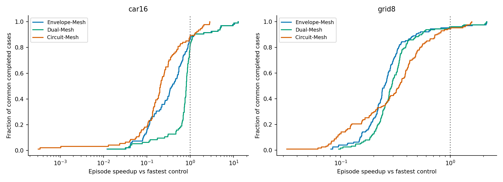{width=99%}

# Идея и корректность

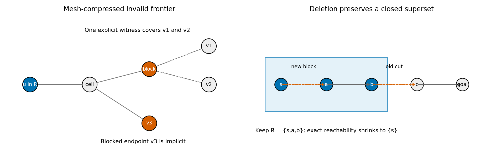{width=99%}

Состояния исходного направленного графа — $(i,j,\theta)$. Каждый примитив имеет исходную положительную стоимость и упорядоченную трассу клеток. Для каждого направления строится префиксное дерево этих трасс. Каждый посещённый префиксный узел разделяет явную проверку трассы между своими продолжениями; дополнительные проверки конечных клеток учитываются полным отдельным счётчиком. Это развёрнутая форма mesh без всех слияний эквивалентных конфигураций оригинального MeshA\*. В новых алгоритмах глобальный поиск и очередь D\* хранят граничные состояния, а mesh отвечает за общее представление и ремонт локальных семейств переходов. Исходный MeshA\* и C-Mesh-D\* Lite участвуют в замерах отдельно.

Входная правка — клетка занятости, а не готовый список изменившихся рёбер примитивного графа. Одна клетка принадлежит множеству переведённых swept-трасс. Обычному динамическому графовому методу ещё нужно породить эти изменения дуг; mesh-граница подписывается только на заблокированные свидетельства, поддерживающие текущий отрицательный ответ. Именно преобразование cell-to-family на ремонтируемой границе, а не общий факт о замкнутом множестве, является узкой гипотезой вклада.

**Отрицательный сертификат.** После полного неуспешного A\* сохраняется множество $R$ всех закрытых граничных состояний. Инвариант: $s\in R$, $t\notin R$ и каждый допустимый переход из $R$ заканчивается в $R$. Следовательно, любой путь из старта остаётся внутри $R$ и не достигает цели. Блокировки только удаляют переходы и сохраняют этот инвариант. Поэтому $R$ можно не уменьшать; оно становится безопасным надмножеством реально достижимых состояний. Это избавляет от сложного удаления поддеревьев связности, но может привести к лишнему вызову точного поиска.

Для выхода из $R$ хранятся первые заблокированные узлы mesh-префиксов. Узел покрывает сразу все продолжающие его примитивы. Поддерево пропускается, если все его конечные состояния уже в $R$, за картой или заблокированы. Заблокированные конечные клетки представлены неявно: при освобождении такой клетки перечисляются входящие примитивы и проверяются только хвосты в $R$. Это предотвращает создание отдельной подписки для каждого примитива к каждому заблокированному конечному состоянию.

Пакет правок сначала целиком применяется к карте убеждений. Освобождённый явный свидетель вызывает проверку полного префикса: после нового препятствия свидетель может переместиться ближе к началу. Если переход стал допустим, его конец добавляется в $R$, затем выполняется обычное раскрытие достижимости с mesh-обходом. При попадании цели в $R$ сертификат отбрасывается и запускается точный взвешенный A\*. Заливка достижимости никогда не возвращает стоимость или положительный путь. При старте вне $R$ также нужен точный поиск.

**Полнота событий.** Вновь допустимый выход из $R$ либо оканчивается в только что освобождённой клетке, либо прежде был покрыт заблокированным mesh-свидетелем. В первом случае он обнаруживается входящим соединением, во втором — освобождением свидетеля. Все новые состояния раскрываются до принятия сертификата. Блокировки не создают выходов. Значит, принятый сертификат остаётся замкнутым. Для физически заблокированных исходных состояний $R$ используется безопасный суперграф с проверкой клеток после начала примитива; это может только вызвать лишний откат к A\*, но не ложный ответ «пути нет». Текущий старт и цель проверяются отдельно.

**Dual-Certificate Mesh.** Добавляет к Envelope-Mesh известное правило оптимального суффикса: после одних блокировок сохранившийся суффикс прежнего оптимального пути остаётся оптимальным от текущего граничного состояния. Любое освобождение удаляет положительный сертификат, потому что путь мог стать короче. Это правило не заявляется как новая научная идея; его роль — устранить лишние поиски на положительных запросах и проверить совместимость двух сертификатов.

**Bellman-Circuit Mesh D\* Lite.** Лист примитива $p$ имеет значение $c_p+g(v_p)$. Заблокированный mesh-узел равен $\infty$, свободный — минимуму детей и терминалов. Корень точно равен $rhs(u)$, кроме стандартного условия цели. Изменение $g$ затрагивает входящие листья, изменение карты — переведённые mesh-узлы. Минимумы распространяются к корню до первого неизменившегося результата. В очередь D\* попадает только несогласованный граничный корень. Это сохраняет Bellman-уравнения исходного графа. В реализации нет сжатия однодетных цепочек; хранится double на каждый узел локального префиксного дерева, поэтому память и локальная работа могут стать слабым местом.

| Вариант | Назначение |
| --- | --- |
| Mesh cold | Идентичный точный backend; ничего не сохраняет |
| Mesh reuse | Тот же backend и только положительный суффикс |
| Cut reset | Отрицательное R сохраняется после блокировок; любое освобождение сбрасывает его |
| Lattice-Envelope | Тот же R и неявные конечные свидетели, но отдельные проверки каждого примитива вместо mesh-префикса |

**Стоимость и границы.** Хранение $R$ занимает $O(|V|)$ бит плюс список состояний $O(|R|)$; явные подписки — $O(|W|)$ для множества свидетелей. Пакет с $o$ освобождениями содержит входящее соединение $O(oP)$ по шаблонным примитивам, проверку затронутых префиксов и обход новых состояний. Между точными перестроениями каждое состояние добавляется в $R$ один раз. Противник может вызывать перестроение после каждого пакета, поэтому общего асимптотического превосходства над D\* Lite нет. Старые избыточные свидетели не очищаются после каждой блокировки; они проверяются при освобождении и удаляются при перестроении. Обратное соединение конечных клеток пока не использует общий suffix-mesh.

# Экспериментальный протокол

Frozen before timings. Six car maps x two roots x four replay families plus four old history cases; all 96 grid replay. New separators: two sizes x two roots x three edit regimes x two control sets, 17 queries. Car unknown: all six maps, one root, four radii. Dynamic: all sixteen maps, one root, two anchors (k,cr)=(2,5),(32,20), visibility n=k, balanced edits clamped and actual cr retained. Three serial randomized repeats; separate allocation pass. No source changes or parameter tuning after freeze.

Использован замороженный набор примитивов текущего репозитория (кривые Эрмита с ограничением кривизны); он не является официальным набором оптимизированных примитивов из статьи MeshA\*. Сравниваются одни и те же исходные дискретные трассы и float-стоимости у всех методов. Официальные Moving AI относятся к картам, не к этому control set.

Модель car16: 16 направлений, 284 примитива, суммарно 1 492 проверяемые клетки в исходных трассах, максимум 8 клеток после начала; префиксный forest содержит 572 узла вместе с 16 корнями, исходный configuration mesh — 412 конфигураций. Grid8: одно направление состояния, восемь одноклеточных переходов, forest из 9 узлов. У grid8 нет длинных общих префиксов; это необходимый отрицательный контроль структурной выгоды mesh.

Шесть car-карт: Berlin, AR0700, arena, MA_maze96, MA_room96, MA_random96. Первые три берутся в исходном размере, последние три — прежние фиксированные кропы Moving AI. В replay есть два корня и четыре семейства: препятствия на пути, вне пути, смешанные блокировки/освобождения, раскрытие неизвестной карты; добавлены четыре прежних history-эпизода. Grid replay — все 96 прежних сценариев random50 с четырьмя плотностями. Новые синтетические эпизоды: разделяющая полоса шириной 7 клеток, размеры 32 и 64, два варианта карты с разными seed и одинаковыми координатами концов, правки вдали, на границе и с периодическим открытием/закрытием прохода; 17 запросов. По этим данным оценивается окупаемость для 0, 1, 2, 4, 8, 16 ремонтов. Префиксы одного эпизода зависимы и не считаются отдельными независимыми запусками.

Для автономной навигации раскрытие карты проверено на всех шести car-картах с радиусами 8, 16, 32, 64 и одним прежним корнем. Динамика проверена на всех 16 картах в двух заранее выбранных точках (k,cr)=(2,5%), (32,20%); n=k. Это сокращённый новый срез прежней полной сетки k/cr, а не её повторное измерение. В навигации только один корень на точку, поэтому выводы по отдельной точке разведочные. Один move означает один исходный примитив, а не одну клетку. Статический радиус — квадратная $L_\infty$-окрестность. Динамическая глубина n задаётся по свободной решётке примитивов с учётом направления; наблюдаются все клетки трасс дуг этой глубины без окклюзии препятствиями. Пути могут различаться при равной оптимальной стоимости, следовательно последующие наблюдения и динамические миры при различном ходе агента тоже могут различаться. Результаты replay дают более строгую проверку на одинаковых входах.

CPU: AMD EPYC 9V74 80-Core Processor; Linux-6.18.57-x86_64-with-glibc2.41; один измерительный процесс, affinity [0, 1, 2]. Компилятор и точные флаги сохранены в JSON каждого задания; все контроли собраны и измерены заново в том же запуске. Бюджет — 1,000,000 раскрытий на запрос, точность проверки стоимости $10^{-6}$. Три повтора выполняются последовательно со случайным порядком алгоритмов; память измеряется четвёртым отдельным проходом. Время проверки эталона не входит во время планировщика. Общая подготовка mesh-шаблонов вынесена из конструктора и отражена в JSON, включая собственную память. Peak heap — число запрошенных байтов C++ new, не RSS и не полный расход процесса.

Медиана относительного MAD полного времени эпизода: 1.78%; p95: 9.90%. Три повтора недостаточны для сильных статистических утверждений; большие отношения на микросекундных запросах проверяются также полным временем и счётчиками.

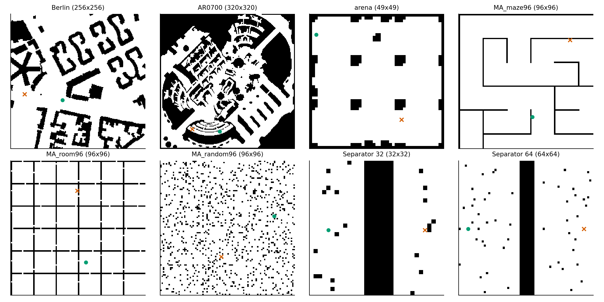{width=99%}

# Результаты по картам

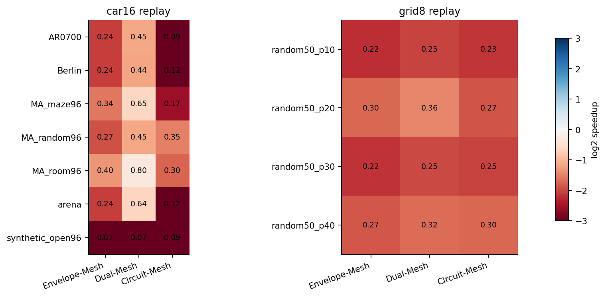{width=99%}

## replay, car16

| Карта | Envelope-Mesh | Dual-Mesh | Circuit-Mesh |
| --- | --- | --- | --- |
| AR0700 | 0.24 / 0.05 (8/8) | 0.45 / 0.37 (8/8) | 0.09 / 0.05 (8/8) |
| Berlin | 0.24 / 0.02 (8/8) | 0.44 / 0.37 (8/8) | 0.12 / 0.04 (8/8) |
| MA_maze96 | 0.34 / 0.03 (8/8) | 0.65 / 0.51 (8/8) | 0.17 / 0.03 (8/8) |
| MA_random96 | 0.27 / 0.08 (8/8) | 0.45 / 0.40 (8/8) | 0.35 / 0.25 (8/8) |
| MA_room96 | 0.40 / 0.05 (8/8) | 0.80 / 0.63 (8/8) | 0.30 / 0.16 (8/8) |
| arena | 0.24 / 0.04 (8/8) | 0.64 / 0.72 (8/8) | 0.12 / 0.03 (8/8) |
| synthetic_open96 | 0.07 / 0.01 (4/4) | 0.07 / 0.01 (4/4) | 0.09 / 0.02 (4/4) |

Формат: полное / ремонт × (общие завершённые / конфигурации). Значения выше 1 выгодны новому методу. Для всех пар по каждому отдельному контролю см. `analysis/map_pairs.csv`.

## navigation_dynamic, car16

| Карта | Envelope-Mesh | Dual-Mesh | Circuit-Mesh |
| --- | --- | --- | --- |
| AR0700 | — / — (0/2) | — / — (0/2) | — / — (0/2) |
| Berlin | 0.77 / 0.90 (1/2) | 0.79 / 1.06 (1/2) | — / — (0/2) |
| MA_maze96 | 0.67 / 0.69 (2/2) | 0.92 / 0.91 (2/2) | 0.36 / 0.25 (2/2) |
| MA_random96 | 0.92 / — (1/2) | 0.92 / — (1/2) | 0.20 / — (1/2) |
| MA_room96 | 0.94 / — (1/2) | 1.03 / — (1/2) | 0.32 / — (1/2) |
| arena | 0.63 / 0.70 (2/2) | 0.63 / 0.73 (2/2) | 0.14 / 0.19 (2/2) |

Формат: полное / ремонт × (общие завершённые / конфигурации). Значения выше 1 выгодны новому методу. Для всех пар по каждому отдельному контролю см. `analysis/map_pairs.csv`.

## navigation_unknown, car16

| Карта | Envelope-Mesh | Dual-Mesh | Circuit-Mesh |
| --- | --- | --- | --- |
| AR0700 | 0.11 / 0.04 (4/4) | 0.71 / 0.77 (4/4) | 0.06 / 0.03 (4/4) |
| Berlin | 0.10 / 0.00 (4/4) | 0.74 / 0.95 (4/4) | 0.17 / 0.01 (4/4) |
| MA_maze96 | 0.42 / 0.07 (4/4) | 0.78 / 0.82 (4/4) | 0.25 / 0.10 (4/4) |
| MA_random96 | 0.28 / 0.10 (4/4) | 0.84 / 0.86 (4/4) | 0.16 / 0.11 (4/4) |
| MA_room96 | 0.46 / 0.10 (4/4) | 0.92 / 0.88 (4/4) | 0.17 / 0.10 (4/4) |
| arena | 0.14 / 0.02 (4/4) | 0.75 / 1.01 (4/4) | 0.08 / 0.02 (4/4) |

Формат: полное / ремонт × (общие завершённые / конфигурации). Значения выше 1 выгодны новому методу. Для всех пар по каждому отдельному контролю см. `analysis/map_pairs.csv`.

## separator, car16

| Карта | Envelope-Mesh | Dual-Mesh | Circuit-Mesh |
| --- | --- | --- | --- |
| separator32 | 4.97 / 35.76 (6/6) | 4.89 / 35.33 (6/6) | 1.13 / 1.65 (6/6) |
| separator64 | 2.77 / 141.41 (6/6) | 2.83 / 144.37 (6/6) | 0.94 / 4.03 (6/6) |

Формат: полное / ремонт × (общие завершённые / конфигурации). Значения выше 1 выгодны новому методу. Для всех пар по каждому отдельному контролю см. `analysis/map_pairs.csv`.

## navigation_dynamic, grid8

| Карта | Envelope-Mesh | Dual-Mesh | Circuit-Mesh |
| --- | --- | --- | --- |
| AR0700 | 0.27 / 0.25 (2/2) | 0.33 / 0.31 (2/2) | 1.54 / 1.53 (1/2) |
| Berlin | 0.14 / 0.11 (2/2) | 0.22 / 0.18 (2/2) | 0.70 / 0.97 (2/2) |
| MA_maze512 | 0.11 / 0.06 (2/2) | 0.12 / 0.07 (2/2) | 1.44 / 1.47 (2/2) |
| MA_random512 | 0.10 / 0.09 (2/2) | 0.12 / 0.10 (2/2) | 0.85 / 1.33 (2/2) |
| MA_room512 | 0.13 / 0.06 (2/2) | 0.15 / 0.08 (2/2) | 1.50 / 1.49 (2/2) |
| arena | 0.12 / 0.16 (2/2) | 0.19 / 0.43 (2/2) | 0.09 / 1.00 (2/2) |
| random50_p10 | 0.20 / 0.16 (2/2) | 0.21 / 0.18 (2/2) | 0.14 / 0.91 (2/2) |
| random50_p20 | 0.27 / 0.28 (2/2) | 0.26 / 0.30 (2/2) | 0.19 / 1.02 (2/2) |
| random50_p30 | 0.31 / 0.25 (2/2) | 0.37 / 0.40 (2/2) | 0.19 / 0.69 (2/2) |
| random50_p40 | 0.40 / 0.53 (2/2) | 0.46 / 0.60 (2/2) | 0.28 / 0.55 (2/2) |

Формат: полное / ремонт × (общие завершённые / конфигурации). Значения выше 1 выгодны новому методу. Для всех пар по каждому отдельному контролю см. `analysis/map_pairs.csv`.

## replay, grid8

| Карта | Envelope-Mesh | Dual-Mesh | Circuit-Mesh |
| --- | --- | --- | --- |
| random50_p10 | 0.22 / 0.23 (24/24) | 0.25 / 0.29 (24/24) | 0.23 / 0.84 (24/24) |
| random50_p20 | 0.30 / 0.37 (24/24) | 0.36 / 0.45 (24/24) | 0.27 / 0.55 (24/24) |
| random50_p30 | 0.22 / 0.25 (24/24) | 0.25 / 0.28 (24/24) | 0.25 / 0.60 (24/24) |
| random50_p40 | 0.27 / 0.29 (24/24) | 0.32 / 0.35 (24/24) | 0.30 / 0.62 (24/24) |

Формат: полное / ремонт × (общие завершённые / конфигурации). Значения выше 1 выгодны новому методу. Для всех пар по каждому отдельному контролю см. `analysis/map_pairs.csv`.

## separator, grid8

| Карта | Envelope-Mesh | Dual-Mesh | Circuit-Mesh |
| --- | --- | --- | --- |
| separator32 | 0.79 / 2.11 (6/6) | 0.76 / 2.11 (6/6) | 0.50 / 0.96 (6/6) |
| separator64 | 0.93 / 8.44 (6/6) | 0.94 / 8.59 (6/6) | 0.56 / 2.50 (6/6) |

Формат: полное / ремонт × (общие завершённые / конфигурации). Значения выше 1 выгодны новому методу. Для всех пар по каждому отдельному контролю см. `analysis/map_pairs.csv`.

## Динамика: отдельные точки k/cr

| Модель | Карта | k/cr% (n=k) | Envelope-Mesh | Dual-Mesh | Circuit-Mesh |
| --- | --- | --- | --- | --- | --- |
| car16 | AR0700 | 2/5 | нет общей goal-пары | нет общей goal-пары | нет общей goal-пары |
| car16 | AR0700 | 32/20 | нет общей goal-пары | нет общей goal-пары | нет общей goal-пары |
| car16 | Berlin | 2/5 | нет общей goal-пары | нет общей goal-пары | нет общей goal-пары |
| car16 | Berlin | 32/20 | 0.77 / 0.90 | 0.79 / 1.06 | нет общей goal-пары |
| car16 | MA_maze96 | 2/5 | 0.54 / 0.49 | 0.88 / 0.84 | 0.97 / 6.54 |
| car16 | MA_maze96 | 32/20 | 0.83 / 0.98 | 0.96 / 0.99 | 0.14 / 0.01 |
| car16 | MA_random96 | 2/5 | нет общей goal-пары | нет общей goal-пары | нет общей goal-пары |
| car16 | MA_random96 | 32/20 | 0.92 / — | 0.92 / — | 0.20 / — |
| car16 | MA_room96 | 2/5 | нет общей goal-пары | нет общей goal-пары | нет общей goal-пары |
| car16 | MA_room96 | 32/20 | 0.94 / — | 1.03 / — | 0.32 / — |
| car16 | arena | 2/5 | 0.72 / 0.70 | 0.74 / 0.73 | 0.19 / 0.19 |
| car16 | arena | 32/20 | 0.55 / — | 0.54 / — | 0.11 / — |
| grid8 | AR0700 | 2/5 | 0.24 / 0.24 | 0.34 / 0.34 | нет общей goal-пары |
| grid8 | AR0700 | 32/20 | 0.31 / 0.27 | 0.31 / 0.27 | 1.54 / 1.53 |
| grid8 | Berlin | 2/5 | 0.08 / 0.06 | 0.14 / 0.10 | 0.65 / 0.95 |
| grid8 | Berlin | 32/20 | 0.24 / 0.23 | 0.35 / 0.34 | 0.76 / 1.00 |
| grid8 | MA_maze512 | 2/5 | 0.08 / 0.04 | 0.10 / 0.05 | 1.37 / 1.41 |
| grid8 | MA_maze512 | 32/20 | 0.13 / 0.08 | 0.14 / 0.09 | 1.52 / 1.54 |
| grid8 | MA_random512 | 2/5 | 0.12 / 0.08 | 0.15 / 0.11 | 1.30 / 2.09 |
| grid8 | MA_random512 | 32/20 | 0.10 / 0.09 | 0.10 / 0.09 | 0.56 / 0.85 |
| grid8 | MA_room512 | 2/5 | 0.08 / 0.03 | 0.12 / 0.05 | 1.42 / 1.37 |
| grid8 | MA_room512 | 32/20 | 0.19 / 0.13 | 0.19 / 0.12 | 1.58 / 1.61 |
| grid8 | arena | 2/5 | 0.16 / 0.16 | 0.33 / 0.43 | 0.28 / 1.00 |
| grid8 | arena | 32/20 | 0.10 / — | 0.10 / — | 0.03 / — |
| grid8 | random50_p10 | 2/5 | 0.17 / 0.16 | 0.18 / 0.18 | 0.32 / 0.91 |
| grid8 | random50_p10 | 32/20 | 0.24 / — | 0.24 / — | 0.06 / — |
| grid8 | random50_p20 | 2/5 | 0.27 / 0.28 | 0.29 / 0.30 | 0.45 / 1.02 |
| grid8 | random50_p20 | 32/20 | 0.27 / — | 0.24 / — | 0.08 / — |
| grid8 | random50_p30 | 2/5 | 0.27 / 0.25 | 0.40 / 0.40 | 0.34 / 0.69 |
| grid8 | random50_p30 | 32/20 | 0.36 / — | 0.35 / — | 0.10 / — |
| grid8 | random50_p40 | 2/5 | 0.30 / 0.28 | 0.36 / 0.35 | 0.48 / 1.20 |
| grid8 | random50_p40 | 32/20 | 0.53 / 0.99 | 0.58 / 1.03 | 0.16 / 0.25 |

При n=k изменение k одновременно меняет частоту правок и глубину наблюдения. Эти эффекты здесь не разделяются; сравниваются совместные настройки, как задал пользователь.

Полное / ремонт × к быстрейшему завершившемуся контролю в данной точке; одна seed-миссия на точку, три повтора времени. Отсутствие общей goal-пары не считается ни ускорением, ни успешным решением. Все завершения показаны отдельно ниже.

# Повторные отрицательные ответы и эффект mesh

Миссии обычной навигации прекращаются при первом NoPath; сертификат, построенный в этот момент, не может окупиться. Кроме того, в динамической модели k moves без следующих движений не будет следующих фаз. Новый механизм предназначен для продолжения запросов после временного разрыва связности: агент ждёт открытия двери либо сервис получает внешние изменения. Синтетический replay с фиксированным стартом моделирует такие ожидающие запросы, но не исполненную поездку; reconnect проверяет возвращение к положительному точному поиску. Эти выигрыши нельзя переносить на все терминальные навигационные миссии.

| Модель | Сценарий | Метод | LBA reuse × | D\* Lite × | Mesh reuse × | Lattice-Envelope × |
| --- | --- | --- | --- | --- | --- | --- |
| car16 | frontier | Envelope-Mesh | 11.74 | 5.91 | 12.22 | 0.99 |
| car16 | frontier | Dual-Mesh | 11.97 | 6.02 | 12.46 | 1.01 |
| car16 | frontier | Circuit-Mesh | 4.81 | 2.42 | 5.01 | 0.41 |
| car16 | reconnect | Envelope-Mesh | 1.33 | 3.63 | 2.41 | 0.99 |
| car16 | reconnect | Dual-Mesh | 1.34 | 3.64 | 2.42 | 1.00 |
| car16 | reconnect | Circuit-Mesh | 0.83 | 2.25 | 1.49 | 0.62 |
| car16 | remote | Envelope-Mesh | 6.88 | 18.15 | 15.31 | 0.97 |
| car16 | remote | Dual-Mesh | 6.77 | 17.86 | 15.07 | 0.95 |
| car16 | remote | Circuit-Mesh | 0.58 | 1.53 | 1.29 | 0.08 |
| grid8 | frontier | Envelope-Mesh | 5.46 | 1.66 | 6.41 | 0.98 |
| grid8 | frontier | Dual-Mesh | 5.45 | 1.66 | 6.40 | 0.97 |
| grid8 | frontier | Circuit-Mesh | 4.00 | 1.22 | 4.70 | 0.72 |
| grid8 | reconnect | Envelope-Mesh | 1.09 | 1.08 | 2.21 | 0.96 |
| grid8 | reconnect | Dual-Mesh | 1.12 | 1.11 | 2.28 | 0.99 |
| grid8 | reconnect | Circuit-Mesh | 1.26 | 1.25 | 2.57 | 1.11 |
| grid8 | remote | Envelope-Mesh | 5.12 | 4.61 | 12.73 | 1.01 |
| grid8 | remote | Dual-Mesh | 4.83 | 4.35 | 12.00 | 0.96 |
| grid8 | remote | Circuit-Mesh | 1.42 | 1.28 | 3.53 | 0.28 |

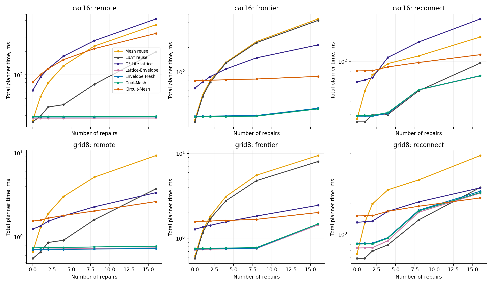{width=99%}

В манифесте синтетические seed-инстансы названы roots; координаты старта и цели в них фиксированы, меняются случайные препятствия. В стандартных replay два корня различаются также стартом и целью.

Начальная стоимость включает повторный mesh-обход границы после исчерпания OPEN; он не подменяется бесплатным построением сертификата. Выигрыш относительно Lattice-Envelope отражает именно совместную обработку префиксов. На grid8 один шаг примитива занимает одну конечную клетку: структурного преимущества общего префикса здесь ожидать нельзя. Быстрый ответ на удалённые правки сам по себе ещё не доказывает пользу mesh; важен этот контроль.

| Модель | Кандидат | Baseline | Положительные × (N) | Нет пути × (N) |
| --- | --- | --- | --- | --- |
| car16 | Circuit-Mesh | D\* Lite lattice | 14.13 (495) | 1.86 (9) |
| car16 | Circuit-Mesh | LBA\* reuse | 0.17 (495) | 0.16 (9) |
| car16 | Circuit-Mesh | Mesh reuse | 0.22 (495) | 0.17 (9) |
| car16 | Dual-Mesh | D\* Lite lattice | 66.58 (495) | 9.27 (9) |
| car16 | Dual-Mesh | LBA\* reuse | 0.82 (495) | 0.82 (9) |
| car16 | Dual-Mesh | Mesh reuse | 1.01 (495) | 0.87 (9) |
| car16 | Envelope-Mesh | D\* Lite lattice | 5.54 (495) | 9.13 (9) |
| car16 | Envelope-Mesh | LBA\* reuse | 0.07 (495) | 0.81 (9) |
| car16 | Envelope-Mesh | Mesh reuse | 0.08 (495) | 0.86 (9) |
| grid8 | Circuit-Mesh | D\* Lite lattice | 2.26 (2025) | 2.82 (1) |
| grid8 | Circuit-Mesh | LBA\* reuse | 1.69 (2025) | 0.98 (1) |
| grid8 | Circuit-Mesh | Mesh reuse | 1.71 (2025) | 0.95 (1) |
| grid8 | Dual-Mesh | D\* Lite lattice | 1.32 (2025) | 2.28 (1) |
| grid8 | Dual-Mesh | LBA\* reuse | 0.99 (2025) | 0.79 (1) |
| grid8 | Dual-Mesh | Mesh reuse | 1.00 (2025) | 0.76 (1) |
| grid8 | Envelope-Mesh | D\* Lite lattice | 0.67 (2025) | 2.27 (1) |
| grid8 | Envelope-Mesh | LBA\* reuse | 0.50 (2025) | 0.79 (1) |
| grid8 | Envelope-Mesh | Mesh reuse | 0.51 (2025) | 0.76 (1) |

Эта таблица использует медианы запросов только replay. В одном эпизоде запросы зависимы; N показывает число пар запросов, а не независимых карт. Поскольку огибающая выбирается по эпизоду, она не подменяет приведённые прямые сравнения типов ответа.

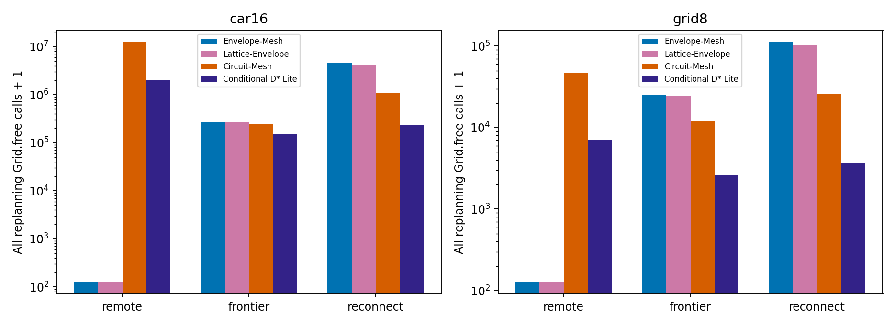{width=99%}

## Полный счётчик обращений к проверке занятости

Старое поле checked_cells считает явные проверки трасс/узлов, но пропускает предварительные проверки конечных клеток в candidate и часть проверок условий входа. Его нельзя трактовать как полное число collision queries. Поэтому выполнен отдельный count-only проход на всех 184 replay-входах: 920 эпизодов с пятью методами, все вызовы Grid.free перехвачены в сгенерированной копии заголовков, измеряемые исходники не изменялись. 16450 строк совпали по всем прежним логическим полям с обычными траекториями. Инструментированный бинарник не используется для сравнения времени. Считаются логические вызовы API, включая проверки вне карты; прямые Grid.blocked в общей нормализации входа и эталонные/проверочные поиски исключены. Это не число физических CPU-чтений памяти.

| Модель | Метод | Все Grid.free, млн | Legacy, млн | Концы, млн | Пропущено, % |
| --- | --- | --- | --- | --- | --- |
| car16 | Circuit-Mesh | 297.71 | 297.70 | 0.00 | 0.00 |
| car16 | Conditional D\* Lite | 51.22 | 51.22 | 0.00 | 0.01 |
| car16 | Dual-Mesh | 169.83 | 158.00 | 11.83 | 6.97 |
| car16 | Envelope-Mesh | 201.63 | 189.79 | 11.83 | 5.87 |
| car16 | Lattice-Envelope | 201.04 | 192.77 | 8.26 | 4.11 |
| grid8 | Circuit-Mesh | 2.18 | 2.17 | 0.00 | 0.40 |
| grid8 | Conditional D\* Lite | 0.28 | 0.27 | 0.00 | 2.62 |
| grid8 | Dual-Mesh | 2.62 | 2.51 | 0.10 | 4.12 |
| grid8 | Envelope-Mesh | 2.92 | 2.81 | 0.10 | 3.71 |
| grid8 | Lattice-Envelope | 2.88 | 2.80 | 0.07 | 2.77 |

| Модель | Набор | Метод | Контроль | Probes F × | Probes R × | Пары |
| --- | --- | --- | --- | --- | --- | --- |
| car16 | frontier_width | Circuit-Mesh | Conditional D\* Lite | 0.29 | 0.46 | 6/6 |
| car16 | frontier_width | Envelope-Mesh | Lattice-Envelope | 0.97 | 0.68 | 6/6 |
| car16 | replay | Circuit-Mesh | Conditional D\* Lite | 0.19 | 0.15 | 52/52 |
| car16 | replay | Envelope-Mesh | Lattice-Envelope | 1.00 | 1.02 | 52/52 |
| car16 | separator | Circuit-Mesh | Conditional D\* Lite | 0.17 | 0.28 | 12/12 |
| car16 | separator | Envelope-Mesh | Lattice-Envelope | 0.96 | 0.99 | 12/12 |
| grid8 | frontier_width | Circuit-Mesh | Conditional D\* Lite | 0.11 | 0.16 | 6/6 |
| grid8 | frontier_width | Envelope-Mesh | Lattice-Envelope | 0.97 | 0.79 | 6/6 |
| grid8 | replay | Circuit-Mesh | Conditional D\* Lite | 0.13 | 0.20 | 96/96 |
| grid8 | replay | Envelope-Mesh | Lattice-Envelope | 1.00 | 1.00 | 96/96 |
| grid8 | separator | Circuit-Mesh | Conditional D\* Lite | 0.10 | 0.17 | 12/12 |
| grid8 | separator | Envelope-Mesh | Lattice-Envelope | 0.98 | 0.96 | 12/12 |

Столбец «Концы» отдельно учитывает проверки в candidate. Реализации mesh/lattice различаются также порядком обхода и ранним выходом из входящего соединения; небольшие различия нельзя приписывать только числу общих префиксов. Полный счётчик включает и эти накладные обращения.

Значения больше 1 означают меньше вызовов проверки занятости у кандидата. Если время улучшается без уменьшения этих вызовов, причина в других операциях; если число обращений меньше, но время хуже, может сказываться обслуживание индексов, очередей и множеств; аппаратный профиль здесь не измерялся. Полный legacy-счётчик сохранён для сопоставления с прежними отчётами, но вывод о суммарной геометрической работе опирается на этот отдельный проход.

# Число изменений, радиус, задержки и память

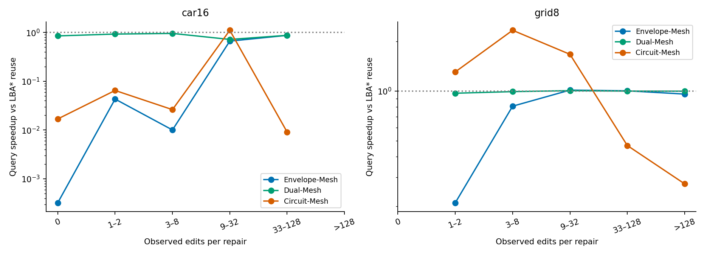{width=99%}

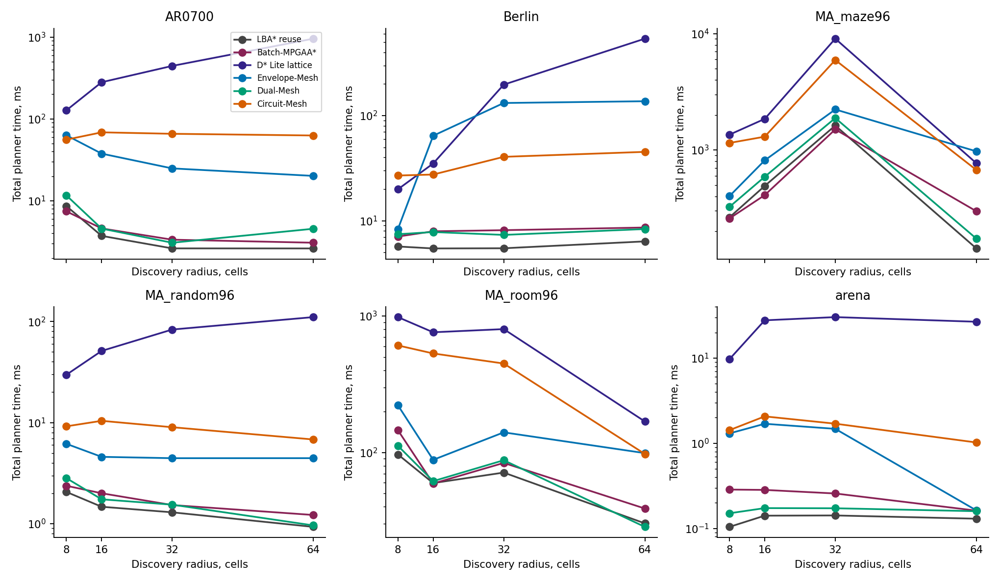{width=99%}

Статическое раскрытие даёт только новые блокировки, поэтому отрицательный сертификат редко нужен до терминального отказа. Выигрыш Dual-Mesh в этом режиме может объясняться известным суффиксом и выбранным backend, а не новым механизмом отрицательной границы. Envelope-Mesh без положительного сертификата измерен отдельно именно для такого разделения.

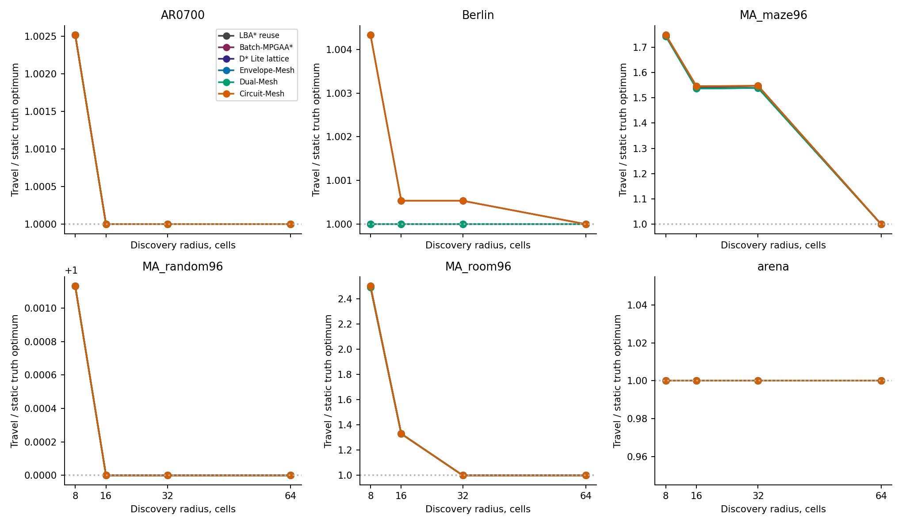{width=99%}

Точность каждого replanning-запроса не означает оптимальность всего исполненного пути в неизвестной карте: агент мог сделать объезд до раскрытия препятствия. Для статического раскрытия нормированная длина обязана быть не меньше 1; это дополнительно проверяется анализом. Для динамических карт такое отношение к исходному статическому оптимуму не является мерой субоптимальности, поскольку препятствия меняются. Абсолютная длина, число moves и число планирований всех навигационных эпизодов сохранены в navigation_quality.csv.

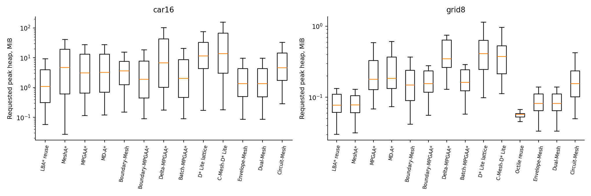{width=99%}

| Модель | Метод | Медиана MiB | Максимум MiB | Завершено |
| --- | --- | --- | --- | --- |
| car16 | Batch-MPGAA\* | 2.03 | 248.94 | 95/100 |
| car16 | Boundary-Mesh | 3.58 | 170.97 | 94/100 |
| car16 | Boundary-MPGAA\* | 1.90 | 221.97 | 95/100 |
| car16 | Circuit-Mesh | 4.67 | 409.53 | 94/100 |
| car16 | C-Mesh-D\* Lite | 13.65 | 261.13 | 92/100 |
| car16 | Cut reset | 1.32 | 126.68 | 64/64 |
| car16 | Delta-MPGAA\* | 6.78 | 1142.38 | 95/100 |
| car16 | D\* Lite lattice | 11.63 | 820.66 | 94/100 |
| car16 | Dual-Mesh | 1.35 | 126.68 | 95/100 |
| car16 | Envelope-Mesh | 1.35 | 126.68 | 95/100 |
| car16 | Lattice-Envelope | 1.32 | 126.68 | 64/64 |
| car16 | LBA\* reuse | 1.09 | 122.09 | 95/100 |
| car16 | MD-A\* | 3.21 | 371.38 | 94/100 |
| car16 | Mesh cold | 1.27 | 126.68 | 64/64 |
| car16 | Mesh reuse | 1.27 | 126.68 | 64/64 |
| car16 | MeshA\* | 4.74 | 253.41 | 92/100 |
| car16 | MPGAA\* | 3.09 | 371.18 | 95/100 |
| grid8 | Batch-MPGAA\* | 0.16 | 10.63 | 127/128 |
| grid8 | Boundary-Mesh | 0.15 | 7.51 | 127/128 |
| grid8 | Boundary-MPGAA\* | 0.16 | 10.00 | 127/128 |
| grid8 | Circuit-Mesh | 0.16 | 9.11 | 127/128 |
| grid8 | C-Mesh-D\* Lite | 0.38 | 17.85 | 127/128 |
| grid8 | Cut reset | 0.08 | 0.33 | 108/108 |
| grid8 | Delta-MPGAA\* | 0.35 | 27.46 | 127/128 |
| grid8 | D\* Lite lattice | 0.41 | 18.92 | 127/128 |
| grid8 | Dual-Mesh | 0.08 | 4.68 | 128/128 |
| grid8 | Envelope-Mesh | 0.08 | 4.68 | 128/128 |
| grid8 | Lattice-Envelope | 0.08 | 0.37 | 108/108 |
| grid8 | LBA\* reuse | 0.08 | 4.63 | 128/128 |
| grid8 | MD-A\* | 0.18 | 16.80 | 127/128 |
| grid8 | Mesh cold | 0.08 | 0.31 | 108/108 |
| grid8 | Mesh reuse | 0.08 | 0.31 | 108/108 |
| grid8 | MeshA\* | 0.08 | 4.41 | 128/128 |
| grid8 | MPGAA\* | 0.18 | 16.13 | 127/128 |
| grid8 | Octile reuse | 0.06 | 4.65 | 128/128 |

Картовые p50/p95/p99 задержки ремонтов приведены в `analysis/latency.csv`; их получают из медиан трёх временных повторов каждого запроса, не из пула всех повторов. Счётчики раскрытий, occupancy-проверок, уведомлений, построений/попаданий сертификата, добавлений R и событий свидетелей сохранены по картам и запросам. Они позволяют отличить экономию поиска от более дешёвого исполнения той же работы.

Число раскрытий у разных представлений относится к разным единицам: MeshA\* раскрывает и внутренние конфигурации, новые методы — граничные состояния. Поэтому оно не является одинаковой операцией CPU. Старые D\*-реализации не заполняют notify_probes для всех своих циклов; нули этого поля не означают отсутствие работы уведомлений. Время и occupancy-проверки интерпретируются отдельно.

# Фактический change rate и завершение навигации

| Модель | Карта | cr % | С фазами | Мин факт % | Макс факт % | Clamp фаз |
| --- | --- | --- | --- | --- | --- | --- |
| car16 | AR0700 | 5 | 13/13 | 5.00 | 5.00 | 0 |
| car16 | AR0700 | 20 | 13/13 | 20.00 | 20.00 | 0 |
| car16 | Berlin | 5 | 13/13 | 5.00 | 5.00 | 0 |
| car16 | Berlin | 20 | 13/13 | 20.00 | 20.00 | 0 |
| car16 | MA_maze96 | 5 | 13/13 | 4.99 | 4.99 | 0 |
| car16 | MA_maze96 | 20 | 13/13 | 13.54 | 13.54 | 26 |
| car16 | MA_random96 | 5 | 13/13 | 4.99 | 4.99 | 0 |
| car16 | MA_random96 | 20 | 0/13 | — | — | 0 |
| car16 | MA_room96 | 5 | 13/13 | 4.99 | 4.99 | 0 |
| car16 | MA_room96 | 20 | 0/13 | — | — | 0 |
| car16 | arena | 5 | 13/13 | 5.00 | 5.00 | 0 |
| car16 | arena | 20 | 0/13 | — | — | 0 |
| grid8 | AR0700 | 5 | 14/14 | 5.00 | 5.00 | 0 |
| grid8 | AR0700 | 20 | 14/14 | 20.00 | 20.00 | 0 |
| grid8 | Berlin | 5 | 14/14 | 5.00 | 5.00 | 0 |
| grid8 | Berlin | 20 | 14/14 | 20.00 | 20.00 | 0 |
| grid8 | MA_maze512 | 5 | 14/14 | 5.00 | 5.00 | 0 |
| grid8 | MA_maze512 | 20 | 14/14 | 12.30 | 12.30 | 106 |
| grid8 | MA_random512 | 5 | 14/14 | 5.00 | 5.00 | 0 |
| grid8 | MA_random512 | 20 | 14/14 | 20.00 | 20.00 | 0 |
| grid8 | MA_room512 | 5 | 14/14 | 5.00 | 5.00 | 0 |
| grid8 | MA_room512 | 20 | 14/14 | 20.00 | 20.00 | 0 |
| grid8 | arena | 5 | 14/14 | 5.00 | 5.00 | 0 |
| grid8 | arena | 20 | 0/14 | — | — | 0 |
| grid8 | random50_p10 | 5 | 14/14 | 5.04 | 5.04 | 0 |
| grid8 | random50_p10 | 20 | 0/14 | — | — | 0 |
| grid8 | random50_p20 | 5 | 14/14 | 5.04 | 5.04 | 0 |
| grid8 | random50_p20 | 20 | 0/14 | — | — | 0 |
| grid8 | random50_p30 | 5 | 14/14 | 5.04 | 5.04 | 0 |
| grid8 | random50_p30 | 20 | 0/14 | — | — | 0 |
| grid8 | random50_p40 | 5 | 14/14 | 5.04 | 5.04 | 0 |
| grid8 | random50_p40 | 20 | 14/14 | 20.00 | 20.00 | 0 |

cr здесь — доля всех клеток, изменённых за фазу, то есть сумма блокировок и освобождений. Каждая сторона выбирается из своего исходного до фазы пула; число пар ограничивается доступными клетками и защитой клеток текущего положения агента и цели. Фактический cr равен 100·actual_changes/(число клеток·phases). Эпизоды без фаз показываются отдельно. Разные маршруты могут дать разное число фаз; clamped_phases суммированы по алгоритмам, не по независимым мирам.

| Сценарий | Модель | Метод | Цель / конфигурации |
| --- | --- | --- | --- |
| navigation_dynamic | car16 | Batch-MPGAA\* | 7/12 |
| navigation_dynamic | car16 | Boundary-Mesh | 6/12 |
| navigation_dynamic | car16 | Boundary-MPGAA\* | 7/12 |
| navigation_dynamic | car16 | Circuit-Mesh | 6/12 |
| navigation_dynamic | car16 | C-Mesh-D\* Lite | 7/12 |
| navigation_dynamic | car16 | Delta-MPGAA\* | 7/12 |
| navigation_dynamic | car16 | D\* Lite lattice | 6/12 |
| navigation_dynamic | car16 | Dual-Mesh | 7/12 |
| navigation_dynamic | car16 | Envelope-Mesh | 7/12 |
| navigation_dynamic | car16 | LBA\* reuse | 7/12 |
| navigation_dynamic | car16 | MD-A\* | 7/12 |
| navigation_dynamic | car16 | MeshA\* | 6/12 |
| navigation_dynamic | car16 | MPGAA\* | 7/12 |
| navigation_dynamic | grid8 | Batch-MPGAA\* | 19/20 |
| navigation_dynamic | grid8 | Boundary-Mesh | 19/20 |
| navigation_dynamic | grid8 | Boundary-MPGAA\* | 19/20 |
| navigation_dynamic | grid8 | Circuit-Mesh | 19/20 |
| navigation_dynamic | grid8 | C-Mesh-D\* Lite | 19/20 |
| navigation_dynamic | grid8 | Delta-MPGAA\* | 19/20 |
| navigation_dynamic | grid8 | D\* Lite lattice | 19/20 |
| navigation_dynamic | grid8 | Dual-Mesh | 20/20 |
| navigation_dynamic | grid8 | Envelope-Mesh | 20/20 |
| navigation_dynamic | grid8 | LBA\* reuse | 20/20 |
| navigation_dynamic | grid8 | MD-A\* | 19/20 |
| navigation_dynamic | grid8 | MeshA\* | 20/20 |
| navigation_dynamic | grid8 | MPGAA\* | 19/20 |
| navigation_dynamic | grid8 | Octile reuse | 20/20 |
| navigation_unknown | car16 | Batch-MPGAA\* | 24/24 |
| navigation_unknown | car16 | Boundary-Mesh | 24/24 |
| navigation_unknown | car16 | Boundary-MPGAA\* | 24/24 |
| navigation_unknown | car16 | Circuit-Mesh | 24/24 |
| navigation_unknown | car16 | C-Mesh-D\* Lite | 24/24 |
| navigation_unknown | car16 | Delta-MPGAA\* | 24/24 |
| navigation_unknown | car16 | D\* Lite lattice | 24/24 |
| navigation_unknown | car16 | Dual-Mesh | 24/24 |
| navigation_unknown | car16 | Envelope-Mesh | 24/24 |
| navigation_unknown | car16 | LBA\* reuse | 24/24 |
| navigation_unknown | car16 | MD-A\* | 24/24 |
| navigation_unknown | car16 | MeshA\* | 24/24 |
| navigation_unknown | car16 | MPGAA\* | 24/24 |

| Сценарий | Модель | Метод | NoPath | В truth есть путь | В truth нет пути |
| --- | --- | --- | --- | --- | --- |
| navigation_dynamic | car16 | Batch-MPGAA\* | 5 | 0 | 5 |
| navigation_dynamic | car16 | Boundary-Mesh | 6 | 0 | 6 |
| navigation_dynamic | car16 | Boundary-MPGAA\* | 5 | 0 | 5 |
| navigation_dynamic | car16 | Circuit-Mesh | 6 | 0 | 6 |
| navigation_dynamic | car16 | C-Mesh-D\* Lite | 1 | 0 | 1 |
| navigation_dynamic | car16 | Delta-MPGAA\* | 5 | 0 | 5 |
| navigation_dynamic | car16 | D\* Lite lattice | 6 | 0 | 6 |
| navigation_dynamic | car16 | Dual-Mesh | 5 | 0 | 5 |
| navigation_dynamic | car16 | Envelope-Mesh | 5 | 0 | 5 |
| navigation_dynamic | car16 | LBA\* reuse | 5 | 0 | 5 |
| navigation_dynamic | car16 | MD-A\* | 4 | 0 | 4 |
| navigation_dynamic | car16 | MeshA\* | 5 | 0 | 5 |
| navigation_dynamic | car16 | MPGAA\* | 5 | 0 | 5 |
| navigation_dynamic | grid8 | Batch-MPGAA\* | 1 | 0 | 1 |
| navigation_dynamic | grid8 | Boundary-Mesh | 1 | 1 | 0 |
| navigation_dynamic | grid8 | Boundary-MPGAA\* | 1 | 0 | 1 |
| navigation_dynamic | grid8 | Circuit-Mesh | 1 | 1 | 0 |
| navigation_dynamic | grid8 | C-Mesh-D\* Lite | 1 | 1 | 0 |
| navigation_dynamic | grid8 | Delta-MPGAA\* | 1 | 0 | 1 |
| navigation_dynamic | grid8 | D\* Lite lattice | 1 | 1 | 0 |
| navigation_dynamic | grid8 | MD-A\* | 1 | 0 | 1 |
| navigation_dynamic | grid8 | MPGAA\* | 1 | 0 | 1 |

В динамике NoPath означает отсутствие пути в текущем belief-графе. Необнаруженные освобождения иногда сохраняют путь в truth-карте: это отказ выбранного контроллера с неполной видимостью, а не ошибка точного поиска. Контроллер здесь прекращает миссию, не исследует мир и не ждёт внешних обновлений после отказа. В статическом раскрытии belief оптимистичен, поэтому такой разрыв belief/truth невозможен; анализ дополнительно проверяет это. Остановки по бюджету в эту таблицу не включены.

# Отдельная структурная проверка ширины границы

Дополнение содержит 12 конфигураций, 630 временных и 210 allocation-эпизодов; 3570 логических строк совпали. Оно объявлено до просмотра агрегированных основных времён и не включено в основные средние 228 конфигураций. Причина добавления — структурная: полоса шириной 7 превосходит размах car-примитивов, и конечные клетки всех выходящих переходов могут быть заблокированы; это скрывает явные префиксные свидетели за неявной обработкой концов. Поэтому отдельно проверены все ширины 1, 3, 7, два seed при фиксированных координатах концов, обе модели, размер 64 и чередующийся сдвиг полосы на одну клетку, 17 запросов. Сохранены все результаты, включая потенциально дорогие ложные откаты надмножества R при тонкой смещающейся стене.

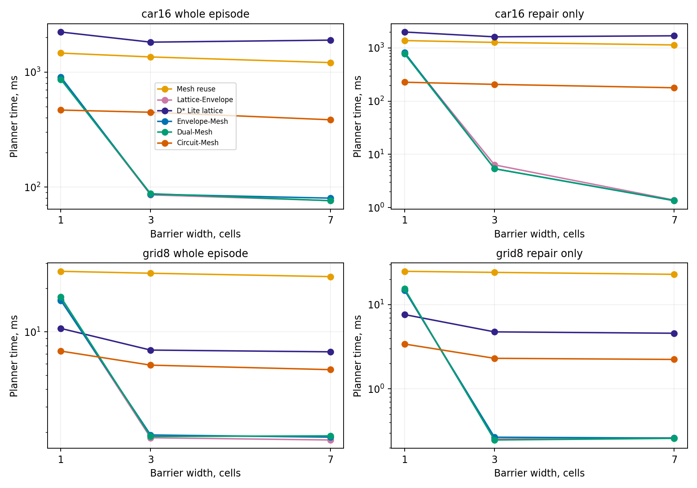{width=99%}

| Модель | Ширина | Кандидат | LBA reuse F/R | Lattice F/R | D\* Lite F/R |
| --- | --- | --- | --- | --- | --- |
| car16 | 1 | Circuit-Mesh | 2.70 / 5.22 | 1.88 / 3.45 | 4.77 / 8.79 |
| car16 | 1 | Dual-Mesh | 1.46 / 1.53 | 1.02 / 1.01 | 2.58 / 2.57 |
| car16 | 1 | Envelope-Mesh | 1.39 / 1.45 | 0.97 / 0.96 | 2.46 / 2.45 |
| car16 | 3 | Circuit-Mesh | 2.68 / 5.42 | 0.19 / 0.03 | 4.07 / 7.83 |
| car16 | 3 | Dual-Mesh | 13.66 / 208.63 | 0.98 / 1.18 | 20.79 / 301.33 |
| car16 | 3 | Envelope-Mesh | 13.80 / 209.06 | 0.99 / 1.18 | 21.00 / 301.95 |
| car16 | 7 | Circuit-Mesh | 3.03 / 6.17 | 0.20 / 0.01 | 4.93 / 9.48 |
| car16 | 7 | Dual-Mesh | 15.31 / 813.60 | 1.00 / 1.02 | 24.90 / 1250.44 |
| car16 | 7 | Envelope-Mesh | 14.55 / 819.81 | 0.95 / 1.03 | 23.66 / 1259.98 |
| grid8 | 1 | Circuit-Mesh | 3.28 / 6.68 | 2.28 / 4.34 | 1.44 / 2.24 |
| grid8 | 1 | Dual-Mesh | 1.38 / 1.48 | 0.96 / 0.96 | 0.61 / 0.49 |
| grid8 | 1 | Envelope-Mesh | 1.46 / 1.54 | 1.01 / 1.00 | 0.64 / 0.52 |
| grid8 | 3 | Circuit-Mesh | 3.65 / 8.77 | 0.31 / 0.11 | 1.27 / 2.06 |
| grid8 | 3 | Dual-Mesh | 11.44 / 81.80 | 0.98 / 1.03 | 3.99 / 19.22 |
| grid8 | 3 | Envelope-Mesh | 11.17 / 75.79 | 0.96 / 0.95 | 3.89 / 17.81 |
| grid8 | 7 | Circuit-Mesh | 3.73 / 8.61 | 0.32 / 0.12 | 1.33 / 2.05 |
| grid8 | 7 | Dual-Mesh | 10.77 / 74.50 | 0.94 / 1.02 | 3.84 / 17.72 |
| grid8 | 7 | Envelope-Mesh | 11.00 / 73.97 | 0.96 / 1.01 | 3.92 / 17.59 |

| Модель | Ширина | Метод | Перестроения | Cert hits | События cut | Occupancy |
| --- | --- | --- | --- | --- | --- | --- |
| car16 | 1 | Circuit-Mesh | 0 | 0 | 0 | 3915792 |
| car16 | 1 | Dual-Mesh | 16 | 16 | 135040 | 16976336 |
| car16 | 1 | Envelope-Mesh | 16 | 16 | 135040 | 16976336 |
| car16 | 1 | Lattice-Envelope | 16 | 16 | 449184 | 18683352 |
| car16 | 3 | Circuit-Mesh | 0 | 0 | 0 | 3495904 |
| car16 | 3 | Dual-Mesh | 0 | 32 | 23980 | 153812 |
| car16 | 3 | Envelope-Mesh | 0 | 32 | 23980 | 153812 |
| car16 | 3 | Lattice-Envelope | 0 | 32 | 48912 | 134332 |
| car16 | 7 | Circuit-Mesh | 0 | 0 | 0 | 2963392 |
| car16 | 7 | Dual-Mesh | 0 | 32 | 236 | 64455 |
| car16 | 7 | Envelope-Mesh | 0 | 32 | 236 | 64455 |
| car16 | 7 | Lattice-Envelope | 0 | 32 | 464 | 17485 |
| grid8 | 1 | Circuit-Mesh | 0 | 0 | 0 | 62784 |
| grid8 | 1 | Dual-Mesh | 16 | 16 | 0 | 289352 |
| grid8 | 1 | Envelope-Mesh | 16 | 16 | 0 | 289352 |
| grid8 | 1 | Lattice-Envelope | 16 | 16 | 0 | 283304 |
| grid8 | 3 | Circuit-Mesh | 0 | 0 | 0 | 50624 |
| grid8 | 3 | Dual-Mesh | 0 | 32 | 0 | 506 |
| grid8 | 3 | Envelope-Mesh | 0 | 32 | 0 | 506 |
| grid8 | 3 | Lattice-Envelope | 0 | 32 | 0 | 128 |
| grid8 | 7 | Circuit-Mesh | 0 | 0 | 0 | 50624 |
| grid8 | 7 | Dual-Mesh | 0 | 32 | 0 | 506 |
| grid8 | 7 | Envelope-Mesh | 0 | 32 | 0 | 506 |
| grid8 | 7 | Lattice-Envelope | 0 | 32 | 0 | 128 |

# Усиленный контроль: условные изменения рёбер D\* Lite

Код исходного D\* Lite условно распространяет изменения g, но после уведомлений карты полностью пересчитывает rhs затронутых хвостов. Чтобы не выдать известную оптимизацию за новизну Circuit-Mesh, добавлен отдельный стандартный Conditional D\* Lite: вновь допустимая дуга понижает rhs через c+g(head), а отключённая вызывает полный backup только при возможной поддержке текущего rhs. Все кеши пакета инвалидируются до backup; одинаковый активный ключ не добавляется повторно. Это контроль, а не новый заявляемый алгоритм.

В отдельном новом бинарнике совместно перемерены все три неизменённых кандидата и Conditional D\* Lite: 184 прежних replay-конфигураций, 2208 временных и 736 allocation-эпизодов. Это повтор тех же входов, а не новые независимые карты; секунды не смешаны с основной серией. Выбор контроля сделан по анализу исходников до просмотра агрегированных основных сравнений. Навигация в этом дополнительном проходе не повторяется. Расхождений стоимости: 0; capped-вызовов: 0; совпавших normal/allocation-строк: 13160.

| Модель | Набор | Кандидат | Пары | Полное × | Ремонт × | Heap / control |
| --- | --- | --- | --- | --- | --- | --- |
| car16 | frontier_width | Circuit-Mesh | 6/6 | 1.38 | 2.45 | 1.34 |
| car16 | frontier_width | Dual-Mesh | 6/6 | 3.52 | 31.29 | 0.58 |
| car16 | frontier_width | Envelope-Mesh | 6/6 | 3.51 | 31.43 | 0.58 |
| car16 | replay | Circuit-Mesh | 52/52 | 0.97 | 1.98 | 1.66 |
| car16 | replay | Dual-Mesh | 52/52 | 2.88 | 12.52 | 0.60 |
| car16 | replay | Envelope-Mesh | 52/52 | 1.52 | 1.28 | 0.61 |
| car16 | separator | Circuit-Mesh | 12/12 | 0.85 | 2.03 | 1.26 |
| car16 | separator | Dual-Mesh | 12/12 | 3.20 | 59.96 | 0.47 |
| car16 | separator | Envelope-Mesh | 12/12 | 3.23 | 59.70 | 0.47 |
| grid8 | frontier_width | Circuit-Mesh | 6/6 | 0.99 | 1.68 | 0.95 |
| grid8 | frontier_width | Dual-Mesh | 6/6 | 1.58 | 4.50 | 0.85 |
| grid8 | frontier_width | Envelope-Mesh | 6/6 | 1.58 | 4.45 | 0.85 |
| grid8 | replay | Circuit-Mesh | 96/96 | 0.93 | 1.48 | 0.93 |
| grid8 | replay | Dual-Mesh | 96/96 | 1.07 | 0.80 | 0.47 |
| grid8 | replay | Envelope-Mesh | 96/96 | 0.92 | 0.67 | 0.47 |
| grid8 | separator | Circuit-Mesh | 12/12 | 0.74 | 1.43 | 0.86 |
| grid8 | separator | Dual-Mesh | 12/12 | 1.23 | 4.04 | 0.70 |
| grid8 | separator | Envelope-Mesh | 12/12 | 1.23 | 3.97 | 0.70 |

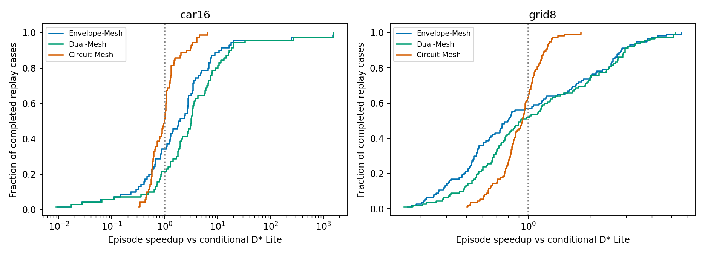{width=99%}

| Модель | Набор | Карта | Envelope-Mesh | Dual-Mesh | Circuit-Mesh |
| --- | --- | --- | --- | --- | --- |
| car16 | frontier_width | shift64_w1 | 0.87 / 0.85 (2/2) | 0.85 / 0.84 (2/2) | 1.50 / 2.65 (2/2) |
| car16 | frontier_width | shift64_w3 | 6.75 / 100.50 (2/2) | 6.68 / 98.39 (2/2) | 1.32 / 2.36 (2/2) |
| car16 | frontier_width | shift64_w7 | 7.34 / 363.82 (2/2) | 7.67 / 371.27 (2/2) | 1.32 / 2.36 (2/2) |
| car16 | replay | AR0700 | 2.12 / 2.10 (8/8) | 3.93 / 14.40 (8/8) | 0.83 / 1.83 (8/8) |
| car16 | replay | Berlin | 1.27 / 0.82 (8/8) | 2.41 / 16.25 (8/8) | 0.61 / 1.66 (8/8) |
| car16 | replay | MA_maze96 | 1.32 / 0.89 (8/8) | 2.56 / 15.02 (8/8) | 0.65 / 0.98 (8/8) |
| car16 | replay | MA_random96 | 0.82 / 0.83 (8/8) | 1.42 / 4.42 (8/8) | 1.10 / 2.59 (8/8) |
| car16 | replay | MA_room96 | 0.98 / 0.58 (8/8) | 1.85 / 7.23 (8/8) | 0.71 / 1.91 (8/8) |
| car16 | replay | arena | 2.95 / 3.71 (8/8) | 8.17 / 64.81 (8/8) | 1.50 / 2.36 (8/8) |
| car16 | replay | synthetic_open96 | 3.23 / 3.34 (4/4) | 3.43 / 3.51 (4/4) | 4.70 / 6.04 (4/4) |
| car16 | separator | separator32 | 4.75 / 46.62 (6/6) | 4.65 / 46.11 (6/6) | 1.05 / 2.06 (6/6) |
| car16 | separator | separator64 | 2.20 / 76.44 (6/6) | 2.20 / 77.97 (6/6) | 0.68 / 1.99 (6/6) |
| grid8 | frontier_width | shift64_w1 | 0.52 / 0.46 (2/2) | 0.52 / 0.47 (2/2) | 1.23 / 2.05 (2/2) |
| grid8 | frontier_width | shift64_w3 | 2.71 / 13.92 (2/2) | 2.64 / 13.90 (2/2) | 0.89 / 1.53 (2/2) |
| grid8 | frontier_width | shift64_w7 | 2.77 / 13.65 (2/2) | 2.84 / 14.09 (2/2) | 0.87 / 1.50 (2/2) |
| grid8 | replay | random50_p10 | 0.69 / 0.37 (24/24) | 0.82 / 0.47 (24/24) | 0.71 / 1.33 (24/24) |
| grid8 | replay | random50_p20 | 1.05 / 0.95 (24/24) | 1.22 / 1.10 (24/24) | 0.92 / 1.40 (24/24) |
| grid8 | replay | random50_p30 | 0.92 / 0.65 (24/24) | 1.03 / 0.74 (24/24) | 0.99 / 1.59 (24/24) |
| grid8 | replay | random50_p40 | 1.05 / 0.81 (24/24) | 1.25 / 0.99 (24/24) | 1.13 / 1.59 (24/24) |
| grid8 | separator | separator32 | 1.43 / 3.08 (6/6) | 1.47 / 3.15 (6/6) | 0.90 / 1.35 (6/6) |
| grid8 | separator | separator64 | 1.05 / 5.12 (6/6) | 1.03 / 5.18 (6/6) | 0.62 / 1.50 (6/6) |

В этом контроле, как и в исходном valid_edge, допустимость вспомогательной дуги проверяет клетки после начала. Исходящие дуги заблокированного состояния могут оставаться во вспомогательном графе, но свободный старт не может попасть в него через заблокированную конечную клетку. Текущие старт и цель проверяются отдельно. Таким образом физические пути и стоимости совпадают с постановкой; блокировки концов и перенос старта дополнительно проверены независимым Dijkstra. Подробности и код: cpp/mesh_conditional/README.md.

# Оценка научного результата

Исходная гипотеза первого этапа — ремонтируемый отрицательный mesh-сертификат: хранить безопасное замкнутое надмножество, а не пытаться поддерживать точную компоненту после удалений. Новая часть в рамках этого репозитория — общая префиксная граница и неявные конечные свидетели. Эксперименты ниже показывают границы её пользы; второй этап с SMD-A\* рассматривается в отдельном отчёте. Доказательство отсутствия пути через замкнутое множество, инкрементальная достижимость, D\* Lite и повторное использование суффикса давно известны. Проверенный набор источников ограничен; литературный приоритет сочетания не доказан.

На car16 replay Envelope-Mesh имеет полное отношение 0.25× и ремонт 0.04× к самому быстрому контролю на конфигурацию; выигрышей от 10% — 0 из 52 общих завершённых пар.

На car16 replay Dual-Mesh имеет полное отношение 0.47× и ремонт 0.37× к самому быстрому контролю на конфигурацию; выигрышей от 10% — 1 из 52 общих завершённых пар.

На car16 replay Circuit-Mesh имеет полное отношение 0.16× и ремонт 0.06× к самому быстрому контролю на конфигурацию; выигрышей от 10% — 6 из 52 общих завершённых пар.

На grid8 replay Envelope-Mesh имеет полное отношение 0.25× и ремонт 0.28× к самому быстрому контролю на конфигурацию; выигрышей от 10% — 0 из 96 общих завершённых пар.

На grid8 replay Dual-Mesh имеет полное отношение 0.29× и ремонт 0.34× к самому быстрому контролю на конфигурацию; выигрышей от 10% — 0 из 96 общих завершённых пар.

На grid8 replay Circuit-Mesh имеет полное отношение 0.26× и ремонт 0.64× к самому быстрому контролю на конфигурацию; выигрышей от 10% — 0 из 96 общих завершённых пар.

На separator car16 Envelope-Mesh даёт 7.75× по полному времени к контролю Mesh cold и 0.98× к независимым lattice-свидетелям. Первая величина изолирует сохранение отрицательного ответа. Только сравнение Envelope-Mesh с Lattice-Envelope изолирует mesh-представление; для Dual-Mesh вторая величина включает также положительный суффикс.

На separator car16 Dual-Mesh даёт 7.69× по полному времени к контролю Mesh reuse и 0.99× к независимым lattice-свидетелям. Первая величина изолирует сохранение отрицательного ответа. Только сравнение Envelope-Mesh с Lattice-Envelope изолирует mesh-представление; для Dual-Mesh вторая величина включает также положительный суффикс.

На separator grid8 Envelope-Mesh даёт 5.63× по полному времени к контролю Mesh cold и 0.98× к независимым lattice-свидетелям. Первая величина изолирует сохранение отрицательного ответа. Только сравнение Envelope-Mesh с Lattice-Envelope изолирует mesh-представление; для Dual-Mesh вторая величина включает также положительный суффикс.

На separator grid8 Dual-Mesh даёт 5.59× по полному времени к контролю Mesh reuse и 0.97× к независимым lattice-свидетелям. Первая величина изолирует сохранение отрицательного ответа. Только сравнение Envelope-Mesh с Lattice-Envelope изолирует mesh-представление; для Dual-Mesh вторая величина включает также положительный суффикс.

Дополнительная совместная проверка car16: Circuit-Mesh / Conditional D\* Lite — 0.97× по полному эпизоду, 1.98× по ремонту, 52/52 общих завершённых конфигураций. Эти отношения следует использовать при оценке новизны Circuit-Mesh, а не только сравнение с полными backup после уведомлений.

Дополнительная совместная проверка car16: Dual-Mesh / Conditional D\* Lite — 2.88× по полному эпизоду, 12.52× по ремонту, 52/52 общих завершённых конфигураций. Эти отношения следует использовать при оценке новизны Circuit-Mesh, а не только сравнение с полными backup после уведомлений.

Дополнительная совместная проверка car16: Envelope-Mesh / Conditional D\* Lite — 1.52× по полному эпизоду, 1.28× по ремонту, 52/52 общих завершённых конфигураций. Эти отношения следует использовать при оценке новизны Circuit-Mesh, а не только сравнение с полными backup после уведомлений.

Дополнительная совместная проверка grid8: Circuit-Mesh / Conditional D\* Lite — 0.93× по полному эпизоду, 1.48× по ремонту, 96/96 общих завершённых конфигураций. Эти отношения следует использовать при оценке новизны Circuit-Mesh, а не только сравнение с полными backup после уведомлений.

Дополнительная совместная проверка grid8: Dual-Mesh / Conditional D\* Lite — 1.07× по полному эпизоду, 0.80× по ремонту, 96/96 общих завершённых конфигураций. Эти отношения следует использовать при оценке новизны Circuit-Mesh, а не только сравнение с полными backup после уведомлений.

Дополнительная совместная проверка grid8: Envelope-Mesh / Conditional D\* Lite — 0.92× по полному эпизоду, 0.67× по ремонту, 96/96 общих завершённых конфигураций. Эти отношения следует использовать при оценке новизны Circuit-Mesh, а не только сравнение с полными backup после уведомлений.

Сильный результат для подачи должен одновременно показать: окупаемость построения, выигрыш относительно lattice-границы, повторяемость на нескольких стандартных картах и контролируемую потерю при восстановлении связи. Разница с одним медленным baseline или только специальные стены этого не устанавливает. Bellman-Circuit оценивается как отдельная простая альтернатива: если локальная арифметика и хранение значений дороже условных lattice-обновлений, этот отрицательный результат также следует сохранить.

Ограничения: единичные 2D occupancy-проверки дешёвы; высокоразмерные swept-volume коллизии не измерены. Префиксный forest не использует все слияния исходного mesh. Возможны лишние откаты из-за устаревшего надмножества R и лишние подписки после блокировок. Полные внешние реализации Lifelong-GLS/Generalized D\* не интегрированы. Из прежних экспериментальных вариантов не повторялись отдельно Selective/Policy/Stamp/Witness и несколько старых параметризаций MD; их прежние секунды не смешиваются с этой серией. Автономная навигация использует один корень на точку. Это проверяемая исследовательская основа, а не установленное универсальное превосходство или готовое доказательство приоритета.

# Воспроизводимость и источники

```sh
make -C cpp/mesh_envelope all test
python cpp/mesh_envelope/run_all.py --output cpp/mesh_envelope/results/reproduction
python cpp/mesh_envelope/analyze.py
python cpp/mesh_envelope/report.py
python cpp/mesh_envelope/validate.py
```

Первая команда собирает код и выполняет прямой Dijkstra. Вторая запускает новую серию без перезаписи существующих данных. Анализ и отчёт читают сохранённую серию `results/full`; другой каталог задаётся через `--directory`. Зависимости анализа: `cpp/mpgaa_mesh/requirements.txt`; PDF: Pandoc/XeLaTeX и Noto. `frozen/manifest.json` фиксирует исходники, входы и протокол; `experiment.json` — бинарники, команды и хеши результатов. Выполненный notebook воспроизводит итоговые таблицы. Старые измеренные каталоги сохранены без изменений.

## Связанные работы

Metadata and available abstracts were retrieved from OpenAlex on 2026-11-20;
exact reference titles and authors were checked with Crossref (see
`references_verified.json`).
raw query results are preserved in `literature_search.json`. This is a scoped
search, not a systematic literature review. We inspected the indexed abstracts;
we do not claim to have audited every full text or established priority.

* **MeshA\*: Efficient Path Planning with Motion Primitives**, AAAI 2026,
  [DOI 10.1609/aaai.v40i43.41004](https://doi.org/10.1609/aaai.v40i43.41004).
  Shares collision-cell structure among primitives and establishes the mesh
  representation. Our new frontier uses an unmerged prefix forest over exactly
  the same ordered primitive traces. It does not reproduce every quotient/merge
  in the paper's full configuration mesh. Original MeshA\* and contracted
  C-Mesh-D\* Lite are freshly timed controls.
* **Koenig and Likhachev, D\* Lite**, AAAI 2002,
  [AAAI proceedings](https://cdn.aaai.org/AAAI/2002/AAAI02-072.pdf).
  Repairs g/rhs with moving starts. Conditional Bellman updates, reuse of labels,
  and D\* Lite's queue are established; Circuit-Mesh is a local compilation and
  event-sharing variant, not a new proof of D\* Lite.
* **Koenig, Likhachev and Furcy, Lifelong Planning A\***, Artificial Intelligence
  155, 2004, [DOI 10.1016/j.artint.2003.12.001](https://doi.org/10.1016/j.artint.2003.12.001).
  Incremental graph search under edge changes is the established problem setting.
* **Hernández, Asín and Baier, MPGAA\*** is represented here by the
  repository's existing directed MPGAA\* implementation and its original
  benchmark protocol reference,
  [AAAI 2015 DOI 10.1609/aaai.v29i1.9355](https://doi.org/10.1609/aaai.v29i1.9355).
  Crossref title: _Reusing Previously Found A\* Paths for Fast Goal-Directed
  Navigation in Dynamic Terrain_. The new separator experiment is distinct from
  that published benchmark.
* **Mandalika et al., Generalized Lazy Search for Robot Motion Planning:
  Interleaving Search and Edge Evaluation via Event-Based Toggles**, ICAPS 2019,
  [DOI 10.1609/icaps.v29i1.3543](https://doi.org/10.1609/icaps.v29i1.3543).
  Lazy evaluation, event-based search/evaluation choices and reusing invalid-edge
  information are prior work.
* **Lazy Lifelong Planning for Efficient Replanning in Graphs with Expensive Edge
  Evaluation**, IROS 2022,
  [DOI 10.1109/IROS47612.2022.9981389](https://doi.org/10.1109/IROS47612.2022.9981389).
  Lifelong-GLS combines LPA\* and GLS. The indexed abstract promises exact optimal
  solutions in dynamic graphs; generic incremental lazy search cannot be claimed
  as the new contribution here.
* **Lazy incremental search for efficient replanning with bounded suboptimality
  guarantees**, IJRR 2024,
  [DOI 10.1177/02783649241227869](https://doi.org/10.1177/02783649241227869).
  Introduces exact L-GLS and Generalized D\* for nonstationary queries alongside
  bounded variants. Their published implementations were not integrated into
  this measured cohort. Consequently our results establish no superiority over
  those external implementations, especially for costly high-dimensional
  collision evaluation.
* **Sung and Stone, Motion Planning (In)feasibility Detection using a Prior
  Roadmap via Path and Cut Search**, RSS 2023,
  [DOI 10.15607/RSS.2023.XIX.060](https://doi.org/10.15607/RSS.2023.XIX.060).
  IPC alternates candidate path and cut search; IDPC also decomposes the roadmap.
  Both target inexpensive feasibility detection with few expensive edge checks.
  We inspected the paper's abstract, problem, IPC algorithm and related work
  (`rss2023_notes.md`). Positive/negative certificates and cut reasoning are
  established; our proposed distinction is mesh-specific incremental frontier
  repair under explicit map updates. IPC/IDPC were not ported or timed here.
* **Sturtevant, Benchmarks for Grid-Based Pathfinding**, IEEE TCIAIG 2012,
  [DOI 10.1109/TCIAIG.2012.2197681](https://doi.org/10.1109/TCIAIG.2012.2197681).
  Standard map sources are recorded in the immutable map registry. The new
  separator maps are mechanism experiments, not published benchmark maps.

The defensible proposed contribution is a **mesh-compressed negative frontier**:
a closed superset survives arbitrary edge deletions; prefix witnesses and
implicit blocked endpoints deliver only insertion events capable of exposing
outgoing transitions; a weighted solver is invoked only after the certificate
ceases to prove failure. A closed-set non-reachability proof and incremental
reachability flood are elementary and are not claimed as new. Dual-Mesh adds a
standard positive suffix certificate, so its positive reuse is also not a novelty
claim. The empirical question is whether the compressed frontier is worth its
construction and repair costs relative to a lattice frontier and strong exact
planners on the frozen workloads.
