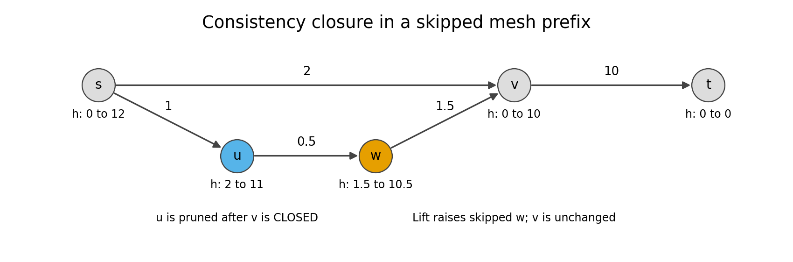
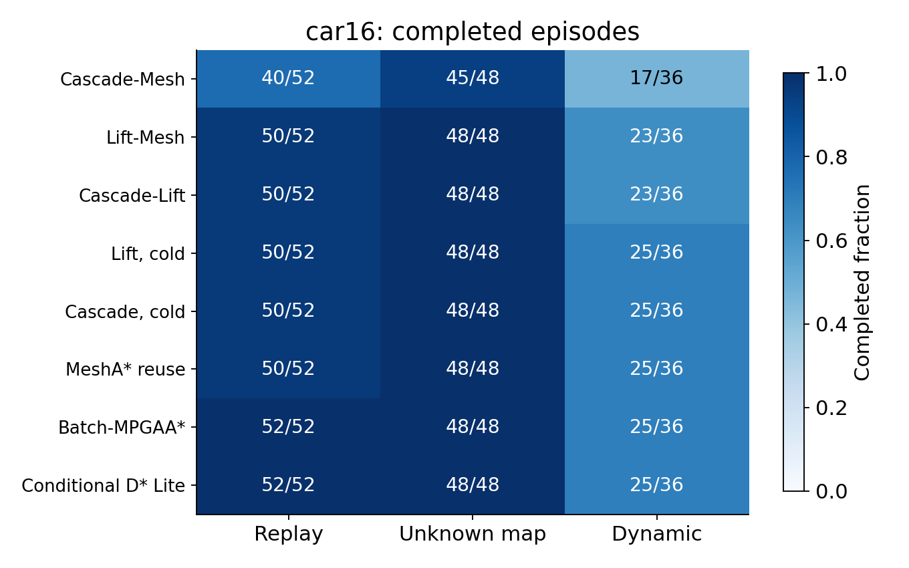
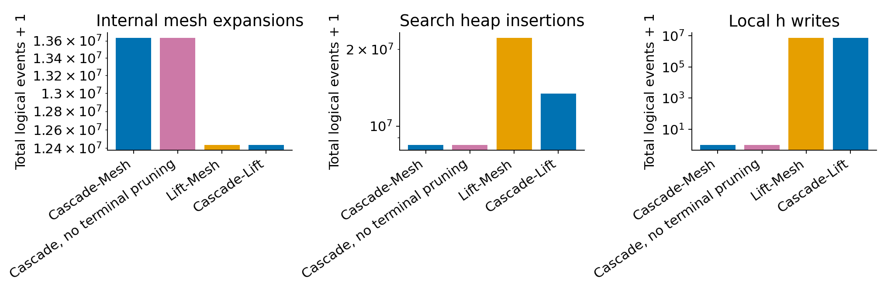
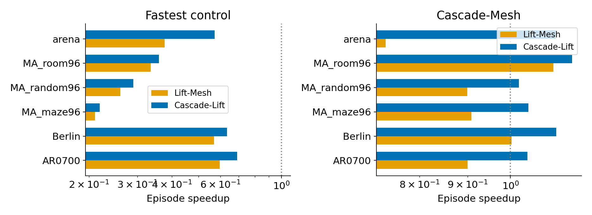
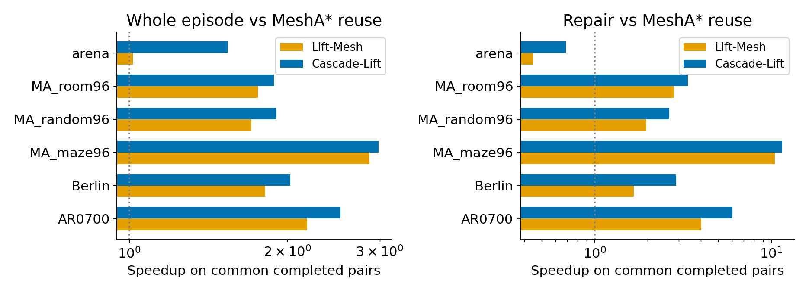

# Abstract

We introduce Lift-Mesh-MPGAA\* and Cascade-Lift, exact incremental planners whose search and learned state live on every configuration of the original motion-primitive mesh. Directly combining MeshA\* terminal-closed pruning with MPGAA\* learning can leave skipped descendants inconsistent. A local directed pathmax closure restores consistency without raising already settled terminal labels. Pathmax itself is known; our contribution hypothesis is this compatibility mechanism, its locality argument and exact incremental opening repair. On the reused balanced 48-case car replay panel, the post hoc selected candidate Cascade-Lift completes 46/48 configurations. Against MeshA\* with suffix reuse it achieves 2.09 episode / 3.24 repair speedup on 46/48 common completed cases; against the same cold contour engine the ratios are 1.26 / 5.56 on 46/48. It remains slower than Batch-MPGAA\* on this panel: 0.70 / 0.91 relative speedup, 46/48 pairs. The frozen second-stage study contains 9,720 timing, 3,240 allocation and 2,316 count-only episodes, with zero completed reference-cost disagreements. The results support incremental mesh reuse but not universal superiority over strong primitive planners.

# Setting and motivation

A vertex is (cell, mesh configuration), including primitive interiors. The original car automaton has 412 configurations and 16 boundary roots; the unchanged 284 motion primitives retain their original IDs, float costs and collision traces. The pre-existing dyadic potential makes mesh arc costs positive and telescopes to zero at boundaries. Initial h at roots is Euclidean; internal h is the minimum primitive completion cost plus endpoint Euclidean distance minus the current potential. No primitive-level A\* runs inside the candidates. Plain mesh-MPGAA and earlier Trigger/Cascade use this full representation, but can explore many prefixes whose terminal states have already been settled.

# Consistent adaptive terminal pruning

An internal vertex u is terminal-closed when every free in-map boundary completion of its current primitive is CLOSED in the current search. Following MeshA\*, such a vertex need not generate outgoing arcs: its valid terminal outcomes have already been settled no more expensively. We still mark u CLOSED. After finding an optimal solution of cost C, the usual adaptive batch sets $h(u)\leftarrow\max(h(u),C-g(u))$ for every CLOSED vertex. Applying this batch without visiting skipped children may violate $h(u)\le c'(u,v)+h(v)$. The generated no-lifting mutant demonstrates this failure on the first test fixture.

Lift propagates $h(v)\leftarrow h(u)-c'(u,v)$ only when this raises a free child's label, using a local stack. Every materialized lifted label is marked learned, including unexpanded vertices. Blocked violations create cell subscriptions in Cascade-Lift. The path policy is installed after closure. A cap installs neither stronger learned labels nor a false NoPath certificate.

**Locality lemma.** Let u be pruned and v a valid boundary completion at reweighted distance d. Since v was settled first under a consistent heuristic, $g(v)\le g(u)+d$. After the adaptive batch, $h_{new}(v)\ge C-g(v)\ge C-g(u)-d$. Therefore v already supports every new adaptive floor propagated from u. If the old h dominates the adaptive floor, its inequalities already held, and raising right labels cannot violate them. Expanded ordinary vertices have children CLOSED or OPEN with f at least C, as in adaptive A\*. Extra propagation is confined to skipped internal regions and cannot raise a boundary root. The implementation asserts this boundary condition. The argument applies to the frozen prefix-configuration mesh with finite internal DAGs; arbitrary quotient meshes are outside its scope.

**Correctness.** Each raise is admissible because $h(u)-c'(u,v)\le d_t(v)$ follows from admissibility and the arc triangle bound. Closure restores every free consistency inequality; raising a right label cannot invalidate unchanged predecessors. Incremental openings repair lowered h through free predecessors, and any newly threatened blocked inequality is subscribed. Thus subsequent A\* starts with admissible consistent h, terminal pruning remains sound, and a validated tight policy can be accepted at an internal vertex. Positive reweighted costs prevent policy cycles, and telescoping preserves original primitive cost. Worst-case repair can still cover a large learned region.

{width=99%}

The implementation initially scans outgoing arcs of every CLOSED vertex; only the additional label raises are confined to skipped regions. If T is the number of inspected arcs over all stack visits, closure costs O(T). A vertex may be lifted repeatedly; the locality lemma is not a linear-time guarantee in the number of map edits. Persistent storage is proportional to materialized records and watches, in addition to the current search frontier.

Opening repair also requires the learned-state invariant $h(u)>base(u) \Rightarrow learned(u)$. An unlearned label equals the initial consistent base and cannot become a violated predecessor when a child decreases but remains above its base. Repair may therefore skip unlearned predecessors. Every lifted label above base must be marked learned; the second mutant below violates this invariant even though its initial free-edge consistency closure was performed.

A deterministic actual-engine fixture demonstrates the incremental consequence. Four boundary headings at one cell represent r,s,v,t; free primitives r-to-s, r-to-v, s-to-v and v-to-t cost 1,2,3,10. The s-to-v primitive has two internal configurations. Initially blocked shortcut primitives v-to-t and s-to-t cost 1 and 5 and have private collision cells. The first query from r costs 12 and prunes the internal prefix after v is CLOSED. Opening both shortcuts and moving the start to s gives optimum 4. The no-closure mutant returns the valid but suboptimal cost 5 because the low skipped label masks the backward repair wave. A second mutant that performs lifting but omits the learned mark also returns 5. Both full algorithms and independent primitive Dijkstra return 4. This is an eight-configuration formal prefix fixture with repeated cells, not an additional kinodynamic benchmark or timing sample.

# Variants and evaluation

Lift uses standard opening-seed scans. Cascade-Lift adds the previous cell-triggered violated-arc subscriptions, local reverse zero-base cascades and an exact-priority forward continuation. Controls include both cold pruning variants, the same engine without pruning, previous Cascade-Mesh, original MeshA\* and MeshA\* with standard suffix reuse, and eight repository incremental comparators. The suffix rule and pathmax are not claimed as new.

Second-stage design after observing 270 aggregate capped calls in the first car replay cohort, before inspecting its aggregate timing comparisons. Full original mesh graph retained. Terminal-closed pruning from MeshA\* is combined with local forward h lifting so adaptive consistency is preserved; naive pruning without lifting is tested by a generated mutant. Shared-core cold controls, a no-pruning ablation, the previous Cascade mesh planner, and all eight strong repository controls are freshly remeasured. SAME232 public configurations:52 car replay(48balanced+4history),96grid,84car navigation(sixmaps,two roots,four radii and three n=k dynamic anchors). No new independent maps or holdout claim; no seconds pooled with stage one. Three randomized serial repeats and one separate allocation pass. No algorithm tuning after this freeze. Pre-timing control amendment: MeshA\* with standard suffix reuse added to avoid a weak cold-only mesh comparator; the preceding draft manifest is retained. Both cold native variants remain in the fastest-control envelope.

The 232 public configurations contain 52 car replay episodes (48 balanced, four history), 96 grid replay episodes and 84 car navigation missions. Navigation uses six maps, two roots, radii 8/16/32/64 and dynamic (k,cr) anchors (2,5%), (8,10%), (32,20%), with n=k and clamped balanced edits. Reused inputs and second-stage design are disclosed; there is no independent holdout. The selected anchors also couple cr to k, so they compare joint regimes rather than isolate a causal change-rate effect. Three serial randomized timing repeats, one allocation pass and one separately compiled all-Grid.free replay pass are kept distinct. Full episode time includes construction and initial search. Replay starts and edits come from one frozen reference agent; on/off-path refers to that reference trajectory, not necessarily to each chosen planner trajectory. Common-completion filtering precedes every paired ratio. Expansions are representation-specific, and prunes, terminal tests and lift work are counted separately.

| Cohort | Model | Candidate | Control | Pairs | Episode × | Repair × |
| --- | --- | --- | --- | --- | --- | --- |
| navigation dynamic | car16 | Cascade-Lift | Batch-MPGAA\* | 23/36 | 0.54 | 0.48 |
| navigation dynamic | car16 | Cascade-Lift | Fastest control | 23/36 | 0.24 | 0.07 |
| navigation dynamic | car16 | Cascade-Lift | Fastest mesh control | 23/36 | 0.40 | 0.10 |
| navigation dynamic | car16 | Cascade-Lift | Cascade-Mesh | 17/36 | 1.09 | 1.03 |
| navigation dynamic | car16 | Cascade-Lift | C-Mesh-D\* Lite | 23/36 | 6.18 | 7.00 |
| navigation dynamic | car16 | Cascade-Lift | Conditional D\* Lite | 23/36 | 1.67 | 2.89 |
| navigation dynamic | car16 | Cascade-Lift | MeshA\* reuse | 23/36 | 0.93 | 0.16 |
| navigation dynamic | car16 | Lift-Mesh | Batch-MPGAA\* | 23/36 | 0.34 | 0.19 |
| navigation dynamic | car16 | Lift-Mesh | Fastest control | 23/36 | 0.15 | 0.03 |
| navigation dynamic | car16 | Lift-Mesh | Fastest mesh control | 23/36 | 0.25 | 0.04 |
| navigation dynamic | car16 | Lift-Mesh | Cascade-Mesh | 17/36 | 0.60 | 0.25 |
| navigation dynamic | car16 | Lift-Mesh | C-Mesh-D\* Lite | 23/36 | 3.86 | 2.82 |
| navigation dynamic | car16 | Lift-Mesh | Conditional D\* Lite | 23/36 | 1.04 | 1.16 |
| navigation dynamic | car16 | Lift-Mesh | MeshA\* reuse | 23/36 | 0.58 | 0.06 |
| navigation unknown | car16 | Cascade-Lift | Batch-MPGAA\* | 48/48 | 0.72 | 1.18 |
| navigation unknown | car16 | Cascade-Lift | Fastest control | 48/48 | 0.52 | 0.55 |
| navigation unknown | car16 | Cascade-Lift | Fastest mesh control | 48/48 | 0.96 | 0.94 |
| navigation unknown | car16 | Cascade-Lift | Cascade-Mesh | 45/48 | 1.10 | 1.07 |
| navigation unknown | car16 | Cascade-Lift | C-Mesh-D\* Lite | 48/48 | 27.35 | 77.80 |
| navigation unknown | car16 | Cascade-Lift | Conditional D\* Lite | 48/48 | 6.52 | 31.05 |
| navigation unknown | car16 | Cascade-Lift | MeshA\* reuse | 48/48 | 1.33 | 0.98 |
| navigation unknown | car16 | Lift-Mesh | Batch-MPGAA\* | 48/48 | 0.68 | 1.13 |
| navigation unknown | car16 | Lift-Mesh | Fastest control | 48/48 | 0.49 | 0.53 |
| navigation unknown | car16 | Lift-Mesh | Fastest mesh control | 48/48 | 0.91 | 0.90 |
| navigation unknown | car16 | Lift-Mesh | Cascade-Mesh | 45/48 | 1.04 | 1.03 |
| navigation unknown | car16 | Lift-Mesh | C-Mesh-D\* Lite | 48/48 | 25.92 | 74.82 |
| navigation unknown | car16 | Lift-Mesh | Conditional D\* Lite | 48/48 | 6.17 | 29.86 |
| navigation unknown | car16 | Lift-Mesh | MeshA\* reuse | 48/48 | 1.26 | 0.94 |
| replay | car16 | Cascade-Lift | Batch-MPGAA\* | 46/48 | 0.70 | 0.91 |
| replay | car16 | Cascade-Lift | Fastest control | 46/48 | 0.41 | 0.30 |
| replay | car16 | Cascade-Lift | Fastest mesh control | 46/48 | 0.77 | 1.04 |
| replay | car16 | Cascade-Lift | Cascade-Mesh | 36/48 | 1.09 | 1.03 |
| replay | car16 | Cascade-Lift | C-Mesh-D\* Lite | 43/48 | 7.48 | 22.98 |
| replay | car16 | Cascade-Lift | Conditional D\* Lite | 46/48 | 2.59 | 10.91 |
| replay | car16 | Cascade-Lift | MeshA\* reuse | 46/48 | 2.09 | 3.24 |
| replay | car16 | Lift-Mesh | Batch-MPGAA\* | 46/48 | 0.60 | 0.66 |
| replay | car16 | Lift-Mesh | Fastest control | 46/48 | 0.36 | 0.22 |
| replay | car16 | Lift-Mesh | Fastest mesh control | 46/48 | 0.66 | 0.75 |
| replay | car16 | Lift-Mesh | Cascade-Mesh | 36/48 | 0.91 | 0.70 |
| replay | car16 | Lift-Mesh | C-Mesh-D\* Lite | 43/48 | 6.40 | 16.35 |
| replay | car16 | Lift-Mesh | Conditional D\* Lite | 46/48 | 2.23 | 7.91 |
| replay | car16 | Lift-Mesh | MeshA\* reuse | 46/48 | 1.80 | 2.35 |
| replay | grid8 | Cascade-Lift | Batch-MPGAA\* | 96/96 | 1.70 | 1.90 |
| replay | grid8 | Cascade-Lift | Fastest control | 96/96 | 0.46 | 0.60 |
| replay | grid8 | Cascade-Lift | Fastest mesh control | 96/96 | 0.71 | 0.69 |
| replay | grid8 | Cascade-Lift | Cascade-Mesh | 96/96 | 1.09 | 1.07 |
| replay | grid8 | Cascade-Lift | C-Mesh-D\* Lite | 96/96 | 4.61 | 2.88 |
| replay | grid8 | Cascade-Lift | Conditional D\* Lite | 96/96 | 1.67 | 1.41 |
| replay | grid8 | Cascade-Lift | MeshA\* reuse | 96/96 | 1.97 | 2.11 |
| replay | grid8 | Lift-Mesh | Batch-MPGAA\* | 96/96 | 1.73 | 1.75 |
| replay | grid8 | Lift-Mesh | Fastest control | 96/96 | 0.47 | 0.56 |
| replay | grid8 | Lift-Mesh | Fastest mesh control | 96/96 | 0.72 | 0.63 |
| replay | grid8 | Lift-Mesh | Cascade-Mesh | 96/96 | 1.11 | 0.99 |
| replay | grid8 | Lift-Mesh | C-Mesh-D\* Lite | 96/96 | 4.68 | 2.66 |
| replay | grid8 | Lift-Mesh | Conditional D\* Lite | 96/96 | 1.70 | 1.30 |
| replay | grid8 | Lift-Mesh | MeshA\* reuse | 96/96 | 1.99 | 1.95 |

| Candidate | First-search control | Solved initial pairs | Initial × |
| --- | --- | --- | --- |
| Cascade-Lift | Cascade, cold | 48/48 | 0.61 |
| Cascade-Lift | Cascade-Mesh | 42/48 | 1.07 |
| Cascade-Lift | Cascade, no terminal pruning | 42/48 | 1.01 |
| Cascade-Lift | MeshA\* reuse | 48/48 | 1.26 |
| Lift-Mesh | Cascade, cold | 48/48 | 0.58 |
| Lift-Mesh | Cascade-Mesh | 42/48 | 1.01 |
| Lift-Mesh | Cascade, no terminal pruning | 42/48 | 0.95 |
| Lift-Mesh | MeshA\* reuse | 48/48 | 1.19 |

This table conditions only on completion of the initial search, including an exact NoPath answer, and retains episodes that later cap during repair. Initial ratios in the episode-level table instead condition on whole-episode completion.

{width=99%}

{width=99%}

{width=99%}

{width=99%}

MeshA\* reuse is an implementation-level comparator: kernel organization can account for part of the speedup. The same-engine cold controls jointly disable adaptive learning, policy reuse and negative caching, so they do not isolate heuristic learning alone. The no-pruning ablation retains those mechanisms. The formal counterexample establishes repair correctness rather than a runtime advantage.

# Evidence, limitations and related work

All five new modes passed 4,810 direct primitive-Dijkstra comparisons and ASan/UBSan on both models. The no-lift mutation triggers an inconsistency after 93 prunes; normal/allocation logical fields match in 63,104 rows, and count-only fields match in 42,292 rows. The full cohort has 207 capped calls, never classified as proof of disconnection. Relative timing MAD has median 2.16% and p95 10.72%. Detailed per-map/radius/change-rate results, path lengths, observed edits, latency, memory and all failures accompany the Russian report.

MeshA\* provides the graph and terminal pruning; MPGAA\* provides learning and policy reuse. Directed pathmax and inconsistency propagation are established techniques (Felner et al., 2011). Our proposed contribution is a consistency closure bounded by settled mesh terminals, enabling this combination with exact opening repair. Fringe Search, partial expansion and lazy incremental planning are related; this limited review does not establish priority. Terminal tests, lifted records and watches may cost more time or memory than they save. Two roots, correlated reused scenarios, cheap occupancy checks, one repository Hermite control set and repository-specific controls limit external validity. A broader independent benchmark and official external implementations are needed before claiming conference-level empirical superiority.

# References

* Agranovskiy and Yakovlev. 2026. *MeshA\*: Efficient Path Planning With Motion
  Primitives\*. AAAI. [DOI](https://doi.org/10.1609/aaai.v40i43.41004).
* Hernández, Asín and Baier. 2015. *Reusing Previously Found A\* Paths for Fast
  Goal-Directed Navigation in Dynamic Terrain\*. AAAI.
  [DOI](https://doi.org/10.1609/aaai.v29i1.9355).
* Koenig and Likhachev. 2002. *D\* Lite\*. AAAI.
* Koenig, Likhachev and Furcy. 2004. *Lifelong Planning A\**. Artificial
  Intelligence. [DOI](https://doi.org/10.1016/j.artint.2003.12.001).
* Björnsson, Enzenberger, Holte and Schaeffer. 2005. *Fringe Search: Beating A\*
  at Pathfinding on Game Maps\*. CIG.
  [Public paper](http://papersdb.cs.ualberta.ca/~papersdb/uploaded_files/424/paper_cig2005.pdf).
* Yoshizumi, Miura and Ishida. 2000. *A\* with Partial Expansion for Large
  Branching Factor Problems\*. AAAI.
  [Paper](https://www.aaai.org/Papers/AAAI/2000/AAAI00-142.pdf).
* Lim, Srinivasa and Tsiotras. 2022. *Lazy Lifelong Planning for Efficient
  Replanning in Graphs with Expensive Edge Evaluation\*. IROS.
  [DOI](https://doi.org/10.1109/IROS47612.2022.9981389).
* Lim, Ghanei, Lawson, Srinivasa and Tsiotras. 2024. *Lazy incremental search
  for efficient replanning with bounded suboptimality guarantees\*. IJRR.
  [DOI](https://doi.org/10.1177/02783649241227869).

* Felner, Zahavi, Holte, Schaeffer, Sturtevant and Zhang. 2011.
  *Inconsistent heuristics in theory and practice\*. Artificial Intelligence.
  [DOI](https://doi.org/10.1016/j.artint.2011.02.001).
