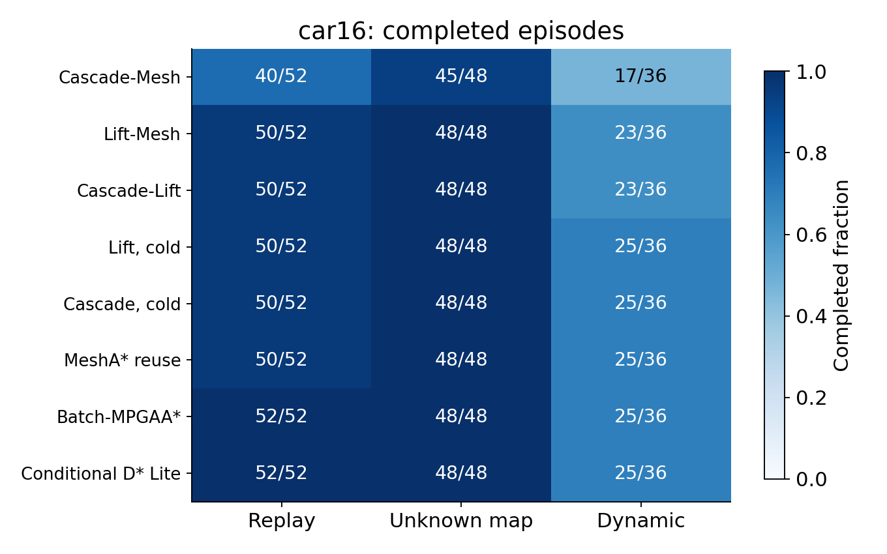
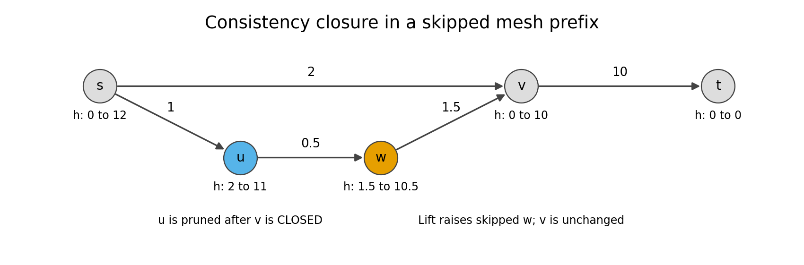
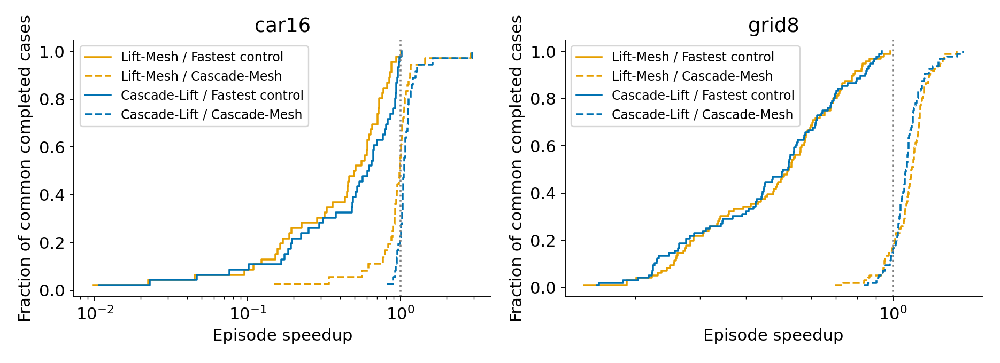
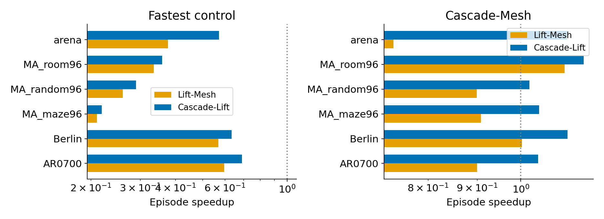
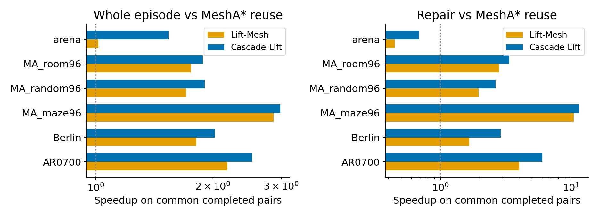
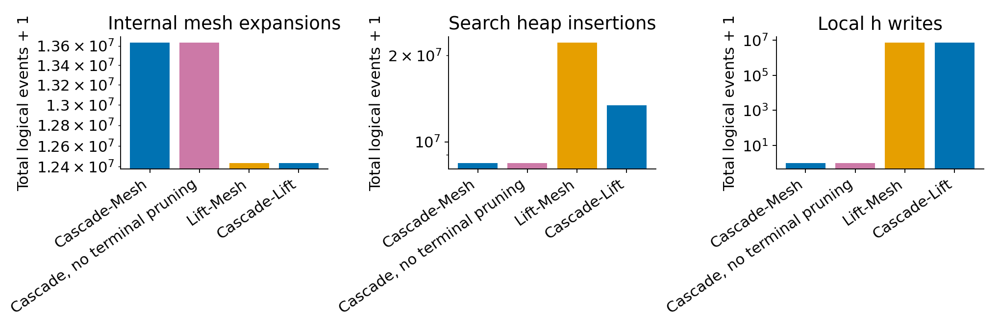
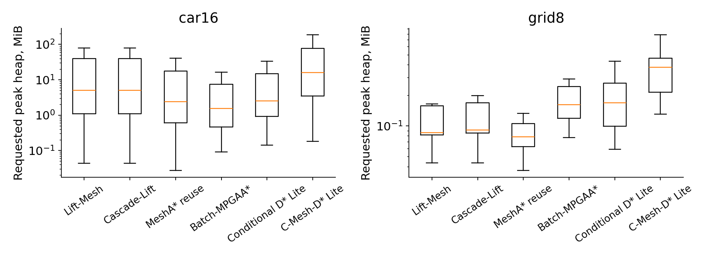
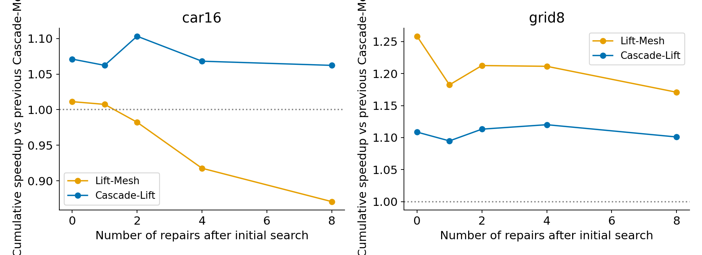
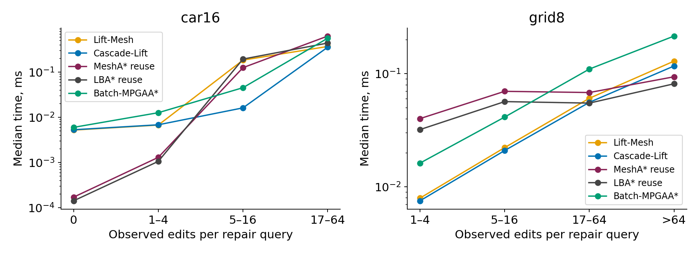
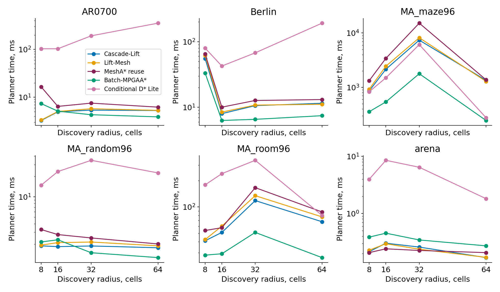

# Результат исследования

Реализованы **Lift-Mesh-MPGAA\*** и **Cascade-Lift-Mesh-MPGAA\***. Поиск, обучение и политики работают на всех вершинах исходного mesh, включая внутренние состояния примитивов. Основная новая идея: совместить терминальное отсечение MeshA\* с MPGAA\* через локальное восстановление согласованности h в пропущенном mesh-DAG. Оператор pathmax известен; предложена его конкретная роль и локальность в этой комбинации.

Новая совместная серия: 232 конфигурации, 9,720 временных эпизодов, 3,240 отдельных эпизодов памяти и 2,316 счётных эпизодов. Завершённые стоимости расходятся с точным эталоном в 0 случаях. Capped-вызовов: 207. По этим данным общего убедительного превосходства над всей огибающей контролей нет. Статья должна опираться на доказательство совместимости и конкретные выигрышные режимы; представлять метод универсальным победителем нельзя.

Из двух кандидатов по завершению, затем полному времени на основной панели выбран **Cascade-Lift** (этот выбор сделан после измерений, результаты обоих сохранены). Он завершает 46/48 основных car16-конфигураций. На общих завершённых парах: к предыдущему Cascade-Mesh **1.09× full / 1.03× repair** (36/48), к быстрейшему mesh-контролю **0.77× / 1.04×** (46/48), ко всем сильным контролям **0.41× / 0.30×** (46/48). Значение выше 1 выгодно кандидату. Условные отношения не заменяют долю завершения.

Прямые mesh-сравнения: Cascade-Lift / MeshA\* reuse — **2.09× full / 3.24× repair**, 46/48 общих пар; к тому же cold-движку с contour — **1.26× / 5.56×**, 46/48. Это показывает пользу полного адаптивного повторного использования в данной реализации. К Batch-MPGAA\* отношение составляет **0.70× / 0.91×**, 46/48; сильный primitive-контроль нельзя исключать из вывода.

Предыдущая серия Trigger/Cascade сохранена отдельно в docs/mesh_vertex. В ней Cascade ускорял ремонт относительно обычного mesh-MPGAA\* в 1,26 раза, но полное время составляло лишь 0,93 от скорости контроля и 12 из 48 основных car-конфигураций достигали лимита. Именно ограничение первого поиска мотивировало второй этап; секунды двух этапов не объединяются.

## Где есть преимущество, а где его нет

Следующий разбор описательно выбран после измерений; все карты, промежуточные отношения и неполные пары приведены ниже, без отбора только победителей.

Lift-Mesh относительно Fastest control. Полный выигрыш от 10%: нет. Выигрыш ремонта от 10%: нет. Полные потери от 10%: AR0700: full 0.60 / repair 0.33 ×, 7/8 пар; Berlin: full 0.57 / repair 0.42 ×, 7/8 пар; MA_maze96: full 0.21 / repair 0.07 ×, 8/8 пар; MA_random96: full 0.26 / repair 0.18 ×, 8/8 пар; MA_room96: full 0.33 / repair 0.25 ×, 8/8 пар; arena: full 0.38 / repair 0.27 ×, 8/8 пар.

Lift-Mesh относительно Fastest mesh control. Полный выигрыш от 10%: MA_maze96: full 1.24 / repair 3.31 ×, 8/8 пар. Выигрыш ремонта от 10%: AR0700: full 0.77 / repair 1.19 ×, 7/8 пар; MA_maze96: full 1.24 / repair 3.31 ×, 8/8 пар. Полные потери от 10%: AR0700: full 0.77 / repair 1.19 ×, 7/8 пар; Berlin: full 0.82 / repair 0.88 ×, 7/8 пар; MA_random96: full 0.33 / repair 0.26 ×, 8/8 пар; MA_room96: full 0.83 / repair 0.73 ×, 8/8 пар; arena: full 0.42 / repair 0.30 ×, 8/8 пар.

Cascade-Lift относительно Fastest control. Полный выигрыш от 10%: нет. Выигрыш ремонта от 10%: нет. Полные потери от 10%: AR0700: full 0.69 / repair 0.50 ×, 7/8 пар; Berlin: full 0.63 / repair 0.73 ×, 7/8 пар; MA_maze96: full 0.22 / repair 0.08 ×, 8/8 пар; MA_random96: full 0.29 / repair 0.24 ×, 8/8 пар; MA_room96: full 0.36 / repair 0.29 ×, 8/8 пар; arena: full 0.57 / repair 0.41 ×, 8/8 пар.

Cascade-Lift относительно Fastest mesh control. Полный выигрыш от 10%: MA_maze96: full 1.29 / repair 3.65 ×, 8/8 пар. Выигрыш ремонта от 10%: AR0700: full 0.89 / repair 1.79 ×, 7/8 пар; Berlin: full 0.92 / repair 1.52 ×, 7/8 пар; MA_maze96: full 1.29 / repair 3.65 ×, 8/8 пар. Полные потери от 10%: AR0700: full 0.89 / repair 1.79 ×, 7/8 пар; MA_random96: full 0.37 / repair 0.35 ×, 8/8 пар; MA_room96: full 0.89 / repair 0.88 ×, 8/8 пар; arena: full 0.64 / repair 0.46 ×, 8/8 пар.

{width=99%}

# Алгоритм, инварианты и доказательство

## Граф и постановка

Поиск идёт на полном исходном конфигурационном mesh: вершина (cell,cfg),
412 конфигураций car16, из которых 16 граничные. OPEN, g, h, CLOSED и политики
включают внутренние конфигурации. Используется прежнее перевзвешивание
$c'(u,v)=c(u,v)+\phi(v)-\phi(u)>0$; между граничными вершинами потенциал
телескопируется, сохраняя исходную стоимость каждого примитива.

Это точный замороженный prefix-автомат репозитория с единственным исходным
primitive-origin для внутренней конфигурации и конечным внутренним DAG.
Универсальность для произвольных quotient-mesh без этого свойства не заявляется.
Карта бинарная; стоимости примитивов фиксированы; цель неизменна, старт движется.

## Проблема

Обычный перенос MPGAA\* хранит h на внутренних mesh-вершинах, но оплачивает
генерацию многих продолжений, которые больше не могут улучшить граничные
состояния. MeshA\* уже умеет отсекать внутреннюю вершину, если все возможные
окончания её текущего примитива закрыты либо недоступны.

Наивно включить это отсечение в Adaptive A\*/MPGAA\* недостаточно. После нахождения
пути стоимости C стандартное обновление $h(u)=\max(h(u),C-g(u))$ поднимает метку
отсечённой вершины, тогда как пропущенный свободный ребёнок остаётся со старой
низкой h. Согласованность $h(u)\le c'(u,v)+h(v)$ нарушается. В следующем поиске
терминальное отсечение уже не может без обоснования опираться на оптимальность
закрытых граничных g.

Это не только теоретический пример: тестовая копия с отключённым подъёмом h
нарушает аудит согласованности на первом seed. Мутант не включён в измеряемые
алгоритмы. Его исходник генерируется отдельно; патч и результат сохранены.

## Терминальное отсечение

При извлечении внутренней u сначала проверяется допустимый tight-суффикс
политики. Если присоединение не найдено, перечисляются шаблонные завершения
текущего примитива. Если каждое свободное граничное окончание уже в CLOSED
текущего поиска, u помечается закрытой без генерации детей.

Такое отсечение известно из MeshA\*, а не предлагается как новая общая идея.
Любой актуальный путь через u должен сначала завершить текущий примитив.
Соответствующая граничная вершина уже имеет оптимальный g; продолжение через
u не улучшит его. Если граничная цель ещё не извлечена, путь к ней этим правилом
не исчезает. Заблокированные/внешние окончания не дают допустимого продолжения.

Закрытые и отсечённые внутренние вершины сохраняют собственные g/h и участвуют
в адаптивном обучении. Не вводится глобальный поиск по primitive-границам.

## Локальный подъём h

После полного положительного ответа:

1. Обновить все обработанные CLOSED, включая отсечённые вершины:
   $h(u)\leftarrow\max(h(u),C-g(u))$.
2. Для каждой поднятой области восстановить свободные неравенства вперёд:
   если $h(v)<h(u)-c'(u,v)$, выполнить
   $h(v)\leftarrow h(u)-c'(u,v)$ и обработать v локальным стеком.
3. Новый внутренний h-рекорд пометить learned, даже если вершина не была
   раскрыта поиском. Для нарушенного заблокированного ребра установить клеточную
   подписку в Trigger-варианте.
4. Установить политику найденного оптимального пути.

Шаг 2 является локальным directed pathmax/consistency closure. Сам оператор
подъёма известен; вклад — ограничение его области пропущенным mesh-DAG и
совместимость терминального отсечения с последующим инкрементальным ремонтом.

## Малый контрпример к наивной комбинации

Рассмотрим уже положительно перевзвешенную схему одного mesh-префикса:
дуги $s\rightarrow v$ стоят 2, $s\rightarrow u$ — 1, $u\rightarrow w$ — 0,5, $w\rightarrow v$ — 1,5, $v\rightarrow t$ — 10.
s,v,t — граничные состояния, u,w — внутренние. Прямой примитив $s\rightarrow v$
стоит 2, а альтернативный $s\rightarrow u\rightarrow w\rightarrow v$ — 3. Начальные согласованные оценки:
h(s)=h(v)=h(t)=0, h(u)=2, h(w)=1,5.

A\* закрывает v с g=2 до u с g=1, поскольку их f равны 2 и 3.
u можно отсечь: единственный терминал v уже CLOSED. Оптимальный ответ C=12.
Наивное адаптивное обновление даёт h(v)=10 и h(u)=11, но пропущенная w
сохраняет h(w)=1,5. Неравенство $u\rightarrow w$ нарушено: 11 > 0,5+1,5.
Lift поднимает h(w) до 10,5; у $w\rightarrow v$ уже выполнено 10,5 $\le$ 1,5+10,
поэтому подъём останавливается до границы. Это самостоятельная численная
иллюстрация; воспроизводимая мутация дополнительно проверена на реальном
замороженном car16-автомате.

## Подоптимальный ответ после освобождений: проверенный C++-контрпример

Есть и более сильный контрпример, проверенный настоящим движком в
repair_counterexample.py. В отдельном формальном mesh корни r,s,v,t
соответствуют четырём направлениям в одной клетке. Открыты примитивы
$r\rightarrow s$ стоимости 1, $r\rightarrow v$ стоимости 2, $s\rightarrow v$ стоимости 3 и $v\rightarrow t$ стоимости 10.
Примитив $s\rightarrow v$ имеет два внутренних состояния u,w. Ещё два примитива,
$v\rightarrow t$ стоимости 1 и $s\rightarrow t$ стоимости 5, сначала заблокированы в собственных
промежуточных collision-клетках.

Первый запрос из r даёт оптимум 12. Терминал v закрывается раньше u,
поэтому u отсекается. Корень s получает h=11, а нераскрытая w без closure
остаётся на исходной низкой оценке. Затем оба коротких примитива открываются
и старт переносится в s. Новый оптимум равен 3+1=4. Обратный ремонт v
не проходит через низкую невыученную w; прямое открытие $s\rightarrow t$ снижает h(s)
лишь до 5. Наивная комбинация возвращает допустимый, но подоптимальный путь 5.

Полные Lift и Cascade-Lift возвращают 4, как независимый primitive Dijkstra.
Два отдельных мутанта возвращают 5: без closure и с closure, но без
пометки новых меток как learned. Таким образом важны и подъём, и участие
поднятых без поиска узлов в дальнейшем opening repair.

Это формальный fixture с повторными клетками, не кинематический car16-набор.
Он проверяет корректность C++-операций на восьми конфигурациях и не добавляется
к временным бенчмаркам или числу независимых карт. Исходный измеряемый
заголовок не меняется; оба мутанта создаются только в build.

## Почему подъём локален и безопасен

Пусть u была отсечена с найденным путём от старта стоимости g(u), а v —
граничное окончание допустимого mesh-продолжения u...v стоимости d.
v была закрыта ранее, поэтому

$$g(v)\le g(u)+d.$$

После адаптивного обновления

$$h_{\mathrm{new}}(v)\ge C-g(v)\ge C-g(u)-d.$$

Следовательно, требуемый подъём, начинающийся с C-g(u), уже поддержан
терминальной меткой. Если старое h(u) выше C-g(u), его неравенства уже были согласованы до пакета; подъёмы правых частей их не нарушают. Он заканчивается до граничного состояния. Если окончание
заблокировано, соответствующее неравенство не требуется. В реализации есть
проверка: подъём не должен пытаться изменить граничную вершину.

Для обычного раскрытого u свободный ребёнок либо также CLOSED, либо остался
в OPEN с ключом не меньше C. Его метка уже достаточна для стандартного
адаптивного обновления. Дополнительная работа нужна именно в пропущенных частях.
Внутренний DAG конечен; глобальный поиск при подъёме не запускается.

Допустимость тоже сохраняется: если h(u) допустима, то
$h(u)-c'(u,v)\le d_t(v)$ для свободного ребра. Каждый подъём ребёнка остаётся
нижней оценкой. После достижения неподвижной точки все свободные неравенства
восстановлены; у неизменённых предшественников правые части только выросли.

Таким образом следующий A\* начинает с согласованной допустимой h. Принятие
tight-политики, терминальное отсечение и стандартное адаптивное обучение
снова применимы. Политика устанавливается после подъёма; на найденном пути h
равна точной оставшейся стоимости.

## Стоимость реализации

Текущий стек начинается со всех CLOSED: проверяются и исходящие дуги
обычно раскрытых узлов. Доказанная локальность относится к дополнительным
подъёмам меток, а не ко всем проверкам. Если T — число просмотренных
исходящих дуг во всех обработках стека, closure требует O(T) времени;
один внутренний узел может получить несколько подъёмов. Постоянные метки
и подписки занимают O(records+watches) памяти, помимо OPEN/CLOSED запроса.
Это не линейная по числу правок оценка и не асимптотическое превосходство.
Счётчики lift_edges и lift_writes показывают фактическую цену.

## Инкрементальные освобождения

Поддерживается дополнительный инвариант: если h(u)>base(u), то
learned(u)=true. У остальных метка равна исходной согласованной base.
Поэтому обратный ремонт может безопасно не перечислять невыученных
предшественников: их base не больше c'+base ребёнка и тем более c'+h ребёнка.
Подъём без learned-пометки нарушает именно это условие, даже если свободные
неравенства h после первого поиска согласованы.

Поднятые без поиска вершины тоже являются learned: понижение их правой части
может потребовать ремонта. Простой Lift использует обычное перечисление
геометрических opening-seeds. Cascade-Lift применяет клеточную границу
нарушенных заблокированных неравенств, обратные каскады и прямой contour
из предыдущего этапа. Локальный подъём регистрирует новые угрозы при создании
меток; старые избыточные подписки безопасны.

Все наблюдаемые изменения немедленно применяются к карте. Capped-поиск не
повышает h, не устанавливает новую политику и не выдаёт NoPath-сертификат.
Повтор отрицательного ответа допускается при том же старте и отсутствии
освобождений. Статусы cap и доказанного NoPath различаются.

## Контроли и ограничения

Сравниваются Lift, Cascade-Lift, тот же движок без терминального отсечения,
два cold-варианта с отсечением, прежний native Cascade и сильные самостоятельные
контроли. Добавлен MeshA\* с обычным suffix reuse, чтобы не ограничивать сравнение
со слишком слабым cold-only MeshA\*.

Отсечённый узел учитывается отдельно от раскрытия исходящих рёбер. Проверки
окончаний, heap/local operations, lift-writes и память измеряются, а не скрываются
в уменьшенном числе expansions. Один и тот же лимит раскрытий не означает
одинаковую CPU-операцию у primitive и mesh-представлений.

Подъём может материализовать много внутренних меток и расходовать память;
терминальные тесты сами читают карту. Если окончания редко закрываются раньше
префикса, дополнительная работа может не окупиться. Большие изменения всё ещё
могут требовать большого ремонта. Нет обещания универсального ускорения или
первенства в литературе; результат должен подтверждаться общими завершёнными
парами, долей достижений цели и абляциями.


```text
Replan(start, blocks, openings):
  apply changes; repair lowered h through newly free arcs
  A* on (cell, mesh configuration):
    accept a validated tight policy to goal, if available
    if every free terminal of an internal node is CLOSED:
      mark this node CLOSED; skip its outgoing expansion
    else expand its free mesh arcs
  on successful solution of cost C:
    for u in CLOSED: h[u] = max(h[u], C - g[u])
    locally lift free descendants to h[u] - cost(u,v)
    record lifted labels as learned; install policy
```

| Метод | Назначение |
| --- | --- |
| Lift-Mesh | Терминальное отсечение + локальный подъём; обычный opening scan |
| Cascade-Lift | Lift + подписки на нарушенные заблокированные неравенства и каскады |
| Lift cold | То же отсечение без обучения, политики и отрицательного кеша |
| Cascade cold | Cold + точное продолжение контура без операций OPEN |
| No-prune | Cascade-Lift без терминального отсечения; контроль на том же новом движке |
| Cascade-Mesh | Предыдущий полный mesh-MPGAA без терминального отсечения |
| MeshA\* reuse | Исходный MeshA\* + стандартный оптимальный суффикс; сильный контроль без заявления новизны |

Тесты: **4 810** сравнений с прямым primitive Dijkstra, 12 seed-карт на модель и по 40 последовательных запросов, включая блокированные концы, дубликаты правок, движущийся старт и восстановление после cap. ASan/UBSan прошли для grid8 и car16. Аудируются все свободные неравенства h и полнота подписок. В car16-тестах 676 834 терминальных отсечения и 22 422 локальных записи h. Контрольная мутация с отключённым подъёмом воспроизводит несогласованность на seed=0 после 93 отсечений; исходный код не содержит публичного небезопасного режима. В измеренных вызовах счётчики подтверждают 87,286,228 отсечений и 39,677,366 подъёмов (один временной повтор).

{width=99%}

Дополнительный детерминированный тест настоящего C++-движка проверяет уже оптимальность после освобождений: primitive Dijkstra, Lift и Cascade-Lift дают стоимость 4; копии без closure либо без learned-пометки поднятых узлов возвращают допустимый, но подоптимальный путь 5. Это отдельный формальный восьмиконфигурационный fixture с повторными клетками, не car16-бенчмарк и не временной результат. Его исходник, хеши и результат сохранены в repair_counterexample.py и validation/repair_counterexample.json.

# Протокол и сравнимость

Second-stage design after observing 270 aggregate capped calls in the first car replay cohort, before inspecting its aggregate timing comparisons. Full original mesh graph retained. Terminal-closed pruning from MeshA\* is combined with local forward h lifting so adaptive consistency is preserved; naive pruning without lifting is tested by a generated mutant. Shared-core cold controls, a no-pruning ablation, the previous Cascade mesh planner, and all eight strong repository controls are freshly remeasured. SAME232 public configurations:52 car replay(48balanced+4history),96grid,84car navigation(sixmaps,two roots,four radii and three n=k dynamic anchors). No new independent maps or holdout claim; no seconds pooled with stage one. Three randomized serial repeats and one separate allocation pass. No algorithm tuning after this freeze. Pre-timing control amendment: MeshA\* with standard suffix reuse added to avoid a weak cold-only mesh comparator; the preceding draft manifest is retained. Both cold native variants remain in the fastest-control envelope.

Replay: шесть car16-карт Berlin, AR0700, arena, MA_maze96, MA_room96, MA_random96, по два старта/цели и четыре семейства: блокировки на пути, вне пути, mixed edits, unknown discovery. Старт и правки в replay задаёт один контрольный агент; «на пути/вне пути» относится к его трассе, а другой метод может выбрать равностоимостный маршрут. Попадание в контрольную трассу не обязательно повышает оптимальную стоимость. Это 48 основных конфигураций плюс четыре history отдельно. Grid8: 96 random50-конфигураций четырёх плотностей, отрицательный контроль пользы длинного mesh. Навигация: все шесть car-карт, два корня, радиусы раскрытия 8,16,32,64 и три динамические точки (k,cr)=(2,5%),(8,10%),(32,20%); n=k. Это повтор выбранных существующих открытых спецификаций, без новых независимых карт и без holdout.

При dynamic cr/2 процентов клеток блокируются и столько же исходно заблокированных освобождаются. Число правок ограничивается доступными клетками; фактический cr выводится ниже. Один move — примитив. Static radius — квадратная клеточная окрестность; dynamic n — глубина primitive-решётки без окклюзии. Связь n=k не позволяет разделить эффект обзора и частоты; в выбранных anchors cr тоже меняется вместе с k, поэтому сравниваются совместные режимы, а не отдельный причинный эффект cr. Разные равностоимостные траектории меняют наблюдения и последующие динамические миры: replay обеспечивает более строгое сравнение одинаковых входов.

Во втором этапе заново измерены пять новых вариантов, предыдущий native Cascade, LBA reuse, MeshA\*, MeshA\* reuse, primitive MPGAA\*, Batch-MPGAA\*, MD-A\*, Boundary-Mesh, Conditional D\* Lite, C-Mesh-D\* Lite и grid Octile reuse. Навигация использует 11 методов из манифеста; отсутствующие контроли не подставляются из прежних замеров. Реализации контролей принадлежат этому репозиторию, не официальным внешним пакетам.

Car16: 284 неизменённых Hermite-примитива, 412 конфигураций, из них 16 граничных; отдельный старый boundary forest имеет 572 узла и не является графом нового поиска. Grid8: восемь одноклеточных переходов. Оригинальные float-стоимости, ID и клеточные трассы одинаковы. Уже существующий dyadic potential делает mesh-дуги положительными; на границах потенциал нулевой. Это не официальный оптимизированный control set MeshA\*.

CPU: AMD EPYC 9V74 80-Core Processor; affinity [0, 1, 2]; один измерительный процесс. Три последовательных повтора со случайным порядком, отдельно один allocation pass. Полное время включает конструктор и первый поиск; repair исключает их. Общее построение шаблонов исключено одинаково для методов и сохранено в JSON. Cap: 1,000,000 раскрытий на запрос; prunes измеряются отдельно, лимит раскрытий не является CPU-бюджетом. Peak — запрошенные байты C++ new, не RSS. Медиана относительного MAD: 2.16%, p95: 10.72%. Три повтора не являются независимыми задачами.

Времена агрегируются медианой внутри конфигурации и геометрическим средним парных отношений между конфигурациями. best_control и best_mesh выбираются post hoc по полному времени только завершившихся контролей; их repair-отношение относится к тому же выбранному методу. NoPath — успешный точный ответ replay, но прекращение навигационной миссии. Незавершённые пары исключаются из отношений и остаются в таблицах completion/caps.

Сравнение с MeshA\* reuse относится к двум готовым реализациям: часть ускорения может быть связана с организацией C++-движка. Cold-контроли на том же движке одновременно убирают обучение, policy reuse и отрицательный кеш; они не изолируют одно только обучение h. No-prune сохраняет эти механизмы и отделяет эффект отсечения с closure. Формальный контрпример проверяет корректность ремонта, а не его скорость.

# Основная replay-панель и абляции

| Модель | Метод | Контроль | Пары | Full × | Init × | Repair × | Heap new/base |
| --- | --- | --- | --- | --- | --- | --- | --- |
| car16 | Cascade-Lift | Batch-MPGAA\* | 46/48 | 0.70 | 0.69 | 0.91 | 2.91 |
| car16 | Cascade-Lift | Fastest control | 46/48 | 0.41 | 0.55 | 0.30 | 4.24 |
| car16 | Cascade-Lift | Fastest mesh control | 46/48 | 0.77 | 0.89 | 1.04 | 1.44 |
| car16 | Cascade-Lift | Boundary-Mesh | 46/48 | 7.10 | 5.19 | 18.82 | 1.83 |
| car16 | Cascade-Lift | Cascade, cold | 46/48 | 1.26 | 0.61 | 5.56 | 1.20 |
| car16 | Cascade-Lift | Cascade-Mesh | 36/48 | 1.09 | 1.06 | 1.03 | 0.92 |
| car16 | Cascade-Lift | C-Mesh-D\* Lite | 43/48 | 7.48 | 4.99 | 22.98 | 0.60 |
| car16 | Cascade-Lift | Conditional D\* Lite | 46/48 | 2.59 | 1.07 | 10.91 | 1.87 |
| car16 | Cascade-Lift | LBA\* reuse | 46/48 | 0.64 | 0.51 | 0.53 | 4.65 |
| car16 | Cascade-Lift | Lift, cold | 46/48 | 1.42 | 0.64 | 6.47 | 1.20 |
| car16 | Cascade-Lift | Lift-Mesh | 46/48 | 1.16 | 1.05 | 1.38 | 1.00 |
| car16 | Cascade-Lift | Cascade, no terminal pruning | 36/48 | 1.02 | 1.00 | 0.98 | 0.92 |
| car16 | Cascade-Lift | MD-A\* | 46/48 | 1.05 | 0.88 | 0.99 | 1.99 |
| car16 | Cascade-Lift | MeshA\* | 46/48 | 3.54 | 1.29 | 17.17 | 2.02 |
| car16 | Cascade-Lift | MeshA\* reuse | 46/48 | 2.09 | 1.26 | 3.24 | 2.01 |
| car16 | Cascade-Lift | MPGAA\* | 46/48 | 1.22 | 0.86 | 2.97 | 2.06 |
| car16 | Lift-Mesh | Batch-MPGAA\* | 46/48 | 0.60 | 0.66 | 0.66 | 2.91 |
| car16 | Lift-Mesh | Fastest control | 46/48 | 0.36 | 0.52 | 0.22 | 4.23 |
| car16 | Lift-Mesh | Fastest mesh control | 46/48 | 0.66 | 0.85 | 0.75 | 1.44 |
| car16 | Lift-Mesh | Boundary-Mesh | 46/48 | 6.11 | 4.93 | 13.64 | 1.83 |
| car16 | Lift-Mesh | Cascade, cold | 46/48 | 1.09 | 0.58 | 4.03 | 1.20 |
| car16 | Lift-Mesh | Cascade-Lift | 46/48 | 0.86 | 0.95 | 0.72 | 1.00 |
| car16 | Lift-Mesh | Cascade-Mesh | 36/48 | 0.91 | 1.00 | 0.70 | 0.92 |
| car16 | Lift-Mesh | C-Mesh-D\* Lite | 43/48 | 6.40 | 4.75 | 16.35 | 0.60 |
| car16 | Lift-Mesh | Conditional D\* Lite | 46/48 | 2.23 | 1.02 | 7.91 | 1.87 |
| car16 | Lift-Mesh | LBA\* reuse | 46/48 | 0.55 | 0.49 | 0.38 | 4.65 |
| car16 | Lift-Mesh | Lift, cold | 46/48 | 1.22 | 0.60 | 4.69 | 1.20 |
| car16 | Lift-Mesh | Cascade, no terminal pruning | 36/48 | 0.85 | 0.95 | 0.67 | 0.92 |
| car16 | Lift-Mesh | MD-A\* | 46/48 | 0.91 | 0.84 | 0.72 | 1.99 |
| car16 | Lift-Mesh | MeshA\* | 46/48 | 3.05 | 1.23 | 12.44 | 2.02 |
| car16 | Lift-Mesh | MeshA\* reuse | 46/48 | 1.80 | 1.20 | 2.35 | 2.01 |
| car16 | Lift-Mesh | MPGAA\* | 46/48 | 1.05 | 0.82 | 2.15 | 2.06 |
| grid8 | Cascade-Lift | Batch-MPGAA\* | 96/96 | 1.70 | 1.47 | 1.90 | 0.75 |
| grid8 | Cascade-Lift | Fastest control | 96/96 | 0.46 | 0.24 | 0.60 | 1.97 |
| grid8 | Cascade-Lift | Fastest mesh control | 96/96 | 0.71 | 0.62 | 0.69 | 1.06 |
| grid8 | Cascade-Lift | Boundary-Mesh | 96/96 | 3.10 | 4.45 | 1.97 | 0.78 |
| grid8 | Cascade-Lift | Cascade, cold | 96/96 | 0.81 | 0.48 | 0.90 | 1.09 |
| grid8 | Cascade-Lift | Cascade-Mesh | 96/96 | 1.09 | 1.11 | 1.07 | 1.00 |
| grid8 | Cascade-Lift | C-Mesh-D\* Lite | 96/96 | 4.61 | 6.63 | 2.88 | 0.35 |
| grid8 | Cascade-Lift | Conditional D\* Lite | 96/96 | 1.67 | 1.91 | 1.41 | 0.69 |
| grid8 | Cascade-Lift | LBA\* reuse | 96/96 | 1.65 | 0.97 | 1.79 | 1.54 |
| grid8 | Cascade-Lift | Lift, cold | 96/96 | 0.81 | 0.49 | 0.91 | 1.09 |
| grid8 | Cascade-Lift | Lift-Mesh | 96/96 | 0.99 | 0.88 | 1.08 | 1.06 |
| grid8 | Cascade-Lift | Cascade, no terminal pruning | 96/96 | 1.00 | 1.00 | 0.99 | 1.00 |
| grid8 | Cascade-Lift | MD-A\* | 96/96 | 1.71 | 1.61 | 1.35 | 0.61 |
| grid8 | Cascade-Lift | MeshA\* | 96/96 | 2.21 | 1.17 | 2.40 | 1.54 |
| grid8 | Cascade-Lift | MeshA\* reuse | 96/96 | 1.97 | 1.17 | 2.11 | 1.51 |
| grid8 | Cascade-Lift | MPGAA\* | 96/96 | 1.82 | 1.60 | 2.01 | 0.64 |
| grid8 | Cascade-Lift | Octile reuse | 96/96 | 0.46 | 0.24 | 0.61 | 1.97 |
| grid8 | Lift-Mesh | Batch-MPGAA\* | 96/96 | 1.73 | 1.67 | 1.75 | 0.71 |
| grid8 | Lift-Mesh | Fastest control | 96/96 | 0.47 | 0.27 | 0.56 | 1.86 |
| grid8 | Lift-Mesh | Fastest mesh control | 96/96 | 0.72 | 0.71 | 0.63 | 1.01 |
| grid8 | Lift-Mesh | Boundary-Mesh | 96/96 | 3.15 | 5.05 | 1.81 | 0.74 |
| grid8 | Lift-Mesh | Cascade, cold | 96/96 | 0.82 | 0.55 | 0.83 | 1.03 |
| grid8 | Lift-Mesh | Cascade-Lift | 96/96 | 1.02 | 1.14 | 0.92 | 0.95 |
| grid8 | Lift-Mesh | Cascade-Mesh | 96/96 | 1.11 | 1.26 | 0.99 | 0.95 |
| grid8 | Lift-Mesh | C-Mesh-D\* Lite | 96/96 | 4.68 | 7.53 | 2.66 | 0.33 |
| grid8 | Lift-Mesh | Conditional D\* Lite | 96/96 | 1.70 | 2.17 | 1.30 | 0.65 |
| grid8 | Lift-Mesh | LBA\* reuse | 96/96 | 1.67 | 1.11 | 1.65 | 1.46 |
| grid8 | Lift-Mesh | Lift, cold | 96/96 | 0.83 | 0.55 | 0.84 | 1.03 |
| grid8 | Lift-Mesh | Cascade, no terminal pruning | 96/96 | 1.01 | 1.13 | 0.91 | 0.95 |
| grid8 | Lift-Mesh | MD-A\* | 96/96 | 1.74 | 1.83 | 1.24 | 0.58 |
| grid8 | Lift-Mesh | MeshA\* | 96/96 | 2.24 | 1.33 | 2.22 | 1.46 |
| grid8 | Lift-Mesh | MeshA\* reuse | 96/96 | 1.99 | 1.33 | 1.95 | 1.43 |
| grid8 | Lift-Mesh | MPGAA\* | 96/96 | 1.85 | 1.82 | 1.85 | 0.61 |
| grid8 | Lift-Mesh | Octile reuse | 96/96 | 0.47 | 0.27 | 0.56 | 1.87 |

## Первый поиск отдельно от последующих ремонтов

| Модель | Метод | Контроль | Завершённых первых пар | Init × |
| --- | --- | --- | --- | --- |
| car16 | Cascade-Lift | Cascade, cold | 48/48 | 0.61 |
| car16 | Cascade-Lift | Cascade-Mesh | 42/48 | 1.07 |
| car16 | Cascade-Lift | Lift, cold | 48/48 | 0.64 |
| car16 | Cascade-Lift | Cascade, no terminal pruning | 42/48 | 1.01 |
| car16 | Cascade-Lift | MeshA\* reuse | 48/48 | 1.26 |
| car16 | Lift-Mesh | Cascade, cold | 48/48 | 0.58 |
| car16 | Lift-Mesh | Cascade-Mesh | 42/48 | 1.01 |
| car16 | Lift-Mesh | Lift, cold | 48/48 | 0.61 |
| car16 | Lift-Mesh | Cascade, no terminal pruning | 42/48 | 0.95 |
| car16 | Lift-Mesh | MeshA\* reuse | 48/48 | 1.19 |
| grid8 | Cascade-Lift | Cascade, cold | 96/96 | 0.48 |
| grid8 | Cascade-Lift | Cascade-Mesh | 96/96 | 1.11 |
| grid8 | Cascade-Lift | Lift, cold | 96/96 | 0.49 |
| grid8 | Cascade-Lift | Cascade, no terminal pruning | 96/96 | 1.00 |
| grid8 | Cascade-Lift | MeshA\* reuse | 96/96 | 1.17 |
| grid8 | Lift-Mesh | Cascade, cold | 96/96 | 0.55 |
| grid8 | Lift-Mesh | Cascade-Mesh | 96/96 | 1.26 |
| grid8 | Lift-Mesh | Lift, cold | 96/96 | 0.55 |
| grid8 | Lift-Mesh | Cascade, no terminal pruning | 96/96 | 1.13 |
| grid8 | Lift-Mesh | MeshA\* reuse | 96/96 | 1.33 |

Эта таблица требует завершения только первого поиска: эпизод с поздним cap здесь сохраняется. Init в общей таблице выше условен на завершении всего эпизода. В обоих случаях конструктор включён; точный первый NoPath считается завершённым ответом.

{width=99%}

{width=99%}

{width=99%}

## По каждой карте и семейству

| Cohort | Модель | Панель | Карта | Метод | Контроль | Пары | Full × | Repair × |
| --- | --- | --- | --- | --- | --- | --- | --- | --- |
| navigation dynamic | car16 | navigation | AR0700 | Cascade-Lift | Fastest control | 2/6 | 0.54 | 0.99 |
| navigation dynamic | car16 | navigation | AR0700 | Cascade-Lift | Fastest mesh control | 2/6 | 0.77 | 0.99 |
| navigation dynamic | car16 | navigation | AR0700 | Cascade-Lift | Cascade-Mesh | 2/6 | 1.04 | 0.99 |
| navigation dynamic | car16 | navigation | AR0700 | Lift-Mesh | Fastest control | 2/6 | 0.19 | 0.08 |
| navigation dynamic | car16 | navigation | AR0700 | Lift-Mesh | Fastest mesh control | 2/6 | 0.27 | 0.08 |
| navigation dynamic | car16 | navigation | AR0700 | Lift-Mesh | Cascade-Mesh | 2/6 | 0.36 | 0.08 |
| navigation dynamic | car16 | navigation | Berlin | Cascade-Lift | Fastest control | 2/6 | 0.43 | 0.41 |
| navigation dynamic | car16 | navigation | Berlin | Cascade-Lift | Fastest mesh control | 2/6 | 0.55 | 0.30 |
| navigation dynamic | car16 | navigation | Berlin | Cascade-Lift | Cascade-Mesh | 2/6 | 1.13 | 1.10 |
| navigation dynamic | car16 | navigation | Berlin | Lift-Mesh | Fastest control | 2/6 | 0.28 | 0.08 |
| navigation dynamic | car16 | navigation | Berlin | Lift-Mesh | Fastest mesh control | 2/6 | 0.36 | 0.06 |
| navigation dynamic | car16 | navigation | Berlin | Lift-Mesh | Cascade-Mesh | 2/6 | 0.73 | 0.23 |
| navigation dynamic | car16 | navigation | MA maze96 | Cascade-Lift | Fastest control | 6/6 | 0.03 | 0.00 |
| navigation dynamic | car16 | navigation | MA maze96 | Cascade-Lift | Fastest mesh control | 6/6 | 0.11 | 0.01 |
| navigation dynamic | car16 | navigation | MA maze96 | Cascade-Lift | Cascade-Mesh | 0/6 | — | — |
| navigation dynamic | car16 | navigation | MA maze96 | Lift-Mesh | Fastest control | 6/6 | 0.03 | 0.00 |
| navigation dynamic | car16 | navigation | MA maze96 | Lift-Mesh | Fastest mesh control | 6/6 | 0.10 | 0.01 |
| navigation dynamic | car16 | navigation | MA maze96 | Lift-Mesh | Cascade-Mesh | 0/6 | — | — |
| navigation dynamic | car16 | navigation | MA random96 | Cascade-Lift | Fastest control | 5/6 | 0.69 | 0.79 |
| navigation dynamic | car16 | navigation | MA random96 | Cascade-Lift | Fastest mesh control | 5/6 | 0.72 | 0.79 |
| navigation dynamic | car16 | navigation | MA random96 | Cascade-Lift | Cascade-Mesh | 5/6 | 1.02 | 1.00 |
| navigation dynamic | car16 | navigation | MA random96 | Lift-Mesh | Fastest control | 5/6 | 0.30 | 0.14 |
| navigation dynamic | car16 | navigation | MA random96 | Lift-Mesh | Fastest mesh control | 5/6 | 0.32 | 0.14 |
| navigation dynamic | car16 | navigation | MA random96 | Lift-Mesh | Cascade-Mesh | 5/6 | 0.45 | 0.17 |
| navigation dynamic | car16 | navigation | MA room96 | Cascade-Lift | Fastest control | 4/6 | 0.22 | 0.10 |
| navigation dynamic | car16 | navigation | MA room96 | Cascade-Lift | Fastest mesh control | 4/6 | 0.38 | 0.11 |
| navigation dynamic | car16 | navigation | MA room96 | Cascade-Lift | Cascade-Mesh | 4/6 | 1.27 | 1.11 |
| navigation dynamic | car16 | navigation | MA room96 | Lift-Mesh | Fastest control | 4/6 | 0.19 | 0.06 |
| navigation dynamic | car16 | navigation | MA room96 | Lift-Mesh | Fastest mesh control | 4/6 | 0.32 | 0.07 |
| navigation dynamic | car16 | navigation | MA room96 | Lift-Mesh | Cascade-Mesh | 4/6 | 1.09 | 0.68 |
| navigation dynamic | car16 | navigation | arena | Cascade-Lift | Fastest control | 4/6 | 0.81 | 0.85 |
| navigation dynamic | car16 | navigation | arena | Cascade-Lift | Fastest mesh control | 4/6 | 0.81 | 0.85 |
| navigation dynamic | car16 | navigation | arena | Cascade-Lift | Cascade-Mesh | 4/6 | 1.01 | 0.99 |
| navigation dynamic | car16 | navigation | arena | Lift-Mesh | Fastest control | 4/6 | 0.43 | 0.24 |
| navigation dynamic | car16 | navigation | arena | Lift-Mesh | Fastest mesh control | 4/6 | 0.43 | 0.24 |
| navigation dynamic | car16 | navigation | arena | Lift-Mesh | Cascade-Mesh | 4/6 | 0.54 | 0.28 |
| navigation unknown | car16 | navigation | AR0700 | Cascade-Lift | Fastest control | 8/8 | 0.72 | 1.00 |
| navigation unknown | car16 | navigation | AR0700 | Cascade-Lift | Fastest mesh control | 8/8 | 1.07 | 1.07 |
| navigation unknown | car16 | navigation | AR0700 | Cascade-Lift | Cascade-Mesh | 8/8 | 1.08 | 1.06 |
| navigation unknown | car16 | navigation | AR0700 | Lift-Mesh | Fastest control | 8/8 | 0.70 | 0.96 |
| navigation unknown | car16 | navigation | AR0700 | Lift-Mesh | Fastest mesh control | 8/8 | 1.05 | 1.03 |
| navigation unknown | car16 | navigation | AR0700 | Lift-Mesh | Cascade-Mesh | 8/8 | 1.05 | 1.02 |
| navigation unknown | car16 | navigation | Berlin | Cascade-Lift | Fastest control | 8/8 | 0.49 | 0.57 |
| navigation unknown | car16 | navigation | Berlin | Cascade-Lift | Fastest mesh control | 8/8 | 0.95 | 1.50 |
| navigation unknown | car16 | navigation | Berlin | Cascade-Lift | Cascade-Mesh | 8/8 | 1.14 | 1.03 |
| navigation unknown | car16 | navigation | Berlin | Lift-Mesh | Fastest control | 8/8 | 0.47 | 0.57 |
| navigation unknown | car16 | navigation | Berlin | Lift-Mesh | Fastest mesh control | 8/8 | 0.92 | 1.52 |
| navigation unknown | car16 | navigation | Berlin | Lift-Mesh | Cascade-Mesh | 8/8 | 1.10 | 1.04 |
| navigation unknown | car16 | navigation | MA maze96 | Cascade-Lift | Fastest control | 8/8 | 0.22 | 0.26 |
| navigation unknown | car16 | navigation | MA maze96 | Cascade-Lift | Fastest mesh control | 8/8 | 0.86 | 0.77 |
| navigation unknown | car16 | navigation | MA maze96 | Cascade-Lift | Cascade-Mesh | 5/8 | 1.30 | 1.30 |
| navigation unknown | car16 | navigation | MA maze96 | Lift-Mesh | Fastest control | 8/8 | 0.20 | 0.24 |
| navigation unknown | car16 | navigation | MA maze96 | Lift-Mesh | Fastest mesh control | 8/8 | 0.81 | 0.71 |
| navigation unknown | car16 | navigation | MA maze96 | Lift-Mesh | Cascade-Mesh | 5/8 | 1.18 | 1.17 |
| navigation unknown | car16 | navigation | MA random96 | Cascade-Lift | Fastest control | 8/8 | 0.80 | 0.81 |
| navigation unknown | car16 | navigation | MA random96 | Cascade-Lift | Fastest mesh control | 8/8 | 1.03 | 1.03 |
| navigation unknown | car16 | navigation | MA random96 | Cascade-Lift | Cascade-Mesh | 8/8 | 1.03 | 1.03 |
| navigation unknown | car16 | navigation | MA random96 | Lift-Mesh | Fastest control | 8/8 | 0.73 | 0.78 |
| navigation unknown | car16 | navigation | MA random96 | Lift-Mesh | Fastest mesh control | 8/8 | 0.94 | 1.00 |
| navigation unknown | car16 | navigation | MA random96 | Lift-Mesh | Cascade-Mesh | 8/8 | 0.94 | 1.00 |
| navigation unknown | car16 | navigation | MA room96 | Cascade-Lift | Fastest control | 8/8 | 0.41 | 0.50 |
| navigation unknown | car16 | navigation | MA room96 | Cascade-Lift | Fastest mesh control | 8/8 | 1.03 | 0.92 |
| navigation unknown | car16 | navigation | MA room96 | Cascade-Lift | Cascade-Mesh | 8/8 | 1.15 | 1.13 |
| navigation unknown | car16 | navigation | MA room96 | Lift-Mesh | Fastest control | 8/8 | 0.37 | 0.45 |
| navigation unknown | car16 | navigation | MA room96 | Lift-Mesh | Fastest mesh control | 8/8 | 0.92 | 0.83 |
| navigation unknown | car16 | navigation | MA room96 | Lift-Mesh | Cascade-Mesh | 8/8 | 1.02 | 1.02 |
| navigation unknown | car16 | navigation | arena | Cascade-Lift | Fastest control | 8/8 | 0.81 | 0.40 |
| navigation unknown | car16 | navigation | arena | Cascade-Lift | Fastest mesh control | 8/8 | 0.83 | 0.48 |
| navigation unknown | car16 | navigation | arena | Cascade-Lift | Cascade-Mesh | 8/8 | 0.99 | 0.95 |
| navigation unknown | car16 | navigation | arena | Lift-Mesh | Fastest control | 8/8 | 0.81 | 0.41 |
| navigation unknown | car16 | navigation | arena | Lift-Mesh | Fastest mesh control | 8/8 | 0.84 | 0.49 |
| navigation unknown | car16 | navigation | arena | Lift-Mesh | Cascade-Mesh | 8/8 | 1.00 | 0.98 |
| replay | car16 | history | synthetic open96 | Cascade-Lift | Fastest control | 4/4 | 0.82 | 0.50 |
| replay | car16 | history | synthetic open96 | Cascade-Lift | Fastest mesh control | 4/4 | 0.96 | 1.02 |
| replay | car16 | history | synthetic open96 | Cascade-Lift | Cascade-Mesh | 4/4 | 0.99 | 1.03 |
| replay | car16 | history | synthetic open96 | Lift-Mesh | Fastest control | 4/4 | 0.09 | 0.04 |
| replay | car16 | history | synthetic open96 | Lift-Mesh | Fastest mesh control | 4/4 | 0.11 | 0.09 |
| replay | car16 | history | synthetic open96 | Lift-Mesh | Cascade-Mesh | 4/4 | 0.11 | 0.09 |
| replay | car16 | main | AR0700 | Cascade-Lift | Fastest control | 7/8 | 0.69 | 0.50 |
| replay | car16 | main | AR0700 | Cascade-Lift | Fastest mesh control | 7/8 | 0.89 | 1.79 |
| replay | car16 | main | AR0700 | Cascade-Lift | Cascade-Mesh | 7/8 | 1.04 | 0.96 |
| replay | car16 | main | AR0700 | Lift-Mesh | Fastest control | 7/8 | 0.60 | 0.33 |
| replay | car16 | main | AR0700 | Lift-Mesh | Fastest mesh control | 7/8 | 0.77 | 1.19 |
| replay | car16 | main | AR0700 | Lift-Mesh | Cascade-Mesh | 7/8 | 0.90 | 0.64 |
| replay | car16 | main | Berlin | Cascade-Lift | Fastest control | 7/8 | 0.63 | 0.73 |
| replay | car16 | main | Berlin | Cascade-Lift | Fastest mesh control | 7/8 | 0.92 | 1.52 |
| replay | car16 | main | Berlin | Cascade-Lift | Cascade-Mesh | 7/8 | 1.12 | 1.04 |
| replay | car16 | main | Berlin | Lift-Mesh | Fastest control | 7/8 | 0.57 | 0.42 |
| replay | car16 | main | Berlin | Lift-Mesh | Fastest mesh control | 7/8 | 0.82 | 0.88 |
| replay | car16 | main | Berlin | Lift-Mesh | Cascade-Mesh | 7/8 | 1.00 | 0.59 |
| replay | car16 | main | MA maze96 | Cascade-Lift | Fastest control | 8/8 | 0.22 | 0.08 |
| replay | car16 | main | MA maze96 | Cascade-Lift | Fastest mesh control | 8/8 | 1.29 | 3.65 |
| replay | car16 | main | MA maze96 | Cascade-Lift | Cascade-Mesh | 2/8 | 1.05 | 1.04 |
| replay | car16 | main | MA maze96 | Lift-Mesh | Fastest control | 8/8 | 0.21 | 0.07 |
| replay | car16 | main | MA maze96 | Lift-Mesh | Fastest mesh control | 8/8 | 1.24 | 3.31 |
| replay | car16 | main | MA maze96 | Lift-Mesh | Cascade-Mesh | 2/8 | 0.91 | 0.92 |
| replay | car16 | main | MA random96 | Cascade-Lift | Fastest control | 8/8 | 0.29 | 0.24 |
| replay | car16 | main | MA random96 | Cascade-Lift | Fastest mesh control | 8/8 | 0.37 | 0.35 |
| replay | car16 | main | MA random96 | Cascade-Lift | Cascade-Mesh | 6/8 | 1.02 | 1.00 |
| replay | car16 | main | MA random96 | Lift-Mesh | Fastest control | 8/8 | 0.26 | 0.18 |
| replay | car16 | main | MA random96 | Lift-Mesh | Fastest mesh control | 8/8 | 0.33 | 0.26 |
| replay | car16 | main | MA random96 | Lift-Mesh | Cascade-Mesh | 6/8 | 0.90 | 0.68 |
| replay | car16 | main | MA room96 | Cascade-Lift | Fastest control | 8/8 | 0.36 | 0.29 |
| replay | car16 | main | MA room96 | Cascade-Lift | Fastest mesh control | 8/8 | 0.89 | 0.88 |
| replay | car16 | main | MA room96 | Cascade-Lift | Cascade-Mesh | 6/8 | 1.16 | 0.99 |
| replay | car16 | main | MA room96 | Lift-Mesh | Fastest control | 8/8 | 0.33 | 0.25 |
| replay | car16 | main | MA room96 | Lift-Mesh | Fastest mesh control | 8/8 | 0.83 | 0.73 |
| replay | car16 | main | MA room96 | Lift-Mesh | Cascade-Mesh | 6/8 | 1.11 | 0.81 |
| replay | car16 | main | arena | Cascade-Lift | Fastest control | 8/8 | 0.57 | 0.41 |
| replay | car16 | main | arena | Cascade-Lift | Fastest mesh control | 8/8 | 0.64 | 0.46 |
| replay | car16 | main | arena | Cascade-Lift | Cascade-Mesh | 8/8 | 1.12 | 1.12 |
| replay | car16 | main | arena | Lift-Mesh | Fastest control | 8/8 | 0.38 | 0.27 |
| replay | car16 | main | arena | Lift-Mesh | Fastest mesh control | 8/8 | 0.42 | 0.30 |
| replay | car16 | main | arena | Lift-Mesh | Cascade-Mesh | 8/8 | 0.74 | 0.73 |
| replay | grid8 | main | random50 p10 | Cascade-Lift | Fastest control | 24/24 | 0.47 | 0.82 |
| replay | grid8 | main | random50 p10 | Cascade-Lift | Fastest mesh control | 24/24 | 0.79 | 0.79 |
| replay | grid8 | main | random50 p10 | Cascade-Lift | Cascade-Mesh | 24/24 | 1.14 | 1.11 |
| replay | grid8 | main | random50 p10 | Lift-Mesh | Fastest control | 24/24 | 0.47 | 0.74 |
| replay | grid8 | main | random50 p10 | Lift-Mesh | Fastest mesh control | 24/24 | 0.78 | 0.71 |
| replay | grid8 | main | random50 p10 | Lift-Mesh | Cascade-Mesh | 24/24 | 1.13 | 0.99 |
| replay | grid8 | main | random50 p20 | Cascade-Lift | Fastest control | 24/24 | 0.54 | 0.65 |
| replay | grid8 | main | random50 p20 | Cascade-Lift | Fastest mesh control | 24/24 | 0.71 | 0.69 |
| replay | grid8 | main | random50 p20 | Cascade-Lift | Cascade-Mesh | 24/24 | 1.08 | 1.08 |
| replay | grid8 | main | random50 p20 | Lift-Mesh | Fastest control | 24/24 | 0.52 | 0.58 |
| replay | grid8 | main | random50 p20 | Lift-Mesh | Fastest mesh control | 24/24 | 0.68 | 0.62 |
| replay | grid8 | main | random50 p20 | Lift-Mesh | Cascade-Mesh | 24/24 | 1.03 | 0.96 |
| replay | grid8 | main | random50 p30 | Cascade-Lift | Fastest control | 24/24 | 0.40 | 0.52 |
| replay | grid8 | main | random50 p30 | Cascade-Lift | Fastest mesh control | 24/24 | 0.69 | 0.65 |
| replay | grid8 | main | random50 p30 | Cascade-Lift | Cascade-Mesh | 24/24 | 1.08 | 1.06 |
| replay | grid8 | main | random50 p30 | Lift-Mesh | Fastest control | 24/24 | 0.41 | 0.48 |
| replay | grid8 | main | random50 p30 | Lift-Mesh | Fastest mesh control | 24/24 | 0.71 | 0.61 |
| replay | grid8 | main | random50 p30 | Lift-Mesh | Cascade-Mesh | 24/24 | 1.12 | 0.98 |
| replay | grid8 | main | random50 p40 | Cascade-Lift | Fastest control | 24/24 | 0.44 | 0.50 |
| replay | grid8 | main | random50 p40 | Cascade-Lift | Fastest mesh control | 24/24 | 0.64 | 0.63 |
| replay | grid8 | main | random50 p40 | Cascade-Lift | Cascade-Mesh | 24/24 | 1.07 | 1.03 |
| replay | grid8 | main | random50 p40 | Lift-Mesh | Fastest control | 24/24 | 0.48 | 0.49 |
| replay | grid8 | main | random50 p40 | Lift-Mesh | Fastest mesh control | 24/24 | 0.70 | 0.62 |
| replay | grid8 | main | random50 p40 | Lift-Mesh | Cascade-Mesh | 24/24 | 1.16 | 1.01 |

| Cohort | Модель | Семейство | Метод | Контроль | Пары | Full × | Repair × |
| --- | --- | --- | --- | --- | --- | --- | --- |
| navigation dynamic | car16 | navigation dynamic | Cascade-Lift | Fastest control | 23/36 | 0.24 | 0.07 |
| navigation dynamic | car16 | navigation dynamic | Cascade-Lift | Fastest mesh control | 23/36 | 0.40 | 0.10 |
| navigation dynamic | car16 | navigation dynamic | Lift-Mesh | Fastest control | 23/36 | 0.15 | 0.03 |
| navigation dynamic | car16 | navigation dynamic | Lift-Mesh | Fastest mesh control | 23/36 | 0.25 | 0.04 |
| navigation unknown | car16 | navigation unknown | Cascade-Lift | Fastest control | 48/48 | 0.52 | 0.55 |
| navigation unknown | car16 | navigation unknown | Cascade-Lift | Fastest mesh control | 48/48 | 0.96 | 0.94 |
| navigation unknown | car16 | navigation unknown | Lift-Mesh | Fastest control | 48/48 | 0.49 | 0.53 |
| navigation unknown | car16 | navigation unknown | Lift-Mesh | Fastest mesh control | 48/48 | 0.91 | 0.90 |
| replay | car16 | churn | Cascade-Lift | Fastest control | 11/12 | 0.55 | 1.00 |
| replay | car16 | churn | Cascade-Lift | Fastest mesh control | 11/12 | 1.08 | 1.58 |
| replay | car16 | churn | Lift-Mesh | Fastest control | 11/12 | 0.35 | 0.32 |
| replay | car16 | churn | Lift-Mesh | Fastest mesh control | 11/12 | 0.68 | 0.50 |
| replay | car16 | history | Cascade-Lift | Fastest control | 4/4 | 0.82 | 0.50 |
| replay | car16 | history | Cascade-Lift | Fastest mesh control | 4/4 | 0.96 | 1.02 |
| replay | car16 | history | Lift-Mesh | Fastest control | 4/4 | 0.09 | 0.04 |
| replay | car16 | history | Lift-Mesh | Fastest mesh control | 4/4 | 0.11 | 0.09 |
| replay | car16 | off path | Cascade-Lift | Fastest control | 12/12 | 0.38 | 0.07 |
| replay | car16 | off path | Cascade-Lift | Fastest mesh control | 12/12 | 1.10 | 2.75 |
| replay | car16 | off path | Lift-Mesh | Fastest control | 12/12 | 0.37 | 0.07 |
| replay | car16 | off path | Lift-Mesh | Fastest mesh control | 12/12 | 1.09 | 2.59 |
| replay | car16 | on path | Cascade-Lift | Fastest control | 11/12 | 0.17 | 0.19 |
| replay | car16 | on path | Cascade-Lift | Fastest mesh control | 11/12 | 0.33 | 0.34 |
| replay | car16 | on path | Lift-Mesh | Fastest control | 11/12 | 0.16 | 0.18 |
| replay | car16 | on path | Lift-Mesh | Fastest mesh control | 11/12 | 0.30 | 0.31 |
| replay | car16 | unknown replay | Cascade-Lift | Fastest control | 12/12 | 0.80 | 0.59 |
| replay | car16 | unknown replay | Cascade-Lift | Fastest mesh control | 12/12 | 0.87 | 0.75 |
| replay | car16 | unknown replay | Lift-Mesh | Fastest control | 12/12 | 0.74 | 0.56 |
| replay | car16 | unknown replay | Lift-Mesh | Fastest mesh control | 12/12 | 0.82 | 0.70 |
| replay | grid8 | paper dynamic | Cascade-Lift | Fastest control | 96/96 | 0.46 | 0.60 |
| replay | grid8 | paper dynamic | Cascade-Lift | Fastest mesh control | 96/96 | 0.71 | 0.69 |
| replay | grid8 | paper dynamic | Lift-Mesh | Fastest control | 96/96 | 0.47 | 0.56 |
| replay | grid8 | paper dynamic | Lift-Mesh | Fastest mesh control | 96/96 | 0.72 | 0.63 |

# Работа, память и окупаемость

{width=99%}

| Модель | Метод | Гран. exp | Внутр. exp | Prunes | Terminal tests | h writes | OPEN push |
| --- | --- | --- | --- | --- | --- | --- | --- |
| car16 | Cascade, cold | 4290067 | 19698793 | 14602478 | 82980103 | 0 | 30175995 |
| car16 | Cascade-Lift | 1883558 | 12436379 | 5517256 | 36783591 | 7494631 | 13426390 |
| car16 | Cascade-Mesh | 820655 | 13634613 | 0 | 0 | 0 | 8443907 |
| car16 | Lift, cold | 4290067 | 19698793 | 14602478 | 82980103 | 0 | 41304372 |
| car16 | Lift-Mesh | 1883558 | 12436379 | 5517256 | 36783591 | 7494631 | 22170111 |
| car16 | Cascade, no terminal pruning | 820655 | 13634613 | 0 | 0 | 0 | 8443907 |
| grid8 | Cascade, cold | 276100 | 0 | 0 | 0 | 0 | 445321 |
| grid8 | Cascade-Lift | 78227 | 0 | 0 | 0 | 0 | 125416 |
| grid8 | Cascade-Mesh | 78227 | 0 | 0 | 0 | 0 | 125416 |
| grid8 | Lift, cold | 276100 | 0 | 0 | 0 | 0 | 479978 |
| grid8 | Lift-Mesh | 78227 | 0 | 0 | 0 | 0 | 145153 |
| grid8 | Cascade, no terminal pruning | 78227 | 0 | 0 | 0 | 0 | 125416 |

Prune — обработанная внутренняя вершина без генерации исходящих рёбер; она всё ещё требует извлечения, terminal tests и адаптивного обновления. Подъём и терминальные проверки могут свести экономию раскрытий к нулю. Нули lift-счётчиков у старых методов означают отсутствие этой инструментации. Max records и active watches — снимки состояния, а не складываемая работа.

{width=99%}

{width=99%}

{width=99%}

Полный Grid.free внутри replan подсчитан в отдельной копии заголовков для всех replay-методов: 2,316 эпизодов, 42,292 совпавших логических строк. Время счётной сборки отброшено; у всех новых вариантов и старого native Cascade проверено точное равенство checked_cells и all_free_calls. Конструктор, прямые Grid.blocked при нормализации правок и эталон исключены. Это API-вызовы, не аппаратные чтения и не дорогие геометрические коллизии.

| Модель | Метод | Контроль | Пары | Все API × | Repair API × |
| --- | --- | --- | --- | --- | --- |
| car16 | Cascade-Lift | Fastest control | 46/48 | 0.81 | 0.22 |
| car16 | Cascade-Lift | Fastest mesh control | 46/48 | 0.72 | 0.84 |
| car16 | Cascade-Lift | Cascade-Mesh | 36/48 | 0.64 | 0.74 |
| car16 | Cascade-Lift | MeshA\* reuse | 46/48 | 1.25 | 1.42 |
| car16 | Lift-Mesh | Fastest control | 46/48 | 0.81 | 0.22 |
| car16 | Lift-Mesh | Fastest mesh control | 46/48 | 0.72 | 0.84 |
| car16 | Lift-Mesh | Cascade-Mesh | 36/48 | 0.64 | 0.74 |
| car16 | Lift-Mesh | MeshA\* reuse | 46/48 | 1.25 | 1.42 |
| grid8 | Cascade-Lift | Fastest control | 96/96 | 0.61 | 0.91 |
| grid8 | Cascade-Lift | Fastest mesh control | 96/96 | 1.16 | 1.19 |
| grid8 | Cascade-Lift | Cascade-Mesh | 96/96 | 0.89 | 0.93 |
| grid8 | Cascade-Lift | MeshA\* reuse | 96/96 | 1.66 | 2.01 |
| grid8 | Lift-Mesh | Fastest control | 96/96 | 0.61 | 0.91 |
| grid8 | Lift-Mesh | Fastest mesh control | 96/96 | 1.16 | 1.19 |
| grid8 | Lift-Mesh | Cascade-Mesh | 96/96 | 0.89 | 0.93 |
| grid8 | Lift-Mesh | MeshA\* reuse | 96/96 | 1.66 | 2.01 |

Нулевое число вызовов у контроля учитывается как нулевое отношение, а не удаляется как неудобная пара; отсутствие самого ремонта отмечается NaN. Число раскрытий несопоставимо как одинаковая единица работы между mesh и primitive-графами.

# Навигация по каждой карте и параметрам

{width=99%}

## navigation_unknown

| Карта | r или k/cr% | Метод | Контроль | Goal-пары | Full × | Repair × |
| --- | --- | --- | --- | --- | --- | --- |
| AR0700 | 8 | Cascade-Lift | Fastest control | 2/2 | 0.93 | 0.97 |
| AR0700 | 8 | Cascade-Lift | Fastest mesh control | 2/2 | 1.06 | 1.09 |
| AR0700 | 8 | Cascade-Lift | Cascade-Mesh | 2/2 | 1.06 | 1.09 |
| AR0700 | 8 | Cascade-Lift | MeshA\* reuse | 2/2 | 5.04 | 6.89 |
| AR0700 | 8 | Lift-Mesh | Fastest control | 2/2 | 0.92 | 0.96 |
| AR0700 | 8 | Lift-Mesh | Fastest mesh control | 2/2 | 1.04 | 1.08 |
| AR0700 | 8 | Lift-Mesh | Cascade-Mesh | 2/2 | 1.04 | 1.08 |
| AR0700 | 8 | Lift-Mesh | MeshA\* reuse | 2/2 | 4.96 | 6.83 |
| AR0700 | 16 | Cascade-Lift | Fastest control | 2/2 | 0.67 | 0.81 |
| AR0700 | 16 | Cascade-Lift | Fastest mesh control | 2/2 | 1.03 | 1.04 |
| AR0700 | 16 | Cascade-Lift | Cascade-Mesh | 2/2 | 1.03 | 1.04 |
| AR0700 | 16 | Cascade-Lift | MeshA\* reuse | 2/2 | 1.30 | 1.19 |
| AR0700 | 16 | Lift-Mesh | Fastest control | 2/2 | 0.66 | 0.78 |
| AR0700 | 16 | Lift-Mesh | Fastest mesh control | 2/2 | 1.01 | 0.99 |
| AR0700 | 16 | Lift-Mesh | Cascade-Mesh | 2/2 | 1.01 | 0.99 |
| AR0700 | 16 | Lift-Mesh | MeshA\* reuse | 2/2 | 1.28 | 1.14 |
| AR0700 | 32 | Cascade-Lift | Fastest control | 2/2 | 0.66 | 1.22 |
| AR0700 | 32 | Cascade-Lift | Fastest mesh control | 2/2 | 1.13 | 1.09 |
| AR0700 | 32 | Cascade-Lift | Cascade-Mesh | 2/2 | 1.13 | 1.09 |
| AR0700 | 32 | Cascade-Lift | MeshA\* reuse | 2/2 | 1.40 | 1.89 |
| AR0700 | 32 | Lift-Mesh | Fastest control | 2/2 | 0.62 | 1.11 |
| AR0700 | 32 | Lift-Mesh | Fastest mesh control | 2/2 | 1.06 | 0.99 |
| AR0700 | 32 | Lift-Mesh | Cascade-Mesh | 2/2 | 1.06 | 0.99 |
| AR0700 | 32 | Lift-Mesh | MeshA\* reuse | 2/2 | 1.31 | 1.71 |
| AR0700 | 64 | Cascade-Lift | Fastest control | 2/2 | 0.63 | 1.06 |
| AR0700 | 64 | Cascade-Lift | Fastest mesh control | 2/2 | 1.08 | 1.07 |
| AR0700 | 64 | Cascade-Lift | Cascade-Mesh | 2/2 | 1.11 | 1.04 |
| AR0700 | 64 | Cascade-Lift | MeshA\* reuse | 2/2 | 1.18 | 1.02 |
| AR0700 | 64 | Lift-Mesh | Fastest control | 2/2 | 0.63 | 1.05 |
| AR0700 | 64 | Lift-Mesh | Fastest mesh control | 2/2 | 1.07 | 1.06 |
| AR0700 | 64 | Lift-Mesh | Cascade-Mesh | 2/2 | 1.10 | 1.03 |
| AR0700 | 64 | Lift-Mesh | MeshA\* reuse | 2/2 | 1.17 | 1.01 |
| Berlin | 8 | Cascade-Lift | Fastest control | 2/2 | 0.50 | 0.35 |
| Berlin | 8 | Cascade-Lift | Fastest mesh control | 2/2 | 0.66 | 5.23 |
| Berlin | 8 | Cascade-Lift | Cascade-Mesh | 2/2 | 1.24 | 1.15 |
| Berlin | 8 | Cascade-Lift | MeshA\* reuse | 2/2 | 1.18 | 0.65 |
| Berlin | 8 | Lift-Mesh | Fastest control | 2/2 | 0.44 | 0.33 |
| Berlin | 8 | Lift-Mesh | Fastest mesh control | 2/2 | 0.59 | 4.97 |
| Berlin | 8 | Lift-Mesh | Cascade-Mesh | 2/2 | 1.10 | 1.09 |
| Berlin | 8 | Lift-Mesh | MeshA\* reuse | 2/2 | 1.05 | 0.62 |
| Berlin | 16 | Cascade-Lift | Fastest control | 2/2 | 0.58 | 0.58 |
| Berlin | 16 | Cascade-Lift | Fastest mesh control | 2/2 | 0.99 | 0.98 |
| Berlin | 16 | Cascade-Lift | Cascade-Mesh | 2/2 | 1.09 | 0.97 |
| Berlin | 16 | Cascade-Lift | MeshA\* reuse | 2/2 | 1.26 | 0.57 |
| Berlin | 16 | Lift-Mesh | Fastest control | 2/2 | 0.55 | 0.62 |
| Berlin | 16 | Lift-Mesh | Fastest mesh control | 2/2 | 0.94 | 1.05 |
| Berlin | 16 | Lift-Mesh | Cascade-Mesh | 2/2 | 1.03 | 1.04 |
| Berlin | 16 | Lift-Mesh | MeshA\* reuse | 2/2 | 1.19 | 0.61 |
| Berlin | 32 | Cascade-Lift | Fastest control | 2/2 | 0.43 | 0.59 |
| Berlin | 32 | Cascade-Lift | Fastest mesh control | 2/2 | 1.16 | 1.01 |
| Berlin | 32 | Cascade-Lift | Cascade-Mesh | 2/2 | 1.16 | 1.01 |
| Berlin | 32 | Cascade-Lift | MeshA\* reuse | 2/2 | 1.20 | 0.62 |
| Berlin | 32 | Lift-Mesh | Fastest control | 2/2 | 0.42 | 0.61 |
| Berlin | 32 | Lift-Mesh | Fastest mesh control | 2/2 | 1.14 | 1.03 |
| Berlin | 32 | Lift-Mesh | Cascade-Mesh | 2/2 | 1.14 | 1.03 |
| Berlin | 32 | Lift-Mesh | MeshA\* reuse | 2/2 | 1.18 | 0.64 |
| Berlin | 64 | Cascade-Lift | Fastest control | 2/2 | 0.46 | 0.88 |
| Berlin | 64 | Cascade-Lift | Fastest mesh control | 2/2 | 1.09 | 0.99 |
| Berlin | 64 | Cascade-Lift | Cascade-Mesh | 2/2 | 1.09 | 0.99 |
| Berlin | 64 | Cascade-Lift | MeshA\* reuse | 2/2 | 1.14 | 0.88 |
| Berlin | 64 | Lift-Mesh | Fastest control | 2/2 | 0.48 | 0.87 |
| Berlin | 64 | Lift-Mesh | Fastest mesh control | 2/2 | 1.13 | 0.98 |
| Berlin | 64 | Lift-Mesh | Cascade-Mesh | 2/2 | 1.13 | 0.98 |
| Berlin | 64 | Lift-Mesh | MeshA\* reuse | 2/2 | 1.18 | 0.88 |
| MA maze96 | 8 | Cascade-Lift | Fastest control | 2/2 | 0.42 | 0.42 |
| MA maze96 | 8 | Cascade-Lift | Fastest mesh control | 2/2 | 0.96 | 0.96 |
| MA maze96 | 8 | Cascade-Lift | Cascade-Mesh | 2/2 | 1.22 | 1.22 |
| MA maze96 | 8 | Cascade-Lift | MeshA\* reuse | 2/2 | 1.55 | 1.55 |
| MA maze96 | 8 | Lift-Mesh | Fastest control | 2/2 | 0.39 | 0.39 |
| MA maze96 | 8 | Lift-Mesh | Fastest mesh control | 2/2 | 0.89 | 0.89 |
| MA maze96 | 8 | Lift-Mesh | Cascade-Mesh | 2/2 | 1.14 | 1.14 |
| MA maze96 | 8 | Lift-Mesh | MeshA\* reuse | 2/2 | 1.44 | 1.44 |
| MA maze96 | 16 | Cascade-Lift | Fastest control | 2/2 | 0.25 | 0.25 |
| MA maze96 | 16 | Cascade-Lift | Fastest mesh control | 2/2 | 1.02 | 1.02 |
| MA maze96 | 16 | Cascade-Lift | Cascade-Mesh | 2/2 | 1.30 | 1.30 |
| MA maze96 | 16 | Cascade-Lift | MeshA\* reuse | 2/2 | 1.58 | 1.58 |
| MA maze96 | 16 | Lift-Mesh | Fastest control | 2/2 | 0.22 | 0.22 |
| MA maze96 | 16 | Lift-Mesh | Fastest mesh control | 2/2 | 0.90 | 0.90 |
| MA maze96 | 16 | Lift-Mesh | Cascade-Mesh | 2/2 | 1.14 | 1.14 |
| MA maze96 | 16 | Lift-Mesh | MeshA\* reuse | 2/2 | 1.39 | 1.39 |
| MA maze96 | 32 | Cascade-Lift | Fastest control | 2/2 | 0.23 | 0.24 |
| MA maze96 | 32 | Cascade-Lift | Fastest mesh control | 2/2 | 1.07 | 1.11 |
| MA maze96 | 32 | Cascade-Lift | Cascade-Mesh | 1/2 | 1.48 | 1.47 |
| MA maze96 | 32 | Cascade-Lift | MeshA\* reuse | 2/2 | 2.05 | 2.10 |
| MA maze96 | 32 | Lift-Mesh | Fastest control | 2/2 | 0.21 | 0.21 |
| MA maze96 | 32 | Lift-Mesh | Fastest mesh control | 2/2 | 0.97 | 1.00 |
| MA maze96 | 32 | Lift-Mesh | Cascade-Mesh | 1/2 | 1.34 | 1.33 |
| MA maze96 | 32 | Lift-Mesh | MeshA\* reuse | 2/2 | 1.86 | 1.90 |
| MA maze96 | 64 | Cascade-Lift | Fastest control | 2/2 | 0.09 | 0.14 |
| MA maze96 | 64 | Cascade-Lift | Fastest mesh control | 2/2 | 0.53 | 0.13 |
| MA maze96 | 64 | Cascade-Lift | Cascade-Mesh | 0/2 | — | — |
| MA maze96 | 64 | Cascade-Lift | MeshA\* reuse | 2/2 | 1.02 | 0.13 |
| MA maze96 | 64 | Lift-Mesh | Fastest control | 2/2 | 0.09 | 0.14 |
| MA maze96 | 64 | Lift-Mesh | Fastest mesh control | 2/2 | 0.56 | 0.14 |
| MA maze96 | 64 | Lift-Mesh | Cascade-Mesh | 0/2 | — | — |
| MA maze96 | 64 | Lift-Mesh | MeshA\* reuse | 2/2 | 1.07 | 0.14 |
| MA random96 | 8 | Cascade-Lift | Fastest control | 2/2 | 1.04 | 1.00 |
| MA random96 | 8 | Cascade-Lift | Fastest mesh control | 2/2 | 1.04 | 1.00 |
| MA random96 | 8 | Cascade-Lift | Cascade-Mesh | 2/2 | 1.04 | 1.00 |
| MA random96 | 8 | Cascade-Lift | MeshA\* reuse | 2/2 | 1.74 | 2.27 |
| MA random96 | 8 | Lift-Mesh | Fastest control | 2/2 | 1.01 | 1.03 |
| MA random96 | 8 | Lift-Mesh | Fastest mesh control | 2/2 | 1.01 | 1.03 |
| MA random96 | 8 | Lift-Mesh | Cascade-Mesh | 2/2 | 1.01 | 1.03 |
| MA random96 | 8 | Lift-Mesh | MeshA\* reuse | 2/2 | 1.70 | 2.33 |
| MA random96 | 16 | Cascade-Lift | Fastest control | 2/2 | 0.94 | 1.04 |
| MA random96 | 16 | Cascade-Lift | Fastest mesh control | 2/2 | 1.01 | 1.03 |
| MA random96 | 16 | Cascade-Lift | Cascade-Mesh | 2/2 | 1.01 | 1.03 |
| MA random96 | 16 | Cascade-Lift | MeshA\* reuse | 2/2 | 1.51 | 1.60 |
| MA random96 | 16 | Lift-Mesh | Fastest control | 2/2 | 0.82 | 0.91 |
| MA random96 | 16 | Lift-Mesh | Fastest mesh control | 2/2 | 0.88 | 0.90 |
| MA random96 | 16 | Lift-Mesh | Cascade-Mesh | 2/2 | 0.88 | 0.90 |
| MA random96 | 16 | Lift-Mesh | MeshA\* reuse | 2/2 | 1.32 | 1.39 |
| MA random96 | 32 | Cascade-Lift | Fastest control | 2/2 | 0.73 | 0.76 |
| MA random96 | 32 | Cascade-Lift | Fastest mesh control | 2/2 | 1.01 | 1.03 |
| MA random96 | 32 | Cascade-Lift | Cascade-Mesh | 2/2 | 1.01 | 1.03 |
| MA random96 | 32 | Cascade-Lift | MeshA\* reuse | 2/2 | 1.31 | 1.10 |
| MA random96 | 32 | Lift-Mesh | Fastest control | 2/2 | 0.63 | 0.75 |
| MA random96 | 32 | Lift-Mesh | Fastest mesh control | 2/2 | 0.88 | 1.01 |
| MA random96 | 32 | Lift-Mesh | Cascade-Mesh | 2/2 | 0.88 | 1.01 |
| MA random96 | 32 | Lift-Mesh | MeshA\* reuse | 2/2 | 1.15 | 1.07 |
| MA random96 | 64 | Cascade-Lift | Fastest control | 2/2 | 0.59 | 0.53 |
| MA random96 | 64 | Cascade-Lift | Fastest mesh control | 2/2 | 1.08 | 1.04 |
| MA random96 | 64 | Cascade-Lift | Cascade-Mesh | 2/2 | 1.08 | 1.04 |
| MA random96 | 64 | Cascade-Lift | MeshA\* reuse | 2/2 | 1.14 | 0.55 |
| MA random96 | 64 | Lift-Mesh | Fastest control | 2/2 | 0.55 | 0.54 |
| MA random96 | 64 | Lift-Mesh | Fastest mesh control | 2/2 | 1.01 | 1.06 |
| MA random96 | 64 | Lift-Mesh | Cascade-Mesh | 2/2 | 1.01 | 1.06 |
| MA random96 | 64 | Lift-Mesh | MeshA\* reuse | 2/2 | 1.07 | 0.56 |
| MA room96 | 8 | Cascade-Lift | Fastest control | 2/2 | 0.52 | 0.51 |
| MA room96 | 8 | Cascade-Lift | Fastest mesh control | 2/2 | 0.93 | 0.93 |
| MA room96 | 8 | Cascade-Lift | Cascade-Mesh | 2/2 | 1.00 | 1.00 |
| MA room96 | 8 | Cascade-Lift | MeshA\* reuse | 2/2 | 1.31 | 1.39 |
| MA room96 | 8 | Lift-Mesh | Fastest control | 2/2 | 0.50 | 0.50 |
| MA room96 | 8 | Lift-Mesh | Fastest mesh control | 2/2 | 0.91 | 0.90 |
| MA room96 | 8 | Lift-Mesh | Cascade-Mesh | 2/2 | 0.97 | 0.97 |
| MA room96 | 8 | Lift-Mesh | MeshA\* reuse | 2/2 | 1.27 | 1.34 |
| MA room96 | 16 | Cascade-Lift | Fastest control | 2/2 | 0.51 | 0.51 |
| MA room96 | 16 | Cascade-Lift | Fastest mesh control | 2/2 | 0.89 | 0.90 |
| MA room96 | 16 | Cascade-Lift | Cascade-Mesh | 2/2 | 1.02 | 1.02 |
| MA room96 | 16 | Cascade-Lift | MeshA\* reuse | 2/2 | 1.13 | 1.12 |
| MA room96 | 16 | Lift-Mesh | Fastest control | 2/2 | 0.44 | 0.43 |
| MA room96 | 16 | Lift-Mesh | Fastest mesh control | 2/2 | 0.76 | 0.76 |
| MA room96 | 16 | Lift-Mesh | Cascade-Mesh | 2/2 | 0.86 | 0.85 |
| MA room96 | 16 | Lift-Mesh | MeshA\* reuse | 2/2 | 0.96 | 0.95 |
| MA room96 | 32 | Cascade-Lift | Fastest control | 2/2 | 0.36 | 0.37 |
| MA room96 | 32 | Cascade-Lift | Fastest mesh control | 2/2 | 1.09 | 1.16 |
| MA room96 | 32 | Cascade-Lift | Cascade-Mesh | 2/2 | 1.26 | 1.29 |
| MA room96 | 32 | Cascade-Lift | MeshA\* reuse | 2/2 | 1.40 | 1.43 |
| MA room96 | 32 | Lift-Mesh | Fastest control | 2/2 | 0.32 | 0.32 |
| MA room96 | 32 | Lift-Mesh | Fastest mesh control | 2/2 | 0.96 | 1.01 |
| MA room96 | 32 | Lift-Mesh | Cascade-Mesh | 2/2 | 1.11 | 1.12 |
| MA room96 | 32 | Lift-Mesh | MeshA\* reuse | 2/2 | 1.23 | 1.25 |
| MA room96 | 64 | Cascade-Lift | Fastest control | 2/2 | 0.30 | 0.65 |
| MA room96 | 64 | Cascade-Lift | Fastest mesh control | 2/2 | 1.23 | 0.74 |
| MA room96 | 64 | Cascade-Lift | Cascade-Mesh | 2/2 | 1.34 | 1.24 |
| MA room96 | 64 | Cascade-Lift | MeshA\* reuse | 2/2 | 1.29 | 0.63 |
| MA room96 | 64 | Lift-Mesh | Fastest control | 2/2 | 0.26 | 0.61 |
| MA room96 | 64 | Lift-Mesh | Fastest mesh control | 2/2 | 1.08 | 0.69 |
| MA room96 | 64 | Lift-Mesh | Cascade-Mesh | 2/2 | 1.18 | 1.15 |
| MA room96 | 64 | Lift-Mesh | MeshA\* reuse | 2/2 | 1.14 | 0.59 |
| arena | 8 | Cascade-Lift | Fastest control | 2/2 | 0.81 | 0.46 |
| arena | 8 | Cascade-Lift | Fastest mesh control | 2/2 | 0.81 | 0.46 |
| arena | 8 | Cascade-Lift | Cascade-Mesh | 2/2 | 1.00 | 1.05 |
| arena | 8 | Cascade-Lift | MeshA\* reuse | 2/2 | 0.96 | 0.29 |
| arena | 8 | Lift-Mesh | Fastest control | 2/2 | 0.76 | 0.46 |
| arena | 8 | Lift-Mesh | Fastest mesh control | 2/2 | 0.76 | 0.46 |
| arena | 8 | Lift-Mesh | Cascade-Mesh | 2/2 | 0.94 | 1.07 |
| arena | 8 | Lift-Mesh | MeshA\* reuse | 2/2 | 0.91 | 0.30 |
| arena | 16 | Cascade-Lift | Fastest control | 2/2 | 0.70 | 0.31 |
| arena | 16 | Cascade-Lift | Fastest mesh control | 2/2 | 0.78 | 0.55 |
| arena | 16 | Cascade-Lift | Cascade-Mesh | 2/2 | 0.96 | 0.98 |
| arena | 16 | Cascade-Lift | MeshA\* reuse | 2/2 | 0.80 | 0.30 |
| arena | 16 | Lift-Mesh | Fastest control | 2/2 | 0.72 | 0.29 |
| arena | 16 | Lift-Mesh | Fastest mesh control | 2/2 | 0.79 | 0.51 |
| arena | 16 | Lift-Mesh | Cascade-Mesh | 2/2 | 0.98 | 0.91 |
| arena | 16 | Lift-Mesh | MeshA\* reuse | 2/2 | 0.82 | 0.28 |
| arena | 32 | Cascade-Lift | Fastest control | 2/2 | 0.87 | 0.45 |
| arena | 32 | Cascade-Lift | Fastest mesh control | 2/2 | 0.87 | 0.45 |
| arena | 32 | Cascade-Lift | Cascade-Mesh | 2/2 | 1.01 | 0.83 |
| arena | 32 | Cascade-Lift | MeshA\* reuse | 2/2 | 0.87 | 0.35 |
| arena | 32 | Lift-Mesh | Fastest control | 2/2 | 0.95 | 0.52 |
| arena | 32 | Lift-Mesh | Fastest mesh control | 2/2 | 0.95 | 0.52 |
| arena | 32 | Lift-Mesh | Cascade-Mesh | 2/2 | 1.11 | 0.96 |
| arena | 32 | Lift-Mesh | MeshA\* reuse | 2/2 | 0.95 | 0.41 |
| arena | 64 | Cascade-Lift | Fastest control | 2/2 | 0.86 | — |
| arena | 64 | Cascade-Lift | Fastest mesh control | 2/2 | 0.86 | — |
| arena | 64 | Cascade-Lift | Cascade-Mesh | 2/2 | 1.00 | — |
| arena | 64 | Cascade-Lift | MeshA\* reuse | 2/2 | 1.22 | — |
| arena | 64 | Lift-Mesh | Fastest control | 2/2 | 0.85 | — |
| arena | 64 | Lift-Mesh | Fastest mesh control | 2/2 | 0.85 | — |
| arena | 64 | Lift-Mesh | Cascade-Mesh | 2/2 | 0.99 | — |
| arena | 64 | Lift-Mesh | MeshA\* reuse | 2/2 | 1.21 | — |

## navigation_dynamic

| Карта | r или k/cr% | Метод | Контроль | Goal-пары | Full × | Repair × |
| --- | --- | --- | --- | --- | --- | --- |
| AR0700 | 2/5 | Cascade-Lift | Fastest control | 0/2 | — | — |
| AR0700 | 2/5 | Cascade-Lift | Fastest mesh control | 0/2 | — | — |
| AR0700 | 2/5 | Cascade-Lift | Cascade-Mesh | 0/2 | — | — |
| AR0700 | 2/5 | Cascade-Lift | MeshA\* reuse | 0/2 | — | — |
| AR0700 | 2/5 | Lift-Mesh | Fastest control | 0/2 | — | — |
| AR0700 | 2/5 | Lift-Mesh | Fastest mesh control | 0/2 | — | — |
| AR0700 | 2/5 | Lift-Mesh | Cascade-Mesh | 0/2 | — | — |
| AR0700 | 2/5 | Lift-Mesh | MeshA\* reuse | 0/2 | — | — |
| AR0700 | 8/10 | Cascade-Lift | Fastest control | 1/2 | 1.01 | 0.99 |
| AR0700 | 8/10 | Cascade-Lift | Fastest mesh control | 1/2 | 1.01 | 0.99 |
| AR0700 | 8/10 | Cascade-Lift | Cascade-Mesh | 1/2 | 1.01 | 0.99 |
| AR0700 | 8/10 | Cascade-Lift | MeshA\* reuse | 1/2 | 2.62 | 3.37 |
| AR0700 | 8/10 | Lift-Mesh | Fastest control | 1/2 | 0.12 | 0.08 |
| AR0700 | 8/10 | Lift-Mesh | Fastest mesh control | 1/2 | 0.12 | 0.08 |
| AR0700 | 8/10 | Lift-Mesh | Cascade-Mesh | 1/2 | 0.12 | 0.08 |
| AR0700 | 8/10 | Lift-Mesh | MeshA\* reuse | 1/2 | 0.31 | 0.28 |
| AR0700 | 32/20 | Cascade-Lift | Fastest control | 1/2 | 0.29 | — |
| AR0700 | 32/20 | Cascade-Lift | Fastest mesh control | 1/2 | 0.58 | — |
| AR0700 | 32/20 | Cascade-Lift | Cascade-Mesh | 1/2 | 1.07 | — |
| AR0700 | 32/20 | Cascade-Lift | MeshA\* reuse | 1/2 | 1.15 | — |
| AR0700 | 32/20 | Lift-Mesh | Fastest control | 1/2 | 0.29 | — |
| AR0700 | 32/20 | Lift-Mesh | Fastest mesh control | 1/2 | 0.60 | — |
| AR0700 | 32/20 | Lift-Mesh | Cascade-Mesh | 1/2 | 1.09 | — |
| AR0700 | 32/20 | Lift-Mesh | MeshA\* reuse | 1/2 | 1.18 | — |
| Berlin | 2/5 | Cascade-Lift | Fastest control | 0/2 | — | — |
| Berlin | 2/5 | Cascade-Lift | Fastest mesh control | 0/2 | — | — |
| Berlin | 2/5 | Cascade-Lift | Cascade-Mesh | 0/2 | — | — |
| Berlin | 2/5 | Cascade-Lift | MeshA\* reuse | 0/2 | — | — |
| Berlin | 2/5 | Lift-Mesh | Fastest control | 0/2 | — | — |
| Berlin | 2/5 | Lift-Mesh | Fastest mesh control | 0/2 | — | — |
| Berlin | 2/5 | Lift-Mesh | Cascade-Mesh | 0/2 | — | — |
| Berlin | 2/5 | Lift-Mesh | MeshA\* reuse | 0/2 | — | — |
| Berlin | 8/10 | Cascade-Lift | Fastest control | 1/2 | 0.41 | 0.41 |
| Berlin | 8/10 | Cascade-Lift | Fastest mesh control | 1/2 | 0.49 | 0.30 |
| Berlin | 8/10 | Cascade-Lift | Cascade-Mesh | 1/2 | 1.14 | 1.10 |
| Berlin | 8/10 | Cascade-Lift | MeshA\* reuse | 1/2 | 0.93 | 0.56 |
| Berlin | 8/10 | Lift-Mesh | Fastest control | 1/2 | 0.18 | 0.08 |
| Berlin | 8/10 | Lift-Mesh | Fastest mesh control | 1/2 | 0.22 | 0.06 |
| Berlin | 8/10 | Lift-Mesh | Cascade-Mesh | 1/2 | 0.50 | 0.23 |
| Berlin | 8/10 | Lift-Mesh | MeshA\* reuse | 1/2 | 0.40 | 0.12 |
| Berlin | 32/20 | Cascade-Lift | Fastest control | 1/2 | 0.45 | — |
| Berlin | 32/20 | Cascade-Lift | Fastest mesh control | 1/2 | 0.62 | — |
| Berlin | 32/20 | Cascade-Lift | Cascade-Mesh | 1/2 | 1.12 | — |
| Berlin | 32/20 | Cascade-Lift | MeshA\* reuse | 1/2 | 1.10 | — |
| Berlin | 32/20 | Lift-Mesh | Fastest control | 1/2 | 0.44 | — |
| Berlin | 32/20 | Lift-Mesh | Fastest mesh control | 1/2 | 0.60 | — |
| Berlin | 32/20 | Lift-Mesh | Cascade-Mesh | 1/2 | 1.09 | — |
| Berlin | 32/20 | Lift-Mesh | MeshA\* reuse | 1/2 | 1.07 | — |
| MA maze96 | 2/5 | Cascade-Lift | Fastest control | 2/2 | 0.02 | 0.00 |
| MA maze96 | 2/5 | Cascade-Lift | Fastest mesh control | 2/2 | 0.11 | 0.02 |
| MA maze96 | 2/5 | Cascade-Lift | Cascade-Mesh | 0/2 | — | — |
| MA maze96 | 2/5 | Cascade-Lift | MeshA\* reuse | 2/2 | 0.29 | 0.01 |
| MA maze96 | 2/5 | Lift-Mesh | Fastest control | 2/2 | 0.02 | 0.00 |
| MA maze96 | 2/5 | Lift-Mesh | Fastest mesh control | 2/2 | 0.11 | 0.02 |
| MA maze96 | 2/5 | Lift-Mesh | Cascade-Mesh | 0/2 | — | — |
| MA maze96 | 2/5 | Lift-Mesh | MeshA\* reuse | 2/2 | 0.27 | 0.01 |
| MA maze96 | 8/10 | Cascade-Lift | Fastest control | 2/2 | 0.03 | 0.00 |
| MA maze96 | 8/10 | Cascade-Lift | Fastest mesh control | 2/2 | 0.10 | 0.00 |
| MA maze96 | 8/10 | Cascade-Lift | Cascade-Mesh | 0/2 | — | — |
| MA maze96 | 8/10 | Cascade-Lift | MeshA\* reuse | 2/2 | 0.34 | 0.01 |
| MA maze96 | 8/10 | Lift-Mesh | Fastest control | 2/2 | 0.03 | 0.00 |
| MA maze96 | 8/10 | Lift-Mesh | Fastest mesh control | 2/2 | 0.08 | 0.00 |
| MA maze96 | 8/10 | Lift-Mesh | Cascade-Mesh | 0/2 | — | — |
| MA maze96 | 8/10 | Lift-Mesh | MeshA\* reuse | 2/2 | 0.30 | 0.01 |
| MA maze96 | 32/20 | Cascade-Lift | Fastest control | 2/2 | 0.04 | 0.00 |
| MA maze96 | 32/20 | Cascade-Lift | Fastest mesh control | 2/2 | 0.13 | 0.01 |
| MA maze96 | 32/20 | Cascade-Lift | Cascade-Mesh | 0/2 | — | — |
| MA maze96 | 32/20 | Cascade-Lift | MeshA\* reuse | 2/2 | 0.42 | 0.01 |
| MA maze96 | 32/20 | Lift-Mesh | Fastest control | 2/2 | 0.03 | 0.00 |
| MA maze96 | 32/20 | Lift-Mesh | Fastest mesh control | 2/2 | 0.11 | 0.01 |
| MA maze96 | 32/20 | Lift-Mesh | Cascade-Mesh | 0/2 | — | — |
| MA maze96 | 32/20 | Lift-Mesh | MeshA\* reuse | 2/2 | 0.35 | 0.01 |
| MA random96 | 2/5 | Cascade-Lift | Fastest control | 1/2 | 0.78 | 0.82 |
| MA random96 | 2/5 | Cascade-Lift | Fastest mesh control | 1/2 | 0.78 | 0.82 |
| MA random96 | 2/5 | Cascade-Lift | Cascade-Mesh | 1/2 | 1.03 | 1.02 |
| MA random96 | 2/5 | Cascade-Lift | MeshA\* reuse | 1/2 | 1.57 | 1.72 |
| MA random96 | 2/5 | Lift-Mesh | Fastest control | 1/2 | 0.53 | 0.49 |
| MA random96 | 2/5 | Lift-Mesh | Fastest mesh control | 1/2 | 0.53 | 0.49 |
| MA random96 | 2/5 | Lift-Mesh | Cascade-Mesh | 1/2 | 0.70 | 0.62 |
| MA random96 | 2/5 | Lift-Mesh | MeshA\* reuse | 1/2 | 1.06 | 1.04 |
| MA random96 | 8/10 | Cascade-Lift | Fastest control | 2/2 | 0.73 | 0.77 |
| MA random96 | 8/10 | Cascade-Lift | Fastest mesh control | 2/2 | 0.73 | 0.77 |
| MA random96 | 8/10 | Cascade-Lift | Cascade-Mesh | 2/2 | 0.99 | 0.99 |
| MA random96 | 8/10 | Cascade-Lift | MeshA\* reuse | 2/2 | 1.61 | 1.94 |
| MA random96 | 8/10 | Lift-Mesh | Fastest control | 2/2 | 0.13 | 0.07 |
| MA random96 | 8/10 | Lift-Mesh | Fastest mesh control | 2/2 | 0.13 | 0.07 |
| MA random96 | 8/10 | Lift-Mesh | Cascade-Mesh | 2/2 | 0.17 | 0.09 |
| MA random96 | 8/10 | Lift-Mesh | MeshA\* reuse | 2/2 | 0.28 | 0.18 |
| MA random96 | 32/20 | Cascade-Lift | Fastest control | 2/2 | 0.61 | — |
| MA random96 | 32/20 | Cascade-Lift | Fastest mesh control | 2/2 | 0.68 | — |
| MA random96 | 32/20 | Cascade-Lift | Cascade-Mesh | 2/2 | 1.05 | — |
| MA random96 | 32/20 | Cascade-Lift | MeshA\* reuse | 2/2 | 1.26 | — |
| MA random96 | 32/20 | Lift-Mesh | Fastest control | 2/2 | 0.56 | — |
| MA random96 | 32/20 | Lift-Mesh | Fastest mesh control | 2/2 | 0.63 | — |
| MA random96 | 32/20 | Lift-Mesh | Cascade-Mesh | 2/2 | 0.96 | — |
| MA random96 | 32/20 | Lift-Mesh | MeshA\* reuse | 2/2 | 1.16 | — |
| MA room96 | 2/5 | Cascade-Lift | Fastest control | 0/2 | — | — |
| MA room96 | 2/5 | Cascade-Lift | Fastest mesh control | 0/2 | — | — |
| MA room96 | 2/5 | Cascade-Lift | Cascade-Mesh | 0/2 | — | — |
| MA room96 | 2/5 | Cascade-Lift | MeshA\* reuse | 0/2 | — | — |
| MA room96 | 2/5 | Lift-Mesh | Fastest control | 0/2 | — | — |
| MA room96 | 2/5 | Lift-Mesh | Fastest mesh control | 0/2 | — | — |
| MA room96 | 2/5 | Lift-Mesh | Cascade-Mesh | 0/2 | — | — |
| MA room96 | 2/5 | Lift-Mesh | MeshA\* reuse | 0/2 | — | — |
| MA room96 | 8/10 | Cascade-Lift | Fastest control | 2/2 | 0.18 | 0.10 |
| MA room96 | 8/10 | Cascade-Lift | Fastest mesh control | 2/2 | 0.28 | 0.11 |
| MA room96 | 8/10 | Cascade-Lift | Cascade-Mesh | 2/2 | 1.21 | 1.11 |
| MA room96 | 8/10 | Cascade-Lift | MeshA\* reuse | 2/2 | 0.60 | 0.20 |
| MA room96 | 8/10 | Lift-Mesh | Fastest control | 2/2 | 0.13 | 0.06 |
| MA room96 | 8/10 | Lift-Mesh | Fastest mesh control | 2/2 | 0.20 | 0.07 |
| MA room96 | 8/10 | Lift-Mesh | Cascade-Mesh | 2/2 | 0.88 | 0.68 |
| MA room96 | 8/10 | Lift-Mesh | MeshA\* reuse | 2/2 | 0.44 | 0.13 |
| MA room96 | 32/20 | Cascade-Lift | Fastest control | 2/2 | 0.28 | — |
| MA room96 | 32/20 | Cascade-Lift | Fastest mesh control | 2/2 | 0.51 | — |
| MA room96 | 32/20 | Cascade-Lift | Cascade-Mesh | 2/2 | 1.33 | — |
| MA room96 | 32/20 | Cascade-Lift | MeshA\* reuse | 2/2 | 1.15 | — |
| MA room96 | 32/20 | Lift-Mesh | Fastest control | 2/2 | 0.29 | — |
| MA room96 | 32/20 | Lift-Mesh | Fastest mesh control | 2/2 | 0.52 | — |
| MA room96 | 32/20 | Lift-Mesh | Cascade-Mesh | 2/2 | 1.36 | — |
| MA room96 | 32/20 | Lift-Mesh | MeshA\* reuse | 2/2 | 1.17 | — |
| arena | 2/5 | Cascade-Lift | Fastest control | 1/2 | 1.06 | 1.01 |
| arena | 2/5 | Cascade-Lift | Fastest mesh control | 1/2 | 1.06 | 1.01 |
| arena | 2/5 | Cascade-Lift | Cascade-Mesh | 1/2 | 1.06 | 1.01 |
| arena | 2/5 | Cascade-Lift | MeshA\* reuse | 1/2 | 2.96 | 3.06 |
| arena | 2/5 | Lift-Mesh | Fastest control | 1/2 | 0.36 | 0.33 |
| arena | 2/5 | Lift-Mesh | Fastest mesh control | 1/2 | 0.36 | 0.33 |
| arena | 2/5 | Lift-Mesh | Cascade-Mesh | 1/2 | 0.36 | 0.33 |
| arena | 2/5 | Lift-Mesh | MeshA\* reuse | 1/2 | 1.02 | 1.01 |
| arena | 8/10 | Cascade-Lift | Fastest control | 1/2 | 0.72 | 0.71 |
| arena | 8/10 | Cascade-Lift | Fastest mesh control | 1/2 | 0.72 | 0.71 |
| arena | 8/10 | Cascade-Lift | Cascade-Mesh | 1/2 | 0.98 | 0.98 |
| arena | 8/10 | Cascade-Lift | MeshA\* reuse | 1/2 | 1.35 | 1.35 |
| arena | 8/10 | Lift-Mesh | Fastest control | 1/2 | 0.20 | 0.17 |
| arena | 8/10 | Lift-Mesh | Fastest mesh control | 1/2 | 0.20 | 0.17 |
| arena | 8/10 | Lift-Mesh | Cascade-Mesh | 1/2 | 0.27 | 0.23 |
| arena | 8/10 | Lift-Mesh | MeshA\* reuse | 1/2 | 0.37 | 0.32 |
| arena | 32/20 | Cascade-Lift | Fastest control | 2/2 | 0.75 | — |
| arena | 32/20 | Cascade-Lift | Fastest mesh control | 2/2 | 0.75 | — |
| arena | 32/20 | Cascade-Lift | Cascade-Mesh | 2/2 | 1.00 | — |
| arena | 32/20 | Cascade-Lift | MeshA\* reuse | 2/2 | 1.65 | — |
| arena | 32/20 | Lift-Mesh | Fastest control | 2/2 | 0.69 | — |
| arena | 32/20 | Lift-Mesh | Fastest mesh control | 2/2 | 0.69 | — |
| arena | 32/20 | Lift-Mesh | Cascade-Mesh | 2/2 | 0.92 | — |
| arena | 32/20 | Lift-Mesh | MeshA\* reuse | 2/2 | 1.52 | — |

| Карта | r | Lift stretch | Cascade-Lift | MeshA reuse | Batch | Cond D\* |
| --- | --- | --- | --- | --- | --- | --- |
| AR0700 | 8 | 1.02 (2/2) | 1.02 (2/2) | 1.29 (2/2) | 1.28 (2/2) | 1.29 (2/2) |
| AR0700 | 16 | 1.00 (2/2) | 1.00 (2/2) | 1.00 (2/2) | 1.01 (2/2) | 1.00 (2/2) |
| AR0700 | 32 | 1.00 (2/2) | 1.00 (2/2) | 1.00 (2/2) | 1.00 (2/2) | 1.00 (2/2) |
| AR0700 | 64 | 1.00 (2/2) | 1.00 (2/2) | 1.00 (2/2) | 1.00 (2/2) | 1.00 (2/2) |
| Berlin | 8 | 1.41 (2/2) | 1.41 (2/2) | 1.41 (2/2) | 1.50 (2/2) | 1.41 (2/2) |
| Berlin | 16 | 1.00 (2/2) | 1.00 (2/2) | 1.00 (2/2) | 1.00 (2/2) | 1.00 (2/2) |
| Berlin | 32 | 1.00 (2/2) | 1.00 (2/2) | 1.00 (2/2) | 1.00 (2/2) | 1.00 (2/2) |
| Berlin | 64 | 1.00 (2/2) | 1.00 (2/2) | 1.00 (2/2) | 1.00 (2/2) | 1.00 (2/2) |
| MA maze96 | 8 | 1.82 (2/2) | 1.82 (2/2) | 1.82 (2/2) | 1.82 (2/2) | 1.83 (2/2) |
| MA maze96 | 16 | 1.60 (2/2) | 1.60 (2/2) | 1.60 (2/2) | 1.60 (2/2) | 1.60 (2/2) |
| MA maze96 | 32 | 1.44 (2/2) | 1.44 (2/2) | 1.44 (2/2) | 1.43 (2/2) | 1.44 (2/2) |
| MA maze96 | 64 | 1.00 (2/2) | 1.00 (2/2) | 1.00 (2/2) | 1.00 (2/2) | 1.00 (2/2) |
| MA random96 | 8 | 1.00 (2/2) | 1.00 (2/2) | 1.01 (2/2) | 1.00 (2/2) | 1.01 (2/2) |
| MA random96 | 16 | 1.00 (2/2) | 1.00 (2/2) | 1.00 (2/2) | 1.00 (2/2) | 1.00 (2/2) |
| MA random96 | 32 | 1.00 (2/2) | 1.00 (2/2) | 1.00 (2/2) | 1.00 (2/2) | 1.00 (2/2) |
| MA random96 | 64 | 1.00 (2/2) | 1.00 (2/2) | 1.00 (2/2) | 1.00 (2/2) | 1.00 (2/2) |
| MA room96 | 8 | 1.58 (2/2) | 1.58 (2/2) | 1.59 (2/2) | 1.60 (2/2) | 1.61 (2/2) |
| MA room96 | 16 | 1.15 (2/2) | 1.15 (2/2) | 1.15 (2/2) | 1.15 (2/2) | 1.15 (2/2) |
| MA room96 | 32 | 1.00 (2/2) | 1.00 (2/2) | 1.00 (2/2) | 1.00 (2/2) | 1.00 (2/2) |
| MA room96 | 64 | 1.00 (2/2) | 1.00 (2/2) | 1.00 (2/2) | 1.00 (2/2) | 1.00 (2/2) |
| arena | 8 | 1.00 (2/2) | 1.00 (2/2) | 1.00 (2/2) | 1.00 (2/2) | 1.00 (2/2) |
| arena | 16 | 1.00 (2/2) | 1.00 (2/2) | 1.00 (2/2) | 1.00 (2/2) | 1.00 (2/2) |
| arena | 32 | 1.00 (2/2) | 1.00 (2/2) | 1.00 (2/2) | 1.00 (2/2) | 1.00 (2/2) |
| arena | 64 | 1.00 (2/2) | 1.00 (2/2) | 1.00 (2/2) | 1.00 (2/2) | 1.00 (2/2) |

Stretch — исполненный путь / начальный оптимум полной статической truth-карты; только завершённые корни. В динамике начальный оптимум не является корректной нижней оценкой длины всего движения; абсолютные travel_cost, moves и plans сохранены в CSV. Оптимальность каждого belief-плана не означает оптимальность исследования карты.

| Карта | k=n | cr requested% | cr actual min | cr actual max | Clamped phases | All phases |
| --- | --- | --- | --- | --- | --- | --- |
| AR0700 | 2 | 5 | 5.00 | 5.00 | 0 | 124 |
| AR0700 | 8 | 10 | 10.00 | 10.00 | 0 | 55 |
| AR0700 | 32 | 20 | 20.00 | 20.00 | 0 | 11 |
| Berlin | 2 | 5 | 5.00 | 5.00 | 0 | 143 |
| Berlin | 8 | 10 | 10.00 | 10.00 | 0 | 66 |
| Berlin | 32 | 20 | 20.00 | 20.00 | 0 | 11 |
| MA maze96 | 2 | 5 | 4.99 | 4.99 | 0 | 289 |
| MA maze96 | 8 | 10 | 10.00 | 10.00 | 0 | 70 |
| MA maze96 | 32 | 20 | 13.54 | 13.54 | 30 | 30 |
| MA random96 | 2 | 5 | 4.99 | 4.99 | 0 | 165 |
| MA random96 | 8 | 10 | 10.00 | 10.00 | 0 | 44 |
| MA random96 | 32 | 20 | — | — | 0 | 0 |
| MA room96 | 2 | 5 | 4.99 | 4.99 | 0 | 140 |
| MA room96 | 8 | 10 | 10.00 | 10.00 | 0 | 66 |
| MA room96 | 32 | 20 | — | — | 0 | 0 |
| arena | 2 | 5 | 5.00 | 5.00 | 0 | 214 |
| arena | 8 | 10 | 10.00 | 10.00 | 0 | 33 |
| arena | 32 | 20 | — | — | 0 | 0 |

Фактический cr вычислен как суммарное число мировых правок / (клетки × фазы). Если фаз не было, значение не определено (NaN), а не равно нулю; наблюдаемые агентом blocks/opens могут быть меньше. Диапазон отражает разные методы/траектории; суммы фаз — не независимые карты.

# Завершение, точность и ограничения

| Cohort | Модель | Метод | Завершено |
| --- | --- | --- | --- |
| navigation dynamic | car16 | Batch-MPGAA\* | 25/36 |
| navigation dynamic | car16 | Cascade, cold | 25/36 |
| navigation dynamic | car16 | Cascade-Lift | 23/36 |
| navigation dynamic | car16 | Cascade-Mesh | 17/36 |
| navigation dynamic | car16 | C-Mesh-D\* Lite | 25/36 |
| navigation dynamic | car16 | Conditional D\* Lite | 25/36 |
| navigation dynamic | car16 | LBA\* reuse | 24/36 |
| navigation dynamic | car16 | Lift, cold | 25/36 |
| navigation dynamic | car16 | Lift-Mesh | 23/36 |
| navigation dynamic | car16 | MD-A\* | 25/36 |
| navigation dynamic | car16 | MeshA\* reuse | 25/36 |
| navigation unknown | car16 | Batch-MPGAA\* | 48/48 |
| navigation unknown | car16 | Cascade, cold | 48/48 |
| navigation unknown | car16 | Cascade-Lift | 48/48 |
| navigation unknown | car16 | Cascade-Mesh | 45/48 |
| navigation unknown | car16 | C-Mesh-D\* Lite | 48/48 |
| navigation unknown | car16 | Conditional D\* Lite | 48/48 |
| navigation unknown | car16 | LBA\* reuse | 48/48 |
| navigation unknown | car16 | Lift, cold | 48/48 |
| navigation unknown | car16 | Lift-Mesh | 48/48 |
| navigation unknown | car16 | MD-A\* | 48/48 |
| navigation unknown | car16 | MeshA\* reuse | 48/48 |
| replay | car16 | Batch-MPGAA\* | 52/52 |
| replay | car16 | Boundary-Mesh | 52/52 |
| replay | car16 | Cascade, cold | 50/52 |
| replay | car16 | Cascade-Lift | 50/52 |
| replay | car16 | Cascade-Mesh | 40/52 |
| replay | car16 | C-Mesh-D\* Lite | 49/52 |
| replay | car16 | Conditional D\* Lite | 52/52 |
| replay | car16 | LBA\* reuse | 52/52 |
| replay | car16 | Lift, cold | 50/52 |
| replay | car16 | Lift-Mesh | 50/52 |
| replay | car16 | Cascade, no terminal pruning | 40/52 |
| replay | car16 | MD-A\* | 51/52 |
| replay | car16 | MeshA\* | 50/52 |
| replay | car16 | MeshA\* reuse | 50/52 |
| replay | car16 | MPGAA\* | 52/52 |
| replay | grid8 | Batch-MPGAA\* | 96/96 |
| replay | grid8 | Boundary-Mesh | 96/96 |
| replay | grid8 | Cascade, cold | 96/96 |
| replay | grid8 | Cascade-Lift | 96/96 |
| replay | grid8 | Cascade-Mesh | 96/96 |
| replay | grid8 | C-Mesh-D\* Lite | 96/96 |
| replay | grid8 | Conditional D\* Lite | 96/96 |
| replay | grid8 | LBA\* reuse | 96/96 |
| replay | grid8 | Lift, cold | 96/96 |
| replay | grid8 | Lift-Mesh | 96/96 |
| replay | grid8 | Cascade, no terminal pruning | 96/96 |
| replay | grid8 | MD-A\* | 96/96 |
| replay | grid8 | MeshA\* | 96/96 |
| replay | grid8 | MeshA\* reuse | 96/96 |
| replay | grid8 | MPGAA\* | 96/96 |
| replay | grid8 | Octile reuse | 96/96 |

| Cohort | Модель | Метод | Фаза cap | Конфигурации | Вызовы (repeat 0) |
| --- | --- | --- | --- | --- | --- |
| navigation dynamic | car16 | Cascade, cold | repair | 2 | 2 |
| navigation dynamic | car16 | Cascade-Lift | repair | 2 | 2 |
| navigation dynamic | car16 | Cascade-Mesh | initial | 6 | 6 |
| navigation dynamic | car16 | Cascade-Mesh | repair | 2 | 2 |
| navigation dynamic | car16 | C-Mesh-D\* Lite | repair | 6 | 6 |
| navigation dynamic | car16 | Lift, cold | repair | 2 | 2 |
| navigation dynamic | car16 | Lift-Mesh | repair | 2 | 2 |
| navigation dynamic | car16 | MD-A\* | repair | 2 | 2 |
| navigation dynamic | car16 | MeshA\* reuse | repair | 2 | 2 |
| navigation unknown | car16 | Cascade-Mesh | initial | 2 | 2 |
| navigation unknown | car16 | Cascade-Mesh | repair | 1 | 1 |
| replay | car16 | Cascade, cold | repair | 2 | 2 |
| replay | car16 | Cascade-Lift | repair | 2 | 2 |
| replay | car16 | Cascade-Mesh | initial | 6 | 6 |
| replay | car16 | Cascade-Mesh | repair | 6 | 6 |
| replay | car16 | C-Mesh-D\* Lite | repair | 3 | 3 |
| replay | car16 | Lift, cold | repair | 2 | 2 |
| replay | car16 | Lift-Mesh | repair | 2 | 2 |
| replay | car16 | Cascade, no terminal pruning | initial | 6 | 6 |
| replay | car16 | Cascade, no terminal pruning | repair | 6 | 6 |
| replay | car16 | MD-A\* | repair | 1 | 1 |
| replay | car16 | MeshA\* | repair | 2 | 2 |
| replay | car16 | MeshA\* reuse | repair | 2 | 2 |

Все cap-вызовы и их queries сохранены в caps.csv; static NoPath дополнительно сверяется с truth reachability. Большой лимит moves и остановка при первом NoPath — свойства контроллера, а не доказательство способности переждать временное закрытие прохода. На основных replay одинаковые входы; в навигации даже точные алгоритмы могут выбирать разные оптимальные пути.

Сильные стороны: поиск действительно на полном mesh; небольшой локальный механизм; проверяемый инвариант и воспроизводимая мутация; сравнение с cold, reuse и no-prune; учёт первого поиска, cap, памяти, столкновений и траекторий. Ограничения: выбранные ранее открытые карты, два корня и один control set; корреляция семейств; три временных повтора; дешёвые occupancy-проверки; одинаковый лимит expansions не равен CPU-бюджету; внешние официальные MPGAA\*/Lifelong-GLS не интегрированы. Независимый holdout и более широкий обзор нужны перед сильной конференционной заявкой.

# Связанные работы и границы новизны

MeshA\* (Agranovskiy и Yakovlev, AAAI 2026) задаёт конфигурационный mesh и
терминальное отсечение. MPGAA\* (Hernández, Asín и Baier, AAAI 2015) задаёт
адаптивное обучение, ремонт понижений и присоединение к ранее найденному пути.
Раздел исходной статьи MeshA\* с Definitions 6–7 и следующим правилом терминального отсечения прочитан в [полном тексте](https://arxiv.org/html/2412.10320v2). Ни один из этих компонентов здесь не заявляется новым. Ссылки и DOI даны
в references.md; исходные метаданные сохранены в предыдущем исследовании.

Оператор $h(v) \leftarrow \max(h(v),h(u)-c(u,v))$ относится к известному
направлению pathmax/распространения несогласованности. Обзор Felner et al.,
*Inconsistent heuristics in theory and practice\*, AI 2011,
[DOI](https://doi.org/10.1016/j.artint.2011.02.001) описывает эту область.
Название, авторы, год и DOI проверены через Crossref; ответ сохранён в
literature_search.json. Это не заявление о первом изобретении pathmax.

Проверяемый вклад Lift: локальное восстановление согласованности именно
между адаптивно поднятой отсечённой mesh-вершиной и пропущенными потомками,
доказательство остановки до ранее закрытых граничных терминалов и учёт
поднятых без раскрытия меток при дальнейшем opening repair. Мутационный
тест показывает необходимость такого восстановления в данной реализации.
Это более узкая заявка, чем новый общий алгоритм инкрементального поиска.

D\* Lite и LPA\* — сильные известные способы локального восстановления.
Fringe Search и Partial Expansion A\* сокращают очередь и генерацию состояний;
прямой contour из предыдущего этапа не заявляется изобретением этого принципа.
Lifelong-GLS/Generalized D\* — близкие работы по ленивому инкрементальному
планированию с дорогой оценкой рёбер. Здесь occupancy применяется немедленно,
а подписки ограничивают ремонт learned h. Официальные внешние пакеты не
интегрированы, поэтому сравнения относятся к реализациям репозитория.

Приоритет комбинации не установлен полным обзором литературы. Перед подачей
нужны чтение близких полных текстов, независимые карты/наборы примитивов
и внешние реализации. Простота известного pathmax не отменяет полезного
инварианта, но сама по себе не доказывает конференционную новизну.


# Воспроизведение

Сборка: make -C cpp/mesh_lift all. Тесты: make -C cpp/mesh_lift test. Новый запуск: python3 cpp/mesh_lift/run_all.py --output /tmp/lift-fresh. Последующие probe.py и analyze.py принимают --directory, probe.py также --output; для альтернативных данных путь count-only набора задаётся --probes у analyze.py. Канонические отчёт и notebook читают сохранённый full. Все source/input/binary hashes, команды и параметры сохранены; прежние исходники и результаты не изменены.
