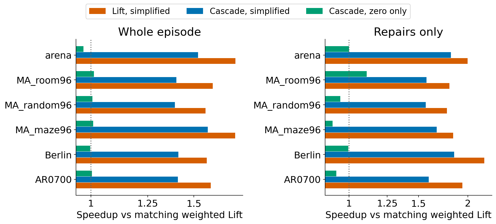
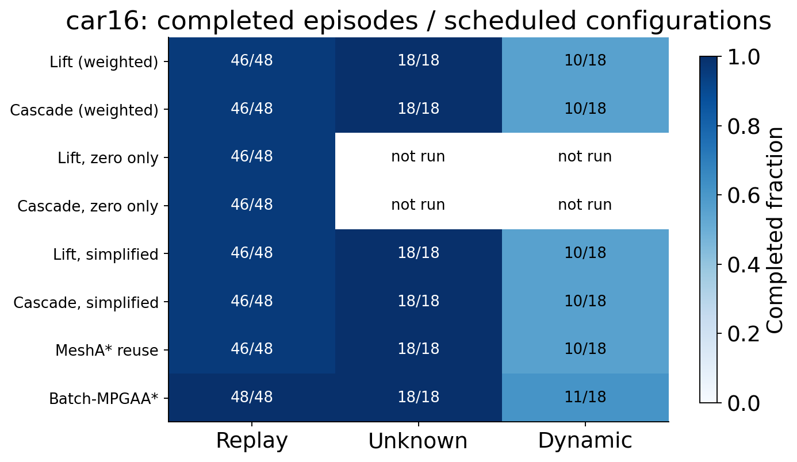
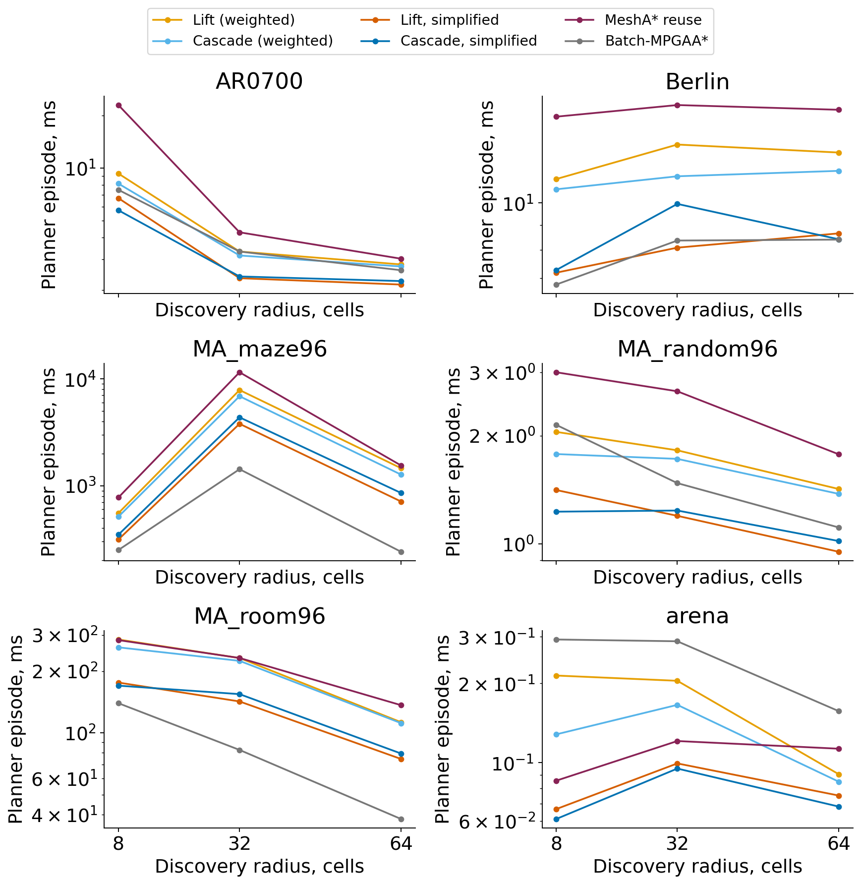

# Результат аудита

**Перевзвешивание в последних Lift действительно не требуется.** Новые `fast_lift` и `fast_cascade` работают с исходными нулевыми prefix-дугами и положительной стоимостью завершения примитива. Удалены потенциалы и лишние шаблоны графа, отдельный флаг `learned`, копии CLOSED, повторные вычисления base и часть временных выделений памяти. Все проверки корректности сохранены. Поиск, обучение и политика остаются на полном исходном mesh.

В основной car16 replay-панели упрощённый Lift даёт **1.65× по эпизоду / 1.91× по ремонту** к прежнему Lift (46/48 общих завершённых пар); упрощённый Cascade — **1.45× / 1.67×** к прежнему Cascade (46/48). Здесь и далее ускорение — время контроля, делённое на время указанного кандидата; больше 1 выгодно кандидату.

Контроль только без потенциала: Lift **1.00× full / 1.00× repair** (46/48), Cascade **1.00× / 0.98×** (46/48). Эти отношения не включают остальные оптимизации fast и не означают сохранения прежнего порядка раскрытия.

В основной car16-панели удаление потенциала оказалось практически нейтральным по времени. Его польза — упрощение формулировки, численного представления и подготовки графа. Измеренное ускорение полного fast относится ко всему пакету изменений.

Число запросов allocation внутри ремонта основной car16-панели уменьшилось в 6.27 и 6.26 раза соответственно (суммы по всем 48 случаям, включая лимитированные). Пиковая рабочая память на общих завершённых парах составляет 1.05 и 1.05 от старой: изменение +4.9% и +4.9% в этой серии. Общий индекс измерен отдельно ниже.

Новая серия содержит 132 уникальные конфигурации и 144 запланированных случая с учётом отдельной повторной абляционной панели: 3,348 временных эпизодов и 1,116 отдельных эпизодов памяти. Расхождений завершённых стоимостей с точным эталоном: **0**. Остановок по лимиту в одном логическом повторе: 24; они не засчитываются как ответ «пути нет».

# Что было лишним

| Деталь прежней реализации | Изменение и причина |
| --- | --- |
| Потенциал и преобразованные стоимости | Одна исходная стоимость; нулевые дуги допустимы. |
| Общие positive/contracted/reverse/boundary шаблоны | Самостоятельный Index читает Model.configs; fast их не требует. |
| Флаг learned | Участие в ремонте определяется h > initial; исходная оценка уже кэширована. |
| Новый vector для проверки каждой политики | Пустая политика проверяется сразу; цепочки используют общий буфер. |
| Новый CLOSED и его копия для closure | Один буфер между запросами, сжатие на месте, затем тот же буфер как стек. |
| Closure по всему CLOSED | Только выросшие метки; у plain — отсечённые, у Cascade — также обычные для подписок. |
| Повторные min/hypot для base при ремонте | Неизменная при фиксированной цели initial хранится в записи. |
| Хеш тройки координат и повторный lookup | Целочисленный ключ и try_emplace; проверка границ и переполнения. |
| Поиск slot обратной дуги через std::find | Slot хранится в дуге; ремонтная очередь содержит (h,id). |
| Повторяющиеся конечные клетки | Для h минимум стоимости по клетке; для отсечения все разные конечные направления. |
| Неиспользуемые finals граничных узлов | Не материализуются в новом индексе. |
| Строка ошибки на успешной проверке | const char\*; строка создаётся только при исключении. |
| Хеш извлечений в каждом поиске | Отключён по умолчанию; доступен отдельной trace-абляцией. |

Это инженерное упрощение прежнего метода. Приоритет в литературе или новый алгоритм только на основании удаления потенциала не заявляются. Оптимизации включены в отдельную ветку `perf/lift-zero-cost`; исходная версия `49b1df9` и её результаты сохранены.

# Почему перевзвешивание можно удалить

В исходном mesh внутренние дуги префикса имеют цену 0, завершения примитивов —
положительную исходную цену. Конфигурационный подграф нулевых дуг является DAG, что новый
индекс проверяет один раз. Поэтому каждый цикл полного графа включает положительное
завершение. A\* с согласованной эвристикой и обратный ремонт допускают неотрицательные
стоимости. В tight-политике вдоль положительной дуги строго уменьшается $h$, а нулевые
дуги продвигаются по конечному DAG. Цикл tight-политики невозможен. Строгая положительность
каждой внутренней дуги для этого не требуется.

При точной арифметике старое преобразование давало $g'=g+\phi$,
$h'=h-\phi$ и $f'=g+h$ (у граничного старта $\phi=0$). Но второй ключ $-g'$
не совпадает с $-g$: он также предпочитал глубокие префиксы. Поэтому zero-only использует
$(f,-g,seq)$, а fast — $(f,-g,-depth,seq)$. Последний ключ явно задаёт глубину только
при равных $f,g$ и не воспроизводит прежний смешанный ключ побитово. Отдельная абляция
`fast_no_depth` проверяет цену такого выбора. Кроме того, удаление сложения/вычитания
потенциала меняет округление float-ключей; идентичность раскрытий старой версии не обещается.

## Что удалять нельзя

Необходимы локальный подъём пропущенных внутренних оценок, обратный ремонт
после освобождений, проверка tight-политики, терминальное отсечение с учётом конечного
направления и подпись нарушенных заблокированных неравенств у Cascade. После успешного
поиска с ценой $C$ обновление $h(u)=\max(h(u),C-g(u))$ само по себе может нарушить
согласованность в пропущенном mesh-префиксе. Closure устраняет это нарушение.

Сам бит learned избыточен при наличии неизменной initial: достаточно $h>initial$.
Смысл прежнего инварианта остаётся: поднятый без раскрытия узел обязан участвовать
в ремонте. Если $h(u)=initial(u)$, согласованность initial и $h(v)\ge initial(v)$
дают $h(u)\le c(u,v)+h(v)$: такой предшественник не требует понижения.
Если оценка уменьшилась до initial, она всё ещё распространяет уменьшение
назад как элемент очереди; пропускаются только предшественники, которые сами равны base.
На детерминированном C++-контрпримере после двух освобождений все шесть проверяемых
вариантов дают оптимальную цену 4. Прежние мутации без closure или без участия поднятых
узлов в ремонте давали цену 5; их результаты сохранены в предыдущем отчёте.

Сужение closure следует из обычного адаптивного обновления. Для раскрытого $u$
свободный ребёнок $v$ либо CLOSED с новой оценкой не меньше $C-g(v)$, либо остаётся
в OPEN с $f(v)\ge C$. В обоих случаях $h(v)\ge C-g(u)-c(u,v)$. Поэтому новое свободное
нарушение возникает только у отсечённого узла. У Cascade выросшие обычные CLOSED
тоже проверяются для новых подписок на заблокированных дугах. Невыросшие метки
не создают новых нарушений; дополнительная топологическая очередь не требуется.
Подробности: [design.md](design.md).

# Протокол и пределы сравнения

Основная replay-панель car16: шесть карт, два прежних корня, четыре семейства (изменения на эталонном маршруте, вне маршрута, смешанные блокировки/освобождения, раскрытие неизвестной карты), всего 48 конфигураций. Grid8: четыре плотности random50, все сочетания `cr=1,5,10,30%` и `k=2,8,32`, один корень; `n=k`, всего 48 конфигураций. Это одинаковые фиксированные последовательности входов для всех методов. Двенадцать car on-path/churn случаев первого корня повторены с отдельными ID для компонентной абляции и не объединяются с основной панелью.

Автономная навигация: те же шесть car-карт, один корень, раскрытие с радиусами 8, 32 и 64 клетки и динамика `(k,cr)=(2,5%), (8,10%), (32,20%)`, `n=k`. Статический радиус — квадратная окрестность; динамическая видимость — глубина по свободной решётке примитивов с учётом направления и всех клеток их трасс. Move означает один примитив. При каждой фазе блокируются и освобождаются равные числа случайных клеток; число правок ограничено доступными клетками, фактический cr показан ниже. Связанные n и k не позволяют приписать эффект одному параметру.

Карты Berlin, AR0700 и arena используются в прежнем размере; MA_maze96, MA_room96 и MA_random96 — прежние фиксированные кропы Moving AI. Control set car16 и его стоимости неизменны; это примитивы данного репозитория, а не официальный оптимизированный набор из статьи MeshA\*. Grid8 не имеет длинных общих префиксов и служит структурным контролем. Все входы уже использовались раньше; независимый holdout не заявляется.

Срез и исходники заморожены 2026-11-22T00:49:57.968103+00:00; измерения начаты 2026-11-22T00:50:06.484527+00:00 на commit `85fb7062576c`. CPU: AMD EPYC 9V74 80-Core Processor; Linux-6.18.57-x86_64-with-glibc2.41; один процесс, affinity [0, 1, 2]. Контроли собраны заново тем же GCC и флагами `-O3 -DNDEBUG -std=c++17`; точные флаги и хеши есть в JSON. Три последовательных повтора со случайным порядком методов и отдельный allocation-проход. Эталон и проверка пути не входят во время поиска.

Full включает конструктор планировщика и все запросы; initial — конструктор и запрос 0; repair — запросы после 0. В навигации время sensing хранится отдельно и не включено в full: здесь сравнивается работа планировщика. Общая подготовка шаблонов исключена из этих часов одинаково для всех методов и измерена отдельным микробенчмарком. Таблицы используют медиану трёх времён каждой конфигурации, затем геометрическое среднее парных отношений по общим завершённым конфигурациям. В replay точное «пути нет» — завершённый ответ; в навигации завершение требует достичь цели. В столбцах памяти меньше 1 выгодно fast. Число пар относится к full; для repair используются только случаи с ненулевым последующим временем у обеих сторон (число repair_pairs и флаги нулевой работы сохранены в CSV). Разная политика равностоимостных путей меняет наблюдения и иногда последующую динамику: навигационные времена не являются сравнением на одинаковых запросах.

Бюджет — 1,000,000 раскрытий на вызов; допуск стоимости $10^{-6}$. Медиана относительного MAD полных времён — 1.71%, p95 — 8.92%. У mesh и primitive-контролей раскрытия относятся к разным вершинам; этот порог не равен единому лимиту процессорного времени. Fast и прежние Lift используют одни и те же mesh-конфигурации. Три повтора характеризуют шум этой машины, а не независимые карты или доверительный интервал переносимости.

# Результаты по времени

| Модель | Кандидат к прежнему | Пары | Full × | Initial × | Repair × | Peak / old |
| --- | --- | --- | --- | --- | --- | --- |
| car16 | Lift, zero only | 46/48 | 1.00 | 1.00 | 1.00 | 1.00 |
| car16 | Cascade, zero only | 46/48 | 1.00 | 1.01 | 0.98 | 1.00 |
| car16 | Lift, simplified | 46/48 | 1.65 | 1.50 | 1.91 | 1.05 |
| car16 | Cascade, simplified | 46/48 | 1.45 | 1.42 | 1.67 | 1.05 |
| grid8 | Lift, zero only | 48/48 | 0.97 | 0.98 | 0.99 | 1.00 |
| grid8 | Cascade, zero only | 48/48 | 1.01 | 1.02 | 1.00 | 1.00 |
| grid8 | Lift, simplified | 48/48 | 1.78 | 2.02 | 1.63 | 1.05 |
| grid8 | Cascade, simplified | 48/48 | 1.38 | 1.35 | 1.43 | 1.03 |

Initial в этой таблице условен на завершение всего эпизода. Для проверки возможного смещения отдельный файл `initial_pairs.csv` сохраняет все общие завершённые первые поиски независимо от исхода позднего ремонта.

| Первые поиски car16 | Пары | Ускорение initial × |
| --- | --- | --- |
| Lift, simplified | 48/48 | 1.50 |
| Cascade, simplified | 48/48 | 1.42 |
| Lift, zero only | 48/48 | 1.01 |
| Cascade, zero only | 48/48 | 1.01 |

{width=99%}

| Карта | Кандидат к old | Пары | Full × | Repair × | Peak / old |
| --- | --- | --- | --- | --- | --- |
| AR0700 | Lift, zero only | 7/8 | 1.02 | 0.97 | 1.00 |
| AR0700 | Cascade, zero only | 7/8 | 1.00 | 0.93 | 1.00 |
| AR0700 | Lift, simplified | 7/8 | 1.60 | 1.94 | 1.05 |
| AR0700 | Cascade, simplified | 7/8 | 1.41 | 1.59 | 1.05 |
| Berlin | Lift, zero only | 7/8 | 1.00 | 1.03 | 1.00 |
| Berlin | Cascade, zero only | 7/8 | 1.00 | 1.00 | 1.00 |
| Berlin | Lift, simplified | 7/8 | 1.58 | 2.20 | 1.05 |
| Berlin | Cascade, simplified | 7/8 | 1.41 | 1.85 | 1.05 |
| MA_maze96 | Lift, zero only | 8/8 | 1.00 | 0.95 | 1.00 |
| MA_maze96 | Cascade, zero only | 8/8 | 1.01 | 0.91 | 1.00 |
| MA_maze96 | Lift, simplified | 8/8 | 1.76 | 1.84 | 1.05 |
| MA_maze96 | Cascade, simplified | 8/8 | 1.58 | 1.67 | 1.05 |
| MA_random96 | Lift, zero only | 8/8 | 1.00 | 0.93 | 1.00 |
| MA_random96 | Cascade, zero only | 8/8 | 1.01 | 0.95 | 1.00 |
| MA_random96 | Lift, simplified | 8/8 | 1.57 | 1.77 | 1.05 |
| MA_random96 | Cascade, simplified | 8/8 | 1.39 | 1.56 | 1.05 |
| MA_room96 | Lift, zero only | 8/8 | 1.01 | 1.14 | 1.00 |
| MA_room96 | Cascade, zero only | 8/8 | 1.01 | 1.11 | 1.00 |
| MA_room96 | Lift, simplified | 8/8 | 1.62 | 1.80 | 1.05 |
| MA_room96 | Cascade, simplified | 8/8 | 1.40 | 1.57 | 1.05 |
| arena | Lift, zero only | 8/8 | 1.00 | 0.98 | 1.00 |
| arena | Cascade, zero only | 8/8 | 0.97 | 1.00 | 1.00 |
| arena | Lift, simplified | 8/8 | 1.77 | 2.00 | 1.05 |
| arena | Cascade, simplified | 8/8 | 1.52 | 1.81 | 1.05 |
| random50_p10 | Lift, zero only | 12/12 | 0.97 | 0.98 | 1.00 |
| random50_p10 | Cascade, zero only | 12/12 | 1.01 | 1.00 | 1.00 |
| random50_p10 | Lift, simplified | 12/12 | 1.63 | 1.45 | 1.06 |
| random50_p10 | Cascade, simplified | 12/12 | 1.27 | 1.28 | 1.05 |
| random50_p20 | Lift, zero only | 12/12 | 0.94 | 0.99 | 1.00 |
| random50_p20 | Cascade, zero only | 12/12 | 1.06 | 1.03 | 1.00 |
| random50_p20 | Lift, simplified | 12/12 | 1.77 | 1.63 | 1.05 |
| random50_p20 | Cascade, simplified | 12/12 | 1.47 | 1.40 | 1.04 |
| random50_p30 | Lift, zero only | 12/12 | 1.00 | 1.02 | 1.00 |
| random50_p30 | Cascade, zero only | 12/12 | 1.00 | 1.01 | 1.00 |
| random50_p30 | Lift, simplified | 12/12 | 1.78 | 1.63 | 1.05 |
| random50_p30 | Cascade, simplified | 12/12 | 1.34 | 1.43 | 1.01 |
| random50_p40 | Lift, zero only | 12/12 | 0.97 | 0.98 | 1.00 |
| random50_p40 | Cascade, zero only | 12/12 | 0.99 | 0.98 | 1.00 |
| random50_p40 | Lift, simplified | 12/12 | 1.95 | 1.82 | 1.05 |
| random50_p40 | Cascade, simplified | 12/12 | 1.46 | 1.61 | 1.02 |

## Сравнение с остальными контролями

| Набор | Fast | Контроль | Пары | Full × | Repair × |
| --- | --- | --- | --- | --- | --- |
| car16/replay | Lift | MeshA\* reuse | 46/48 | 3.09 | 4.60 |
| car16/replay | Lift | Batch-MPGAA\* | 46/48 | 1.02 | 1.30 |
| car16/replay | Cascade | MeshA\* reuse | 46/48 | 3.13 | 5.45 |
| car16/replay | Cascade | Batch-MPGAA\* | 46/48 | 1.03 | 1.55 |
| grid8/replay | Lift | MeshA\* reuse | 48/48 | 3.63 | 2.94 |
| grid8/replay | Lift | Batch-MPGAA\* | 48/48 | 2.96 | 2.75 |
| grid8/replay | Lift | Octile reuse | 48/48 | 0.87 | 0.90 |
| grid8/replay | Cascade | MeshA\* reuse | 48/48 | 2.78 | 2.81 |
| grid8/replay | Cascade | Batch-MPGAA\* | 48/48 | 2.26 | 2.62 |
| grid8/replay | Cascade | Octile reuse | 48/48 | 0.67 | 0.86 |
| car16/unknown | Lift | MeshA\* reuse | 18/18 | 1.90 | 1.14 |
| car16/unknown | Lift | Batch-MPGAA\* | 18/18 | 1.05 | 2.26 |
| car16/unknown | Cascade | MeshA\* reuse | 18/18 | 1.86 | 1.16 |
| car16/unknown | Cascade | Batch-MPGAA\* | 18/18 | 1.03 | 2.30 |
| car16/dynamic | Lift | MeshA\* reuse | 10/18 | 1.11 | 0.22 |
| car16/dynamic | Lift | Batch-MPGAA\* | 10/18 | 0.60 | 0.40 |
| car16/dynamic | Cascade | MeshA\* reuse | 10/18 | 1.53 | 0.40 |
| car16/dynamic | Cascade | Batch-MPGAA\* | 10/18 | 0.83 | 0.73 |

Обе fast-версии сохранены независимо от того, какая быстрее в конкретном режиме. Преимущество над старой неоптимизированной реализацией не доказывает превосходство над Batch-MPGAA\* или MeshA\* reuse. Полные парные отношения, включая проигрыши, сохранены в `paired_cases.csv`; разбиение по семействам — в `family_pairs.csv`.

## Контроли по car-картам

Lift, simplified: прямые сравнения с MeshA\* reuse и Batch-MPGAA\*. У каждого контроля своё множество общих завершённых случаев.

| Карта | MeshA пары | Full × | Repair × | Batch пары | Full × | Repair × |
| --- | --- | --- | --- | --- | --- | --- |
| AR0700 | 7/8 | 3.54 | 7.74 | 7/8 | 1.16 | 1.16 |
| Berlin | 7/8 | 2.80 | 3.73 | 7/8 | 1.07 | 2.88 |
| MA_maze96 | 8/8 | 5.54 | 19.82 | 8/8 | 0.53 | 0.50 |
| MA_random96 | 8/8 | 2.67 | 3.46 | 8/8 | 1.15 | 1.44 |
| MA_room96 | 8/8 | 3.19 | 5.79 | 8/8 | 0.79 | 1.01 |
| arena | 8/8 | 1.86 | 0.86 | 8/8 | 1.93 | 2.22 |

Cascade, simplified: прямые сравнения с MeshA\* reuse и Batch-MPGAA\*. У каждого контроля своё множество общих завершённых случаев.

| Карта | MeshA пары | Full × | Repair × | Batch пары | Full × | Repair × |
| --- | --- | --- | --- | --- | --- | --- |
| AR0700 | 7/8 | 3.57 | 9.72 | 7/8 | 1.17 | 1.46 |
| Berlin | 7/8 | 2.71 | 5.33 | 7/8 | 1.04 | 4.12 |
| MA_maze96 | 8/8 | 5.10 | 19.56 | 8/8 | 0.49 | 0.49 |
| MA_random96 | 8/8 | 2.70 | 4.07 | 8/8 | 1.16 | 1.69 |
| MA_room96 | 8/8 | 2.87 | 5.72 | 8/8 | 0.71 | 0.99 |
| arena | 8/8 | 2.44 | 1.19 | 8/8 | 2.53 | 3.09 |

Описательное разбиение после измерений, Lift, simplified к Batch: полный выигрыш от 10% — AR0700: 1.16×, 7/8 пар; MA_random96: 1.15×, 8/8 пар; arena: 1.93×, 8/8 пар; полный проигрыш от 10% — MA_maze96: 0.53×, 8/8 пар; MA_room96: 0.79×, 8/8 пар. Эти группы не являются независимой проверочной выборкой.

Описательное разбиение после измерений, Cascade, simplified к Batch: полный выигрыш от 10% — AR0700: 1.17×, 7/8 пар; MA_random96: 1.16×, 8/8 пар; arena: 2.53×, 8/8 пар; полный проигрыш от 10% — MA_maze96: 0.49×, 8/8 пар; MA_room96: 0.71×, 8/8 пар. Эти группы не являются независимой проверочной выборкой.

Batch-MPGAA\* завершает 48/48 car16 replay-случаев, упрощённый Cascade — 46/48. Условное полное отношение к Batch 1.03× и ремонт 1.55× не отменяют разницы завершения; requested peak у Cascade в 3.05 раза больше. В автономной динамике общего преимущества над Batch по этим данным также не видно; её времена и завершение разобраны отдельно.

# Завершение и качество пути

{width=99%}

| Модель | Сценарий | Метод | Завершено |
| --- | --- | --- | --- |
| car16 | dynamic | Batch-MPGAA\* | 11/18 |
| car16 | dynamic | Cascade (weighted) | 10/18 |
| car16 | dynamic | Cascade, simplified | 10/18 |
| car16 | dynamic | Lift, simplified | 10/18 |
| car16 | dynamic | Lift (weighted) | 10/18 |
| car16 | dynamic | MeshA\* reuse | 10/18 |
| car16 | unknown | Batch-MPGAA\* | 18/18 |
| car16 | unknown | Cascade (weighted) | 18/18 |
| car16 | unknown | Cascade, simplified | 18/18 |
| car16 | unknown | Lift, simplified | 18/18 |
| car16 | unknown | Lift (weighted) | 18/18 |
| car16 | unknown | MeshA\* reuse | 18/18 |
| car16 | replay | Batch-MPGAA\* | 48/48 |
| car16 | replay | Cascade (weighted) | 46/48 |
| car16 | replay | Cascade, simplified | 46/48 |
| car16 | replay | Lift, simplified | 46/48 |
| car16 | replay | Lift (weighted) | 46/48 |
| car16 | replay | MeshA\* reuse | 46/48 |
| car16 | replay | Cascade, zero only | 46/48 |
| car16 | replay | Lift, zero only | 46/48 |
| grid8 | replay | Batch-MPGAA\* | 48/48 |
| grid8 | replay | Cascade (weighted) | 48/48 |
| grid8 | replay | Cascade, simplified | 48/48 |
| grid8 | replay | Lift, simplified | 48/48 |
| grid8 | replay | Lift (weighted) | 48/48 |
| grid8 | replay | MeshA\* reuse | 48/48 |
| grid8 | replay | Octile reuse | 48/48 |
| grid8 | replay | Cascade, zero only | 48/48 |
| grid8 | replay | Lift, zero only | 48/48 |

| Метод | Фаза | Остановки |
| --- | --- | --- |
| Cascade (weighted) | repair | 4 |
| Cascade, simplified | repair | 4 |
| Lift, simplified | repair | 4 |
| Lift (weighted) | repair | 4 |
| MeshA\* reuse | repair | 4 |
| Cascade, zero only | repair | 2 |
| Lift, zero only | repair | 2 |

## Раскрытие карты с разным радиусом

{width=99%}

| Карта | Радиус | Fast Cascade | Full, мс | К old × | Путь / truth opt |
| --- | --- | --- | --- | --- | --- |
| AR0700 | 8 | goal | 5.72 | 1.42 | 1.00 |
| AR0700 | 32 | goal | 2.39 | 1.32 | 1.00 |
| AR0700 | 64 | goal | 2.25 | 1.21 | 1.00 |
| Berlin | 8 | goal | 7.28 | 1.47 | 1.00 |
| Berlin | 32 | goal | 9.95 | 1.14 | 1.00 |
| Berlin | 64 | goal | 8.42 | 1.38 | 1.00 |
| MA_maze96 | 8 | goal | 348.07 | 1.47 | 1.74 |
| MA_maze96 | 32 | goal | 4361.34 | 1.58 | 1.54 |
| MA_maze96 | 64 | goal | 854.67 | 1.48 | 1.00 |
| MA_random96 | 8 | goal | 1.23 | 1.45 | 1.00 |
| MA_random96 | 32 | goal | 1.24 | 1.39 | 1.00 |
| MA_random96 | 64 | goal | 1.02 | 1.35 | 1.00 |
| MA_room96 | 8 | goal | 169.94 | 1.54 | 2.46 |
| MA_room96 | 32 | goal | 154.48 | 1.45 | 1.00 |
| MA_room96 | 64 | goal | 79.28 | 1.41 | 1.00 |
| arena | 8 | goal | 0.06 | 2.09 | 1.00 |
| arena | 32 | goal | 0.09 | 1.74 | 1.00 |
| arena | 64 | goal | 0.07 | 1.24 | 1.00 |

Отношение пути к оптимуму полной статической карты описывает цену неизвестности, а не подоптимальность каждого запроса: все завершённые планы точны на текущей известной карте. Для динамического мира такое отношение к начальному оптимуму не используется; абсолютные длины, шаги и статусы всех методов есть в `navigation_quality.csv`.

## Динамика при n=k и фактическом cr

| Карта | k=n | cr, % | Факт., % | Clamp/фаз | Fast Cascade | К old × |
| --- | --- | --- | --- | --- | --- | --- |
| AR0700 | 2 | 5 | 5.00 | 0/7 | no_path | — |
| AR0700 | 8 | 10 | 10.00 | 0/4 | goal | 1.34 |
| AR0700 | 32 | 20 | 20.00 | 0/1 | capped | — |
| Berlin | 2 | 5 | 5.00 | 0/7 | no_path | — |
| Berlin | 8 | 10 | 10.00 | 0/4 | capped | — |
| Berlin | 32 | 20 | 20.00 | 0/1 | no_path | — |
| MA_maze96 | 2 | 5 | 4.99 | 0/24 | goal | 1.88 |
| MA_maze96 | 8 | 10 | 10.00 | 0/4 | goal | 1.73 |
| MA_maze96 | 32 | 20 | 13.54 | 2/2 | goal | 1.77 |
| MA_random96 | 2 | 5 | 4.99 | 0/1 | no_path | — |
| MA_random96 | 8 | 10 | 10.00 | 0/2 | goal | 1.26 |
| MA_random96 | 32 | 20 | — | 0/0 | goal | 1.36 |
| MA_room96 | 2 | 5 | 4.99 | 0/1 | no_path | — |
| MA_room96 | 8 | 10 | 10.00 | 0/4 | goal | 1.71 |
| MA_room96 | 32 | 20 | — | 0/0 | goal | 1.46 |
| arena | 2 | 5 | 5.00 | 0/10 | goal | 1.36 |
| arena | 8 | 10 | 10.00 | 0/2 | no_path | — |
| arena | 32 | 20 | — | 0/0 | goal | 1.70 |

Если фаз нет, фактический cr не определён и обозначен тире. Недостижение цели при динамике может означать реальную разрывность текущей карты; это не автоматически ошибка поиска. `no_path_diagnostics.csv` сохраняет проверку истинной достижимости при таких остановках. В статической неизвестной карте ложных отказов при достижимой истинной цели не обнаружено.

# Абляции и работа алгоритмов

{width=99%}

| Возвращённая деталь | Пары | Full × | Repair × | Fast peak / ablation |
| --- | --- | --- | --- | --- |
| Scan all CLOSED | 12/12 | 1.02 | 1.01 | 1.00 |
| No depth tie | 12/12 | 1.06 | 1.05 | 1.00 |
| Repeated finals | 12/12 | 1.05 | 1.04 | 1.00 |
| Recompute base | 12/12 | 1.00 | 0.99 | 1.00 |
| Allocate policy chains | 12/12 | 1.06 | 1.06 | 1.00 |
| Enable trace hash | 12/12 | 1.03 | 1.02 | 1.00 |

У абляций одинакового приоритета подтверждено совпадение пути, числа раскрытий, стоимости и статуса в 430 строках. `fast_no_depth` из этого требования исключён, поскольку меняет правило выбора равных ключей. Для него действуют те же проверки точной стоимости. Компоненты целочисленного ключа, компактной ремонтной записи, ленивого сообщения ошибки и отсутствия learned-бита входят в общий пакет; их отдельный причинный вклад этой серией не оценивался.

Пересчёт base вместо чтения сохранённого порога даёт отношение full 0.996× и repair 0.995×. Отдельного ускорения от кэширования порога на этой панели не установлено. Поле initial сохраняется для простого критерия h > initial и численной нижней границы; абляция пересчитывает только порог ремонта, поэтому цену полного удаления поля из записи эта серия не измеряет. Остальные отдельные эффекты в несколько процентов следует читать с учётом трёх повторов и разброса времени.

{width=99%}

| Метод | Раскрытия | Closure дуги | Подъёмы h | Policy loop | Grid.free |
| --- | --- | --- | --- | --- | --- |
| Lift (weighted) | 11817639 | 21341456 | 3317229 | 15855822 | 51288375 |
| Cascade (weighted) | 11817639 | 21341456 | 3317229 | 15855822 | 51288375 |
| Lift, zero only | 11889181 | 21423264 | 3280963 | 15939607 | 51430689 |
| Cascade, zero only | 11889181 | 21423264 | 3280963 | 15939607 | 51430689 |
| Lift, simplified | 11818042 | 6664557 | 3316579 | 41973 | 49846638 |
| Cascade, simplified | 11818042 | 21147179 | 3316579 | 41973 | 50543903 |

`checked_cells` у всех шести Lift/zero/fast считает каждый вызов Grid.free внутри replan, включая концы и внешние клетки. У MeshA\* reuse и Batch-MPGAA\* унаследованный счётчик покрывает лишь часть проверок, поэтому его межсемейное отношение здесь не используется. mv_policy_tests считает итерации цикла цепочки; ранние проверки next/memo в fast в этот счётчик не входят. Это логические вызовы API, не аппаратные чтения памяти. Суммы работы включают лимитированные вызовы; при разном завершении число выполненных запросов может различаться. Показатели `fast_base_evaluations` и `fast_closure_seeds` инструментированы только для fast; нули в строках прежних контролей не означают отсутствия такой работы.

## Выделения памяти и общий индекс

| Метод | Запросы allocation: initial | Запросы allocation: repair |
| --- | --- | --- |
| Lift (weighted) | 24596549 | 52562618 |
| Cascade (weighted) | 24630701 | 52574303 |
| Lift, zero only | 24596573 | 52778048 |
| Cascade, zero only | 24630725 | 52789718 |
| Lift, simplified | 8405791 | 8381428 |
| Cascade, simplified | 8439943 | 8393115 |

Запросы new считаются строго внутри replay replan в отдельном allocation-бинаре. Конструктор планировщика, эталон и форматирование CSV в этот счётчик не входят. Навигационные allocation requests не измерялись. Requested peak/retained heap включает рабочие записи и возвращённые пути, исключает общий заранее построенный индекс; это не RSS. Новая запись хранит initial и потому сама может быть крупнее старой; уменьшение числа временных выделений не гарантирует уменьшения peak.

| Модель | Построение индекса | Медиана, мкс | Peak, B | Retained, B | New calls |
| --- | --- | --- | --- | --- | --- |
| car16 | direct dedup | 314.49 | 193408 | 188688 | 9070 |
| car16 | direct raw | 147.86 | 200352 | 195632 | 5410 |
| car16 | legacy templates | 1863.72 | 916656 | 916592 | 51268 |
| grid8 | direct dedup | 0.74 | 1376 | 736 | 38 |
| grid8 | direct raw | 0.73 | 1376 | 736 | 38 |
| grid8 | legacy templates | 10.29 | 10440 | 9800 | 567 |

Этот микробенчмарк выполнен после основной временной фазы: 100 повторов каждого конструктора со случайным порядком, отдельный проход памяти. `legacy templates` включает весь прежний Prepared + MeshIndex; `direct raw` и `direct dedup` строят только самостоятельный новый индекс. Разница с legacy включает удаление накопленных общих шаблонов и не приписывается одному потенциалу. В совместном harness все индексы существуют для доступности контролей; производственный fast не имеет этой зависимости. Подготовка Model и чтение файла не входят в эти часы.

# Проверки и оценка работы

Независимый primitive Dijkstra проверил **9,640** ответов. Для каждой модели использованы 12 карт с разными seed и по 40 запросов; проверены десять режимов. Тесты включают движущийся старт, закрытые концы, дубликаты и смешанные правки. Проверен малый лимит раскрытий и повторный поиск после его увеличения. Аудируются свободные неравенства согласованности, нижняя граница base и полнота подписок. Дополнительный C++-пример проверяет ремонт после освобождений в шести режимах и отказ от нулевого цикла вне класса prefix-DAG. ASan/UBSan и проверка утечек пройдены для обеих моделей.

В полной серии обычный и allocation-бинарь совпали по логическим полям в 18,567 строках вызовов и 216 навигационных эпизодах. Счётчики подтверждают 60,812,730 терминальных отсечений и 88,300,054 подъёмов h. Исходные файлы контролей не менялись; их хеши проверяются вместе с источниками новой версии.

Для prefix-mesh доказана согласованность на исходных ценах. Тесты с независимым эталоном подтверждают результат на измеренных задачах. Практический результат — более быстрая и простая реализация точного Lift, с показанным выше увеличением рабочей памяти. В статье теперь можно описывать исходные нулевые дуги. Для сильного сравнения нужны независимые реализации и другие наборы примитивов. Литературная новизна самой чистки кода в этой работе не заявляется.

Ограничения: фиксированная цель, данный класс prefix-DAG и примитивов; шесть car-карт и один control set; один корень на автономную параметрическую точку; три временных повтора; повторное использование известных входов; дешёвые 2D-проверки клеток. Нет доказательства выигрыша для произвольных моделей, нулевых циклов или дорогой геометрической проверки. Не все оптимизации аблированы отдельно. Результат показывает, какие детали реализации можно убрать при сохранении точности.

# Артефакт и воспроизведение

Ветка `perf/lift-zero-cost`. Код: [алгоритмы](../../cpp/mesh_lift_fast/algorithms.hpp), [индекс](../../cpp/mesh_lift_fast/index.hpp), [zero-only](../../cpp/mesh_lift_fast/zero_only.hpp). Полные команды приведены в [README](../../cpp/mesh_lift_fast/README.md). Секунды предыдущих серий с этой не смешиваются.

Материалы:

- [Входы и хеши](../../cpp/mesh_lift_fast/frozen/manifest.json).
- [Протокол сырых прогонов](../../cpp/mesh_lift_fast/results/full/experiment.json).
- [Таблицы по конфигурациям](../../cpp/mesh_lift_fast/results/full/analysis/case_metrics.csv).
- [Попарные сравнения](../../cpp/mesh_lift_fast/results/full/analysis/paired_cases.csv).
- [Проверки корректности](../../cpp/mesh_lift_fast/validation/correctness.json).

```bash
make -C cpp/mesh_lift_fast -j2 all
make -C cpp/mesh_lift_fast test
python3 cpp/mesh_lift_fast/run_all.py --output /tmp/lift-fast-rerun
python3 cpp/mesh_lift_fast/run_setup.py --output /tmp/lift-fast-setup-rerun
python3 cpp/mesh_lift_fast/analyze.py --directory /tmp/lift-fast-rerun --setup-directory /tmp/lift-fast-setup-rerun
python3 cpp/mesh_lift_fast/report.py --directory /tmp/lift-fast-rerun
```
