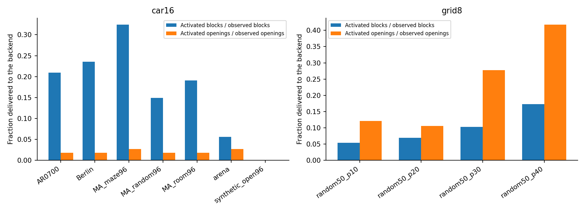
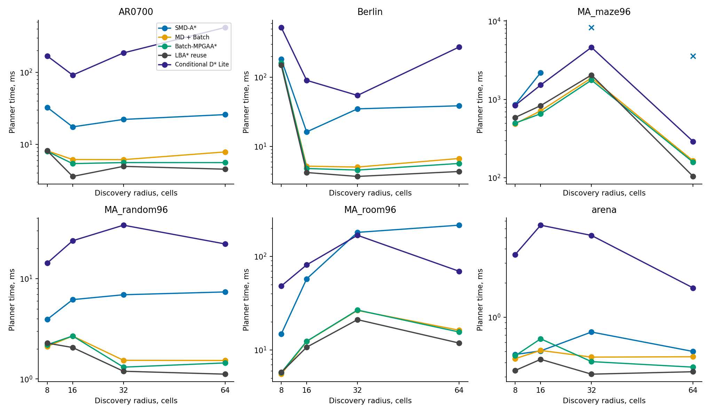
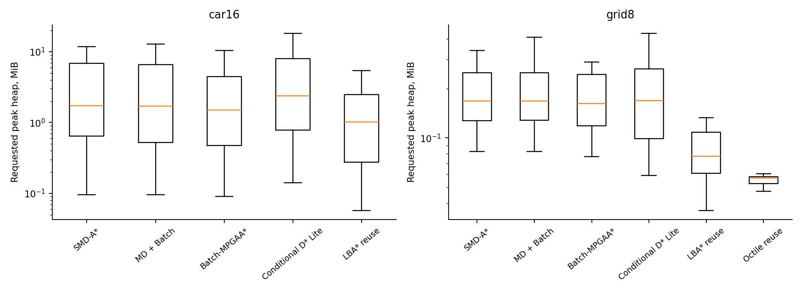

# Abstract

We study exact incremental planning with fixed-cost motion primitives under occupancy updates. A single working graph can contain deferred obstacles and omit deferred openings, making it neither an optimistic nor a pessimistic model of the observed graph. We propose SMD-A\*, which couples actual-path feasibility with mesh-derived swept-cell detour bounds. A known feasible incumbent can be accepted when the exact working optimum meets its cost, even if other tied working paths are invalid. The implementation wraps an unchanged mesh adaptive-search backend. A separate frozen study measures 5,148 timing episodes and 1,716 allocation episodes on 184 configurations, using shared-backend, gap-off, eager-open lazy-block and strong standalone controls. All completed answers match exact references; capped or unsuccessful missions are reported rather than counted as speedups. Priority of the particular combination remains a hypothesis, not an established first-in-literature claim.

The balanced 48-case car replay panel yields 0.44 episode speedup against the fastest completed control and 0.99 against eager-opening lazy blocking. Thus the implementation does not establish a useful general runtime advantage from symmetric mesh deferral on these inexpensive occupancy benchmarks, despite reducing backend update activation.

# Problem and algorithm

Let A be the current observed graph and W the backend's working graph. Initial
maps coincide. Keep B: blocked in A but free in W, and O: free in A but blocked
in W. All primitive costs are fixed and positive. Inputs are cell updates.
No global subgraph ordering between A and W is assumed.

For q in O, the existing mesh compiler supplies L(s,q,t), an admissible lower
bound on any primitive path whose swept collision cells contain q. This matters
because q need not be a primitive-boundary vertex. We reuse the existing MD-A\*
compiler and its fast octile/projection correction; the bound itself is not new.
The same traveling lower-bound heap from MD-A\* handles moving starts.

## Certificate

Suppose P is a known A-feasible path of cost C, every remaining q in O satisfies
L(s,q,t)>C, and the exact optimum in W is at least C. If an A-path P' cheaper
than C exists, it either uses an omitted opening q (contradicting the bound), or
contains no omitted opening. In the latter case all its cells are free in W:
B only adds free cells to W. Thus P' is a W-path cheaper than C, a contradiction.
Therefore P is optimal in A. A W-optimal candidate which is also A-feasible is a
special case. An infeasible W-optimal candidate need not be repaired when its
cost already meets the cost of a known feasible incumbent.

## Replan

1. Apply observed updates to A. Keep newly blocked/free-in-W cells in B. Queue
   newly opened/blocked-in-W cells in O; opposite updates can cancel without a
   backend change. A previously saved optimal working suffix is reused only if
   it survives actual blocks and no competitive opening has to be released.
2. Compute an exact W-optimal path using the unchanged Batch-Mesh-MPGAA\* backend.
3. If a valid incumbent C exists and the working optimum meets C, release any
   still-competitive openings and return the incumbent if none remain.
4. Otherwise validate the optimistic candidate against A. Activate all B cells
   on it as one batch and repair W again if it is invalid.
5. A valid candidate supplies an incumbent C. Release O cells with L<=C and
   repeat; when none remain, return the certified exact path.
6. If W has no path, release all remaining openings. With O empty, A is a
   subgraph of W, so a complete W failure proves an A failure. A cap is never
   treated as a failure proof. Saved positive/negative certificates are cleared
   after a capped incomplete attempt.

Every nonterminal round activates at least one previously deferred cell. Between
input batches, activations move W toward A, so termination is finite; worst-case
work may exceed eager repair. The expansion budget is shared across rounds.
A valid incumbent never meets a newly activated blocking cell, so it stays valid
in both maps through repair. Graph decreases always force a new exact backend
answer before reusing the positive certificate. Saved paths are truncated to the
current start after repair, preventing reuse of earlier prefixes after openings.

The gap-off ablation tests whether avoiding tied invalid candidates matters.
The eager-open ablation applies openings directly (without a pointless heap),
testing the contribution of the mesh lower bound relative to plain lazy blocks.
The one-sided control uses exactly the same backend, isolating two-sided repair
from backend engineering. Tests also verify that a saved certified suffix is
optimal in W, not merely feasible in A, including random start changes and cap
recovery with an unflushed opening.

## Claim boundaries

Generic lazy edge checking, primal/dual bounds, suffix reuse, and the existing
mesh detour bound are prior concepts. The research hypothesis is their coupled
certificate for an incomparably modified working mesh graph. The first stage
informed this design; its replay results are exploratory development data. The
alternate-root navigation check is separate. No claim of priority or universal
speedup should precede the strong-control, ablation and completion results.

The existing mesh compiler provides an admissible swept-cell lower bound L(s,q,t). We reuse its fast scaled-octile/projection-correction form and its moving-start lower-bound heap. Neither that bound nor generic lazy evaluation is claimed as new. The proposed contribution is the coupled acceptance/repair certificate when opposite update types are deferred and a global graph ordering is unavailable. Cell updates are given, not a precomputed changed-edge list; withholding irrelevant cells can avoid enumerating many translated primitive effects.

# Evaluation

Stage-two algorithm design AFTER first-stage replay showed no useful standard-map mesh-envelope gain. Freeze before all SMD timings. Exploratory replay: all52 car and96 grid cases from stage one, no case selection by wins. Holdout navigation relative to stage one: alternate root s48102 on all six car maps, four discovery radii8/16/32/64 and two dynamic anchors(k,cr)=(2,5),(32,20), n=k and actual clampedcr retained. These maps/specifications already existed in the repository; this is a new-method/alternate-root check, not a claim of a hidden benchmark. Shared Batch backend isolates symmetric vs one-sided deferral; gap-off and eager-open ablations. All comparator times collected afresh, three randomized serial repeats and a separate allocation pass. No seconds pooled with earlier cohorts.

The 52 car replay inputs include 48 balanced map/root/family configurations and 4 separately reported history cases. The 96 grid inputs retain the strong Octile reuse control. Navigation uses the alternate root on each of six car maps, four discovery radii, and two n=k dynamic anchors. The replay inputs informed development; alternate-root navigation was not measured in the first stage, although all specifications were already public within this repository. Three serial randomized repeats and separate allocation measurement are used. No earlier seconds are pooled. A million-expansion cap is shared over all internal SMD repair rounds.

| Cohort | Model | Panel | Comparator | Episode × | Repair × | Pairs |
| --- | --- | --- | --- | --- | --- | --- |
| navigation_dynamic | car16 | holdout | Fastest control | 0.38 | 0.03 | 9/12 |
| navigation_dynamic | car16 | holdout | MD + Batch | 0.94 | 0.84 | 9/12 |
| navigation_dynamic | car16 | holdout | SMD без gap | 1.02 | 1.04 | 9/12 |
| navigation_unknown | car16 | holdout | Fastest control | 0.27 | 0.43 | 22/24 |
| navigation_unknown | car16 | holdout | MD + Batch | 0.34 | 0.61 | 22/24 |
| navigation_unknown | car16 | holdout | SMD без gap | 0.99 | 1.02 | 22/24 |
| replay | car16 | history | Fastest control | 0.97 | 1.12 | 4/4 |
| replay | car16 | history | Lazy blocks / eager opens | 0.99 | 1.01 | 4/4 |
| replay | car16 | history | MD + Batch | 1.02 | 1.55 | 4/4 |
| replay | car16 | history | SMD без gap | 1.01 | 1.03 | 4/4 |
| replay | car16 | main | Fastest control | 0.44 | 0.33 | 48/48 |
| replay | car16 | main | Lazy blocks / eager opens | 0.99 | 1.06 | 48/48 |
| replay | car16 | main | MD + Batch | 0.80 | 0.70 | 47/48 |
| replay | car16 | main | SMD без gap | 1.00 | 0.99 | 48/48 |
| replay | grid8 | main | Fastest control | 0.27 | 0.43 | 96/96 |
| replay | grid8 | main | Lazy blocks / eager opens | 1.13 | 1.64 | 96/96 |
| replay | grid8 | main | MD + Batch | 0.92 | 0.90 | 96/96 |
| replay | grid8 | main | SMD без gap | 1.02 | 1.02 | 96/96 |

Ratios above one favor SMD-A\*. The descriptive fastest-control envelope selects a completed control by whole-episode median after measurement. Replay completion includes correct failure proofs; navigation completion requires reaching the goal. Missing pairs and caps are retained in the accompanying report. Different optimal paths may generate different subsequent observations, so replay gives the stricter identical-input comparison.

On the balanced 48-case car replay panel, the geometric-mean episode speedup is 0.44 against the fastest completed control and 0.99 against eager-opening lazy blocking. These values include construction and the first query; repair-only values are shown separately. The results support only the regimes where the measured ratios exceed one, not a claim of universal superiority.

{width=99%}

{width=99%}

{width=99%}

# Limitations and related work

The first stage found no useful standard-map advantage for a mesh negative envelope over independent lattice witnesses; this motivated targeting positive replanning. SMD combines established lazy search, incumbent bounds, adaptive A\*, suffix reuse and the repository's prior mesh detour bound. Its novelty hypothesis is the particular two-sided swept-cell certificate. Lifelong-GLS and Generalized D\* are closely related incremental lazy planners; external implementations were not integrated. IPC/IDPC already combine path and cut reasoning for feasibility. A full priority review is required before submission. The grid and car controls use identical frozen Hermite primitives and binary2D maps, not official optimized primitive libraries or expensive high-dimensional collision models. One alternate navigation root per point limits statistical strength; n=k changes sensing and frequency together.

Additional candidate validation can be wasted when many optimistic paths collide, and the expansion budget may be reached even where eager repair succeeds. The initial working model can also be a poor guide after dense changes. Deferred cell sets and repeated paths consume memory and validation work. Conversely, activation and gap-hit counts explain the proposed repair mechanism without treating the historical partial checked_cells counter as a full geometry count. The complete report preserves per-map ratios, all completion failures, actual clamped rates and latency percentiles.

# References

* **MeshA\*: Efficient Path Planning with Motion Primitives**, AAAI 2026,
  [DOI 10.1609/aaai.v40i43.41004](https://doi.org/10.1609/aaai.v40i43.41004).
  Shares collision-cell structure among primitives and establishes the mesh
  representation. Our new frontier uses an unmerged prefix forest over exactly
  the same ordered primitive traces. It does not reproduce every quotient/merge
  in the paper's full configuration mesh. Original MeshA\* and contracted
  C-Mesh-D\* Lite are freshly timed controls.
* **Koenig and Likhachev, D\* Lite**, AAAI 2002,
  [AAAI proceedings](https://cdn.aaai.org/AAAI/2002/AAAI02-072.pdf).
  Repairs g/rhs with moving starts. Conditional Bellman updates, reuse of labels,
  and D\* Lite's queue are established; Circuit-Mesh is a local compilation and
  event-sharing variant, not a new proof of D\* Lite.
* **Koenig, Likhachev and Furcy, Lifelong Planning A\***, Artificial Intelligence
  155, 2004, [DOI 10.1016/j.artint.2003.12.001](https://doi.org/10.1016/j.artint.2003.12.001).
  Incremental graph search under edge changes is the established problem setting.
* **Hernández, Asín and Baier, MPGAA\*** is represented here by the
  repository's existing directed MPGAA\* implementation and its original
  benchmark protocol reference,
  [AAAI 2015 DOI 10.1609/aaai.v29i1.9355](https://doi.org/10.1609/aaai.v29i1.9355).
  Crossref title: _Reusing Previously Found A\* Paths for Fast Goal-Directed
  Navigation in Dynamic Terrain_. The new separator experiment is distinct from
  that published benchmark.
* **Mandalika et al., Generalized Lazy Search for Robot Motion Planning:
  Interleaving Search and Edge Evaluation via Event-Based Toggles**, ICAPS 2019,
  [DOI 10.1609/icaps.v29i1.3543](https://doi.org/10.1609/icaps.v29i1.3543).
  Lazy evaluation, event-based search/evaluation choices and reusing invalid-edge
  information are prior work.
* **Lazy Lifelong Planning for Efficient Replanning in Graphs with Expensive Edge
  Evaluation**, IROS 2022,
  [DOI 10.1109/IROS47612.2022.9981389](https://doi.org/10.1109/IROS47612.2022.9981389).
  Lifelong-GLS combines LPA\* and GLS. The indexed abstract promises exact optimal
  solutions in dynamic graphs; generic incremental lazy search cannot be claimed
  as the new contribution here.
* **Lazy incremental search for efficient replanning with bounded suboptimality
  guarantees**, IJRR 2024,
  [DOI 10.1177/02783649241227869](https://doi.org/10.1177/02783649241227869).
  Introduces exact L-GLS and Generalized D\* for nonstationary queries alongside
  bounded variants. Their published implementations were not integrated into
  this measured cohort. Consequently our results establish no superiority over
  those external implementations, especially for costly high-dimensional
  collision evaluation.
* **Sung and Stone, Motion Planning (In)feasibility Detection using a Prior
  Roadmap via Path and Cut Search**, RSS 2023,
  [DOI 10.15607/RSS.2023.XIX.060](https://doi.org/10.15607/RSS.2023.XIX.060).
  IPC alternates candidate path and cut search; IDPC also decomposes the roadmap.
  Both target inexpensive feasibility detection with few expensive edge checks.
  We inspected the paper's abstract, problem, IPC algorithm and related work
  (`rss2023_notes.md`). Positive/negative certificates and cut reasoning are
  established; our proposed distinction is mesh-specific incremental frontier
  repair under explicit map updates. IPC/IDPC were not ported or timed here.
* **Sturtevant, Benchmarks for Grid-Based Pathfinding**, IEEE TCIAIG 2012,
  [DOI 10.1109/TCIAIG.2012.2197681](https://doi.org/10.1109/TCIAIG.2012.2197681).
  Standard map sources are recorded in the immutable map registry. The new
  separator maps are mechanism experiments, not published benchmark maps.

The defensible proposed contribution is a **mesh-compressed negative frontier**:
a closed superset survives arbitrary edge deletions; prefix witnesses and
implicit blocked endpoints deliver only insertion events capable of exposing
outgoing transitions; a weighted solver is invoked only after the certificate
ceases to prove failure. A closed-set non-reachability proof and incremental
reachability flood are elementary and are not claimed as new. Dual-Mesh adds a
standard positive suffix certificate, so its positive reuse is also not a novelty
claim. The empirical question is whether the compressed frontier is worth its
construction and repair costs relative to a lattice frontier and strong exact
planners on the frozen workloads.
