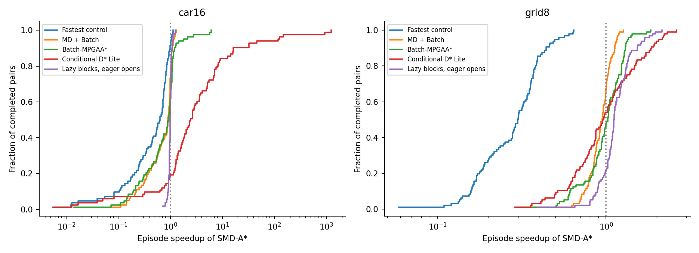
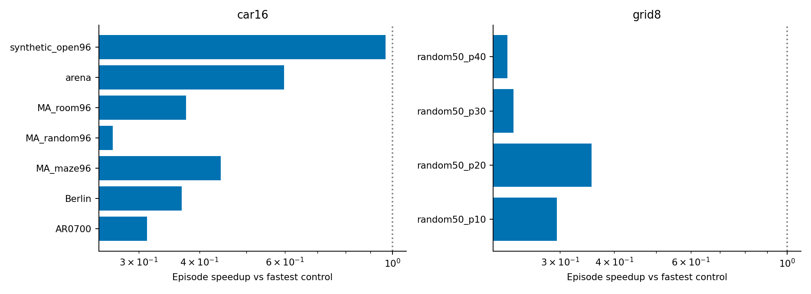
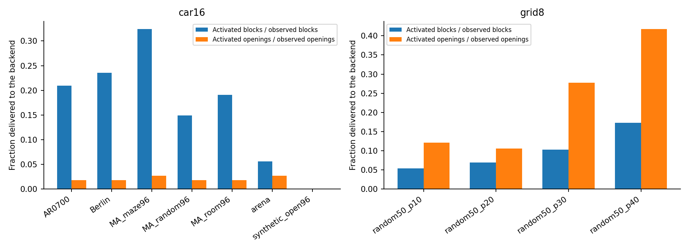
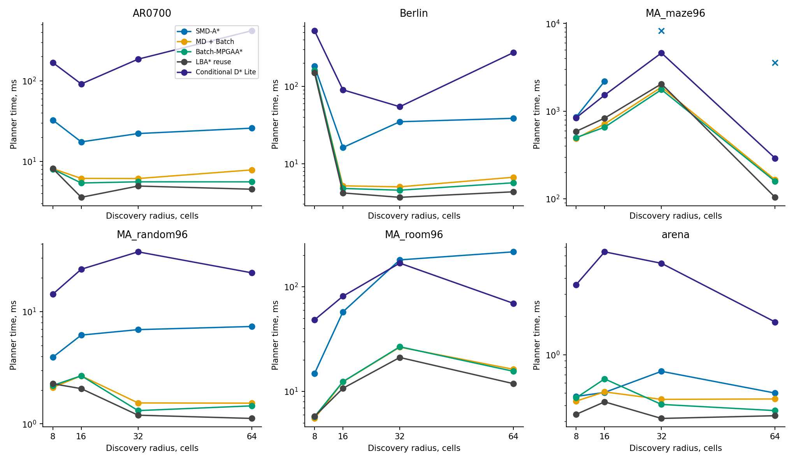
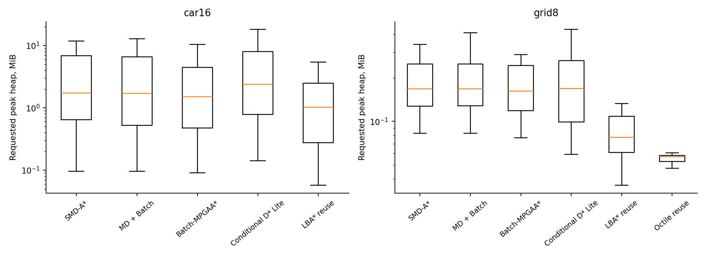

# Результат второй итерации

Реализован **SMD-A\*** — симметричное откладывание правок с mesh-сертификатом освобождений и проверкой разрыва между рабочим оптимумом и допустимым incumbent. Выполнены 5,148 временных эпизодов и 1,716 отдельных эпизодов памяти на 184 конфигурациях; 96,522 вызовов. Расхождений завершённых ответов с точным эталоном: 0; capped-вызовов: 18. Все прежние логические поля обычного и allocation-прохода совпали в 32,174 строках.

Это вторая исследовательская итерация после отрицательного первого результата: Envelope-Mesh почти не отличался от lattice-варианта на обычных картах, Circuit-Mesh не дал общего преимущества. Новый протокол зафиксирован до замеров SMD, но повторные replay-входы относятся к разработке, а не к независимому подтверждению. Навигация на альтернативном корне не участвовала в первой серии. Карты и спецификации уже были в репозитории; скрытым бенчмарком они не являются. Секунды разных серий не смешиваются.

| Набор | Модель | Панель | Пары | Полное × | Ремонт × | Выигрыш от 10% |
| --- | --- | --- | --- | --- | --- | --- |
| navigation_dynamic | car16 | holdout | 9/12 | 0.38 | 0.03 | 0/9 |
| navigation_unknown | car16 | holdout | 22/24 | 0.27 | 0.43 | 0/22 |
| replay | car16 | history | 4/4 | 0.97 | 1.12 | 2/4 |
| replay | car16 | main | 48/48 | 0.44 | 0.33 | 0/48 |
| replay | grid8 | main | 96/96 | 0.27 | 0.43 | 0/96 |

Отношение больше 1 выгодно SMD. Полное время включает конструктор и запрос 0; ремонт исключает их. Replay считает точный NoPath завершением; в навигации нужно достичь цели. Самый быстрый контроль выбирается после измерения по медиане полного эпизода среди завершившихся. В replay эта огибающая включает и сильный eager-open lazy-block контроль. Разные строки могут иметь разные общие завершённые конфигурации; caps и все завершения приведены ниже.

{width=99%}

# Алгоритм и доказательство

Let A be the current observed graph and W the backend's working graph. Initial
maps coincide. Keep B: blocked in A but free in W, and O: free in A but blocked
in W. All primitive costs are fixed and positive. Inputs are cell updates.
No global subgraph ordering between A and W is assumed.

For q in O, the existing mesh compiler supplies L(s,q,t), an admissible lower
bound on any primitive path whose swept collision cells contain q. This matters
because q need not be a primitive-boundary vertex. We reuse the existing MD-A\*
compiler and its fast octile/projection correction; the bound itself is not new.
The same traveling lower-bound heap from MD-A\* handles moving starts.

## Certificate

Suppose P is a known A-feasible path of cost C, every remaining q in O satisfies
L(s,q,t)>C, and the exact optimum in W is at least C. If an A-path P' cheaper
than C exists, it either uses an omitted opening q (contradicting the bound), or
contains no omitted opening. In the latter case all its cells are free in W:
B only adds free cells to W. Thus P' is a W-path cheaper than C, a contradiction.
Therefore P is optimal in A. A W-optimal candidate which is also A-feasible is a
special case. An infeasible W-optimal candidate need not be repaired when its
cost already meets the cost of a known feasible incumbent.

## Replan

1. Apply observed updates to A. Keep newly blocked/free-in-W cells in B. Queue
   newly opened/blocked-in-W cells in O; opposite updates can cancel without a
   backend change. A previously saved optimal working suffix is reused only if
   it survives actual blocks and no competitive opening has to be released.
2. Compute an exact W-optimal path using the unchanged Batch-Mesh-MPGAA\* backend.
3. If a valid incumbent C exists and the working optimum meets C, release any
   still-competitive openings and return the incumbent if none remain.
4. Otherwise validate the optimistic candidate against A. Activate all B cells
   on it as one batch and repair W again if it is invalid.
5. A valid candidate supplies an incumbent C. Release O cells with L<=C and
   repeat; when none remain, return the certified exact path.
6. If W has no path, release all remaining openings. With O empty, A is a
   subgraph of W, so a complete W failure proves an A failure. A cap is never
   treated as a failure proof. Saved positive/negative certificates are cleared
   after a capped incomplete attempt.

Every nonterminal round activates at least one previously deferred cell. Between
input batches, activations move W toward A, so termination is finite; worst-case
work may exceed eager repair. The expansion budget is shared across rounds.
A valid incumbent never meets a newly activated blocking cell, so it stays valid
in both maps through repair. Graph decreases always force a new exact backend
answer before reusing the positive certificate. Saved paths are truncated to the
current start after repair, preventing reuse of earlier prefixes after openings.

The gap-off ablation tests whether avoiding tied invalid candidates matters.
The eager-open ablation applies openings directly (without a pointless heap),
testing the contribution of the mesh lower bound relative to plain lazy blocks.
The one-sided control uses exactly the same backend, isolating two-sided repair
from backend engineering. Tests also verify that a saved certified suffix is
optimal in W, not merely feasible in A, including random start changes and cap
recovery with an unflushed opening.

## Claim boundaries

Generic lazy edge checking, primal/dual bounds, suffix reuse, and the existing
mesh detour bound are prior concepts. The research hypothesis is their coupled
certificate for an incomparably modified working mesh graph. The first stage
informed this design; its replay results are exploratory development data. The
alternate-root navigation check is separate. No claim of priority or universal
speedup should precede the strong-control, ablation and completion results.


Конкретный backend — неизменённый Batch-Mesh-MPGAA\* с размером плитки 8. Нижняя оценка клетки взята из существующего MD-A\*: $L(s,q,t)=D_\alpha(s,q)+D_\alpha(q,t)+\kappa$, где $D_\alpha$ — масштабированная octile-метрика, а поправка $\kappa$ компилируется из исходного primitive mesh. В частности, клетка q может лежать внутри swept-трассы и не быть граничной вершиной решётки. Это не новая нижняя оценка. Полные формулы и C++ остаются в `cpp/include/ima/deferred.hpp`. Отложенные освобождения обслуживаются прежней нижнеоценивающей очередью с поправкой на перемещение старта.

| Вариант | Роль |
| --- | --- |
| SMD-A\* | Оба вида правок отложены, mesh bound и gap-сертификат |
| SMD без gap | Изолирует короткую проверку оптимальности incumbent |
| MD + Batch | Односторонний MD на том же backend; блокировки применяются заранее |
| Lazy blocks / eager opens | Все освобождения применяются сразу, без ненужной очереди; только блокировки отложены |
| Batch / MD-A\* / LBA reuse / Boundary-Mesh / Conditional D\* / Octile | Сильные самостоятельные контроли |

Generic lazy search, incumbent/primal-dual bounds, suffix reuse и mesh-bound MD-A\* — известные компоненты. Заявляемая гипотеза вклада — их совместный сертификат при отсутствии глобального порядка между рабочим и наблюдаемым графом. Приоритет этого сочетания не установлен; нужен более широкий обзор полных текстов Lifelong-GLS/GD\* и других lazy incremental методов. Официальные внешние реализации здесь не портированы. Код содержит дополнительный аудит: сохранённый путь допустим в observed-карте и оптимален в working-графе; случайные проверки сравнивают ответы с прямым primitive Dijkstra. ASan/UBSan проходят.

# Протокол

Stage-two algorithm design AFTER first-stage replay showed no useful standard-map mesh-envelope gain. Freeze before all SMD timings. Exploratory replay: all52 car and96 grid cases from stage one, no case selection by wins. Holdout navigation relative to stage one: alternate root s48102 on all six car maps, four discovery radii8/16/32/64 and two dynamic anchors(k,cr)=(2,5),(32,20), n=k and actual clampedcr retained. These maps/specifications already existed in the repository; this is a new-method/alternate-root check, not a claim of a hidden benchmark. Shared Batch backend isolates symmetric vs one-sided deferral; gap-off and eager-open ablations. All comparator times collected afresh, three randomized serial repeats and a separate allocation pass. No seconds pooled with earlier cohorts.

Контролей и новых вариантов много, но единицы эксперимента не следует суммировать как независимые карты. Основная replay-панель car — 48 конфигураций шести карт и двух корней; четыре history-инстанса показаны отдельно. Grid replay — 96 прежних случаев четырёх плотностей random50; сильный Octile reuse сохраняется. Holdout-навигация: второй корень на всех шести car-картах, раскрытие с радиусами 8/16/32/64 и динамика при (k,cr)=(2,5%),(32,20%), n=k. Радиус — квадратная клеточная окрестность, move — исходный примитив. Динамическая видимость задана по глубине свободной primitive-решётки без окклюзии. При n=k одновременно меняются обзор и частота, поэтому их эффекты не разделяются.

Медиана относительного MAD времени эпизода: 1.83%, p95: 11.03%. Три временных повтора — не три независимые карты. Память — отдельно запрошенные байты C++ new, не RSS. Общие шаблоны моделей готовятся заранее и отражены в JSON. Бюджет 1 000 000 раскрытий на запрос общий для всех внутренних раундов SMD. Нельзя засчитывать остановку по бюджету как NoPath. Проверяется стоимость каждого завершённого ответа с точностью $10^{-6}$.

# Результаты по картам

{width=99%}

## navigation_dynamic, car16

| Карта | Fastest | MD+Batch | Batch | Cond D\* | No gap | Eager opens |
| --- | --- | --- | --- | --- | --- | --- |
| AR0700 | 0.63 / — (1/2) | 0.97 / — (1/2) | 0.97 / — (1/2) | 0.63 / — (1/2) | 1.03 / — (1/2) | — |
| Berlin | 0.76 / — (1/2) | 1.00 / — (1/2) | 0.94 / — (1/2) | 2.33 / — (1/2) | 1.00 / — (1/2) | — |
| MA_maze96 | 0.25 / 0.01 (2/2) | 0.87 / 0.81 (2/2) | 1.05 / 1.12 (2/2) | 1.48 / 1.16 (2/2) | 0.98 / 0.99 (2/2) | — |
| MA_random96 | 0.11 / 0.01 (2/2) | 0.95 / 0.86 (2/2) | 0.12 / 0.01 (2/2) | 0.29 / 0.05 (2/2) | 1.02 / 0.98 (2/2) | — |
| MA_room96 | 0.81 / 0.82 (2/2) | 0.95 / 0.88 (2/2) | 0.92 / 0.82 (2/2) | 1.13 / 0.91 (2/2) | 1.09 / 1.22 (2/2) | — |
| arena | 0.81 / — (1/2) | 0.96 / — (1/2) | 1.05 / — (1/2) | 0.93 / — (1/2) | 0.96 / — (1/2) | — |

Формат: полное / ремонт × (завершённые пары / конфигурации). Eager-open и gap-off абляции навигации не добавлялись автоматически: недостающие клетки показаны прочерком.

## navigation_unknown, car16

| Карта | Fastest | MD+Batch | Batch | Cond D\* | No gap | Eager opens |
| --- | --- | --- | --- | --- | --- | --- |
| AR0700 | 0.21 / 0.39 (4/4) | 0.29 / 0.58 (4/4) | 0.25 / 0.42 (4/4) | 7.77 / 31.24 (4/4) | 0.99 / 1.04 (4/4) | — |
| Berlin | 0.22 / 0.52 (4/4) | 0.29 / 0.75 (4/4) | 0.27 / 0.59 (4/4) | 3.65 / 32.96 (4/4) | 1.01 / 1.12 (4/4) | — |
| MA_maze96 | 0.41 / 0.41 (2/4) | 0.43 / 0.43 (2/4) | 0.42 / 0.42 (2/4) | 0.82 / 0.83 (2/4) | 1.05 / 1.05 (2/4) | — |
| MA_random96 | 0.26 / 0.58 (4/4) | 0.32 / 0.79 (4/4) | 0.31 / 0.79 (4/4) | 3.80 / 39.19 (4/4) | 0.99 / 0.97 (4/4) | — |
| MA_room96 | 0.15 / 0.19 (4/4) | 0.17 / 0.31 (4/4) | 0.17 / 0.30 (4/4) | 1.08 / 3.96 (4/4) | 0.99 / 0.97 (4/4) | — |
| arena | 0.64 / 0.73 (4/4) | 0.84 / 1.08 (4/4) | 0.84 / 2.90 (4/4) | 7.04 / 181.96 (4/4) | 0.92 / 0.99 (4/4) | — |

Формат: полное / ремонт × (завершённые пары / конфигурации). Eager-open и gap-off абляции навигации не добавлялись автоматически: недостающие клетки показаны прочерком.

## replay, car16

| Карта | Fastest | MD+Batch | Batch | Cond D\* | No gap | Eager opens |
| --- | --- | --- | --- | --- | --- | --- |
| AR0700 | 0.35 / 0.32 (8/8) | 0.74 / 0.77 (8/8) | 0.76 / 0.98 (8/8) | 3.28 / 13.65 (8/8) | 0.96 / 1.00 (8/8) | 0.94 / 1.00 (8/8) |
| Berlin | 0.43 / 0.36 (8/8) | 0.87 / 0.81 (7/8) | 0.87 / 1.78 (8/8) | 2.45 / 16.42 (8/8) | 1.00 / 1.00 (8/8) | 1.00 / 1.01 (8/8) |
| MA_maze96 | 0.52 / 0.29 (8/8) | 0.68 / 0.42 (8/8) | 0.66 / 1.11 (8/8) | 1.85 / 8.22 (8/8) | 1.01 / 0.91 (8/8) | 1.02 / 1.45 (8/8) |
| MA_random96 | 0.33 / 0.32 (8/8) | 0.91 / 1.01 (8/8) | 0.94 / 1.24 (8/8) | 1.13 / 3.96 (8/8) | 1.03 / 1.02 (8/8) | 1.01 / 1.00 (8/8) |
| MA_room96 | 0.50 / 0.34 (8/8) | 0.70 / 0.64 (8/8) | 0.69 / 0.69 (8/8) | 1.21 / 4.00 (8/8) | 1.01 / 1.00 (8/8) | 1.01 / 1.00 (8/8) |
| arena | 0.55 / 0.35 (8/8) | 0.93 / 0.69 (8/8) | 1.06 / 1.93 (8/8) | 8.11 / 38.63 (8/8) | 1.02 / 1.00 (8/8) | 0.98 / 0.99 (8/8) |
| synthetic_open96 | 0.97 / 1.12 (4/4) | 1.02 / 1.55 (4/4) | 3.82 / 17.49 (4/4) | 69.15 / 393.54 (4/4) | 1.01 / 1.03 (4/4) | 0.99 / 1.01 (4/4) |

Формат: полное / ремонт × (завершённые пары / конфигурации). Eager-open и gap-off абляции навигации не добавлялись автоматически: недостающие клетки показаны прочерком.

## replay, grid8

| Карта | Fastest | MD+Batch | Batch | Cond D\* | No gap | Eager opens |
| --- | --- | --- | --- | --- | --- | --- |
| random50_p10 | 0.29 / 0.62 (24/24) | 0.93 / 0.94 (24/24) | 1.06 / 1.52 (24/24) | 0.99 / 1.04 (24/24) | 1.01 / 1.03 (24/24) | 1.14 / 1.68 (24/24) |
| random50_p20 | 0.35 / 0.60 (24/24) | 0.97 / 0.99 (24/24) | 1.09 / 1.72 (24/24) | 1.14 / 1.46 (24/24) | 1.03 / 1.03 (24/24) | 1.26 / 2.07 (24/24) |
| random50_p30 | 0.23 / 0.33 (24/24) | 0.92 / 0.88 (24/24) | 0.96 / 1.19 (24/24) | 0.97 / 0.80 (24/24) | 1.01 / 1.01 (24/24) | 1.16 / 1.52 (24/24) |
| random50_p40 | 0.23 / 0.30 (24/24) | 0.86 / 0.82 (24/24) | 0.81 / 1.07 (24/24) | 0.82 / 0.76 (24/24) | 1.02 / 1.03 (24/24) | 1.00 / 1.37 (24/24) |

Формат: полное / ремонт × (завершённые пары / конфигурации). Eager-open и gap-off абляции навигации не добавлялись автоматически: недостающие клетки показаны прочерком.

# Механизм ремонта

{width=99%}

| Набор | Модель | Blocks | Act B | Opens | Act O | Backend | Gap hits | Path probes |
| --- | --- | --- | --- | --- | --- | --- | --- | --- |
| navigation_dynamic | car16 | 1185 | 123 | 1037 | 492 | 194 | 35 | 6642 |
| navigation_unknown | car16 | 31939 | 2738 | 0 | 0 | 1065 | 0 | 81891 |
| replay | car16 | 4072 | 566 | 1894 | 14 | 421 | 5 | 30265 |
| replay | grid8 | 9846 | 1071 | 9648 | 2513 | 2534 | 765 | 35815 |

Backend — число вызовов API, включая нулевые раскрытия; оно не равно числу запусков полного нового A\*. Gap hit означает принятие уже известного допустимого пути после сравнения с рабочим оптимумом. Path probes считает только дополнительную проверку optimistic-кандидата в observed-карте. Это не полный collision-API счётчик backend: историческое checked_cells также не охватывает все предварительные проверки. Время, число раскрытий, ремонт h, stamp-writes, очереди и доставленные изменения интерпретируются отдельно. Сумма deferred_block_cells в work.csv — сумма снимков; для максимума использовать max_deferred_blocks.csv.

# Радиусы, качество движения и память

{width=99%}

| Карта | Радиус | SMD | MD+Batch | Batch | LBA reuse | Cond D\* |
| --- | --- | --- | --- | --- | --- | --- |
| AR0700 | 8 | 1.65 | 1.65 | 1.65 | 1.54 | 1.66 |
| AR0700 | 16 | 1.02 | 1.02 | 1.02 | 1.01 | 1.01 |
| AR0700 | 32 | 1.00 | 1.00 | 1.00 | 1.00 | 1.00 |
| AR0700 | 64 | 1.00 | 1.00 | 1.00 | 1.00 | 1.00 |
| Berlin | 8 | 2.00 | 2.25 | 2.25 | 2.25 | 1.99 |
| Berlin | 16 | 1.00 | 1.00 | 1.00 | 1.00 | 1.00 |
| Berlin | 32 | 1.00 | 1.00 | 1.00 | 1.00 | 1.00 |
| Berlin | 64 | 1.00 | 1.00 | 1.00 | 1.00 | 1.00 |
| MA_maze96 | 8 | 1.91 | 1.91 | 1.91 | 1.91 | 1.91 |
| MA_maze96 | 16 | 1.67 | 1.66 | 1.66 | 1.66 | 1.67 |
| MA_maze96 | 32 | нет goal | 1.32 | 1.32 | 1.35 | 1.35 |
| MA_maze96 | 64 | нет goal | 1.00 | 1.00 | 1.00 | 1.00 |
| MA_random96 | 8 | 1.01 | 1.01 | 1.01 | 1.01 | 1.01 |
| MA_random96 | 16 | 1.00 | 1.00 | 1.00 | 1.00 | 1.00 |
| MA_random96 | 32 | 1.00 | 1.00 | 1.00 | 1.00 | 1.00 |
| MA_random96 | 64 | 1.00 | 1.00 | 1.00 | 1.00 | 1.00 |
| MA_room96 | 8 | 1.03 | 1.03 | 1.03 | 1.03 | 1.03 |
| MA_room96 | 16 | 1.00 | 1.00 | 1.00 | 1.00 | 1.00 |
| MA_room96 | 32 | 1.00 | 1.00 | 1.00 | 1.00 | 1.00 |
| MA_room96 | 64 | 1.00 | 1.00 | 1.00 | 1.00 | 1.00 |
| arena | 8 | 1.00 | 1.00 | 1.00 | 1.00 | 1.00 |
| arena | 16 | 1.00 | 1.00 | 1.00 | 1.00 | 1.00 |
| arena | 32 | 1.00 | 1.00 | 1.00 | 1.00 | 1.00 |
| arena | 64 | 1.00 | 1.00 | 1.00 | 1.00 | 1.00 |

Здесь значения — длина исполненного пути / начальный оптимум полной статической truth-карты, а не отношение времён. В динамике этот знаменатель не является нижней оценкой исполненного пути; там сохранены абсолютная длина, число moves и планирований. Каждый replanning-запрос точен относительно текущего belief, но контроллер не реализует активное исследование при NoPath. Он прекращает миссию; диагностические truth-снимки сохранены отдельно. Разные оптимальные пути могут приводить к разным наблюдениям и числу фаз.

{width=99%}

| Модель | Метод | Медиана MiB | Максимум MiB | Завершено |
| --- | --- | --- | --- | --- |
| car16 | Batch-MPGAA\* | 1.52 | 248.94 | 85/88 |
| car16 | Boundary-Mesh | 3.31 | 170.97 | 86/88 |
| car16 | Conditional D\* Lite | 2.38 | 304.37 | 86/88 |
| car16 | Lazy blocks / eager opens | 1.68 | 249.17 | 52/52 |
| car16 | LBA\* reuse | 1.03 | 122.09 | 84/88 |
| car16 | MD-A\* | 2.19 | 371.38 | 84/88 |
| car16 | MD + Batch | 1.71 | 249.14 | 84/88 |
| car16 | SMD-A\* | 1.72 | 249.17 | 83/88 |
| car16 | SMD без gap | 1.72 | 249.17 | 83/88 |
| grid8 | Batch-MPGAA\* | 0.16 | 0.53 | 96/96 |
| grid8 | Boundary-Mesh | 0.15 | 0.37 | 96/96 |
| grid8 | Conditional D\* Lite | 0.17 | 0.51 | 96/96 |
| grid8 | Lazy blocks / eager opens | 0.17 | 0.55 | 96/96 |
| grid8 | LBA\* reuse | 0.08 | 0.24 | 96/96 |
| grid8 | MD-A\* | 0.18 | 0.75 | 96/96 |
| grid8 | MD + Batch | 0.17 | 0.54 | 96/96 |
| grid8 | Octile reuse | 0.06 | 0.09 | 96/96 |
| grid8 | SMD-A\* | 0.17 | 0.56 | 96/96 |
| grid8 | SMD без gap | 0.17 | 0.56 | 96/96 |

# Caps, завершение и фактический cr

| Метод | Capped calls | Конфигурации |
| --- | --- | --- |
| MD-A\* | 3 | car16 / Berlin / churn / s48102 / b8 / k2 / r8 |
| MD + Batch | 3 | car16 / Berlin / churn / s48102 / b8 / k2 / r8 |
| SMD-A\* | 6 | car16 / MA_maze96 / unknown / s48102 / r32, car16 / MA_maze96 / unknown / s48102 / r64 |
| SMD без gap | 6 | car16 / MA_maze96 / unknown / s48102 / r32, car16 / MA_maze96 / unknown / s48102 / r64 |

| Набор | Модель | Метод | Завершено |
| --- | --- | --- | --- |
| navigation_dynamic | car16 | Batch-MPGAA\* | 9/12 |
| navigation_dynamic | car16 | Boundary-Mesh | 10/12 |
| navigation_dynamic | car16 | Conditional D\* Lite | 10/12 |
| navigation_dynamic | car16 | LBA\* reuse | 8/12 |
| navigation_dynamic | car16 | MD-A\* | 9/12 |
| navigation_dynamic | car16 | MD + Batch | 9/12 |
| navigation_dynamic | car16 | SMD-A\* | 9/12 |
| navigation_dynamic | car16 | SMD без gap | 9/12 |
| navigation_unknown | car16 | Batch-MPGAA\* | 24/24 |
| navigation_unknown | car16 | Boundary-Mesh | 24/24 |
| navigation_unknown | car16 | Conditional D\* Lite | 24/24 |
| navigation_unknown | car16 | LBA\* reuse | 24/24 |
| navigation_unknown | car16 | MD-A\* | 24/24 |
| navigation_unknown | car16 | MD + Batch | 24/24 |
| navigation_unknown | car16 | SMD-A\* | 22/24 |
| navigation_unknown | car16 | SMD без gap | 22/24 |
| replay | car16 | Batch-MPGAA\* | 52/52 |
| replay | car16 | Boundary-Mesh | 52/52 |
| replay | car16 | Conditional D\* Lite | 52/52 |
| replay | car16 | Lazy blocks / eager opens | 52/52 |
| replay | car16 | LBA\* reuse | 52/52 |
| replay | car16 | MD-A\* | 51/52 |
| replay | car16 | MD + Batch | 51/52 |
| replay | car16 | SMD-A\* | 52/52 |
| replay | car16 | SMD без gap | 52/52 |
| replay | grid8 | Batch-MPGAA\* | 96/96 |
| replay | grid8 | Boundary-Mesh | 96/96 |
| replay | grid8 | Conditional D\* Lite | 96/96 |
| replay | grid8 | Lazy blocks / eager opens | 96/96 |
| replay | grid8 | LBA\* reuse | 96/96 |
| replay | grid8 | MD-A\* | 96/96 |
| replay | grid8 | MD + Batch | 96/96 |
| replay | grid8 | Octile reuse | 96/96 |
| replay | grid8 | SMD-A\* | 96/96 |
| replay | grid8 | SMD без gap | 96/96 |

| Карта | k=n | Запрос cr% | Мин факт% | Макс факт% | Clamp phases | С фазами |
| --- | --- | --- | --- | --- | --- | --- |
| AR0700 | 2 | 5 | 5.00 | 5.00 | 0 | 8/8 |
| AR0700 | 32 | 20 | — | — | 0 | 0/8 |
| Berlin | 2 | 5 | 5.00 | 5.00 | 0 | 8/8 |
| Berlin | 32 | 20 | — | — | 0 | 0/8 |
| MA_maze96 | 2 | 5 | 4.99 | 4.99 | 0 | 8/8 |
| MA_maze96 | 32 | 20 | 13.54 | 13.54 | 8 | 8/8 |
| MA_random96 | 2 | 5 | 4.99 | 4.99 | 0 | 8/8 |
| MA_random96 | 32 | 20 | — | — | 0 | 0/8 |
| MA_room96 | 2 | 5 | 4.99 | 4.99 | 0 | 8/8 |
| MA_room96 | 32 | 20 | — | — | 0 | 0/8 |
| arena | 2 | 5 | 5.00 | 5.00 | 0 | 8/8 |
| arena | 32 | 20 | — | — | 0 | 0/8 |

cr считает сумму блокировок и освобождений / все клетки за фазу. Половины выбираются из исходных до фазы раздельных пулов, с защитой клеток агента и цели; число пар ограничивается доступной мощностью. Фактический cr=100·actual_changes/(число клеток·phases). Без фаз скорость изменения не оценивается. Ограниченные/нулевые фазы и метод-зависимые длины маршрутов не исключаются из исходных данных.

# Оценка пригодности для статьи

Основная balanced-панель car16, контроль Fastest control: полное время 0.44×, ремонт 0.33×, выигрыш от 10% в 0/48 завершённых пар, всего 48 конфигураций.

Основная balanced-панель car16, контроль MD + Batch: полное время 0.80×, ремонт 0.70×, выигрыш от 10% в 5/47 завершённых пар, всего 48 конфигураций.

Основная balanced-панель car16, контроль Lazy blocks / eager opens: полное время 0.99×, ремонт 1.06×, выигрыш от 10% в 2/48 завершённых пар, всего 48 конфигураций.

Основная balanced-панель car16, контроль SMD без gap: полное время 1.00×, ремонт 0.99×, выигрыш от 10% в 8/48 завершённых пар, всего 48 конфигураций.

Требование убедительного общего преимущества на обычных картах пока не выполнено: основная панель не даёт одновременно более 10% по полному времени к самой быстрой контрольной реализации и к eager-open абляции. Отдельные успешные карты и экономия доставленных правок сохраняются как локальные результаты; объявлять алгоритм готовым победителем для ведущей конференции по этим данным нельзя.

| Набор | Модель | Панель | Контроль | Полное × | Ремонт × | Пары |
| --- | --- | --- | --- | --- | --- | --- |
| navigation_dynamic | car16 | holdout | Fastest control | 0.38 | 0.03 | 9/12 |
| navigation_dynamic | car16 | holdout | MD + Batch | 0.94 | 0.84 | 9/12 |
| navigation_dynamic | car16 | holdout | SMD без gap | 1.02 | 1.04 | 9/12 |
| navigation_unknown | car16 | holdout | Fastest control | 0.27 | 0.43 | 22/24 |
| navigation_unknown | car16 | holdout | MD + Batch | 0.34 | 0.61 | 22/24 |
| navigation_unknown | car16 | holdout | SMD без gap | 0.99 | 1.02 | 22/24 |
| replay | car16 | history | Fastest control | 0.97 | 1.12 | 4/4 |
| replay | car16 | history | Lazy blocks / eager opens | 0.99 | 1.01 | 4/4 |
| replay | car16 | history | MD + Batch | 1.02 | 1.55 | 4/4 |
| replay | car16 | history | SMD без gap | 1.01 | 1.03 | 4/4 |
| replay | car16 | main | Fastest control | 0.44 | 0.33 | 48/48 |
| replay | car16 | main | Lazy blocks / eager opens | 0.99 | 1.06 | 48/48 |
| replay | car16 | main | MD + Batch | 0.80 | 0.70 | 47/48 |
| replay | car16 | main | SMD без gap | 1.00 | 0.99 | 48/48 |
| replay | grid8 | main | Fastest control | 0.27 | 0.43 | 96/96 |
| replay | grid8 | main | Lazy blocks / eager opens | 1.13 | 1.64 | 96/96 |
| replay | grid8 | main | MD + Batch | 0.92 | 0.90 | 96/96 |
| replay | grid8 | main | SMD без gap | 1.02 | 1.02 | 96/96 |

Критерии убедительного результата: выигрыш не только над исходным MD, но и над тем же Batch-backend с односторонней обработкой; положительная роль mesh-bound против eager-open lazy-block варианта; повторяемость на нескольких обычных картах; отсутствие выигрыша за счёт недостижения цели или большего бюджета. Эти критерии проверяются приведёнными прямыми парами. Улучшение одной history-карты не заменяет результаты balanced main-панели. Заявка на ведущую конференцию потребует внешних L-GLS/GD\* сравнений, большего числа корней и проверки литературного приоритета. Работа с дешёвыми 2D occupancy-проверками не доказывает выигрыш при высокоразмерной геометрии.

# Воспроизведение

```sh
make -C cpp/mesh_symmetric all test
python cpp/mesh_symmetric/run_all.py --output cpp/mesh_symmetric/results/reproduction
python cpp/mesh_symmetric/analyze.py
python cpp/mesh_symmetric/report.py
```

Файл frozen/manifest.json фиксирует код, входы и план; results/full/experiment.json фиксирует бинарники, команды, исходные CSV и метаданные. Тесты и preflight вынесены из измеряемой серии. Анализ также принимает --directory; PDF требует Pandoc, XeLaTeX и Noto. Общий обзор связанных работ и результаты отрицательного первого этапа находятся в docs/mesh_envelope/report.pdf и related_work.md.
