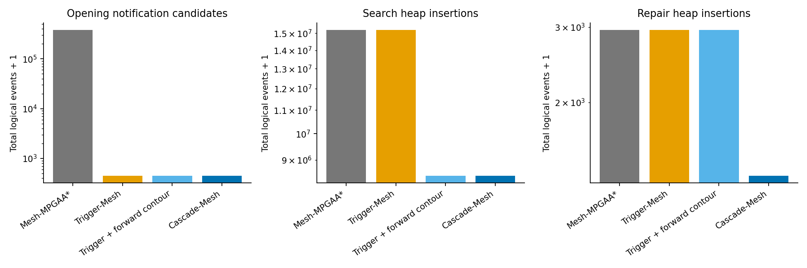
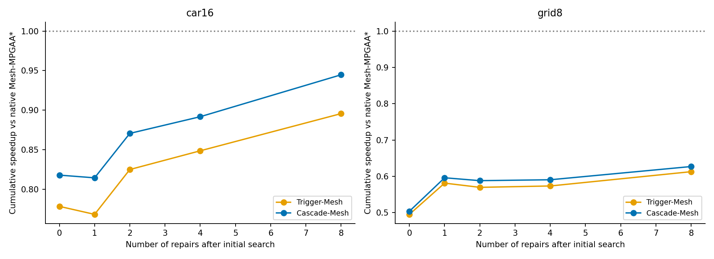
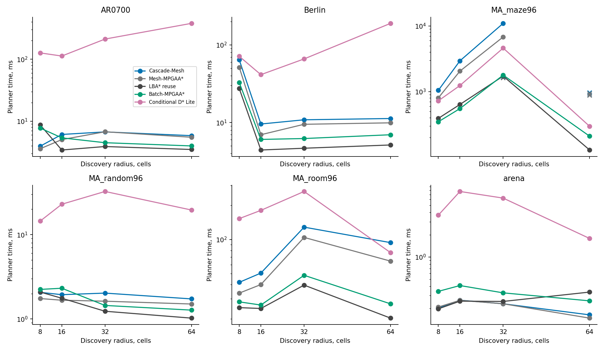

# Abstract

We study exact incremental planning directly on a motion-primitive configuration mesh. Unlike boundary-state planners that only share collision tests, our g-values, learned heuristics, OPEN entries and cached policies include intermediate mesh configurations. Trigger-Mesh-MPGAA\* maintains subscriptions to blocked arcs whose heuristic-consistency inequalities are violated; openings activate only these subscriptions. Cascade-Mesh-MPGAA\* additionally processes zero-base internal repair arcs locally under a potential-normalized key and continues a forward contour only when the exact OPEN order permits it. On the balanced 48-case car replay panel, Cascade achieves 0.93 whole-episode and 1.26 repair speedup relative to ordinary MPGAA\* on the identical mesh. Against the fastest completed strong control, the corresponding ratios are 0.59 and 0.59. Our frozen C++ study contains 8,964 timing episodes, 2,988 allocation episodes and 2,316 independent API-count episodes. All completed answers match exact references; caps and failed missions remain visible. Novelty is a hypothesis about the mesh repair combination, not a claim to invent adaptive search, watched dependencies or fringe queues.

# Problem and graph

The directed mesh vertex is (cell, configuration). The original car automaton has 412 configurations, 16 of them primitive boundaries. Every returned solution is projected to the unchanged primitive IDs and float costs. A pre-existing dyadic potential phi gives each search arc the positive cost c prime = c + phi(v) - phi(u); boundary potentials are zero. Internal arcs have zero original base cost, while completion arcs pay the primitive cost. The initial internal heuristic minimizes completion cost plus endpoint Euclidean distance, subtracting the current potential. No lattice search is called inside either candidate.

# Triggered consistency repair

The maintained invariant is that every blocked mesh arc satisfying $h(u)>c'(u,v)+h(v)$ is subscribed to the collision cell of v. Successful A\* learning first updates all expanded labels to $\max(h(u),C-g(u))$, then installs any newly violated blocked arcs. Decreasing h(v) examines its predecessors: a free violated arc is relaxed immediately, and a blocked one is subscribed. Duplicate subscriptions are suppressed; stale subscriptions are harmless. Opening a cell extracts only its bucket. A violation can appear only after a left-label increase, a right-label decrease or an arc opening. The first two events install a subscription or repair the free arc, and the last processes its bucket. Thus an unobserved opening seed cannot remain on a free inconsistent arc. This filters work, not the observed map: all occupancy updates are applied eagerly.

# Cascades and search contours

Repair priorities use $h(u)+\phi(u)$. Across an internal arc of original base cost zero, reverse relaxation preserves this priority. A local stack processes that contour; positive-base completion arcs return to the heap. All intermediate vertices retain their own labels. Forward search separately bypasses the heap for the best newly generated child only when its complete key $(f,-g,seq)$ is no worse than the current heap minimum. Sequence numbers are assigned identically to ordinary A\*. Therefore the next extracted vertex is unchanged. The implementation checks this equivalence over all replay queries using status, cost, path and pop-trace fingerprints.

After consistency repair, A\* may join a cached policy at any mesh vertex. A policy suffix is accepted only after checking current collision cells and tight h equalities through the goal. Extracting that vertex yields an optimal path; standard adaptive updates preserve consistency. Positive reweighted costs prevent policy cycles, and potential telescoping preserves original primitive costs. A capped search learns no stronger labels and creates no NoPath cache entry. The worst case may still repair a large learned region; subscriptions can increase memory.

# Evaluation

Freeze before any canonical timings. Search, OPEN, g, learned h and cached policies operate on the full original configuration mesh (412 car configurations,16 boundary headings); positive dyadic reweighting preserves primitive costs. Triggered cell-violation repair; reverse zero-base cascades and forward exact-priority contour continuation. Same-core native MPGAA and component ablations plus eight fresh strong repository controls. All52 previous car replay and96 grid replay inputs, never selected by wins; history4 separated. Closed-loop: all six car maps x both roots, four unknown radii8/16/32/64, dynamic(k,cr)=(2,5),(8,10),(32,20), n=k; balanced exchanges clamped, actualcr reported. These are existing public repository specifications, not hidden or statistically independent validation. Three randomized serial timing repeats; one separate allocation pass. No compilation, instrumentation or analysis during timing. No earlier seconds pooled.

Replay inputs are reused exploratory data; the four history cases are separated from the balanced car panel. Navigation covers six car maps, both roots, four discovery radii and three n=k dynamic anchors. Different optimal paths can produce different observations, so replay is the stricter identical-input test. Three serial randomized repeats measure time, a separate pass measures requested C++ heap bytes, and a generated-header counter pass measures every Grid.free API invocation. Counter-binary times are discarded. Snapshot counters and cross-representation expansion units are not treated as common CPU work.

| Cohort | Model | Panel | Candidate | Comparator | Episode × | Repair × | Pairs |
| --- | --- | --- | --- | --- | --- | --- | --- |
| navigation_dynamic | car16 | navigation | Cascade-Mesh | Fastest control | 0.55 | 0.66 | 17/36 |
| navigation_dynamic | car16 | navigation | Cascade-Mesh | Mesh-MPGAA\* | 1.54 | 4.05 | 17/36 |
| navigation_dynamic | car16 | navigation | Trigger-Mesh | Fastest control | 0.51 | 0.60 | 17/36 |
| navigation_dynamic | car16 | navigation | Trigger-Mesh | Mesh-MPGAA\* | 1.43 | 3.65 | 17/36 |
| navigation_unknown | car16 | navigation | Cascade-Mesh | Fastest control | 0.52 | 0.53 | 45/48 |
| navigation_unknown | car16 | navigation | Cascade-Mesh | Mesh-MPGAA\* | 0.84 | 0.89 | 45/48 |
| navigation_unknown | car16 | navigation | Trigger-Mesh | Fastest control | 0.49 | 0.51 | 45/48 |
| navigation_unknown | car16 | navigation | Trigger-Mesh | Mesh-MPGAA\* | 0.79 | 0.85 | 45/48 |
| replay | car16 | history | Cascade-Mesh | Fastest control | 1.19 | 0.24 | 4/4 |
| replay | car16 | history | Cascade-Mesh | Mesh-MPGAA\* | 8.18 | 10.61 | 4/4 |
| replay | car16 | history | Trigger-Mesh | Fastest control | 1.16 | 0.24 | 4/4 |
| replay | car16 | history | Trigger-Mesh | Mesh-MPGAA\* | 8.03 | 10.25 | 4/4 |
| replay | car16 | main | Cascade-Mesh | Fastest control | 0.59 | 0.59 | 36/48 |
| replay | car16 | main | Cascade-Mesh | Mesh-MPGAA\* | 0.93 | 1.26 | 36/48 |
| replay | car16 | main | Trigger-Mesh | Fastest control | 0.56 | 0.55 | 36/48 |
| replay | car16 | main | Trigger-Mesh | Mesh-MPGAA\* | 0.88 | 1.17 | 36/48 |
| replay | grid8 | main | Cascade-Mesh | Fastest control | 0.42 | 0.56 | 96/96 |
| replay | grid8 | main | Cascade-Mesh | Mesh-MPGAA\* | 0.70 | 0.91 | 96/96 |
| replay | grid8 | main | Trigger-Mesh | Fastest control | 0.42 | 0.56 | 96/96 |
| replay | grid8 | main | Trigger-Mesh | Mesh-MPGAA\* | 0.69 | 0.90 | 96/96 |

Ratios above one favor the candidate. Whole-episode time includes construction and initial search. The fastest-control envelope is descriptive and selected after measurement among completed controls; it includes the ordinary native mesh planner. Replay completion permits an exact failure proof; navigation requires reaching the goal. Incomplete pairs are never credited as time wins. Per-map losses, all caps, allocation maxima, actual clamped rates, latency and trajectory quality are retained in the accompanying report.

{width=99%}

{width=99%}

{width=99%}

# Scope and related work

MeshA\* supplies the configuration representation; MPGAA\* supplies adaptive learning and policy reuse. Potential reweighting and watched dependencies are established techniques. Fringe Search and partial-expansion A\* already reduce queue/generation costs; our forward contour mechanism preserves the exact valid-vertex queue order and is not a claim of generic novelty in fringe processing. The proposed research contribution is the cell-triggered violation frontier combined with zero-base mesh repair cascades in a fully vertex-level adaptive planner. Priority requires a broader full-text review. Official external MPGAA\*/Lifelong-GLS implementations were not integrated. Cheap 2D occupancy checks, a repository Hermite control set, fixed map crops and two roots limit external validity. Stronger claims require broader independent inputs and external implementations.

# References

* Agranovskiy and Yakovlev. 2026. *MeshA\*: Efficient Path Planning With Motion
  Primitives\*. AAAI. [DOI](https://doi.org/10.1609/aaai.v40i43.41004).
* Hernández, Asín and Baier. 2015. *Reusing Previously Found A\* Paths for Fast
  Goal-Directed Navigation in Dynamic Terrain\*. AAAI.
  [DOI](https://doi.org/10.1609/aaai.v29i1.9355).
* Koenig and Likhachev. 2002. *D\* Lite\*. AAAI.
* Koenig, Likhachev and Furcy. 2004. *Lifelong Planning A\**. Artificial
  Intelligence. [DOI](https://doi.org/10.1016/j.artint.2003.12.001).
* Björnsson, Enzenberger, Holte and Schaeffer. 2005. *Fringe Search: Beating A\*
  at Pathfinding on Game Maps\*. CIG.
  [Public paper](http://papersdb.cs.ualberta.ca/~papersdb/uploaded_files/424/paper_cig2005.pdf).
* Yoshizumi, Miura and Ishida. 2000. *A\* with Partial Expansion for Large
  Branching Factor Problems\*. AAAI.
  [Paper](https://www.aaai.org/Papers/AAAI/2000/AAAI00-142.pdf).
* Lim, Srinivasa and Tsiotras. 2022. *Lazy Lifelong Planning for Efficient
  Replanning in Graphs with Expensive Edge Evaluation\*. IROS.
  [DOI](https://doi.org/10.1109/IROS47612.2022.9981389).
* Lim, Ghanei, Lawson, Srinivasa and Tsiotras. 2024. *Lazy incremental search
  for efficient replanning with bounded suboptimality guarantees\*. IJRR.
  [DOI](https://doi.org/10.1177/02783649241227869).
