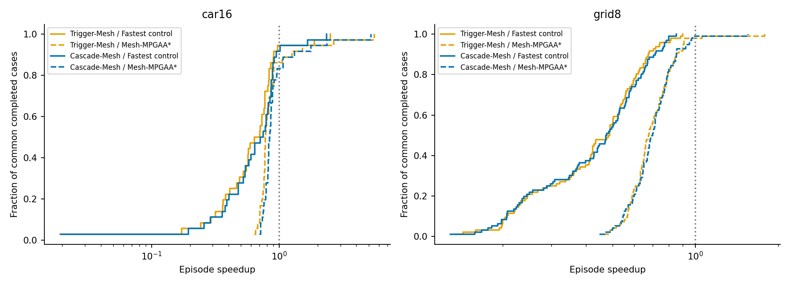
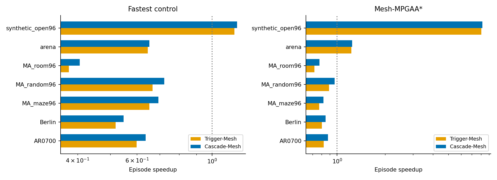
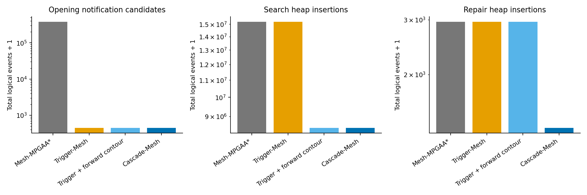
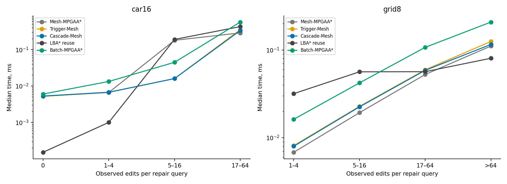
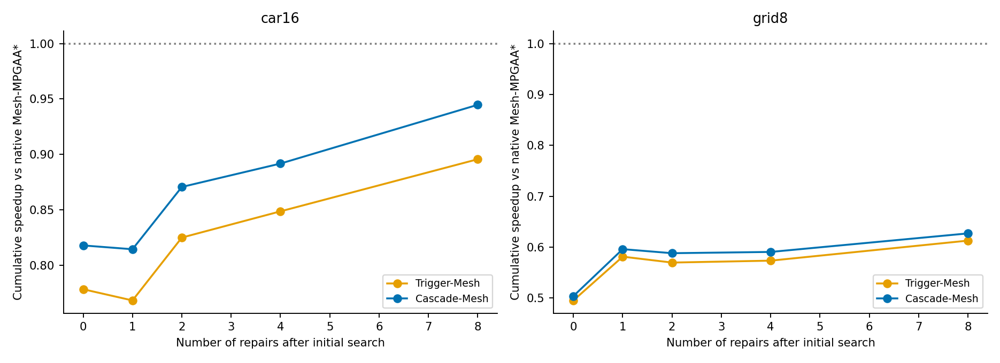
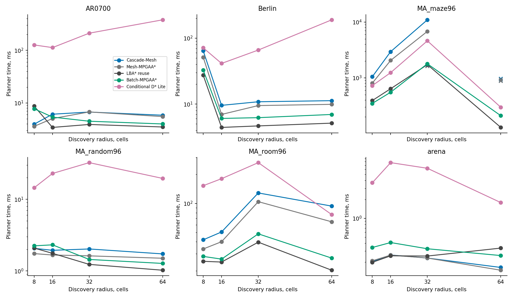
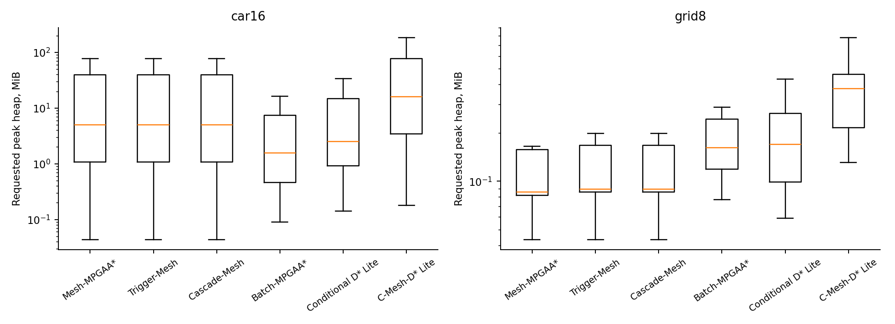

# Что реализовано и что проверено

Реализованы **Trigger-Mesh-MPGAA\*** и **Cascade-Mesh-MPGAA\***. В отличие от прежних boundary-вариантов, OPEN, g, learned h и сохранённые политики работают на полном конфигурационном mesh, включая промежуточные состояния примитивов. Добавлен обычный Mesh-MPGAA\* на том же движке и четыре абляции. Выполнены 8,964 временных эпизодов, 2,988 отдельных замеров памяти, 2,316 счётных эпизодов на 232 конфигурациях. Расхождений завершённых ответов с точным эталоном: 0. Capped-вызовов: 393; они не считаются NoPath или быстрым успешным решением.

Основная balanced-панель car16: Cascade / обычный Mesh-MPGAA — **0.93×** по полному времени и **1.26×** по ремонту, 36/48 общих завершённых пар. Относительно самого быстрого завершившегося контроля — **0.59× / 0.59×**, выигрышей от 10%: 2/36. Отношения больше 1 выгодны кандидату.

На основной панели общего убедительного выигрыша над тем же mesh-движком пока нет. Локальная экономия событий, очередей или отдельные удачные карты не заменяют окупаемость полного эпизода. Представлять эту реализацию как готового победителя для ведущей конференции по этим данным нельзя.

| Набор | Модель | Панель | Метод | Пары | Полное × | Ремонт × |
| --- | --- | --- | --- | --- | --- | --- |
| navigation_dynamic | car16 | navigation | Cascade-Mesh | 17/36 | 0.55 | 0.66 |
| navigation_dynamic | car16 | navigation | Trigger-Mesh | 17/36 | 0.51 | 0.60 |
| navigation_unknown | car16 | navigation | Cascade-Mesh | 45/48 | 0.52 | 0.53 |
| navigation_unknown | car16 | navigation | Trigger-Mesh | 45/48 | 0.49 | 0.51 |
| replay | car16 | history | Cascade-Mesh | 4/4 | 1.19 | 0.24 |
| replay | car16 | history | Trigger-Mesh | 4/4 | 1.16 | 0.24 |
| replay | car16 | main | Cascade-Mesh | 36/48 | 0.59 | 0.59 |
| replay | car16 | main | Trigger-Mesh | 36/48 | 0.56 | 0.55 |
| replay | grid8 | main | Cascade-Mesh | 96/96 | 0.42 | 0.56 |
| replay | grid8 | main | Trigger-Mesh | 96/96 | 0.42 | 0.56 |

Полное время включает конструктор и запрос 0. Ремонт исключает их. Общие шаблоны моделей готовятся заранее; их время и память отдельно сохранены в JSON. В replay точный ответ NoPath считается завершением; в навигации нужно достичь цели. Огибающая best_control выбирается post hoc по медиане полного времени среди завершившихся контролей; прямые сравнения со всеми методами сохранены. Она включает обычный native Mesh-MPGAA\*, но не новые абляции. Три временных повтора не являются тремя независимыми картами.

{width=99%}

# Алгоритмы и доказательства

Вершина — `(i,j,c)`, где `c` может быть начальным направлением либо промежуточной
конфигурацией примитива. Все `g`, learned `h`, OPEN, CLOSED, родители и стрелки
политики относятся к этим вершинам. Для car16 используется исходный автомат
репозитория: 412 конфигураций, из них 16 граничных. После достижения цели цепь
mesh-рёбер проецируется на исходные ID примитивов. Поиск на решётке внутри новых
методов отсутствует; решётка используется только независимым эталоном.

## Стоимости и исходная эвристика

Сохраняется прежнее dyadic-перевзвешивание C-Mesh: $c'(u,v)=c(u,v)+\phi(v)-\phi(u)$,
где $\phi=\delta\,depth$ и потенциал граничной конфигурации равен нулю. Все $c'>0$,
а стоимость полного примитива не меняется. Внутренние рёбра исходного mesh имеют
$c=0$, завершающие — полную исходную стоимость примитива. Это существующий
компилятор, не новый научный результат.

Граничная эвристика — Euclidean до цели. Для внутренней конфигурации используется
минимум `primitive_cost + Euclidean(endpoint,goal) - potential` по допустимым
шаблонным завершениям. Геометрия будущего препятствия при вычислении этой нижней
оценки не читается. Это согласованная эвристика перевзвешенного mesh-графа.

## Базовый Mesh-MPGAA\*

Обычный directed MPGAA\* переносится непосредственно на конфигурационный граф:
поиск A\*, присоединение к допустимому tight-суффиксу политики в любой mesh-вершине,
затем адаптивное обновление `h(u)=max(h(u),C-g(u))` для раскрытых вершин. Стрелки
политики содержат mesh-рёбра, а не целые примитивы. При блокировках согласованность
сохраняется. При освобождениях h понижается обратной релаксацией. Сам перенос
MPGAA\* на другой граф не заявляется как новая теория.

## Trigger-Mesh-MPGAA\*

При понижении стоимости не требуется перечислять все геометрически возможные
входящие рёбра для каждой новой свободной клетки. Храним подписки только на
**нарушенные неравенства у заблокированных mesh-рёбер**:

$$h(u)>c'(u,v)+h(v),\qquad cell(v)=q,\quad q\text{ заблокирована}.$$

Каждое такое ребро имеет подписку в bucket клетки q. После пакетного повышения h
при обучении проверяются исходящие рёбра изменённых вершин; после понижения h(v)
проверяются его геометрические предшественники. Если нарушенное ребро свободно,
выполняется релаксация. Если заблокировано, создаётся подписка. Повторная подписка
одного ребра исключается битовой маской; устаревшие подписки безопасны.

Освобождение q извлекает только её bucket. Если подписок нет, это освобождение
не может нарушить согласованность h. После понижения меток обычная обратная
релаксация восстанавливает все затронутые неравенства. Это точный event-фильтр,
не отложенная карта: все блокировки и освобождения сразу применяются к карте.

**Полнота.** Новое нарушение возникает лишь после повышения левой части,
понижения правой части либо освобождения ребра. Первые два события регистрируют
подписку или немедленно ремонтируют свободное ребро. Третье обслуживает bucket.
Блокировка не создаёт нового требования к h. Поэтому пропущенное освобождение
не оставляет несогласованного свободного ребра.

## Cascade-Mesh-MPGAA\*

Добавляет два механизма, не удаляя промежуточных вершин и их меток.

1. **Обратный каскад ремонта.** Ключ repair-очереди равен `h(u)+potential(u)`.
   Релаксация по внутреннему ребру исходной нулевой стоимости сохраняет этот
   ключ: $h(u)+\phi(u)=c(u,v)+h(v)+\phi(v)$. Такие предшественники обслуживаются
   локальным стеком до возвращения к глобальной куче. Завершающие рёбра с
   положительной исходной стоимостью идут в кучу. Понижение меток остаётся
   обычной корректной релаксацией; внутренний DAG исключает бесконечный каскад.
2. **Продолжение поискового контура.** После раскрытия вершины лучший новый
   ребёнок обрабатывается непосредственно, если его полный ключ `(f,-g,seq)`
   не хуже минимального актуального ключа глобальной OPEN. Остальные дети
   помещаются в OPEN. Следующая обрабатываемая вершина совпадает с обычным A\*.
   Сохраняется счётчик `seq`, включая локальные вставки. Отдельный тест сравнивает
   порядок извлечений и ID возвращённого пути с heap-вариантом.

Первый механизм использует именно структуру нулевых внутренних рёбер mesh до
перевзвешивания; на одноклеточной grid8 таких рёбер нет. Второй применим шире
mesh; он родственен известным fringe/partial-expansion идеям и не заявляется
как изобретение общего обхода приоритетной очереди. Внутренние вершины по-прежнему
реально раскрываются, получают g/h и входят в сохранённую политику.

## Затраты

Память — $O(|cells|+|V_{seen}|+|W|)$ для карты, записей вершин и подписок.
Пусть освобождается набор O клеток, а шаблон mesh содержит T рёбер. Scan-контроль
проверяет $O(|O|T)$ геометрических кандидатов до обратного ремонта. Trigger делает
$O(|O|)$ bucket-lookups и обрабатывает только найденные подписки и последствия
релаксаций. Обучение дополнительно просматривает исходящие рёбра CLOSED, включая
вершины с неизменившейся меткой; эта начальная стоимость входит в замер.

Если R — число обработанных repair-событий, из которых S идут в кучу как seeds
или по положительному исходному ребру, каскад заменяет часть heap-операций на
линейную работу локального стека: ориентир $O(S\log R+(R-S))$ вместо heap-операции
для каждого события, помимо проверки затронутых предшественников. Это оценка по
событиям, а не обещание единственного посещения каждой вершины. В неблагоприятном
случае S почти равно R. Forward-contour меняет расходы очереди, сохраняя обработку
актуальных вершин; при отсутствии подходящих детей выигрыш может не окупить
дополнительные сравнения.

## Корректность и границы

После ремонта h согласована и допустима, а цель имеет h=0. Присоединение к
политике принимается только после проверки свободных клеток и равенств
`h(u)=c'(u,v)+h(v)` до цели. При извлечении такой вершины A\* получает оптимальный
путь. Стандартное адаптивное обновление сохраняет согласованность. Потенциал
телескопируется между граничными состояниями, поэтому ответ оптимален и на
исходной primitive-решётке. Положительные стоимости исключают циклы tight-политики.

Лимит — 1 миллион раскрытий на запрос. Capped-ответ не считается NoPath и не
создаёт отрицательный сертификат; learned h не повышается после незавершённого
поиска. Успешный NoPath может повторяться при неизменном старте и отсутствии
освобождений. Блокировки цели/старта, произвольный перенос старта, повторные
правки, отмена правок и восстановление после cap проверяются отдельно.

Worst case остаётся неблагоприятным: много нарушенных рёбер требует памяти для
подписок; далеко распространяющееся освобождение понижает много меток; при
смене компонент повторяется большой поиск. Метод не обещает асимптотического
превосходства над D\* Lite. Эффект, стоимость индекса и абляции должны оцениваться
по новым измерениям, а не по секундам прежних исследований.

## Новизна

Предлагаемый вклад — сочетание клеточных подписок на нарушения learned h с
каскадной обработкой внутренних mesh-рёбер при полноценном конфигурационном
MPGAA\*. MPGAA\*, адаптивные эвристики, watch-индексы, перевзвешивание потенциалом и
поисковые контуры имеют предшественников. Литературный приоритет сочетания пока
не установлен. Внешние официальные реализации MPGAA\*/Lifelong-GLS не портированы;
используются сильные реализации текущего репозитория и контролируемые абляции.


| Вариант | Назначение |
| --- | --- |
| Mesh-MPGAA\* | Обычный MPGAA\* с g/h/OPEN/policy на всех mesh-конфигурациях |
| Trigger-Mesh | Только подписки на нарушенные неравенства у заблокированных рёбер |
| Cascade-Mesh | Подписки, обратный каскад и прямое продолжение контура |
| Cascade scan | Убраны клеточные подписки |
| Cascade heap | Убрано прямое продолжение; обратный каскад сохранён |
| Contour only | Trigger + прямое продолжение; обратного каскада нет |
| Mesh A\* same core | Убраны обучение, политика и отрицательный кеш |

Прямой primitive Dijkstra проверил 6 734 ответа на случайных картах и восстановлении после cap; ASan/UBSan прошли для обеих моделей. Тесты аудируют согласованность h и полноту подписок. В car16-тестах раскрыты 5 096 285 внутренних mesh-вершин. Дополнительно на всей новой replay-серии в 2,678 запросах подтверждены идентичные статусы, стоимости, пути и хеши порядка обработки актуальных вершин у Trigger и contour-only. Это проверка именно обхода кучи; обратный каскад может менять порядок равнозначных ремонтных событий и выбор равностоимостной политики.

# Протокол

Freeze before any canonical timings. Search, OPEN, g, learned h and cached policies operate on the full original configuration mesh (412 car configurations,16 boundary headings); positive dyadic reweighting preserves primitive costs. Triggered cell-violation repair; reverse zero-base cascades and forward exact-priority contour continuation. Same-core native MPGAA and component ablations plus eight fresh strong repository controls. All52 previous car replay and96 grid replay inputs, never selected by wins; history4 separated. Closed-loop: all six car maps x both roots, four unknown radii8/16/32/64, dynamic(k,cr)=(2,5),(8,10),(32,20), n=k; balanced exchanges clamped, actualcr reported. These are existing public repository specifications, not hidden or statistically independent validation. Three randomized serial timing repeats; one separate allocation pass. No compilation, instrumentation or analysis during timing. No earlier seconds pooled.

Replay: шесть car-карт Berlin, AR0700, arena, MA_maze96, MA_room96, MA_random96; два корня, четыре семейства изменений на/вне пути, смешанных правок и раскрытия. Основная панель — 48 конфигураций, history — четыре отдельных. Grid — все 96 random50-сценариев четырёх плотностей. Новая навигация охватывает оба корня каждой car-карты и все четыре радиуса; динамика дополнена средней точкой (8,10%) между (2,5%) и (32,20%). Это существующие открытые спецификации репозитория, а не скрытый holdout; прежние результаты использовались при постановке исследовательского направления.

Восемь внешних по отношению к новому движку контролей: LBA reuse, исходный MeshA\*, primitive MPGAA\*, Batch-MPGAA\*, MD-A\*, Boundary-Mesh, Conditional D\* Lite и C-Mesh-D\* Lite. Grid сохраняет сильный Octile reuse. Навигация использует native Mesh-MPGAA, оба новых метода и пять сильных самостоятельных контролей; дополнительные абляции ограничены одинаковыми replay-входами. Остальные старые варианты не перемерялись и их секунды сюда не добавлялись. Контроли — реализации текущего репозитория, не официальные внешние пакеты.

Все методы используют одинаковые исходные float-стоимости и трассы Hermite-примитивов; это не официальный оптимизированный control set MeshA\*. Радиус раскрытия — клеточная квадратная окрестность. Dynamic n — глубина primitive-решётки без окклюзии; n=k связывает обзор и частоту правок, поэтому их отдельные причинные эффекты не оцениваются. Move означает один примитив. Разные оптимальные пути могут приводить к разным наблюдениям и последующим мировым правкам; replay обеспечивает более строгие одинаковые входы.

CPU AMD EPYC 9V74 80-Core Processor; affinity [0, 1, 2]; один измерительный процесс. Флаги и версия компилятора сохранены для каждого задания. Бюджет 1,000,000 раскрытий на запрос; единицы раскрытия различаются между primitive и mesh-представлениями. Стоимость каждого завершённого ответа проверяется с точностью $10^{-6}$. Обычный и allocation-проходы совпали по всем логическим полям в 57,001 строках. Медиана относительного MAD времени 2.21%, p95 11.96%. Память — запрошенные C++ new байты, не RSS.

# Результаты по картам и абляции

{width=99%}

## navigation_dynamic, car16, Cascade-Mesh

| Карта | Fastest | Mesh MPGAA | Trigger | No reverse | No forward | No watches |
| --- | --- | --- | --- | --- | --- | --- |
| AR0700 | 0.65 / 1.65 (2/6) | 2.57 / 10.97 (2/6) | 1.09 / 1.07 (2/6) | — | — | — |
| Berlin | 0.40 / 0.40 (2/6) | 1.31 / 4.67 (2/6) | 1.09 / 1.24 (2/6) | — | — | — |
| MA_maze96 | — / — (0/6) | — / — (0/6) | — / — (0/6) | — | — | — |
| MA_random96 | 0.78 / 1.19 (5/6) | 1.99 / 5.66 (5/6) | 1.07 / 1.10 (5/6) | — | — | — |
| MA_room96 | 0.19 / 0.11 (4/6) | 0.93 / 1.87 (4/6) | 1.04 / 1.14 (4/6) | — | — | — |
| arena | 1.10 / 1.36 (4/6) | 1.54 / 3.01 (4/6) | 1.09 / 1.05 (4/6) | — | — | — |

Формат: полное / ремонт × (общие завершённые пары / конфигурации). Прочерк означает отсутствие сравнения; в частности, абляции не запускались в навигации. Сравнение метода с самим собой также не приводится.

## navigation_dynamic, car16, Trigger-Mesh

| Карта | Fastest | Mesh MPGAA | Trigger | No reverse | No forward | No watches |
| --- | --- | --- | --- | --- | --- | --- |
| AR0700 | 0.59 / 1.54 (2/6) | 2.35 / 10.21 (2/6) | — | — | — | — |
| Berlin | 0.37 / 0.32 (2/6) | 1.20 / 3.76 (2/6) | — | — | — | — |
| MA_maze96 | — / — (0/6) | — / — (0/6) | — | — | — | — |
| MA_random96 | 0.72 / 1.08 (5/6) | 1.85 / 5.15 (5/6) | — | — | — | — |
| MA_room96 | 0.18 / 0.10 (4/6) | 0.89 / 1.64 (4/6) | — | — | — | — |
| arena | 1.01 / 1.29 (4/6) | 1.41 / 2.86 (4/6) | — | — | — | — |

Формат: полное / ремонт × (общие завершённые пары / конфигурации). Прочерк означает отсутствие сравнения; в частности, абляции не запускались в навигации. Сравнение метода с самим собой также не приводится.

## navigation_unknown, car16, Cascade-Mesh

| Карта | Fastest | Mesh MPGAA | Trigger | No reverse | No forward | No watches |
| --- | --- | --- | --- | --- | --- | --- |
| AR0700 | 0.62 / 0.82 (8/8) | 0.92 / 0.93 (8/8) | 1.04 / 1.03 (8/8) | — | — | — |
| Berlin | 0.44 / 0.56 (8/8) | 0.82 / 0.89 (8/8) | 1.05 / 0.97 (8/8) | — | — | — |
| MA_maze96 | 0.22 / 0.22 (5/8) | 0.71 / 0.71 (5/8) | 1.10 / 1.11 (5/8) | — | — | — |
| MA_random96 | 0.72 / 0.75 (8/8) | 0.84 / 0.94 (8/8) | 1.07 / 1.08 (8/8) | — | — | — |
| MA_room96 | 0.35 / 0.43 (8/8) | 0.77 / 0.84 (8/8) | 1.05 / 1.06 (8/8) | — | — | — |
| arena | 0.93 / 0.49 (8/8) | 0.98 / 1.03 (8/8) | 1.08 / 1.04 (8/8) | — | — | — |

Формат: полное / ремонт × (общие завершённые пары / конфигурации). Прочерк означает отсутствие сравнения; в частности, абляции не запускались в навигации. Сравнение метода с самим собой также не приводится.

## navigation_unknown, car16, Trigger-Mesh

| Карта | Fastest | Mesh MPGAA | Trigger | No reverse | No forward | No watches |
| --- | --- | --- | --- | --- | --- | --- |
| AR0700 | 0.60 / 0.80 (8/8) | 0.88 / 0.91 (8/8) | — | — | — | — |
| Berlin | 0.42 / 0.58 (8/8) | 0.78 / 0.91 (8/8) | — | — | — | — |
| MA_maze96 | 0.20 / 0.20 (5/8) | 0.64 / 0.64 (5/8) | — | — | — | — |
| MA_random96 | 0.67 / 0.69 (8/8) | 0.79 / 0.87 (8/8) | — | — | — | — |
| MA_room96 | 0.34 / 0.40 (8/8) | 0.74 / 0.79 (8/8) | — | — | — | — |
| arena | 0.86 / 0.47 (8/8) | 0.91 / 0.99 (8/8) | — | — | — | — |

Формат: полное / ремонт × (общие завершённые пары / конфигурации). Прочерк означает отсутствие сравнения; в частности, абляции не запускались в навигации. Сравнение метода с самим собой также не приводится.

## replay, car16, Cascade-Mesh

| Карта | Fastest | Mesh MPGAA | Trigger | No reverse | No forward | No watches |
| --- | --- | --- | --- | --- | --- | --- |
| AR0700 | 0.64 / 0.49 (7/8) | 0.88 / 1.25 (7/8) | 1.06 / 1.11 (7/8) | 0.98 / 0.99 (7/8) | 1.06 / 1.12 (7/8) | 0.83 / 1.17 (7/8) |
| Berlin | 0.55 / 0.74 (7/8) | 0.85 / 1.51 (7/8) | 1.06 / 1.05 (7/8) | 1.00 / 1.00 (7/8) | 1.09 / 1.07 (7/8) | 0.84 / 1.45 (7/8) |
| MA_maze96 | 0.69 / 0.68 (2/8) | 0.82 / 0.81 (2/8) | 1.06 / 1.05 (2/8) | 1.00 / 1.00 (2/8) | 1.05 / 1.05 (2/8) | 0.81 / 0.79 (2/8) |
| MA_random96 | 0.72 / 0.63 (6/8) | 0.96 / 1.27 (6/8) | 1.08 / 1.07 (6/8) | 1.01 / 0.98 (6/8) | 1.07 / 1.06 (6/8) | 0.89 / 1.17 (6/8) |
| MA_room96 | 0.41 / 0.36 (6/8) | 0.78 / 0.99 (6/8) | 1.08 / 1.13 (6/8) | 1.02 / 1.05 (6/8) | 1.09 / 1.11 (6/8) | 0.73 / 0.86 (6/8) |
| arena | 0.65 / 0.74 (8/8) | 1.24 / 1.46 (8/8) | 1.01 / 1.04 (8/8) | 0.96 / 0.98 (8/8) | 1.01 / 0.99 (8/8) | 1.27 / 1.55 (8/8) |
| synthetic_open96 | 1.19 / 0.24 (4/4) | 8.18 / 10.61 (4/4) | 1.02 / 1.04 (4/4) | 0.95 / 1.02 (4/4) | 1.01 / 1.01 (4/4) | 8.24 / 10.75 (4/4) |

Формат: полное / ремонт × (общие завершённые пары / конфигурации). Прочерк означает отсутствие сравнения; в частности, абляции не запускались в навигации. Сравнение метода с самим собой также не приводится.

## replay, car16, Trigger-Mesh

| Карта | Fastest | Mesh MPGAA | Trigger | No reverse | No forward | No watches |
| --- | --- | --- | --- | --- | --- | --- |
| AR0700 | 0.60 / 0.44 (7/8) | 0.82 / 1.12 (7/8) | — | 0.92 / 0.89 (7/8) | 0.99 / 1.01 (7/8) | 0.78 / 1.05 (7/8) |
| Berlin | 0.52 / 0.70 (7/8) | 0.80 / 1.44 (7/8) | — | 0.95 / 0.95 (7/8) | 1.03 / 1.02 (7/8) | 0.80 / 1.38 (7/8) |
| MA_maze96 | 0.65 / 0.64 (2/8) | 0.77 / 0.77 (2/8) | — | 0.94 / 0.95 (2/8) | 0.99 / 1.00 (2/8) | 0.76 / 0.75 (2/8) |
| MA_random96 | 0.67 / 0.59 (6/8) | 0.89 / 1.19 (6/8) | — | 0.93 / 0.91 (6/8) | 0.99 / 0.99 (6/8) | 0.82 / 1.10 (6/8) |
| MA_room96 | 0.38 / 0.32 (6/8) | 0.72 / 0.88 (6/8) | — | 0.95 / 0.93 (6/8) | 1.01 / 0.98 (6/8) | 0.68 / 0.76 (6/8) |
| arena | 0.65 / 0.71 (8/8) | 1.23 / 1.41 (8/8) | — | 0.95 / 0.94 (8/8) | 1.00 / 0.96 (8/8) | 1.25 / 1.49 (8/8) |
| synthetic_open96 | 1.16 / 0.24 (4/4) | 8.03 / 10.25 (4/4) | — | 0.93 / 0.98 (4/4) | 1.00 / 0.98 (4/4) | 8.09 / 10.38 (4/4) |

Формат: полное / ремонт × (общие завершённые пары / конфигурации). Прочерк означает отсутствие сравнения; в частности, абляции не запускались в навигации. Сравнение метода с самим собой также не приводится.

## replay, grid8, Cascade-Mesh

| Карта | Fastest | Mesh MPGAA | Trigger | No reverse | No forward | No watches |
| --- | --- | --- | --- | --- | --- | --- |
| random50_p10 | 0.43 / 0.73 (24/24) | 0.72 / 0.93 (24/24) | 0.99 / 1.00 (24/24) | 0.97 / 0.98 (24/24) | 1.01 / 1.08 (24/24) | 0.69 / 0.89 (24/24) |
| random50_p20 | 0.52 / 0.63 (24/24) | 0.77 / 0.98 (24/24) | 1.02 / 1.01 (24/24) | 1.00 / 0.96 (24/24) | 1.00 / 0.96 (24/24) | 0.75 / 0.96 (24/24) |
| random50_p30 | 0.35 / 0.47 (24/24) | 0.66 / 0.87 (24/24) | 1.01 / 1.00 (24/24) | 1.06 / 1.03 (24/24) | 1.01 / 1.00 (24/24) | 0.67 / 0.88 (24/24) |
| random50_p40 | 0.40 / 0.48 (24/24) | 0.64 / 0.85 (24/24) | 1.00 / 1.01 (24/24) | 0.98 / 1.00 (24/24) | 1.00 / 1.02 (24/24) | 0.63 / 0.85 (24/24) |

Формат: полное / ремонт × (общие завершённые пары / конфигурации). Прочерк означает отсутствие сравнения; в частности, абляции не запускались в навигации. Сравнение метода с самим собой также не приводится.

## replay, grid8, Trigger-Mesh

| Карта | Fastest | Mesh MPGAA | Trigger | No reverse | No forward | No watches |
| --- | --- | --- | --- | --- | --- | --- |
| random50_p10 | 0.43 / 0.73 (24/24) | 0.73 / 0.93 (24/24) | — | 0.98 / 0.98 (24/24) | 1.03 / 1.08 (24/24) | 0.70 / 0.89 (24/24) |
| random50_p20 | 0.51 / 0.63 (24/24) | 0.75 / 0.97 (24/24) | — | 0.97 / 0.95 (24/24) | 0.97 / 0.96 (24/24) | 0.73 / 0.95 (24/24) |
| random50_p30 | 0.35 / 0.47 (24/24) | 0.66 / 0.88 (24/24) | — | 1.05 / 1.03 (24/24) | 1.00 / 1.01 (24/24) | 0.66 / 0.89 (24/24) |
| random50_p40 | 0.40 / 0.47 (24/24) | 0.64 / 0.84 (24/24) | — | 0.98 / 0.99 (24/24) | 1.00 / 1.00 (24/24) | 0.63 / 0.84 (24/24) |

Формат: полное / ремонт × (общие завершённые пары / конфигурации). Прочерк означает отсутствие сравнения; в частности, абляции не запускались в навигации. Сравнение метода с самим собой также не приводится.

# Работа ремонта и очередей

{width=99%}

| Метод | Boundary | Interior | Notify | Search heap | Repair heap | Repair local |
| --- | --- | --- | --- | --- | --- | --- |
| Mesh MPGAA | 820655 | 13634613 | 380800 | 15199389 | 2955 | 0 |
| Trigger | 820655 | 13634613 | 449 | 15199389 | 2955 | 0 |
| Cascade | 820655 | 13634613 | 449 | 8443907 | 1346 | 1609 |
| No reverse | 820655 | 13634613 | 449 | 8443907 | 2955 | 0 |
| No forward | 820655 | 13634613 | 449 | 15199389 | 1346 | 1609 |
| No watches | 820655 | 13634613 | 380800 | 8443907 | 1346 | 1609 |
| Cold | 1052475 | 15486320 | 0 | 17785460 | 0 | 0 |

Все единицы этой таблицы относятся к одному native mesh-графу. Contour only сохраняет точный поисковый порядок Trigger, поэтому разница поисковой кучи изолирует прямое продолжение. Cascade heap изолирует обратный каскад без прямого продолжения; Cascade scan показывает стоимость отсутствия подписок. Взаимодействующие эффекты нельзя складывать как независимые ускорения. mv_records и mv_active_watches — снимки; их максимумы доступны в max_state.csv, а не в сумме work.csv. Хеш порядка не является счётчиком работы. Поля mv_\* инструментированы только в новом движке; нули у старых контролей означают отсутствие этой инструментации.

{width=99%}

{width=99%}

# Полный collision-API счётчик

В отдельной копии заголовков каждый Grid.free внутри replan подсчитан для всех replay-методов: 2,316 эпизодов, 42,292 строк с совпавшими прежними логическими полями. Время инструментированной сборки полностью отброшено. У новых методов проверено точное равенство all_free_calls и checked_cells. У старых checked_cells может пропускать предварительные gates; для сравнения используются полные API-вызовы.

| Модель | Метод | Все Grid.free | Grid.free ремонта |
| --- | --- | --- | --- |
| car16 | Batch-MPGAA\* | 68388068 | 55103271 |
| car16 | Boundary-Mesh | 95916163 | 68858637 |
| car16 | Cascade, no forward contour | 20022501 | 10243282 |
| car16 | Cascade-Mesh | 20022501 | 10243282 |
| car16 | Cascade, no watches | 20022501 | 10243282 |
| car16 | C-Mesh-D\* Lite | 58606307 | 23103940 |
| car16 | Conditional D\* Lite | 38410540 | 28617427 |
| car16 | Trigger + forward contour | 20022501 | 10243282 |
| car16 | LBA\* reuse | 101981020 | 90606095 |
| car16 | MD-A\* | 57805696 | 46430771 |
| car16 | Mesh A\*, same core | 23108623 | 13329404 |
| car16 | Mesh-MPGAA\* | 20022501 | 10243282 |
| car16 | MeshA\* | 124068973 | 111346696 |
| car16 | MPGAA\* | 57482178 | 46107357 |
| car16 | Trigger-Mesh | 20022501 | 10243282 |
| grid8 | Batch-MPGAA\* | 844980 | 564084 |
| grid8 | Boundary-Mesh | 849436 | 446116 |
| grid8 | Cascade, no forward contour | 743789 | 462893 |
| grid8 | Cascade-Mesh | 743789 | 462893 |
| grid8 | Cascade, no watches | 743737 | 462841 |
| grid8 | C-Mesh-D\* Lite | 1139263 | 323899 |
| grid8 | Conditional D\* Lite | 195474 | 78942 |
| grid8 | Trigger + forward contour | 743789 | 462893 |
| grid8 | LBA\* reuse | 988002 | 850554 |
| grid8 | MD-A\* | 227812 | 90364 |
| grid8 | Mesh A\*, same core | 2213044 | 1932148 |
| grid8 | Mesh-MPGAA\* | 743737 | 462841 |
| grid8 | MeshA\* | 2213044 | 1932148 |
| grid8 | MPGAA\* | 227363 | 90107 |
| grid8 | Octile reuse | 775054 | 678454 |
| grid8 | Trigger-Mesh | 743789 | 462893 |

Эти сырые суммы включают выполненные префиксы capped-эпизодов и не являются парным сравнением завершённых задач. Для оценки выигрыша используются следующие отношения только на общих завершённых конфигурациях; пары и недостающие ремонты сохранены в collision_pairs.csv.

| Модель | Кандидат | Контроль | Все API × | Ремонт API × | Пары |
| --- | --- | --- | --- | --- | --- |
| car16 | Cascade-Mesh | Batch-MPGAA\* | 2.51 | 1.08 | 36/48 |
| car16 | Cascade-Mesh | Fastest control | 1.80 | 0.57 | 36/48 |
| car16 | Cascade-Mesh | C-Mesh-D\* Lite | 9.65 | 2.17 | 34/48 |
| car16 | Cascade-Mesh | Mesh-MPGAA\* | 1.00 | 1.00 | 36/48 |
| car16 | Trigger-Mesh | Batch-MPGAA\* | 2.51 | 1.08 | 36/48 |
| car16 | Trigger-Mesh | Fastest control | 1.80 | 0.57 | 36/48 |
| car16 | Trigger-Mesh | C-Mesh-D\* Lite | 9.65 | 2.17 | 34/48 |
| car16 | Trigger-Mesh | Mesh-MPGAA\* | 1.00 | 1.00 | 36/48 |
| grid8 | Cascade-Mesh | Batch-MPGAA\* | 1.22 | 2.00 | 96/96 |
| grid8 | Cascade-Mesh | Fastest control | 0.64 | 0.87 | 96/96 |
| grid8 | Cascade-Mesh | C-Mesh-D\* Lite | 1.95 | 1.04 | 96/96 |
| grid8 | Cascade-Mesh | Mesh-MPGAA\* | 1.00 | 1.00 | 96/96 |
| grid8 | Trigger-Mesh | Batch-MPGAA\* | 1.22 | 2.00 | 96/96 |
| grid8 | Trigger-Mesh | Fastest control | 0.64 | 0.87 | 96/96 |
| grid8 | Trigger-Mesh | C-Mesh-D\* Lite | 1.95 | 1.04 | 96/96 |
| grid8 | Trigger-Mesh | Mesh-MPGAA\* | 1.00 | 1.00 | 96/96 |

Это логические вызовы API, включая обращения за границей карты. Исключены конструктор, прямые Grid.blocked при нормализации правок и эталонная проверка путей. Это не число аппаратных чтений памяти и не эксперимент с дорогими геометрическими коллизиями.

# Радиус раскрытия, динамика и качество движения

{width=99%}

## navigation_unknown: Trigger-Mesh

| Карта | r или k/cr | Пары fast | Full fast | Repair fast | Пары mesh | Full mesh | Repair mesh |
| --- | --- | --- | --- | --- | --- | --- | --- |
| AR0700 | 8 | 2/2 | 0.77 | 0.72 | 2/2 | 0.89 | 0.87 |
| AR0700 | 16 | 2/2 | 0.56 | 0.63 | 2/2 | 0.83 | 0.89 |
| AR0700 | 32 | 2/2 | 0.55 | 0.90 | 2/2 | 0.96 | 0.89 |
| AR0700 | 64 | 2/2 | 0.55 | 1.00 | 2/2 | 0.87 | 0.99 |
| Berlin | 8 | 2/2 | 0.38 | 0.32 | 2/2 | 0.72 | 0.77 |
| Berlin | 16 | 2/2 | 0.50 | 0.62 | 2/2 | 0.79 | 0.92 |
| Berlin | 32 | 2/2 | 0.41 | 0.66 | 2/2 | 0.83 | 1.02 |
| Berlin | 64 | 2/2 | 0.40 | 0.86 | 2/2 | 0.78 | 0.95 |
| MA_maze96 | 8 | 2/2 | 0.28 | 0.28 | 2/2 | 0.66 | 0.66 |
| MA_maze96 | 16 | 2/2 | 0.17 | 0.17 | 2/2 | 0.65 | 0.65 |
| MA_maze96 | 32 | 1/2 | 0.14 | 0.14 | 1/2 | 0.60 | 0.59 |
| MA_maze96 | 64 | 0/2 | — | — | 0/2 | — | — |
| MA_random96 | 8 | 2/2 | 0.81 | 0.80 | 2/2 | 0.81 | 0.80 |
| MA_random96 | 16 | 2/2 | 0.76 | 0.77 | 2/2 | 0.76 | 0.77 |
| MA_random96 | 32 | 2/2 | 0.61 | 0.71 | 2/2 | 0.80 | 0.99 |
| MA_random96 | 64 | 2/2 | 0.53 | 0.52 | 2/2 | 0.78 | 0.94 |
| MA_room96 | 8 | 2/2 | 0.46 | 0.45 | 2/2 | 0.78 | 0.77 |
| MA_room96 | 16 | 2/2 | 0.46 | 0.45 | 2/2 | 0.75 | 0.75 |
| MA_room96 | 32 | 2/2 | 0.29 | 0.28 | 2/2 | 0.76 | 0.76 |
| MA_room96 | 64 | 2/2 | 0.21 | 0.46 | 2/2 | 0.66 | 0.90 |
| arena | 8 | 2/2 | 0.75 | 0.36 | 2/2 | 0.86 | 0.90 |
| arena | 16 | 2/2 | 0.87 | 0.54 | 2/2 | 0.94 | 1.06 |
| arena | 32 | 2/2 | 0.99 | 0.54 | 2/2 | 1.01 | 1.01 |
| arena | 64 | 2/2 | 0.83 | — | 2/2 | 0.83 | — |

## navigation_unknown: Cascade-Mesh

| Карта | r или k/cr | Пары fast | Full fast | Repair fast | Пары mesh | Full mesh | Repair mesh |
| --- | --- | --- | --- | --- | --- | --- | --- |
| AR0700 | 8 | 2/2 | 0.78 | 0.79 | 2/2 | 0.91 | 0.94 |
| AR0700 | 16 | 2/2 | 0.56 | 0.62 | 2/2 | 0.83 | 0.87 |
| AR0700 | 32 | 2/2 | 0.58 | 0.98 | 2/2 | 1.00 | 0.97 |
| AR0700 | 64 | 2/2 | 0.60 | 0.96 | 2/2 | 0.94 | 0.95 |
| Berlin | 8 | 2/2 | 0.43 | 0.34 | 2/2 | 0.80 | 0.82 |
| Berlin | 16 | 2/2 | 0.46 | 0.58 | 2/2 | 0.73 | 0.87 |
| Berlin | 32 | 2/2 | 0.43 | 0.59 | 2/2 | 0.88 | 0.92 |
| Berlin | 64 | 2/2 | 0.46 | 0.86 | 2/2 | 0.88 | 0.95 |
| MA_maze96 | 8 | 2/2 | 0.33 | 0.33 | 2/2 | 0.77 | 0.77 |
| MA_maze96 | 16 | 2/2 | 0.19 | 0.19 | 2/2 | 0.70 | 0.70 |
| MA_maze96 | 32 | 1/2 | 0.14 | 0.15 | 1/2 | 0.62 | 0.62 |
| MA_maze96 | 64 | 0/2 | — | — | 0/2 | — | — |
| MA_random96 | 8 | 2/2 | 0.84 | 0.88 | 2/2 | 0.84 | 0.88 |
| MA_random96 | 16 | 2/2 | 0.86 | 0.87 | 2/2 | 0.86 | 0.87 |
| MA_random96 | 32 | 2/2 | 0.61 | 0.74 | 2/2 | 0.80 | 1.04 |
| MA_random96 | 64 | 2/2 | 0.59 | 0.55 | 2/2 | 0.87 | 0.99 |
| MA_room96 | 8 | 2/2 | 0.47 | 0.47 | 2/2 | 0.80 | 0.80 |
| MA_room96 | 16 | 2/2 | 0.48 | 0.48 | 2/2 | 0.79 | 0.79 |
| MA_room96 | 32 | 2/2 | 0.31 | 0.30 | 2/2 | 0.81 | 0.82 |
| MA_room96 | 64 | 2/2 | 0.22 | 0.50 | 2/2 | 0.69 | 0.98 |
| arena | 8 | 2/2 | 0.90 | 0.40 | 2/2 | 1.03 | 1.01 |
| arena | 16 | 2/2 | 0.92 | 0.55 | 2/2 | 1.00 | 1.07 |
| arena | 32 | 2/2 | 0.98 | 0.53 | 2/2 | 1.00 | 1.00 |
| arena | 64 | 2/2 | 0.90 | — | 2/2 | 0.90 | — |

## navigation_dynamic: Trigger-Mesh

| Карта | r или k/cr | Пары fast | Full fast | Repair fast | Пары mesh | Full mesh | Repair mesh |
| --- | --- | --- | --- | --- | --- | --- | --- |
| AR0700 | 2 / 5% | 0/2 | — | — | 0/2 | — | — |
| AR0700 | 8 / 10% | 1/2 | 1.24 | 1.54 | 1/2 | 6.81 | 10.21 |
| AR0700 | 32 / 20% | 1/2 | 0.29 | — | 1/2 | 0.81 | — |
| Berlin | 2 / 5% | 0/2 | — | — | 0/2 | — | — |
| Berlin | 8 / 10% | 1/2 | 0.35 | 0.32 | 1/2 | 1.87 | 3.76 |
| Berlin | 32 / 20% | 1/2 | 0.38 | — | 1/2 | 0.77 | — |
| MA_maze96 | 2 / 5% | 0/2 | — | — | 0/2 | — | — |
| MA_maze96 | 8 / 10% | 0/2 | — | — | 0/2 | — | — |
| MA_maze96 | 32 / 20% | 0/2 | — | — | 0/2 | — | — |
| MA_random96 | 2 / 5% | 1/2 | 0.97 | 1.14 | 1/2 | 1.26 | 1.44 |
| MA_random96 | 8 / 10% | 2/2 | 0.83 | 1.05 | 2/2 | 5.18 | 9.75 |
| MA_random96 | 32 / 20% | 2/2 | 0.54 | — | 2/2 | 0.80 | — |
| MA_room96 | 2 / 5% | 0/2 | — | — | 0/2 | — | — |
| MA_room96 | 8 / 10% | 2/2 | 0.15 | 0.10 | 2/2 | 1.23 | 1.64 |
| MA_room96 | 32 / 20% | 2/2 | 0.21 | — | 2/2 | 0.64 | — |
| arena | 2 / 5% | 1/2 | 1.94 | 1.94 | 1/2 | 2.22 | 2.30 |
| arena | 8 / 10% | 1/2 | 0.82 | 0.86 | 1/2 | 2.73 | 3.55 |
| arena | 32 / 20% | 2/2 | 0.81 | — | 2/2 | 0.81 | — |

## navigation_dynamic: Cascade-Mesh

| Карта | r или k/cr | Пары fast | Full fast | Repair fast | Пары mesh | Full mesh | Repair mesh |
| --- | --- | --- | --- | --- | --- | --- | --- |
| AR0700 | 2 / 5% | 0/2 | — | — | 0/2 | — | — |
| AR0700 | 8 / 10% | 1/2 | 1.34 | 1.65 | 1/2 | 7.39 | 10.97 |
| AR0700 | 32 / 20% | 1/2 | 0.31 | — | 1/2 | 0.89 | — |
| Berlin | 2 / 5% | 0/2 | — | — | 0/2 | — | — |
| Berlin | 8 / 10% | 1/2 | 0.41 | 0.40 | 1/2 | 2.17 | 4.67 |
| Berlin | 32 / 20% | 1/2 | 0.39 | — | 1/2 | 0.80 | — |
| MA_maze96 | 2 / 5% | 0/2 | — | — | 0/2 | — | — |
| MA_maze96 | 8 / 10% | 0/2 | — | — | 0/2 | — | — |
| MA_maze96 | 32 / 20% | 0/2 | — | — | 0/2 | — | — |
| MA_random96 | 2 / 5% | 1/2 | 1.06 | 1.23 | 1/2 | 1.37 | 1.54 |
| MA_random96 | 8 / 10% | 2/2 | 0.89 | 1.17 | 2/2 | 5.54 | 10.86 |
| MA_random96 | 32 / 20% | 2/2 | 0.58 | — | 2/2 | 0.86 | — |
| MA_room96 | 2 / 5% | 0/2 | — | — | 0/2 | — | — |
| MA_room96 | 8 / 10% | 2/2 | 0.16 | 0.11 | 2/2 | 1.32 | 1.87 |
| MA_room96 | 32 / 20% | 2/2 | 0.21 | — | 2/2 | 0.65 | — |
| arena | 2 / 5% | 1/2 | 2.13 | 2.11 | 1/2 | 2.43 | 2.50 |
| arena | 8 / 10% | 1/2 | 0.91 | 0.88 | 1/2 | 3.04 | 3.62 |
| arena | 32 / 20% | 2/2 | 0.87 | — | 2/2 | 0.87 | — |

| Карта | r | Cascade | Mesh MPGAA | LBA reuse | Batch | Cond D\* |
| --- | --- | --- | --- | --- | --- | --- |
| AR0700 | 8 | 1.02 (2/2) | 1.02 (2/2) | 1.24 (2/2) | 1.28 (2/2) | 1.29 (2/2) |
| AR0700 | 16 | 1.00 (2/2) | 1.00 (2/2) | 1.01 (2/2) | 1.01 (2/2) | 1.00 (2/2) |
| AR0700 | 32 | 1.00 (2/2) | 1.00 (2/2) | 1.00 (2/2) | 1.00 (2/2) | 1.00 (2/2) |
| AR0700 | 64 | 1.00 (2/2) | 1.00 (2/2) | 1.00 (2/2) | 1.00 (2/2) | 1.00 (2/2) |
| Berlin | 8 | 1.41 (2/2) | 1.41 (2/2) | 1.50 (2/2) | 1.50 (2/2) | 1.41 (2/2) |
| Berlin | 16 | 1.00 (2/2) | 1.00 (2/2) | 1.00 (2/2) | 1.00 (2/2) | 1.00 (2/2) |
| Berlin | 32 | 1.00 (2/2) | 1.00 (2/2) | 1.00 (2/2) | 1.00 (2/2) | 1.00 (2/2) |
| Berlin | 64 | 1.00 (2/2) | 1.00 (2/2) | 1.00 (2/2) | 1.00 (2/2) | 1.00 (2/2) |
| MA_maze96 | 8 | 1.82 (2/2) | 1.82 (2/2) | 1.83 (2/2) | 1.82 (2/2) | 1.83 (2/2) |
| MA_maze96 | 16 | 1.60 (2/2) | 1.60 (2/2) | 1.60 (2/2) | 1.60 (2/2) | 1.60 (2/2) |
| MA_maze96 | 32 | 1.54 (1/2) | 1.54 (1/2) | 1.44 (2/2) | 1.43 (2/2) | 1.44 (2/2) |
| MA_maze96 | 64 | — (0/2) | — (0/2) | 1.00 (2/2) | 1.00 (2/2) | 1.00 (2/2) |
| MA_random96 | 8 | 1.00 (2/2) | 1.00 (2/2) | 1.00 (2/2) | 1.00 (2/2) | 1.01 (2/2) |
| MA_random96 | 16 | 1.00 (2/2) | 1.00 (2/2) | 1.00 (2/2) | 1.00 (2/2) | 1.00 (2/2) |
| MA_random96 | 32 | 1.00 (2/2) | 1.00 (2/2) | 1.00 (2/2) | 1.00 (2/2) | 1.00 (2/2) |
| MA_random96 | 64 | 1.00 (2/2) | 1.00 (2/2) | 1.00 (2/2) | 1.00 (2/2) | 1.00 (2/2) |
| MA_room96 | 8 | 1.58 (2/2) | 1.58 (2/2) | 1.60 (2/2) | 1.60 (2/2) | 1.61 (2/2) |
| MA_room96 | 16 | 1.15 (2/2) | 1.15 (2/2) | 1.15 (2/2) | 1.15 (2/2) | 1.15 (2/2) |
| MA_room96 | 32 | 1.00 (2/2) | 1.00 (2/2) | 1.00 (2/2) | 1.00 (2/2) | 1.00 (2/2) |
| MA_room96 | 64 | 1.00 (2/2) | 1.00 (2/2) | 1.00 (2/2) | 1.00 (2/2) | 1.00 (2/2) |
| arena | 8 | 1.00 (2/2) | 1.00 (2/2) | 1.00 (2/2) | 1.00 (2/2) | 1.00 (2/2) |
| arena | 16 | 1.00 (2/2) | 1.00 (2/2) | 1.00 (2/2) | 1.00 (2/2) | 1.00 (2/2) |
| arena | 32 | 1.00 (2/2) | 1.00 (2/2) | 1.00 (2/2) | 1.00 (2/2) | 1.00 (2/2) |
| arena | 64 | 1.00 (2/2) | 1.00 (2/2) | 1.00 (2/2) | 1.00 (2/2) | 1.00 (2/2) |

Здесь величина — длина исполненного пути / начальный оптимум полной статической truth-карты (завершённые корни / все корни). В динамике начальный оптимум не является нижней оценкой исполненного пути; сохранены абсолютная длина, moves и plans. Точность belief-планирования не означает оптимальность исследовательской стратегии. Контроллер прекращает миссию при NoPath или cap и не ждёт будущего открытия. Диагностика truth-reachable при belief-NoPath сохранена отдельно; статическая оптимистичная карта не дала ложного отрицательного ответа при существующем truth-пути.

| Карта | k=n | Запрос cr% | Мин факт% | Макс факт% | Clamp phases | С фазами |
| --- | --- | --- | --- | --- | --- | --- |
| AR0700 | 2 | 5 | 5.00 | 5.00 | 0 | 16/16 |
| AR0700 | 8 | 10 | 10.00 | 10.00 | 0 | 16/16 |
| AR0700 | 32 | 20 | 20.00 | 20.00 | 0 | 8/16 |
| Berlin | 2 | 5 | 5.00 | 5.00 | 0 | 16/16 |
| Berlin | 8 | 10 | 10.00 | 10.00 | 0 | 16/16 |
| Berlin | 32 | 20 | 20.00 | 20.00 | 0 | 8/16 |
| MA_maze96 | 2 | 5 | 4.99 | 4.99 | 0 | 10/16 |
| MA_maze96 | 8 | 10 | 10.00 | 10.00 | 0 | 10/16 |
| MA_maze96 | 32 | 20 | 13.54 | 13.54 | 15 | 10/16 |
| MA_random96 | 2 | 5 | 4.99 | 4.99 | 0 | 16/16 |
| MA_random96 | 8 | 10 | 10.00 | 10.00 | 0 | 16/16 |
| MA_random96 | 32 | 20 | — | — | 0 | 0/16 |
| MA_room96 | 2 | 5 | 4.99 | 4.99 | 0 | 16/16 |
| MA_room96 | 8 | 10 | 10.00 | 10.00 | 0 | 16/16 |
| MA_room96 | 32 | 20 | — | — | 0 | 0/16 |
| arena | 2 | 5 | 5.00 | 5.00 | 0 | 16/16 |
| arena | 8 | 10 | 10.00 | 10.00 | 0 | 16/16 |
| arena | 32 | 20 | — | — | 0 | 0/16 |

cr — суммарная доля заблокированных и освобождённых клеток за фазу. Равные половины выбираются из раздельных исходных пулов; число пар ограничивается наличием клеток, агент и цель защищены. Фактический cr=100·actual_changes/(число клеток·phases). Строки без фаз не интерпретируются как наблюдение скорости изменения. Различия маршрутов могут менять число фаз и мощность доступных пулов.

# Память, завершение и ограничения

{width=99%}

| Модель | Метод | Медиана MiB | Максимум MiB | Завершено |
| --- | --- | --- | --- | --- |
| car16 | Batch-MPGAA\* | 1.55 | 248.94 | 125/136 |
| car16 | Boundary-Mesh | 2.69 | 170.97 | 52/52 |
| car16 | Cascade, no forward contour | 4.95 | 157.11 | 40/52 |
| car16 | Cascade-Mesh | 5.03 | 312.20 | 102/136 |
| car16 | Cascade, no watches | 4.95 | 156.50 | 40/52 |
| car16 | C-Mesh-D\* Lite | 16.08 | 261.13 | 122/136 |
| car16 | Conditional D\* Lite | 2.51 | 304.37 | 125/136 |
| car16 | Trigger + forward contour | 4.95 | 157.11 | 40/52 |
| car16 | LBA\* reuse | 1.04 | 122.09 | 124/136 |
| car16 | MD-A\* | 2.21 | 371.38 | 124/136 |
| car16 | Mesh A\*, same core | 4.99 | 156.50 | 40/52 |
| car16 | Mesh-MPGAA\* | 5.03 | 312.11 | 102/136 |
| car16 | MeshA\* | 2.11 | 253.41 | 50/52 |
| car16 | MPGAA\* | 1.98 | 371.18 | 52/52 |
| car16 | Trigger-Mesh | 5.03 | 312.20 | 102/136 |
| grid8 | Batch-MPGAA\* | 0.16 | 0.53 | 96/96 |
| grid8 | Boundary-Mesh | 0.15 | 0.37 | 96/96 |
| grid8 | Cascade, no forward contour | 0.09 | 0.35 | 96/96 |
| grid8 | Cascade-Mesh | 0.09 | 0.35 | 96/96 |
| grid8 | Cascade, no watches | 0.09 | 0.31 | 96/96 |
| grid8 | C-Mesh-D\* Lite | 0.38 | 0.78 | 96/96 |
| grid8 | Conditional D\* Lite | 0.17 | 0.51 | 96/96 |
| grid8 | Trigger + forward contour | 0.09 | 0.35 | 96/96 |
| grid8 | LBA\* reuse | 0.08 | 0.24 | 96/96 |
| grid8 | MD-A\* | 0.18 | 0.75 | 96/96 |
| grid8 | Mesh A\*, same core | 0.09 | 0.31 | 96/96 |
| grid8 | Mesh-MPGAA\* | 0.09 | 0.31 | 96/96 |
| grid8 | MeshA\* | 0.08 | 0.22 | 96/96 |
| grid8 | MPGAA\* | 0.18 | 0.73 | 96/96 |
| grid8 | Octile reuse | 0.06 | 0.09 | 96/96 |
| grid8 | Trigger-Mesh | 0.09 | 0.35 | 96/96 |

| Набор | Модель | Метод | Завершено |
| --- | --- | --- | --- |
| navigation_dynamic | car16 | Batch-MPGAA\* | 25/36 |
| navigation_dynamic | car16 | Cascade-Mesh | 17/36 |
| navigation_dynamic | car16 | C-Mesh-D\* Lite | 25/36 |
| navigation_dynamic | car16 | Conditional D\* Lite | 25/36 |
| navigation_dynamic | car16 | LBA\* reuse | 24/36 |
| navigation_dynamic | car16 | MD-A\* | 25/36 |
| navigation_dynamic | car16 | Mesh-MPGAA\* | 17/36 |
| navigation_dynamic | car16 | Trigger-Mesh | 17/36 |
| navigation_unknown | car16 | Batch-MPGAA\* | 48/48 |
| navigation_unknown | car16 | Cascade-Mesh | 45/48 |
| navigation_unknown | car16 | C-Mesh-D\* Lite | 48/48 |
| navigation_unknown | car16 | Conditional D\* Lite | 48/48 |
| navigation_unknown | car16 | LBA\* reuse | 48/48 |
| navigation_unknown | car16 | MD-A\* | 48/48 |
| navigation_unknown | car16 | Mesh-MPGAA\* | 45/48 |
| navigation_unknown | car16 | Trigger-Mesh | 45/48 |
| replay | car16 | Batch-MPGAA\* | 52/52 |
| replay | car16 | Boundary-Mesh | 52/52 |
| replay | car16 | Cascade, no forward contour | 40/52 |
| replay | car16 | Cascade-Mesh | 40/52 |
| replay | car16 | Cascade, no watches | 40/52 |
| replay | car16 | C-Mesh-D\* Lite | 49/52 |
| replay | car16 | Conditional D\* Lite | 52/52 |
| replay | car16 | Trigger + forward contour | 40/52 |
| replay | car16 | LBA\* reuse | 52/52 |
| replay | car16 | MD-A\* | 51/52 |
| replay | car16 | Mesh A\*, same core | 40/52 |
| replay | car16 | Mesh-MPGAA\* | 40/52 |
| replay | car16 | MeshA\* | 50/52 |
| replay | car16 | MPGAA\* | 52/52 |
| replay | car16 | Trigger-Mesh | 40/52 |
| replay | grid8 | Batch-MPGAA\* | 96/96 |
| replay | grid8 | Boundary-Mesh | 96/96 |
| replay | grid8 | Cascade, no forward contour | 96/96 |
| replay | grid8 | Cascade-Mesh | 96/96 |
| replay | grid8 | Cascade, no watches | 96/96 |
| replay | grid8 | C-Mesh-D\* Lite | 96/96 |
| replay | grid8 | Conditional D\* Lite | 96/96 |
| replay | grid8 | Trigger + forward contour | 96/96 |
| replay | grid8 | LBA\* reuse | 96/96 |
| replay | grid8 | MD-A\* | 96/96 |
| replay | grid8 | Mesh A\*, same core | 96/96 |
| replay | grid8 | Mesh-MPGAA\* | 96/96 |
| replay | grid8 | MeshA\* | 96/96 |
| replay | grid8 | MPGAA\* | 96/96 |
| replay | grid8 | Octile reuse | 96/96 |
| replay | grid8 | Trigger-Mesh | 96/96 |

| Метод | Capped calls | Конфигурации |
| --- | --- | --- |
| Cascade, no forward contour | 36 | car16 / AR0700 / on_path / s48102 / b8 / k2 / r8, car16 / Berlin / churn / s48102 / b8 / k2 / r8, car16 / MA_maze96 / churn / s48101 / b8 / k2 / r8, car16 / MA_maze96 / churn / s48102 / b8 / k2 / r8, car16 / MA_maze96 / off_path / s48101 / b8 / k2 / r8, car16 / MA_maze96 / off_path / s48102 / b8 / k2 / r8, car16 / MA_maze96 / on_path / s48101 / b8 / k2 / r8, car16 / MA_maze96 / on_path / s48102 / b8 / k2 / r8, car16 / MA_random96 / on_path / s48101 / b8 / k2 / r8, car16 / MA_random96 / on_path / s48102 / b8 / k2 / r8, car16 / MA_room96 / on_path / s48101 / b8 / k2 / r8, car16 / MA_room96 / on_path / s48102 / b8 / k2 / r8 |
| Cascade-Mesh | 69 | car16 / AR0700 / dynamic / s48101 / k32 / cr20 / n32, car16 / AR0700 / on_path / s48102 / b8 / k2 / r8, car16 / Berlin / churn / s48102 / b8 / k2 / r8, car16 / Berlin / dynamic / s48101 / k8 / cr10 / n8, car16 / MA_maze96 / churn / s48101 / b8 / k2 / r8, car16 / MA_maze96 / churn / s48102 / b8 / k2 / r8, car16 / MA_maze96 / dynamic / s48101 / k2 / cr5 / n2, car16 / MA_maze96 / dynamic / s48101 / k32 / cr20 / n32, car16 / MA_maze96 / dynamic / s48101 / k8 / cr10 / n8, car16 / MA_maze96 / dynamic / s48102 / k2 / cr5 / n2, car16 / MA_maze96 / dynamic / s48102 / k32 / cr20 / n32, car16 / MA_maze96 / dynamic / s48102 / k8 / cr10 / n8, car16 / MA_maze96 / off_path / s48101 / b8 / k2 / r8, car16 / MA_maze96 / off_path / s48102 / b8 / k2 / r8, car16 / MA_maze96 / on_path / s48101 / b8 / k2 / r8, car16 / MA_maze96 / on_path / s48102 / b8 / k2 / r8, car16 / MA_maze96 / unknown / s48101 / r64, car16 / MA_maze96 / unknown / s48102 / r32, car16 / MA_maze96 / unknown / s48102 / r64, car16 / MA_random96 / on_path / s48101 / b8 / k2 / r8, car16 / MA_random96 / on_path / s48102 / b8 / k2 / r8, car16 / MA_room96 / on_path / s48101 / b8 / k2 / r8, car16 / MA_room96 / on_path / s48102 / b8 / k2 / r8 |
| Cascade, no watches | 36 | car16 / AR0700 / on_path / s48102 / b8 / k2 / r8, car16 / Berlin / churn / s48102 / b8 / k2 / r8, car16 / MA_maze96 / churn / s48101 / b8 / k2 / r8, car16 / MA_maze96 / churn / s48102 / b8 / k2 / r8, car16 / MA_maze96 / off_path / s48101 / b8 / k2 / r8, car16 / MA_maze96 / off_path / s48102 / b8 / k2 / r8, car16 / MA_maze96 / on_path / s48101 / b8 / k2 / r8, car16 / MA_maze96 / on_path / s48102 / b8 / k2 / r8, car16 / MA_random96 / on_path / s48101 / b8 / k2 / r8, car16 / MA_random96 / on_path / s48102 / b8 / k2 / r8, car16 / MA_room96 / on_path / s48101 / b8 / k2 / r8, car16 / MA_room96 / on_path / s48102 / b8 / k2 / r8 |
| C-Mesh-D\* Lite | 27 | car16 / AR0700 / dynamic / s48101 / k2 / cr5 / n2, car16 / AR0700 / dynamic / s48102 / k2 / cr5 / n2, car16 / AR0700 / on_path / s48101 / b8 / k2 / r8, car16 / Berlin / dynamic / s48101 / k2 / cr5 / n2, car16 / Berlin / dynamic / s48102 / k2 / cr5 / n2, car16 / Berlin / on_path / s48102 / b8 / k2 / r8, car16 / MA_maze96 / on_path / s48102 / b8 / k2 / r8, car16 / MA_random96 / dynamic / s48101 / k2 / cr5 / n2, car16 / MA_room96 / dynamic / s48101 / k2 / cr5 / n2 |
| Trigger + forward contour | 36 | car16 / AR0700 / on_path / s48102 / b8 / k2 / r8, car16 / Berlin / churn / s48102 / b8 / k2 / r8, car16 / MA_maze96 / churn / s48101 / b8 / k2 / r8, car16 / MA_maze96 / churn / s48102 / b8 / k2 / r8, car16 / MA_maze96 / off_path / s48101 / b8 / k2 / r8, car16 / MA_maze96 / off_path / s48102 / b8 / k2 / r8, car16 / MA_maze96 / on_path / s48101 / b8 / k2 / r8, car16 / MA_maze96 / on_path / s48102 / b8 / k2 / r8, car16 / MA_random96 / on_path / s48101 / b8 / k2 / r8, car16 / MA_random96 / on_path / s48102 / b8 / k2 / r8, car16 / MA_room96 / on_path / s48101 / b8 / k2 / r8, car16 / MA_room96 / on_path / s48102 / b8 / k2 / r8 |
| MD-A\* | 9 | car16 / AR0700 / dynamic / s48101 / k32 / cr20 / n32, car16 / Berlin / churn / s48102 / b8 / k2 / r8, car16 / Berlin / dynamic / s48101 / k8 / cr10 / n8 |
| Mesh A\*, same core | 36 | car16 / AR0700 / on_path / s48102 / b8 / k2 / r8, car16 / Berlin / churn / s48102 / b8 / k2 / r8, car16 / MA_maze96 / churn / s48101 / b8 / k2 / r8, car16 / MA_maze96 / churn / s48102 / b8 / k2 / r8, car16 / MA_maze96 / off_path / s48101 / b8 / k2 / r8, car16 / MA_maze96 / off_path / s48102 / b8 / k2 / r8, car16 / MA_maze96 / on_path / s48101 / b8 / k2 / r8, car16 / MA_maze96 / on_path / s48102 / b8 / k2 / r8, car16 / MA_random96 / on_path / s48101 / b8 / k2 / r8, car16 / MA_random96 / on_path / s48102 / b8 / k2 / r8, car16 / MA_room96 / on_path / s48101 / b8 / k2 / r8, car16 / MA_room96 / on_path / s48102 / b8 / k2 / r8 |
| Mesh-MPGAA\* | 69 | car16 / AR0700 / dynamic / s48101 / k32 / cr20 / n32, car16 / AR0700 / on_path / s48102 / b8 / k2 / r8, car16 / Berlin / churn / s48102 / b8 / k2 / r8, car16 / Berlin / dynamic / s48101 / k8 / cr10 / n8, car16 / MA_maze96 / churn / s48101 / b8 / k2 / r8, car16 / MA_maze96 / churn / s48102 / b8 / k2 / r8, car16 / MA_maze96 / dynamic / s48101 / k2 / cr5 / n2, car16 / MA_maze96 / dynamic / s48101 / k32 / cr20 / n32, car16 / MA_maze96 / dynamic / s48101 / k8 / cr10 / n8, car16 / MA_maze96 / dynamic / s48102 / k2 / cr5 / n2, car16 / MA_maze96 / dynamic / s48102 / k32 / cr20 / n32, car16 / MA_maze96 / dynamic / s48102 / k8 / cr10 / n8, car16 / MA_maze96 / off_path / s48101 / b8 / k2 / r8, car16 / MA_maze96 / off_path / s48102 / b8 / k2 / r8, car16 / MA_maze96 / on_path / s48101 / b8 / k2 / r8, car16 / MA_maze96 / on_path / s48102 / b8 / k2 / r8, car16 / MA_maze96 / unknown / s48101 / r64, car16 / MA_maze96 / unknown / s48102 / r32, car16 / MA_maze96 / unknown / s48102 / r64, car16 / MA_random96 / on_path / s48101 / b8 / k2 / r8, car16 / MA_random96 / on_path / s48102 / b8 / k2 / r8, car16 / MA_room96 / on_path / s48101 / b8 / k2 / r8, car16 / MA_room96 / on_path / s48102 / b8 / k2 / r8 |
| MeshA\* | 6 | car16 / AR0700 / on_path / s48102 / b8 / k2 / r8, car16 / Berlin / churn / s48102 / b8 / k2 / r8 |
| Trigger-Mesh | 69 | car16 / AR0700 / dynamic / s48101 / k32 / cr20 / n32, car16 / AR0700 / on_path / s48102 / b8 / k2 / r8, car16 / Berlin / churn / s48102 / b8 / k2 / r8, car16 / Berlin / dynamic / s48101 / k8 / cr10 / n8, car16 / MA_maze96 / churn / s48101 / b8 / k2 / r8, car16 / MA_maze96 / churn / s48102 / b8 / k2 / r8, car16 / MA_maze96 / dynamic / s48101 / k2 / cr5 / n2, car16 / MA_maze96 / dynamic / s48101 / k32 / cr20 / n32, car16 / MA_maze96 / dynamic / s48101 / k8 / cr10 / n8, car16 / MA_maze96 / dynamic / s48102 / k2 / cr5 / n2, car16 / MA_maze96 / dynamic / s48102 / k32 / cr20 / n32, car16 / MA_maze96 / dynamic / s48102 / k8 / cr10 / n8, car16 / MA_maze96 / off_path / s48101 / b8 / k2 / r8, car16 / MA_maze96 / off_path / s48102 / b8 / k2 / r8, car16 / MA_maze96 / on_path / s48101 / b8 / k2 / r8, car16 / MA_maze96 / on_path / s48102 / b8 / k2 / r8, car16 / MA_maze96 / unknown / s48101 / r64, car16 / MA_maze96 / unknown / s48102 / r32, car16 / MA_maze96 / unknown / s48102 / r64, car16 / MA_random96 / on_path / s48101 / b8 / k2 / r8, car16 / MA_random96 / on_path / s48102 / b8 / k2 / r8, car16 / MA_room96 / on_path / s48101 / b8 / k2 / r8, car16 / MA_room96 / on_path / s48102 / b8 / k2 / r8 |

Из-за большого числа внутренних состояний лимит раскрытий может быть достигнут раньше, чем на primitive-графе. Подписки расходуют память и требуют работы после первого обучения. Открытие узкого прохода может вызвать широкий ремонт. Дешёвые 2D occupancy-проверки не моделируют дорогой swept-volume oracle. Два корня на карту и фиксированные кропы ограничивают статистическую переносимость. Отсутствуют официальные внешние реализации MPGAA\*/Lifelong-GLS и систематическая проверка литературного приоритета. Отрицательные результаты сохраняются наравне с положительными.

# Воспроизведение

```sh
make -C cpp/mesh_vertex all test
python cpp/mesh_vertex/run_all.py --output cpp/mesh_vertex/results/reproduction
python cpp/mesh_vertex/probe.py
python cpp/mesh_vertex/analyze.py
python cpp/mesh_vertex/report.py
python cpp/mesh_vertex/validate.py
```

Результаты нового запуска не перезаписывают canonical full. Анализ принимает --directory; по умолчанию отчёт и notebook читают сохранённую canonical серию. Полные команды, source/input/binary hashes и фактические параметры находятся в frozen/manifest.json и experiment.json. Основной источник доказательств — case-level CSV, а не округлённые PDF-таблицы. Прежние исходники и данные остаются без изменений.

# Связанные работы и границы приоритета

* **MeshA\*** — Agranovskiy and Yakovlev, *MeshA\*: Efficient Path Planning With
  Motion Primitives\*, AAAI 2026, [DOI](https://doi.org/10.1609/aaai.v40i43.41004).
  Отсюда происходит конфигурационное представление. Здесь применяется точный
  замороженный автомат репозитория; новые OPEN/g/h/policy относятся ко всем его
  состояниям, а не только к primitive-границам.
* **MPGAA\*** — Hernández, Asín and Baier, *Reusing Previously Found A\* Paths
  for Fast Goal-Directed Navigation in Dynamic Terrain\*, AAAI 2015,
  [DOI](https://doi.org/10.1609/aaai.v29i1.9355). Обучение эвристики, ремонт при
  понижениях стоимости и присоединение к сохранённой политике являются базовыми
  известными компонентами. Обычный перенос на mesh включён отдельным контролем.
* **D\* Lite** — Koenig and Likhachev, AAAI 2002;
  **Lifelong Planning A\*** — Koenig, Likhachev and Furcy, Artificial Intelligence
  2004, [DOI](https://doi.org/10.1016/j.artint.2003.12.001).
  Локальная релаксация, условия поддержки и инкрементальное восстановление
  графовых меток давно известны; положительное перевзвешивание C-Mesh также
  уже присутствует в предыдущей ветке репозитория.
* **Fringe Search** — Yngvi Björnsson, Markus Enzenberger, Robert C. Holte and
  Jonathan Schaeffer, *Fringe Search: Beating A\* at Pathfinding on Game Maps\*,
  CIG 2005, [public paper](http://papersdb.cs.ualberta.ca/~papersdb/uploaded_files/424/paper_cig2005.pdf),
  [metadata](https://openalex.org/W4260767). Обход дорогостоящих операций OPEN
  имеет предшественников. Наше прямое продолжение — узкий механизм, сохраняющий
  точный порядок `(f,-g,seq)`, а не новая общая идея fringe-поиска.
* **Partial Expansion A\*** — Takayuki Yoshizumi, Teruhisa Miura and Toru Ishida,
  *A\* with Partial Expansion for Large Branching Factor Problems\*, AAAI 2000,
  [paper](https://www.aaai.org/Papers/AAAI/2000/AAAI00-142.pdf),
  [metadata](https://openalex.org/W1603934459). В Cascade не удаляются внутренние
  состояния и не подменяется поиск на primitive-границах. Но сокращение
  генерации/очередей нельзя заявлять без учёта этого направления.
* **Lifelong-GLS / Generalized D\*** — Lim, Srinivasa and Tsiotras, IROS 2022,
  [DOI](https://doi.org/10.1109/IROS47612.2022.9981389); IJRR 2024,
  [DOI](https://doi.org/10.1177/02783649241227869). Это близкие направления
  инкрементального ленивого планирования. В этой работе карта применяется
  немедленно, а подписки фильтруют ремонт learned h. Официальные внешние
  реализации не интегрированы.

Новая проверяемая гипотеза — активная клеточная граница нарушений согласованности
learned h и каскады по исходным нулевым рёбрам полного mesh-MPGAA\*. Watch-индексы,
адаптивный поиск, кеширование путей и потенциалы сами по себе не новые. Метаданные
основных работ проверены в предыдущем исследовании; для Fringe/Partial Expansion
сохранён отдельный OpenAlex-поиск в literature_search.json. Это ограниченный обзор,
не доказательство первого в литературе сочетания и не замена чтению всех близких
полных текстов перед подачей.
