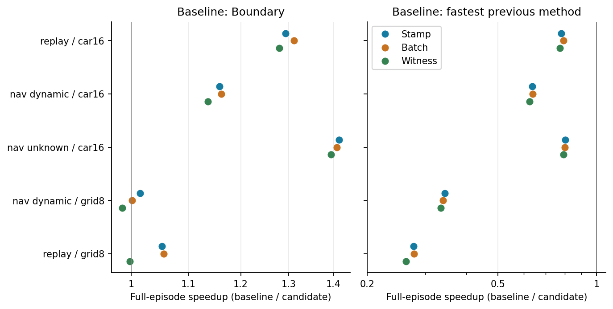
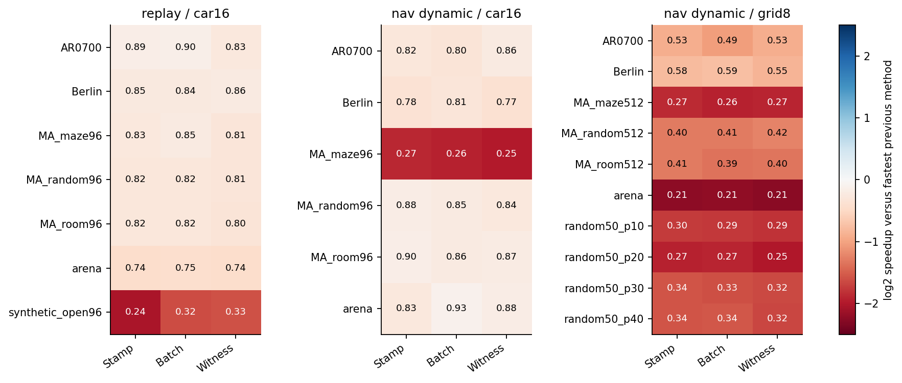
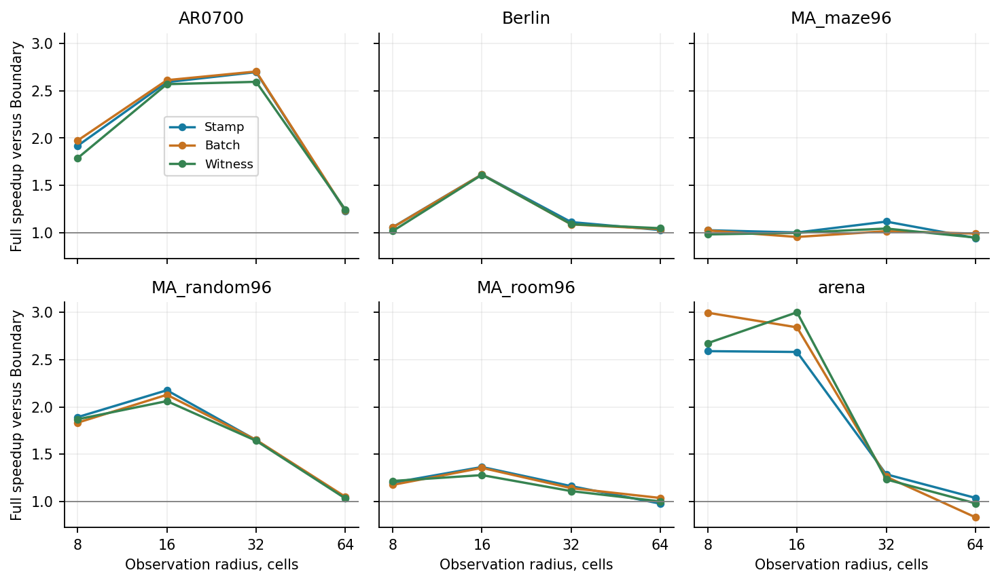
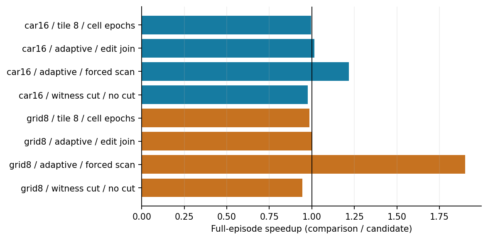
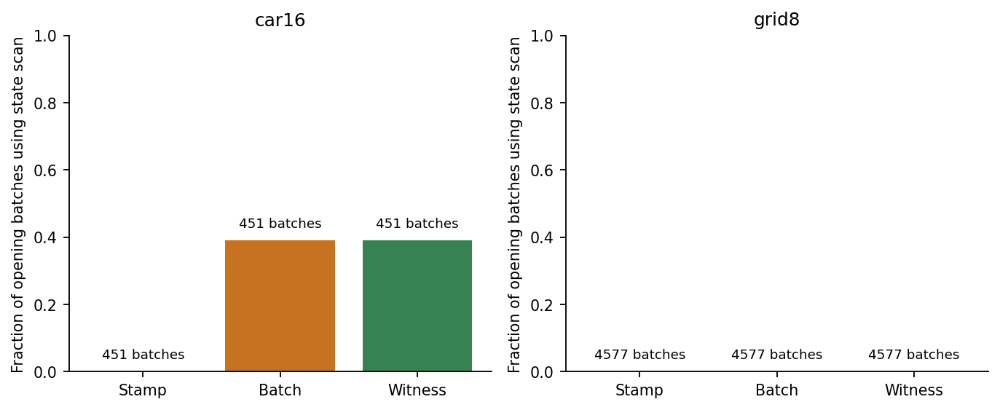
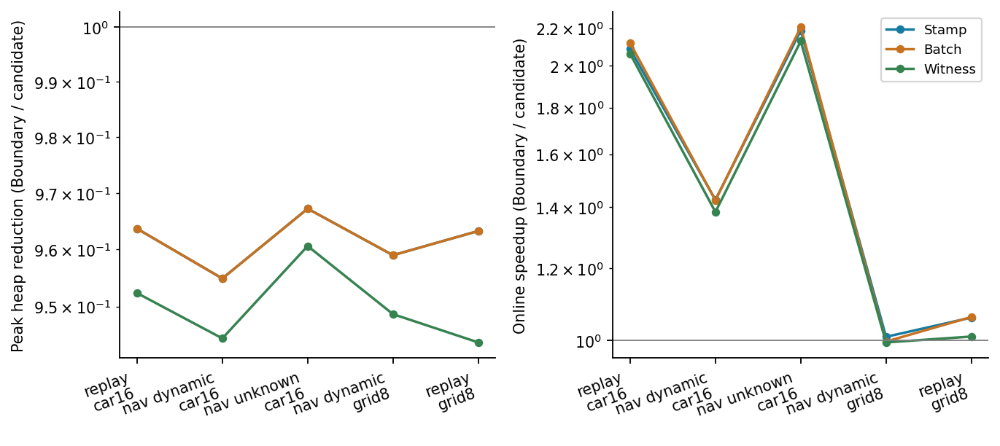
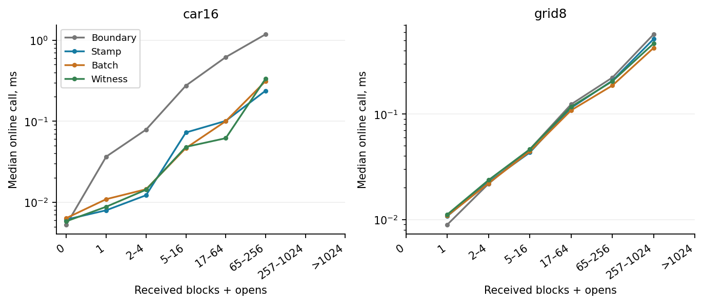
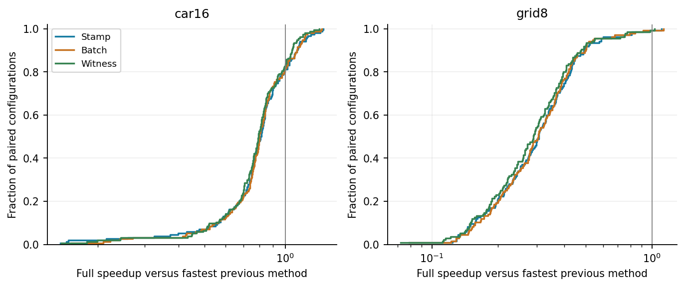

# Результат

Реализованы три новых варианта C++17: **Stamp-Mesh-MPGAA\***, **Batch-Mesh-MPGAA\*** и **Witness-Mesh-MPGAA\***. Выполнено **10,464 временных прогонов** и **3,488 отдельных прогонов памяти** на **298 конфигурациях**. Измерено 307,455 вызовов планировщиков; завершенные ответы проверены с точностью $10^{-6}$. Расхождений стоимости — **0**, остановок по бюджету — **6**.

Остановки по лимиту: MD-A\* — 6 вызовов. Остановок новых трех методов по бюджету в этой серии нет; неуспехи достижения цели разбираются отдельно.

Это исследование конкретных инженерных сочетаний версий карты, пакетного восстановления эвристики и префиксных свидетельств. Их новизна относительно прежнего кода репозитория определяется явно ниже. Литературный приоритет этих сочетаний и превосходство над всеми опубликованными реализациями не установлены. Прежние четыре mesh-MPGAA и исходные контроли сохранены без изменений.

| Метод | Завершено | Полное × | Online × | Память × | Выигрыш от 10% |
| --- | --- | --- | --- | --- | --- |
| Stamp | 289/298 | 0.49 | 0.41 | 0.55 | 18/289 |
| Batch | 289/298 | 0.49 | 0.42 | 0.55 | 18/289 |
| Witness | 289/298 | 0.48 | 0.40 | 0.55 | 9/289 |

Здесь baseline — самый быстрый **по полному эпизоду** завершившийся прежний метод в каждой конфигурации: MPGAA\*, LBA\* reuse, MD-A\*, Boundary-MPGAA\*, Selective-Mesh-MPGAA\*, Delta-Mesh-MPGAA\*, Policy-Mesh-MPGAA\* и, на grid8, Octile A\* reuse. Это выбранная после измерения описательная огибающая. Ее online-время не обязательно минимально среди online-времен контролей. Отношения — геометрические средние по общим завершенным конфигурациям, разные строки могут иметь разные множества пар. Значение больше 1 выгодно новому методу. В replay корректное доказательство отсутствия пути считается завершением; в навигации требуется достижение цели.

Если ни один контроль не завершился, конфигурация сохраняется как непарная: для нее не вычисляется ускорение. Случаи, завершенные только новым методом, и обратные случаи учитываются отдельно в таблице полноты.

Универсального превосходства нет: в наборе новые методы проигрывают сильным прежним контролям на части конфигураций. Итоги ниже разделены по модели, нагрузке и карте; преимущество в доставке блокировок или объеме подписок не подменяет полное время.

| Replay | Метод | Полное / Boundary | Online / Boundary | Heap / Boundary | Пар |
| --- | --- | --- | --- | --- | --- |
| car16 | Stamp | 1.29 | 2.09 | 0.96 | 90/90 |
| car16 | Batch | 1.31 | 2.12 | 0.96 | 90/90 |
| car16 | Witness | 1.28 | 2.06 | 0.95 | 90/90 |
| grid8 | Stamp | 1.05 | 1.06 | 0.96 | 96/96 |
| grid8 | Batch | 1.06 | 1.06 | 0.96 | 96/96 |
| grid8 | Witness | 1.00 | 1.01 | 0.94 | 96/96 |

На общем множестве 90 завершенных car16 replay-конфигураций наиболее быстрым из трех новых методов по геометрическому среднему полного времени стал **Batch**: 1.31× относительно Boundary. Это внутрисемейное сравнение на одинаковом множестве задач; его следует читать вместе с таблицей более сильных прежних контролей, памятью и online-временем.

На общем множестве 96 завершенных grid8 replay-конфигураций наиболее быстрым из трех новых методов по геометрическому среднему полного времени стал **Batch**: 1.06× относительно Boundary. Это внутрисемейное сравнение на одинаковом множестве задач; его следует читать вместе с таблицей более сильных прежних контролей, памятью и online-временем.

Основная практическая прибавка относительно Boundary приходится на общую архитектуру Stamp/Batch. Дополнительное отношение полного времени Stamp / Batch на car16 replay — лишь **1.014×**; отношение Batch / Witness — **0.976×**, то есть сечение в среднем не окупилось. Для дальнейшего развития разумно использовать простой Stamp либо Batch с его недорогим выбором оператора. Узкая область дополнительного выигрыша Batch разобрана отдельно по картам и типам запросов; значительная часть этой выборки синтетическая.

{width=99%}

# Постановка и алгоритмы

Состояние $u=(i,j,\theta)$ — исходное граничное состояние направленного графа примитивов. Цель фиксирована. Дуга $p$ имеет положительную стоимость $c_p$ и исходную упорядоченную трассу клеток. Она допустима, если все проверяемые клетки свободны. Общий mesh — префиксное дерево этих трасс для каждого начального направления, без изменения дуг, затрат или дискретизации. В OPEN остаются только исходные граничные состояния.

Общий поиск использует MPGAA\*: допустимую согласованную эвристику $h\geq h_0$, сохраненное продолжение `next` и обучение $h(u)\leftarrow\max(h(u),C-g(u))$ после найденного оптимального пути стоимости $C$. Новые методы меняют обслуживание коллизий и начальных нарушений согласованности. Они не используют weighted A\*, приближенный ответ или отсечение по времени ремонта.

## Stamp-Mesh-MPGAA\*: версии карты вместо обратной доставки блокировок

Карта делится на плитки $8\times8$. У каждой плитки — номер последнего пакета изменений. У кеша граничного состояния хранятся упакованные флаги всех исходящих примитивов, версия полного вычисления `born` и версия последней успешной проверки `verified`. Ограничивающий прямоугольник всех исходных трасс данного направления вычисляется один раз.

Если состояние уже проверялось в текущем пакете, кеш читается сразу. Иначе читаются версии плиток, пересекающих его прямоугольник. Если все они не новее `born`, прежняя маска точна. Если хотя бы одна новее, все нужные флаги пересчитываются общим обходом префиксного дерева. Изменение внутри прямоугольника, но вне трасс, может вызвать лишнее обновление; пропустить влияющую правку оно не может. Размер плитки 8 зафиксирован до временных измерений, без настройки по результатам.

Блокировки больше не перечисляют обратные смещения примитивов и не разрушают все затронутые кеши заранее. Перед приемом сохраненного MPGAA-продолжения проверяются актуальная допустимость каждой дуги и tight-равенство $h(u)=c_p+h(v)$; результат внутри запроса мемоизируется. Поэтому ленивость не позволяет вернуть поврежденный путь. При освобождениях эвристика ремонтируется полностью до поиска.

**Инвариант версий.** Любая изменившаяся проверяемая клетка дуги лежит в одной из просмотренных плиток. Ее версия больше `born`, поэтому старая маска не читается без пересчета. За границей карты занятость постоянна. Если успешная tight-цепочка ведет в цель, суммирование ее стоимостей дает $h(s)$; допустимость $h$ доказывает оптимальность этой цепочки.

**Ожидаемое преимущество.** После общей нормализации правок доставка блокировок требует только записей версий, не зависит от числа обратных смещений car16 и количества сохраненных состояний. Цена переносится в будущие чтения масок и проверку продолжения. Это условие преимущества, а не гарантия ускорения каждого эпизода.

## Batch-Mesh-MPGAA\*: два полных способа начать ремонт

Batch сохраняет Stamp и выбирает направление соединения при релевантных освобождениях. Пусть $O$ — число таких клеток, $G$ — число групп обратных смещений, $H$ — множество состояний с обученным $h$, $D_H=\sum_{u\in H}\deg^+(u)$. Значение $D_H$ поддерживается при обучении без полного обхода $H$ на каждом обновлении.

* **Edit join:** для освобожденных клеток перечисляются $G$ групп смещений; кандидаты «обученное состояние, примитив» объединяются. Проверяется только возможное нарушение $h(u)>c_p+h(v)$, затем актуальная допустимость дуги.
* **State scan:** состояния $H$ сортируются в стабильном порядке и просматриваются все их исходящие дуги. Проверяются все текущие нарушения того же неравенства независимо от того, какая клетка их вызвала.

Выбирается state scan при $D_H<O\,G$, иначе edit join. Это детерминированная модель числа операций без измерения времени и без обучаемого порога. Она не учитывает цену сортировки, выделения памяти и вероятность попадания в кеш, поэтому не гарантирует лучший wall time.

**Полнота ремонта.** При edit join любой вновь открывшийся переход из обученного состояния содержит хотя бы одну освобожденную клетку и попадает в обратную проекцию. State scan непосредственно проверяет все исходящие переходы таких состояний и тоже не теряет ни одного начального нарушения. В обоих случаях найденные снижения $h$ затем полностью распространяются стандартной очередью MPGAA\* по допустимым предшественникам. Нельзя ограничиться первыми кандидатами и пропустить эту очередь. Блокировки согласованность не ухудшают; состояния без обученного значения используют согласованную геометрическую оценку $h_0$.

## Witness-Mesh-MPGAA\*: компактное сечение препятствий

Witness добавляет к Batch префиксно свободное сечение из занятых узлов mesh. Обычный обход изначально находит первые блокировки; после обновлений сохраненный свидетель не обязан быть первой текущей блокировкой, поскольку его предки могут не проверяться.

При устаревании маски читаются клетки прежнего сечения. Еще занятые свидетели образуют $W$ и покрывают примитивы $C=\bigcup_{w\in W}P(w)$. **Перед чтением клетки ветви $q$** проверяется $P(q)\subseteq C$. При полном покрытии вся ветвь запрещается сразу: можно пропустить и свободный префикс до нескольких разных глубоких препятствий. Иначе продолжается обычный mesh-обход. Новые блокировки объединяются со старыми свидетелями; DFS-интервалы удаляют из сечения потомков уже выбранного предка.

**Корректность.** Каждый примитив из $C$ содержит клетку еще занятого свидетеля и потому запрещен. Если $P(q)\subseteq C$, чтение предков свидетелей не может разрешить ни одну дугу ветви. Открытие свидетеля проверяется до его повторного использования. Нормализация сохраняет префиксную свободу: разные узлы сечения закрывают непересекающиеся множества трасс, размер сечения не превышает исходящей степени.

Пропустить только сам блокирующий узел недостаточно: обычный обход и так остановился бы на нем, а чтение свидетеля уже оплачено. Существен именно сертификат **совместного покрытия более ранней ветви**. Детерминированный тест с двумя глубокими препятствиями требует сокращения чтений занятости с 10 до 2. Это тест механизма, не дополнительная временная победа на основной матрице.

В отличие от прежнего Delta, здесь нет обратного индекса, связывающего клетку с множеством состояний и узлов, снятия подписок или плотного массива активности всего дерева для каждого состояния. Witness не доставляет только действительные изменения допустимости заранее: он откладывает работу до чтения маски и может проверить свидетели, которые фактически не затронуты правками. Это иной обмен времени и памяти, а не замена Delta с тождественной работой.

## Стоимость и точность сравнения механизмов

Пусть $R$ — число материализованных масок, $d$ — максимальная исходящая степень, $T$ — число узлов шаблонного дерева, $A$ — число плиток карты. Память новых кешей и версий — $O(Rd+A)$, плюс эвристика, указатели и структуры текущего поиска. У Witness сечение добавляет не более $O(Rd)$. Полное обновление Stamp/Batch требует до $O(T)$ чтений узлов и $O(d)$ записей флагов; проверка версии — до числа плиток прямоугольника трасс. Witness дополнительно проверяет членство примитивов: в худшем случае до суммы длин исходных трасс, плюс $O(d\log d)$ для нормализации сечения. Сокращение чтений занятости должно окупить эту работу. Неограниченный рост числа сохраненных состояний возможен; вытеснение кеша в этой работе не реализовано.

Три новых метода имеют общий поисковый код. Относительно старого Boundary изменена также организация раскрытия: ссылка на текущую маску берется один раз перед циклом примитивов. Поэтому общее ускорение Stamp против Boundary нельзя целиком приписывать версиям карты. Абляция `stamp_cell` отделяет размер плитки, Batch против Stamp — выбор начала ремонта, Witness против Batch — сохраненное сечение. `batch_scan` проверяет адаптивный выбор против постоянного state scan. Сравнение новых методов между собой сохраняет организацию поискового цикла.

Вычисления используют `double`, `EPS=1e-9` и ту же схему tie breaking, что прежний поиск. Tight-связи допускают запас `8*EPS`; внешняя проверка стоимости — абсолютный допуск $10^{-6}$. Персистентное хранение непроверенного `next` может сохранить пригодную цепочку после блокировки и последующего открытия, когда прежний Boundary уже удалил указатель. Поэтому равенство числа раскрытий с Boundary не требуется и проверяется отдельно как наблюдение.

# Протокол

| Нагрузка | Модель | Конфигураций | Методов | Временных | Память |
| --- | --- | --- | --- | --- | --- |
| replay | car16 | 90 | 12 | 3240 | 1080 |
| nav / dynamic | car16 | 24 | 10 | 720 | 240 |
| nav / unknown | car16 | 48 | 10 | 1440 | 480 |
| nav / dynamic | grid8 | 40 | 11 | 1320 | 440 |
| replay | grid8 | 96 | 13 | 3744 | 1248 |

Replay использует все 90 car16 и 96 grid8 сценариев прежнего замороженного набора. car16 включает препятствия на референсном пути и вдали от него, смешанные изменения, раскрытие карты и историю правок; партии до 128 клеток и несколько интервалов изменения. grid8 replay включает случайные карты с плотностями 10/20/30/40%, частичную видимость и разные k/cr. Метки on_path/off_path относятся к пути референсного планировщика. Replay подает всем методам одинаковые старты и изменения, даже если их собственные оптимальные пути имеют разный tie breaking.

Новая закрытая навигация: динамика на всех 16 картах, два корня и две заранее зафиксированные опорные точки `(k,cr)=(2,5),(32,20)` с **n=k**. Раскрытие полностью неизвестной car16-карты: все шесть карт, два корня, радиусы **8/16/32/64**. Это 64 динамические и 48 неизвестных миссий, а не полный повтор 36 сочетаний k/cr. В неизвестной карте ненаблюденные клетки оптимистично свободны; наблюдения накапливаются по мере движения. Динамика начинается с известной исходной карты, затем агент получает только локальные наблюдения.

Каждые k исполненных примитивов динамика выбирает из исходных пулов одинаковое число свободных клеток для блокировки и занятых для освобождения. Половина запроса равна округленному `N*cr/200`; она ограничена размером обоих пулов. Текущая клетка агента и цель защищены. В одном пакете новая блокировка не может тут же стать освобождением. Плотность сохраняется. Реальный cr равен `100*actual_changes/(N*phases)` и может быть меньше запрошенного. Динамическая видимость — глубина по графу примитивов, а не квадратный радиус.

В навигации каждый метод исполняет свой маршрут, получает собственные наблюдения, а защита текущей клетки может изменить реализацию общей случайной фазы. Поэтому совпадают параметры и корни симулятора, но не гарантируются тождественные запросы или миры. Фиксированная цель и одинаковый генератор не превращают это в сравнение на одной траектории. Replay и closed-loop результаты представлены раздельно.

При доказанном отсутствии пути в текущей карте знаний симулятор останавливается. Истинная карта при устаревших локальных знаниях может допускать путь; такой исход является неуспехом миссии, но не ошибкой оптимальности ответа по знаниям. На этих остановках дополнительно решается истинная карта вне таймера; диагностика сохранена в `navigation_terminal_calls.csv`.

В каждом задании сначала три последовательных временных повтора с перемешиванием порядка методов, затем отдельный одинарный проход памяти. Одновременно запущен один измеряющий процесс. Предварительные данные в `results/preflight` исключены из основных отношений. Старые секунды не используются. Медиана берется внутри конфигурации; среднее парных ускорений геометрическое. Bootstrap в CSV выполняется по кластерам карт и носит описательный характер: корни, запросы и повторы не являются независимой выборкой новых карт.

Первый предварительный Witness сохранял только блокирующие узлы без совместного покрытия предков. Проверка кода выявила, что это не экономит чтения по сравнению с обычной остановкой на препятствии. Незавершенная серия, ее исходники и манифест сохранены в `results/pre_witness_cover` и полностью исключены. После добавления покрытия все временные и профилирующие задания выполнены заново, включая контроли. Матрица карт, параметров и методов не изменена; старые секунды не импортировались.

Медианный относительный MAD полного времени трех повторов — **2.17%**, 95-й процентиль — **10.86%**. Преимущества масштаба этого шума следует оценивать осторожно. Бюджет 1,000,000 ограничивает раскрытия A\*, но не отдельным лимитом всю очередь ремонта эвристики. Остановленные эпизоды сохраняются в данных и не заменяются числом секунд как успешное решение.

Полное время включает конструктор, нормализацию пакета, изменение внутренней карты, уведомления, весь ремонт h, поиск, обучение, проверку продолжения и построение возвращаемого пути. Online исключает конструктор и первый вызов. Генерация среды, сенсор, точный контрольный поиск, ввод-вывод CSV и компиляция общей модели вынесены за часы планировщика. Общий MeshIndex строится для всех методов; его время сохранено в native JSON завершения. Для однократного запуска холодную подготовку нужно прибавить отдельно.

Память получена отдельной сборкой с перехватом C++ new/delete: пик запрошенных heap-байтов планировщика и его ответа. Включены копия карты, версии плиток и кеши; общая модель и мир симулятора исключены. Это не RSS, не стек и не общая память приложения. Все результаты, пути и счетчики профилирующей сборки совпали с обычной, а три временных повтора — друг с другом по решениям и работе.

# Карты и нагрузки

{width=99%}

## replay / car16

Baseline: Boundary-MPGAA\*. В ячейке: **полное / online (число пар / конфигураций)**.

| Карта | Stamp | Batch | Witness |
| --- | --- | --- | --- |
| AR0700 | 1.16 / 1.46 (8/8) | 1.18 / 1.49 (8/8) | 1.09 / 1.44 (8/8) |
| Berlin | 1.08 / 1.04 (8/8) | 1.07 / 1.11 (8/8) | 1.09 / 1.09 (8/8) |
| MA_maze96 | 1.09 / 1.46 (8/8) | 1.12 / 1.56 (8/8) | 1.06 / 1.42 (8/8) |
| MA_random96 | 1.36 / 2.56 (27/27) | 1.36 / 2.52 (27/27) | 1.33 / 2.46 (27/27) |
| MA_room96 | 1.10 / 1.98 (27/27) | 1.09 / 1.92 (27/27) | 1.06 / 1.88 (27/27) |
| arena | 1.85 / 3.82 (8/8) | 1.87 / 3.88 (8/8) | 1.83 / 3.80 (8/8) |
| synthetic_open96 | 3.31 / 3.69 (4/4) | 4.37 / 5.24 (4/4) | 4.50 / 5.29 (4/4) |

Baseline: самый быстрый завершившийся прежний метод. В ячейке: **полное / online (число пар / конфигураций)**.

| Карта | Stamp | Batch | Witness |
| --- | --- | --- | --- |
| AR0700 | 0.89 / 0.67 (8/8) | 0.90 / 0.68 (8/8) | 0.83 / 0.66 (8/8) |
| Berlin | 0.85 / 0.37 (8/8) | 0.84 / 0.39 (8/8) | 0.86 / 0.39 (8/8) |
| MA_maze96 | 0.83 / 0.26 (8/8) | 0.85 / 0.28 (8/8) | 0.81 / 0.25 (8/8) |
| MA_random96 | 0.82 / 0.74 (27/27) | 0.82 / 0.73 (27/27) | 0.81 / 0.71 (27/27) |
| MA_room96 | 0.82 / 0.76 (27/27) | 0.82 / 0.73 (27/27) | 0.80 / 0.72 (27/27) |
| arena | 0.74 / 0.30 (8/8) | 0.75 / 0.30 (8/8) | 0.74 / 0.29 (8/8) |
| synthetic_open96 | 0.24 / 0.05 (4/4) | 0.32 / 0.07 (4/4) | 0.33 / 0.07 (4/4) |

## Навигация: dynamic / car16

Baseline: Boundary-MPGAA\*. В ячейке: **полное / online (число пар / конфигураций)**.

| Карта | Stamp | Batch | Witness |
| --- | --- | --- | --- |
| AR0700 | 1.07 / — (1/4) | 1.04 / — (1/4) | 1.12 / — (1/4) |
| Berlin | 1.23 / 2.62 (2/4) | 1.27 / 2.72 (2/4) | 1.22 / 2.69 (2/4) |
| MA_maze96 | 1.19 / 1.17 (4/4) | 1.16 / 1.15 (4/4) | 1.12 / 1.11 (4/4) |
| MA_random96 | 1.16 / 1.36 (3/4) | 1.12 / 1.42 (3/4) | 1.10 / 1.44 (3/4) |
| MA_room96 | 1.05 / 1.15 (3/4) | 1.01 / 1.09 (3/4) | 1.02 / 1.11 (3/4) |
| arena | 1.21 / 2.20 (3/4) | 1.35 / 2.30 (3/4) | 1.27 / 2.04 (3/4) |

Baseline: самый быстрый завершившийся прежний метод. В ячейке: **полное / online (число пар / конфигураций)**.

| Карта | Stamp | Batch | Witness |
| --- | --- | --- | --- |
| AR0700 | 0.82 / — (1/4) | 0.80 / — (1/4) | 0.86 / — (1/4) |
| Berlin | 0.78 / 1.00 (2/4) | 0.81 / 1.04 (2/4) | 0.77 / 1.03 (2/4) |
| MA_maze96 | 0.27 / 0.03 (4/4) | 0.26 / 0.03 (4/4) | 0.25 / 0.03 (4/4) |
| MA_random96 | 0.88 / 0.83 (3/4) | 0.85 / 0.87 (3/4) | 0.84 / 0.88 (3/4) |
| MA_room96 | 0.90 / 1.15 (3/4) | 0.86 / 1.09 (3/4) | 0.87 / 1.11 (3/4) |
| arena | 0.83 / 1.10 (3/4) | 0.93 / 1.15 (3/4) | 0.88 / 1.02 (3/4) |

## Навигация: unknown / car16

Baseline: Boundary-MPGAA\*. В ячейке: **полное / online (число пар / конфигураций)**.

| Карта | Stamp | Batch | Witness |
| --- | --- | --- | --- |
| AR0700 | 2.01 / 3.35 (8/8) | 2.04 / 3.41 (8/8) | 1.96 / 3.19 (8/8) |
| Berlin | 1.18 / 2.21 (8/8) | 1.18 / 2.26 (8/8) | 1.17 / 2.24 (8/8) |
| MA_maze96 | 1.02 / 1.12 (8/8) | 1.00 / 1.06 (8/8) | 0.99 / 1.10 (8/8) |
| MA_random96 | 1.63 / 2.40 (8/8) | 1.61 / 2.41 (8/8) | 1.60 / 2.24 (8/8) |
| MA_room96 | 1.17 / 1.30 (8/8) | 1.17 / 1.25 (8/8) | 1.15 / 1.22 (8/8) |
| arena | 1.73 / 4.69 (8/8) | 1.73 / 5.31 (8/8) | 1.76 / 4.89 (8/8) |

Baseline: самый быстрый завершившийся прежний метод. В ячейке: **полное / online (число пар / конфигураций)**.

| Карта | Stamp | Batch | Witness |
| --- | --- | --- | --- |
| AR0700 | 0.86 / 0.92 (8/8) | 0.87 / 0.94 (8/8) | 0.84 / 0.88 (8/8) |
| Berlin | 0.75 / 0.38 (8/8) | 0.75 / 0.39 (8/8) | 0.74 / 0.39 (8/8) |
| MA_maze96 | 0.85 / 0.44 (8/8) | 0.83 / 0.41 (8/8) | 0.83 / 0.43 (8/8) |
| MA_random96 | 0.87 / 0.77 (8/8) | 0.86 / 0.77 (8/8) | 0.85 / 0.72 (8/8) |
| MA_room96 | 0.82 / 0.64 (8/8) | 0.82 / 0.61 (8/8) | 0.80 / 0.60 (8/8) |
| arena | 0.68 / 0.20 (8/8) | 0.68 / 0.23 (8/8) | 0.69 / 0.21 (8/8) |

## Навигация: dynamic / grid8

Baseline: Boundary-MPGAA\*. В ячейке: **полное / online (число пар / конфигураций)**.

| Карта | Stamp | Batch | Witness |
| --- | --- | --- | --- |
| AR0700 | 1.03 / 1.03 (3/4) | 0.94 / 0.94 (3/4) | 1.03 / 1.04 (3/4) |
| Berlin | 1.07 / 1.05 (4/4) | 1.10 / 1.08 (4/4) | 1.02 / 1.04 (4/4) |
| MA_maze512 | 0.97 / 0.97 (4/4) | 0.93 / 0.93 (4/4) | 0.95 / 0.95 (4/4) |
| MA_random512 | 0.96 / 0.93 (4/4) | 0.97 / 0.96 (4/4) | 1.00 / 1.01 (4/4) |
| MA_room512 | 0.96 / 0.96 (4/4) | 0.92 / 0.94 (4/4) | 0.93 / 0.94 (4/4) |
| arena | 1.00 / 0.96 (4/4) | 1.00 / 0.95 (4/4) | 0.98 / 0.95 (4/4) |
| random50_p10 | 1.02 / 1.02 (4/4) | 1.01 / 1.01 (4/4) | 0.98 / 1.00 (4/4) |
| random50_p20 | 1.03 / 0.99 (4/4) | 1.04 / 1.00 (4/4) | 0.97 / 0.95 (4/4) |
| random50_p30 | 1.03 / 1.01 (4/4) | 1.00 / 1.00 (4/4) | 0.98 / 0.98 (4/4) |
| random50_p40 | 1.09 / 1.16 (4/4) | 1.10 / 1.15 (4/4) | 1.03 / 1.07 (4/4) |

Baseline: самый быстрый завершившийся прежний метод. В ячейке: **полное / online (число пар / конфигураций)**.

| Карта | Stamp | Batch | Witness |
| --- | --- | --- | --- |
| AR0700 | 0.53 / 0.53 (3/4) | 0.49 / 0.49 (3/4) | 0.53 / 0.54 (3/4) |
| Berlin | 0.58 / 0.56 (4/4) | 0.59 / 0.58 (4/4) | 0.55 / 0.55 (4/4) |
| MA_maze512 | 0.27 / 0.28 (4/4) | 0.26 / 0.27 (4/4) | 0.27 / 0.27 (4/4) |
| MA_random512 | 0.40 / 0.40 (4/4) | 0.41 / 0.41 (4/4) | 0.42 / 0.43 (4/4) |
| MA_room512 | 0.41 / 0.42 (4/4) | 0.39 / 0.41 (4/4) | 0.40 / 0.41 (4/4) |
| arena | 0.21 / 0.68 (4/4) | 0.21 / 0.68 (4/4) | 0.21 / 0.67 (4/4) |
| random50_p10 | 0.30 / 0.48 (4/4) | 0.29 / 0.48 (4/4) | 0.29 / 0.47 (4/4) |
| random50_p20 | 0.27 / 0.49 (4/4) | 0.27 / 0.50 (4/4) | 0.25 / 0.47 (4/4) |
| random50_p30 | 0.34 / 0.61 (4/4) | 0.33 / 0.61 (4/4) | 0.32 / 0.59 (4/4) |
| random50_p40 | 0.34 / 0.39 (4/4) | 0.34 / 0.38 (4/4) | 0.32 / 0.36 (4/4) |

## replay / grid8

Baseline: Boundary-MPGAA\*. В ячейке: **полное / online (число пар / конфигураций)**.

| Карта | Stamp | Batch | Witness |
| --- | --- | --- | --- |
| random50_p10 | 1.06 / 1.07 (24/24) | 1.07 / 1.08 (24/24) | 1.01 / 1.01 (24/24) |
| random50_p20 | 1.08 / 1.11 (24/24) | 1.08 / 1.08 (24/24) | 1.05 / 1.06 (24/24) |
| random50_p30 | 1.03 / 1.04 (24/24) | 1.06 / 1.08 (24/24) | 0.99 / 1.02 (24/24) |
| random50_p40 | 1.04 / 1.03 (24/24) | 1.02 / 1.00 (24/24) | 0.94 / 0.96 (24/24) |

Baseline: самый быстрый завершившийся прежний метод. В ячейке: **полное / online (число пар / конфигураций)**.

| Карта | Stamp | Batch | Witness |
| --- | --- | --- | --- |
| random50_p10 | 0.29 / 0.41 (24/24) | 0.29 / 0.41 (24/24) | 0.27 / 0.39 (24/24) |
| random50_p20 | 0.32 / 0.35 (24/24) | 0.32 / 0.34 (24/24) | 0.31 / 0.34 (24/24) |
| random50_p30 | 0.23 / 0.25 (24/24) | 0.23 / 0.26 (24/24) | 0.22 / 0.25 (24/24) |
| random50_p40 | 0.28 / 0.27 (24/24) | 0.27 / 0.26 (24/24) | 0.25 / 0.25 (24/24) |

## Семейства replay

| Модель | Семейство | Stamp | Batch | Witness |
| --- | --- | --- | --- | --- |
| car16 | churn | 1.19 / 1.58 | 1.22 / 1.59 | 1.15 / 1.50 |
| car16 | history | 3.31 / 3.69 | 4.37 / 5.24 | 4.50 / 5.29 |
| car16 | off_path | 1.30 / 5.45 | 1.29 / 5.45 | 1.29 / 5.42 |
| car16 | on_path | 1.10 / 1.34 | 1.09 / 1.34 | 1.07 / 1.30 |
| car16 | unknown_replay | 1.39 / 1.76 | 1.37 / 1.76 | 1.37 / 1.76 |
| grid8 | paper_dynamic | 1.05 / 1.06 | 1.06 / 1.06 | 1.00 / 1.01 |

## Раскрытие карты: все радиусы

{width=99%}

| Карта | Радиус | Stamp | Batch | Witness |
| --- | --- | --- | --- | --- |
| AR0700 | 8 | 1.92 / 2.39 (2) | 1.97 / 2.42 (2) | 1.79 / 2.21 (2) |
| AR0700 | 16 | 2.59 / 4.38 (2) | 2.61 / 4.56 (2) | 2.57 / 4.41 (2) |
| AR0700 | 32 | 2.70 / 6.71 (2) | 2.70 / 6.95 (2) | 2.60 / 5.88 (2) |
| AR0700 | 64 | 1.23 / 1.78 (2) | 1.23 / 1.75 (2) | 1.24 / 1.80 (2) |
| Berlin | 8 | 1.06 / 3.12 (2) | 1.06 / 2.99 (2) | 1.02 / 2.95 (2) |
| Berlin | 16 | 1.62 / 2.63 (2) | 1.62 / 2.67 (2) | 1.61 / 2.56 (2) |
| Berlin | 32 | 1.11 / 2.87 (2) | 1.09 / 3.06 (2) | 1.09 / 2.96 (2) |
| Berlin | 64 | 1.03 / 1.01 (2) | 1.04 / 1.07 (2) | 1.05 / 1.13 (2) |
| MA_maze96 | 8 | 1.03 / 1.03 (2) | 1.02 / 1.02 (2) | 0.98 / 0.98 (2) |
| MA_maze96 | 16 | 1.00 / 1.00 (2) | 0.95 / 0.95 (2) | 1.00 / 1.00 (2) |
| MA_maze96 | 32 | 1.12 / 1.13 (2) | 1.02 / 1.02 (2) | 1.04 / 1.05 (2) |
| MA_maze96 | 64 | 0.94 / 1.70 (2) | 0.99 / 1.55 (2) | 0.95 / 1.88 (2) |
| MA_random96 | 8 | 1.89 / 2.57 (2) | 1.83 / 2.60 (2) | 1.87 / 2.59 (2) |
| MA_random96 | 16 | 2.18 / 2.90 (2) | 2.13 / 2.77 (2) | 2.06 / 2.73 (2) |
| MA_random96 | 32 | 1.65 / 4.79 (2) | 1.65 / 4.91 (2) | 1.64 / 4.05 (2) |
| MA_random96 | 64 | 1.04 / 0.93 (2) | 1.05 / 0.95 (2) | 1.03 / 0.89 (2) |
| MA_room96 | 8 | 1.20 / 1.24 (2) | 1.18 / 1.24 (2) | 1.22 / 1.27 (2) |
| MA_room96 | 16 | 1.36 / 1.38 (2) | 1.36 / 1.37 (2) | 1.28 / 1.29 (2) |
| MA_room96 | 32 | 1.16 / 1.18 (2) | 1.14 / 1.17 (2) | 1.11 / 1.13 (2) |
| MA_room96 | 64 | 0.98 / 1.42 (2) | 1.04 / 1.22 (2) | 1.00 / 1.20 (2) |
| arena | 8 | 2.59 / 8.19 (2) | 3.00 / 8.90 (2) | 2.67 / 7.96 (2) |
| arena | 16 | 2.58 / 4.91 (2) | 2.84 / 6.13 (2) | 3.00 / 6.06 (2) |
| arena | 32 | 1.29 / 2.57 (2) | 1.26 / 2.75 (2) | 1.23 / 2.43 (2) |
| arena | 64 | 1.04 / — (2) | 0.83 / — (2) | 0.98 / — (2) |

Ячейки: полное / online (пар из двух). Разные радиусы меняют количество раскрытий, полученных препятствий и собственный маршрут; зависимость не обязана быть монотонной.

## Динамика: опорные точки и фактический cr

| Карта | k=n / cr% | Stamp | Batch | Witness |
| --- | --- | --- | --- | --- |
| car16/AR0700 | 2/5 | — / — (0) | — / — (0) | — / — (0) |
| car16/AR0700 | 32/20 | 0.82 / — (1) | 0.80 / — (1) | 0.86 / — (1) |
| car16/Berlin | 2/5 | — / — (0) | — / — (0) | — / — (0) |
| car16/Berlin | 32/20 | 0.78 / 1.00 (2) | 0.81 / 1.04 (2) | 0.77 / 1.03 (2) |
| car16/MA_maze96 | 2/5 | 0.31 / 0.06 (2) | 0.29 / 0.05 (2) | 0.30 / 0.05 (2) |
| car16/MA_maze96 | 32/20 | 0.24 / 0.02 (2) | 0.24 / 0.02 (2) | 0.21 / 0.01 (2) |
| car16/MA_random96 | 2/5 | 0.85 / 0.83 (1) | 0.88 / 0.87 (1) | 0.89 / 0.88 (1) |
| car16/MA_random96 | 32/20 | 0.89 / — (2) | 0.84 / — (2) | 0.82 / — (2) |
| car16/MA_room96 | 2/5 | 1.12 / 1.15 (1) | 1.08 / 1.09 (1) | 1.10 / 1.11 (1) |
| car16/MA_room96 | 32/20 | 0.80 / — (2) | 0.76 / — (2) | 0.77 / — (2) |
| car16/arena | 2/5 | 1.13 / 1.10 (1) | 1.19 / 1.15 (1) | 1.05 / 1.02 (1) |
| car16/arena | 32/20 | 0.72 / — (2) | 0.83 / — (2) | 0.80 / — (2) |
| grid8/AR0700 | 2/5 | 0.98 / 0.96 (1) | 0.91 / 0.89 (1) | 1.03 / 1.00 (1) |
| grid8/AR0700 | 32/20 | 0.40 / 0.40 (2) | 0.36 / 0.36 (2) | 0.38 / 0.40 (2) |
| grid8/Berlin | 2/5 | 0.95 / 0.89 (2) | 0.95 / 0.88 (2) | 0.87 / 0.86 (2) |
| grid8/Berlin | 32/20 | 0.35 / 0.35 (2) | 0.37 / 0.38 (2) | 0.35 / 0.36 (2) |
| grid8/MA_maze512 | 2/5 | 0.36 / 0.37 (2) | 0.35 / 0.36 (2) | 0.35 / 0.35 (2) |
| grid8/MA_maze512 | 32/20 | 0.21 / 0.21 (2) | 0.20 / 0.20 (2) | 0.21 / 0.21 (2) |
| grid8/MA_random512 | 2/5 | 0.70 / 0.67 (2) | 0.74 / 0.73 (2) | 0.75 / 0.78 (2) |
| grid8/MA_random512 | 32/20 | 0.23 / 0.23 (2) | 0.23 / 0.23 (2) | 0.24 / 0.24 (2) |
| grid8/MA_room512 | 2/5 | 0.66 / 0.70 (2) | 0.58 / 0.64 (2) | 0.62 / 0.66 (2) |
| grid8/MA_room512 | 32/20 | 0.25 / 0.25 (2) | 0.26 / 0.27 (2) | 0.25 / 0.26 (2) |
| grid8/arena | 2/5 | 0.43 / 0.68 (2) | 0.42 / 0.68 (2) | 0.42 / 0.67 (2) |
| grid8/arena | 32/20 | 0.11 / — (2) | 0.11 / — (2) | 0.10 / — (2) |
| grid8/random50_p10 | 2/5 | 0.41 / 0.48 (2) | 0.40 / 0.48 (2) | 0.39 / 0.47 (2) |
| grid8/random50_p10 | 32/20 | 0.22 / — (2) | 0.22 / — (2) | 0.21 / — (2) |
| grid8/random50_p20 | 2/5 | 0.39 / 0.49 (2) | 0.40 / 0.50 (2) | 0.38 / 0.47 (2) |
| grid8/random50_p20 | 32/20 | 0.18 / — (2) | 0.18 / — (2) | 0.17 / — (2) |
| grid8/random50_p30 | 2/5 | 0.50 / 0.61 (2) | 0.48 / 0.61 (2) | 0.46 / 0.59 (2) |
| grid8/random50_p30 | 32/20 | 0.22 / — (2) | 0.22 / — (2) | 0.22 / — (2) |
| grid8/random50_p40 | 2/5 | 0.49 / 0.58 (2) | 0.48 / 0.56 (2) | 0.46 / 0.55 (2) |
| grid8/random50_p40 | 32/20 | 0.23 / 0.26 (2) | 0.24 / 0.26 (2) | 0.22 / 0.23 (2) |

Ячейки: полное / online (пар из двух) против самого быстрого завершившегося прежнего метода.

| Карта | k=n / cr% | Фактический cr% | Ограниченных фаз | Эпизодов без фазы |
| --- | --- | --- | --- | --- |
| car16/AR0700 | 2/5 | 5.000–5.000 | 0 | 0 |
| car16/AR0700 | 32/20 | 20.000–20.000 | 0 | 10 |
| car16/Berlin | 2/5 | 4.999–4.999 | 0 | 0 |
| car16/Berlin | 32/20 | 20.001–20.001 | 0 | 10 |
| car16/MA_maze96 | 2/5 | 4.991–4.991 | 0 | 0 |
| car16/MA_maze96 | 32/20 | 13.542–13.542 | 30 | 0 |
| car16/MA_random96 | 2/5 | 4.991–4.991 | 0 | 0 |
| car16/MA_random96 | 32/20 | —–— | 0 | 20 |
| car16/MA_room96 | 2/5 | 4.991–4.991 | 0 | 0 |
| car16/MA_room96 | 32/20 | —–— | 0 | 20 |
| car16/arena | 2/5 | 4.998–4.998 | 0 | 0 |
| car16/arena | 32/20 | —–— | 0 | 20 |
| grid8/AR0700 | 2/5 | 5.000–5.000 | 0 | 0 |
| grid8/AR0700 | 32/20 | 20.000–20.000 | 0 | 0 |
| grid8/Berlin | 2/5 | 4.999–4.999 | 0 | 0 |
| grid8/Berlin | 32/20 | 20.001–20.001 | 0 | 0 |
| grid8/MA_maze512 | 2/5 | 5.000–5.000 | 0 | 0 |
| grid8/MA_maze512 | 32/20 | 12.305–12.305 | 156 | 0 |
| grid8/MA_random512 | 2/5 | 5.000–5.000 | 0 | 0 |
| grid8/MA_random512 | 32/20 | 20.000–20.000 | 0 | 0 |
| grid8/MA_room512 | 2/5 | 5.000–5.000 | 0 | 0 |
| grid8/MA_room512 | 32/20 | 20.000–20.000 | 0 | 0 |
| grid8/arena | 2/5 | 4.998–4.998 | 0 | 0 |
| grid8/arena | 32/20 | —–— | 0 | 22 |
| grid8/random50_p10 | 2/5 | 5.040–5.040 | 0 | 0 |
| grid8/random50_p10 | 32/20 | —–— | 0 | 22 |
| grid8/random50_p20 | 2/5 | 5.040–5.040 | 0 | 0 |
| grid8/random50_p20 | 32/20 | —–— | 0 | 22 |
| grid8/random50_p30 | 2/5 | 5.040–5.040 | 0 | 0 |
| grid8/random50_p30 | 32/20 | —–— | 0 | 22 |
| grid8/random50_p40 | 2/5 | 5.040–5.040 | 0 | 0 |
| grid8/random50_p40 | 32/20 | 20.000–20.000 | 0 | 0 |

Диапазон фактического cr охватывает методы и оба корня первого временного повтора. Суммы фаз не являются числом независимых сценариев: одна и та же настройка повторяется у методов. Без фазы cr не определен, а не равен нулю. Полная разметка находится в `actual_changes.csv`.

| Метод | Полное от 10% на обоих корнях | Online от 10% на обоих корнях | Точек |
| --- | --- | --- | --- |
| Stamp | 0 | 0 | 32 |
| Batch | 0 | 0 | 32 |
| Witness | 0 | 0 | 32 |

Требование двух корней — описательный фильтр устойчивости внутри этих карт, а не статистическое доказательство обобщения. Для online требуется положительное измеренное время ремонта у обоих методов на обоих корнях.

## Совпавшие входы внутри closed-loop

| Неизвестная статическая карта | Вызовов нового | Вызовов Boundary | Совпали входы | Совпал путь | Совпала поисковая работа |
| --- | --- | --- | --- | --- | --- |
| Stamp | 1522 | 1522 | 1522 | 1522 | 1522 |
| Batch | 1522 | 1522 | 1522 | 1522 | 1522 |
| Witness | 1522 | 1522 | 1522 | 1522 | 1522 |

Эта проверка сопоставляет все шаги раскрытия статической карты с Boundary, включая начальный запрос. Входы включают позицию, мир, карту знаний до и после изменений и число правок. Путь проверяется по хешу и статусу; поисковая работа — по раскрытиям и извлечениям ремонта h. Она показывает, насколько различия времени объясняются обработкой кешей при одинаковом поиске, а не различными последовательностями запросов.

| Нагрузка | Модель | Метод | Путь Boundary / новый | Вызовы Boundary / новый | Пар |
| --- | --- | --- | --- | --- | --- |
| nav / dynamic | car16 | Stamp | 1.00 | 1.00 | 16 |
| nav / unknown | car16 | Stamp | 1.00 | 1.00 | 48 |
| nav / dynamic | grid8 | Stamp | 1.00 | 1.00 | 39 |
| nav / dynamic | car16 | Batch | 1.00 | 1.00 | 16 |
| nav / unknown | car16 | Batch | 1.00 | 1.00 | 48 |
| nav / dynamic | grid8 | Batch | 1.00 | 1.00 | 39 |
| nav / dynamic | car16 | Witness | 1.00 | 1.00 | 16 |
| nav / unknown | car16 | Witness | 1.00 | 1.00 | 48 |
| nav / dynamic | grid8 | Witness | 1.00 | 1.00 | 39 |

Длина исполненного пути и количество вызовов условны на достижении цели обоими методами. В динамике миры могут различаться, а освобождения позволяют пройти дешевле исходного статического оптимума. Это описательные отношения маршрутов, не коэффициенты конкурентности и не доказательство меньшей вычислительной цены одного ремонта.

| Нагрузка | Модель | Метод | Без лимита | Совпало / вызовов кандидата | Время запросов × |
| --- | --- | --- | --- | --- | --- |
| nav / dynamic | car16 | Batch | 178 | 178/178 | 1.08 |
| nav / dynamic | car16 | Stamp | 178 | 178/178 | 1.11 |
| nav / dynamic | car16 | Witness | 178 | 178/178 | 1.07 |
| nav / dynamic | grid8 | Batch | 4184 | 4184/4200 | 0.95 |
| nav / dynamic | grid8 | Stamp | 4184 | 4184/4200 | 0.99 |
| nav / dynamic | grid8 | Witness | 4184 | 4184/4200 | 0.96 |
| nav / unknown | car16 | Batch | 1474 | 1474/1474 | 1.06 |
| nav / unknown | car16 | Stamp | 1474 | 1474/1474 | 1.10 |
| nav / unknown | car16 | Witness | 1474 | 1474/1474 | 1.05 |

Дополнительное сравнение с Boundary сопоставляет одинаковые case/step/start, 64-битные хеши мира и карты знаний до и после правки, а также число блокировок и освобождений. Для каждого совпавшего вызова берется медиана трех повторов, затем сравниваются суммы времен только совпавших вызовов без cap. Состояния поиска и предыстории h все еще могут различаться. Это подмножество фактических траекторий, не замена полному эпизоду или независимому replay; совпадение хешей не является формальным доказательством равенства всех битов. Покрытие и все строки сохранены в `aligned_calls.csv` и `aligned_maps.csv`.

# Механизмы и абляции

{width=99%}

| Модель | Сравнение | Полное × | Online × | Heap × | Проверки × | Пар |
| --- | --- | --- | --- | --- | --- | --- |
| car16 | Stamp / cell epochs | 0.996 | 0.989 | 1.133 | 0.932 | 90 |
| car16 | Batch / Stamp | 1.014 | 1.015 | 1.000 | 0.993 | 90 |
| car16 | Batch / forced scan | 1.218 | 1.638 | 1.000 | 1.087 | 90 |
| car16 | Witness / Batch | 0.976 | 0.973 | 0.988 | 1.004 | 90 |
| grid8 | Stamp / cell epochs | 0.985 | 0.966 | 1.137 | 0.707 | 96 |
| grid8 | Batch / Stamp | 1.003 | 1.001 | 1.000 | 1.000 | 96 |
| grid8 | Batch / forced scan | 1.901 | 2.479 | 1.000 | 1.236 | 96 |
| grid8 | Witness / Batch | 0.945 | 0.952 | 0.980 | 0.975 | 96 |

«Проверки ×» — число проверок занятости контроля / кандидата, включая чтения старых свидетелей. Меньшее число mesh-узлов само по себе не учитывает дополнительную цену сечения.

Абляции не выбирались по выигравшим картам: все применены ко всем replay-конфигурациям. Различия меньше шума трех повторов не поддерживают сильное утверждение о преимуществе механизма. Forced scan может менять порядок начальных снижений h и последующее дерево поиска; число раскрытий не обязано совпадать с адаптивным вариантом.

{width=99%}

## Ремонт Batch: условная разбивка по выбору оператора

| Replay | Выбор Batch | Подмножество | Вызовов | Конфиг. | GM × | Сумма × |
| --- | --- | --- | --- | --- | --- | --- |
| car16 | edits | Все ответы | 137 | 28 | 1.00 | 1.05 |
| car16 | edits | Успех, 0 раскрытий | 83 | 27 | 0.99 | 1.08 |
| car16 | scan | Все ответы | 170 | 6 | 1.50 | 1.36 |
| car16 | scan | Успех, 0 раскрытий | 165 | 6 | 1.52 | 1.42 |
| grid8 | edits | Все ответы | 1550 | 91 | 0.99 | 0.99 |
| grid8 | edits | Успех, 0 раскрытий | 421 | 75 | 1.00 | 1.01 |
| grid8 | scan | Все ответы | 1 | 1 | 1.08 | 1.08 |

Baseline здесь — Stamp. Берутся одинаковые replay case/query; для каждого запроса медиана трех временных повторов. «GM» усредняет отношения по запросам; «Сумма» сравнивает суммы времен этих же запросов. Остановки по бюджету исключены. Группа определяется телеметрией scan/edit до просмотра времени, но сама разбивка аналитическая, не отдельная экспериментальная серия. Подмножество успешных ответов с нулем раскрытий у обоих методов отделяет обслуживание изменений и продолжения от нового A\*-поиска. Предыстории внутренних структур могут различаться; это не чистый микробенчмарк оператора над одним сохраненным h. Запросы вложены в конфигурации и карты, не являются независимыми повторениями. Все строки и картовые разбиения сохранены в `batch_repair_calls.csv` и `batch_repair_maps.csv`.

В car16-группе успешных ремонтов без новых раскрытий при выборе scan получено 1.52× по геометрическому среднему и 1.42× по сумме времени на 165 запросах из 6 конфигураций. Этот локальный эффект следует отличать от небольшого изменения полного эпизода Batch относительно Stamp в общей абляции.

| Карта этой группы | Запросов | Конфигураций | GM × | Сумма × |
| --- | --- | --- | --- | --- |
| MA_random96 | 4 | 1 | 0.89 | 0.91 |
| arena | 5 | 1 | 1.34 | 1.33 |
| synthetic_open96 | 156 | 4 | 1.55 | 1.54 |

В этой условной группе преобладает синтетическая история правок на открытой карте. Арена и случайная карта дают значительно меньше запросов и разные знаки эффекта. Поэтому эту величину нельзя переносить на все освобождения или все опубликованные карты.

| Replay, только blocks | Метод | Правок | Notify probes | Чтений занятости | Раскрытий |
| --- | --- | --- | --- | --- | --- |
| car16 | Boundary | 6590 | 1511640 | 38709074 | 2342862 |
| car16 | Stamp | 6590 | 0 | 45880992 | 2342862 |
| car16 | Batch | 6590 | 0 | 45880992 | 2342862 |
| car16 | Witness | 6590 | 0 | 45830704 | 2342862 |
| car16 | Delta | 6590 | 211271 | 44504410 | 2342862 |
| grid8 | Boundary | 652 | 4704 | 4064 | 2706 |
| grid8 | Stamp | 652 | 0 | 22064 | 2706 |
| grid8 | Batch | 652 | 0 | 22064 | 2706 |
| grid8 | Witness | 652 | 0 | 22122 | 2706 |
| grid8 | Delta | 652 | 2873 | 4849 | 2706 |

Здесь суммируются строго односторонние блокировки первого повтора на одинаковых replay-запросах. Нулевые notify probes у новых вариантов показывают устранение обратной доставки блокировок, но не нулевую работу: остаются нормализация, записи версий, проверка продолжения, чтения плиток и возможный поиск. У Delta notify probes — попадания подписок; у Boundary — группы смещений. Одинаковое число таких событий не означает одинаковую стоимость.

| Модель | Метод | Записей версий | Чтений версий | Обновлений масок | Проверок сечения | Отсеченных ветвей |
| --- | --- | --- | --- | --- | --- | --- |
| car16 | Stamp | 106199 | 6685917 | 4966079 | 0 | 0 |
| car16 | Batch | 106199 | 6687299 | 4967001 | 0 | 0 |
| car16 | Witness | 106199 | 6687299 | 4967001 | 780292 | 507966 |
| grid8 | Stamp | 109981 | 10661208 | 1222778 | 0 | 0 |
| grid8 | Batch | 109981 | 10661209 | 1222779 | 0 | 0 |
| grid8 | Witness | 109981 | 10661209 | 1222779 | 816024 | 644113 |

Счетчики включают начальный поиск и все выполненные вызовы первого повтора всех нагрузок, включая остановки. Чтения свидетелей уже входят в checked_cells; складывать эти два поля как разные затраты нельзя. Ускорение Witness против Batch, а не одна величина cut_reuses, определяет, окупилось ли сечение.

| Нагрузка | Модель | Совпавших строк | Batch: проверки | Witness: проверки | Отсеченных ветвей |
| --- | --- | --- | --- | --- | --- |
| nav / dynamic | car16 | 202 | 26524544 | 26648862 | 106229 |
| nav / dynamic | grid8 | 4240 | 8941496 | 9089064 | 513516 |
| nav / unknown | car16 | 1522 | 22325490 | 22172006 | 216433 |
| replay | car16 | 835 | 88179101 | 88045209 | 185304 |
| replay | grid8 | 2122 | 840736 | 865079 | 130597 |

Для каждой строки первого повтора Batch и Witness проверено точное совпадение входов, статуса, стоимости, хеша пути, раскрытий, ремонта h и расписания обновления масок. Поэтому их сравнение изолирует обработку коллизий и ее накладные расходы. В grid8 у примитива одна проверяемая клетка: свободного общего префикса для экономии нет. Сохранившийся свидетель заменяет одно обычное чтение, а открывшийся требует дополнительной проверки. Валидатор подтвердил, что Witness не сократил число проверок относительно Batch ни на одном grid8-вызове; положительный счетчик отсеченных ветвей здесь не означает экономии.

| Модель | Метод | Online replay-строк | Совпал ответ | Совпали раскрытия | Совпал путь |
| --- | --- | --- | --- | --- | --- |
| car16 | Stamp | 745 | 745 | 745 | 745 |
| grid8 | Stamp | 2026 | 2026 | 2024 | 2025 |
| car16 | Batch | 745 | 745 | 745 | 745 |
| grid8 | Batch | 2026 | 2026 | 2024 | 2025 |
| car16 | Witness | 745 | 745 | 745 | 745 |
| grid8 | Witness | 2026 | 2026 | 2024 | 2025 |

# Память и задержки

{width=99%}

| Нагрузка | Модель | Метод | Heap мед., MiB | Heap макс., MiB | p95, ms | p99, ms |
| --- | --- | --- | --- | --- | --- | --- |
| dynamic | car16 | Boundary | 1.56 | 151.13 | 83.693 | 382.068 |
| dynamic | car16 | Delta | 3.99 | 665.69 | 118.759 | 898.694 |
| dynamic | car16 | Stamp | 1.60 | 163.46 | 80.228 | 278.438 |
| dynamic | car16 | Batch | 1.60 | 163.46 | 86.187 | 297.031 |
| dynamic | car16 | Witness | 1.61 | 168.53 | 77.925 | 323.565 |
| dynamic | grid8 | Boundary | 0.97 | 10.00 | 17.529 | 33.464 |
| dynamic | grid8 | Delta | 2.24 | 27.46 | 27.861 | 52.543 |
| dynamic | grid8 | Stamp | 1.02 | 10.63 | 17.654 | 33.887 |
| dynamic | grid8 | Batch | 1.02 | 10.63 | 19.208 | 35.057 |
| dynamic | grid8 | Witness | 1.02 | 10.74 | 17.953 | 35.315 |
| unknown | car16 | Boundary | 1.52 | 24.81 | 23.652 | 70.658 |
| unknown | car16 | Delta | 3.90 | 111.67 | 41.284 | 126.187 |
| unknown | car16 | Stamp | 1.56 | 26.40 | 22.393 | 65.552 |
| unknown | car16 | Batch | 1.56 | 26.40 | 23.311 | 69.894 |
| unknown | car16 | Witness | 1.56 | 26.71 | 24.122 | 69.559 |
| replay | car16 | Boundary | 1.52 | 221.97 | 22.847 | 605.786 |
| replay | car16 | Delta | 3.99 | 1142.38 | 51.772 | 2146.810 |
| replay | car16 | Stamp | 1.58 | 248.94 | 20.479 | 577.898 |
| replay | car16 | Batch | 1.58 | 248.94 | 20.349 | 570.962 |
| replay | car16 | Witness | 1.59 | 253.16 | 21.710 | 588.659 |
| replay | grid8 | Boundary | 0.16 | 0.50 | 0.216 | 0.499 |
| replay | grid8 | Delta | 0.35 | 1.38 | 0.234 | 0.534 |
| replay | grid8 | Stamp | 0.16 | 0.53 | 0.211 | 0.433 |
| replay | grid8 | Batch | 0.16 | 0.53 | 0.209 | 0.444 |
| replay | grid8 | Witness | 0.17 | 0.56 | 0.224 | 0.485 |

p95/p99 описывают объединенные выполненные online-вызовы, кроме capped-вызовов; это не доверительные интервалы. Включены корректные ответы «пути нет», исключены пропущенные после лимита запросы. В навигации методы могут выполнять разное количество запросов на разных состояниях. По картам задержки даны в `latency.csv`.

| Car16 replay | Ответ | Вызовов | p50, ms | p95, ms | p99, ms |
| --- | --- | --- | --- | --- | --- |
| Batch | no_path | 48 | 557.935 | 5183.408 | 5729.548 |
| Batch | ok | 2187 | 0.045 | 11.525 | 201.033 |
| Boundary | no_path | 48 | 597.966 | 5407.626 | 6039.305 |
| Boundary | ok | 2187 | 0.273 | 12.596 | 223.565 |
| Stamp | no_path | 48 | 570.407 | 5070.178 | 6038.348 |
| Stamp | ok | 2187 | 0.070 | 11.485 | 193.844 |
| Witness | no_path | 48 | 584.611 | 5547.795 | 5963.610 |
| Witness | ok | 2187 | 0.045 | 12.066 | 184.294 |

Разделение найденного пути и доказанной недостижимости позволяет увидеть, не определяется ли хвост задержек полным обходом компоненты. Оно не исключает трудные ответы из общих временных итогов. Полные картовые таблицы по типу ответа находятся в `latency_by_status.csv`.

{width=99%}

{width=99%}

# Полнота и положительные случаи

| Метод | Завершил только новый | Завершил только прежний контроль | Конфигураций |
| --- | --- | --- | --- |
| Batch | 0 | 1 | 298 |
| Stamp | 0 | 1 | 298 |
| Witness | 0 | 1 | 298 |

«Только новый» означает, что не завершился ни один выбранный прежний контроль. «Только контроль» — новый метод не завершился, а хотя бы один контроль завершился. В closed-loop это свойства маршрутов и наблюдений данных миссий, не доказательство различия полноты поиска по одной известной карте.

| Нагрузка | Модель | Метод | Завершено |
| --- | --- | --- | --- |
| nav / dynamic | car16 | Batch | 16/24 |
| nav / dynamic | car16 | Boundary | 16/24 |
| nav / dynamic | car16 | LBA\* reuse | 15/24 |
| nav / dynamic | car16 | MD-A\* | 16/24 |
| nav / dynamic | car16 | Stamp | 16/24 |
| nav / dynamic | car16 | Witness | 16/24 |
| nav / dynamic | grid8 | Batch | 39/40 |
| nav / dynamic | grid8 | Boundary | 39/40 |
| nav / dynamic | grid8 | LBA\* reuse | 39/40 |
| nav / dynamic | grid8 | MD-A\* | 39/40 |
| nav / dynamic | grid8 | Octile A\* reuse | 39/40 |
| nav / dynamic | grid8 | Stamp | 39/40 |
| nav / dynamic | grid8 | Witness | 39/40 |
| nav / unknown | car16 | Batch | 48/48 |
| nav / unknown | car16 | Boundary | 48/48 |
| nav / unknown | car16 | LBA\* reuse | 48/48 |
| nav / unknown | car16 | MD-A\* | 48/48 |
| nav / unknown | car16 | Stamp | 48/48 |
| nav / unknown | car16 | Witness | 48/48 |
| replay | car16 | Batch | 90/90 |
| replay | car16 | Boundary | 90/90 |
| replay | car16 | LBA\* reuse | 90/90 |
| replay | car16 | MD-A\* | 89/90 |
| replay | car16 | Stamp | 90/90 |
| replay | car16 | Witness | 90/90 |
| replay | grid8 | Batch | 96/96 |
| replay | grid8 | Boundary | 96/96 |
| replay | grid8 | LBA\* reuse | 96/96 |
| replay | grid8 | MD-A\* | 96/96 |
| replay | grid8 | Octile A\* reuse | 96/96 |
| replay | grid8 | Stamp | 96/96 |
| replay | grid8 | Witness | 96/96 |

| Нагрузка | Карта | Семейство | Метод | От 10% | Мин. × | Макс. × |
| --- | --- | --- | --- | --- | --- | --- |
| nav / dynamic | car16/MA_room96 | dynamic | Stamp | 1 | 1.12 | 1.12 |
| nav / dynamic | car16/arena | dynamic | Batch | 1 | 1.19 | 1.19 |
| nav / dynamic | car16/arena | dynamic | Stamp | 1 | 1.13 | 1.13 |
| nav / dynamic | grid8/Berlin | dynamic | Batch | 1 | 1.13 | 1.13 |
| nav / dynamic | grid8/Berlin | dynamic | Stamp | 1 | 1.11 | 1.11 |
| nav / unknown | car16/AR0700 | unknown | Batch | 2 | 1.11 | 1.19 |
| nav / unknown | car16/AR0700 | unknown | Stamp | 2 | 1.11 | 1.13 |
| nav / unknown | car16/MA_random96 | unknown | Stamp | 1 | 1.19 | 1.19 |
| nav / unknown | car16/MA_random96 | unknown | Witness | 1 | 1.18 | 1.18 |
| replay | car16/AR0700 | churn | Batch | 2 | 1.16 | 1.21 |
| replay | car16/AR0700 | churn | Stamp | 2 | 1.12 | 1.13 |
| replay | car16/AR0700 | churn | Witness | 1 | 1.16 | 1.16 |
| replay | car16/AR0700 | unknown_replay | Batch | 1 | 1.18 | 1.18 |
| replay | car16/AR0700 | unknown_replay | Stamp | 1 | 1.28 | 1.28 |
| replay | car16/AR0700 | unknown_replay | Witness | 1 | 1.16 | 1.16 |
| replay | car16/Berlin | on_path | Batch | 1 | 1.28 | 1.28 |
| replay | car16/Berlin | on_path | Stamp | 1 | 1.25 | 1.25 |
| replay | car16/Berlin | on_path | Witness | 1 | 1.23 | 1.23 |
| replay | car16/MA_maze96 | churn | Batch | 1 | 1.37 | 1.37 |
| replay | car16/MA_maze96 | churn | Stamp | 1 | 1.21 | 1.21 |
| replay | car16/MA_maze96 | on_path | Stamp | 1 | 1.37 | 1.37 |
| replay | car16/MA_random96 | churn | Batch | 4 | 1.13 | 1.35 |
| replay | car16/MA_random96 | churn | Stamp | 3 | 1.21 | 1.39 |
| replay | car16/MA_random96 | churn | Witness | 3 | 1.10 | 1.34 |
| replay | car16/MA_room96 | churn | Batch | 3 | 1.10 | 1.14 |
| replay | car16/MA_room96 | churn | Stamp | 1 | 1.12 | 1.12 |
| replay | car16/MA_room96 | unknown_replay | Batch | 1 | 1.11 | 1.11 |
| replay | car16/MA_room96 | unknown_replay | Stamp | 1 | 1.19 | 1.19 |
| replay | car16/MA_room96 | unknown_replay | Witness | 1 | 1.13 | 1.13 |
| replay | car16/arena | churn | Batch | 1 | 1.15 | 1.15 |
| replay | car16/arena | churn | Stamp | 1 | 1.10 | 1.10 |
| replay | car16/arena | churn | Witness | 1 | 1.12 | 1.12 |

Таблица положительных случаев перечисляет все такие группы, а не только лучший результат. Все отдельные конфигурации с параметрами сохранены в `strong_control_wins.csv`, включая выбранный контроль. Полный набор выигрышей и проигрышей находится в `paired_cases.csv`. Конфигурация с единственным удачным корнем не считается устойчивой победой динамической точки.

# Проверки, воспроизводимость и качество

Независимый Дейкстра выполнен на **1 300 снимках тестовых последовательностей**: 1 296 случайных динамических запросов и четыре запроса синтетического теста покрытия при двух запусках бинарника. Всего 7,790 сравнений вариантов, абляций и восстановления после нулевого бюджета. Дейкстра перечисляет исходные примитивы и напрямую читает карту, не использует mesh, кеш или адаптивную эвристику. Аудит h и текущих сертифицированных масок не меняет планировщик. ASan/UBSan прошли те же тесты. Перед официальными измерениями проверены 24,180 строк двух harness и их профилирующих сборок. Во всей серии совпало 102,485 строк решений и работы первого временного повтора с отдельным проходом памяти.

После временных прогонов дополнительно выполнено 144 целевых сравнений с Дейкстрой на Python: блокировка и открытие цели, два препятствия трассы, открытие за остающимся препятствием, повторное открытие, блокировка старта и `start == goal`. Они не входят в измеряемую матрицу и не используются для настройки параметров. Решения также совпали с отдельной профилирующей сборкой.

На каждой большой карте native harness проверяет допустимость возвращенного пути и стоимость: replay — с замороженным точным ответом, навигация — с отдельным исходным LBA\*. Времена проверки исключены из часов. Это проверка данной модели; малые независимые тесты уменьшают риск общей ошибки mesh и контрольного поиска, но не доказывают отсутствие всех ошибок во всех возможных моделях.

Сильные стороны работы: полные исходники C++17; новые и прежние методы измерены в одном процессе с одинаковыми моделями; замороженный план до таймингов; отдельная память; проверки оптимальности, воспроизводимых решений и счетчиков; разделение карт, радиусов, нагрузок и неуспехов; явные абляции; сохранение сырых данных и команд.

Практические ограничения: один набор направленных примитивов car16 и один grid8, дешевые 2D-чтения занятости, фиксированная цель, два экспериментальных корня на карте и только две динамические опорные точки. В серии повторно измерена выбранная группа сильных прежних методов, а не все 15 исторических реализаций. Измерения на одной машине не устанавливают преимущество на иной архитектуре или в робототехнической проверке контура. Адаптивная оценка стоимости Batch не учитывает все накладные расходы. Память кешей не ограничена вытеснением.

Классические D\* Lite по решетке и mesh отдельно в этой новой серии не перезапускались. Их прежние результаты остаются в предыдущих отчетах; старые секунды не используются для сравнения с новыми методами. Текущие времена относятся к сборкам с оставленными счетчиками работы, при отдельном отключенном heap-профилировании.

Качество оценивается по фактическим результатам: гарантия оптимальности опирается на инварианты и независимые проверки; инженерная воспроизводимость проверяется отдельным валидатором; область ускорения определяется картовыми парными таблицами. Для заявления конференционной новизны нужны отдельный обзор литературы по lazy collision caches и incremental search, больше независимых карт и реализаций соперников. Здесь такого приоритета или готовности к принятию на ведущую конференцию не заявляется.

Ориентиры протокола: Hernández, Asín & Baier, MPGAA\*, AAAI 2015, DOI 10.1609/aaai.v29i1.9355; Koenig & Likhachev, D\* Lite, AAAI 2002; Sturtevant, Moving AI benchmarks. Источники официальных карт и хеши сохранены в [реестре карт](../../cpp/experiments/maps/SOURCES.json). Это адаптация опубликованных постановок, без воспроизведения чужих опубликованных секунд.

## Команды и файлы

```bash
make -C cpp/mpgaa_lazy -j2 all
make -C cpp/mpgaa_lazy test
python cpp/mpgaa_lazy/run_all.py \
  --output cpp/mpgaa_lazy/results/reproduction
python cpp/mpgaa_lazy/analyze.py
python cpp/mpgaa_lazy/report.py
python cpp/mpgaa_lazy/validate_artifact.py
```

Последние три команды проверяют сохраненные основные данные, не повторяя временные прогоны. Для анализа нового каталога указывайте `--directory`. Зависимости Python те же, что в `cpp/mpgaa_mesh/requirements.txt`; PDF использует Pandoc, XeLaTeX, Noto Serif и Noto Sans Mono.

| Артефакт | Содержимое |
| --- | --- |
| algorithms.hpp / factory.hpp | Алгоритмы, абляции и выбор методов |
| frozen/manifest.json | План и хеши входов и исходников |
| results/full/experiment.json | Команды, бинарники и завершения заданий |
| analysis/case_metrics.csv | Медианы времени, память, статусы |
| analysis/paired_cases.csv | Все парные отношения и выбранный baseline |
| analysis/map_pairs.csv | Раздельные результаты карт |
| analysis/actual_changes.csv | Фактические cr, ограниченные и нулевые фазы |
| analysis/repair_work.csv | Работа по типу правок |
| analysis/navigation_points.csv | Два корня для каждой динамической точки |
| analysis/latency.csv | Картовые p50/p95/p99 |
| analysis.ipynb | Выполненный анализ сохраненных таблиц |
