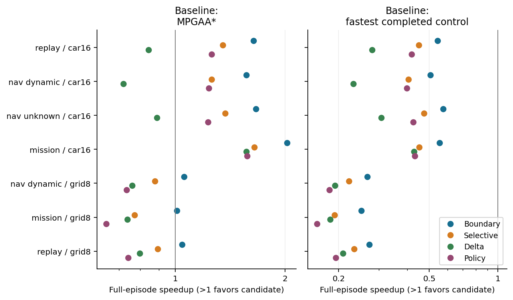
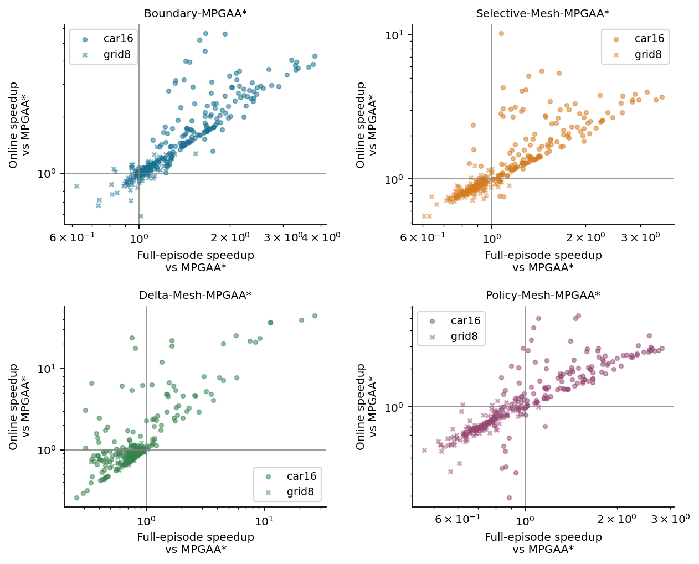
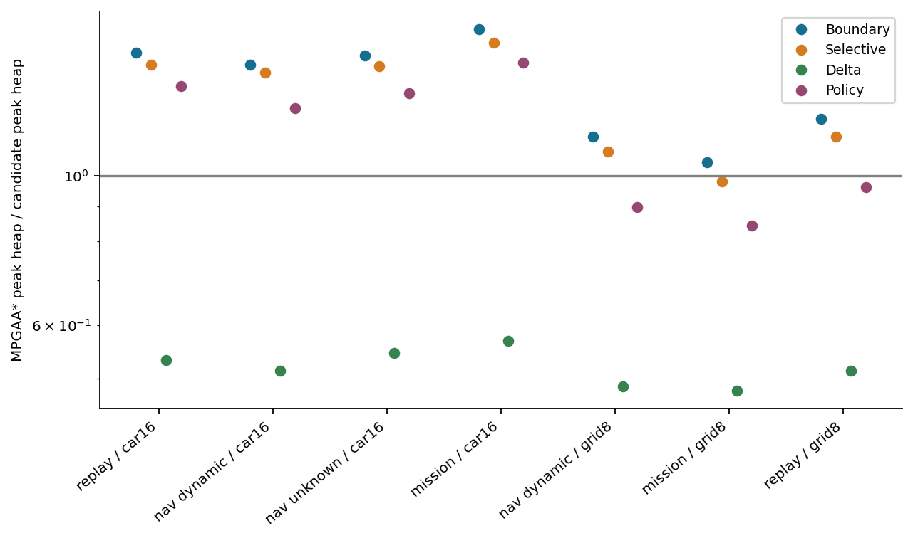

# Результат и границы вывода

Реализованы четыре точных исследовательских варианта MPGAA\*: Boundary, Selective, Delta и Policy. В новой серии выполнено **11,922 временных прогонов**, **3,974 отдельных прогонов памяти**, **429,312 измеренных вызовов** на **378 конфигурациях**. Ни один завершённый ответ не разошёлся с точным контролем более чем на $10^{-6}$. На небольших динамических картах выполнено 6,488 сравнений с независимым Дейкстрой; ASan/UBSan пройдены. Бюджетные остановки сохранены: **9 вызовов**.

Названия обозначают проверяемые инженерные сочетания известных механизмов. Внешний приоритет и литературная новизна здесь не установлены. Исходный MPGAA\* и прежние алгоритмы репозитория не изменены; у четырёх новых методов общий код поиска и обучения. Времена всех контролей измерены заново теми же бинарниками и на той же машине, без подмешивания старых секунд.

Остановленные по лимиту эпизоды в этой серии: MD-A\* — 9 временных повторов. Остальные недостигнутые цели навигации следует отличать от остановки вычисления: корректное доказательство отсутствия пути по текущей карте знаний не является достижением цели.

| Метод | Завершено | Эпизод × | Выигрыш от 10% | Heap × | Только кандидат |
| --- | --- | --- | --- | --- | --- |
| Boundary | 365/378 | 0.37 | 18/365 | 0.54 | 0 |
| Selective | 365/378 | 0.31 | 4/365 | 0.51 | 0 |
| Delta | 365/378 | 0.23 | 0/365 | 0.21 | 0 |
| Policy | 364/378 | 0.27 | 1/364 | 0.45 | 0 |

В этой обзорной таблице baseline — самый быстрый по полному эпизоду **завершившийся** контроль в каждой конфигурации из LBA\*, LBA\* reuse, MPGAA\*, MD-A\*, Boundary-Mesh и, на grid8, Octile A\* reuse. Контроль выбирается после замера, поэтому это описательная огибающая сильных соперников. Отношения агрегированы геометрическим средним по общим завершённым конфигурациям; строки имеют разные допустимые множества. «Heap ×» означает пик контроля / пик кандидата. В replay завершение включает корректный ответ «пути нет»; в миссии означает достижение цели. Доли завершения относятся ко всем конфигурациям кандидата, а не только к парам. «Только кандидат» считает завершённые им конфигурации, в которых не завершился ни один контроль; для них ускорение не вычисляется. Полная разметка, включая обратные случаи, сохранена в completion_vs_controls.csv.

**Универсальное преимущество четырёх вариантов не подтверждено.** Есть проигрыши сильным контролям или незавершённые конфигурации. Ни большое сокращение отдельного счётчика, ни ускорение online-части сами по себе не означают выигрыш полного эпизода. Дальше приведены отдельные модели, нагрузки, карты, полнота и абляции.

На car16 replay Boundary даёт **1.64× по полному эпизоду и 2.09× по ремонту** относительно MPGAA\* на 90/90 конфигурациях. Его пик heap в 1.52 раза меньше. Это полезный результат замены вычисления коллизий и кеша, при сохранённых раскрытиях поиска. У Delta online-отношение 1.69× сочетается с полным отношением 0.84× и пиком heap примерно в 1.87 раза больше MPGAA\*: начальная материализация и подписки меняют практический вывод. На одноклеточном grid8 возможности разделения длинных трасс отсутствуют; результаты этой модели рассмотрены отдельно.

{width=96%}

# Модель и общий инвариант MPGAA\*

Состояние $u=(i,j,\theta)$ — граница примитива. Примитив $p$ имеет исходные положительную стоимость $c(p)$, конечное состояние $v=\operatorname{end}(u,p)$ и упорядоченную трассу клеток. Для car16 сохранены 16 ориентаций, направленные движения и исходные double-стоимости; grid8 имеет одну ориентацию, восемь одноклеточных движений, стоимости $1$ и $\sqrt 2$. Как и в прежней модели grid8, диагональ проверяет конечную клетку и не добавляет нового запрета на срезание углов. Цель фиксирована в течение эпизода.

MPGAA\* хранит обученную нижнюю оценку $h$, один указатель продолжения `next` и кеш допустимости переходов. Исходная оценка $h_0(u)$ — евклидово расстояние до цели. Из условия $c(p)\geq\|u-v\|_2$ следует согласованность $h_0$. До очередного поиска поддерживается

$$0\le h(u)\le d^*(u,t),\qquad h(u)\le c(u,v)+h(v)$$

на допустимых переходах. Добавление препятствия не нарушает допустимость старой оценки. Освобождение может её нарушить: все варианты сначала выявляют вновь разрешённые переходы, снижают затронутые $h(u)$ и распространяют снижения по предшественникам очередью MPGAA\*. Поэтому в результатах отдельно учитываются уведомления и `heuristic_pops`.

A\* заканчивается в цели или в состоянии, у которого существует допустимая tight-цепочка `next` до цели. Её стоимость равна $h(u)$. После решения стоимости $C$ для раскрытых состояний обновляется $h(u)\gets\max(h(u),C-g(u))$. Порядок кандидатов, tie breaking по большему $g$, исходные примитивы и бюджет раскрытий сохранены. На 1 080 динамических снимках Boundary дополнительно совпал с исходным MPGAA\* по числу раскрытий.

# Четыре реализации

## Boundary-MPGAA\*: проверять общий префикс один раз

`MeshIndex` строит отдельное дерево для каждой исходной ориентации. Узел соответствует префиксу **исходной упорядоченной трассы**, содержит относительную клетку, потомков, завершившиеся примитивы и список всех примитивов ветви. Совпадение геометрического смещения без совпадения предыдущих клеток не сливает ветви.

При раскрытии граничного состояния обход дерева проверяет общие клетки один раз и получает маску разрешённых примитивов. Препятствие закрывает все завершения ниже узла. Маска кешируется у материализованного состояния; уведомления по прежним геометрическим группам инвалидируют её после изменений. Поиск остаётся на границах примитивов: промежуточные mesh-узлы не становятся вершинами OPEN.

**Сохранение графа.** Лист или терминал дерева соответствует ровно исходной трассе примитива. Он разрешён тогда и только тогда, когда свободны все её проверяемые клетки. Стоимость перехода и его конечное состояние не меняются; значит, меняется только стоимость вычисления допустимости, а множество путей и их стоимости сохраняются.

**Цена.** Вместо суммы длин всех трасс посещается достигнутая часть дерева. Дополнительная память — маски для материализованных состояний и общий шаблон. При одноклеточных grid8-примитивах почти нет полезного общего префикса; накладные расходы могут преобладать. Пакетная проверка также может затратить работу на примитивы, которые обычный поиск отбросил бы ещё до проверки коллизии.

## Selective-Mesh-MPGAA\*: отсечение до коллизий

Ветвь $q$ содержит множество примитивов $P(q)$. До её проверки вычисляется

$$B(u,q)=\min_{p\in P(q)}\{c(p)+h(\operatorname{end}(u,p))\}.$$

Пусть $U$ — стоимость **допустимого** полного пути. Если $g(u)+B(u,q)>U$, ветвь не может дать улучшение и её клетки не проверяются. В коде применён консервативный запас $8\,\mathrm{EPS}$: ветвь отсекается только при `g + B >= U + 8*EPS`; равные варианты сохраняются. Отсечённая ветвь не записывается как заблокированная: ещё не проверенные флаги остаются неизвестными, а ранее вычисленные коллизионные флаги сохраняются.

Верхнюю границу даёт допустимый суффикс ранее найденного пути либо соединение уже достигнутого префикса с проверенным продолжением MPGAA\*. Индекс клеток пути отслеживает его повреждения. Освобождения не нарушают допустимость этого пути, но могут сделать его неоптимальным; поэтому они сначала ремонтируют $h$, и сохранённый путь используется только как верхняя граница.

**Безопасность отсечения.** Для любого продолжения через $p\in P(q)$ его стоимость не меньше $g(u)+c(p)+h(\operatorname{end}(u,p))\geq g(u)+B(u,q)$. При указанном условии оно хуже существующего допустимого решения. Очередь и сохранённый incumbent обрабатываются вместе; удаление всех неконкурентных кандидатов не превращает допустимый incumbent в ответ «пути нет».

**Цена и абляции.** Нижняя оценка ветви сама требует перебора её концов и чтения $h$. Без верхней границы отсечение не применяется. `selective_no_prune` сохраняет тот же incumbent и ту же структуру поиска, отключая только проверки границ ветвей. `selective_geom` подставляет в $B$ исходную $h_0$, при этом основной A\* по-прежнему использует обученную $h$. Эти два контроля отделяют эффект отсечения от хранения пути и вклад обученных оценок от геометрических.

## Delta-Mesh-MPGAA\*: события действительной допустимости

Для каждого материализованного граничного состояния Delta сохраняет достигнутые узлы дерева. Обратный индекс связывает клетку с парами «состояние, узел». В свободной части дерева регистрируются все достигнутые клетки; первый блокирующий узел также регистрируется и служит **свидетелем** для всех своих потомков. Потомки за этим препятствием пока не подписываются.

При пакете правок сначала обновляется карта, затем из индекса извлекаются затронутые узлы. Изменённый предок поглощает изменённых потомков того же пакета. Только соответствующие поддеревья пересчитываются; старые подписки снимаются, новые регистрируются. Затем прежняя и новая маски сравниваются: в обслуживание MPGAA\* поступают только переходы с изменившейся итоговой допустимостью. Блокировка инвалидирует выбранное продолжение; вновь разрешённый переход может запустить снижение эвристики.

**Полнота уведомлений.** Если разрешённый переход стал запрещённым, новая блокировка лежит в его ранее достигнутом префиксе, значит, имеет подписку. Если запрещённый переход стал разрешённым, прежний первый блокирующий узел обязательно открылся и имеет подписку-свидетель; обход обнаружит новое состояние оставшейся трассы. Правки за остающимся заблокированным свидетелем не меняют допустимость перехода. Для каждого раскрываемого состояния до обучения материализуются **все** исходящие примитивы, включая доминируемые поиском; поэтому вновь разрешённый переход из обученного состояния не теряется. У ещё не материализованного состояния нет обученного $h$ и сохранённого продолжения; при первом обращении оно проверяется по текущей карте.

**Цена.** Выигрыш в доставке уведомлений оплачивается обратным индексом, снятием подписок и пересчётом поддеревьев. Время не равно только числу `validity_flips`: дополнительно просматривается маска каждого затронутого состояния. В реализации массив активности выделен для всего шаблонного дерева каждого материализованного состояния, включая недостигнутые узлы. Поэтому память включает не только действующие подписки. В открытой области длинных примитивов их число тоже может быть большим.

## Policy-Mesh-MPGAA\*: граф оптимальных продолжений

После решения Policy сохраняет у раскрытых состояний и состояний пути несколько разрешённых переходов, удовлетворяющих

$$h(u)=c(u,v)+h(v).$$

Перед раскрытием очередной вершины выполняется DFS по этим альтернативам и текущему `next`, с мемоизацией внутри запроса. При обходе заново проверяются актуальная tight-связь и допустимость перехода по общей mesh-маске. Успешная цепочка устанавливает выбранные указатели `next`; при неуспехе запускается обычное продолжение MPGAA\*. Неуспех DFS **не** доказывает отсутствие пути: сохранённый граф может быть неполным.

**Сертификат оптимальности.** Для найденной цепочки $u_0=s,\ldots,u_k=t$ суммирование tight-равенств даёт

$$\sum_{i=0}^{k-1}c(u_i,u_{i+1})=h(s)-h(t)=h(s).$$

Путь допустим, а $h$ — нижняя оценка; значит, его стоимость оптимальна. Положительные стоимости исключают tight-циклы в точной арифметике. Реализация также явно отслеживает активные состояния DFS и проверяет реконструируемые цепочки на цикл.

Обычный MPGAA\* уже присоединяет поиск к **одному** сохранённому продолжению. Новый механизм здесь — выбор среди нескольких tight-альтернатив до очередного раскрытия. Это ленивый обход сохранённого графа, а не отдельный полностью динамический алгоритм связности. Дополнительные альтернативы и DFS могут стоить дороже нового A\*.

## Основные дополнительные затраты

Пусть $R$ — число материализованных граничных состояний, $d$ — максимальное число исходящих примитивов, $N_T$ — максимальное число узлов шаблонного дерева одной ориентации, $T$ — число достигнутых пар «состояние, узел префикса», $E_P$ — число сохранённых tight-альтернатив. В таблице опущены общие структуры MPGAA\* и неизменный общий шаблон.

| Механизм | Дополнительная память | Дополнительная работа |
| --- | --- | --- |
| Маски Boundary | $O(Rd)$ | Достигнутая часть дерева вместо отдельных трасс |
| Границы Selective | $O(Rd)$ и индекс пути | До $\sum_q \|P(q)\|$ оценок концов при одном обходе |
| Подписки Delta | $O(R(N_T+d)+T)$ | Массив активности, подписки, обход поддеревьев и сравнение масок |
| Альтернативы Policy | $O(Rd+E_P)$ | DFS по достигнутому графу альтернатив с мемоизацией |

Это оценки структуры реализации, а не доказательство ускорения относительно MPGAA\*. Например, сокращение уведомлений Delta может сопровождаться большой ценой хранения подписок, а оценка ветвей Selective — требовать больше обращений к эвристике, чем сэкономлено дешёвых чтений клеток.

# Протокол измерения

| Когорта | Конфигураций | Назначение |
| --- | --- | --- |
| Replay car16 | 90 | Шесть карт; on/off-path, churn, раскрытие, история |
| Replay grid8 | 96 | Четыре карты 50×50; плотности 10–40%, k/cr |
| Прежние миссии | 40 | Движение по неизвестной карте, собственные траектории |
| Навигация с динамикой | 128 | 16 карт × 2 корня × 4 опорные точки |
| Новое раскрытие car16 | 24 | 6 карт × 2 корня × 2 радиуса |

Навигационные точки зафиксированы до замеров кандидатов: `(k, cr) = (2,5), (8,10), (32,20), (64,30)`, `n=k`. Для раскрытия car16 выбраны радиусы 16 и 64. Это четыре опорные точки прежнего стенда, **не полный перебор 36 комбинаций**. Сохранены два исходных корня и замороженные карты, параметры, миры и сенсорные шаблоны. В динамике пакеты содержат блокировки и освобождения с защитой конечных клеток и ограничением доступными пулами; параметры, фактические изменения и зажимы сохраняются нативным стендом. Точные правила находятся в неизменённых `navigation_sweeps/environment.hpp`, `visibility.hpp` и сохранённых контекстах.

В replay всем методам даны одинаковые запросы и правки. В миссиях каждый метод едет по собственному допустимому пути и получает собственные наблюдения; защита текущей клетки также зависит от траектории. Поэтому парное отношение означает время выполнения одной конфигурации симулятора с теми же начальными параметрами, а не причинный эффект на тождественных online-запросах. В частности, меньшее время при меньшей доле достижения цели не считается ускорением успешного решения.

Это серия с перечисленными сильными контролями, а не повторный запуск всех прежних 15 методов. Прежние результаты остаются отдельным артефактом. Связка n = k одновременно меняет частоту глобальных фаз и видимость; их независимые эффекты здесь не разделены.

## Фактический cr новой динамической навигации

| Граф / карта | Запрошено 5% | 10% | 20% | 30% |
| --- | --- | --- | --- | --- |
| car16 / AR0700 | 5.00 | 10.00 | 20.00 | 30.00 |
| car16 / Berlin | 5.00 | 10.00 | 20.00 | 30.00 |
| car16 / MA_maze96 | 4.99 | 10.00 | 13.54\* | 13.54\* |
| car16 / MA_random96 | 4.99 | 10.00 | 20.01 | 20.38\* |
| car16 / MA_room96 | 4.99 | 10.00 | 20.01 | 23.03\* |
| car16 / arena | 5.00 | 10.00 | 19.99 | 28.90\* |
| grid8 / AR0700 | 5.00 | 10.00 | 20.00 | 30.00 |
| grid8 / Berlin | 5.00 | 10.00 | 20.00 | 30.00 |
| grid8 / MA_maze512 | 5.00 | 10.00 | 12.30\* | 12.30\* |
| grid8 / MA_random512 | 5.00 | 10.00 | 20.00 | 20.02\* |
| grid8 / MA_room512 | 5.00 | 10.00 | 20.00 | 23.11\* |
| grid8 / arena | 5.00 | 10.00 | 19.99 | 28.90\* |
| grid8 / random50_p10 | 5.04 | 10.00 | 20.00 | 20.96\* |
| grid8 / random50_p20 | 5.04 | 10.00 | 20.00 | 30.00 |
| grid8 / random50_p30 | 5.04 | 10.00 | 20.00 | 30.00 |
| grid8 / random50_p40 | 5.04 | 10.00 | 20.00 | 30.00 |

Числа — фактический процент всех клеток, меняющих занятость за состоявшуюся фазу. Звёздочка отмечает ограничение доступным пулом. Стороны обмена равны; округление половины пакета тоже может слегка менять процент. При отсутствии фаз доставлено ноль правок, а интенсивность состоявшейся фазы не определена. Это бюджет глобального мира, не число клеток, наблюдённых агентом. Доставленные и наблюдённые количества сохранены отдельно в runs/calls CSV. Таблица относится к новой динамике; старый grid8 replay имеет свой ранее зафиксированный протокол и сюда не подмешан.

Таймер C++ включает применение правок, уведомления, снижение эвристики, поиск, обучение, извлечение и кеширование ответа. Конструктор измерен отдельно и добавлен к полному эпизоду. Online-время исключает первичный запрос и конструктор. Сенсор, контрольный поиск и валидация пути находятся вне таймера. Общие модели компилируются один раз до измерений; их время и, в replay-проходе памяти, совместная heap-стоимость сохранены отдельно. `MeshIndex` использует новую компиляцию трасс; это не бесплатная часть полного холодного запуска системы.

Все методы C++17 собраны `-O3 -DNDEBUG -std=c++17 -Wall -Wextra -Wpedantic`. В каждом случае три повтора, порядок методов перемешан фиксированным RNG; задания выполняются последовательно. Лимит — 1 000 000 раскрытий на запрос, у MD общий на два возможных вызова ядра. Отдельного лимита ремонта эвристики нет. Время отказа и оставшиеся запросы после лимита сохранены, но не включаются как успешные парные решения. Недостижимость в replay — корректный вычисленный ответ; для навигации рядом показывается именно достижение цели.

Машина: **AMD EPYC 9V74 80-Core Processor**; `Linux-6.18.57-x86_64-with-glibc2.41`. Полная среда, affinity, SHA-256 бинарников, входов, исходников, команды и завершения каждого задания находятся в `results/full/experiment.json` и `frozen/manifest.json`. Поиск использует исходные double-стоимости, `EPS=1e-9`; контроль стоимости допускает абсолютное расхождение `1e-6`. Доказательства выше предполагают точную арифметику.

Память измерена отдельным бинарником, учитывающим запрошенные C++ heap-байты; это **не RSS**. Пик включает данные планировщика и результат. Общая модель, стек и метаданные аллокатора исключены. Времена этого прохода не используются. Статусы, пути и счётчики всех его строк сверены с первым временным повтором. Одно раскрытие разных представлений не имеет одинаковой цены; специализированные нулевые счётчики другого метода не означают отсутствие любой работы.

Исправления стенда сохранены отдельно. После первого исправления учёта живой памяти миссии основная временная серия была выполнена заново. Перед проходом памяти обнаружилась вторая ошибка диагностики: построение длинного строкового аргумента require могло увеличить глобальный счётчик раньше вычисления проверяемой разности. Исправление делает снимок счётчика до вызова require и компилируется только при IMA_TRACK_ALLOC. Оба обычных бинарника остались побайтно идентичны уже измеренным; поэтому все 29 завершённых временных заданий сохранены без повторного измерения. Старые манифест, исходник, состояние и прерванный профиль находятся в results/pre_instrument_argument_fix, доказательство идентичности — в allocation_revision манифеста. Исправленный профиль повторён с начала; контрольный пример дал 229 совпавших строк. Ранее прерванные данные в анализ не входят.

| Общий шаблон | Узлов | Компиляция, ms | Живой heap, KiB | Пик heap, KiB |
| --- | --- | --- | --- | --- |
| car16 | 572 | 0.131 | 105.5 | 108.1 |
| grid8 | 9 | 0.003 | 1.8 | 2.4 |

Таблица показывает новый общий MeshIndex; время взято из обычного бинарника, heap — из отдельного инструментированного. Внутренний таймер компиляции трасс не включает начальное выделение контейнеров членов конструктора; полное общее время подготовки стенда сохранено отдельно как shared_preparation_s. Отдельные старые mesh-модели и исходные примитивы в этот heap не входят. В replay метаданные variant_model_heap_\* дополнительно содержат их совместную стоимость с новым MeshIndex.

Сначала берётся медиана трёх повторов внутри конфигурации; затем геометрическое среднее парных отношений. Все ускорения больше единицы выгодны кандидату. 95%-интервалы получены описательным кластерным bootstrap по паре «модель, карта» (3 000 повторов); они не превращают фиксированный набор карт в случайную популяционную выборку. Параметры и корни одной карты зависимы. Рядом всегда приводится число общих завершённых пар.

Медиана относительного MAD времени эпизода внутри конфигураций — **2.27%**, p95 этого показателя — **11.29%**. Поэтому небольшие процентные различия следует оценивать вместе с вариабельностью и составом пар. Частота CPU не фиксировалась; независимых повторных сессий на другой машине нет. Проверенные версии анализа: NumPy 2.3.5, Pandas 2.2.3, Matplotlib 3.10.8.

# Полное время и online-часть

## car16

Baseline **MPGAA\***.

| Когорта | Метод | Эпизод × | 95% интервал | Online × | Пары |
| --- | --- | --- | --- | --- | --- |
| replay | Boundary | 1.64 | [1.49; 1.89] | 2.09 | 90/90 |
| nav / dynamic | Boundary | 1.57 | [1.50; 1.65] | 1.96 | 37/48 |
| nav / unknown | Boundary | 1.66 | [1.54; 1.78] | 1.78 | 24/24 |
| mission | Boundary | 2.02 | [1.67; 2.39] | 2.30 | 15/16 |
| replay | Selective | 1.35 | [1.20; 1.59] | 1.78 | 90/90 |
| nav / dynamic | Selective | 1.26 | [1.17; 1.32] | 1.79 | 37/48 |
| nav / unknown | Selective | 1.37 | [1.28; 1.46] | 2.01 | 24/24 |
| mission | Selective | 1.65 | [1.36; 1.96] | 1.95 | 15/16 |
| replay | Delta | 0.84 | [0.58; 1.55] | 1.69 | 90/90 |
| nav / dynamic | Delta | 0.72 | [0.54; 0.98] | 1.39 | 37/48 |
| nav / unknown | Delta | 0.89 | [0.61; 1.32] | 2.00 | 24/24 |
| mission | Delta | 1.56 | [0.89; 2.59] | 2.45 | 15/16 |
| replay | Policy | 1.26 | [1.13; 1.48] | 1.55 | 90/90 |
| nav / dynamic | Policy | 1.23 | [1.15; 1.32] | 1.92 | 37/48 |
| nav / unknown | Policy | 1.23 | [1.10; 1.37] | 1.27 | 24/24 |
| mission | Policy | 1.57 | [1.28; 1.89] | 1.79 | 15/16 |

Baseline **огибающая сильных контролей** (выбор по полному эпизоду).

| Когорта | Метод | Эпизод × | 95% интервал | Online × | Пары |
| --- | --- | --- | --- | --- | --- |
| replay | Boundary | 0.54 | [0.38; 0.70] | 0.24 | 90/90 |
| nav / dynamic | Boundary | 0.50 | [0.34; 0.67] | 0.10 | 37/38 |
| nav / unknown | Boundary | 0.57 | [0.50; 0.67] | 0.22 | 24/24 |
| mission | Boundary | 0.56 | [0.35; 0.88] | 0.30 | 15/15 |
| replay | Selective | 0.45 | [0.32; 0.58] | 0.21 | 90/90 |
| nav / dynamic | Selective | 0.40 | [0.28; 0.53] | 0.09 | 37/38 |
| nav / unknown | Selective | 0.47 | [0.40; 0.55] | 0.25 | 24/24 |
| mission | Selective | 0.45 | [0.29; 0.71] | 0.25 | 15/15 |
| replay | Delta | 0.28 | [0.26; 0.32] | 0.20 | 90/90 |
| nav / dynamic | Delta | 0.23 | [0.13; 0.39] | 0.07 | 37/38 |
| nav / unknown | Delta | 0.31 | [0.25; 0.38] | 0.25 | 24/24 |
| mission | Delta | 0.43 | [0.38; 0.50] | 0.32 | 15/15 |
| replay | Policy | 0.42 | [0.30; 0.52] | 0.18 | 90/90 |
| nav / dynamic | Policy | 0.40 | [0.29; 0.51] | 0.10 | 37/38 |
| nav / unknown | Policy | 0.43 | [0.38; 0.47] | 0.16 | 24/24 |
| mission | Policy | 0.43 | [0.27; 0.67] | 0.23 | 15/15 |

## grid8

Baseline **MPGAA\***.

| Когорта | Метод | Эпизод × | 95% интервал | Online × | Пары |
| --- | --- | --- | --- | --- | --- |
| nav / dynamic | Boundary | 1.06 | [1.02; 1.10] | 1.04 | 79/80 |
| mission | Boundary | 1.01 | [0.99; 1.03] | 1.01 | 24/24 |
| replay | Boundary | 1.04 | [1.02; 1.06] | 1.02 | 96/96 |
| nav / dynamic | Selective | 0.88 | [0.85; 0.91] | 0.87 | 79/80 |
| mission | Selective | 0.77 | [0.74; 0.79] | 0.76 | 24/24 |
| replay | Selective | 0.89 | [0.88; 0.91] | 0.89 | 96/96 |
| nav / dynamic | Delta | 0.76 | [0.73; 0.80] | 0.83 | 79/80 |
| mission | Delta | 0.74 | [0.72; 0.76] | 0.81 | 24/24 |
| replay | Delta | 0.80 | [0.78; 0.82] | 0.93 | 96/96 |
| nav / dynamic | Policy | 0.73 | [0.71; 0.76] | 0.72 | 78/80 |
| mission | Policy | 0.65 | [0.61; 0.68] | 0.61 | 24/24 |
| replay | Policy | 0.74 | [0.73; 0.76] | 0.76 | 96/96 |

Baseline **огибающая сильных контролей** (выбор по полному эпизоду).

| Когорта | Метод | Эпизод × | 95% интервал | Online × | Пары |
| --- | --- | --- | --- | --- | --- |
| nav / dynamic | Boundary | 0.27 | [0.21; 0.34] | 0.28 | 79/80 |
| mission | Boundary | 0.25 | [0.21; 0.29] | 0.33 | 24/24 |
| replay | Boundary | 0.27 | [0.25; 0.31] | 0.31 | 96/96 |
| nav / dynamic | Selective | 0.22 | [0.17; 0.29] | 0.23 | 79/80 |
| mission | Selective | 0.19 | [0.17; 0.23] | 0.25 | 24/24 |
| replay | Selective | 0.23 | [0.21; 0.27] | 0.27 | 96/96 |
| nav / dynamic | Delta | 0.19 | [0.14; 0.25] | 0.22 | 79/80 |
| mission | Delta | 0.18 | [0.16; 0.21] | 0.26 | 24/24 |
| replay | Delta | 0.21 | [0.19; 0.23] | 0.29 | 96/96 |
| nav / dynamic | Policy | 0.18 | [0.14; 0.23] | 0.19 | 78/80 |
| mission | Policy | 0.16 | [0.14; 0.19] | 0.20 | 24/24 |
| replay | Policy | 0.19 | [0.18; 0.22] | 0.23 | 96/96 |

{width=96%}

# Нагрузки, карты и завершение

{width=96%}

![Динамическая навигация: отдельные карты и модели. Числа — геометрические средние полных отношений к самому быстрому завершившемуся контролю в каждой конфигурации. Цвет обрезан на диапазоне [1/4, 4], числа не обрезаны. Матрица условна на достижении цели обоими методами.](figures/navigation_maps.png){width=96%}

| Карта | Boundary × | Selective × | Delta × | Policy × |
| --- | --- | --- | --- | --- |
| car16 / AR0700 | 0.78 (4/4) | 0.60 (4/4) | 0.41 (4/4) | 0.56 (4/4) |
| car16 / Berlin | 0.60 (5/5) | 0.46 (5/5) | 0.20 (5/5) | 0.46 (5/5) |
| car16 / MA_maze96 | 0.22 (8/8) | 0.19 (8/8) | 0.08 (8/8) | 0.20 (8/8) |
| car16 / MA_random96 | 0.57 (7/7) | 0.46 (7/7) | 0.39 (7/7) | 0.45 (7/7) |
| car16 / MA_room96 | 0.62 (7/7) | 0.53 (7/7) | 0.19 (7/7) | 0.45 (7/7) |
| car16 / arena | 0.67 (6/7) | 0.46 (6/7) | 0.48 (6/7) | 0.52 (6/7) |
| grid8 / AR0700 | 0.50 (7/8) | 0.41 (7/8) | 0.40 (7/8) | 0.31 (6/8) |
| grid8 / Berlin | 0.45 (8/8) | 0.38 (8/8) | 0.35 (8/8) | 0.31 (8/8) |
| grid8 / MA_maze512 | 0.11 (8/8) | 0.09 (8/8) | 0.07 (8/8) | 0.07 (8/8) |
| grid8 / MA_random512 | 0.34 (8/8) | 0.29 (8/8) | 0.23 (8/8) | 0.25 (8/8) |
| grid8 / MA_room512 | 0.19 (8/8) | 0.14 (8/8) | 0.12 (8/8) | 0.12 (8/8) |
| grid8 / arena | 0.21 (8/8) | 0.18 (8/8) | 0.14 (8/8) | 0.14 (8/8) |
| grid8 / random50_p10 | 0.29 (8/8) | 0.25 (8/8) | 0.22 (8/8) | 0.22 (8/8) |
| grid8 / random50_p20 | 0.24 (8/8) | 0.21 (8/8) | 0.18 (8/8) | 0.18 (8/8) |
| grid8 / random50_p30 | 0.31 (8/8) | 0.26 (8/8) | 0.22 (8/8) | 0.21 (8/8) |
| grid8 / random50_p40 | 0.27 (8/8) | 0.24 (8/8) | 0.20 (8/8) | 0.19 (8/8) |

Число пар показано в скобках. В этой таблице максимум восемь конфигураций карты (два корня × четыре точки). Знаменатель парной таблицы может быть меньше восьми, если в конфигурации ни один контроль не достиг цели; такие конфигурации остаются в следующей таблице полноты и в сырых данных.

## Где сохраняется выигрыш на обоих корнях

Далее подсчитаны опорные точки, где выигрыш составляет не меньше 10% на каждом из двух корней. Это описательный фильтр размера эффекта, выбранный для чтения результатов, а не статистический тест или заранее зарегистрированная гипотеза. В ячейке: выигрышные/допустимые точки по полному времени; затем по online-времени. Полное сравнение требует двух достигнутых целей; online дополнительно требует положительного ремонта на обоих корнях. При начальном полном знании динамической карты положительный ремонт означает состоявшиеся изменения. Baseline — выбранный по полному времени самый быстрый завершившийся контроль каждого корня; его online-часть не обязательно минимальна среди контролей.

| Граф / карта | Boundary | Selective | Delta | Policy |
| --- | --- | --- | --- | --- |
| car16 / AR0700 | 0/1; 0/0 | 0/1; 0/0 | 0/1; 0/0 | 0/1; 0/0 |
| car16 / Berlin | 0/2; 0/0 | 0/2; 0/0 | 0/2; 0/0 | 0/2; 0/0 |
| car16 / MA_maze96 | 0/4; 0/4 | 0/4; 0/4 | 0/4; 0/4 | 0/4; 0/4 |
| car16 / MA_random96 | 0/3; 0/1 | 0/3; 0/1 | 0/3; 0/1 | 0/3; 0/1 |
| car16 / MA_room96 | 0/3; 0/1 | 0/3; 0/1 | 0/3; 0/1 | 0/3; 0/1 |
| car16 / arena | 0/2; 0/0 | 0/2; 0/0 | 0/2; 0/0 | 0/2; 0/0 |
| grid8 / AR0700 | 0/3; 0/3 | 0/3; 0/3 | 0/3; 0/3 | 0/3; 0/3 |
| grid8 / Berlin | 0/4; 0/4 | 0/4; 0/4 | 0/4; 0/4 | 0/4; 0/4 |
| grid8 / MA_maze512 | 0/4; 0/4 | 0/4; 0/4 | 0/4; 0/4 | 0/4; 0/4 |
| grid8 / MA_random512 | 0/4; 0/4 | 0/4; 0/4 | 0/4; 0/4 | 0/4; 0/4 |
| grid8 / MA_room512 | 0/4; 0/4 | 0/4; 0/4 | 0/4; 0/4 | 0/4; 0/4 |
| grid8 / arena | 0/4; 0/2 | 0/4; 0/2 | 0/4; 0/2 | 0/4; 0/2 |
| grid8 / random50_p10 | 0/4; 0/2 | 0/4; 0/2 | 0/4; 0/2 | 0/4; 0/2 |
| grid8 / random50_p20 | 0/4; 0/2 | 0/4; 0/2 | 0/4; 0/2 | 0/4; 0/2 |
| grid8 / random50_p30 | 0/4; 0/2 | 0/4; 0/2 | 0/4; 0/2 | 0/4; 0/2 |
| grid8 / random50_p40 | 0/4; 0/3 | 0/4; 0/3 | 0/4; 0/3 | 0/4; 0/3 |

Ни одна измеренная динамическая точка не прошла указанный фильтр выигрыша над огибающей контролей на обоих корнях.

## Replay и прежние миссии по картам

Следующие таблицы сохраняют все карты; в каждой ячейке полное ускорение относительно выбранного самого быстрого завершившегося контроля и число пар. Разные карты и когорты не объединяются в один временной рейтинг. Replay включает корректную недостижимость; миссии требуют достижения цели.

### mission / car16

| Карта | Boundary × | Selective × | Delta × | Policy × |
| --- | --- | --- | --- | --- |
| MA_maze96 | 1.07 (3/3) | 0.89 (3/3) | 0.53 (3/3) | 0.79 (3/3) |
| MA_random96 | 0.51 (4/4) | 0.41 (4/4) | 0.43 (4/4) | 0.42 (4/4) |
| MA_room96 | 0.75 (4/4) | 0.60 (4/4) | 0.42 (4/4) | 0.59 (4/4) |
| arena | 0.27 (4/4) | 0.23 (4/4) | 0.37 (4/4) | 0.20 (4/4) |

### mission / grid8

| Карта | Boundary × | Selective × | Delta × | Policy × |
| --- | --- | --- | --- | --- |
| random50_p10 | 0.20 (6/6) | 0.16 (6/6) | 0.15 (6/6) | 0.14 (6/6) |
| random50_p20 | 0.25 (6/6) | 0.19 (6/6) | 0.20 (6/6) | 0.16 (6/6) |
| random50_p30 | 0.25 (6/6) | 0.19 (6/6) | 0.18 (6/6) | 0.16 (6/6) |
| random50_p40 | 0.31 (6/6) | 0.24 (6/6) | 0.22 (6/6) | 0.20 (6/6) |

### replay / car16

| Карта | Boundary × | Selective × | Delta × | Policy × |
| --- | --- | --- | --- | --- |
| AR0700 | 0.50 (8/8) | 0.40 (8/8) | 0.23 (8/8) | 0.38 (8/8) |
| Berlin | 0.54 (8/8) | 0.42 (8/8) | 0.21 (8/8) | 0.42 (8/8) |
| MA_maze96 | 0.79 (8/8) | 0.63 (8/8) | 0.31 (8/8) | 0.60 (8/8) |
| MA_random96 | 0.46 (27/27) | 0.38 (27/27) | 0.28 (27/27) | 0.37 (27/27) |
| MA_room96 | 0.81 (27/27) | 0.68 (27/27) | 0.27 (27/27) | 0.59 (27/27) |
| arena | 0.39 (8/8) | 0.35 (8/8) | 0.33 (8/8) | 0.33 (8/8) |
| synthetic_open96 | 0.12 (4/4) | 0.11 (4/4) | 0.56 (4/4) | 0.09 (4/4) |

### replay / grid8

| Карта | Boundary × | Selective × | Delta × | Policy × |
| --- | --- | --- | --- | --- |
| random50_p10 | 0.26 (24/24) | 0.22 (24/24) | 0.20 (24/24) | 0.20 (24/24) |
| random50_p20 | 0.33 (24/24) | 0.28 (24/24) | 0.24 (24/24) | 0.22 (24/24) |
| random50_p30 | 0.24 (24/24) | 0.20 (24/24) | 0.18 (24/24) | 0.17 (24/24) |
| random50_p40 | 0.27 (24/24) | 0.24 (24/24) | 0.21 (24/24) | 0.19 (24/24) |

## Раскрытие карты: отдельно радиусы 16 и 64

| Карта car16 | Радиус | Boundary × | Selective × | Delta × | Policy × |
| --- | --- | --- | --- | --- | --- |
| AR0700 | 16 | 0.32 (2/2) | 0.29 (2/2) | 0.27 (2/2) | 0.27 (2/2) |
| AR0700 | 64 | 0.72 (2/2) | 0.59 (2/2) | 0.46 (2/2) | 0.55 (2/2) |
| Berlin | 16 | 0.42 (2/2) | 0.39 (2/2) | 0.22 (2/2) | 0.35 (2/2) |
| Berlin | 64 | 0.77 (2/2) | 0.63 (2/2) | 0.23 (2/2) | 0.53 (2/2) |
| MA_maze96 | 16 | 1.06 (2/2) | 0.82 (2/2) | 0.43 (2/2) | 0.66 (2/2) |
| MA_maze96 | 64 | 0.50 (2/2) | 0.42 (2/2) | 0.12 (2/2) | 0.33 (2/2) |
| MA_random96 | 16 | 0.43 (2/2) | 0.33 (2/2) | 0.40 (2/2) | 0.36 (2/2) |
| MA_random96 | 64 | 0.72 (2/2) | 0.63 (2/2) | 0.40 (2/2) | 0.50 (2/2) |
| MA_room96 | 16 | 0.74 (2/2) | 0.62 (2/2) | 0.40 (2/2) | 0.56 (2/2) |
| MA_room96 | 64 | 0.71 (2/2) | 0.60 (2/2) | 0.19 (2/2) | 0.47 (2/2) |
| arena | 16 | 0.26 (2/2) | 0.22 (2/2) | 0.37 (2/2) | 0.19 (2/2) |
| arena | 64 | 0.78 (2/2) | 0.52 (2/2) | 0.49 (2/2) | 0.63 (2/2) |

Ускорение полного эпизода и пары указаны для каждого радиуса отдельно. Среди контролей здесь нет Octile A\* reuse, который применим только к grid8. Сохраняются собственные траектории и различия полноты; таблица не является сравнением одинаковых запросов.

## Отдельные выигрыши над огибающей контролей

Это полная группировка индивидуальных конфигураций с ускорением полного эпизода минимум 10% относительно самого быстрого завершившегося контроля. Это положительный срез, выбранный по результатам; он не является несмещённой оценкой среднего выигрыша и не требует выигрыша обоих корней. Указаны выигрыши/все общие завершённые конфигурации группы и диапазон отношений только у победителей. Все идентификаторы и выбранные контроли — в strong_control_wins.csv; все проигрыши остаются в paired_cases.csv. Строгий фильтр обоих корней для динамики приведён отдельно выше.

| Когорта / модель | Карта / нагрузка | Метод | Выигрыши/пар | Диапазон × |
| --- | --- | --- | --- | --- |
| mission / car16 | MA_maze96 / unknown_mission | Boundary | 1/3 | 1.10–1.10 |
| nav / dynamic / car16 | MA_room96 / dynamic | Boundary | 1/7 | 1.85–1.85 |
| nav / dynamic / car16 | MA_room96 / dynamic | Policy | 1/7 | 1.17–1.17 |
| nav / dynamic / car16 | MA_room96 / dynamic | Selective | 1/7 | 1.32–1.32 |
| nav / unknown / car16 | MA_maze96 / unknown | Boundary | 1/4 | 1.13–1.13 |
| replay / car16 | AR0700 / churn | Boundary | 1/2 | 1.25–1.25 |
| replay / car16 | Berlin / churn | Boundary | 1/2 | 1.17–1.17 |
| replay / car16 | Berlin / on_path | Boundary | 1/2 | 1.27–1.27 |
| replay / car16 | MA_maze96 / churn | Boundary | 2/2 | 1.22–1.26 |
| replay / car16 | MA_maze96 / on_path | Boundary | 1/2 | 1.31–1.31 |
| replay / car16 | MA_random96 / churn | Boundary | 3/11 | 1.13–1.24 |
| replay / car16 | MA_room96 / churn | Boundary | 6/11 | 1.18–1.44 |
| replay / car16 | MA_room96 / churn | Selective | 3/11 | 1.12–1.19 |

{width=96%}

| Когорта | Модель | Метод | Завершено |
| --- | --- | --- | --- |
| mission | car16 | MPGAA\* | 15/16 |
| mission | car16 | LBA\* reuse | 15/16 |
| mission | car16 | Boundary | 15/16 |
| mission | car16 | Selective | 15/16 |
| mission | car16 | Delta | 15/16 |
| mission | car16 | Policy | 15/16 |
| mission | grid8 | MPGAA\* | 24/24 |
| mission | grid8 | LBA\* reuse | 24/24 |
| mission | grid8 | Boundary | 24/24 |
| mission | grid8 | Selective | 24/24 |
| mission | grid8 | Delta | 24/24 |
| mission | grid8 | Policy | 24/24 |
| nav / dynamic | car16 | MPGAA\* | 37/48 |
| nav / dynamic | car16 | LBA\* reuse | 36/48 |
| nav / dynamic | car16 | Boundary | 37/48 |
| nav / dynamic | car16 | Selective | 37/48 |
| nav / dynamic | car16 | Delta | 37/48 |
| nav / dynamic | car16 | Policy | 37/48 |
| nav / dynamic | grid8 | MPGAA\* | 79/80 |
| nav / dynamic | grid8 | LBA\* reuse | 79/80 |
| nav / dynamic | grid8 | Boundary | 79/80 |
| nav / dynamic | grid8 | Selective | 79/80 |
| nav / dynamic | grid8 | Delta | 79/80 |
| nav / dynamic | grid8 | Policy | 78/80 |
| nav / unknown | car16 | MPGAA\* | 24/24 |
| nav / unknown | car16 | LBA\* reuse | 24/24 |
| nav / unknown | car16 | Boundary | 24/24 |
| nav / unknown | car16 | Selective | 24/24 |
| nav / unknown | car16 | Delta | 24/24 |
| nav / unknown | car16 | Policy | 24/24 |
| replay | car16 | MPGAA\* | 90/90 |
| replay | car16 | LBA\* reuse | 90/90 |
| replay | car16 | Boundary | 90/90 |
| replay | car16 | Selective | 90/90 |
| replay | car16 | Delta | 90/90 |
| replay | car16 | Policy | 90/90 |
| replay | grid8 | MPGAA\* | 96/96 |
| replay | grid8 | LBA\* reuse | 96/96 |
| replay | grid8 | Boundary | 96/96 |
| replay | grid8 | Selective | 96/96 |
| replay | grid8 | Delta | 96/96 |
| replay | grid8 | Policy | 96/96 |

## Длина проезда и число запросов

| Когорта | Модель | Метод | Проезд × | Запросы × | Пары |
| --- | --- | --- | --- | --- | --- |
| nav / dynamic | car16 | Boundary | 1.000 | 1.000 | 37 |
| nav / unknown | car16 | Boundary | 1.000 | 1.000 | 24 |
| mission | car16 | Boundary | 1.000 | 1.000 | 15 |
| nav / dynamic | grid8 | Boundary | 1.000 | 1.000 | 79 |
| mission | grid8 | Boundary | 1.000 | 1.000 | 24 |
| nav / dynamic | car16 | Selective | 1.000 | 1.000 | 37 |
| nav / unknown | car16 | Selective | 1.000 | 1.000 | 24 |
| mission | car16 | Selective | 1.000 | 1.000 | 15 |
| nav / dynamic | grid8 | Selective | 1.000 | 1.000 | 79 |
| mission | grid8 | Selective | 1.000 | 1.000 | 24 |
| nav / dynamic | car16 | Delta | 1.000 | 1.000 | 37 |
| nav / unknown | car16 | Delta | 1.000 | 1.000 | 24 |
| mission | car16 | Delta | 1.000 | 1.000 | 15 |
| nav / dynamic | grid8 | Delta | 1.000 | 1.000 | 79 |
| mission | grid8 | Delta | 1.000 | 1.000 | 24 |
| nav / dynamic | car16 | Policy | 1.000 | 0.998 | 37 |
| nav / unknown | car16 | Policy | 1.000 | 1.000 | 24 |
| mission | car16 | Policy | 1.000 | 0.999 | 15 |
| nav / dynamic | grid8 | Policy | 1.000 | 0.999 | 78 |
| mission | grid8 | Policy | 1.006 | 1.023 | 24 |

Отношения здесь равны проезду или числу запросов MPGAA\* / кандидата, на тех же общих завершённых конфигурациях. Больше единицы означает меньший фактический проезд или меньше обращений к планировщику у кандидата. Эти различия помогают интерпретировать эпизодное время на собственных траекториях; они не являются ускорением одинакового вычислительного запроса.

# Проверка механизмов и абляции

{width=96%}

| Модель | Метод | Mesh-узлы | Отсечения | Смена допуск. | Альтернативы |
| --- | --- | --- | --- | --- | --- |
| car16 | Boundary | 72,439,794 | 0 | 0 | 0 |
| car16 | Selective | 85,262,004 | 189,605 | 0 | 0 |
| car16 | Delta | 85,503,367 | 0 | 816,632 | 0 |
| car16 | Policy | 72,441,558 | 0 | 0 | 165 |
| grid8 | Boundary | 537,112 | 0 | 0 | 0 |
| grid8 | Selective | 520,893 | 109,982 | 0 | 0 |
| grid8 | Delta | 387,762 | 0 | 61,626 | 0 |
| grid8 | Policy | 543,792 | 0 | 0 | 1,433 |

Счётчики подтверждают выполнение механизма, но не заменяют время. `pruned_branches` считает события отсечения с повторениями по раскрытиям; в них могут входить ветви с готовой маской и примитивы, которые отбросило бы сравнение g. Поэтому это не число предотвращённых проверок коллизий. `validity_flips` — смены допустимости материализованных примитивов после целого пакета. `alternate_uses` включает как выбор другого tight-перехода, так и установку отсутствующего next; это не строгое число переключений между двумя ранее выбранными маршрутами. Для других вариантов нулевой специализированный счётчик ожидаем. Delta не является просто фильтром по клеткам: его подписки и снятие поддеревьев полностью входят в таймер и память.

{width=96%}

| Модель | Baseline | Эпизод × | Online × | Пары |
| --- | --- | --- | --- | --- |
| car16 | Boundary | 0.82 | 0.86 | 90 |
| car16 | Selective / no pruning | 1.00 | 0.98 | 90 |
| car16 | Selective / geometric bounds | 0.98 | 0.96 | 90 |
| grid8 | Boundary | 0.86 | 0.87 | 96 |
| grid8 | Selective / no pruning | 0.98 | 0.97 | 96 |
| grid8 | Selective / geometric bounds | 0.97 | 0.96 | 96 |

Изолированный эффект отсечения ветвей невелик: отношение полного времени варианта без отсечения к Selective составляет 1.004 на car16 и 0.976 на grid8. Эти величины нужно рассматривать рядом с вариабельностью повторов; большой выигрыш относительно исходного MPGAA\* нельзя целиком приписать новому отсечению. Хранение incumbent, пакетная маска и обработка коллизий остаются и в контроле без отсечения.

Policy дал **205 дополнительных replay-ответов с нулём раскрытий**, в которых Boundary на том же запросе выполнял раскрытия. Список сохранён в [таблице дополнительных сертификатов](../../cpp/mpgaa_mesh/results/full/analysis/policy_extra_certificates.csv). Этот показатель не равен `policy_hits`: успешный обход графа возможен и после нескольких раскрытий. `backend_calls=1` у Policy означает обращение к общему решателю даже при нуле раскрытий; сокращение раскрытий не выдаётся за отсутствие всей работы.

Хотя replay-запросы совпадают, истории обучения вариантов могут различаться из-за прежних присоединений и пропущенных раскрытий. Число дополнительных сертификатов описывает итоговое поведение Policy, а не выделяет эффект только одного текущего переключения. В checked_cells считаются инструментированные проверки клеток трасс, включая отказ за границей; отдельные служебные проверки начальной и целевой клеток в этот счётчик не входят.

![Фактически переданный пакет blocks+opens и медианная online-задержка на двух картах разных моделей, выбранных для иллюстрации. Первый повтор; объединены четыре k/cr и оба корня. Включены доказанная недостижимость и бюджетные остановки. Пропуски означают отсутствие группы, а не ноль. Методы имеют собственные траектории и наблюдения: это условные описательные группы, а не парные одинаковые запросы или причинный эффект размера пакета. Полные группы всех карт с числами запросов и счётчиками — received_changes.csv.](figures/received_changes.png){width=96%}

# Память и задержки

{width=96%}

| Когорта | Модель | Метод | Медиана MiB | Максимум MiB |
| --- | --- | --- | --- | --- |
| mission | car16 | MPGAA\* | 0.83 | 30.67 |
| mission | car16 | Boundary | 0.61 | 12.15 |
| mission | car16 | Selective | 0.68 | 12.39 |
| mission | car16 | Delta | 1.52 | 73.47 |
| mission | car16 | Policy | 0.66 | 15.51 |
| mission | grid8 | MPGAA\* | 0.16 | 0.27 |
| mission | grid8 | Boundary | 0.15 | 0.27 |
| mission | grid8 | Selective | 0.16 | 0.28 |
| mission | grid8 | Delta | 0.32 | 0.56 |
| mission | grid8 | Policy | 0.19 | 0.34 |
| nav / dynamic | car16 | MPGAA\* | 2.23 | 317.19 |
| nav / dynamic | car16 | Boundary | 1.56 | 176.85 |
| nav / dynamic | car16 | Selective | 1.57 | 187.31 |
| nav / dynamic | car16 | Delta | 3.99 | 1002.79 |
| nav / dynamic | car16 | Policy | 1.77 | 177.33 |
| nav / dynamic | grid8 | MPGAA\* | 1.07 | 20.46 |
| nav / dynamic | grid8 | Boundary | 0.98 | 14.73 |
| nav / dynamic | grid8 | Selective | 1.02 | 14.75 |
| nav / dynamic | grid8 | Delta | 2.30 | 37.10 |
| nav / dynamic | grid8 | Policy | 1.26 | 19.60 |
| nav / unknown | car16 | MPGAA\* | 1.99 | 37.27 |
| nav / unknown | car16 | Boundary | 1.52 | 24.02 |
| nav / unknown | car16 | Selective | 1.58 | 25.25 |
| nav / unknown | car16 | Delta | 3.85 | 110.98 |
| nav / unknown | car16 | Policy | 1.70 | 31.20 |
| replay | car16 | MPGAA\* | 2.23 | 371.18 |
| replay | car16 | Boundary | 1.52 | 221.97 |
| replay | car16 | Selective | 1.57 | 238.13 |
| replay | car16 | Delta | 3.99 | 1142.38 |
| replay | car16 | Policy | 1.71 | 222.12 |
| replay | grid8 | MPGAA\* | 0.18 | 0.73 |
| replay | grid8 | Boundary | 0.16 | 0.50 |
| replay | grid8 | Selective | 0.16 | 0.51 |
| replay | grid8 | Delta | 0.35 | 1.38 |
| replay | grid8 | Policy | 0.20 | 0.54 |

В таблице памяти сохранены все конфигурации, включая незавершённые. Пик учитывает конструктор и вызовы. Живая память результата включена. Сырые retained-значения и память каждого вызова находятся в memory_metrics.csv и отдельном проходе; верхние значения нужно учитывать при выборе Delta даже при хорошем времени.

| Когорта | Модель | Метод | Медиана p95, ms | Макс. p95, ms |
| --- | --- | --- | --- | --- |
| mission | car16 | MPGAA\* | 7.389 | 28.828 |
| mission | car16 | Boundary | 4.235 | 17.274 |
| mission | car16 | Selective | 5.629 | 24.786 |
| mission | car16 | Delta | 7.549 | 39.296 |
| mission | car16 | Policy | 6.256 | 25.356 |
| mission | grid8 | MPGAA\* | 0.064 | 0.114 |
| mission | grid8 | Boundary | 0.061 | 0.102 |
| mission | grid8 | Selective | 0.080 | 0.140 |
| mission | grid8 | Delta | 0.071 | 0.141 |
| mission | grid8 | Policy | 0.066 | 0.146 |
| nav / dynamic | car16 | MPGAA\* | 15.277 | 558.426 |
| nav / dynamic | car16 | Boundary | 6.510 | 337.167 |
| nav / dynamic | car16 | Selective | 6.661 | 354.292 |
| nav / dynamic | car16 | Delta | 15.236 | 769.634 |
| nav / dynamic | car16 | Policy | 6.615 | 316.958 |
| nav / dynamic | grid8 | MPGAA\* | 1.272 | 38.890 |
| nav / dynamic | grid8 | Boundary | 1.051 | 34.799 |
| nav / dynamic | grid8 | Selective | 1.368 | 43.545 |
| nav / dynamic | grid8 | Delta | 1.225 | 53.260 |
| nav / dynamic | grid8 | Policy | 1.856 | 53.108 |
| nav / unknown | car16 | MPGAA\* | 1.701 | 49.566 |
| nav / unknown | car16 | Boundary | 0.724 | 27.296 |
| nav / unknown | car16 | Selective | 0.875 | 36.138 |
| nav / unknown | car16 | Delta | 0.663 | 67.926 |
| nav / unknown | car16 | Policy | 0.789 | 46.304 |
| replay | car16 | MPGAA\* | 3.484 | 281.439 |
| replay | car16 | Boundary | 2.432 | 177.554 |
| replay | car16 | Selective | 3.280 | 300.491 |
| replay | car16 | Delta | 3.852 | 283.981 |
| replay | car16 | Policy | 3.610 | 271.944 |
| replay | grid8 | MPGAA\* | 0.197 | 0.260 |
| replay | grid8 | Boundary | 0.190 | 0.269 |
| replay | grid8 | Selective | 0.235 | 0.315 |
| replay | grid8 | Delta | 0.217 | 0.283 |
| replay | grid8 | Policy | 0.266 | 0.377 |

p95 сначала рассчитан по online-вызовам внутри карты и метода; таблица показывает медиану и максимум этих картовых p95. Это не p95 объединения всех карт. Включены доказанные ответы «пути нет», исключены остановленные по лимиту вызовы; доли таких остановок приведены отдельно. Латентности разных методов навигации относятся к их собственным наблюдениям.

# Проверки и воспроизведение

Совпало **146,512 строк** первого временного повтора с отдельным проходом памяти по статусам, путям, стоимости и инструментированным счётчикам. Нативный стенд проверяет повторяемость трёх временных повторов, каждую возвращённую траекторию по карте знаний и фактически выполняемый примитив по истинному миру. Для replay оптимальные стоимости заморожены заранее; для собственного движения контроль LBA\* вычисляется вне таймера на той же карте знаний. Это две разные проверки: независимый Дейкстра в selfcheck и точный контроль корпуса, а не 429,312 независимых задач.

На всех **2,957 replay-строках первого повтора** Boundary совпал с MPGAA\* по статусу, стоимости, хешу пути, числу раскрытий и извлечений ремонта эвристики. Это подтверждает сохранение работы поиска. Сравнение времени оценивает всю поставленную реализацию: новый общий код также содержит выбор режима Mode и дополнительные обращения к маскам; это не отдельный микробенчмарк одной функции коллизий.

Независимый selfcheck охватывает обе модели, случайные пакеты блокировок и освобождений, возвраты старта, блокировку/открытие цели, недостижимость и восстановление после нулевого лимита. После ответов проверяются согласованность обученной эвристики и совпадение кешированных масок с прямыми трассами. Аудит не материализует зависимости и не может исправить алгоритм перед следующим запросом. Проверки ASan/UBSan выполнены до временного прогона.

Первый неполный проход остановлен после обнаружения ошибки старого mission-стенда: живая heap-память не накапливалась между перепланированиями. Исправлены перенос живой памяти после замены ответа и учёт конструктора. Весь итоговый временной проход начат заново с пересобранными бинарниками; первый проход, его исходники и манифест сохранены в `results/pre_memory_accounting_fix` и не участвуют ни в одной итоговой таблице. Алгоритмический заголовок четырёх вариантов при этом не менялся.

Из корня отдельной копии репозитория:

```bash
make -C cpp/mpgaa_mesh -j2 all
make -C cpp/mpgaa_mesh test
python cpp/mpgaa_mesh/run_all.py \
  --output cpp/mpgaa_mesh/results/reproduction
python cpp/mpgaa_mesh/analyze.py \
  --directory cpp/mpgaa_mesh/results/reproduction
python cpp/mpgaa_mesh/report.py \
  --directory cpp/mpgaa_mesh/results/reproduction
```

Для пересборки таблиц и PDF из сохранённых данных повторять измерения не нужно: последние две команды запускаются с `results/full`. Сеть во время экспериментов не используется. Python-анализ требует NumPy, Pandas и Matplotlib; PDF — Pandoc, XeLaTeX, Noto Serif и Noto Sans Mono. Прежний объединённый отчёт и прежние CSV не изменены.

| Файл | Назначение |
| --- | --- |
| cpp/mpgaa_mesh/algorithms.hpp | Четыре реализации и два режима абляции |
| cpp/mpgaa_mesh/frozen/manifest.json | План, хеши входов и измеряемых исходников |
| cpp/mpgaa_mesh/results/full/experiment.json | Команды, бинарники, завершения и хеши |
| analysis/episode_metrics.csv | Каждый временной повтор и полнота |
| analysis/case_metrics.csv | Медианы времени и отдельная память |
| analysis/paired_cases.csv | Каждое парное отношение и допустимость |
| analysis/map_pairs.csv | Раздельные карты, методы, число пар |
| analysis/statuses.csv | Все статусы, включая лимиты и недостижимость |
| analysis/latency.csv | Картовые p50/p95/p99 online-вызовов |
| analysis/work.csv | Счётчики первого повтора без их размножения |

# Ограничения и дальнейший выбор

Эта серия проверяет конкретную реализацию на сохранённых задачах. Карты фиксированы, control set car16 один; все сеточные коллизии — дешёвые чтения 2D-клетки точечного агента. Переход к реальному контуру, 3D или дорогой проверке коллизии может изменить соотношение накладных расходов и выгоды mesh. Цель не меняется. Холодная компиляция общих шаблонов исключена из эпизодных таймеров и должна добавляться для разового запуска.

Boundary полезен только настолько, насколько общие трассы сокращают реальную работу. Selective нуждается в достаточно ранней верхней границе и должен окупить вычисление минимумов. Delta требует оценки подписок и пиков памяти, а не только числа изменившихся переходов. Policy зависит от наличия нескольких обнаруженных tight-цепочек; единственный узкий коридор или незаполненная эвристика ограничивают пользу. Эти условия — интерпретация механизма; причинные утверждения требуют отдельных контролируемых серий.

Сравнение Boundary с исходным MPGAA\* одновременно меняет совместный обход трасс и представление кеша допустимости. Совпадение поисковых раскрытий изолирует изменение обработки коллизий и кеша в целом, но не разделяет вклад префиксного дерева и упаковки маски. Для такого разделения нужен дополнительный вариант с той же маской, полученной независимыми проверками трасс. Policy и ремонт эвристики выполняют дополнительную работу вне счётчика раскрытий; их расходы следует оценивать по времени и специализированным счётчикам, а не по одному лимиту A\*.

Практическое предпочтение следует выбирать по конкретным карте и нагрузке, одновременно проверяя полное время, достижение цели, online-хвост и память. В отчёте не утверждаются SOTA, литературная новизна или готовность к сильной конференционной подаче. Следующие полезные проверки — другие наборы примитивов, дорогие коллизии, больше независимых карт и реализаций соперников, а также отдельные абляции объёма хранимых альтернатив и обратного индекса.

Исходные ориентиры протокола: Hernández, Asín & Baier, MPGAA\*, AAAI 2015, DOI 10.1609/aaai.v29i1.9355; Koenig & Likhachev, D\* Lite, AAAI 2002; Sturtevant, Moving AI benchmarks. Происхождение официальных карт и их контрольные суммы сохранены в [описании источников](../../cpp/experiments/maps/SOURCES.json); это адаптация постановок, а не воспроизведение опубликованных времён. Сведения о MeshA\* и авторской модели сохранены в исходной документации репозитория.
